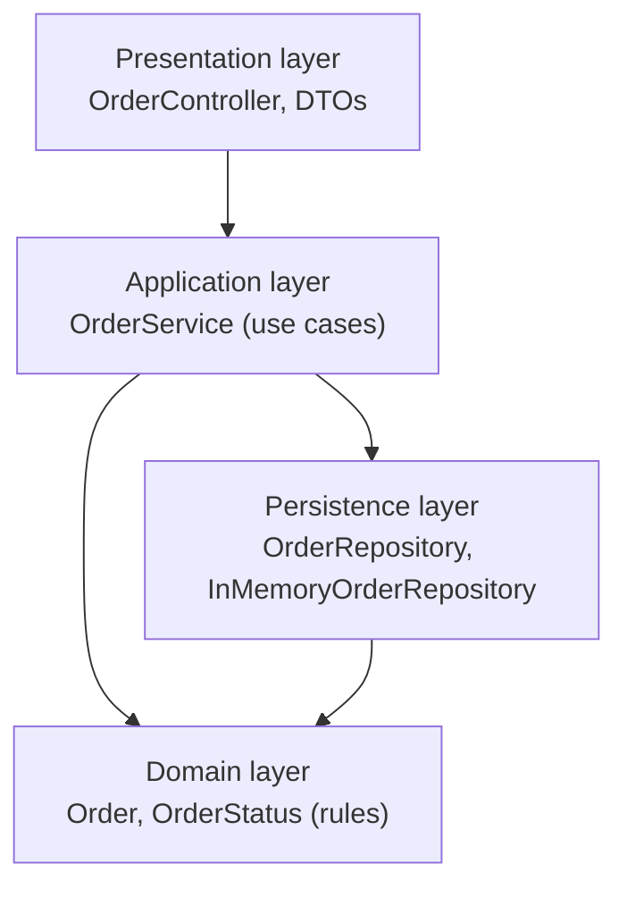
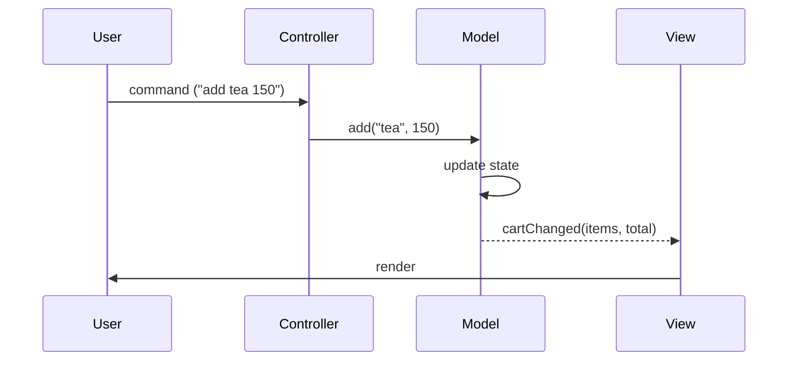
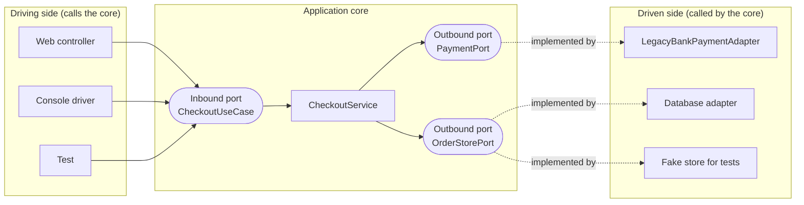
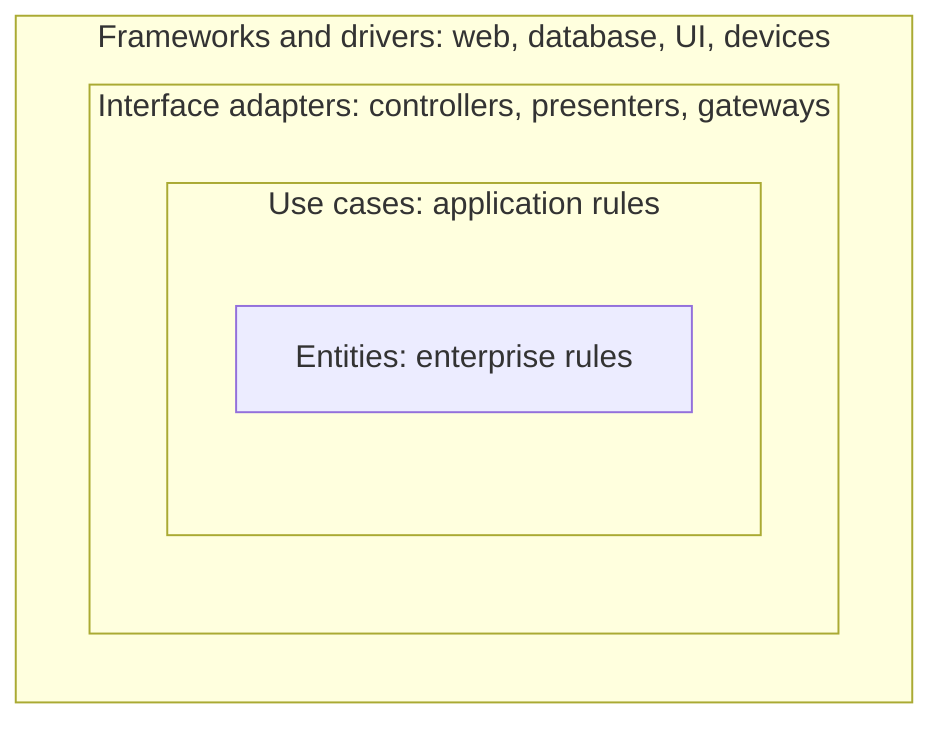

# Architectural Patterns for LLD

An architectural pattern divides a program into parts and states which part may depend on which. This page covers the patterns that an LLD interview and a machine-coding round ask about: layered architecture (controller, service, repository), MVC, hexagonal architecture, clean architecture, the repository pattern, DTOs and mapping, dependency injection, the service layer, and unit of work. It also gives a package layout for a machine-coding round and one paragraph each on CQRS and event sourcing. This page covers code-level architecture inside one program. System-level architecture (CQRS and event sourcing across services, message brokers, microservices) has its home in `kb/hld/fundamentals/16-event-driven-architecture.md`.

## Why It Matters

LLD interviews ask "How do you structure the code?" in the first minutes of a machine-coding round, and evaluators score the package layout, the separation of the layers, and the use of interfaces. Direct questions often follow: "What is the difference between layered and hexagonal architecture?", "Why constructor injection?", "What is a DTO and why not return the entity?". On the job, the same decisions decide whether you can test a service without a database, replace a payment provider without touching business rules, and change the web framework without rewriting the domain. A design that mixes input parsing, business rules, and storage in one class works in a demo and fails at the first change request.

## Core Concepts

**Architecture**: the set of parts of a program and the rules for how the parts depend on each other. A *dependency* exists when the source code of part A names part B (an import, a call, a type). If B changes, A may have to change.

**Layer**: a group of classes with one kind of responsibility. A layer depends on the layers below it, or only on the layer that the rule names.

**Layered architecture**: the code is split into horizontal layers, and a request passes through them from top to bottom. A typical Java split: *presentation* (controllers), *application or service* (use cases), *domain* (entities and rules), *persistence* (repositories).

**Controller**: a class at the edge of the program that receives an input (an HTTP request, a console command), converts it to a call on the service layer, and converts the result to an output. It holds no business rules.

**Service** (application service, service layer): a class that implements one use case by coordinating domain objects and repositories. Fowler (PoEAA) summarizes the *Service Layer* as a layer that "defines an application's boundary with a layer of services that establishes a set of available operations and coordinates the application's response in each operation".

**Domain model**: the classes that represent the business concepts and their rules (`Order`, `Money`, `Seat`). See [domain modeling](05-domain-modeling.md).

**Repository**: an object that looks like an in-memory collection of aggregate roots and hides the storage. The caller calls `findById` and `save`. Fowler (PoEAA) summarizes it as an object that "mediates between the domain and data mapping layers using a collection-like interface for accessing domain objects".

**DTO** (data transfer object): a plain object that carries data across a boundary, for example between the controller and the service, or between two processes. It has fields and no business behavior.

**Mapper**: code that converts one object type into another, for example `Order` to `OrderResponse`.

**Dependency injection** (DI): a technique in which a class receives the objects that it needs from outside, and does not create them. See [SOLID](02-solid.md) for the difference between DI and the Dependency Inversion Principle.

**Composition root**: the one place in the program (usually `main`) that creates the concrete objects and connects them. All other classes depend on interfaces.

**Port**: an interface that the application core owns. It states what the core offers (*driving* or *inbound* port) or what the core needs (*driven* or *outbound* port).

**Adapter**: a class that connects a technology to a port. A *driving adapter* (a controller, a console command, a test) calls an inbound port. A *driven adapter* (a database class, an HTTP client) implements an outbound port.

**Dependency rule** (clean architecture): "source code dependencies can only point inwards" (R. C. Martin). Inner circles (entities, use cases) know nothing about outer circles (web, database, frameworks).

**Unit of work**: an object that tracks the changes of one business operation and writes them together, so that the operation succeeds or fails as a whole.

### Pattern Summary

| Pattern | Problem it solves | Main rule |
|---|---|---|
| Layered | Mixed input handling, rules, and storage | Each layer has one responsibility and depends on the layer below |
| MVC | UI code mixed with state and rules | Model holds state. View renders it. Controller translates input |
| Hexagonal | Business logic tied to a database or a framework | The core owns ports. Adapters implement them |
| Clean | Same as hexagonal, with a named layering of the core | Dependencies point inward only |
| Repository | Storage code spread through business code | Collection-like interface for each aggregate root |
| DTO and mapper | Entities leak across a boundary | Separate objects for the boundary, with explicit mapping |
| Dependency injection | Hard-wired dependencies that no test can replace | A class receives its collaborators through its constructor |
| Service layer | Use-case logic in controllers | One method for each use case, with the transaction boundary |
| Unit of work | A partial update after an error | Collect the changes, then commit together |

## How It Works

### Layered architecture (controller, service, repository)

**Intent**: separate the concerns of a program into layers, so that each layer has one reason to change.

**Problem**: the wrong form puts everything in one class. The demo below has an `OrderController` that checks the business rule (`quantity > 0`), builds a storage row, stores it in a map, and returns the internal map to the caller. A change of storage, a second input channel (a console and a web API), or a unit test of the rule each needs a change in this one class. The caller can also change stored state through the returned map.

```java
import java.util.*;

class WrongLayersDemo {
    public static void main(String[] args) {
        OrderController controller = new OrderController();
        System.out.println(controller.create("c-1", "sku-1", 2));
        System.out.println(controller.create("c-1", "sku-1", 0));
        // The controller returns the stored entity, so the caller can change stored state.
        Map<String, Object> entity = controller.find("o-1");
        entity.put("status", "HACKED");
        System.out.println(controller.find("o-1").get("status"));
    }
}

// Wrong form: one class does HTTP-like input, business rules, and storage, and it leaks
// the internal map to the caller.
class OrderController {
    private final Map<String, Map<String, Object>> table = new HashMap<>();

    String create(String customerId, String sku, int quantity) {
        if (quantity <= 0) {                                   // business rule in the controller
            return "400 quantity must be positive";
        }
        Map<String, Object> row = new HashMap<>();             // storage detail in the controller
        row.put("id", "o-" + (table.size() + 1));
        row.put("customer", customerId);
        row.put("status", "NEW");
        table.put((String) row.get("id"), row);
        return "201 " + row.get("id");
    }

    Map<String, Object> find(String id) {
        return table.get(id);                                  // internal state leaves the class
    }
}
```

<!-- expected-output -->

```text
201 o-1
400 quantity must be positive
HACKED
```

The last output line shows the problem: the caller changed the stored status to `HACKED` through the returned map.

**Structure**



**Right form.** Each layer has one job:

| Layer | Class | Job | Does not do |
|---|---|---|---|
| Presentation | `OrderController` | Reads the request DTO. Calls the service. Maps an exception to an error code. Returns a response DTO | Business rules, storage |
| Application | `OrderService` | One method for each use case. Loads and saves through the repository. Maps entity to DTO. Marks the transaction boundary | Input parsing, SQL |
| Domain | `Order` | State and rules (`quantity > 0`, legal status changes) | Any I/O |
| Persistence | `InMemoryOrderRepository` | Stores and loads aggregates | Business rules |

```java
import java.util.*;

class LayeredDemo {
    public static void main(String[] args) {
        // Composition root: the only place that knows all concrete classes.
        OrderRepository repository = new InMemoryOrderRepository();
        OrderService service = new OrderService(repository);
        OrderController controller = new OrderController(service);

        System.out.println(controller.post(new CreateOrderRequest("c-1", "sku-1", 2)));
        System.out.println(controller.post(new CreateOrderRequest("c-1", "sku-1", 0)));
        System.out.println(controller.get("o-1"));
        System.out.println(controller.get("o-9"));
    }
}

// ---- Presentation layer: translates between the outside format and the service ----
record CreateOrderRequest(String customerId, String sku, int quantity) {}

record OrderResponse(String id, String status, long totalCents) {}

class OrderController {
    private final OrderService service;

    OrderController(OrderService service) {
        this.service = service;
    }

    String post(CreateOrderRequest request) {
        try {
            OrderResponse response = service.placeOrder(request);
            return "201 " + response;
        } catch (IllegalArgumentException e) {
            return "400 " + e.getMessage();
        }
    }

    String get(String id) {
        return service.find(id).map(r -> "200 " + r).orElse("404 order " + id + " not found");
    }
}

// ---- Application layer: use cases, one transaction boundary per method ----
class OrderService {
    private static final Map<String, Long> PRICE_CENTS = Map.of("sku-1", 1_250L);
    private final OrderRepository repository;

    OrderService(OrderRepository repository) {
        this.repository = repository;
    }

    OrderResponse placeOrder(CreateOrderRequest request) {
        Long unitPrice = PRICE_CENTS.get(request.sku());
        if (unitPrice == null) {                           // a use-case check: the product exists
            throw new IllegalArgumentException("unknown sku " + request.sku());
        }
        Order order = Order.create(repository.nextId(), request.customerId(),
                request.quantity(), unitPrice);          // the domain object checks the rules
        repository.save(order);
        return toResponse(order);                          // mapping: entity to DTO
    }

    Optional<OrderResponse> find(String id) {
        return repository.findById(id).map(OrderService::toResponse);
    }

    private static OrderResponse toResponse(Order order) {
        return new OrderResponse(order.id(), order.status().name(), order.totalCents());
    }
}

// ---- Domain layer: entities and rules. It depends on no other layer ----
enum OrderStatus { NEW, PAID, CANCELLED }

final class Order {
    private final String id;
    private final String customerId;
    private final int quantity;
    private final long unitPriceCents;
    private OrderStatus status = OrderStatus.NEW;

    private Order(String id, String customerId, int quantity, long unitPriceCents) {
        this.id = id;
        this.customerId = customerId;
        this.quantity = quantity;
        this.unitPriceCents = unitPriceCents;
    }

    static Order create(String id, String customerId, int quantity, long unitPriceCents) {
        if (quantity <= 0) {
            throw new IllegalArgumentException("quantity must be positive");
        }
        return new Order(id, customerId, quantity, unitPriceCents);
    }

    String id() { return id; }
    OrderStatus status() { return status; }
    long totalCents() { return quantity * unitPriceCents; }
}

// ---- Persistence layer: the interface belongs to the layer above, the class to this one ----
interface OrderRepository {
    String nextId();
    void save(Order order);
    Optional<Order> findById(String id);
}

class InMemoryOrderRepository implements OrderRepository {
    private final Map<String, Order> orders = new LinkedHashMap<>();
    private int sequence = 0;

    @Override
    public String nextId() {
        return "o-" + (++sequence);
    }

    @Override
    public void save(Order order) {
        orders.put(order.id(), order);
    }

    @Override
    public Optional<Order> findById(String id) {
        return Optional.ofNullable(orders.get(id));
    }
}
```

<!-- expected-output -->

```text
201 OrderResponse[id=o-1, status=NEW, totalCents=2500]
400 quantity must be positive
200 OrderResponse[id=o-1, status=NEW, totalCents=2500]
404 order o-9 not found
```

Points in this code:

- The controller catches `IllegalArgumentException` from the domain and returns `400`. The rule lives in `Order.create`, not in the controller.
- The controller never sees an `Order`. It sees `CreateOrderRequest` and `OrderResponse` only.
- The service depends on the `OrderRepository` interface. The composition root in `main` is the only place that names `InMemoryOrderRepository`.
- The `OrderRepository` interface is a type that the service uses, and the implementation belongs to the persistence layer. When the service layer owns the interface, this is the dependency inversion variant of layering. See [hexagonal architecture](#hexagonal-architecture-ports-and-adapters).

**Strict and relaxed layering.** In *strict* layering a layer calls only the layer directly below it. In *relaxed* layering a layer may call any layer below it. A controller that calls a repository directly skips the service layer. Recommendation: allow no such skip in an interview design, because the skip moves the use-case logic to the controller.

**When to use**

- A CRUD-style application with a clear request-response flow.
- A machine-coding round, where the evaluator expects visible separation of layers.

**When not to use**

- A small script or a single-purpose function. Four layers around 20 lines of logic are over-engineering.
- A domain with rich rules, where the layered style often turns into an *anemic domain model*: services hold all logic and entities hold only fields. See [anti-patterns](11-anti-patterns.md).

**Typical flaws**

- The domain layer imports from the persistence layer (for example, a JPA annotation or a repository class in an entity method). The dependency points the wrong way.
- Every layer has its own copy of the same data class with the same fields, and the mappers do no work. Merge them, or skip the layer where it adds nothing.
- Leaking: the controller returns the entity, which exposes internal fields and ties the output format to the storage model.

### MVC (Model-View-Controller)

**Intent**: separate the state and rules of an application (the model) from its display (the view) and from the handling of user input (the controller). Trygve Reenskaug created the pattern in 1978 and 1979 while he was a visiting scientist at Xerox PARC, working on Smalltalk. His two original reports are dated 12 May 1979 ("Thing-Model-View-Editor") and 10 December 1979 ("Models-Views-Controllers"). Fowler's catalog (PoEAA) describes the same idea as the *Model View Controller* pattern.

**Problem**: a class that holds the state, prints it, and parses the input cannot change its display or its input channel without a change to the rules, and nobody can test the rules without the display.

**Structure**



| Part | Responsibility | Knows about |
|---|---|---|
| Model | State and business rules. Notifies listeners when the state changes | Nothing about the view or the controller (only a listener interface) |
| View | Renders the model. Sends no commands to the model | The model's read interface |
| Controller | Translates one input into a call on the model | The model, and the command format |

The demo is a console shopping cart. The model fires a `CartListener` event on each change (this is the Observer pattern, see [behavioral patterns](08-behavioral-patterns.md)). The view implements the listener and prints. The controller parses the text and calls the model. The model has no `System.out` call, and a test can register a listener that records the calls.

```java
import java.util.*;

class MvcDemo {
    public static void main(String[] args) {
        CartModel model = new CartModel();
        ConsoleCartView view = new ConsoleCartView();
        model.addListener(view);                 // the model knows only the listener interface
        CartController controller = new CartController(model);

        controller.handle("add tea 150");
        controller.handle("add cake 320");
        controller.handle("remove tea");
        controller.handle("remove pizza");
        controller.handle("dance");
    }
}

// Model: the state and the rules. No output code, no input parsing.
interface CartListener {
    void cartChanged(Map<String, Long> items, long totalCents);
}

class CartModel {
    private final Map<String, Long> centsByItem = new TreeMap<>();
    private final List<CartListener> listeners = new ArrayList<>();

    void addListener(CartListener listener) {
        listeners.add(listener);
    }

    void add(String item, long cents) {
        centsByItem.put(item, cents);
        fire();
    }

    void remove(String item) {
        if (centsByItem.remove(item) == null) {
            throw new NoSuchElementException("no item " + item);
        }
        fire();
    }

    private void fire() {
        long total = centsByItem.values().stream().mapToLong(Long::longValue).sum();
        for (CartListener listener : listeners) {
            listener.cartChanged(Collections.unmodifiableMap(centsByItem), total);
        }
    }
}

// View: renders the model. No business rules.
class ConsoleCartView implements CartListener {
    @Override
    public void cartChanged(Map<String, Long> items, long totalCents) {
        System.out.println("cart " + items + " total " + totalCents);
    }
}

// Controller: reads one command, calls the model, picks the reaction.
class CartController {
    private final CartModel model;

    CartController(CartModel model) {
        this.model = model;
    }

    void handle(String command) {
        String[] parts = command.split(" ");
        try {
            switch (parts[0]) {
                case "add" -> model.add(parts[1], Long.parseLong(parts[2]));
                case "remove" -> model.remove(parts[1]);
                default -> System.out.println("error: unknown command " + parts[0]);
            }
        } catch (NoSuchElementException e) {
            System.out.println("error: " + e.getMessage());
        }
    }
}
```

<!-- expected-output -->

```text
cart {tea=150} total 150
cart {cake=320, tea=150} total 470
cart {cake=320} total 320
error: no item pizza
error: unknown command dance
```

**Variants.** The names differ between frameworks, and the interview answer should state which variant you mean.

| Variant | Difference |
|---|---|
| Classic MVC (Smalltalk) | The view observes the model directly |
| Web MVC (Spring MVC, a request-response framework) | The controller receives the HTTP request, calls a service, puts data in a model object, and selects a view. The view does not observe the model, because the response is a single render |
| MVP (Model-View-Presenter) | The presenter handles the input and updates the view. Fowler describes two forms. In *Passive View*, the view has no reference to the model, and the presenter sets every view field. In *Supervising Controller*, the view binds simple fields to the model itself, and the presenter handles the complex logic |
| MVVM (Model-View-ViewModel) | A view model exposes state and commands for one view. A data-binding framework keeps the view and the view model in step, so no code copies values between them |

**When to use**: any program with a user interface, and any LLD problem that has a display (a game board, an ATM screen, an elevator panel).

**When not to use**: a batch job or a library with no display. For a small UI with one screen, a full MVC split is more structure than the program needs.

**Typical flaws**: business rules in the controller (the controller becomes a god object); a view that calls the repository; a model that prints.

### Hexagonal architecture (ports and adapters)

**Intent**: Alistair Cockburn (2005) states the intent as: allow an application to be driven equally by users, programs, automated tests, or batch scripts, and to be developed and tested in isolation from its run-time devices and databases.

**Problem**: in a layered design where the service calls a concrete `PaymentClient` and a concrete database class, the business logic depends on technology. A test needs the real technology, and a change of provider changes the core.

**Structure**: the application core is at the center. It has *ports*, which are interfaces that the core owns. *Adapters* outside the core connect each port to a technology.



A driving adapter calls an inbound port of the core. The core calls a driven adapter through an outbound port that the core defines. In the source code, each adapter depends on a port, and the core depends on no adapter. The complete runnable code is in [Java Example](#java-example).

Rules:

1. The core has no import from an adapter, a framework, or a driver.
2. The core defines the ports in the language of the domain (`PaymentPort.charge`), not in the language of the technology (`HttpClient.post`).
3. Each adapter translates: types, units, errors. It holds no business rules. The Adapter pattern in [structural patterns](07-structural-patterns.md) is the structural form of a driven adapter.
4. One composition root connects the adapters to the ports.

**Layered or hexagonal?** Layered architecture orders the code by technical role and often lets the domain depend on the persistence layer. Hexagonal architecture orders the code by the direction of the dependency, and places the technology on the outside. A layered design with the repository interface in the service layer (as in the demo above) has one driven port, so it is a step toward hexagonal architecture. It becomes fully hexagonal when every external system (payment, notification) also sits behind a port that the core owns, and the input channels call the core through an inbound port.

**When to use**

- Several input channels (web, console, a message queue) call the same use cases.
- You expect to replace an external system (a payment provider, a notification channel).
- You want fast unit tests with fakes.

**When not to use**: a small CRUD service, where each port has one implementation and the adapter only forwards the call. The extra interfaces cost more than they return.

### Clean architecture and the dependency rule

**Intent**: Robert C. Martin (2012) combines several similar architectures (hexagonal, onion, and others) in one layering. The central statement is the *Dependency Rule*: source code dependencies can only point inwards.



| Circle (outside to inside) | Content | Java example |
|---|---|---|
| Frameworks and drivers | The web framework, the database driver, the UI toolkit | Spring MVC, JDBC, a JSON library |
| Interface adapters | Convert data between the use cases and the outside | Controllers, repository implementations, presenters |
| Use cases | Application-specific rules. One class for each use case | `PlaceOrder`, `CancelBooking` |
| Entities | Rules that hold for the whole business | `Order`, `Money`, `Seat` |

How an inner circle calls an outer one: with *dependency inversion*. The use case needs to save an order, so it defines the interface `OrderStorePort`. The outer circle implements it. At run time the call goes outward. In the source code the arrow points inward. Data that crosses a circle boundary is a simple structure (a DTO or a record), not an entity of the outer circle.

How to enforce the rule: put each layer in its own Maven or Gradle module, or in a Java module (JPMS), so that the build rejects a wrong import. A test library such as ArchUnit also checks package dependencies in a unit test. In a machine-coding round, packages and a comment on the rule are enough.

**Hexagonal and clean**: both put the business rules at the center and the technology outside. Hexagonal has two zones (the core and the adapters) and names the ports. Clean architecture divides the core into entities and use cases and names the data that crosses each boundary. In an interview, treat them as the same idea at two levels of detail.

**When not to use**: when the domain rules are few. The cost is more classes: a request and a response model for each boundary, and a mapper between them.

### Repository pattern

**Intent**: give the domain a collection-like interface to the stored aggregates, and hide how and where they are stored.

**Problem**: if the service uses SQL, a map, or a JPA `EntityManager` directly, every use case repeats the storage code and cannot run without the database.

**Right form**: define the interface in the language of the domain, with a method for each question the domain asks.

```java
record SeatId(String value) {}
record ShowId(String value) {}
record Seat(SeatId id, ShowId showId, boolean free) {}

interface SeatRepository {
    Optional<Seat> findById(SeatId id);
    List<Seat> findFreeForShow(ShowId showId);
    void save(Seat seat);
}
```

The repository returns and accepts domain objects. It has one repository for each *aggregate root* (see [domain modeling](05-domain-modeling.md)), not one for each table. An in-memory implementation (a `Map`) serves the unit tests and the machine-coding round. A database implementation serves production.

| Repository | DAO (data access object) |
|---|---|
| Speaks the domain language (`findFreeForShow`) | Speaks the storage language (`selectByColumn`) |
| One for each aggregate root | One for each table |
| Looks like a collection | Looks like a table gateway |
| Owned by the domain | Owned by the persistence layer |

The two terms overlap in practice, and many projects use them as synonyms. In an interview, name the difference and say which one you mean.

**When not to use**: do not write a generic `Repository<T>` with `findAll`, `save`, `delete` for every entity and stop there. A repository that offers methods the domain never calls invites queries from everywhere. Define the methods that the use cases need.

**Concurrency note**: an in-memory repository used by several threads needs a thread-safe map and atomic updates. See [concurrency in LLD](09-concurrency-in-lld.md).

### DTO and mapping

**Intent**: carry data across a boundary in an object that has the shape that the boundary needs, so that the internal model stays hidden and free to change. Fowler's catalog summarizes a DTO as "an object that carries data between processes in order to reduce the number of method calls". In an LLD design, the same object also keeps the internal model apart from the boundary.

**Problem**: the controller from the wrong form returns the entity. The output now contains every internal field, so a new internal field (a password hash, a cost price) leaks into the response. A change to the entity breaks every client. And the caller can reach internal state.

**Right form**: define a request DTO and a response DTO. A Java `record` fits: it is immutable and has no boilerplate. The service maps between the entity and the DTO. The layered demo above shows both records and the `toResponse` mapper.

| Question | Answer |
|---|---|
| Where does the mapping run? | In the service (application layer) or in a mapper class beside the controller. Not inside the entity, because the entity must not know the DTO |
| One DTO for all use cases? | No. A create request and an update request have different required fields. Use one DTO for each use case |
| Hand-written or generated mappers? | Hand-written for few fields. A mapping library (for example MapStruct) when there are many types. State the choice |
| Does the DTO validate? | It checks format (not null, length). The domain checks business rules (`quantity > 0` for this product) |
| Do DTOs have behavior? | No. Fields only. Use a `record` |

**Cost**: more classes and a mapper for each pair. Use a DTO at a boundary that changes at a different speed from the model: the public API, a message, a module border. Inside one module with no such pressure, a copy adds code and no benefit.

**Typical flaws**: a DTO that is the entity with a new name; a mapper that holds business rules; a DTO with a public mutable `List` field.

### Dependency injection

**Intent**: a class receives its collaborators from outside. This lets the composition root choose the implementation, and lets a test pass a fake.

**Problem**: in the wrong form the class creates its own dependency with `new`. The class is fixed to one implementation, a test cannot replace it, and the class hides what it needs.

```java
import java.util.*;

class DiDemo {
    public static void main(String[] args) {
        // Wrong form: the class creates its own dependency. A test sends a real message.
        System.out.println(new HardWiredReminder().remind("ann@example.com"));

        // Right form: the caller passes the dependency. A test passes a fake.
        List<String> sent = new ArrayList<>();
        MessageSender fake = (to, text) -> sent.add(to + ": " + text);
        new Reminder(fake).remind("ann@example.com");
        System.out.println("fake captured " + sent);

        // The composition root picks the real class once.
        Reminder production = new Reminder(new ConsoleSender());
        production.remind("bob@example.com");
    }
}

interface MessageSender {
    void send(String to, String text);
}

class ConsoleSender implements MessageSender {
    @Override
    public void send(String to, String text) {
        System.out.println("SEND to " + to + ": " + text);
    }
}

class HardWiredReminder {
    private final ConsoleSender sender = new ConsoleSender();   // fixed to one class

    String remind(String to) {
        sender.send(to, "Payment due");                           // cannot be replaced in a test
        return "reminded " + to;
    }
}

// Constructor injection: the dependency is required, final, and visible in the signature.
class Reminder {
    private final MessageSender sender;

    Reminder(MessageSender sender) {
        this.sender = Objects.requireNonNull(sender);
    }

    void remind(String to) {
        sender.send(to, "Payment due");
    }
}
```

<!-- expected-output -->

```text
SEND to ann@example.com: Payment due
reminded ann@example.com
fake captured [ann@example.com: Payment due]
SEND to bob@example.com: Payment due
```

The wrong form `HardWiredReminder` always sends through `ConsoleSender`, so a test of `remind` prints a real message. The right form `Reminder` takes a `MessageSender` in its constructor. The test passes a lambda that records the call. The composition root in `main` selects `ConsoleSender` once.

**Forms of injection**

| Form | How | Verdict |
|---|---|---|
| Constructor injection | The dependency is a constructor parameter, stored in a `final` field | Default choice. The object is complete after construction. The fields are `final`. The dependencies are visible in the signature. The class cannot exist without them. The Spring reference documentation states: "The Spring team generally advocates constructor injection, as it lets you implement application components as immutable objects and ensures that required dependencies are not `null`." |
| Setter injection | A setter receives the dependency after construction | For optional dependencies that have a reasonable default value (the Spring documentation gives the same rule). The object can be in a partial state |
| Field injection | A framework writes into a private field through reflection (`@Autowired` on a field) | Avoid. Reasons below |
| Method parameter injection | The dependency is a parameter of one method (for example a `Clock` in `process(Clock clock)`) | Good when the dependency varies per call |

**Why not field injection.** The following block shows it with Spring annotations. It does not compile here, because the Spring types are not in the JDK.

<!-- fragment -->

```java
@Service
class OrderService {
    @Autowired
    private OrderRepository repository;     // hidden dependency, not final, set by reflection
    @Autowired
    private PaymentGateway payment;
}
```

1. A test cannot create the object with `new OrderService(fake, fake)`. It needs the framework, or reflection, to fill the fields.
2. The fields cannot be `final`, so the object can be used before injection and can be changed afterwards.
3. The dependencies do not appear in the constructor, so a class can collect ten dependencies without any visible warning. A constructor with ten parameters shows the problem (too many responsibilities).
4. The class depends on the framework annotation and cannot work without the container.

The constructor form of the same class:

```java
interface OrderRepository {}
interface PaymentGateway {}

class OrderService {
    private final OrderRepository repository;
    private final PaymentGateway payment;

    OrderService(OrderRepository repository, PaymentGateway payment) {
        this.repository = repository;
        this.payment = payment;
    }
}
```

**DI is not a framework.** The `main` method in the demos wires the objects by hand ("pure DI"). A container (Spring, Guice, Dagger, Jakarta CDI) does the same wiring from configuration. In a machine-coding round, wire by hand in `main` and do not import a framework, since a framework is often not allowed. Do not use a *service locator* (a global registry that a class asks for its dependencies): it hides the dependencies again. See [anti-patterns](11-anti-patterns.md).

**Dependency injection and dependency inversion.** The Dependency Inversion Principle says that high-level code depends on an abstraction that it owns. DI is a technique that supplies the implementation. You can do one without the other. See [SOLID](02-solid.md).

**Related**: DI replaces most uses of Singleton and factories. See [creational patterns](06-creational-patterns.md).

### Service layer

**Intent**: define the boundary of the application and its set of operations in one layer. Each method is one use case. The service coordinates domain objects and repositories and marks the transaction boundary.

**What goes where**

| Logic | Place | Example |
|---|---|---|
| A rule about one entity | The entity | `order.cancel()` checks that the status is `NEW` |
| A rule about several entities of one aggregate | The aggregate root | `show.holdSeats(seatIds)` |
| A flow that touches several aggregates or an external system | The service | `placeOrder`: load the cart, charge the payment, save the order |
| Input format and error codes | The controller | HTTP status, JSON parsing |
| Storage | The repository | SQL, map access |

**Anemic and rich domain.** If the service holds all rules and the entities hold only getters and setters, the model is *anemic* (Fowler calls it an anti-pattern). Move each rule that belongs to one entity into that entity. The service then only coordinates. See [anti-patterns](11-anti-patterns.md).

**Typical flaws**: a `GodService` with 40 methods (split by use case); a service that parses HTTP input; a service that returns entities; a service method with no clear use-case name (`process`, `handle`).

### Unit of work

**Intent**: track the changes that one business operation makes, and write them together, so that a failure writes none of them. Fowler's catalog summarizes it as an object that "maintains a list of objects affected by a business transaction and coordinates the writing out of changes and the resolution of concurrency problems".

**Problem**: a use case changes an order, the stock, and a loyalty balance. If the code saves each object right after it changes and the second save fails, the first change stays and the data is inconsistent.

The demo collects the changes and applies them in one `commit` after a validation. A failed commit leaves the store unchanged.

```java
import java.util.*;

class UnitOfWorkDemo {
    public static void main(String[] args) {
        Map<String, Long> database = new HashMap<>(Map.of("a", 100L, "b", 50L));

        UnitOfWork ok = new UnitOfWork(database);
        ok.put("a", 70L);
        ok.put("b", 80L);
        System.out.println("before commit: " + new TreeMap<>(database));
        ok.commit();
        System.out.println("after commit: " + new TreeMap<>(database));

        UnitOfWork failing = new UnitOfWork(database);
        failing.put("a", 0L);
        failing.put("c", -1L);      // invalid value: the commit rejects the whole unit
        try {
            failing.commit();
        } catch (IllegalStateException e) {
            System.out.println("rolled back: " + e.getMessage());
        }
        System.out.println("after failed commit: " + new TreeMap<>(database));
    }
}

// Unit of Work: collects the changes of one business operation and applies them together.
class UnitOfWork {
    private final Map<String, Long> store;
    private final Map<String, Long> pending = new LinkedHashMap<>();

    UnitOfWork(Map<String, Long> store) {
        this.store = store;
    }

    void put(String key, long value) {
        pending.put(key, value);
    }

    void commit() {
        for (Map.Entry<String, Long> change : pending.entrySet()) {
            if (change.getValue() < 0) {
                throw new IllegalStateException("negative value for " + change.getKey());
            }
        }
        store.putAll(pending);      // all changes become visible after the checks pass
        pending.clear();
    }
}
```

<!-- expected-output -->

```text
before commit: {a=100, b=50}
after commit: {a=70, b=80}
rolled back: negative value for c
after failed commit: {a=70, b=80}
```

In real programs the unit of work is rarely hand-written. A database transaction is a unit of work: JDBC `commit` and `rollback`, a JPA `EntityManager` (its persistence context tracks changes and writes them at flush time), or the Spring `@Transactional` annotation on a service method. In an in-memory machine-coding design, the same idea is "validate everything first, then apply all changes", or a copy of the state that replaces the original after success. Mention it in one sentence, and show it only if the problem has a multi-object update (a transfer, an order with stock).

### Package layout for a machine-coding round

Two common layouts. Recommendation: use *package by layer* when the evaluator expects visible layers, and *package by feature* when the program has several independent features.

**Package by layer**

```text
com.example.booking
├── Main.java                  driver and composition root
├── controller/
│   └── BookingController.java
├── service/
│   ├── BookingService.java
│   ├── BookingRepository.java port (interface), owned by the service layer
│   └── PaymentGateway.java    port (interface), owned by the service layer
├── domain/
│   ├── Booking.java
│   ├── Seat.java
│   ├── SeatStatus.java
│   └── exception/
│       └── SeatUnavailableException.java
├── repository/
│   └── InMemoryBookingRepository.java implements service.BookingRepository
├── dto/
│   ├── BookSeatRequest.java
│   └── BookingResponse.java
└── strategy/                  pricing, allocation: one interface, several classes
```

**Package by feature (with ports and adapters inside)**

```text
com.example.booking
├── Main.java
├── booking/
│   ├── domain/                Booking, Seat
│   ├── application/           BookingService, ports
│   └── adapter/               in-memory repository, console driver
└── payment/
    ├── domain/
    ├── application/
    └── adapter/
```

Rules for either layout:

1. `domain` imports nothing from the other packages.
2. The interface lives with its user. `BookingRepository` lives in `service`, next to `BookingService`. The implementation lives in the persistence package (`repository`). Many projects put the interface in `repository`, beside its implementation. That form also compiles, and tests can still use a fake, but then `service` imports `repository`, and the persistence package owns the abstraction. State which form you use and why.
3. `Main` is the only class that calls `new` on implementations (the composition root).
4. Exceptions for domain errors live in `domain`. The controller maps them to messages.
5. One top-level class for each file. A class name is a noun for a thing, and a verb phrase for a use case (`PlaceOrder`).
6. Tests mirror the package structure and use fakes.

In a single-file interview submission, keep the same separation with top-level classes and comments that name the layer.

### CQRS and event sourcing in brief

**CQRS** (Command Query Responsibility Segregation): the program uses one model to change state (commands) and a separate model to read state (queries). The command side enforces the rules. The query side is shaped for the screens or the reports and can be a denormalized copy. Fowler warns: "For some situations, this separation can be valuable, but beware that for most systems CQRS adds risky complexity." At the code level, you meet a small form of the idea when a service has `placeOrder` (a command that returns nothing or an id) and a separate `OrderQueryService` that returns read-only DTOs.

**Event sourcing**: the program stores the sequence of events that changed an entity (`SeatHeld`, `SeatBooked`, `SeatReleased`) and not the current state. The current state is the result of replaying the events. It gives a complete history and an audit trail, and a replay can rebuild any past state. The cost is a more complex model, event versioning, and slow replay unless the program stores snapshots.

Both patterns need system-level treatment (a message broker, eventual consistency, event stores). Their home is `kb/hld/fundamentals/16-event-driven-architecture.md`. In an LLD round, name them only if the problem asks for history or separate read models, and otherwise do not use them.

## Trade-offs and When to Use

| Pattern | Benefit | Cost | Use it when | Skip it when |
|---|---|---|---|---|
| Layered | Familiar, easy to explain, clear place for each kind of code | Can become anemic. Layers of pass-through methods | CRUD-like services. Machine-coding rounds | A tiny program |
| MVC | Separates display from state | Notification plumbing. Variants differ by framework | A program with a UI or a display | No display |
| Hexagonal | Test with fakes. Replace technology | More interfaces and adapters | Several input channels. Replaceable external systems | One implementation per port, no tests with fakes |
| Clean | Strict dependency rule. Use cases are explicit | The most classes. Mappers at each boundary | A long-lived domain with many rules | A small or short-lived program |
| Repository | Storage hidden. Fast tests | One more interface | Any program that stores aggregates | A script |
| DTO and mapper | Stable boundary. No leak | Copy code. More classes | Public API, messages, module borders | Inside one module with no change pressure |
| Constructor DI | Testable. Clear dependencies | A composition root, or a container | Required dependencies of every service class | An optional dependency with a default (use a setter) |
| Service layer | One place for use cases and transactions | A `GodService` if not split | Flows over several aggregates | A single entity operation |
| Unit of work | Atomic multi-object change | A hand-written one is rare. Use the transaction of the store | Multi-object updates | Single-object updates |
| CQRS | Separate read and write models | Two models to keep in step | Very different read and write shapes | Almost every LLD problem |
| Event sourcing | History and replay | Complexity | An audit trail is a requirement | Plain state is enough |

Recommendation for a 45-minute round: use a layered package layout with interfaces for repositories and external systems, constructor injection wired in `main`, and DTOs only at the controller boundary. Say "this is a hexagonal core with one driven port for each external system" if the interviewer asks for the name. Do not add CQRS, event sourcing, or a framework unless the problem needs them.

## Java Example

The example is a checkout use case in a hexagonal layout: a core (`CheckoutService`) with one driving port (`CheckoutUseCase`) and two driven ports (`PaymentPort`, `OrderStorePort`). Adapters: a fake order store (the test double), a legacy bank client behind `LegacyBankPaymentAdapter`, and a console driver. The first part of `main` tests the use case with lambda fakes and no technology. The second part wires the production adapter by hand. The core does not import any adapter. All dependency arrows point at the ports.

```java
import java.util.*;

class HexagonalDemo {
    public static void main(String[] args) {
        // Test with fakes: no database, no network.
        FakeOrderStore store = new FakeOrderStore();
        CheckoutService withFakeGateway = new CheckoutService(store, (id, cents) -> true);
        System.out.println(withFakeGateway.checkout("c-1", 2599));
        CheckoutService declined = new CheckoutService(store, (id, cents) -> false);
        System.out.println(declined.checkout("c-2", 100));
        System.out.println("stored: " + store.saved);

        // Production wiring: swap the adapters. The use case does not change.
        CheckoutUseCase app = new CheckoutService(new FakeOrderStore(),
                new LegacyBankPaymentAdapter(new LegacyBankClient()));
        System.out.println(new ConsoleDriver(app).run("c-3 4000"));
    }
}

// ---- Domain core: no framework, no I/O ----
record PlacedOrder(String customerId, long amountCents, boolean paid) {}

// Driving port (inbound): what the outside world can ask the application to do.
interface CheckoutUseCase {
    String checkout(String customerId, long amountCents);
}

// Driven ports (outbound): what the application needs from the outside world.
interface PaymentPort {
    boolean charge(String customerId, long amountCents);
}

interface OrderStorePort {
    void save(PlacedOrder order);
}

// The use case implements the driving port and calls the driven ports.
class CheckoutService implements CheckoutUseCase {
    private final OrderStorePort store;
    private final PaymentPort payment;

    CheckoutService(OrderStorePort store, PaymentPort payment) {
        this.store = store;
        this.payment = payment;
    }

    @Override
    public String checkout(String customerId, long amountCents) {
        if (!payment.charge(customerId, amountCents)) {
            return "DECLINED";
        }
        store.save(new PlacedOrder(customerId, amountCents, true));
        return "PLACED";
    }
}

// ---- Adapters: translate between a technology and a port ----
class FakeOrderStore implements OrderStorePort {
    final List<PlacedOrder> saved = new ArrayList<>();

    @Override
    public void save(PlacedOrder order) {
        saved.add(order);
    }
}

// Driven adapter for a legacy library with a different interface.
class LegacyBankClient {
    String submit(String account, double dollars) {
        return dollars > 0 ? "OK-" + account : "ERR";
    }
}

class LegacyBankPaymentAdapter implements PaymentPort {
    private final LegacyBankClient bank;

    LegacyBankPaymentAdapter(LegacyBankClient bank) {
        this.bank = bank;
    }

    @Override
    public boolean charge(String customerId, long amountCents) {
        // The legacy API takes dollars as a double. The adapter converts at this one edge.
        // The core keeps money as long cents, because a double cannot hold most cent values
        // exactly.
        return bank.submit(customerId, amountCents / 100.0).startsWith("OK-");
    }
}

// Driving adapter: turns text input into a call on the driving port.
class ConsoleDriver {
    private final CheckoutUseCase useCase;

    ConsoleDriver(CheckoutUseCase useCase) {
        this.useCase = useCase;
    }

    String run(String line) {
        String[] parts = line.split(" ");
        return useCase.checkout(parts[0], Long.parseLong(parts[1]));
    }
}
```

The expected output is:

<!-- expected-output -->

```text
PLACED
DECLINED
stored: [PlacedOrder[customerId=c-1, amountCents=2599, paid=true]]
PLACED
```

What the example shows:

- `CheckoutService` is tested with a lambda for the payment port. No database and no network are needed.
- Replacing the payment provider changes one adapter class and the wiring in `main`. The core stays the same.
- `ConsoleDriver` is a driving adapter. A web controller would call `CheckoutUseCase` in the same way.
- `LegacyBankPaymentAdapter` applies the Adapter pattern to a legacy library with a different interface (dollars as `double`, string results). See [structural patterns](07-structural-patterns.md).

## Interview Angle

### Questions

??? question "Explain layered architecture. What does each layer do, and what does it not do?"

    Layered architecture splits the code by responsibility, and a request passes from the top layer to the bottom one. In a typical Java service: the **controller** converts the input to a call and the result to an output, and holds no business rule. The **service** implements one use case, coordinates entities and repositories, and marks the transaction boundary. The **domain** holds the entities and their rules. The **repository** stores and loads the aggregates and hides the storage.

    The rule is that a layer depends on the layer below, and that no layer takes the work of another: no SQL in the service, no business rule in the controller, no HTTP in the domain. The benefit is that I can test the service with a fake repository and change the storage without a change in the service. The risk is an anemic domain, where the service holds all the logic and the entities hold fields.

??? question "What is the difference between layered, hexagonal, and clean architecture?"

    All three separate the business logic from the technology. Layered architecture orders code by technical role (controller, service, repository) and usually lets each layer call the one below, so the domain often depends on persistence. Hexagonal architecture (Cockburn) puts the application core in the center, and the core owns the ports (interfaces). Adapters for the web, the database, and external services implement or call the ports, so the technology depends on the core. Clean architecture (Martin) is the same idea with named rings, entities then use cases then interface adapters then frameworks, and a single rule: source code dependencies point inwards.

    In practice: a layered design where the repository interface belongs to the service layer already has one driven port, so it is a step toward hexagonal. It is fully hexagonal when every external system sits behind a port that the core owns. The deciding question is the direction of the dependency between the business logic and the technology.

??? question "What is the dependency rule, and how do you apply it when the use case needs to save data?"

    The rule says that source code dependencies point inwards only: an inner circle never names a class of an outer circle. When the use case needs to save an order, it would depend outward on the database. I apply dependency inversion: the use case defines an interface (`OrderStorePort`) in its own package, in the language of the domain. The persistence adapter in the outer circle implements that interface. At run time the call goes outward, but in the source code the arrow points inward. The composition root connects the two. I check the rule with module boundaries or an ArchUnit test, and a quick check is that the domain package has no import from the adapter packages.

??? question "Why constructor injection, and not field injection?"

    Constructor injection makes the object complete when it exists. The fields are `final`, the dependencies are visible in the constructor signature, and a test can create the class with `new` and pass fakes with no framework. A constructor with many parameters shows that the class has too many responsibilities. Field injection (`@Autowired` on a private field) hides the dependencies, needs reflection or the container to fill the fields, allows the object to be used before injection, and cannot use `final`. The Spring reference documentation states that the Spring team "generally advocates constructor injection", because it gives immutable components and required dependencies that are not `null`. I use setter injection only for an optional dependency that has a default.

??? question "What is the difference between dependency injection and dependency inversion?"

    Dependency inversion is a design principle (the D in SOLID): high-level code and low-level code both depend on an abstraction, and the high-level code owns the abstraction. Dependency injection is a technique: something outside the class creates the dependency and passes it in. DI supplies the implementation at run time. You can inject a concrete class (DI without inversion), and you can invert a dependency and create the implementation with `new` in a factory (inversion without DI). Good designs use both: the class depends on an interface that it owns, and the composition root injects the implementation.

??? question "What is the repository pattern? How does it differ from a DAO?"

    A repository gives the domain a collection-like interface to the aggregate roots: `findById`, `save`, and queries named in the domain language (`findFreeForShow`). It hides where and how the objects are stored. There is one repository for each aggregate root. A DAO is a data access object that wraps access to one table or source and speaks the storage language. The two overlap and many teams use the words as synonyms. The deciding point is the viewpoint: a repository belongs to the domain and looks like a collection, and a DAO belongs to the persistence layer and looks like a table gateway. For tests and machine-coding rounds I write an in-memory repository behind the interface.

??? question "Why use DTOs? Why not return the entity from the controller?"

    The entity is the internal model. If the controller returns it, every internal field leaks, a change to the entity breaks the clients, the output format is tied to the storage model, and the caller may reach mutable internal state. A DTO has exactly the fields that the boundary needs and can change at its own speed. In Java a `record` is a good DTO: immutable, with no boilerplate. The service maps entity to DTO. The cost is more classes and mappers, so I use DTOs at the controller boundary, in messages, and at module borders, and not between two classes in the same module with no reason.

??? question "A requirement says: support a web API and a console client for the same booking logic. How do you structure it?"

    I put the booking logic in an application service that implements an inbound port (`BookingUseCase`) with methods such as `book(BookSeatCommand)`. The web controller and the console driver are two driving adapters. Each parses its own input format, calls the same port, and formats the result in its own way. The service depends on outbound ports (`SeatRepository`, `PaymentPort`), and the composition root selects the adapters. No business rule lives in either driver, so the second client costs one adapter class, and the logic has one set of tests.

??? question "Where do business rules belong: the controller, the service, or the entity?"

    A rule about one entity goes into that entity (`order.cancel()` checks the status). A rule over several entities of one aggregate goes into the aggregate root. A flow that crosses aggregates or calls an external system goes into the service, which only coordinates. The controller holds input format and error mapping, and no rule. If the service has all the rules and the entities have only getters and setters, the model is anemic. A test for the placement: can I test the rule without the framework, the database, and the controller? If yes, the placement is good.

??? question "What is a unit of work, and where do you meet it in Java?"

    A unit of work tracks the changes that one business operation makes and writes them together. A failure writes none of them, so the data stays consistent. In Java, the database transaction is the usual form: JDBC `commit` and `rollback`, a JPA `EntityManager` whose persistence context tracks the changes and writes them at flush, or `@Transactional` on a service method. For an in-memory design, I validate all the changes first and apply them after the validation passes, or I work on a copy and swap it in on success.

### Follow-up Questions

??? question "Where do you put the transaction boundary?"

    On the service method that implements the use case, because one use case is one business operation that must succeed or fail as a whole. Not on the controller (it handles the input format) and not on the repository (one repository call is too small a unit: the operation can touch several repositories).

??? question "Where does validation happen: DTO, service, or domain?"

    Three levels. The DTO or the controller validates format: required fields, length, parse errors. The service validates the use case: the customer exists, the product is available. The domain validates invariants: `quantity > 0`, a legal status change. The domain check is the last guard and cannot be skipped by a new entry point.

??? question "Your `Main` has 15 `new` calls for wiring. Is that a problem?"

    It is the composition root, and its job is to know all the concrete classes. A long wiring block is not an error. If the block grows unmanageable, group the wiring in factory methods for each module, or use a DI container. The error would be `new` calls for implementations inside business classes.

??? question "Is hexagonal architecture over-engineering for a coding round?"

    It can be. I use the minimum: interfaces for the repository and for each external system (payment, notification), constructor injection, and the wiring in `main`. This is the hexagonal core with ports, without the extra module structure. I add more only when the problem has several input channels or provider replacement.

??? question "How does MVC differ in a web framework from the original MVC?"

    In the original Smalltalk form the view observes the model and updates itself. In web MVC (Spring MVC), one request produces one response: the controller receives the request, calls a service, puts the result in a model object, and selects a view that renders it. The view does not observe the model. The names stay the same and the interaction differs, which is why I state the variant in an answer.

### Red Flags

- Putting business rules in the controller, or SQL in the service.
- Returning entities from the controller and calling that a "response".
- Using field injection and saying "the framework handles it", with no reason.
- Creating implementations with `new` inside a service class.
- A generic `Repository<T>` with `findAll` and `delete` as the whole design, with no methods in the domain language.
- Importing a framework (Spring, Hibernate) in a machine-coding round that does not allow it, or in the domain package.
- Four layers where each method only forwards the call to the next layer.
- Confusing dependency injection with dependency inversion, or saying that a DI container is required for DI.
- Claiming that hexagonal, clean, and onion architecture differ in an essential way, with no statement of the common rule.
- Using CQRS or event sourcing for a simple booking system, with no requirement.
- An `Order` class with only getters and setters, and a 40-method `OrderService`.
- Saying "I use the Singleton for the service" instead of one instance created in `main`.

## Common Mistakes

| Mistake | Why it hurts | Fix |
|---|---|---|
| Business rule in the controller | The rule is repeated for each new entry point and is hard to test | Move the rule to the entity or the service. The controller maps input and errors only |
| The controller calls the repository directly | The use-case logic moves to the controller. No transaction boundary | Call the service. Allow no layer skip |
| Entity returned from the controller | Leaks fields. Couples clients to storage | Return a response DTO (`record`) |
| Domain imports persistence or framework classes | The dependency points outward. The domain needs the database to run | Define a port in the domain. Implement it in an adapter |
| `new` of an implementation inside a service | The service cannot be tested with a fake | Inject the interface through the constructor |
| Field injection | Hidden dependencies. Objects exist in a partial state | Constructor injection with `final` fields |
| Repository per table | The domain sees storage structure. Invariants of an aggregate spread over repositories | One repository for each aggregate root |
| Generic CRUD repository only | Invites queries from every layer | Add domain-named methods. Hide unused ones |
| One DTO for create and update | Fields are optional for one case and required for the other. Validation is unclear | One DTO for each use case |
| Mapper that holds business rules | Rules in two places | Keep mappers to field copy and conversion |
| Anemic domain with a God service | Rules spread through the service. The entity can be put in an invalid state | Move each rule into the entity that owns the state |
| Layers for their own sake | Pass-through methods in each layer. More code, no benefit | Merge or drop a layer that has no responsibility |
| Interface for every class | No second implementation, so the interface adds only noise | Add an interface at a boundary: storage, an external system, or a strategy |
| Service locator instead of DI | Dependencies are hidden. Tests must set up a global registry | Pass dependencies through the constructor |
| Partial update with no unit of work | An error between two saves leaves inconsistent data | Validate first and apply together, or use a transaction |
| CQRS or event sourcing added without a requirement | Two models and an event store for a simple problem | Use one model. Mention the pattern as an extension |

## Commonly Confused With

| Looks like | Difference | Deciding question |
|---|---|---|
| Layered vs hexagonal | Layered orders code by role and often lets the domain depend on persistence. Hexagonal puts the core in the center and technology outside, connected through ports | Does the business logic depend on the technology, or the other way round? |
| Hexagonal vs clean | The same dependency idea. Hexagonal names ports and adapters. Clean names four rings and the data that crosses each boundary | Do I need to describe the layers inside the core? |
| MVC vs layered | MVC separates display, state, and input in the UI part. Layered separates the whole program by responsibility. A web application usually has MVC in its presentation layer | Is the question about the user interface, or about the whole program? |
| Repository vs DAO | A repository looks like a collection of aggregates and speaks the domain language. A DAO wraps one table and speaks the storage language | Does the interface name a domain question or a table operation? |
| DTO vs entity | An entity has identity and rules. A DTO carries data across a boundary and has no behavior | Does the object have behavior that protects an invariant? |
| DTO vs value object | A value object is a domain concept with equality by value and rules (`Money`). A DTO is a transport shape | Is the type part of the domain model? |
| Service layer vs domain service | The service layer coordinates use cases and holds no rules of its own. A domain service holds a domain rule that fits no single entity | Is this a rule of the business, or a coordination step? |
| Dependency injection vs service locator | DI pushes the dependencies in. A locator makes the class pull them from a registry | Does the class ask a global object for its dependencies? |
| Dependency injection vs dependency inversion | DI is a technique to supply a dependency. Inversion is a principle about who owns the abstraction | Am I talking about wiring, or about the direction of the source dependency? |
| Unit of work vs transaction | A transaction is the database mechanism. A unit of work is the pattern that tracks the changes and writes them in one transaction | Does the object track the changes, or only commit them? |
| CQRS vs event sourcing | CQRS splits the read and write models. Event sourcing stores the events as the source of truth. They are independent. Systems often use them together | Do I split the models, or change how the state is stored? |

## Quick Reference Card

| Topic | Rule to remember |
|---|---|
| Layers | Controller (input and output), service (use case), domain (rules), repository (storage). No layer skip |
| MVC | Model: state and rules. View: render. Controller: input to call. The model has no output code |
| Hexagonal | The core owns the ports. Adapters implement or call them. The core imports no adapter |
| Clean | Dependencies point inward only. Cross a boundary with simple data |
| Repository | Collection-like, in domain language, one for each aggregate root. In-memory version for tests |
| DTO | A `record` at the boundary. The service maps. One DTO for each use case |
| DI | Constructor injection. `final` fields. Wire by hand in `main` |
| Service layer | One method for each use case. Coordinates. Marks the transaction |
| Unit of work | Collect changes. Commit together. Often the database transaction |
| CQRS and event sourcing | Name them. Do not use them without a requirement. Home: `kb/hld/fundamentals/16-event-driven-architecture.md` |

Package layout for a round:

```text
Main.java          composition root (the only place with `new` of implementations)
controller/        input, output, error mapping
service/           use cases, and the ports (interfaces) they need, repositories included
domain/            entities, value objects, enums, exceptions. Imports nothing else
repository/        in-memory implementations of the repository ports
dto/               request and response records
strategy/          one interface, several classes, when a rule varies
```

Sentences to say in the round:

- "The service depends on the repository interface. `Main` wires the in-memory implementation."
- "The controller maps input and errors. The rules are in the domain."
- "I use DTOs at the boundary so the entity does not leak."
- "If I add a database, only the repository implementation changes."

## Further Reading

- Fowler. *Patterns of Enterprise Application Architecture*. Addison-Wesley, 2002. The source for Repository, Service Layer, Data Transfer Object, Unit of Work, and Model View Controller.
- [Fowler: Repository](https://martinfowler.com/eaaCatalog/repository.html). The definition of the pattern as a collection-like interface to the domain.
- [Fowler: Data Transfer Object](https://martinfowler.com/eaaCatalog/dataTransferObject.html). The purpose of a DTO and when it pays off.
- [Fowler: Unit of Work](https://martinfowler.com/eaaCatalog/unitOfWork.html). The definition of tracking changes and writing them together.
- [Fowler: Service Layer](https://martinfowler.com/eaaCatalog/serviceLayer.html). The application boundary and its operations.
- [Fowler: Model View Controller](https://martinfowler.com/eaaCatalog/modelViewController.html). A short description of the pattern.
- [Fowler: Presentation Domain Data Layering](https://martinfowler.com/bliki/PresentationDomainDataLayering.html). The three-layer split of an application.
- [Fowler: Anemic Domain Model](https://martinfowler.com/bliki/AnemicDomainModel.html). The risk of a layered design with no behavior in the entities.
- [Fowler: CQRS](https://martinfowler.com/bliki/CQRS.html). The pattern and the warning that most systems do not need it.
- [Fowler: Event Sourcing](https://martinfowler.com/eaaDev/EventSourcing.html). The pattern, its benefits, and its costs.
- [Cockburn: Hexagonal architecture](https://alistair.cockburn.us/hexagonal-architecture/). The original article that defines ports, adapters, and the intent.
- [Martin: The Clean Architecture](https://blog.cleancoder.com/uncle-bob/2012/08/13/the-clean-architecture.html). The circles and the Dependency Rule.
- Martin. *Clean Architecture: A Craftsman's Guide to Software Structure and Design*. Prentice Hall, 2017. The full treatment of the dependency rule and the boundaries.
- [Reenskaug. The original MVC reports (University of Oslo archive, DUO)](https://hdl.handle.net/10852/9621). Scans of "Thing-Model-View-Editor" (12 May 1979) and "Models-Views-Controllers" (10 December 1979), written at Xerox PARC. The first description of MVC.
- [Fowler: GUI Architectures](https://martinfowler.com/eaaDev/uiArchs.html). Classic MVC in Smalltalk-80, and the MVP forms Supervising Controller and Passive View.
- [MapStruct](https://mapstruct.org/). An annotation processor that generates Java bean mappers at compile time.
- [Spring Framework reference: Dependency Injection](https://docs.spring.io/spring-framework/reference/core/beans/dependencies/factory-collaborators.html). The guidance on constructor versus setter injection.
- [ArchUnit](https://www.archunit.org/). A library that checks package and layer dependencies in unit tests.
