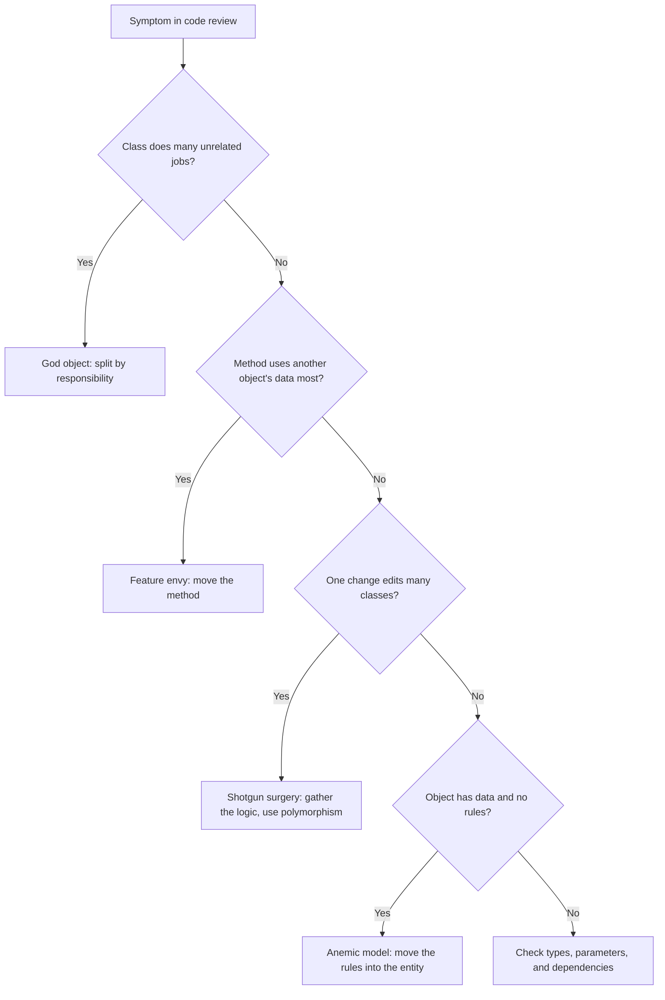
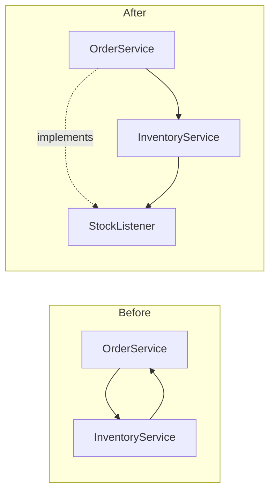

# Anti-Patterns

An anti-pattern is a common solution to a recurring problem that looks reasonable at first and causes more harm than good. A code smell is a surface sign in the code that points to a deeper design problem. Martin Fowler and Kent Beck popularized the term "code smell". The book *AntiPatterns* by Brown and others (1998) catalogs anti-patterns for code, architecture, and projects. This page covers 14 anti-patterns that LLD interviews and code reviews raise most often. Each entry has the symptom, a Java example, the problem, and the fix. For the general catalog of smells and the refactorings that remove them, see `kb/engineering-practice/02-refactoring-and-code-smells.md`.

## Why It Matters

In an LLD interview, the interviewer reads your class diagram and looks for these shapes: a class with 20 methods, a `switch` on a type code, a `static getInstance()` call inside business logic, an entity with only getters and setters. Each shape signals a design that is hard to change or to test. On the job, the same shapes appear in code review and in legacy code. If you can name the anti-pattern, show how it fails, and show the refactoring, you give the answer of a senior engineer. Naming is also useful in a design discussion: "this is feature envy" is shorter than three sentences of explanation.

## Core Concepts

| Term | Definition |
|---|---|
| Anti-pattern | A recurring solution that causes more problems than it solves. It has a name, a symptom, a cause, and a known fix |
| Code smell | A surface symptom in code that may point to a design problem. A smell is a hint, not a proof |
| Refactoring | A change to the structure of code that does not change its behavior |
| Technical debt | The future cost of a shortcut in the design or the code |
| Invariant | A condition on an object's state that must hold at all times, for example "a balance is not negative" |

The 14 anti-patterns on this page, with the smell name that Fowler's *Refactoring* (2nd edition, 2018) uses where one exists, and the principle that the anti-pattern violates. A name in parentheses is not a smell in the book; it names the related source or idea:

| Anti-pattern | Fowler smell name | Principle that it violates |
|---|---|---|
| God object | Large Class | Single Responsibility, cohesion |
| Anemic domain model | (Fowler's bliki: AnemicDomainModel) | Tell, don't ask, encapsulation |
| Overuse of inheritance | Refused Bequest (the 1st edition also lists Parallel Inheritance Hierarchies) | Favor composition |
| Singleton overuse | Global Data | Dependency inversion, testability |
| Primitive obsession | Primitive Obsession | Encapsulation, fail fast |
| Feature envy | Feature Envy | Cohesion, tell-don't-ask |
| Shotgun surgery | Shotgun Surgery, Repeated Switches | Cohesion, open-closed |
| Circular dependencies | (cyclic dependency) | Acyclic dependencies, dependency inversion |
| Magic numbers and strings | (refactoring: Replace Magic Literal) | DRY, least astonishment |
| Boolean parameters | (Fowler's bliki: FlagArgument) | Single responsibility |
| Leaky abstractions | (Spolsky's law) | Information hiding |
| Premature optimization | (Knuth) | KISS, YAGNI |
| Copy-paste programming | Duplicated Code | DRY |
| Service locator | (hidden dependencies) | Dependency inversion, explicit dependencies |

The principles are in [design principles](03-design-principles.md) and [SOLID](02-solid.md).

## How It Works

Each anti-pattern follows the same structure: the symptom, the example, the problem, and the fix. Use this method on a design that you inspect:

1. Look at the class and method sizes. A class with many unrelated methods suggests a God object.
2. Look at how classes use each other. A method that uses another class's data more than its own suggests feature envy. A change that touches many classes suggests shotgun surgery.
3. Look at the arrows. Draw the dependency arrows between packages. A cycle is a defect.
4. Look at the signatures. Primitives, booleans, and strings that carry meaning suggest primitive obsession and flag arguments.
5. Look at the construction. A `getInstance()` or a `Locator.get()` inside a method hides a dependency.
6. Refactor in small steps. Run the tests after each step.



### 1. God object

**Symptom.** One class knows and does too much. It has many fields, many methods, and imports from many packages. Its name ends in `Manager`, `Handler`, `Processor`, or `Controller`. Developers touch it in every change, and merge conflicts happen there. Brown and others call it "The Blob". Fowler calls the smell "Large Class".

```java
class OrderManager {
    private final Map<String, Integer> stock = new HashMap<>();
    private final List<String> sentEmails = new ArrayList<>();
    private final Map<String, BigDecimal> savedTotals = new HashMap<>();

    BigDecimal price(List<String> skus, Map<String, BigDecimal> catalog) {
        BigDecimal sum = BigDecimal.ZERO;
        for (String sku : skus) {
            sum = sum.add(catalog.get(sku));
        }
        return sum;
    }

    void reserveStock(String sku) {
        stock.merge(sku, -1, Integer::sum);
    }

    void sendConfirmation(String email, String orderId) {
        sentEmails.add("To " + email + ": order " + orderId + " confirmed");
    }

    void saveToDatabase(String orderId, BigDecimal total) {
        savedTotals.put(orderId, total);
    }

    String monthlyReport() {
        return "Orders saved: " + savedTotals.size();
    }
}
```

**Problem.** The class changes for five reasons: the pricing rule, the stock rule, the mail text, the storage, and the report. A change to the mail text can break the stock code, because they share the same file and the same fields. A unit test for pricing must build the whole class. Two developers who work on different features edit the same file.

**Fix.** Split by responsibility. Keep a thin service that coordinates the parts.

```java
class PriceCalculator {
    BigDecimal price(List<String> skus, Map<String, BigDecimal> catalog) {
        BigDecimal sum = BigDecimal.ZERO;
        for (String sku : skus) {
            sum = sum.add(catalog.get(sku));
        }
        return sum;
    }
}

class StockService {
    private final Map<String, Integer> stock = new HashMap<>();

    void reserve(String sku) {
        stock.merge(sku, -1, Integer::sum);
    }
}

interface ConfirmationMailer {
    void send(String email, String orderId);
}

interface OrderRepository {
    void save(String orderId, BigDecimal total);
}

class OrderService {
    private final PriceCalculator pricing;
    private final StockService stock;
    private final ConfirmationMailer mailer;
    private final OrderRepository repository;

    OrderService(PriceCalculator pricing, StockService stock,
                 ConfirmationMailer mailer, OrderRepository repository) {
        this.pricing = pricing;
        this.stock = stock;
        this.mailer = mailer;
        this.repository = repository;
    }

    void place(String orderId, String email, List<String> skus, Map<String, BigDecimal> catalog) {
        skus.forEach(stock::reserve);
        repository.save(orderId, pricing.price(skus, catalog));
        mailer.send(email, orderId);
    }
}
```

Each class has one reason to change. `OrderService` only coordinates. See the Single Responsibility Principle in [SOLID](02-solid.md).

**In an interview.** Count the actors, not the methods. If one class in your first class diagram has methods that serve different actors (the pricing team, the warehouse, the marketing team), or if its fields split into groups that separate methods use, split it before the interviewer asks.

### 2. Anemic domain model

**Symptom.** Domain classes hold data and have only getters and setters. All rules live in `*Service` classes. Fowler describes this in his bliki entry "AnemicDomainModel". He calls it an anti-pattern because it gives up the benefit of an object model (data and behavior together) and keeps the cost of the mapping.

```java
enum OrderStatus { NEW, CONFIRMED, SHIPPED }

record OrderLine(String sku, int quantity) { }

class Order {
    private OrderStatus status = OrderStatus.NEW;
    private List<OrderLine> lines = new ArrayList<>();

    OrderStatus getStatus() { return status; }

    void setStatus(OrderStatus status) { this.status = status; }

    List<OrderLine> getLines() { return lines; }

    void setLines(List<OrderLine> lines) { this.lines = lines; }
}

class OrderService {
    void confirm(Order order) {
        if (order.getLines().isEmpty()) {
            throw new IllegalStateException("empty order");
        }
        if (order.getStatus() != OrderStatus.NEW) {
            throw new IllegalStateException("not a new order");
        }
        order.setStatus(OrderStatus.CONFIRMED);
    }
}
```

**Problem.** Any code can call `order.setStatus(OrderStatus.SHIPPED)` and skip the rules. The rules for `Order` live outside `Order`. Each new use case copies the checks, or forgets them. The class has no invariants.

**Fix.** Move the rules into the entity. Expose behavior and hide the state.

```java
enum OrderStatus { NEW, CONFIRMED, SHIPPED }

record OrderLine(String sku, int quantity) { }

class Order {
    private OrderStatus status = OrderStatus.NEW;
    private final List<OrderLine> lines = new ArrayList<>();

    void addLine(OrderLine line) {
        if (status != OrderStatus.NEW) {
            throw new IllegalStateException("cannot change a " + status + " order");
        }
        lines.add(line);
    }

    void confirm() {
        if (lines.isEmpty()) {
            throw new IllegalStateException("empty order");
        }
        if (status != OrderStatus.NEW) {
            throw new IllegalStateException("not a new order");
        }
        status = OrderStatus.CONFIRMED;
    }

    OrderStatus status() { return status; }

    List<OrderLine> lines() { return List.copyOf(lines); }
}
```

**Balance.** A simple CRUD application that has few rules may not need a rich model. A service that holds a rule for one use case is a valid "transaction script". The anti-pattern applies when the rules are about the entity itself and many callers need them. Functional-style designs also keep data and behavior apart on purpose, and use immutable records with pure functions. That style is not anemic if the types make illegal states impossible. See [domain modeling](05-domain-modeling.md).

### 3. Overuse of inheritance (deep hierarchies)

**Symptom.** A hierarchy is deep: the example below has four levels. Class names combine features (`LoggingRetryingEmailNotifier`). Subclasses override methods to do nothing or to throw `UnsupportedOperationException`. A new feature needs a new class in each branch of the tree.

```java
class Notifier {
    void send(String to, String message) {
        System.out.println("Send to " + to + ": " + message);
    }
}

class EmailNotifier extends Notifier { }

class RetryingEmailNotifier extends EmailNotifier {
    @Override
    void send(String to, String message) {
        for (int attempt = 1; attempt < 3; attempt++) {
            try {
                super.send(to, message);
                return;
            } catch (RuntimeException e) {
                System.out.println("Attempt " + attempt + " failed");
            }
        }
        super.send(to, message);
    }
}

class LoggingRetryingEmailNotifier extends RetryingEmailNotifier {
    @Override
    void send(String to, String message) {
        System.out.println("LOG: sending");
        super.send(to, message);
    }
}

class SmsNotifier extends Notifier { }

class RetryingSmsNotifier extends SmsNotifier { }

class LoggingRetryingSmsNotifier extends RetryingSmsNotifier { }
```

**Problem.** Two channels and two features give six subclasses, and the tree still has no class for "logging without retry". Each new channel needs its own copy of every feature class, and the retry code is copied into each one. The features are fixed at compile time. A subclass depends on the implementation of its superclass, which is the fragile base class problem. Bloch gives a classic case in *Effective Java*, Item 18. A `HashSet` subclass that counts added elements overrides `add` and `addAll`. `HashSet` inherits `addAll` from `AbstractCollection`, and that `addAll` calls `add` for each element, so the count doubles:

```java
class BrokenCountingSet<E> extends HashSet<E> {
    private int added;

    @Override
    public boolean add(E element) {
        added++;
        return super.add(element);
    }

    @Override
    public boolean addAll(Collection<? extends E> elements) {
        added += elements.size();
        return super.addAll(elements);
    }

    int added() {
        return added;
    }
}
```

After `addAll(List.of("a", "b", "c"))`, `added()` returns 6, not 3. The `AbstractCollection.addAll` javadoc describes this behavior, but `HashSet` does not promise to keep it. Bloch calls this self-use an implementation detail that can change from release to release. If `HashSet` ever overrides `addAll` without a call to `add`, the subclass counts correctly by accident, and a fix written for today's behavior becomes a bug. The subclass breaks because it depends on how its superclass calls its own methods.

**Fix.** Use composition. Define the capability as an interface. Wrap one implementation in another (the Decorator pattern; see [structural patterns](07-structural-patterns.md)).

```java
interface Notifier {
    void send(String to, String message);
}

class EmailNotifier implements Notifier {
    public void send(String to, String message) {
        System.out.println("Email to " + to + ": " + message);
    }
}

class SmsNotifier implements Notifier {
    public void send(String to, String message) {
        System.out.println("SMS to " + to + ": " + message);
    }
}

class RetryingNotifier implements Notifier {
    private final Notifier delegate;
    private final int attempts;

    RetryingNotifier(Notifier delegate, int attempts) {
        if (attempts < 1) {
            throw new IllegalArgumentException("attempts must be at least 1: " + attempts);
        }
        this.delegate = Objects.requireNonNull(delegate);
        this.attempts = attempts;
    }

    public void send(String to, String message) {
        RuntimeException last = null;
        for (int i = 0; i < attempts; i++) {
            try {
                delegate.send(to, message);
                return;
            } catch (RuntimeException e) {
                last = e;
            }
        }
        throw last;
    }
}

class LoggingNotifier implements Notifier {
    private final Notifier delegate;

    LoggingNotifier(Notifier delegate) {
        this.delegate = delegate;
    }

    public void send(String to, String message) {
        System.out.println("LOG: sending to " + to);
        delegate.send(to, message);
    }
}
```

The caller builds any combination at run time: `new LoggingNotifier(new RetryingNotifier(new SmsNotifier(), 3))`. Two channels and two features need four classes. Three channels and three features need six. See [OOP](01-oop.md) for when inheritance is the right tool.

### 4. Singleton overuse

**Symptom.** Business classes call `Something.getInstance()` inside their methods. Tests cannot replace the instance. Tests pass or fail depending on their order, because the instance keeps state between tests.

```java
class PaymentGateway {
    private static final PaymentGateway INSTANCE = new PaymentGateway();

    private PaymentGateway() { }

    static PaymentGateway getInstance() {
        return INSTANCE;
    }

    boolean charge(String card, BigDecimal amount) {
        // a real implementation calls a payment provider over the network
        return true;
    }
}

class CheckoutService {
    boolean checkout(String card, BigDecimal total) {
        return PaymentGateway.getInstance().charge(card, total);
    }
}
```

**Problem.**

- Hidden dependency: the constructor of `CheckoutService` does not show that it needs a payment gateway. A reader finds out only by reading the method bodies.
- Global state: if the singleton holds state (a counter, a cache, a configuration), any code in the program can change it. A bug in one place appears in another.
- Test pain: a unit test of `CheckoutService` would call the real gateway. The test cannot substitute a fake, and the singleton keeps state from one test to the next.
- Tight coupling to a concrete class, which violates dependency inversion.
- Concurrency: a mutable singleton is shared by all threads, so each access needs care. See [concurrency in LLD](09-concurrency-in-lld.md).

**Fix.** Keep the need for one instance, and drop the global access. Create one instance in the composition root (usually `main` or a dependency injection container) and pass it to the classes that need it.

```java
interface PaymentGateway {
    boolean charge(String card, BigDecimal amount);
}

class CheckoutService {
    private final PaymentGateway gateway;

    CheckoutService(PaymentGateway gateway) {
        this.gateway = gateway;
    }

    boolean checkout(String card, BigDecimal total) {
        return gateway.charge(card, total);
    }
}

class CheckoutDemo {
    static void run() {
        PaymentGateway alwaysDeclines = (card, amount) -> false;
        CheckoutService service = new CheckoutService(alwaysDeclines);
        System.out.println(service.checkout("4111", new BigDecimal("10.00")));
    }
}
```

The application still has one gateway, but no class knows that. A test passes a fake. A Singleton is acceptable for stateless, immutable objects, or for a resource that has one instance by nature (a logger factory, for example), if no test needs to replace it. The forms of Singleton and their thread-safety are in [creational patterns](06-creational-patterns.md).

### 5. Primitive obsession

**Symptom.** The code represents domain concepts with `String`, `int`, and `double`: an email as `String`, a price as `double`, a status as `int`. Methods have several parameters of the same type. Validation code for the same concept appears in many places.

```java
class Billing {
    void charge(String email, String currency, double amount, String phone) {
        System.out.println("Charge " + amount + " " + currency + " to " + email);
    }
}

class BillingDemo {
    void run(Billing billing) {
        billing.charge("+91 98765 43210", "USD", 10.0, "a@example.com");
    }
}
```

**Problem.** The call in `run` swaps the email and the phone. The compiler accepts it, because both are `String`. The `double` for money has rounding errors (`0.1 + 0.2` is not `0.3`). The method does not check that the email has an `@`, and the check is repeated in every method that takes an email.

**Fix.** Give each concept a type. A `record` is the shortest form in Java 21. Validate in the constructor (fail fast).

```java
record Email(String value) {
    Email {
        Objects.requireNonNull(value);
        if (!value.contains("@")) {
            throw new IllegalArgumentException("not an email: " + value);
        }
    }
}

record Phone(String value) {
    Phone {
        Objects.requireNonNull(value);
    }
}

record Money(BigDecimal amount, Currency currency) {
    Money {
        Objects.requireNonNull(amount);
        Objects.requireNonNull(currency);
    }
}

class Billing {
    void charge(Email email, Phone phone, Money price) {
        System.out.println("Charge " + price.amount() + " " + price.currency()
                + " to " + email.value());
    }
}
```

Now the compiler rejects a swapped call. A status code such as `int status = 3` becomes an `enum`. The same fix applies to quantities and identifiers: `OrderId` instead of `String`. See [domain modeling](05-domain-modeling.md) for money, time, and quantities.

**Balance.** Not every `String` needs a type. A type pays off when the concept has rules (validation, formatting, arithmetic) or when two concepts of the same primitive type can be confused.

### 6. Feature envy

**Symptom.** A method in class A uses the data and the methods of class B more than its own. The method calls many getters of B.

```java
class OrderLine {
    private final BigDecimal price;
    private final int quantity;

    OrderLine(BigDecimal price, int quantity) {
        this.price = price;
        this.quantity = quantity;
    }

    BigDecimal getPrice() { return price; }

    int getQuantity() { return quantity; }
}

class Order {
    private final List<OrderLine> lines;
    private final BigDecimal discountRate;

    Order(List<OrderLine> lines, BigDecimal discountRate) {
        this.lines = lines;
        this.discountRate = discountRate;
    }

    List<OrderLine> getLines() { return lines; }

    BigDecimal getDiscountRate() { return discountRate; }
}

class InvoicePrinter {
    BigDecimal total(Order order) {
        BigDecimal sum = BigDecimal.ZERO;
        for (OrderLine line : order.getLines()) {
            sum = sum.add(line.getPrice().multiply(BigDecimal.valueOf(line.getQuantity())));
        }
        return sum.subtract(sum.multiply(order.getDiscountRate()));
    }
}
```

**Problem.** The rule for the order total belongs to `Order`, but it lives in `InvoicePrinter`. If a second class (an e-mail template, a refund calculator) needs the total, it copies the code. When `Order` changes its discount model, `InvoicePrinter` breaks. This is also a violation of tell-don't-ask and of the Law of Demeter. See [design principles](03-design-principles.md).

**Fix.** Move the method to the class whose data it uses (the Move Method refactoring, named Move Function in the 2nd edition of *Refactoring*).

```java
class OrderLine {
    private final BigDecimal price;
    private final int quantity;

    OrderLine(BigDecimal price, int quantity) {
        this.price = price;
        this.quantity = quantity;
    }

    BigDecimal subtotal() {
        return price.multiply(BigDecimal.valueOf(quantity));
    }
}

class Order {
    private final List<OrderLine> lines;
    private final BigDecimal discountRate;

    Order(List<OrderLine> lines, BigDecimal discountRate) {
        this.lines = List.copyOf(lines);
        this.discountRate = discountRate;
    }

    BigDecimal total() {
        BigDecimal sum = BigDecimal.ZERO;
        for (OrderLine line : lines) {
            sum = sum.add(line.subtotal());
        }
        return sum.subtract(sum.multiply(discountRate));
    }
}

class InvoicePrinter {
    String print(Order order) {
        return "Total: " + order.total();
    }
}
```

**Exception.** Strategy and Visitor objects exist to hold behavior outside the data classes, on purpose. In those patterns, the envy is the design. Formatters and mappers (for example an `OrderToDtoMapper`) also read another class's data by design.

### 7. Shotgun surgery

**Symptom.** One conceptual change requires small edits in many classes. The typical cause is the same `switch` on a type code in several places. Fowler names this smell "Shotgun Surgery". It is the reverse of "Divergent Change", where one class changes for many reasons.

```java
class FeeCalculator {
    BigDecimal fee(String method, BigDecimal amount) {
        switch (method) {
            case "CARD": return amount.multiply(new BigDecimal("0.02"));
            case "UPI": return BigDecimal.ZERO;
            default: throw new IllegalArgumentException(method);
        }
    }
}

class ReceiptFormatter {
    String label(String method) {
        switch (method) {
            case "CARD": return "Paid by card";
            case "UPI": return "Paid by UPI";
            default: throw new IllegalArgumentException(method);
        }
    }
}

class PaymentValidator {
    boolean isValid(String method, String account) {
        switch (method) {
            case "CARD": return account.length() == 16;
            case "UPI": return account.contains("@");
            default: throw new IllegalArgumentException(method);
        }
    }
}
```

**Problem.** To add the payment method "WALLET", the developer edits three classes. If the developer forgets one, the code fails at run time, with an `IllegalArgumentException`. The compiler does not help, because the type is a `String`.

**Fix.** Put the logic that varies by payment method behind one type. A sealed interface lets the compiler check that all cases are covered.

```java
sealed interface PaymentMethod permits Card, Upi {
    BigDecimal fee(BigDecimal amount);

    String label();

    boolean isValid(String account);
}

record Card() implements PaymentMethod {
    public BigDecimal fee(BigDecimal amount) {
        return amount.multiply(new BigDecimal("0.02"));
    }

    public String label() {
        return "Paid by card";
    }

    public boolean isValid(String account) {
        return account.length() == 16;
    }
}

record Upi() implements PaymentMethod {
    public BigDecimal fee(BigDecimal amount) {
        return BigDecimal.ZERO;
    }

    public String label() {
        return "Paid by UPI";
    }

    public boolean isValid(String account) {
        return account.contains("@");
    }
}
```

A new method is one new class. The compiler reports each place that must handle it if the code uses a `switch` over the sealed type. This is the Strategy and polymorphism approach. See [behavioral patterns](08-behavioral-patterns.md).

### 8. Circular dependencies

**Symptom.** Class A depends on class B, and class B depends on class A. A longer cycle is also a cycle (A to B to C to A). The same happens between packages. Symptoms: you cannot build or test one class without the other, constructor injection fails because neither object can be built first, and a change in one package breaks a distant package.



```java
class OrderService {
    private InventoryService inventory;

    void setInventory(InventoryService inventory) {
        this.inventory = inventory;
    }

    void place(String sku) {
        inventory.reserve(sku);
    }

    void onStockReleased(String sku) {
        System.out.println("Retry waiting orders for " + sku);
    }
}

class InventoryService {
    private OrderService orders;

    void setOrders(OrderService orders) {
        this.orders = orders;
    }

    void reserve(String sku) {
        System.out.println("Reserved " + sku);
    }

    void release(String sku) {
        orders.onStockReleased(sku);
    }
}
```

**Problem.** Each class needs the other to exist, so the code uses setters and a fixed order of initialization. A developer who forgets a setter call gets a `NullPointerException`. Neither class can be reused or tested alone. The cycle also grows: new code adds more links, because every class can already reach every other class.

**Fix.** Break the cycle with one of these methods:

- Dependency inversion: the lower-level class defines an interface, and the higher-level class implements it. The source dependency now goes one way.
- Extract the shared part: move the code that both classes need into a third class that both depend on.
- Replace a direct call with an event: one class publishes, the other subscribes (Observer).

```java
interface StockListener {
    void onStockReleased(String sku);
}

class InventoryService {
    private final List<StockListener> listeners = new ArrayList<>();

    void addListener(StockListener listener) {
        listeners.add(listener);
    }

    void reserve(String sku) {
        System.out.println("Reserved " + sku);
    }

    void release(String sku) {
        listeners.forEach(listener -> listener.onStockReleased(sku));
    }
}

class OrderService implements StockListener {
    private final InventoryService inventory;

    OrderService(InventoryService inventory) {
        this.inventory = inventory;
        inventory.addListener(this);
    }

    void place(String sku) {
        inventory.reserve(sku);
    }

    @Override
    public void onStockReleased(String sku) {
        System.out.println("Retry waiting orders for " + sku);
    }
}
```

`InventoryService` no longer knows `OrderService`. It knows only the `StockListener` interface. The cycle is gone, and constructor injection works. Note the line `inventory.addListener(this)` in the constructor. It lets `this` escape before construction ends, which is acceptable here because the constructor does nothing after it. In a concurrent program, register listeners in a separate step. For packages, tools such as JDepend or ArchUnit can find cycles in a build. Layering rules in [architectural patterns](10-architectural-patterns.md) prevent most cycles.

### 9. Magic numbers and strings

**Symptom.** Literal values with an unstated meaning appear in the code: `if (zone == 3)`, `weight > 20000`, `"PREMIUM"`. The same literal appears in several places.

```java
class ShippingCalculator {
    BigDecimal cost(int weightGrams, int zone, String customerType) {
        BigDecimal base = new BigDecimal("4.99");
        if (zone == 3) {
            base = base.add(new BigDecimal("6.00"));
        }
        if (weightGrams > 20000) {
            base = base.add(new BigDecimal("12.50"));
        }
        if (customerType.equals("PREMIUM")) {
            base = BigDecimal.ZERO;
        }
        return base;
    }
}
```

**Problem.** A reader cannot tell what `3` or `20000` means. If the heavy-parcel limit changes, a search for `20000` can miss a copy that someone wrote as `20_000` or `20 * 1000`. A typo such as `"PREMUIM"` compiles and silently does not match.

**Fix.** Give each value a name. Use an `enum` for a closed set of values.

```java
enum Zone { LOCAL, REGIONAL, REMOTE }

enum CustomerType { STANDARD, PREMIUM }

class ShippingCalculator {
    private static final int HEAVY_PARCEL_GRAMS = 20_000;
    private static final BigDecimal BASE_RATE = new BigDecimal("4.99");
    private static final BigDecimal REMOTE_SURCHARGE = new BigDecimal("6.00");
    private static final BigDecimal HEAVY_SURCHARGE = new BigDecimal("12.50");

    BigDecimal cost(int weightGrams, Zone zone, CustomerType customerType) {
        if (customerType == CustomerType.PREMIUM) {
            return BigDecimal.ZERO;
        }
        BigDecimal cost = BASE_RATE;
        if (zone == Zone.REMOTE) {
            cost = cost.add(REMOTE_SURCHARGE);
        }
        if (weightGrams > HEAVY_PARCEL_GRAMS) {
            cost = cost.add(HEAVY_SURCHARGE);
        }
        return cost;
    }
}
```

Not every literal is magic. `0`, `1`, `-1`, and `""` in an obvious role (a loop start, an empty string) need no name. A value that business people change (the rate, the limit) belongs in configuration, not in a constant, if it changes without a release.

### 10. Boolean parameters

**Symptom.** A method takes one or more `boolean` arguments. The call site reads `generate("sales", true, false, true)`. Fowler calls this a "flag argument".

```java
class ReportService {
    void generate(String name, boolean landscape, boolean includeTotals, boolean compress) {
        System.out.println("Report " + name + " landscape=" + landscape
                + " totals=" + includeTotals + " compress=" + compress);
    }
}

class ReportDemo {
    void run(ReportService service) {
        service.generate("sales", true, false, true);
    }
}
```

**Problem.** The call site does not say what `true` means. Swapping two flags compiles. A method with a flag often does two jobs, with an `if` on the flag. With `n` flags, the method has `2^n` combinations, and most are untested.

**Fix.** Choose by the situation:

- Two distinct behaviors: two methods (`generateLandscape`, `generatePortrait`).
- A value from a small set: an `enum`.
- Several options: an options object with named fields, built with a builder or with a record and named factory methods.

```java
enum Orientation { PORTRAIT, LANDSCAPE }

record ReportOptions(Orientation orientation, boolean includeTotals, boolean compress) {
    static ReportOptions defaults() {
        return new ReportOptions(Orientation.PORTRAIT, true, false);
    }

    ReportOptions landscape() {
        return new ReportOptions(Orientation.LANDSCAPE, includeTotals, compress);
    }

    ReportOptions withoutTotals() {
        return new ReportOptions(orientation, false, compress);
    }

    ReportOptions compressed() {
        return new ReportOptions(orientation, includeTotals, true);
    }
}

class ReportService {
    void generate(String name, ReportOptions options) {
        System.out.println("Report " + name + " " + options);
    }
}

class ReportDemo {
    void run(ReportService service) {
        ReportOptions options = ReportOptions.defaults().landscape().withoutTotals().compressed();
        service.generate("sales", options);
    }
}
```

A single boolean property setter with a clear name is not a problem: `setEnabled(true)` reads well. The anti-pattern is the boolean that selects behavior inside a method and has no name at the call site.

### 11. Leaky abstractions

**Symptom.** An interface exposes details of its implementation. Callers must know how the implementation works to use the interface correctly. Joel Spolsky states it as "The Law of Leaky Abstractions": all non-trivial abstractions, to some degree, are leaky.

```java
import java.sql.ResultSet;
import java.sql.SQLException;

interface UserRepository {
    User find(String id) throws SQLException;

    List<User> findByQuery(String sql);

    ResultSet rawRows();
}

record User(String id, String name) { }
```

**Problem.** The interface says that the storage is a SQL database. A caller catches `SQLException`, builds SQL strings, and reads a `ResultSet`. Moving to a document store or to an in-memory fake requires a change in every caller. A test double must produce a `ResultSet`. The SQL strings also create a risk of SQL injection when callers build them from user input.

**Fix.** Express the interface in the language of the domain. Translate low-level exceptions inside the implementation.

```java
import java.sql.Connection;
import java.sql.PreparedStatement;
import java.sql.ResultSet;
import java.sql.SQLException;

interface UserRepository {
    Optional<User> findById(String id);

    List<User> findActiveSince(LocalDate date);
}

class RepositoryException extends RuntimeException {
    RepositoryException(String message, Throwable cause) {
        super(message, cause);
    }
}

class JdbcUserRepository implements UserRepository {
    private final Connection connection;

    JdbcUserRepository(Connection connection) {
        this.connection = connection;
    }

    @Override
    public Optional<User> findById(String id) {
        try (PreparedStatement statement =
                     connection.prepareStatement("SELECT id, name FROM users WHERE id = ?")) {
            statement.setString(1, id);
            try (ResultSet rows = statement.executeQuery()) {
                return rows.next()
                        ? Optional.of(new User(rows.getString("id"), rows.getString("name")))
                        : Optional.empty();
            }
        } catch (SQLException e) {
            throw new RepositoryException("cannot read user " + id, e);
        }
    }

    @Override
    public List<User> findActiveSince(LocalDate date) {
        // omitted: the same pattern as findById, with a query on the activity date
        return List.of();
    }
}

record User(String id, String name) { }
```

The `JdbcUserRepository` class uses `java.sql` types. The interface does not.

Some leaks cannot be removed. A remote call that the interface presents as a local method call can still time out, and the interface must show that (for example, with a timeout parameter or an exception that the caller handles). Design the abstraction so that the leaks that remain are the ones that the caller must know. See [architectural patterns](10-architectural-patterns.md) for the repository pattern.

### 12. Premature optimization

**Symptom.** Code is made more complex for speed before a measurement shows a speed problem. Examples: manual caches, object pools for small objects, bit tricks, hand-unrolled loops, and custom data structures where the JDK has one.

Donald Knuth wrote in 1974: "We should forget about small efficiencies, say about 97% of the time: premature optimization is the root of all evil. Yet we should not pass up our opportunities in that critical 3%." The second sentence is part of the quotation. Knuth does not say "never optimize".

```java
class Cart {
    private final List<BigDecimal> prices = new ArrayList<>();
    private BigDecimal cachedTotal;

    void add(BigDecimal price) {
        prices.add(price);
    }

    BigDecimal total() {
        if (cachedTotal == null) {
            BigDecimal sum = BigDecimal.ZERO;
            for (BigDecimal price : prices) {
                sum = sum.add(price);
            }
            cachedTotal = sum;
        }
        return cachedTotal;
    }
}
```

**Problem.** The cache is stale after `add` is called following a `total()` call. The developer saved a sum over a list of a few items and bought a bug. The code is also longer and has a state that tests must cover.

**Fix.** Write the simple version first.

```java
class Cart {
    private final List<BigDecimal> prices = new ArrayList<>();

    void add(BigDecimal price) {
        prices.add(price);
    }

    BigDecimal total() {
        return prices.stream().reduce(BigDecimal.ZERO, BigDecimal::add);
    }
}
```

If a measurement shows that `total()` is a bottleneck, then optimize it, and invalidate the cache in `add`. Measure with a profiler, or with JMH (the Java Microbenchmark Harness) for microbenchmarks. Choose the right data structure and algorithm early: an O(n²) search over a list of a million items is not a micro-optimization, and a design that uses a `HashMap` for lookup is not premature. In an LLD round, state the complexity of the main operations and optimize only the one that the requirement names (for example, "O(1) get" for an LRU cache).

### 13. Copy-paste programming

**Symptom.** A developer copies a block of code, changes one or two details, and leaves the rest. Search finds near-identical blocks in several places. Brown and others list it as "Cut-and-Paste Programming". Fowler lists the smell as "Duplicated Code".

```java
class DiscountService {
    BigDecimal regularCustomer(BigDecimal total) {
        if (total.compareTo(new BigDecimal("100")) > 0) {
            return total.multiply(new BigDecimal("0.95"));
        }
        return total;
    }

    BigDecimal premiumCustomer(BigDecimal total) {
        if (total.compareTo(new BigDecimal("50")) > 0) {
            return total.multiply(new BigDecimal("0.90"));
        }
        return total;
    }
}
```

**Problem.** A bug fix in one copy does not reach the others. Suppose the rule changes to round the result to two decimal places. The developer edits one method and forgets the other. The two methods now disagree in a way that nobody planned.

**Fix.** Extract the shared logic into one method. Pass in what varies.

```java
class DiscountService {
    BigDecimal apply(BigDecimal total, BigDecimal threshold, BigDecimal factor) {
        if (total.compareTo(threshold) > 0) {
            return total.multiply(factor).setScale(2, RoundingMode.HALF_UP);
        }
        return total;
    }

    BigDecimal regularCustomer(BigDecimal total) {
        return apply(total, new BigDecimal("100"), new BigDecimal("0.95"));
    }

    BigDecimal premiumCustomer(BigDecimal total) {
        return apply(total, new BigDecimal("50"), new BigDecimal("0.90"));
    }
}
```

**Caution.** Remove duplication only if the copies represent the same knowledge. Two blocks that look the same and change for different reasons should stay apart. If the shared method needs a flag for each difference, the abstraction is wrong. See "the wrong abstraction" in [design principles](03-design-principles.md).

### 14. Service locator

**Symptom.** A class gets its dependencies by calling a global registry: `ServiceLocator.get(PaymentGateway.class)`. The class constructor does not list what the class needs.

```java
interface PaymentGateway {
    boolean charge(String orderId);
}

class ServiceLocator {
    private static final Map<Class<?>, Object> SERVICES = new HashMap<>();

    static <T> void register(Class<T> type, T service) {
        SERVICES.put(type, service);
    }

    static <T> T get(Class<T> type) {
        return type.cast(SERVICES.get(type));
    }
}

class OrderProcessor {
    boolean process(String orderId) {
        PaymentGateway gateway = ServiceLocator.get(PaymentGateway.class);
        return gateway.charge(orderId);
    }
}
```

**Problem.**

- Hidden dependencies: you cannot see what `OrderProcessor` needs from its constructor or its signature. You must read the method bodies.
- Late failure: if no one registered a `PaymentGateway`, `get` returns `null`, and `process` fails with a `NullPointerException` at run time. With constructor injection, the compiler reports a missing constructor argument when you wire the objects by hand, and a container reports a missing dependency at start-up.
- Test pain: every test must register fakes in a global map, and the map keeps its state between tests.
- The class depends on the locator, which is a global, so reuse in another program means to take the locator along.

Martin Fowler's article "Inversion of Control Containers and the Dependency Injection pattern" (2004) compares the two. Fowler does not call the service locator an anti-pattern. He writes that for application classes the two are roughly equivalent, that dependency injection is the better choice for classes that several applications reuse, and that the separation of configuration from use matters more than the choice between them. Mark Seemann (2010) argues that a service locator is an anti-pattern because it hides dependencies and causes run-time failures.

**Fix.** Constructor injection. The class declares what it needs. A composition root creates the objects and wires them.

```java
interface PaymentGateway {
    boolean charge(String orderId);
}

class OrderProcessor {
    private final PaymentGateway gateway;

    OrderProcessor(PaymentGateway gateway) {
        this.gateway = Objects.requireNonNull(gateway);
    }

    boolean process(String orderId) {
        return gateway.charge(orderId);
    }
}

class CompositionRoot {
    static OrderProcessor build() {
        PaymentGateway gateway = orderId -> true;
        return new OrderProcessor(gateway);
    }
}
```

A dependency injection container (Spring, Guice) uses a locator-like registry inside. The difference is that the container is at the edge of the application and calls the constructors. Business classes do not call it. See [architectural patterns](10-architectural-patterns.md) for dependency injection.

## Trade-offs and When to Use

An anti-pattern is not always wrong. The "fix" has a cost, and a small program may not repay it.

| Anti-pattern | When the "anti-pattern" is acceptable | Cost of the fix |
|---|---|---|
| God object | A 200-line script or a prototype that no one extends | More classes, more wiring |
| Anemic model | A CRUD service with few rules, or a functional style with strong types | Entities must protect their invariants, which needs care with persistence frameworks |
| Deep inheritance | A stable framework hierarchy that you do not own (for example, `Exception`) | More wrapper classes and delegation code |
| Singleton | A stateless, immutable object, or a resource that exists once by nature | Constructor parameters spread through the code |
| Primitive obsession | A local variable, or a value with no rules | More types and conversion code at the boundaries |
| Feature envy | Mappers, formatters, Visitor, and Strategy | Delegation methods |
| Shotgun surgery | A `switch` that appears once | An interface and one class for each case |
| Circular dependencies | None between packages. Two classes in one package that model a two-way relationship (a parent and its child) can refer to each other | An interface or an event |
| Magic numbers | `0`, `1`, `-1`, and a literal that is used once and is clear from context | Constants and enums |
| Boolean parameters | A private method whose flag is obvious from a local name | Extra types for the options |
| Leaky abstraction | None you can fully remove. Choose which leaks to keep | Translation code at the boundary |
| Premature optimization | After a measurement shows the bottleneck, it is not premature | None |
| Copy-paste | Two blocks that change for different reasons | A shared method and a parameter list |
| Service locator | Plug-in loading with `ServiceLoader`, where the set of services is not known at compile time | Wiring code in the composition root |

Recommendation: fix an anti-pattern when you must change the code anyway, or when it blocks testing. Do not rewrite a stable module only to remove a smell.

## Java Example

The program below runs the inheritance example (anti-pattern 3). `BrokenCountingSet` extends `HashSet` and counts six added elements for three `addAll` elements. `CountingSet` wraps a `Set` and counts three. The program runs with `java Main.java`.

```java
import java.util.Collection;
import java.util.HashSet;
import java.util.List;
import java.util.Set;

public class Main {
    public static void main(String[] args) {
        BrokenCountingSet<String> broken = new BrokenCountingSet<>();
        broken.addAll(List.of("a", "b", "c"));
        System.out.println("Inheritance: added=" + broken.added() + " size=" + broken.size());

        CountingSet<String> fixed = new CountingSet<>(new HashSet<>());
        fixed.addAll(List.of("a", "b", "c"));
        System.out.println("Composition: added=" + fixed.added() + " size=" + fixed.size());
    }
}

class BrokenCountingSet<E> extends HashSet<E> {
    private int added;

    @Override
    public boolean add(E element) {
        added++;
        return super.add(element);
    }

    @Override
    public boolean addAll(Collection<? extends E> elements) {
        added += elements.size();
        return super.addAll(elements);
    }

    int added() {
        return added;
    }
}

class CountingSet<E> {
    private final Set<E> delegate;
    private int added;

    CountingSet(Set<E> delegate) {
        this.delegate = delegate;
    }

    boolean add(E element) {
        added++;
        return delegate.add(element);
    }

    boolean addAll(Collection<? extends E> elements) {
        added += elements.size();
        return delegate.addAll(elements);
    }

    int added() {
        return added;
    }

    int size() {
        return delegate.size();
    }
}
```

Output:

<!-- expected-output -->

```text
Inheritance: added=6 size=3
Composition: added=3 size=3
```

## Interview Angle

### Questions

??? question "What is a God object, and how do you refactor one?"

    A God object is a class that holds too much knowledge and does too many jobs: many fields, many methods, and many imports. Example: an `OrderManager` that prices orders, reserves stock, sends mail, saves to the database, and prints reports. Fowler calls the smell "Large Class".

    It hurts because the class changes for many reasons, so every feature touches it. Tests need the whole class. Two developers edit the same file.

    To refactor, I group the methods by the actor or reason that changes them, and extract one class for each group: `PriceCalculator`, `StockService`, `ConfirmationMailer`, `OrderRepository`. I keep a thin `OrderService` that coordinates them. I move one responsibility at a time and run the tests after each move.

??? question "What is an anemic domain model? Is it always bad?"

    It is a domain model in which the entities hold data and have only getters and setters, and the rules live in service classes. Fowler calls it an anti-pattern. Any code can set an entity into an invalid state, because the entity does not protect its invariants. Each use case repeats the checks.

    The fix is to move the rules into the entity: `order.confirm()` checks that the order has lines and that its status is `NEW`, and the status has no public setter.

    It is not always bad. A simple CRUD service with few rules does not gain much from a rich model. A functional design that uses immutable records and pure functions keeps data and behavior apart on purpose, and it works if the types make illegal states impossible. The anti-pattern applies when the rules belong to the entity and many callers need them.

??? question "Why is the Singleton pattern often called an anti-pattern?"

    The pattern itself is valid. The problem is its use as a global variable. A class that calls `Gateway.getInstance()` hides its dependency, because the constructor does not show it. The singleton keeps state across the program, so tests depend on each other. A test cannot replace the instance with a fake. The class is coupled to a concrete type.

    The fix is to create one instance in the composition root and pass it through constructors, typed by an interface. The program still has one instance, but no class knows that. I accept a Singleton for a stateless or immutable object, or a resource that exists once by nature, if no test needs to replace it.

??? question "What is primitive obsession? Give an example and the fix."

    It is the use of `String`, `int`, and `double` for domain concepts. Example: `charge(String email, String currency, double amount, String phone)`. The caller can swap the email and the phone, and the compiler accepts it. A `double` for money has rounding errors. Validation for an email is repeated in each method.

    The fix is a type for each concept: `Email`, `Phone`, `Money(BigDecimal amount, Currency currency)`, each a `record` with a validating constructor. The compiler then rejects a swapped call, and each rule lives in one place. A status code becomes an `enum`.

    I do not wrap every string. A type pays off when the concept has rules or when two concepts of the same primitive type can be confused.

??? question "What is feature envy, and what is shotgun surgery?"

    Feature envy: a method uses the data of another class more than its own. Example: `InvoicePrinter.total(order)` loops over `order.getLines()` and reads their prices. The fix is Move Method: the total belongs in `Order`.

    Shotgun surgery: one change requires small edits in many classes. Example: adding a payment method needs a new `case` in a fee calculator, a receipt formatter, and a validator. The cause is the same type switch in several places. The fix is to put the varying logic behind one type: a sealed `PaymentMethod` interface with `fee`, `label`, and `isValid`, and one record for each method. A new method is one new class.

    Both smells show that the behavior is in the wrong place. Feature envy has one method in the wrong class. Shotgun surgery has one concept spread across many classes.

??? question "How do you detect and break a circular dependency?"

    I detect it in the class or package diagram as a cycle of arrows. At run time, the signs are setter injection that only exists to close the loop, and a `NullPointerException` when the order of initialization changes. Build tools such as ArchUnit or JDepend can report cycles.

    To break it, I use one of three methods. First, dependency inversion: the lower-level class defines an interface, and the higher-level class implements it. Second, extract the shared logic into a third class that both use. Third, replace the direct call with an event, so that one class publishes and the other subscribes. After the change, the dependencies point in one direction, and constructor injection works.

??? question "Is premature optimization always wrong? What did Knuth actually say?"

    Knuth wrote that we should forget about small efficiencies about 97 percent of the time, because premature optimization is the root of all evil. He also wrote that we should not pass up the opportunities in the critical 3 percent. So the rule is: measure first, and then optimize the part that the measurement shows.

    Choosing a good algorithm and a good data structure at design time is not premature. A `HashMap` for lookup in an LRU cache is a design decision. A hand-written cache for a sum over five items is premature, and it adds a stale-state bug.

??? question "What is the difference between a service locator and dependency injection?"

    With a service locator, a class asks a global registry for its dependencies: `ServiceLocator.get(PaymentGateway.class)`. With dependency injection, something outside the class passes the dependencies to its constructor.

    The locator hides the dependencies, because the constructor does not list them. It fails at run time with `null` if no one registered the service. Tests must register fakes in a global map. With injection, the constructor shows what the class needs, a missing dependency fails at start-up, and a test passes its own fake.

    A container such as Spring is a locator-like registry, but it sits at the edge of the application and calls the constructors. The business classes do not call it.

### Follow-up Questions

??? question "A colleague says an anemic model is fine because 'it is how Spring apps are written'. How do you respond?"

    I agree that many Spring applications use it, and that it works for simple CRUD. I ask where the rules live and who enforces them. If an entity has rules such as "a confirmed order cannot change", and three services each check the rule, then a missed check is a bug that the compiler cannot catch. I propose to move the rules that belong to the entity into the entity, and I keep the use-case orchestration in the service. Spring does not force an anemic model. JPA entities can have behavior.

??? question "Boolean parameters are common in the JDK too, for example `new FileWriter(name, true)`. Is that wrong?"

    It has the same readability problem: `true` does not say "append". The JDK keeps such signatures for compatibility. For new code, I prefer a named alternative, such as `Files.write(path, bytes, StandardOpenOption.APPEND)`. `StandardOpenOption` is an enum, so the call site names the behavior.

??? question "When does inheritance remain the right choice?"

    When the relationship is a true is-a, the subclass honors the contract of the superclass (Liskov substitution), and the superclass is designed for extension. Examples: a closed hierarchy that you own and document, such as `sealed interface Shape permits Circle, Square`, and framework extension points that the framework documents, such as an abstract base with template methods. See [OOP](01-oop.md) and [SOLID](02-solid.md).

### Red Flags

- You name an anti-pattern but cannot show the code symptom or the fix.
- You say "Singleton is always bad" or "inheritance is always bad". The pattern has valid uses, and your answer shows that you repeat a slogan.
- You say "avoid all duplication" and do not mention the wrong abstraction.
- You propose to "fix" a God object by moving its methods into several `*Util` classes with static methods. The result is still a set of unrelated functions.
- You describe the anemic model as "classes with getters and setters are bad" and do not mention rules and invariants.
- You quote Knuth as "premature optimization is evil" and omit the second sentence.
- Your class diagram contains a God class or a cycle, and you do not notice it.

## Common Mistakes

| Mistake | Why it hurts | Fix |
|---|---|---|
| Split a God object into classes named `Helper1`, `Helper2` | The split follows file size, not responsibility. The new classes have the same coupling | Split by reason to change. Name each class by its job |
| Replace a Singleton with a `static` utility class | The global state remains. A static method is harder to replace in a test than a Singleton | Use constructor injection and an interface |
| Use setter injection to close a cycle | The cycle still exists. Objects can be used before they are fully wired | Break the cycle with an interface or an event |
| Wrap every primitive in a type | Many classes carry no rule | Wrap only the concepts that have rules or that can be confused |
| Replace a `switch` with a class hierarchy for a `switch` that appears once | The code gets longer, and the change does not repay | Wait until the switch appears in a second place |
| Add a `boolean` parameter for a new case | Callers cannot read the call. The method grows another branch | Add a method or an enum value |
| Cache before measuring | A stale-data bug, and more code to test | Measure. Optimize the bottleneck. Invalidate on every write |
| Fix feature envy by making the other class's fields `public` | Coupling gets worse | Move the method to the class that owns the data |
| Hide a leak with a catch-all `catch (Exception e)` | The caller loses the information to handle the failure | Translate to a domain exception with a clear cause |
| Remove duplication between two things that change for different reasons | The shared method needs flags, and coupling grows | Keep both copies. Merge only knowledge that changes together |

## Commonly Confused With

| Looks like | Difference | Deciding question |
|---|---|---|
| God object vs a facade | A facade delegates all work to other classes and holds no logic. A God object does the work itself | Does the class do the work, or only forward it? |
| Feature envy vs a Visitor or a mapper | In a Visitor or a mapper, reading another class's data is the purpose | Is the behavior meant to live outside the data class? |
| Shotgun surgery vs divergent change | Shotgun surgery: one change touches many classes. Divergent change: one class changes for many reasons | One change in many places, or many changes in one place? |
| Anemic model vs a data transfer object (DTO) | A DTO carries data between layers on purpose and has no rules. An anemic entity should have rules and has none | Is the class an entity with invariants, or a carrier? |
| Singleton vs a shared instance by injection | Both have one instance. The Singleton has a global access point. The injected instance does not | Can a test replace the instance? |
| Service locator vs dependency injection | A locator is pulled by the class. Injection is pushed into the class | Does the class call a registry, or does it receive its dependencies? |
| Primitive obsession vs a simple parameter | A simple parameter has no rules and no risk of mix-up | Does the value have a validity rule, or can it be confused with another value? |
| Premature optimization vs choosing an efficient design | A design decision about data structure and algorithm is not premature. Complexity added without measurement is | Did a measurement or a stated requirement drive the change? |
| Copy-paste vs a legitimate repeated structure | Two blocks that change for different reasons are not a copy-paste defect | Do the blocks change for the same reason? |
| Leaky abstraction vs a thin wrapper | A leaky abstraction forces the caller to know the internals. A thin wrapper hides them | Must the caller know how the implementation works? |

## Quick Reference Card

| Anti-pattern | Symptom | Fix |
|---|---|---|
| God object | One class, many unrelated methods | Split by reason to change. Keep a thin coordinator |
| Anemic domain model | Entities with getters and setters. Rules in services | Move rules into the entity. Remove public setters |
| Deep inheritance | Names like `LoggingRetryingEmailNotifier`. Overrides that do nothing | Interface and composition (Decorator, Strategy) |
| Singleton overuse | `X.getInstance()` in business code | Constructor injection of an interface. One instance in the composition root |
| Primitive obsession | `String email`, `double price`, swapped arguments | Records with validation. `enum` for codes. `BigDecimal` for money |
| Feature envy | A method that calls many getters of another class | Move the method to the class that owns the data |
| Shotgun surgery | The same `switch` in many classes | Polymorphism, a sealed interface |
| Circular dependency | A and B depend on each other. Setter wiring | Interface owned by the lower level, a third class, or an event |
| Magic numbers and strings | `if (zone == 3)`, `"PREMIUM"` | Named constants, enums |
| Boolean parameters | `generate("x", true, false)` | Two methods, an enum, or an options record |
| Leaky abstraction | `SQLException` or SQL strings in an interface | Domain-level methods. Translate exceptions |
| Premature optimization | A manual cache with no measurement | Measure first. Simple code first |
| Copy-paste | Near-identical blocks | Extract one method, if the blocks change together |
| Service locator | `Locator.get(X.class)` in methods | Constructor injection |

In an interview: name the smell, point to the line in the design, state the problem it causes, give the fix, and say when you would keep the smell.

## Further Reading

- Martin Fowler, *Refactoring*, 2nd edition, and the [refactoring catalog](https://refactoring.com/catalog/): the smell names Large Class, Feature Envy, Shotgun Surgery, Primitive Obsession, Global Data, Repeated Switches, and Duplicated Code, and the refactorings that fix them (Move Function, Replace Magic Literal, Replace Conditional with Polymorphism). See also [CodeSmell](https://martinfowler.com/bliki/CodeSmell.html).
- Martin Fowler, [AnemicDomainModel](https://martinfowler.com/bliki/AnemicDomainModel.html): the definition and the argument against it.
- Martin Fowler, [FlagArgument](https://martinfowler.com/bliki/FlagArgument.html): why boolean arguments make an API hard to read.
- Martin Fowler, [Inversion of Control Containers and the Dependency Injection pattern](https://martinfowler.com/articles/injection.html): service locator and dependency injection compared.
- Mark Seemann, [Service Locator is an Anti-Pattern](https://blog.ploeh.dk/2010/02/03/ServiceLocatorisanAnti-Pattern/): the argument that a service locator hides dependencies.
- William Brown, Raphael Malveau, Hays McCormick, Thomas Mowbray, *AntiPatterns: Refactoring Software, Architectures, and Projects in Crisis* (Wiley, 1998): the source of "The Blob" and "Cut-and-Paste Programming".
- Joshua Bloch, *Effective Java*, 3rd edition: Item 18 (favor composition over inheritance) and the `InstrumentedHashSet` example.
- Donald Knuth, "Structured Programming with go to Statements", *Computing Surveys* 6(4), 1974, page 268: the source of the quotation about premature optimization.
- Joel Spolsky, [The Law of Leaky Abstractions](https://www.joelonsoftware.com/2002/11/11/the-law-of-leaky-abstractions/): the origin of the term.
- Sandi Metz, [The Wrong Abstraction](https://sandimetz.com/blog/2016/1/20/the-wrong-abstraction): the cost of merging duplication too early.
