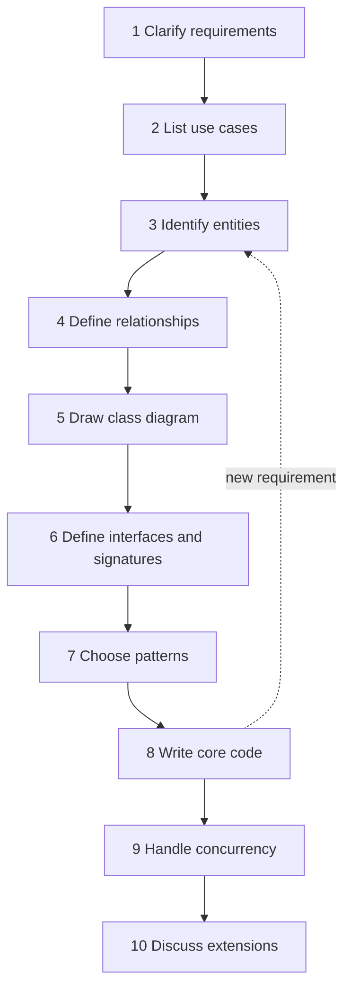
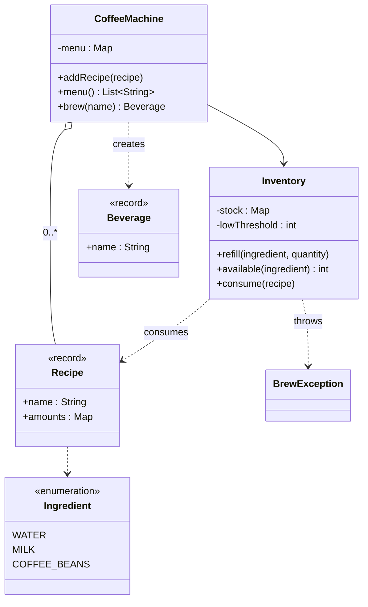

# How to Approach an LLD Interview

A low-level design (LLD) interview gives you a short problem statement, such as a parking lot or a vending machine. You have 45 to 60 minutes to design the classes, interfaces, and interactions, and to write the core code. This page gives one procedure with ten steps, a time budget, a scoring rubric, and a worked example. The pages in [`fundamentals/`](fundamentals/01-oop.md) give the background for each step.

## Why It Matters

Every LLD interview scores the same things in a different problem: whether you ask before you design, whether your classes have clear responsibilities, whether the design survives a changed requirement, and whether you can turn the design into working code in the time that you have. Candidates with strong knowledge of patterns still fail when they start to code at minute 3, or when they spend 30 minutes on a diagram and have no time for code. A fixed procedure removes this risk, because each minute has a purpose. On the job, the same steps apply to a design review of a new module: clarify, model, define contracts, then build.

## Core Concepts

**Low-level design (LLD)**: the design of the classes, interfaces, and interactions inside one program. HLD (high-level design) covers the services and data stores of a distributed system. See the [LLD index](README.md).

**Functional requirement**: a statement of what the system does. Example: "A customer brews a beverage by name."

**Non-functional requirement**: a statement of how well the system does it. Example: "Two customers can order at the same time, and the stock does not become negative."

**Use case**: one goal of one actor, written as a short sentence or a short sequence. Example: "The operator refills an ingredient." A use case becomes one public method, or a small group of methods.

**Actor**: a person or system that starts a use case.

**Entity**: a class that has an identity and a life cycle, for example `Order`. A **value object** has no identity and compares by value, for example `Money`. The [domain modeling page](fundamentals/05-domain-modeling.md) defines both and shows how to find them.

**Invariant**: a condition that must hold for every valid object. Example: "Stock is not negative." A class protects its own invariants. See [OOP](fundamentals/01-oop.md).

**Contract**: the promise of an interface: the method signatures, the accepted input, the result, and the errors. Callers rely on the contract and not on the implementation.

**Extension point**: a place in the design where a new variant is added with a new class and no edit to old code. This is the Open-Closed Principle in practice. See [SOLID](fundamentals/02-solid.md).

**Requirement smell**: a phrase in the problem statement that points to a design pattern. Example: "The behavior depends on the current state" points to State. Step 7 lists the smells.

### The ten steps

| Step | Name | Output | Fundamentals page |
|---|---|---|---|
| 1 | Clarify requirements | A short list of requirements, scope, and assumptions | |
| 2 | List use cases | One sentence per actor goal | |
| 3 | Identify entities | Nouns of the statement, sorted into entities, value objects, and enums | [Domain modeling](fundamentals/05-domain-modeling.md) |
| 4 | Define relationships | Has-a, is-a, uses, with multiplicity | [OOP](fundamentals/01-oop.md), [UML](fundamentals/04-uml-class-and-sequence-diagrams.md) |
| 5 | Draw the class diagram | One diagram of 5 to 10 classes | [UML](fundamentals/04-uml-class-and-sequence-diagrams.md) |
| 6 | Define interfaces and signatures | The public methods of each type | [SOLID](fundamentals/02-solid.md), [design principles](fundamentals/03-design-principles.md) |
| 7 | Choose patterns | The patterns that the requirement smells ask for | [Creational](fundamentals/06-creational-patterns.md), [structural](fundamentals/07-structural-patterns.md), [behavioral](fundamentals/08-behavioral-patterns.md) |
| 8 | Write the core code | Compiling classes for the main use cases | [Architectural patterns](fundamentals/10-architectural-patterns.md) |
| 9 | Handle concurrency | The shared state and its protection | [Concurrency in LLD](fundamentals/09-concurrency-in-lld.md) |
| 10 | Discuss extensions | Answers for three or four likely changes | [Anti-patterns](fundamentals/11-anti-patterns.md) |



The dotted arrow shows that a design is not a straight line. If the interviewer adds a requirement, you go back to the entities, change the model, and then continue.

## How It Works

### Step 1. Clarify requirements

Spend the first 5 minutes on questions. An LLD statement is short on purpose. The interviewer checks whether you find the gaps. Ask questions in groups, state your assumption for each answer, and write the list on the board.

| Group | Question to ask | Example for a parking lot |
|---|---|---|
| Scope | Which features are in scope, and which are out? | Do we include payment? Do we include a display board? |
| Actors | Who uses the system? | Driver, attendant, admin? |
| Scale | How big is one instance? | How many floors, how many spots? |
| Variants | Which kinds of the main thing exist? | Which vehicle types and spot types? |
| Rules | What are the exact rules? | How is the fee computed? What happens when the lot is full? |
| Failure | What happens on invalid input or on a conflict? | Unknown ticket? Two cars for one spot? |
| Concurrency | Do many users act at the same time? | Two entry gates assign spots at once? |
| Persistence | Is storage in memory or in a database? | In memory is enough? |
| Interface | How do callers use it? | A Java API, a console, a REST API? |
| Extensions | Which change is likely later? | New vehicle type? New pricing? |

Rules for this step:

- Ask closed questions that have a short answer ("Is payment in scope?"), because an open question ("What do you want?") wastes time.
- Write each answer as a numbered requirement. Label an unanswered question as an assumption: "Assumption: in-memory storage."
- Stop at 5 minutes. If the interviewer says "your choice", pick the simpler option and say so.

### Step 2. List use cases

Write one sentence for each actor goal. Use the verb-noun form.

```text
Operator: add a recipe, refill an ingredient
Customer: list the menu, brew a beverage
System:   alert when an ingredient is low
```

Each use case becomes a method or a small group of methods. The list also sets the scope of the code that you write in step 8: you implement the use cases that the interviewer ranks as core, and you only name the rest.

### Step 3. Identify entities

Take the nouns of the statement and the use cases. Sort each noun:

| Kind | Test | Example |
|---|---|---|
| Entity | Has an identity and a life cycle. Two objects with the same data are still two objects | `Order`, `Ticket` |
| Value object | Has no identity. Immutable. Equal if the data is equal | `Money`, `TimeSlot` |
| Enum | A fixed set of constants without behavior that changes the structure | `VehicleType` |
| Service | A verb-like class that holds a rule or a workflow | `FeeCalculator` |
| Not a class | An attribute of another class, or a detail that the statement does not need | "name", "color" |

The verbs show the responsibilities. Give each verb to the class that owns the data that the verb changes. A class with a vague name (`Manager`, `Handler`, `Util`) signals that you did not find the responsibility. See [domain modeling](fundamentals/05-domain-modeling.md) for noun-verb analysis on a full example.

### Step 4. Define relationships

For each pair of related classes, choose one relationship and state the multiplicity (how many on each side).

| Relationship | Meaning | Java shape | Test |
|---|---|---|---|
| Inheritance (is-a) | The subclass can replace the superclass everywhere | `extends` | Does the Liskov Substitution Principle hold? |
| Realization | A class implements an interface | `implements` | |
| Composition | The whole owns the part. The part ends with the whole | A `final` field that the whole creates | Does the part exist without the whole? If not, composition |
| Aggregation | The whole refers to parts that live on their own | A field that the whole receives | |
| Association | One object holds a reference to another | A field | |
| Dependency | A method uses a type for a short time | A parameter or a local variable | |

Prefer composition over inheritance. Use inheritance only for a true is-a relationship with a stable hierarchy. See [OOP](fundamentals/01-oop.md), and [UML class diagrams](fundamentals/04-uml-class-and-sequence-diagrams.md) for the notation.

### Step 5. Draw the class diagram

Draw a class diagram on the board with these rules:

- Show 5 to 10 classes. Show the key attributes and the key methods only.
- Show interfaces with their implementations, and the multiplicity of each association.
- Mark the extension points (the interfaces that have several implementations).
- Do not show getters, setters, or constructors.

The interviewer reads the diagram to check the model. A short diagram that you explain beats a long one that you copy from memory. The next steps (code) must match this diagram. If the code needs a class that the diagram does not show, update the diagram.

### Step 6. Define interfaces and signatures

Before you write any body, write the public method signatures of the main types. This is the contract. Decide:

- Input types: use a value object when two or more parameters travel together (`TimeSlot`, not two `LocalTime` parameters).
- Return types: return a result object or throw an exception. Do not return `null` for failure. Use `Optional` for a lookup that can find nothing.
- Errors: a domain-specific unchecked exception for a business failure (`BrewException`). `IllegalArgumentException` for a bad argument.
- Visibility: package-private by default. Make a method `public` only if a caller outside the package needs it.
- Dependencies: pass collaborators in through the constructor (dependency injection). The [architectural patterns page](fundamentals/10-architectural-patterns.md) explains why.

A signature sketch takes 3 to 5 minutes. It shows the interviewer that you design the API before the internals.

### Step 7. Choose patterns

A design pattern is a named solution to a design problem that repeats. Choose a pattern only when a requirement smell matches. A pattern with no smell is over-engineering. Use the table to map smells to patterns.

| Requirement smell | Pattern | Why | Page |
|---|---|---|---|
| "Behavior depends on the current state" (vending machine, order, elevator) | State | One class per state removes the `switch` on a status field | [Behavioral](fundamentals/08-behavioral-patterns.md) |
| "Several ways to do the same thing, chosen at run time" (pricing, spot allocation, split rules) | Strategy | A new way is a new class | [Behavioral](fundamentals/08-behavioral-patterns.md) |
| "When X changes, tell Y and Z" (display boards, low-stock alerts, status updates) | Observer | The source does not know its listeners | [Behavioral](fundamentals/08-behavioral-patterns.md) |
| "Pass a request along until someone handles it" (log levels, ATM notes, approval levels) | Chain of Responsibility | Each handler decides to act or to forward | [Behavioral](fundamentals/08-behavioral-patterns.md) |
| "Undo", "redo", "queue the action", "schedule the action" | Command | An action becomes an object | [Behavioral](fundamentals/08-behavioral-patterns.md) |
| "Same steps, one step differs" | Template Method | The base class fixes the order of steps | [Behavioral](fundamentals/08-behavioral-patterns.md) |
| "Save a snapshot and go back" | Memento | The object saves its own state | [Behavioral](fundamentals/08-behavioral-patterns.md) |
| "Many objects talk to each other" (chat room, air traffic) | Mediator | One object coordinates, the others do not know each other | [Behavioral](fundamentals/08-behavioral-patterns.md) |
| "Operation on every node of a tree, many operations" | Visitor | New operations without edits to node classes | [Behavioral](fundamentals/08-behavioral-patterns.md) |
| "Create an object, and the exact class depends on input" (vehicle, notification channel) | Factory Method, Simple Factory | The caller does not use `new` on a concrete class | [Creational](fundamentals/06-creational-patterns.md) |
| "Families of related objects that must match" (UI theme, database vendor) | Abstract Factory | The family changes together | [Creational](fundamentals/06-creational-patterns.md) |
| "Object with many optional fields" | Builder | Named steps, validation in `build()` | [Creational](fundamentals/06-creational-patterns.md) |
| "Exactly one instance" (logger, configuration) | Singleton, or dependency injection | Prefer injection, because Singleton hides state and hurts tests | [Creational](fundamentals/06-creational-patterns.md) |
| "Copy an existing object" | Prototype | Copy constructor or copy method | [Creational](fundamentals/06-creational-patterns.md) |
| "Add features in any combination" (toppings, notification wrappers) | Decorator | `n` classes and not `2^n` | [Structural](fundamentals/07-structural-patterns.md) |
| "Part and whole, same treatment" (file system, menu, organization chart) | Composite | A leaf and a group share one interface | [Structural](fundamentals/07-structural-patterns.md) |
| "Existing class, wrong interface" (legacy bank, third-party SDK) | Adapter | Translate in one place | [Structural](fundamentals/07-structural-patterns.md) |
| "Simple entry to a group of classes" (checkout, booking flow) | Facade | One method for one use case | [Structural](fundamentals/07-structural-patterns.md) |
| "Control access, load late, cache, check permission" | Proxy | Same interface, extra control | [Structural](fundamentals/07-structural-patterns.md) |
| "Millions of similar small objects" | Flyweight | Share the immutable part | [Structural](fundamentals/07-structural-patterns.md) |
| "Two dimensions that vary" (shape and color, device and remote) | Bridge | `k + c` classes, not `k × c` | [Structural](fundamentals/07-structural-patterns.md) |
| "The same null check repeats in many places" | Null Object | A do-nothing implementation replaces `null` | [Behavioral](fundamentals/08-behavioral-patterns.md) |

State each choice in one sentence with the rejected alternative: "I use Strategy for fee rules, because the interviewer said that pricing changes. A `switch` on vehicle type would force an edit in `FeeCalculator` for each new rule." The [creational page](fundamentals/06-creational-patterns.md), [structural page](fundamentals/07-structural-patterns.md), and [behavioral page](fundamentals/08-behavioral-patterns.md) show each pattern in Java.

!!! warning "Do not start from a pattern"
    The order is requirement, then smell, then pattern. A candidate who says "I will use Factory, Strategy, and Observer" before the requirements are clear shows that the candidate memorized a list.

### Step 8. Write the core code

Write the code for the main use cases first. Order:

1. Value objects and enums (short, no logic).
2. Interfaces from step 6.
3. The entity with the main invariant, with validation in the constructor.
4. The service class that runs the main use case.
5. A `main` method or a driver that runs one happy path and one failure.

Rules:

- Write compiling code, not pseudocode. If you run out of time, a class with a method body that throws `UnsupportedOperationException("not in scope")` is better than a missing class.
- Name each class after its role (`FeeCalculator`) and each method after its action (`brew`, not `process`).
- Keep each method short. If a method has more than one level of nesting, extract a method.
- Do not write getters and setters for every field. Give each class behavior. See [anti-patterns](fundamentals/11-anti-patterns.md) (anemic model) and [design principles](fundamentals/03-design-principles.md) (tell, don't ask).
- Write the code for the interviewer's top-ranked use cases. Name the others and move on.

For package layout and the layers (controller, service, repository), see [architectural patterns](fundamentals/10-architectural-patterns.md).

### Step 9. Handle concurrency

Ask one question for each class: "Do two threads change this object?" If yes, the object holds shared mutable state, and it needs protection. State the answer even if the interviewer did not ask.

1. Find the shared state (a stock count, a seat map, a counter).
2. Find the compound action (check, then change). A compound action is the point where a race appears.
3. Choose the simplest protection that makes the compound action one step: a `synchronized` method, a `ReentrantLock`, an atomic class, or a concurrent collection.
4. State the lock granularity (one lock for the whole object, or one lock per entity) and the reason.
5. State the deadlock risk if a method needs two locks, and the fix (a fixed lock order).

The [concurrency page](fundamentals/09-concurrency-in-lld.md) has the full comparison with runnable cases. Do not add threads to a design that has no concurrency requirement. Over-engineering costs points (see Red Flags).

### Step 10. Discuss extensions

Keep the last 2 to 5 minutes for extensions. For each likely change, name the class to add and the classes that stay unchanged. This proves the design is open for extension. The typical changes:

- A new variant of an existing thing (a new vehicle type, a new payment method).
- A new rule (a new discount, a new fee).
- A new notification or listener.
- A limit (a capacity, a rate, a timeout).
- A change of storage (from memory to a database).
- A concurrency requirement.

If a change forces an edit in many classes (shotgun surgery), say so and explain the redesign.

### Time budget

The budget is a recommendation, not a standard. Change the proportions if the interviewer asks for more code or more discussion.

| Phase | 45-minute round | 60-minute round |
|---|---|---|
| 1. Clarify requirements | 5 | 5 |
| 2-3. Use cases and entities | 7 | 8 |
| 4-5. Relationships and class diagram | 8 | 10 |
| 6. Interfaces and signatures | 5 | 6 |
| 7. Choose patterns | 3 | 4 |
| 8. Core code | 12 | 17 |
| 9. Concurrency | 3 | 5 |
| 10. Extensions | 2 | 5 |
| **Total** | **45** | **60** |

Checkpoints for a 45-minute round: by minute 12, the entity list is on the board. By minute 20, the diagram is done. By minute 28, you start code. If you are behind at a checkpoint, cut the next phase and say that you cut it.

### What interviewers score

Companies publish no common rubric for LLD interviews. The rubric below is this KB's model of the criteria that interview guides and candidate reports repeat. It is a study tool and not an official standard.

| Criterion | Strong signal | Weak signal |
|---|---|---|
| Requirements | Asks 5 to 10 targeted questions, states assumptions, limits scope | Starts to draw at once, or asks no question |
| Domain model | Entities match the statement. Responsibilities are clear. Value objects and enums are used | One god class. Classes named `Manager` or `Helper`. Anemic data classes |
| Design quality | Interfaces at the extension points. Composition over inheritance. SOLID without a lecture | Deep inheritance. `if` chains on type. Patterns with no reason |
| Pattern use | A pattern for each smell, and a rejected alternative | A pattern for its own sake. Wrong pattern name |
| Code quality | Compiles. Short methods. Clear names. Validation. Error handling | Pseudocode. Long methods. `null` returns. Public mutable fields |
| Extensibility | Answers each change with "add a class" | Each change needs edits in many classes |
| Concurrency and edge cases | Names the shared state and the protection. Handles invalid input | Ignores races, or locks everything with no reason |
| Communication | Explains each choice, reacts to hints, uses the board | Silent for minutes. Defends a wrong choice |

### How to talk while designing

- Say the step that you are in: "I am at the entities step. I see four nouns."
- Give each decision a reason and an alternative: "I use composition here, because a `Latte` is not a kind of machine."
- Pause after each phase and ask: "Does this match what you expect?" A short check costs 10 seconds and finds a misunderstanding early.
- When you are stuck, say what you know and what blocks you. The interviewer then gives a hint, and a hint that you use well scores as a positive signal.
- When the interviewer questions a choice, treat it as information. Say "that is a good point, I would change X to Y" if the point is right. Explain your reason if you think the choice is right.
- Do not read your code aloud line by line. Describe the intent of each class in one sentence.
- Write the code in the order that the explanation follows, so the interviewer can follow it.

### Red flags during the round

- A start to code before the requirements are clear.
- A single class that holds everything (`ParkingLotManager` with 30 methods).
- A `switch` or `if` chain on a type field in the main logic.
- Public mutable fields, or a setter for every field.
- Singletons everywhere for convenience.
- Static methods and static state for business logic.
- An inheritance tree three levels deep for variation that composition handles.
- No handling of invalid input or failure.
- A silent period of more than two minutes.
- A design with no answer to "what if this changes?"

## Trade-offs and When to Use

The procedure is a default. These variants exist, and each fits a different round.

| Choice | Option A | Option B | Recommendation |
|---|---|---|---|
| Order of work | Top-down: diagram, signatures, then code | Code first, diagram after | Top-down for a 45-minute whiteboard round. Code first only in a round where the interviewer wants running code (see [machine coding round](machine-coding-round.md)) |
| Diagram detail | Names only | Names, fields, and methods | Names and the key methods. Full detail costs time |
| When to name patterns | At the start | When a smell appears | When a smell appears |
| Depth of code | Every use case | The core use cases, with the others named | The core use cases. The interviewer ranks them |
| Concurrency | Full lock design | Only if the requirement asks, or one sentence | State the shared state in one or two sentences. Code the lock only if the requirement asks or time remains |
| Interfaces | An interface for every class | An interface at the extension points | At the extension points. An interface with one implementation and no planned variant is noise |
| Storage | A repository interface | A map in the service | A map in the service for a whiteboard round. A repository interface for a machine-coding round |

The procedure does not fit these cases:

- **HLD questions in disguise.** If the interviewer asks about databases, shards, or queues between services, the round is an HLD round. Ask: "Do you want classes in one process or services across machines?" The HLD pages cover the second case.
- **Algorithm-heavy problems** (LRU cache, rate limiter, debt simplification). The design is small, and the algorithm decides the result. Spend more time on the data structure and its complexity.
- **Frameworks.** An interviewer who says "use Spring" wants annotations and layers. Keep the same steps and add the layers from the [architectural patterns page](fundamentals/10-architectural-patterns.md).

## Java Example

The worked example is a coffee machine. The statement, as the interviewer says it: "Design a coffee machine. It makes beverages from ingredients. The operator can refill ingredients. A customer picks a beverage and gets it, or gets an error."

### Step 1: requirements and assumptions

| # | Requirement | Source |
|---|---|---|
| R1 | The operator adds recipes. A recipe has a name and an amount for each ingredient | Statement |
| R2 | The operator refills an ingredient | Statement |
| R3 | A customer lists the menu and brews a beverage by name | Statement |
| R4 | If the name is unknown, the machine reports an error | Question: "What if the customer picks an unknown beverage?" |
| R5 | If any ingredient is short, the machine reports which one, and the stock does not change | Question: "Does a failed order use some stock?" Answer: no |
| R6 | The machine alerts when an ingredient falls below a threshold | Question: "Should the machine report low stock?" Answer: yes |
| R7 | Several customers brew at the same time. The stock does not become negative | Question: "Is it used by many customers at once?" Answer: yes |
| A1 | Assumption: in-memory storage, one machine, no payment, a fixed set of three ingredients | Out of scope, stated to the interviewer |
| A2 | Assumption: all amounts are positive whole numbers (milliliters or grams) | |

### Step 2: use cases

```text
Operator: add a recipe (R1), refill an ingredient (R2)
Customer: list the menu (R3), brew a beverage (R3, R4, R5)
System:   alert on low stock (R6)
```

### Step 3: entities

Nouns: machine, beverage, recipe, ingredient, stock, threshold, alert, operator, customer.

| Noun | Decision | Reason |
|---|---|---|
| `CoffeeMachine` | Entity (the entry point) | Owns the menu, and runs "brew" |
| `Ingredient` | Enum | A fixed set (assumption A1). If the operator adds ingredients at run time, it becomes a class |
| `Recipe` | Value object (`record`) | Name plus amounts. Immutable. Equal if the data is equal |
| `Beverage` | Value object (`record`) | The result of a brew. Has only a name |
| `Inventory` | Entity | Holds the stock. Owns the invariant "stock is not negative" |
| Alert | Not a class. A callback | One method call. A class would add no behavior |
| Operator, customer | Not classes | They are actors, and they call the machine |

The central decision: a beverage type is **data** (a `Recipe`), not a subclass. A design with `class Latte extends Beverage` needs a new class for each menu item and breaks the Open-Closed Principle. The behavior of all beverages is the same: take the amounts from the stock.

### Step 4: relationships

- `CoffeeMachine` has an `Inventory` (association). The machine receives it in the constructor, so a test passes a different one.
- `CoffeeMachine` has many `Recipe` objects (aggregation, multiplicity 0..*), keyed by name.
- `Recipe` refers to `Ingredient` constants with amounts (dependency on the enum).
- `Inventory` reports low stock through a `Consumer<Ingredient>` (a functional interface from the JDK), which is the Observer pattern in its smallest form.

### Step 5: class diagram



### Step 6: interfaces and signatures

The signature sketch comes before any body. Each method states its input and its failure.

```java
interface BeverageDispenser {
    // R1: throws IllegalArgumentException if the recipe is invalid.
    void addRecipe(Recipe recipe);

    // R3: the names of the recipes, sorted.
    List<String> menu();

    // R3-R5: throws BrewException for an unknown name or for short stock.
    Beverage brew(String name);
}

interface StockKeeper {
    // R2: throws IllegalArgumentException if the quantity is not positive.
    void refill(Ingredient ingredient, int quantity);

    int available(Ingredient ingredient);

    // R5, R7: takes all ingredients of the recipe or none, as one step.
    void consume(Recipe recipe);
}

enum Ingredient { WATER, MILK, COFFEE_BEANS }

record Recipe(String name, Map<Ingredient, Integer> amounts) { }

record Beverage(String name) { }
```

The final program below does not use the two interfaces, because a machine with one implementation of each does not need them. The sketch shows the contract, and a candidate keeps the interfaces only if a second implementation is likely (see the trade-offs table).

### Step 7: patterns

| Smell in the statement | Pattern | Decision |
|---|---|---|
| "Alerts when an ingredient is low" | Observer | Yes, as a `Consumer<Ingredient>` callback. One listener, so no listener list |
| "Beverages differ" | Strategy or subclasses | Rejected. Recipes are data, and all beverages use the same algorithm |
| "The machine is idle or brewing" | State | Rejected. The statement has no state that changes the behavior. If the interviewer adds outlets, heating, or maintenance mode, add State |
| "Create a beverage" | Factory | Rejected. A `Beverage` is a record that has only a name |

### Steps 8 and 9: core code and concurrency

The code below is the complete program. It follows the diagram. The concurrency decision is in `Inventory`:

- The shared mutable state is the `stock` map.
- The compound action is "check all ingredients, then take them". Without protection, two threads both check 30 ml of water, both pass, and both take it. The stock then becomes negative.
- Every method of `Inventory` is `synchronized`, so the check and the take run as one step. One machine has one inventory, so one lock is enough (lock granularity: the whole inventory). A lock for each ingredient would need a fixed lock order to avoid deadlock, and it would give no gain for three ingredients.
- The loop over `Ingredient.values()` gives a fixed order, so the error message and the alert order do not depend on map iteration order.
- The listener runs inside the lock. A slow listener would block all brews. Step 10 names this limit.

```java
import java.util.ArrayList;
import java.util.EnumMap;
import java.util.List;
import java.util.Map;
import java.util.concurrent.ConcurrentSkipListMap;
import java.util.concurrent.atomic.AtomicInteger;
import java.util.function.Consumer;

class CoffeeMachineDemo {
    public static void main(String[] args) throws InterruptedException {
        List<String> alerts = new ArrayList<>();
        Inventory inventory = new Inventory(20, ingredient -> alerts.add("LOW " + ingredient));
        inventory.refill(Ingredient.WATER, 200);
        inventory.refill(Ingredient.MILK, 300);
        inventory.refill(Ingredient.COFFEE_BEANS, 60);

        CoffeeMachine machine = new CoffeeMachine(inventory);
        machine.addRecipe(new Recipe("espresso",
                Map.of(Ingredient.WATER, 30, Ingredient.COFFEE_BEANS, 18)));
        machine.addRecipe(new Recipe("latte",
                Map.of(Ingredient.WATER, 30, Ingredient.COFFEE_BEANS, 18, Ingredient.MILK, 150)));

        System.out.println("Menu: " + machine.menu());
        for (String order : List.of("espresso", "latte", "latte", "latte", "mocha")) {
            try {
                System.out.println("Served: " + machine.brew(order).name());
            } catch (BrewException e) {
                System.out.println("Failed: " + e.getMessage());
            }
        }
        System.out.println("Water left: " + inventory.available(Ingredient.WATER));
        System.out.println("Alerts: " + alerts);

        // Concurrency check: stock for exactly 5 espressos, 20 threads compete.
        Inventory shared = new Inventory(0, ingredient -> { });
        shared.refill(Ingredient.WATER, 150);
        shared.refill(Ingredient.COFFEE_BEANS, 90);
        CoffeeMachine busy = new CoffeeMachine(shared);
        busy.addRecipe(new Recipe("espresso",
                Map.of(Ingredient.WATER, 30, Ingredient.COFFEE_BEANS, 18)));
        AtomicInteger served = new AtomicInteger();
        AtomicInteger failed = new AtomicInteger();
        List<Thread> threads = new ArrayList<>();
        for (int i = 0; i < 20; i++) {
            Thread t = new Thread(() -> {
                try {
                    busy.brew("espresso");
                    served.incrementAndGet();
                } catch (BrewException e) {
                    failed.incrementAndGet();
                }
            });
            threads.add(t);
            t.start();
        }
        for (Thread t : threads) {
            t.join();
        }
        System.out.println("Concurrent: served=" + served + " failed=" + failed);
    }
}

enum Ingredient { WATER, MILK, COFFEE_BEANS }

record Recipe(String name, Map<Ingredient, Integer> amounts) {
    Recipe {
        if (name == null || name.isBlank()) {
            throw new IllegalArgumentException("Recipe name is required");
        }
        if (amounts.isEmpty()) {
            throw new IllegalArgumentException("Recipe needs at least one ingredient");
        }
        amounts.forEach((ingredient, quantity) -> {
            if (quantity <= 0) {
                throw new IllegalArgumentException("Quantity must be positive: " + ingredient);
            }
        });
        amounts = Map.copyOf(amounts);
    }
}

record Beverage(String name) { }

class BrewException extends RuntimeException {
    BrewException(String message) {
        super(message);
    }
}

class Inventory {
    private final Map<Ingredient, Integer> stock = new EnumMap<>(Ingredient.class);
    private final int lowThreshold;
    private final Consumer<Ingredient> lowStockListener;

    Inventory(int lowThreshold, Consumer<Ingredient> lowStockListener) {
        this.lowThreshold = lowThreshold;
        this.lowStockListener = lowStockListener;
    }

    synchronized void refill(Ingredient ingredient, int quantity) {
        if (quantity <= 0) {
            throw new IllegalArgumentException("Refill quantity must be positive");
        }
        stock.merge(ingredient, quantity, Integer::sum);
    }

    synchronized int available(Ingredient ingredient) {
        return stock.getOrDefault(ingredient, 0);
    }

    // All or nothing: check every ingredient first, then take them in one step.
    synchronized void consume(Recipe recipe) {
        for (Ingredient ingredient : Ingredient.values()) {
            int needed = recipe.amounts().getOrDefault(ingredient, 0);
            if (needed > available(ingredient)) {
                throw new BrewException("Not enough " + ingredient + ": need " + needed
                        + ", have " + available(ingredient));
            }
        }
        for (Ingredient ingredient : Ingredient.values()) {
            int needed = recipe.amounts().getOrDefault(ingredient, 0);
            if (needed == 0) {
                continue;
            }
            int left = stock.merge(ingredient, -needed, Integer::sum);
            if (left < lowThreshold) {
                lowStockListener.accept(ingredient);
            }
        }
    }
}

class CoffeeMachine {
    private final Map<String, Recipe> menu = new ConcurrentSkipListMap<>();
    private final Inventory inventory;

    CoffeeMachine(Inventory inventory) {
        this.inventory = inventory;
    }

    void addRecipe(Recipe recipe) {
        menu.put(recipe.name(), recipe);
    }

    List<String> menu() {
        return List.copyOf(menu.keySet());
    }

    Beverage brew(String name) {
        Recipe recipe = menu.get(name);
        if (recipe == null) {
            throw new BrewException("Unknown beverage: " + name);
        }
        inventory.consume(recipe);
        return new Beverage(name);
    }
}
```

<!-- expected-output -->
```text
Menu: [espresso, latte]
Served: espresso
Served: latte
Served: latte
Failed: Not enough MILK: need 150, have 0
Failed: Unknown beverage: mocha
Water left: 110
Alerts: [LOW MILK, LOW COFFEE_BEANS]
Concurrent: served=5 failed=15
```

Read the output against the requirements:

| Output line | Requirement |
|---|---|
| `Menu: [espresso, latte]` | R3 (the menu is sorted because the map is a `ConcurrentSkipListMap`) |
| Three `Served` lines | R3 |
| `Failed: Not enough MILK` | R5. The third latte took the last milk, so the fourth latte fails on milk |
| `Water left: 110` | R5. Three brews took 30 ml each: 200 minus 90 is 110. The failed latte took no water |
| `Failed: Unknown beverage: mocha` | R4 |
| `Alerts: [LOW MILK, LOW COFFEE_BEANS]` | R6. After the second latte, milk is 0 and beans are 6, both below 20. Water (110) is not |
| `served=5 failed=15` | R7. The stock covers exactly 5 espressos. The lock lets exactly 5 threads succeed |

### Step 10: extensions

| Change | Classes to add or change | Classes that stay |
|---|---|---|
| The machine has N outlets, so at most N brews run at once | Add a `Semaphore` field to `CoffeeMachine`. `brew` calls `acquire` and `release` in a `try`/`finally` | `Inventory`, `Recipe` |
| Beverages have a price and payment | Add a `PaymentMethod` interface (Strategy) and a `price` field to `Recipe` | `Inventory` |
| The operator adds new ingredients at run time | Change `Ingredient` from an enum to a record with an id. `Inventory` iterates over the recipe amounts, in a sorted order | `CoffeeMachine` |
| Size variants (small, large) | Add a `Size` enum with a multiplier. `Recipe.scaled(Size)` returns a new recipe | `Inventory` |
| The machine has modes (idle, brewing, cleaning, out of service) | Add a `MachineState` interface (State). `CoffeeMachine` delegates `brew` to the current state | `Inventory`, `Recipe` |
| Low-stock alerts go to several listeners, or to a slow channel | Replace the `Consumer` with a listener list, and call listeners after the lock is released, or on an executor | `CoffeeMachine`, `Recipe` |
| Persistent recipes | Add a `RecipeRepository` interface. Inject it in `CoffeeMachine` | `Inventory` |

This table is what you say in the last two minutes of the round.

## Interview Angle

### Questions

??? question "Walk me through how you approach an LLD problem."

    Answer in the order of the ten steps, with the purpose of each.

    1. I clarify requirements for about 5 minutes: scope, actors, scale, rules, failure, concurrency. I write the answers as numbered requirements and label my assumptions.
    2. I list the use cases, one sentence for each actor goal.
    3. I take the nouns and verbs of the statement, and sort the nouns into entities, value objects, and enums. I give each verb to the class that owns the data.
    4. I define the relationships: composition, aggregation, inheritance, and the multiplicities. I prefer composition.
    5. I draw a class diagram of 5 to 10 classes.
    6. I write the public signatures: inputs, results, errors. This is the contract.
    7. I choose a design pattern only where a requirement smell asks for it, and I name the rejected alternative.
    8. I write the core code for the main use cases.
    9. I find the shared mutable state and protect each compound action.
    10. I finish with extensions: for each change, the class to add and the classes that stay.

    The reason for this order: each step produces the input of the next step, and the interviewer sees the reasoning before the code.

??? question "What questions do you ask first?"

    I ask questions in groups, and I state my assumption after each answer.

    - Scope: which features are in, which are out.
    - Actors: who uses the system.
    - Scale: how many floors, items, or users in one instance.
    - Variants: which types of the main thing exist.
    - Rules: the exact rules, for example how a fee is computed.
    - Failure: what happens on invalid input, on a conflict, and when a resource is full.
    - Concurrency: whether several users act at the same time.
    - Storage and interface: in memory or a database, a Java API or a console.
    - Extensions: which change is likely later.

    I stop at 5 minutes. For an answer like "your choice", I choose the simpler option and say so. I write each answer as a numbered requirement so that I can trace code back to it.

??? question "How do you find the entities and their responsibilities?"

    I underline the nouns in the statement, and I sort them: an entity has an identity and a life cycle, a value object compares by data and is immutable, an enum is a fixed set of constants, and some nouns are only attributes. Then I take the verbs, and I give each verb to the class that owns the data that the verb changes. I check two things. First, the class name is a specific noun, not `Manager` or `Helper`. Second, I can state the class responsibility in one sentence without "and". If I cannot, the class has two responsibilities and I split it. In the coffee machine, "stock is not negative" belongs to `Inventory`, because `Inventory` owns the stock.

??? question "How do you decide which design patterns to use?"

    I start from the requirement and not from the pattern. I look for a smell in the statement: "behavior depends on the state" means State, "several ways to compute the same thing" means Strategy, "tell several parties when something changes" means Observer, "pass the request until someone handles it" means Chain of Responsibility. If no smell matches, I use no pattern. For each pattern that I use, I give the reason and the rejected alternative. For example: "Strategy for the fee rule, because the interviewer said that pricing changes. The alternative is a `switch` on the vehicle type, and each new rule would edit `FeeCalculator`." A pattern that I cannot justify with a requirement is over-engineering, and interviewers score it down.

??? question "How much UML do you draw in a 45-minute round?"

    One class diagram of 5 to 10 classes, drawn in about 5 to 8 minutes. It shows class names, the key attributes, the key methods, interfaces with their implementations, and the multiplicity on each association. I show the extension points. I leave out getters, setters, and constructors. I draw a sequence diagram only for one complicated flow, if the interviewer asks or if the flow involves three or more objects. The diagram is a tool to check the model. The code must match it, and I update the diagram if the code changes the design. See [UML class and sequence diagrams](fundamentals/04-uml-class-and-sequence-diagrams.md).

??? question "The interviewer adds a requirement at minute 35. What do you do?"

    I state which part of the design the new requirement touches, and I do not start to code at once. First I classify it: a new variant (add a class that implements an existing interface), a new rule (add a Strategy), a new listener (add an Observer), a new limit (add a check in one place), or a change that crosses the model (change an entity). Then I name the classes to add and the classes that stay unchanged. If the design is open for extension, the answer is "I add one class". If the change forces edits in many classes, I say that the model missed something, and I explain the change to the model. Then I write the code for the change if time remains. See [SOLID](fundamentals/02-solid.md) for the Open-Closed Principle.

??? question "How do you handle concurrency in an interview without over-engineering?"

    I ask one question for each class: "Do two threads change this object?" If no class has shared mutable state, I say so and stop. If one does, I name the state, I name the compound action (check, then change), and I choose the simplest protection that makes the action one step. For one machine or one lot, a `synchronized` method or one lock is correct, and I say why a lock per entity is not worth it. If a method needs two locks, I name the deadlock risk and fix it with a fixed lock order. I avoid threads, executors, and lock-free code unless the requirement asks for them. See [concurrency in LLD](fundamentals/09-concurrency-in-lld.md).

??? question "What do you do when you run out of time?"

    I decide at the checkpoints, not at the end. If I am behind at minute 20 of a 45-minute round, I cut the diagram detail. If I am behind at minute 28, I write the code for the single most important use case, and I write the other methods as signatures. I tell the interviewer what I cut and why: "I skip the display board and show the allocation and exit flow. The display board is an Observer, and this is how I would add it." Compiling code for one use case with named gaps scores higher than pseudocode for all use cases.

??? question "What is the difference between an LLD interview and an HLD interview?"

    An LLD interview designs the classes, interfaces, and code of one program, for example a parking lot or a rate limiter class. The output is a class diagram and working code, and the scoring focuses on the object model, SOLID, patterns, and extensibility. An HLD interview designs a distributed system, for example a URL shortener at scale. The output is components, data stores, APIs, and capacity estimates, and the scoring focuses on scalability, consistency, and availability. Some problems appear in both (a rate limiter, a notification service). In that case the LLD version designs the classes and the algorithm, and the HLD version designs the services, the shared state, and the failure handling. If I am not sure, I ask the interviewer which one is meant.

??? question "When do you choose inheritance, and when composition?"

    I choose inheritance only for a true is-a relationship where a subclass can replace the superclass everywhere (the Liskov Substitution Principle) and the hierarchy is stable. I choose composition when I want to reuse behavior or to vary behavior at run time: the class holds a collaborator through an interface, and I swap the collaborator. In the coffee machine, a latte is not a subclass of an espresso. It is a recipe with different amounts, so it is data. Deep hierarchies and subclasses that override methods to do nothing are the signs of wrong inheritance. See [OOP](fundamentals/01-oop.md) and [anti-patterns](fundamentals/11-anti-patterns.md).

### Follow-up Questions

??? question "Why do you not use a `switch` on the beverage name in `brew`?"

    A `switch` on a type or name forces an edit in `brew` for each new beverage, which breaks the Open-Closed Principle. With recipes as data, a new beverage is one new `Recipe` object and no code change.

??? question "Why is `Ingredient` an enum, and when would you change it?"

    The ingredients are a fixed set in the stated scope, and an enum gives type safety and an ordered `values()` array. If the operator must add ingredients at run time, the set is not fixed, and I change the enum to a record with an id.

??? question "What is wrong with calling the listener inside the lock?"

    The listener runs while the inventory lock is held. A slow listener blocks all brews, and a listener that calls back into the inventory from another thread can deadlock. The fix is to collect the low ingredients inside the lock and call the listeners after the lock is released, or to hand the alert to an executor.

??? question "How would you test this design?"

    I test the use cases through the public API. A test for R5 brews a latte with too little milk, expects a `BrewException`, and checks that the water stock did not change. A test for R7 starts many threads against stock for a known number of brews, joins them, and checks that the count of successes equals that number. A test for R6 passes a listener that records the alerts. Because `Inventory` receives its listener in the constructor, no mock library is needed.

??? question "The interviewer says: do it with Strategy for each beverage. What do you answer?"

    I ask what varies. If the brewing algorithm is the same for all beverages and only the amounts differ, a Strategy class for each beverage has no behavior to vary, and data is the better model. If the interviewer adds a rule that does vary (for example, a milk step that foams for a latte and not for an espresso), I add a `BrewStep` Strategy to the recipe. The change follows the requirement.

### Red Flags

- Coding before the requirements are clear, or after only one question.
- Reciting the names of patterns before the requirements.
- A god class such as `CoffeeMachineManager` that owns the stock, the menu, the alerts, and the parsing.
- A subclass for each menu item (`Latte extends Beverage`), or a `switch` on a type field.
- `double` for money, `null` for failure, public mutable fields, setters for every field.
- No error handling: the unknown beverage and the short stock cases are not handled.
- Threads added with no requirement, or a global `synchronized` on everything with no reason.
- No answer for "what if this changes?"
- Silence for minutes, or an argument that the interviewer's hint is wrong, without a reason.

## Common Mistakes

| Mistake | Why it hurts | Fix |
|---|---|---|
| Skipping the clarification step | The design solves the wrong problem, and the interviewer sees no judgment | Spend 5 minutes on grouped questions, and write assumptions |
| Spending 20 minutes on the diagram | No time for code, and the round has no working output | Limit the diagram to 5 to 10 classes and 8 minutes. Set checkpoints |
| Choosing patterns first | The design has patterns that no requirement needs | Use the smell table. Name the rejected alternative |
| One class for everything | Many reasons to change, and the code is hard to test | One responsibility for each class. Test with the "and" check |
| Inheritance for variation | Class explosion, and fragile base classes | Composition, with data or an interface for the variant |
| An interface for every class | Noise, and the diagram is hard to read | An interface at the extension points only |
| Anemic classes with getters and setters, and all logic in a service | The invariants are not protected | Put behavior with the data. See [anti-patterns](fundamentals/11-anti-patterns.md) |
| Returning `null` or an error code for failure | Callers forget the check | Throw a domain exception, or return `Optional` for a lookup |
| Ignoring concurrency | A race in a shared-state design is a major flaw | Find the shared state and the compound action. State the protection |
| Over-engineering the concurrency | Locks and threads hide the design | The simplest protection that makes the compound action atomic |
| No answer to extensions | The interviewer cannot see that the design is open | Prepare "add a class, change nothing else" answers in step 10 |
| Writing pseudocode | Not compilable, and details are hidden | Write real Java, with the bodies of the core methods |
| Talking to the board and not to the interviewer | The interviewer cannot give hints | State each step, and check in after each phase |

## Commonly Confused With

| Looks like | Difference | Deciding question |
|---|---|---|
| LLD round vs HLD round | LLD designs classes and code in one program. HLD designs services, data stores, and scale | Is the output a class diagram and code, or a component diagram and estimates? |
| LLD whiteboard round vs [machine-coding round](machine-coding-round.md) | The whiteboard round is 45 to 60 minutes with a discussion. The machine-coding round is a longer timed session that produces running code, then a review | Is the code run by the evaluator? |
| LLD vs DSA round | A DSA round scores the algorithm and its complexity. An LLD round scores the model, the contracts, and the extensibility | Does the problem statement ask for an efficient algorithm, or for a model? |
| Use case vs requirement | A requirement states a rule or a quality. A use case states one goal of one actor. One use case can need several requirements | Is the sentence an actor's goal? |
| Entity vs value object | An entity has an identity. A value object compares by data | Are two objects with equal data the same thing? |
| Class diagram vs sequence diagram | A class diagram shows structure. A sequence diagram shows the order of calls in one scenario | Do I show what exists or what happens? |
| Design pattern vs design principle | A principle (SOLID, DRY) is a rule to judge a design. A pattern is a named solution for a repeated problem | Is it a rule to check or a structure to build? See [SOLID](fundamentals/02-solid.md) and [design principles](fundamentals/03-design-principles.md) |

## Quick Reference Card

Read this before an interview.

**The ten steps**

1. Clarify (5 min): scope, actors, scale, variants, rules, failure, concurrency, storage, extensions.
2. Use cases: one sentence per actor goal.
3. Entities: nouns into entity, value object, enum, or attribute. Verbs go to the owner of the data.
4. Relationships: prefer composition. Inheritance only for a true is-a.
5. Diagram: 5 to 10 classes.
6. Signatures: inputs, results, errors. Value objects for grouped parameters.
7. Patterns: smell first, then pattern, then the rejected alternative.
8. Code: compiling, core use cases, behavior with data.
9. Concurrency: shared state, compound action, simplest protection, lock order.
10. Extensions: add a class, change nothing else.

**Time (45 min)**: 5 / 7 / 8 / 5 / 3 / 12 / 3 / 2. Checkpoints at minutes 12, 20, and 28.

**Smell to pattern**: state changes behavior - State. Many ways - Strategy. Notify - Observer. Pass along - Chain of Responsibility. Undo - Command. Optional fields - Builder. Add features - Decorator. Tree - Composite. Wrong interface - Adapter. One entry - Facade.

**Say out loud**: the step, the reason, the rejected alternative, the extension.

**Avoid**: coding at minute 3, god classes, `switch` on type, setters everywhere, `null` for failure, patterns with no smell, threads with no requirement.

## Further Reading

- Gamma, Helm, Johnson, Vlissides. *Design Patterns: Elements of Reusable Object-Oriented Software*. Addison-Wesley, 1994. The source of the pattern names and the intent statements in the smell table.
- Robert C. Martin. *Agile Software Development, Principles, Patterns, and Practices*. Prentice Hall, 2002. The source text for the SOLID principles that step 6 and the rubric use.
- [Mermaid class diagram syntax](https://mermaid.js.org/syntax/classDiagram.html). The notation for step 5.
- [Mermaid sequence diagram syntax](https://mermaid.js.org/syntax/sequenceDiagram.html). The notation for a flow diagram.
- [JLS 8.10 Record Classes](https://docs.oracle.com/javase/specs/jls/se21/html/jls-8.html#jls-8.10). The rules for the canonical constructor and the compact form that the `Recipe` record uses.
- [`java.util.concurrent.ConcurrentSkipListMap` javadoc (Java 21)](https://docs.oracle.com/en/java/javase/21/docs/api/java.base/java/util/concurrent/ConcurrentSkipListMap.html). The sorted, thread-safe map in the example.
- [`java.util.EnumMap` javadoc (Java 21)](https://docs.oracle.com/en/java/javase/21/docs/api/java.base/java/util/EnumMap.html). The map that iterates in the order of the enum constants.
- [`java.util.Map.copyOf` in the `Map` javadoc (Java 21)](https://docs.oracle.com/en/java/javase/21/docs/api/java.base/java/util/Map.html). The unmodifiable copy for the defensive copy in `Recipe`.
- [JLS 17.4 Memory Model](https://docs.oracle.com/javase/specs/jls/se21/html/jls-17.html#jls-17.4). Why `synchronized` gives both atomicity and visibility.

Case studies that apply this procedure: `kb/lld/case-studies/01-parking-lot/README.md`, `kb/lld/case-studies/07-vending-machine/README.md`, `kb/lld/case-studies/04-elevator-system/README.md`. For the long-form coding round, read the [machine-coding round](machine-coding-round.md) page.
