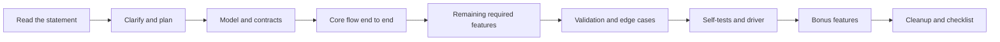

# The Machine-Coding Round

A machine-coding round is a timed coding session in which you build a small working program from a written requirement list. The session lasts 90 to 120 minutes in the reports that candidates publish. This page describes the format, the scoring criteria, the package layout, the test options, a time plan, a submission checklist, and the reasons for rejection. For the 45-minute whiteboard version of LLD, read [how to approach LLD](how-to-approach-lld.md).

## Why It Matters

Several Indian product companies are reported to use a machine-coding round before or next to the system design rounds. The round decides the result for many candidates, because a program that does not run fails the round, however good the ideas are. The skills also apply on the job: you break a requirement list into modules, you keep the code easy to change, and you show that the program works. The round rewards a plan, a clean structure, and discipline with time more than it rewards knowledge of patterns.

## Core Concepts

**Machine-coding round**: a timed session in which the candidate writes a working program on their own machine, in a language of choice, from a requirement document. A review with the interviewer follows.

**Requirement document**: the written problem. It lists the required features, often some bonus features, the input format, and the expected output.

**Bonus requirement**: a feature that the document marks as optional. Do the required features first.

**Driver class** (also called a demo class or `Main`): a class with a `main` method that runs the program through its public API, with fixed or parsed input, and prints the results.

**In-memory repository**: a class that stores objects in a collection such as a `Map`, behind an interface, so that a database could replace it later.

**Package layout**: the way that the source files are grouped into folders (packages) by role, for example `model`, `repository`, `service`, `exception`.

**Self-test**: code that checks the behavior of the program and fails with a clear message if the behavior is wrong. A self-test uses the `assert` statement, a small check helper, or a test framework.

**Review (or evaluation) discussion**: the 15 to 30 minute conversation after the coding time. The interviewer reads the code, asks for an explanation, and asks for a new requirement.

**Extensibility**: the property that a new requirement needs new code and a small change to old code.

### The format, from public sources

The sources below are accounts of candidates and interview-preparation sites. They are not statements of the companies. The format changes between companies, roles, and years, so read the recruiter's mail for the real rules.

| Source | What it reports | Detail |
|---|---|---|
| [Udaan SDE-1 experience (GeeksforGeeks, 2021)](https://www.geeksforgeeks.org/?p=561821) | A candidate's account of the Udaan machine-coding round | 90 minutes of coding and 30 minutes of evaluation or explanation. Task: a program that calls a news API and shows headlines, search results, and sources. Object-oriented design was required, and any language was allowed. The code had to run without compile errors and show all the functions. The author lists clean, extensible code and good modeling as goals |
| [PhonePe interview process (DesignGurus)](https://www.designgurus.io/answers/detail/what-is-the-phonepe-interview-process-like-round-by-round) | A summary of candidate reports for PhonePe | The round is reported at about 90 minutes, followed by a review of about 15 to 30 minutes. The page lists "working code, class design, extensibility" as the focus. One report mentions a requirement to add a feature without a rewrite of the existing classes. Some reports say up to two hours |
| [Flipkart interview process (DesignGurus)](https://www.designgurus.io/answers/detail/what-is-the-flipkart-interview-process-like-round-by-round) | A summary of candidate reports for Flipkart | 90 to 120 minutes, and a longer session for some senior candidates. A console application. Several reports say that the candidate uses their own laptop and editor. Classes must have sensible separation, and a new requirement must be possible without a rewrite |

The common points in these three sources:

- The input is a written requirement list.
- You write the code on your own machine. The language is often free, and you can write in Java.
- The code must compile and run.
- A review discussion with the interviewer follows the coding time.
- The scoring covers working code, class design, and extensibility.

### What evaluators score

No company publishes its rubric. The table below is this KB's model, built from the criteria that the sources above repeat. It is a study tool. The weights are an assumption.

| Criterion | What the evaluator checks | Typical weak signal |
|---|---|---|
| Working code | The program compiles and runs. Each required feature works. The demo shows each feature | A compile error. A feature that only exists as a stub |
| Modularity | Each class has one responsibility. The layers are separate. The business logic does not read input or print | Everything in `Main`. A class that parses input, applies rules, and prints |
| Extensibility | A new variant or a new rule needs a new class and a small edit | A `switch` on a type that all new rules must edit |
| Naming and readability | Class, method, and variable names state their role. Methods are short | `Manager`, `Helper`, `data`, `temp`. A method of 80 lines |
| Tests | Each main rule has a check, including a failure case | No test, or a test that only prints |
| Error handling | Invalid input and conflicts give a clear error. The program does not crash | A stack trace. A `null` return. A swallowed exception |
| Right-sized design | Patterns only where a requirement needs them | An abstract factory for one product. Interfaces for every class |
| Edge cases | Empty input, duplicates, capacity limits, boundaries | Only the happy path |
| Communication | The candidate explains the design and takes the new requirement in the review | A candidate who cannot explain their own code |

See the [LLD rubric](how-to-approach-lld.md#what-interviewers-score) for the whiteboard version. The two rounds share the model and the contracts. This round adds one criterion that the whiteboard round lacks: the code runs.

## How It Works



### Step 1. Read and clarify (10 minutes)

Read the whole statement twice. Underline the required features, the bonus features, the input format, and the output format. Ask the interviewer about each gap: which input is valid, what the program prints on an error, what the limits are, whether a concurrent use case exists. Ask before the timer starts if the rules allow that. Write each answer as an assumption in a comment or a `NOTES.md` file.

If the statement gives an exact output format, copy it. A different output format fails an automated or manual comparison.

### Step 2. Plan the time

A recommendation for a 90-minute and a 120-minute session. Change the numbers to the rules of your round.

| Phase | 90 minutes | 120 minutes | Output |
|---|---|---|---|
| Read, clarify, plan | 10 | 12 | Requirement list, assumptions, a sketch of 5 to 8 classes |
| Model and contracts | 10 | 12 | Entities, enums, interfaces, and exceptions that compile |
| Core flow end to end | 25 | 30 | One use case, from the driver down to the repository and back |
| Remaining required features | 15 | 22 | Each required feature through the same layers |
| Validation and edge cases | 8 | 12 | Checks on input, duplicates, limits, conflicts |
| Self-tests and driver | 10 | 14 | Checks for the main rules, and a demo that shows all features |
| Bonus features | 5 | 8 | Only after everything above works |
| Cleanup and checklist | 7 | 10 | Names, dead code, formatting, run from a clean build, notes |
| **Total** | **90** | **120** | |

The rule of the plan: get one use case to run from the driver to the storage and back by minute 40 of 90. A thin end-to-end flow first, then widen. A program with ten half-written classes that does not run scores below a program with four classes that runs.

### Step 3. Package layout

Group files by role. The layout below is a recommendation and not a standard. It works for most statements.

```text
src/
  com/example/booking/
    Main.java                    driver: wires the objects and runs the demo
    model/                       entities, value objects, enums
      Room.java
      Booking.java
      TimeSlot.java
    repository/                  storage behind interfaces
      RoomRepository.java
      BookingRepository.java
      InMemoryRoomRepository.java
      InMemoryBookingRepository.java
    service/                     business rules and use cases
      BookingService.java
    strategy/                    interchangeable rules (pricing, allocation), only if needed
    exception/                   domain exceptions
      BookingException.java
    cli/                         input parsing and output formatting
      CommandProcessor.java
test/
  com/example/booking/
    BookingServiceTest.java
NOTES.md                         assumptions, how to run, design decisions, limits
```

Layer rules:

| Layer | Holds | May use | Must not |
|---|---|---|---|
| `model` | Data and the rules of one object (invariants) | Nothing else in the project | Read input, print, or call a service |
| `repository` | Storage and lookup | `model` | Hold business rules |
| `service` | Use cases and rules across objects | `model`, `repository` interfaces, `strategy` | Parse text or print |
| `strategy` | One rule for each class, behind an interface | `model` | Hold state of other layers |
| `cli` (driver) | Input parsing and output text | `service` | Hold business rules |

The dependency arrows point inward: `cli` to `service` to `repository` and `model`. A `model` class does not know the `service`. See [architectural patterns](fundamentals/10-architectural-patterns.md) for layered and hexagonal designs, and the reason for constructor injection.

If the rules allow only one file, keep the same separation as top-level types in one file, in the same order. State this in the notes.

### Step 4. In-memory repositories

The statement usually says "no database". Store the data in memory, behind an interface. The interface costs one file and gives two benefits: a test uses a fake, and the review question "how do you move to a database?" has the answer "I write a second implementation".

```java
record Booking(String id, String roomId) { }   // simplified for this snippet

interface BookingRepository {
    void save(Booking booking);
    List<Booking> findByRoom(String roomId);
    boolean remove(String bookingId);
}
```

Rules for an in-memory repository:

- Use a `HashMap` for lookup by id. Use a `LinkedHashMap` or a `TreeMap` if the output order matters. The iteration order of a `HashMap` is not specified, so a test or a printed list that depends on it is fragile.
- Return copies or unmodifiable views (`List.copyOf`, `Collections.unmodifiableList`), so a caller cannot change the stored data.
- Do not put business rules in the repository. It saves, finds, and removes.
- If the statement has concurrent users, use `ConcurrentHashMap`, and note that a compound action (check then save) needs a lock in the service. A concurrent map makes each single call safe and does not make two calls atomic. See [concurrency in LLD](fundamentals/09-concurrency-in-lld.md).
- Keep an index when the statement asks for a frequent search (for example, bookings by room), and say so in the notes.

### Step 5. Driver class and input parsing

The driver wires the objects (constructor injection), runs the scenario, and prints. It holds no business rule.

Three input styles appear in statements:

| Style | When | How |
|---|---|---|
| Fixed demo in `main` | The statement says "show that the features work" | Call the service in a sequence, and print each result |
| Command lines from standard input | The statement gives commands such as `BOOK r1 09:00 10:00` | Read lines with `Scanner` or `BufferedReader`, and pass each line to a `CommandProcessor` |
| Input file | The statement says "read the file" | Read the lines with `Files.readAllLines`, and pass each line to the same `CommandProcessor` |

The parser is a thin layer:

1. Split the line into tokens.
2. Check the token count and the types. Report a clear error for a bad line and continue with the next line.
3. Call one service method.
4. Format the result as the statement requires.

Keep the parser in its own class (`CommandProcessor`). If the statement changes the input format, only this class changes. A `switch` on the command name is fine in a parser, because the parser is the one place that must know the command names. A command object (the Command pattern) is worth the cost only if the statement asks for undo or for many commands.

### Step 6. Exception handling

| Situation | Action |
|---|---|
| A rule of the domain fails (room busy, stock short, unknown id) | Throw a domain exception (`BookingException`) from the service, with a message that says what failed and which value |
| An argument is invalid (negative capacity, start after end) | Throw `IllegalArgumentException` from the constructor or the method that receives it |
| The input line is malformed | The parser reports the error and continues. It does not throw to `main` |
| A lookup finds nothing | Return `Optional` from the repository. The service decides if that is an error |
| An unexpected failure (a bug) | Do not catch it. Let it show, so you fix it |

Rules: do not catch `Exception` to hide a failure. Do not return `null` or an error code. Do not print and continue in the service. The driver or the parser catches the domain exception and prints the message. Use unchecked exceptions for domain failures, so that the signatures stay short. A checked exception is fine if the statement wants the caller to handle the failure.

### Step 7. Tests

You have three options. The statement or the interviewer states which are allowed.

| Option | Setup cost | Output | Use when |
|---|---|---|---|
| `assert` statements | None. Part of the language | `AssertionError` if the check fails | You have no framework. Run with `-ea` |
| A small check helper | A few lines | A clear message and a count | You want a run that fails or passes without flags |
| JUnit 5 | A build file and the dependency | A report for each test | The environment has Maven or Gradle and the rules allow a dependency |

**Plain `assert` checks.** The `assert` statement throws an `AssertionError` if its condition is false. The JVM disables assertions by default, so a failing `assert` does nothing unless you run with `-ea` (the `-enableassertions` flag), for example `java -ea Main`. State the flag in the notes. Do not use `assert` to validate user input, because the check disappears when assertions are off. See JLS 14.10.

```java
class AssertDemo {
    static int total(int price, int quantity) {
        assert price >= 0 : "price must not be negative";
        return price * quantity;
    }
}
```

**A check helper.** An `expect` method that throws an `AssertionError` on each run, with or without `-ea`. The example below uses this form. It keeps a count, so the output shows how many checks ran.

**JUnit 5.** JUnit is the standard framework for Java tests. A test is a method with `@Test`. The class under test needs no change. A test framework is not part of the JDK, so a program that uses it needs a build tool. Use it only if the environment gives you one. The block below is a fragment, because it needs the JUnit dependency.

<!-- fragment -->
```java
import static org.junit.jupiter.api.Assertions.assertEquals;
import static org.junit.jupiter.api.Assertions.assertThrows;

import java.time.LocalTime;
import org.junit.jupiter.api.BeforeEach;
import org.junit.jupiter.api.Test;

class BookingServiceTest {
    private BookingService service;

    @BeforeEach
    void setUp() {
        service = new BookingService(new InMemoryRoomRepository(), new InMemoryBookingRepository());
        service.addRoom("r1", 4);
    }

    @Test
    void rejectsOverlappingBooking() {
        TimeSlot nine = new TimeSlot(LocalTime.of(9, 0), LocalTime.of(10, 0));
        service.book("r1", nine);
        assertThrows(BookingException.class, () -> service.book("r1", nine));
    }

    @Test
    void allowsBackToBackBookings() {
        service.book("r1", new TimeSlot(LocalTime.of(9, 0), LocalTime.of(10, 0)));
        service.book("r1", new TimeSlot(LocalTime.of(10, 0), LocalTime.of(11, 0)));
        assertEquals(2, service.list("r1").size());
    }
}
```

What to test, in this order: the main happy path, each failure rule (the conflict, the unknown id, the limit), each boundary (back-to-back slots, the last free seat), and the concurrency rule (join the threads, then check the count). Name each test after the rule that it checks.

### Step 8. Extensibility without over-engineering

The review asks for a new requirement. Prepare for it with small steps, and not with extra layers:

- An interface where the statement hints at a change ("pricing may change", "different notification channels").
- A value object for a concept that travels with several fields (`TimeSlot`).
- Constructor injection for each collaborator.
- A `Strategy` for a rule that has two or more variants now, and not for a rule that has one.
- A comment or a note for each extension that you did not build: "To add X, add a class Y that implements Z."

Do not build a plugin system, a generic framework, an event bus, or a dependency injection container for a 90-minute round. An unrequested abstraction costs time, hides bugs, and scores as over-engineering. See [design principles](fundamentals/03-design-principles.md) for YAGNI and KISS, and [anti-patterns](fundamentals/11-anti-patterns.md) for the signs of too much design.

### Step 9. Notes

A short `NOTES.md` (or a comment at the top of `Main`) helps the reviewer:

- How to compile and run (the exact commands).
- Assumptions that you made about gaps in the statement.
- The structure: one line for each package.
- What you did not build, and how you would add it.

The notes take three minutes and prevent a wrong reading of the code.

### Checklist before submission

| # | Check |
|---|---|
| 1 | The project compiles from a clean state with the stated command, and has no warnings that you can remove |
| 2 | `main` runs the full demo, and shows each required feature and one failure case |
| 3 | The output format matches the statement exactly |
| 4 | Each required feature works. Bonus features do not break required ones |
| 5 | No class mixes input parsing, business rules, and printing |
| 6 | Each collaborator comes through the constructor, and no hidden `static` state holds business data |
| 7 | Invalid input and conflicts give a clear message and not a stack trace |
| 8 | No `null` return for a failure. No empty `catch` block |
| 9 | No hard-coded value that the statement lets the user set (limits, rates, sizes) |
| 10 | Names state the role. No `Manager`, `Helper`, `data`, `temp`, `test1` |
| 11 | No dead code, no commented-out code, no debug prints |
| 12 | The tests or the self-checks pass, and the notes state how to run them |
| 13 | A second run gives the same output (no dependence on `HashMap` order, time, or `Random` without a seed) |
| 14 | The notes list the assumptions and the extension points |
| 15 | You can explain each class in one sentence |

### Common reasons for rejection

The list comes from the criteria in the sources above and from the failure signs that the sources describe. It is not a count of real rejections.

| Reason | What the evaluator sees | Fix |
|---|---|---|
| The program does not compile or run | A failed round, whatever the design | Get a thin end-to-end flow by minute 40 of 90. Compile every 10 minutes |
| A required feature is missing | The statement is not met | Build all required features before any bonus feature |
| All logic in one class or in `main` | No modularity | Use the layers from step 3 from the start |
| No extensibility | A new rule needs edits in many places | Interfaces at the variation points, constructor injection, Strategy for real variants |
| Over-engineering | Too many classes and layers, and an unfinished core | Build only what the requirements need. Write the extension plan in the notes |
| No validation | A crash on bad input | Validate in constructors and at the parser. Test one bad input for each rule |
| No tests | The evaluator cannot trust the code | Add a small set of checks for the main rules |
| Poor naming | The code is hard to read | Name by role. Rename during the cleanup phase |
| Wrong output format | A failed comparison | Copy the format from the statement, and compare it before you submit |
| Cannot explain the code in the review | The code may not be your own work | Keep the design small enough to explain. Rehearse a 3-minute walkthrough |
| Cannot add the new requirement | The extensibility claim is false | Practice the change on your own design before the round |

A rejection report is an anecdote and not a rule. One public report on a different site describes a candidate who produced working code and was rejected for code that was not modular or extensible. Treat that as a reminder that the code must also be well structured. The Udaan source above says the same from the other side: clean, extensible code and good modeling are goals next to working code.

## Trade-offs and When to Use

| Decision | Option A | Option B | Recommendation |
|---|---|---|---|
| Layout | Many files in packages | One file with several top-level types | Packages, if the rules allow. One file if the environment is a single-file editor or a source launcher. Keep the same separation |
| Storage | `HashMap` field in the service | Repository interface with in-memory classes | The interface. It costs one file, and the review often asks about a database |
| Interfaces | One for every class | Only at variation points | Variation points and repositories |
| Patterns | Several, to show knowledge | Few, only for a real requirement | Few. Strategy and Observer are the most common fit. Evaluators score unneeded patterns as a weakness |
| Tests | `assert` | Check helper | JUnit 5 | `assert` or a helper in a plain `javac` environment. JUnit if a build tool exists and the rules allow it |
| Input | Parse commands | Hard-coded demo | Parse commands if the statement gives a command format. A hard-coded demo if it does not |
| Concurrency | Ignore | Lock the shared state | Lock if the statement mentions concurrent users. Otherwise, one sentence in the notes |
| Language features | Records, `Optional`, streams, switch expressions | Plain classes | Modern Java where it reduces code. Do not use a feature that you cannot explain |
| Order of work | Breadth first (all classes, then logic) | Thin vertical slice, then widen | The vertical slice. It gives a running program early |

When not to use the round format: if you have no tested compile-and-run setup, prepare it before the round. A broken build tool wastes the first 15 minutes. Prepare a template project that compiles, with an empty `Main` and a test class.

## Java Example

The example is a meeting-room booking program. It follows the layout of step 3, written as top-level types in one file, because the Java source launcher runs one file. Each class is a file in a real submission.

The requirement list, as a statement would give it:

- R1: add a room with an id and a capacity.
- R2: book a room for a time slot. Reject a slot that overlaps another booking of the same room. A slot that starts when another one ends is valid.
- R3: cancel a booking by id.
- R4: list the bookings of a room.
- R5: read commands as text lines. Print `OK ...` or `ERROR: ...` for each line.
- R6 (bonus): show that the program keeps its rules, with self-checks.

Design notes:

- `TimeSlot` is a record. Its constructor rejects a start that is not before the end. `overlaps` compares the half-open interval `[start, end)`, so back-to-back slots do not overlap.
- `RoomRepository` and `BookingRepository` are interfaces with in-memory implementations.
- `BookingService.book` is `synchronized`. The overlap check and the save are one compound action. See [concurrency in LLD](fundamentals/09-concurrency-in-lld.md).
- `CommandProcessor` is the parser layer. It turns every failure into an `ERROR:` line, so one bad line does not stop the run.
- `SelfTests` uses an `expect` helper, so the checks run without `-ea`.

```java
import java.time.LocalTime;
import java.time.format.DateTimeParseException;
import java.util.ArrayList;
import java.util.HashMap;
import java.util.List;
import java.util.Map;
import java.util.Optional;

class RoomBookingApp {
    public static void main(String[] args) {
        BookingService service = new BookingService(
                new InMemoryRoomRepository(), new InMemoryBookingRepository());
        CommandProcessor cli = new CommandProcessor(service);

        String[] script = {
            "ADD_ROOM r1 10",
            "BOOK r1 09:00 10:00",
            "BOOK r1 09:30 10:30",
            "BOOK r1 10:00 11:00",
            "BOOK r2 09:00 10:00",
            "BOOK r1 11:00 10:00",
            "BOOK r1 9am 10am",
            "LIST r1",
            "CANCEL b1",
            "LIST r1",
            "CANCEL b1",
            "FLY r1",
        };
        for (String line : script) {
            System.out.println("> " + line);
            System.out.println(cli.execute(line));
        }
        SelfTests.run();
    }
}

record TimeSlot(LocalTime start, LocalTime end) {
    TimeSlot {
        if (!start.isBefore(end)) {
            throw new IllegalArgumentException("Start must be before end");
        }
    }

    boolean overlaps(TimeSlot other) {
        return start.isBefore(other.end) && other.start.isBefore(end);
    }

    @Override
    public String toString() {
        return start + "-" + end;
    }
}

record Room(String id, int capacity) { }

record Booking(String id, String roomId, TimeSlot slot) { }

class BookingException extends RuntimeException {
    BookingException(String message) {
        super(message);
    }
}

interface RoomRepository {
    void save(Room room);

    Optional<Room> findById(String id);
}

interface BookingRepository {
    void save(Booking booking);

    List<Booking> findByRoom(String roomId);

    boolean remove(String bookingId);
}

class InMemoryRoomRepository implements RoomRepository {
    private final Map<String, Room> rooms = new HashMap<>();

    @Override
    public void save(Room room) {
        rooms.put(room.id(), room);
    }

    @Override
    public Optional<Room> findById(String id) {
        return Optional.ofNullable(rooms.get(id));
    }
}

class InMemoryBookingRepository implements BookingRepository {
    private final List<Booking> bookings = new ArrayList<>();

    @Override
    public void save(Booking booking) {
        bookings.add(booking);
    }

    @Override
    public List<Booking> findByRoom(String roomId) {
        return bookings.stream().filter(b -> b.roomId().equals(roomId)).toList();
    }

    @Override
    public boolean remove(String bookingId) {
        return bookings.removeIf(b -> b.id().equals(bookingId));
    }
}

class BookingService {
    private final RoomRepository rooms;
    private final BookingRepository bookings;
    private int nextId = 1;

    BookingService(RoomRepository rooms, BookingRepository bookings) {
        this.rooms = rooms;
        this.bookings = bookings;
    }

    void addRoom(String id, int capacity) {
        if (capacity <= 0) {
            throw new IllegalArgumentException("Capacity must be positive");
        }
        rooms.save(new Room(id, capacity));
    }

    // synchronized: the overlap check and the save must run as one step.
    synchronized Booking book(String roomId, TimeSlot slot) {
        rooms.findById(roomId)
                .orElseThrow(() -> new BookingException("Unknown room: " + roomId));
        for (Booking existing : bookings.findByRoom(roomId)) {
            if (existing.slot().overlaps(slot)) {
                throw new BookingException("Room " + roomId + " is busy at " + existing.slot());
            }
        }
        Booking booking = new Booking("b" + nextId++, roomId, slot);
        bookings.save(booking);
        return booking;
    }

    synchronized void cancel(String bookingId) {
        if (!bookings.remove(bookingId)) {
            throw new BookingException("Unknown booking: " + bookingId);
        }
    }

    List<Booking> list(String roomId) {
        return bookings.findByRoom(roomId);
    }
}

class CommandProcessor {
    private final BookingService service;

    CommandProcessor(BookingService service) {
        this.service = service;
    }

    String execute(String line) {
        String[] p = line.trim().split("\\s+");
        try {
            return switch (p[0]) {
                case "ADD_ROOM" -> {
                    service.addRoom(p[1], Integer.parseInt(p[2]));
                    yield "OK room " + p[1];
                }
                case "BOOK" -> {
                    TimeSlot slot = new TimeSlot(LocalTime.parse(p[2]), LocalTime.parse(p[3]));
                    yield "OK booking " + service.book(p[1], slot).id();
                }
                case "CANCEL" -> {
                    service.cancel(p[1]);
                    yield "OK cancelled " + p[1];
                }
                case "LIST" -> service.list(p[1]).toString();
                default -> "ERROR: unknown command " + p[0];
            };
        } catch (BookingException | IllegalArgumentException e) {
            return "ERROR: " + e.getMessage();
        } catch (DateTimeParseException e) {
            return "ERROR: time must look like HH:mm";
        } catch (ArrayIndexOutOfBoundsException e) {
            return "ERROR: missing argument";
        }
    }
}

class SelfTests {
    private static int checks = 0;

    static void run() {
        BookingService service = new BookingService(
                new InMemoryRoomRepository(), new InMemoryBookingRepository());
        service.addRoom("r1", 4);
        TimeSlot nine = new TimeSlot(LocalTime.of(9, 0), LocalTime.of(10, 0));
        TimeSlot ten = new TimeSlot(LocalTime.of(10, 0), LocalTime.of(11, 0));

        service.book("r1", nine);
        expect(service.list("r1").size() == 1, "one booking saved");
        service.book("r1", ten);
        expect(service.list("r1").size() == 2, "back-to-back slots do not overlap");
        expectFailure(() -> service.book("r1", nine), "overlap is rejected");
        expectFailure(() -> service.book("nope", nine), "unknown room is rejected");
        System.out.println("Self-tests passed: " + checks);
    }

    private static void expect(boolean condition, String name) {
        if (!condition) {
            throw new AssertionError("FAILED: " + name);
        }
        checks++;
    }

    private static void expectFailure(Runnable action, String name) {
        try {
            action.run();
        } catch (BookingException expected) {
            checks++;
            return;
        }
        throw new AssertionError("FAILED: " + name);
    }
}
```

<!-- expected-output -->
```text
> ADD_ROOM r1 10
OK room r1
> BOOK r1 09:00 10:00
OK booking b1
> BOOK r1 09:30 10:30
ERROR: Room r1 is busy at 09:00-10:00
> BOOK r1 10:00 11:00
OK booking b2
> BOOK r2 09:00 10:00
ERROR: Unknown room: r2
> BOOK r1 11:00 10:00
ERROR: Start must be before end
> BOOK r1 9am 10am
ERROR: time must look like HH:mm
> LIST r1
[Booking[id=b1, roomId=r1, slot=09:00-10:00], Booking[id=b2, roomId=r1, slot=10:00-11:00]]
> CANCEL b1
OK cancelled b1
> LIST r1
[Booking[id=b2, roomId=r1, slot=10:00-11:00]]
> CANCEL b1
ERROR: Unknown booking: b1
> FLY r1
ERROR: unknown command FLY
Self-tests passed: 4
```

How the program maps to the evaluation criteria:

| Criterion | Where it shows |
|---|---|
| Working code | The output shows R1 to R5, including each failure case |
| Modularity | `CommandProcessor` parses, `BookingService` holds the rules, repositories store, and records hold data |
| Extensibility | A database needs two new classes that implement the repository interfaces. A new input format needs a new parser. A capacity rule needs one check in `book` |
| Error handling | Five different bad lines give five clear messages, and the run continues |
| Tests | `SelfTests` covers the happy path, the boundary (back-to-back slots), and two failure rules |
| Right-sized design | No pattern is named. The interfaces exist only where storage may change |

Limits of this example (state them in a review):

- `list` returns bookings in the insertion order. A `Room` holds a capacity that the booking rule does not use. The statement had no rule for it.
- `nextId` is an `int` inside a `synchronized` method. A second service instance would restart the ids. An `AtomicLong` or an id generator class is the fix.
- `findByRoom` scans a list. An index (`Map<String, List<Booking>>`) or a sorted structure by start time gives faster lookup, and the repository interface lets you change it without a change to the service.
- The service has a single lock. Two rooms could book in parallel with one lock for each room. For this round the single lock is the simpler and correct choice.

## Interview Angle

### Questions

??? question "What is a machine-coding round, and how does it differ from an LLD interview?"

    A machine-coding round is a timed session of about 90 to 120 minutes, as candidates report it, in which you write a working program from a written requirement list on your own machine. A review discussion follows. An LLD whiteboard interview lasts 45 to 60 minutes, produces a class diagram and partial code, and runs as a conversation. The two share the same skills: a model of entities, clear contracts, and an extensible design. The machine-coding round adds a hard condition, which is that the program compiles and runs, and it scores code quality, tests, and the demo in addition to the design. The time plan differs too: in a machine-coding round most of the time goes to code and not to talk.

??? question "How do you plan 90 minutes?"

    I spend about 10 minutes to read the statement, clarify, and list required and bonus features. I spend 10 minutes to write the model, the interfaces, and the exceptions. Then I build one use case end to end, from the driver to the repository and back, in about 25 minutes, so that a running program exists by minute 40. I add the remaining required features through the same layers in 15 minutes, add validation and edge cases in 8 minutes, and write the checks and the demo in 10 minutes. Bonus features come only after that, in 5 minutes, and the last 7 minutes go to cleanup, the notes, and the checklist. I compile every 10 minutes, so that an error does not stay hidden.

??? question "What do evaluators score, and which criterion costs the most when it fails?"

    The public reports list working code, class design, and extensibility as the main criteria. The reports and prep sites add naming, tests, error handling, and edge cases. A program that does not run fails the round whatever the design is, so working code is the gate. After that gate, the main difference between candidates is modularity and extensibility: the evaluator asks for a new requirement in the review and checks how many files change. No company publishes exact weights, and I do not claim any.

??? question "How do you structure the packages?"

    I group by role: `model` for entities, value objects, and enums, `repository` for interfaces and in-memory implementations, `service` for the use cases and rules, `strategy` for interchangeable rules if the statement needs them, `exception` for domain exceptions, and a driver class that wires the objects and runs the demo. The dependencies point inward: the driver uses the service, the service uses repository interfaces and the model, and the model uses nothing else. The business logic does not read input or print, so a test can call the service directly. See [architectural patterns](fundamentals/10-architectural-patterns.md).

??? question "How do you test without JUnit?"

    I have two options in a plain `javac` environment. The first is the `assert` statement, run with `java -ea`. It throws `AssertionError` on a failed condition, and the JVM disables assertions by default, so I must give the flag and state it in the notes. The second is a small `expect(condition, name)` helper that throws `AssertionError` and counts the checks. It runs without a flag, and I prefer it for that reason. I test the happy path, each failure rule, each boundary, and the concurrency rule (join the threads, then check the count). If the environment has Maven or Gradle and the rules allow it, I use JUnit 5, with `@Test` and `assertThrows`.

??? question "How do you handle input parsing?"

    I put parsing in its own class that takes a line and calls one service method. It splits the line, checks the token count and the types, and formats the result as the statement requires. It turns each failure into an error line and continues with the next line, so one bad line does not stop the run. The service and the model know nothing about text commands. If the statement changes the input format, only the parser changes. A `switch` on the command name is acceptable here, because the parser is the one place that must know the command names.

??? question "How much design is enough? Do you use design patterns?"

    I use the patterns that a requirement asks for, and no more. Common fits are Strategy for a rule that has two or more variants (pricing, allocation), Observer for a notification, State for a life cycle, and a Factory for creation that depends on input. For everything else, I use plain classes. The evaluators score unneeded layers and patterns as over-engineering, and they score a missing extension point as a weakness. My test is a question about the review: "If the interviewer adds a new rule here, how many files change?" If the answer is one new class, the design is enough. I write the extension points that I did not build in the notes. See [design principles](fundamentals/03-design-principles.md) for YAGNI.

??? question "What do you do if you cannot finish?"

    I protect the running program. By the middle of the round, a thin end-to-end flow must exist. If time is short, I cut bonus features first, then the second layer of validation, then the extra tests, and I keep the core flow, the demo, and the notes. I do not leave the code in a state that does not compile. In the review, I say what is missing, why I chose to cut it, and how I would build it. A program that runs with named gaps scores higher than a complete design that fails to compile.

??? question "The interviewer asks you to add a feature in the review. How do you respond?"

    I restate the requirement and classify it: a new variant (a new class behind an existing interface), a new rule (a new Strategy), a new listener, a new limit (a check in one method), or a change to the model. I name the files that change and the files that stay. Then I write the change, run the demo, and show the output. If my design needs edits in many files, I say so, and I explain what I would change in the design. I do not blame the statement. See [how to approach LLD](how-to-approach-lld.md), step 10.

??? question "How do you handle concurrency in a machine-coding round?"

    I read the statement for concurrent users. If it names them, I find the shared mutable state and the compound actions, such as "check the slot, then save the booking". A concurrent map makes each single call safe but does not make two calls atomic, so I put a lock around the compound action in the service, and I add a test that starts threads, joins them, and checks the count. If the statement does not mention concurrency, I write one sentence in the notes about where the lock would go. I do not add threads that nobody asked for. See [concurrency in LLD](fundamentals/09-concurrency-in-lld.md).

??? question "What makes a candidate with working code fail the round?"

    The reports describe three causes. The first is a structure problem: all the logic sits in one class or in `main`, so the evaluator sees no modularity. The second is no extensibility: a new rule needs edits in many places. The third is no review ability: the candidate cannot explain the code or cannot add the new requirement. A fourth cause is over-engineering, where the program has many layers and an unfinished core. A public report on a different site describes working code with a rejection for code that was not modular or extensible. It is one report, and I treat it as a warning and not as a rule.

### Follow-up Questions

??? question "Would you use a database or files for storage?"

    I use memory behind a repository interface, as the statement says "no database" in most cases. I state that a database implementation is a new class that implements the same interface. I do not add JDBC, an ORM, or a file format unless the statement requires it.

??? question "What changes if the statement asks for a REST API?"

    The layers stay. A controller layer replaces the `CommandProcessor` and calls the same service. The service, the repositories, and the model do not change. This is why the business logic does not read input or print.

??? question "Why does `book` use `synchronized`, and what is the cost?"

    The overlap check and the save are one compound action. Without a lock, two threads can both see a free slot and both save a booking. The method-level lock is correct and short. The cost is that bookings of different rooms wait for each other. A lock for each room gives more parallelism, and for one machine and a small statement the single lock is the simpler choice. I would state the trade-off.

??? question "How do you make the output deterministic?"

    I avoid the iteration order of a `HashMap` in printed output, because the language does not specify it. I use a list, a `LinkedHashMap`, or a `TreeMap` for output, and I do not print times, hash codes, or unseeded random values. The driver prints the same lines on each run, so that a comparison with the expected output works.

??? question "Records are new. Do you use them in the round?"

    I use a record for a value object (`TimeSlot`, `Booking`), because it gives a constructor, `equals`, `hashCode`, and `toString` with less code, and a compact constructor holds the validation. I use a normal class for an entity that changes. I use a language feature only if I can explain it in the review.

### Red Flags

- A program that does not compile at the end of the session.
- A requirement list read once, with an assumption that the candidate does not state.
- All logic in `main` or in one class, with no layers.
- A `switch` on a type field for the main rule, so each new rule edits it.
- Many patterns, interfaces, and layers with an unfinished core feature.
- A wrong output format, or output that changes between runs.
- No validation, or a stack trace on a bad input line.
- `null` for failure, empty `catch` blocks, public mutable fields.
- No test or self-check.
- A candidate who cannot explain a class, or cannot add the requested feature in the review.
- A claim such as "company X asks the parking lot problem" with no source.

## Common Mistakes

| Mistake | Why it hurts | Fix |
|---|---|---|
| Designing for 30 minutes before the first line of code | No running program until late | Limit the design to 10 to 20 minutes. Build a thin end-to-end flow by minute 40 of 90 |
| Writing all classes before running anything | A compile error appears late and costs time | Compile and run every 10 minutes |
| Starting bonus features first | Required features stay incomplete | Finish the required features and the demo first |
| Business rules in the driver or the parser | No modularity, and a test needs the console | Put rules in the service. Keep the driver thin |
| A `HashMap` iteration order in the output | The output changes between runs, and the comparison fails | Use a list, a `LinkedHashMap`, or a `TreeMap` for printed data |
| Using `assert` for input validation | Assertions are off by default, so the check disappears | Throw `IllegalArgumentException`. Use `assert` only in checks that run with `-ea` |
| A concurrent map with a check-then-act | Each call is safe and the pair is not | A lock around the compound action |
| Static mutable state for business data | Tests share state, and extension is hard | Constructor injection of the repositories |
| Over-engineering with a framework-like core | An unfinished feature set | Build what the statement lists. Put the rest in the notes |
| Not reading the output format | A wrong format fails the check | Copy the format and compare it before submission |
| Catching `Exception` and printing | Hides bugs and loses the failure type | Catch the domain exception at the boundary only |
| Skipping the notes | The reviewer misreads the code | Write the run command, assumptions, and extension points |
| Unrehearsed review | The candidate cannot add a requirement | Practice a 3-minute walkthrough, and practice adding a rule to your own design |

## Commonly Confused With

| Looks like | Difference | Deciding question |
|---|---|---|
| Machine-coding round vs LLD whiteboard round | The machine-coding round is a long timed session that produces running code. The whiteboard round is a short discussion with a diagram and partial code. See [how to approach LLD](how-to-approach-lld.md) | Does the evaluator run the program? |
| Machine-coding round vs DSA round | A DSA round gives one algorithmic problem with a complexity target. A machine-coding round gives a feature list and scores structure and extensibility | Is the problem a model with many features or one algorithm? |
| Machine-coding round vs take-home assignment | A take-home gives days and often allows a framework. A machine-coding round has a fixed session and a review. One DesignGurus report describes a take-home coding part for one company, so formats vary | Is the time fixed to one session? |
| Driver class vs unit test | The driver shows the features by a scenario and prints. A unit test checks one rule and fails with a message | Does the code check a result, or does it only print? |
| `assert` vs `expect` helper vs JUnit | `assert` is a language statement, off by default. A helper runs on each run. JUnit is a framework with a report and needs a dependency | Can I run with `-ea`, and is a build tool available? |
| Repository vs service | A repository stores and finds objects. A service holds the rules and the workflow | Does the class apply a business rule? |
| Over-engineering vs extensibility | Extensibility adds a hook where a change is likely. Over-engineering adds layers for changes that nobody asked for | Does a requirement or a hint name this change? |

## Quick Reference Card

**Format (reports, not company statements)**: 90 to 120 minutes of coding, a requirement list, your own machine, then a review of about 15 to 30 minutes. The code must compile and run.

**Scored**: working code, modularity, extensibility, naming, tests, error handling, edge cases, right-sized design, review.

**Time (90 min)**: 10 read and plan, 10 model, 25 core flow, 15 other features, 8 validation, 10 tests and demo, 5 bonus, 7 cleanup.

**Layers**: `cli` (driver) to `service` to `repository` interfaces and `model`. Rules in `service` and `model`. No printing or parsing there.

**Storage**: in-memory behind an interface. Order-stable collections for output.

**Tests**: `assert` needs `-ea`. A helper runs without a flag. JUnit needs a build tool.

**Errors**: domain exception from the service, `IllegalArgumentException` for bad arguments, the parser prints errors and continues.

**Concurrency**: lock the compound action. A concurrent map does not make two calls atomic.

**Before submission**: it compiles clean, the demo shows every required feature and one failure, the output format matches, the output is the same on each run, the names state roles, the notes list the run command and the assumptions, and you can explain each class in one sentence.

**Avoid**: bonus first, everything in `main`, many patterns on an unfinished core, `null` for failure, claims without sources.

## Further Reading

- [Udaan SDE-1 interview experience (GeeksforGeeks)](https://www.geeksforgeeks.org/?p=561821). A candidate's account of a 90-minute coding session and a 30-minute evaluation. Read it for the format and the stated goals.
- [PhonePe interview process (DesignGurus)](https://www.designgurus.io/answers/detail/what-is-the-phonepe-interview-process-like-round-by-round). A summary of candidate reports on the round duration and the criteria.
- [Flipkart interview process (DesignGurus)](https://www.designgurus.io/answers/detail/what-is-the-flipkart-interview-process-like-round-by-round). A summary of candidate reports on the length, the console application, and the grading.
- [JLS 14.10 The `assert` Statement](https://docs.oracle.com/javase/specs/jls/se21/html/jls-14.html#jls-14.10). Defines when an `assert` throws `AssertionError` and that assertions can be disabled.
- [The `java` command (Java 21)](https://docs.oracle.com/en/java/javase/21/docs/specs/man/java.html). Documents `-ea` and `-enableassertions` and the source-file mode.
- [JEP 330: Launch Single-File Source-Code Programs](https://openjdk.org/jeps/330). Defines how `java File.java` compiles and runs the first top-level class.
- [JUnit 5 User Guide](https://junit.org/junit5/docs/current/user-guide/). The reference for `@Test`, `@BeforeEach`, and `assertThrows`.
- [Maven: Introduction to the Standard Directory Layout](https://maven.apache.org/guides/introduction/introduction-to-the-standard-directory-layout.html). The `src/main/java` and `src/test/java` convention behind the layout in step 3.
- [`ConcurrentHashMap` javadoc (Java 21)](https://docs.oracle.com/en/java/javase/21/docs/api/java.base/java/util/concurrent/ConcurrentHashMap.html). States that single operations are atomic and compound actions need external coordination.
- [`HashMap` javadoc (Java 21)](https://docs.oracle.com/en/java/javase/21/docs/api/java.base/java/util/HashMap.html). States that the map makes no guarantee about the order of its entries.
- [JLS 8.10 Record Classes](https://docs.oracle.com/javase/specs/jls/se21/html/jls-8.html#jls-8.10). The rules for records and compact constructors.

Related pages: [how to approach LLD](how-to-approach-lld.md), [domain modeling](fundamentals/05-domain-modeling.md), [SOLID](fundamentals/02-solid.md), [behavioral patterns](fundamentals/08-behavioral-patterns.md), [anti-patterns](fundamentals/11-anti-patterns.md). Case studies to practice under a timer: `kb/lld/case-studies/01-parking-lot/README.md`, `kb/lld/case-studies/05-movie-ticket-booking/README.md`, `kb/lld/case-studies/06-splitwise/README.md`, `kb/lld/case-studies/13-library-management/README.md`.
