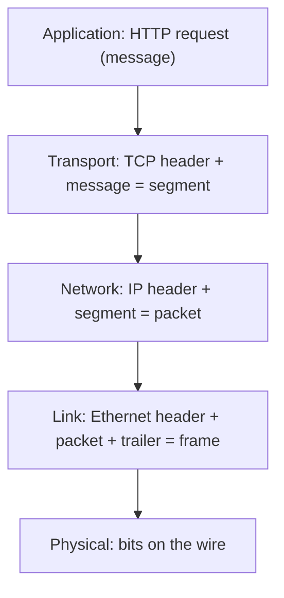
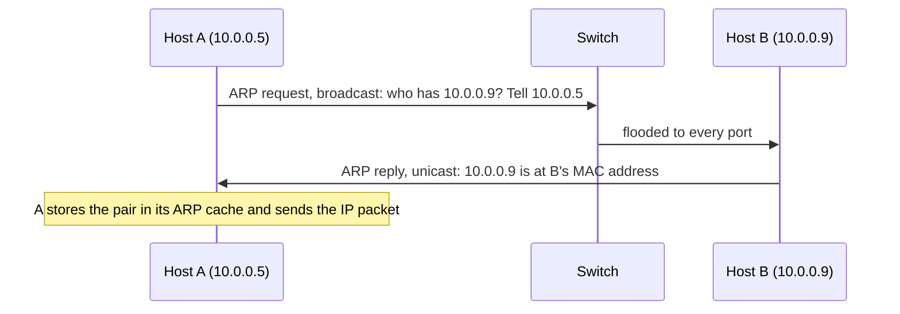
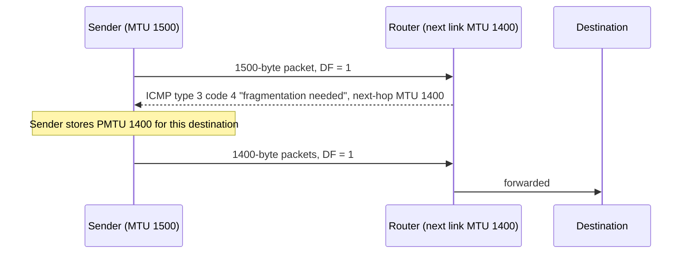

# OSI and TCP/IP Models

A network model splits the job of moving data between two programs into layers. Each layer has one task, talks only to the layer above and the layer below on the same machine, and talks to the same layer on the other machine through a header. Two models are in use: the seven-layer OSI model (a reference model) and the four-layer TCP/IP model (the structure of the real Internet protocols). This page gives both, shows what each layer adds to a message, and explains the two numbers that decide whether a packet arrives whole: the MTU and the path MTU.

## Why It Matters

Interviews use the layer numbers as a shared vocabulary. "Is the load balancer layer 4 or layer 7?" and "Which layer does a switch work at?" assume that you know them, and "What happens when a packet is larger than the MTU?" tests whether you know where fragmentation happens. On the job, the same knowledge sorts a network problem into one layer. A pod that cannot reach another pod is often a layer 3 problem (routing, addresses). A request that works for small bodies and hangs for large bodies is often a layer 3 problem too (a path MTU black hole, described below). A TLS error with a good TCP connection is above layer 4. The page is a P2 page: the details come up less often than TCP or HTTP, but the vocabulary appears in many answers on other pages, for example in [load balancing, DNS, and CDN](../hld/fundamentals/02-load-balancing-dns-cdn.md), where "L4" and "L7" mean the OSI layers on this page.

## Core Concepts

**Protocol**: a set of rules for the messages that two parties exchange: their format, their order, and the action on each. **Layer**: a group of protocols that solve one problem and offer one service to the layer above. **Protocol data unit (PDU)**: the unit of data that a layer handles. The names of the PDUs below (frame, packet, segment) are common usage. The standards use them with some variation, for example RFC 791 calls an IPv4 packet a "datagram".

**Encapsulation**: the sending machine wraps the data of the upper layer in a header (and, at the link layer, a trailer) of the current layer. **Decapsulation**: the receiving machine removes the header at each layer and passes the content up.

**MTU (maximum transmission unit)**: the largest packet that one link carries, counted from the first byte of the IP header. For Ethernet the standard value is 1500 bytes (RFC 894, section "Frame Format": "the maximum length of an IP datagram sent over an Ethernet is 1500 octets"). **Path MTU (PMTU)**: the smallest MTU of all links on the path between two hosts. **Fragmentation**: the split of one IP packet into several smaller packets so that each one fits an MTU.

**MAC address**: the 48-bit address of a network interface on a local link. **ARP (Address Resolution Protocol)**: the protocol that maps an IPv4 address to a MAC address on the local link (RFC 826).

**Switch**: a device that forwards Ethernet frames inside one network by MAC address. **Router**: a device that forwards IP packets between networks by IP address. **Gateway** (in this page): the router that a host uses to leave its own network (the default gateway, see [IP addressing and routing](02-ip-addressing-and-routing.md)).

## How It Works

### The OSI model

The OSI (Open Systems Interconnection) reference model is defined in ISO/IEC 7498-1 (ITU-T X.200 carries the same model). It has seven layers. Layers are numbered from the bottom, and the numbers are what engineers use in speech.

| Layer | Name | Job | PDU (common name) | Examples | Devices |
|---|---|---|---|---|---|
| 7 | Application | Protocols that programs use to talk to each other | Message or data | HTTP, DNS, SMTP, SSH, gRPC | L7 load balancer, proxy, WAF |
| 6 | Presentation | Data representation, encoding, encryption | Message or data | In practice: JSON, Protobuf, character encodings. TLS is often placed here or at layer 5 | |
| 5 | Session | Open, keep, and close a dialog between two programs | Message or data | In practice: part of TLS and of application protocols | |
| 4 | Transport | Delivery between two programs (ports), with or without reliability | Segment (TCP), datagram (UDP) | TCP, UDP, QUIC | L4 load balancer, stateful firewall, NAT device |
| 3 | Network | Addressing and routing between networks | Packet | IPv4, IPv6, ICMP | Router, L3 switch |
| 2 | Data link | Delivery between two devices on one link | Frame | Ethernet, Wi-Fi, ARP | Switch, bridge, network interface card |
| 1 | Physical | Bits as signals on a medium | Bit | Copper, fiber, radio | Cable, hub, repeater |

**What "L4" and "L7" mean.** The numbers in "L4 load balancer" and "L7 load balancer" are OSI layer numbers. An L4 load balancer works with the transport layer: it sees IP addresses, ports, and the protocol (TCP or UDP), and it forwards the stream of a connection to one backend without reading the HTTP bytes. An L7 load balancer works with the application layer: it terminates the client connection, reads the HTTP request, and chooses a backend for each request by host, path, or header. Product documentation uses these numbers in the same way. AWS, for example, says that a Network Load Balancer "functions at the fourth layer of the Open Systems Interconnection (OSI) model" and an Application Load Balancer "functions at the application layer, the seventh layer of the Open Systems Interconnection (OSI) model" (AWS Elastic Load Balancing user guides, checked 2026-11-05). The full comparison (features, algorithms, when to choose each) is in [load balancing, DNS, and CDN](../hld/fundamentals/02-load-balancing-dns-cdn.md). Nobody says "L5" or "L6 load balancer", because no product routes on those layers as a separate step. A "TLS load balancer" that terminates TLS is an L7 product in practice. A "TLS pass-through" balancer that only routes by the SNI name in the `ClientHello` is an L4 product that reads one field from the first message.

### The TCP/IP model

The Internet protocols were designed before the OSI model was finished, and they use fewer layers. RFC 1122 (section 1.1.3, "Internet Protocol Suite") describes four layers: link, internet, transport, application. Textbooks sometimes split the link layer into physical and data link and call the result a five-layer model. The page uses the four layers of RFC 1122.

| TCP/IP layer (RFC 1122) | OSI layers | Protocols | What it adds |
|---|---|---|---|
| Application | 5, 6, 7 | HTTP, DNS, TLS, SSH, SMTP | The message of the program |
| Transport | 4 | TCP, UDP, QUIC (on UDP) | Ports, and for TCP the sequence numbers, windows, and checksums |
| Internet | 3 | IP, ICMP, IGMP | Source and destination IP address, TTL, protocol number |
| Link | 1, 2 | Ethernet, Wi-Fi, ARP | MAC addresses, frame check sequence |

The mapping is approximate. RFC 1122 puts ICMP in the internet layer even though ICMP messages travel inside IP packets. ARP is also hard to place: it has its own Ethernet type (see below), and it serves the internet layer, but it uses link-layer addresses. The standards do not give each protocol one layer, and interviews do not ask you to defend a placement. Ask the question that matters instead: "which header carries this field, and which device reads it?".

### Encapsulation and decapsulation

When a Java program writes an HTTP request to a socket, each layer adds its header on the way down. The receiving host removes the headers in the opposite order.



The fields that each header carries, and which device reads them:

| Header | Size | Key fields | Who reads it |
|---|---|---|---|
| Ethernet II | 14 bytes + 4-byte trailer | Destination MAC (6), source MAC (6), EtherType (2), frame check sequence (4, in the trailer) | Switch (MAC addresses), network card (checks the trailer) |
| IPv4 | 20 bytes without options | Source address, destination address, TTL, protocol, total length, fragmentation fields | Every router on the path (destination, TTL) |
| IPv6 | 40 bytes (fixed) | Source address, destination address, hop limit, next header, payload length | Every router on the path |
| TCP | 20 bytes without options (up to 60) | Source port, destination port, sequence number, acknowledgment number, flags, window | The two end hosts, and L4 devices (NAT, firewall, L4 load balancer). See [TCP and UDP](03-tcp-and-udp.md) |
| UDP | 8 bytes | Source port, destination port, length, checksum | The two end hosts and L4 devices |

The Ethernet II header carries an EtherType that names the protocol inside the frame. The IANA registry lists 0x0800 for IPv4, 0x0806 for ARP, 0x86DD for IPv6, and 0x8100 for a VLAN tag. The IPv4 header carries a protocol number that names the protocol inside the packet: 1 for ICMP, 6 for TCP, 17 for UDP (IANA protocol numbers registry; ICMPv6 is 58). So a receiver reads the EtherType, hands the payload to the IP code, reads the protocol number, and hands the payload to TCP or UDP. This chain of "what is inside" fields is how decapsulation knows which code runs next.

**What each device reads.** A switch reads the Ethernet header only. A router reads the Ethernet header to accept the frame, discards it, and reads the IP header to choose the next hop. It then builds a new Ethernet header for the next link, so the MAC addresses change at every hop and the IP addresses do not (unless a NAT device rewrites them, see [proxies and NAT](09-proxies-and-nat.md)). An L4 device also reads the TCP or UDP ports. An L7 device reads the application bytes.

### Where devices work

| Device | Layer | Decides by | Notes |
|---|---|---|---|
| Hub, repeater | 1 | Nothing: it repeats bits to all ports | Rare today |
| Switch (L2) | 2 | Destination MAC address | A switch learns which MAC address is behind which port from the source address of the frames that it receives (IEEE 802.1D bridging). It floods a frame whose destination it does not know, and a broadcast frame, to every other port. This is standard bridge behavior (IEEE 802.1D MAC bridges, since 2014 part of IEEE 802.1Q). The standards are paid documents, so the page does not quote them |
| Router, L3 switch | 3 | Destination IP address (longest prefix match) | Connects different networks. Decrements the TTL. See [IP addressing and routing](02-ip-addressing-and-routing.md) |
| Stateful firewall, NAT device | 3 and 4 | IP addresses, ports, connection state | See [proxies and NAT](09-proxies-and-nat.md) |
| L4 load balancer | 4 | The 5-tuple (protocol, source and destination address and port) | Picks a backend when a connection opens |
| L7 load balancer, reverse proxy | 7 | Host, path, headers, cookies | Terminates the client connection. See [proxies and NAT](09-proxies-and-nat.md) for the protocol view |

### Ethernet and ARP in brief

Ethernet II is the link layer protocol of wired local networks. A frame has a 14-byte header (destination MAC, source MAC, EtherType), a data field, and a 4-byte frame check sequence (FCS) that detects bit errors. RFC 894 states the data field limits for IP over Ethernet: at most 1500 octets and at least 46 octets. If the IP packet is shorter than 46 bytes, the sender pads the data field with zero bytes, and the padding is not part of the IP packet (RFC 894). So the smallest frame has 14 + 46 + 4 = 64 bytes (computed), which matches the 64-byte minimum frame size of IEEE 802.3 (the count starts at the destination address and includes the FCS). On the physical medium, each frame also costs a preamble of 7 bytes plus a 1-byte start frame delimiter (8 bytes together) and an inter-frame gap of 96 bit times (12 bytes). These four numbers come from IEEE 802.3, a paid standard that this page did not open. Free secondary descriptions (for example the Wikipedia article "Ethernet frame") agree with them. The Java example below counts the preamble and the gap as "wire bytes". An IEEE 802.1Q VLAN tag adds 4 bytes to the header and is not counted in this page.

A host that wants to send an IPv4 packet to a destination on its own network needs the MAC address of that destination. The host also needs a MAC address when the destination is on another network: then the host sends the frame to the MAC address of its default gateway. ARP finds the MAC address.



RFC 826 describes the steps. A host that has no entry for the target broadcasts a request to all stations on the link. The target adds the sender's addresses to its own table, swaps the sender and target fields, sets the operation to "reply", and sends the reply directly to the requester. Each host keeps a translation table (the ARP cache) and does not broadcast periodically: "Periodic broadcasting is definitely not desired" (RFC 826). A new entry for a known address replaces the old one ("the new hardware address supersedes the old one"), and the protocol has no authentication. This is why ARP spoofing works: a host on the same link can send false replies and receive traffic for another host's address. IPv6 does not use ARP. It uses Neighbor Discovery (RFC 4861), which runs over ICMPv6 (RFC 4443).

On Linux, `ip neigh` shows the neighbor table (the ARP cache). Wi-Fi and other link layers have their own frame formats, and the IP layer above them is the same.

### MTU, fragmentation, and path MTU discovery

A link has an MTU. A packet that is larger than the MTU of the next link cannot be sent as it is. IPv4 and IPv6 handle this in different ways.

**IPv4 fragmentation.** The IPv4 header has an identification field, a 3-bit flags field with the DF (Don't Fragment) and MF (More Fragments) bits, and a 13-bit fragment offset measured in units of 8 octets (RFC 791, section 3.1). If a router must forward a packet that is larger than the next link's MTU, and DF is 0, the router splits it into fragments. Each fragment has its own IP header, the same identification, the MF bit set on all fragments except the last, and the offset of its data. Only the destination host reassembles the fragments. Every host must accept datagrams of at least 576 octets, whole or in fragments (RFC 791, section 3.1).

Example (computed): an IP payload of 4000 bytes crosses a link with an MTU of 1500. Each fragment carries a 20-byte IP header, so it holds at most 1480 bytes of data, and 1480 is a multiple of 8, as the offset unit requires.

| Fragment | Data bytes | Fragment offset (units of 8 bytes) | MF | Total length |
|---|---|---|---|---|
| 1 | 1480 | 0 | 1 | 1500 |
| 2 | 1480 | 185 | 1 | 1500 |
| 3 | 1040 | 370 | 0 | 1060 |

Fragmentation has a cost. If one fragment is lost, the destination can never rebuild the datagram, so the sender must send the whole datagram again (TCP does this after a timeout; UDP does not). A fragment other than the first has no transport header, so a firewall or L4 load balancer cannot read its ports. For these reasons, TCP avoids fragmentation by sending segments that fit the path (the MSS, see [TCP and UDP](03-tcp-and-udp.md)), and UDP applications such as DNS and QUIC keep datagrams small (the UDP payload numbers are also on that page).

**IPv6 does not fragment in routers.** RFC 8200 (section 4.5) states that "fragmentation in IPv6 is performed only by source nodes, not by routers along a packet's delivery path". Every IPv6 link must have an MTU of 1280 octets or more (RFC 8200, section 5), and for links that can be configured, RFC 8200 recommends an MTU of at least 1500 octets. A router that cannot forward an IPv6 packet drops it and sends an ICMPv6 "Packet Too Big" message to the source.

**Path MTU discovery (PMTUD).** The source learns the path MTU while it sends. RFC 1191 defines the method for IPv4, and RFC 8201 defines it for IPv6.



1. The sender assumes that the path MTU equals the MTU of its first link, and sends packets with the DF bit set to 1 (RFC 1191, section 2).
2. A router that cannot forward such a packet discards it and returns an ICMP Destination Unreachable message with type 3 and code 4 ("fragmentation needed and DF set"). The router puts the MTU of the next link in the Next-Hop MTU field (RFC 1191, section 4).
3. The sender lowers its estimate of the path MTU for that destination (it must not go below 68 octets), and sends smaller packets (RFC 1191, section 3).
4. The sender tries a larger size again after a timer. RFC 1191 recommends 10 minutes. RFC 8201 uses the same recommendation of 10 minutes, with a minimum of 5 minutes, for IPv6.

In IPv6, the same steps use the ICMPv6 Packet Too Big message (type 2, RFC 4443). A node must not lower its estimate below 1280, and it must ignore a Packet Too Big message that reports a smaller MTU (RFC 8201, section 4).

**The PMTUD black hole.** PMTUD depends on the ICMP message reaching the sender. Many firewalls drop all ICMP. Then the router discards the large packet, the message never arrives, and the sender keeps sending packets that no router can forward. RFC 8201 states this for IPv6: "If ICMPv6 filtering prevents reception of ICMPv6 Packet Too Big messages, the source will not learn the actual path MTU". The symptoms are typical:

- The TCP handshake works (its packets are small).
- A small request and response work.
- A large response, a large POST body, or the TLS `Certificate` message makes the connection hang, because the full-size segments are lost on a smaller link.
- `ping` works with its default size.

Fixes, in the order that an operator tries them:

1. Allow the needed ICMP messages (type 3 code 4 for IPv4, Packet Too Big for IPv6) through every firewall.
2. Clamp the TCP MSS on the device at the narrow link (a router or a VPN gateway), so that both ends choose segments that fit.
3. Lower the MTU on the interface that sits before the tunnel.
4. Use packetization layer PMTUD. RFC 8899 defines PLPMTUD, which probes with larger packets and does not depend on ICMP; QUIC uses it. On Linux, `net.ipv4.tcp_mtu_probing` enables the TCP version: 0 is off, 1 is off until an ICMP black hole is detected, and 2 is always on (kernel documentation `ip-sysctl`).

**Tunnels lower the MTU.** A VPN, a GRE tunnel, or an overlay network wraps the original packet in another IP packet, and the added headers reduce the room for the inner packet. A container network that uses an overlay therefore has an interface MTU that is smaller than 1500. A Java service that works on a developer laptop can fail in a cluster for this reason. The tunnel header sizes depend on the protocol, so read the documentation of the product that you use.

**Jumbo frames.** Some data center networks configure an MTU of about 9000 bytes on every link of a path, which cuts the header overhead per byte. The exact value depends on the vendor, and it is not part of the standard Ethernet MTU of 1500 bytes. Every device on the path must support it, so use it only inside a network that you control.

### Why OSI is a teaching model

The Internet runs TCP/IP. The OSI protocol suite was a competing set of protocols, and it lost. The seven-layer model survived as a teaching tool because it names the parts. It is a poor description of real protocols for four reasons:

- **Layers 5 and 6 have no separate protocols.** Session handling and data representation live inside application protocols, libraries, and TLS.
- **Protocols nest in other ways than the model allows.** TLS runs on TCP and carries HTTP, so it sits between layers 4 and 7. QUIC (see [HTTP](04-http.md)) is a transport protocol that runs on top of UDP and does its own encryption. A VPN carries IP packets inside IP packets. MPLS is often called "layer 2.5". DNS over HTTPS puts a layer 7 protocol inside another layer 7 protocol.
- **ICMP and ARP do not fit one layer.** See the TCP/IP section above.
- **Real stacks do not divide the work along these lines.** Linux, for example, implements the transport and network layers in the kernel, and QUIC in user space libraries.

Recommendation: use the OSI layer numbers as names ("a layer 4 problem", "an L7 load balancer"), and describe the mechanism with the real protocols. In an interview, say "L4 means the transport layer: TCP and UDP, ports", and do not argue about where TLS belongs.

### What a Java developer sees

A Java program works at the top of the stack. `java.net.Socket` and `SocketChannel` give a TCP byte stream (layer 4 service), `DatagramSocket` gives UDP, and `java.net.http.HttpClient` speaks HTTP (layer 7). The program never sees a frame, a packet, or a segment boundary: one `write` can become several segments, and several writes can become one. These layers do appear in four places:

- **Errors.** `Connection refused` (a TCP RST or an ICMP error), `Connection timed out` (nothing returns, often a firewall or a black hole), and `No route to host` (an ICMP error or a missing route).
- **The interface MTU.** `NetworkInterface.getMTU()` returns the MTU of a local interface (JDK 21 Javadoc). It does not tell you the path MTU.
- **Datagram size.** A `DatagramPacket` larger than the path MTU is fragmented (IPv4) or fails (IPv6, and IPv4 with DF set).
- **Load balancer choice.** The L4 or L7 choice decides whether a gRPC or HTTP/2 client with one long connection spreads its requests over several backends (see [load balancing, DNS, and CDN](../hld/fundamentals/02-load-balancing-dns-cdn.md)).

On Linux, `ping -M do -s 1472 host` probes the path MTU for IPv4: `-M do` sets the DF bit and forbids local fragmentation, and `-s` sets the payload. The ICMP header adds 8 bytes and the IP header adds 20, so 1472 + 8 + 20 = 1500 (computed from the `ping(8)` description of `-s` and `-M`). If the reply arrives, the path carries 1500-byte packets. If an error "message too long" or no reply comes back, reduce the size until it works. The local `ping` on macOS uses different options, so read its own manual page.

## Trade-offs and When to Use

| Choice | Option A | Option B | Choose A when | Choose B when |
|---|---|---|---|---|
| Model for explanation | OSI (7 layers) | TCP/IP (4 layers) | You name a device or a product ("L4", "L7", "switch is L2") | You describe how a real protocol stack works |
| Load balancer layer | L4 (layer 4) | L7 (layer 7) | You need very high rate, any TCP or UDP protocol, a static IP, or TLS pass-through | You need routing by host or path, per-request retries, or HTTP features |
| Fragmentation | Let IPv4 routers fragment (DF = 0) | Set DF and use PMTUD | The path crosses unknown links and you cannot rely on ICMP (DNS over UDP, for example) | The protocol is TCP or QUIC, where a lost fragment would stall the connection |
| MTU | 1500 bytes (standard Ethernet) | About 9000 bytes (jumbo frames) | The path includes the Internet, VPNs, or devices you do not control | Every link of a path in your own network supports it, and you move large volumes |
| Fix for an MTU black hole | Allow ICMP through firewalls | Clamp the MSS or enable MTU probing | You control the firewalls on the path | You cannot change the firewall, or the problem sits in a tunnel |

## Java Example

The program below wraps an application message in TCP, IP, and Ethernet headers and prints the sizes. It splits a message that is larger than the MSS into several segments, pads a frame that is shorter than the Ethernet minimum, and compares IPv4 with IPv6 and with TCP timestamps (a 12-byte TCP option that raises the TCP header from 20 to 32 bytes, RFC 7323). It counts the 8-byte preamble and the 12-byte inter-frame gap as "wire bytes". The program opens no socket.

```java
import java.util.ArrayList;
import java.util.List;

public class Main {
    record Layer(String name, int headerBytes, int trailerBytes) {}

    // Ethernet II: destination MAC 6 + source MAC 6 + EtherType 2 = 14 header bytes,
    // 4-byte frame check sequence (FCS) as trailer. The data field is at least 46 bytes.
    static final int ETH_HEADER = 14;
    static final int ETH_FCS = 4;
    static final int ETH_MIN_DATA = 46;
    static final int ETH_MTU = 1500;
    // On the wire, each frame also costs 8 bytes of preamble and start delimiter
    // and a 12-byte inter-frame gap.
    static final int ETH_WIRE_EXTRA = 8 + 12;

    static void send(String label, int appBytes, int ipHeader, int tcpHeader) {
        int mss = ETH_MTU - ipHeader - tcpHeader;
        System.out.println("== " + label + ": application message " + appBytes + " bytes, MSS "
                + mss + " ==");
        int left = appBytes;
        int segmentCount = 0;
        long frameBytesTotal = 0;
        long wireBytesTotal = 0;
        while (left > 0 || segmentCount == 0) {
            int payload = Math.min(left, mss);
            left -= payload;
            segmentCount++;
            List<Layer> stack = new ArrayList<>();
            stack.add(new Layer("TCP", tcpHeader, 0));
            stack.add(new Layer("IP", ipHeader, 0));
            int ipPacket = payload;
            for (Layer layer : stack) {
                ipPacket += layer.headerBytes();
                System.out.println("  segment " + segmentCount + " after " + layer.name()
                        + " header: " + ipPacket + " bytes");
            }
            int data = Math.max(ipPacket, ETH_MIN_DATA);
            int pad = data - ipPacket;
            int frame = ETH_HEADER + data + ETH_FCS;
            frameBytesTotal += frame;
            wireBytesTotal += frame + ETH_WIRE_EXTRA;
            System.out.println("  segment " + segmentCount + " Ethernet frame: " + frame
                    + " bytes (padding " + pad + ")");
        }
        System.out.println("  frames: " + segmentCount + ", frame bytes: " + frameBytesTotal
                + ", wire bytes: " + wireBytesTotal);
        long overhead = wireBytesTotal - appBytes;
        System.out.println("  overhead: " + overhead + " bytes, "
                + String.format("%.1f", 100.0 * overhead / wireBytesTotal) + " percent of wire");
    }

    public static void main(String[] args) {
        send("IPv4, tiny message", 1, 20, 20);
        send("IPv4, typical request", 300, 20, 20);
        send("IPv4, response that needs 3 segments", 4000, 20, 20);
        send("IPv6, same response", 4000, 40, 20);
        send("IPv4 with TCP timestamps", 4000, 20, 32);
    }
}
```

The output:

<!-- expected-output -->
```text
== IPv4, tiny message: application message 1 bytes, MSS 1460 ==
  segment 1 after TCP header: 21 bytes
  segment 1 after IP header: 41 bytes
  segment 1 Ethernet frame: 64 bytes (padding 5)
  frames: 1, frame bytes: 64, wire bytes: 84
  overhead: 83 bytes, 98.8 percent of wire
== IPv4, typical request: application message 300 bytes, MSS 1460 ==
  segment 1 after TCP header: 320 bytes
  segment 1 after IP header: 340 bytes
  segment 1 Ethernet frame: 358 bytes (padding 0)
  frames: 1, frame bytes: 358, wire bytes: 378
  overhead: 78 bytes, 20.6 percent of wire
== IPv4, response that needs 3 segments: application message 4000 bytes, MSS 1460 ==
  segment 1 after TCP header: 1480 bytes
  segment 1 after IP header: 1500 bytes
  segment 1 Ethernet frame: 1518 bytes (padding 0)
  segment 2 after TCP header: 1480 bytes
  segment 2 after IP header: 1500 bytes
  segment 2 Ethernet frame: 1518 bytes (padding 0)
  segment 3 after TCP header: 1100 bytes
  segment 3 after IP header: 1120 bytes
  segment 3 Ethernet frame: 1138 bytes (padding 0)
  frames: 3, frame bytes: 4174, wire bytes: 4234
  overhead: 234 bytes, 5.5 percent of wire
== IPv6, same response: application message 4000 bytes, MSS 1440 ==
  segment 1 after TCP header: 1460 bytes
  segment 1 after IP header: 1500 bytes
  segment 1 Ethernet frame: 1518 bytes (padding 0)
  segment 2 after TCP header: 1460 bytes
  segment 2 after IP header: 1500 bytes
  segment 2 Ethernet frame: 1518 bytes (padding 0)
  segment 3 after TCP header: 1140 bytes
  segment 3 after IP header: 1180 bytes
  segment 3 Ethernet frame: 1198 bytes (padding 0)
  frames: 3, frame bytes: 4234, wire bytes: 4294
  overhead: 294 bytes, 6.8 percent of wire
== IPv4 with TCP timestamps: application message 4000 bytes, MSS 1448 ==
  segment 1 after TCP header: 1480 bytes
  segment 1 after IP header: 1500 bytes
  segment 1 Ethernet frame: 1518 bytes (padding 0)
  segment 2 after TCP header: 1480 bytes
  segment 2 after IP header: 1500 bytes
  segment 2 Ethernet frame: 1518 bytes (padding 0)
  segment 3 after TCP header: 1136 bytes
  segment 3 after IP header: 1156 bytes
  segment 3 Ethernet frame: 1174 bytes (padding 0)
  frames: 3, frame bytes: 4210, wire bytes: 4270
  overhead: 270 bytes, 6.3 percent of wire
```

Read the output as follows:

- A 1-byte message becomes a 64-byte frame (the Ethernet minimum) and costs 84 bytes on the wire, so the overhead is almost the whole transfer. Many tiny writes waste bandwidth.
- A 300-byte request costs 78 bytes of overhead: 20 for TCP, 20 for IP, 18 for Ethernet (header and trailer), and 20 for preamble and gap.
- A 4000-byte response needs three segments because the MSS is 1460 bytes, and each segment repeats all headers.
- IPv6 has a 20-byte larger IP header, so the MSS falls to 1440 and the overhead rises.

A class that reads the MTU of the local interfaces uses a real API. It is not run here, because the output depends on the machine:

```java
import java.net.NetworkInterface;
import java.net.SocketException;
import java.util.Collections;

class MtuReport {
    // Not run by the KB checker: the output depends on the machine.
    static void print() throws SocketException {
        for (NetworkInterface nic : Collections.list(NetworkInterface.getNetworkInterfaces())) {
            System.out.println(nic.getName() + " mtu=" + nic.getMTU());
        }
    }
}
```

## Interview Angle

### Questions

??? question "What do 'L4' and 'L7' mean, and how does an L4 load balancer differ from an L7 load balancer?"

    The numbers are the layers of the OSI model: layer 4 is the transport layer (TCP and UDP, ports) and layer 7 is the application layer (HTTP and similar protocols).

    An L4 load balancer reads the IP addresses, the ports, and the protocol. It chooses a backend when a connection opens and then forwards every packet of that connection to that backend. It does not read the HTTP bytes. An L7 load balancer terminates the client connection, parses the request, and chooses a backend for each request by host, path, header, or cookie.

    The trade-off: L4 is simple and fast, works for any TCP or UDP protocol, and can give a static IP address. L7 can route by content, retry a request, and balance each HTTP/2 stream, but it costs more CPU and needs the TLS key if it reads encrypted traffic. A long-lived HTTP/2 or gRPC connection pins all its requests to one backend behind an L4 balancer. See [load balancing, DNS, and CDN](../hld/fundamentals/02-load-balancing-dns-cdn.md) for the full comparison.

??? question "Walk through what happens to a message from a Java `socket.write` to the wire, layer by layer."

    The application hands bytes to the kernel through the socket API. TCP splits the byte stream into segments of at most one MSS (1460 bytes on a 1500-byte Ethernet MTU for IPv4), and adds a header with the ports, a sequence number, and the flags. IP adds a header with the source and destination addresses, the TTL, and the protocol number 6 for TCP, and the kernel looks up the next hop in the routing table. The link layer finds the MAC address of the next hop (ARP, for IPv4), builds an Ethernet frame with the MAC addresses, the EtherType 0x0800, and the frame check sequence, and the network card sends the bits.

    The receiver reverses the steps: it checks the frame, reads the EtherType, reads the IP header, reads the protocol number, and hands the segment to TCP, which uses the port to find the socket. At every router in between, the Ethernet header is replaced, the TTL is decremented, and the IP addresses stay the same unless a NAT device rewrites them.

??? question "Why is the OSI model called a teaching model, and which model does the Internet use?"

    The Internet runs on the TCP/IP protocol suite, whose structure RFC 1122 describes with four layers: link, internet, transport, and application. The OSI model has seven layers and came with its own protocol suite, which the market did not adopt. The model survived because its layer names are useful: "layer 2 switch", "layer 4 load balancer".

    It does not describe real protocols well. Layers 5 and 6 have no separate protocols. TLS sits between TCP and HTTP. QUIC is a transport that runs over UDP and does its own encryption. A VPN puts IP inside IP. So I use the numbers as names for devices and problems, and I describe a mechanism with the real protocols.

??? question "What is the MTU? What happens when a packet is larger than the MTU of a link?"

    The MTU is the largest IP packet that a link carries. Standard Ethernet has 1500 bytes. The path MTU is the smallest MTU on the path.

    In IPv4, if the DF bit is 0, the router fragments the packet: it splits the data into pieces whose sizes are multiples of 8 bytes (except the last), copies the IP header, and the destination host reassembles them. If the DF bit is 1, the router drops the packet and returns an ICMP "fragmentation needed" message (type 3, code 4) with the next-hop MTU. In IPv6, routers never fragment. The router drops the packet and returns an ICMPv6 Packet Too Big message, and only the source host fragments, if the application sends a larger packet at all.

    Fragmentation is costly: if one fragment is lost, the whole datagram is lost, and firewalls cannot read the ports in later fragments. TCP avoids it with the MSS, and QUIC and DNS keep datagrams small.

??? question "A service works for small requests but hangs when the response is large, and `ping` works. What do you check?"

    I suspect a path MTU black hole. The TCP handshake and small packets succeed, but full-size segments are dropped on a link with a smaller MTU, and the ICMP message that would tell the sender is blocked by a firewall. `ping` works because its default packet is small (56 bytes of data).

    To confirm, I send packets with the DF bit set and a known size, for example `ping -M do -s 1472 host` on Linux, and reduce the size until the reply arrives. I can also capture traffic with `tcpdump` and look for repeated retransmissions of the large segments and no ICMP "fragmentation needed" message.

    Fixes: allow ICMP type 3 code 4 (IPv4) and Packet Too Big (IPv6) through the firewalls, clamp the MSS at the tunnel or the router, lower the MTU of the interface in front of the tunnel, or enable TCP MTU probing (`tcp_mtu_probing`). The usual cause in a cluster is an overlay network or a VPN that lowers the MTU below 1500.

??? question "How does a host find the MAC address of the machine it wants to send an IPv4 packet to? What if the destination is in another network?"

    The host compares the destination address with its own address and subnet mask. If the destination is in the same subnet, the host needs the destination's MAC address. If not, the host sends the frame to its default gateway, and so it needs the gateway's MAC address. In both cases the host looks in its ARP cache. If there is no entry, it broadcasts an ARP request ("who has this IP address?") on the link, and the owner answers with a unicast ARP reply that holds its MAC address (RFC 826). The host caches the result.

    The IP destination address in the packet stays the address of the final destination, and only the MAC address in the frame names the next hop. Each router repeats the process for the next link.

    ARP has no authentication, so a host on the same link can send false replies (ARP spoofing). IPv6 uses Neighbor Discovery instead of ARP.

??? question "At which layer does a switch, a router, and a firewall work? What does each one read?"

    A switch works at layer 2. It reads the destination MAC address, and it learns the source MAC addresses to know which port leads to which host. A router works at layer 3. It reads the destination IP address, chooses the next hop by longest prefix match, decrements the TTL, and rewrites the Ethernet header for the next link. A stateful firewall works at layers 3 and 4: it reads IP addresses and ports and tracks connection state. A web application firewall or an L7 proxy reads the application bytes.

    "L3 switch" is a marketing term for a switch that also routes. Do not assume that a device is limited to one layer: most real devices do several jobs.

### Follow-up Questions

- Why does an IPv4 fragment have an offset in units of 8 bytes? (The offset field has 13 bits, and the datagram can be up to 65,535 bytes, so the unit is 8 bytes: 2^13 × 8 = 65,536.)
- Why does the MAC address change at every hop and the IP address does not? (The MAC address is only valid on one link. The IP address names the endpoints of the path.)
- What changes in IPv6 for fragmentation? (Only the source fragments. The minimum link MTU is 1280. Routers send Packet Too Big.)
- What is the smallest Ethernet frame and why? (64 bytes: a 14-byte header, 46 bytes of data, and a 4-byte trailer. A shorter packet is padded.)
- Where does TLS sit in the model? (Above TCP and below HTTP. OSI has no clean place for it.)
- What does QUIC do about the path MTU? (It does packetization layer PMTUD, RFC 8899, with probe packets.)

### Red Flags

- Saying "L7" and meaning HTTPS or TLS as a layer in itself. TLS is not layer 7 in the OSI sense.
- Saying that a router "reads the MAC address to route". Routers route by IP address.
- Saying "IPv6 routers fragment large packets". They do not.
- Saying "block all ICMP for security". Blocking the PMTUD messages breaks connections.
- Saying that `ping` success proves that the application path works. `ping` uses ICMP, small packets, and no port.
- Placing every protocol on exactly one layer with certainty and arguing about it. Say that the mapping is approximate.

## Common Mistakes

| Mistake | Fix |
|---|---|
| Blocking all ICMP in a firewall | Allow ICMP type 3 code 4 (IPv4) and ICMPv6 Packet Too Big. Rate-limit other types if needed |
| Assuming an MTU of 1500 inside a VPN, overlay, or cloud network | Read the interface MTU (`ip link`) and set the MSS or MTU to match the tunnel |
| Sending UDP datagrams larger than the path MTU | Keep the payload below the path MTU (see [TCP and UDP](03-tcp-and-udp.md)), or use a protocol that does PMTUD |
| Debugging an application error at layer 7 before checking layers 3 and 4 | Check name resolution, routing, then the TCP connect, then TLS, then HTTP |
| Believing that `ping` failing means the host is down | Many networks filter ICMP. Test the real port with a TCP connect |
| Thinking one `write` is one packet | TCP is a byte stream. Segment boundaries do not match writes |
| Using jumbo frames on part of a path | Every link of the path must support the same MTU, or fragmentation or drops occur |

## Commonly Confused With

| Looks like | Difference | Deciding question |
|---|---|---|
| MAC address and IP address | A MAC address names an interface on one link and changes at every hop. An IP address names an endpoint and stays the same along the path (without NAT) | Does the address have to be valid beyond this link? |
| Switch and router | A switch forwards frames by MAC address inside one network. A router forwards packets by IP address between networks | Does the device connect networks or only hosts? |
| MTU and MSS | MTU is the largest IP packet on a link. MSS is the largest TCP payload in a segment (MTU minus the IP and TCP headers) | Is the number counted with the IP header or without it? |
| Frame, packet, segment | A frame is a layer 2 PDU, a packet is a layer 3 PDU, a segment is a TCP PDU | Which header is outermost? |
| OSI model and TCP/IP model | OSI has seven layers and is a reference model. TCP/IP has four layers (RFC 1122) and describes the real protocols | Are you naming a device or describing a protocol? |
| Fragmentation and segmentation | Segmentation is the split of a byte stream into TCP segments by the sender. Fragmentation is the split of an IP packet by a router or the source | Which layer splits the data? |
| ARP and DNS | ARP maps an IP address to a MAC address on one link. DNS maps a name to an IP address (see [DNS](06-dns.md)) | Is the answer a hardware address or an IP address? |

## Quick Reference Card

- **OSI layers (top to bottom)**: 7 application, 6 presentation, 5 session, 4 transport, 3 network, 2 data link, 1 physical.
- **TCP/IP (RFC 1122)**: application, transport, internet, link.
- **L4** = transport layer (TCP, UDP, ports). **L7** = application layer (HTTP). **L2 switch** forwards by MAC. **L3 router** forwards by IP.
- **PDUs**: bits, frame, packet, segment (TCP) or datagram (UDP), message.
- **Headers**: Ethernet 14 bytes + 4-byte trailer, IPv4 20 bytes (minimum), IPv6 40 bytes, TCP 20 bytes (minimum), UDP 8 bytes.
- **EtherType**: 0x0800 IPv4, 0x0806 ARP, 0x86DD IPv6. **IP protocol number**: 1 ICMP, 6 TCP, 17 UDP, 58 ICMPv6.
- **MTU**: 1500 for Ethernet (RFC 894). IPv6 minimum link MTU: 1280. IPv4 hosts accept 576 bytes.
- **IPv4 routers fragment if DF = 0. IPv6 routers never fragment.**
- **PMTUD**: DF set, ICMP type 3 code 4 (IPv4) or Packet Too Big (IPv6). Black hole when ICMP is blocked. Fix: allow ICMP, clamp the MSS, enable `tcp_mtu_probing`.
- **ARP**: broadcast request, unicast reply, cache, no authentication. IPv6 uses Neighbor Discovery.

## Further Reading

- [ISO/IEC 7498-1:1994, OSI Basic Reference Model](https://www.iso.org/standard/20269.html) and [ITU-T X.200](https://www.itu.int/rec/T-REC-X.200-199407-I/en): the seven-layer model. ITU-T X.200 (1994) is the technically aligned twin of ISO/IEC 7498-1, and the layer names are the same (the ITU copy is free to read).
- [IEEE 802.3 working group](https://www.ieee802.org/3/) and [IEEE 802.1 working group](https://1.ieee802.org/): the frame format (FCS, preamble, inter-frame gap, 64-byte minimum) and MAC learning. Paid standards: this page did not read them.
- [AWS Network Load Balancer](https://docs.aws.amazon.com/elasticloadbalancing/latest/network/introduction.html) and [AWS Application Load Balancer](https://docs.aws.amazon.com/elasticloadbalancing/latest/application/introduction.html) user guides: the quoted OSI layer statements.
- [RFC 1122, Requirements for Internet Hosts](https://www.rfc-editor.org/rfc/rfc1122): section 1.1.3 describes the four layers of the Internet protocol suite.
- [RFC 791, Internet Protocol](https://www.rfc-editor.org/rfc/rfc791): the IPv4 header, fragmentation, and the 576-byte rule.
- [RFC 8200, IPv6 Specification](https://www.rfc-editor.org/rfc/rfc8200): the IPv6 header, source-only fragmentation, and the 1280-byte minimum link MTU. RFC 9673 updates its hop-by-hop options procedures.
- [RFC 1191, Path MTU Discovery](https://www.rfc-editor.org/rfc/rfc1191) and [RFC 8201, Path MTU Discovery for IPv6](https://www.rfc-editor.org/rfc/rfc8201): the PMTUD method and its timers.
- [RFC 8899, Packetization Layer Path MTU Discovery for Datagram Transports](https://www.rfc-editor.org/rfc/rfc8899): PMTUD that does not rely on ICMP.
- [RFC 894, IP Datagrams over Ethernet](https://www.rfc-editor.org/rfc/rfc894): the 1500-byte maximum, the 46-byte minimum data field, and the EtherType for IP.
- [RFC 826, Address Resolution Protocol](https://www.rfc-editor.org/rfc/rfc826): the ARP request and reply steps.
- [RFC 4861, Neighbor Discovery for IPv6](https://www.rfc-editor.org/rfc/rfc4861) and [RFC 4443, ICMPv6](https://www.rfc-editor.org/rfc/rfc4443): the IPv6 replacement for ARP and the Packet Too Big message.
- [IANA IEEE 802 Numbers (EtherTypes)](https://www.iana.org/assignments/ieee-802-numbers/ieee-802-numbers.xhtml) and [IANA Protocol Numbers](https://www.iana.org/assignments/protocol-numbers/protocol-numbers.xhtml): the type and protocol values on this page.
- [ping(8)](https://man7.org/linux/man-pages/man8/ping.8.html) and [Linux kernel `ip-sysctl`](https://www.kernel.org/doc/html/latest/networking/ip-sysctl.html): `-M` and `-s` options; `tcp_mtu_probing` and `min_pmtu`.
- [JDK 21 `NetworkInterface`](https://docs.oracle.com/en/java/javase/21/docs/api/java.base/java/net/NetworkInterface.html): `getMTU()`.
- [Load balancing, DNS, and CDN](../hld/fundamentals/02-load-balancing-dns-cdn.md) and [IP addressing and routing](02-ip-addressing-and-routing.md): the design view of L4 and L7, and the next page of this subject.
