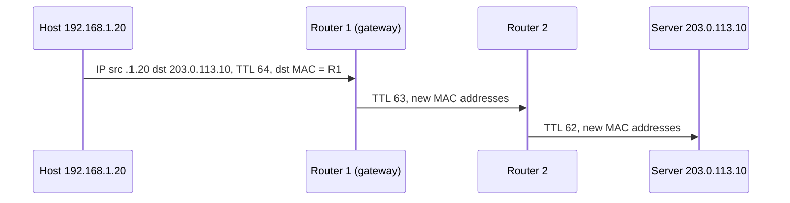

# IP Addressing and Routing

An IP address names a network interface, and routing moves a packet from the sender to that address across many networks. This page covers IPv4 and IPv6 addresses, subnets and CIDR with worked calculations, how a router and a host choose the next hop (the routing table and longest prefix match), BGP between networks, and the ICMP messages that `ping` and `traceroute` use. It builds on [OSI and TCP/IP models](01-osi-and-tcp-ip-models.md), which explains layers, MTU, and ARP.

## Why It Matters

Interviews test addressing with calculations ("How many hosts fit in a /26?", "Are 10.1.2.77 and 10.1.2.100 in the same /27?") and with design questions ("Choose the CIDR blocks for your VPC and subnets"). Routing questions follow: "How does a packet find its way?", "What does `traceroute` do?", "Why did the Facebook outage take down everything at once?" On the job, the same knowledge decides a VPC layout that you cannot change later without a migration, explains why two peered networks with overlapping ranges cannot talk to each other, and lets you read a routing table, a security group rule, or a Kubernetes pod CIDR. IPv6 questions focus on one point: why IPv6 does not need NAT, and what a dual-stack client does when one family fails.

## Core Concepts

**IPv4 address**: a 32-bit number, written as four decimal numbers (octets) separated by dots, for example `192.168.10.77`. There are 2^32 = 4,294,967,296 values (computed). RFC 791 defines IPv4.

**Prefix and prefix length**: the first *n* bits of an address name the network, and the remaining 32 − *n* bits name the host. Written `192.168.10.64/26`. **Subnet mask**: the same information as a 32-bit number with *n* one-bits followed by zeros, for example `255.255.255.192` for /26. **Network address**: the address with all host bits set to 0. **Broadcast address**: the address with all host bits set to 1. A packet sent to it goes to all hosts of the subnet. **Subnet**: a range of addresses that share a prefix and sit on one link.

**CIDR (Classless Inter-Domain Routing)**: addressing and routing with a prefix of any length, from 0 to 32 (RFC 4632, section 3.1). It replaced the old classful system (class A, B, C with fixed prefixes 8, 16, 24). RFC 4632 obsoletes RFC 1519. CIDR also lets a provider announce many customer networks as one aggregate prefix, which keeps the global routing table smaller.

**Routing table**: the list of prefixes with a next hop for each, which a host or router consults for every packet. **Next hop**: the neighbor to which the router sends the packet. **Default route**: the entry for prefix `0.0.0.0/0`, which matches every destination (RFC 4632, section 5.1). **Default gateway**: the next hop of the default route.

**Autonomous system (AS)**: a set of networks under one administration and one routing policy, identified by an AS number. **BGP (Border Gateway Protocol)**: the protocol that autonomous systems use to exchange the prefixes that they can reach (RFC 4271).

**ICMP (Internet Control Message Protocol)**: the protocol that carries error and diagnostic messages of the IP layer (RFC 792). It is not a transport protocol: it has no ports.

## How It Works

### The IPv4 header

The header has 20 bytes without options (RFC 791, section 3.1). The checksum covers the header only, so every router recomputes it after it changes the TTL.

| Field | Size | Meaning |
|---|---|---|
| Version | 4 bits | 4 |
| IHL | 4 bits | Header length in 32-bit words. The minimum is 5, which means 20 bytes |
| Type of service (later: DSCP and ECN) | 8 bits | Priority and congestion marks |
| Total length | 16 bits | Header plus data in bytes. The maximum is 65,535 |
| Identification, flags, fragment offset | 16 + 3 + 13 bits | Fragmentation (see [OSI and TCP/IP models](01-osi-and-tcp-ip-models.md)) |
| Time to live (TTL) | 8 bits | Limits the life of the packet. Each router decrements it. At 0 the packet is destroyed |
| Protocol | 8 bits | The protocol inside: 1 ICMP, 6 TCP, 17 UDP |
| Header checksum | 16 bits | Checks the header only |
| Source address, destination address | 32 + 32 bits | The endpoints |

RFC 791 defines the TTL as a time limit ("the maximum time the datagram is allowed to remain in the internet system", in seconds). It also requires that every module that processes a datagram "decrease the TTL by at least one even if it process the datagram in less than a second". RFC 1812 (requirements for IPv4 routers, section 5.3.1) repeats the rule and states the result: "the TTL is effectively a hop count limit on how far a datagram can propagate through the Internet". A router that reduces the TTL to zero discards the packet and sends an ICMP Time Exceeded message (RFC 1812). The Linux default for packets that a host sends is 64 (`ip_default_ttl` in the kernel documentation `ip-sysctl`).

### Subnets and CIDR: worked calculations

For a prefix length *n*, the number of addresses is 2^(32 − *n*). The usable host count is that number minus 2, because the network address and the broadcast address are not given to hosts. Two prefix lengths are special cases: a /31 has 2 addresses and both are usable on a point-to-point link (RFC 3021), and a /32 names one host.

**Method.** To find the network address, write the mask and compute `address AND mask`. To find the broadcast address, set all host bits to 1. For a prefix length that is not a multiple of 8, work in the octet that the prefix cuts: its block size is 256 − (the mask value in that octet).

**Example 1: `10.1.2.77/27`** (computed).

1. The prefix is 27 bits, so the mask is `255.255.255.224` (the last octet has 3 one-bits: 128 + 64 + 32 = 224).
2. The block size in the last octet is 256 − 224 = 32. The blocks start at 0, 32, 64, 96, and so on.
3. 77 lies in the block that starts at 64. The network address is `10.1.2.64`.
4. The broadcast address is the last address of the block: 64 + 32 − 1 = 95, so `10.1.2.95`.
5. The usable hosts run from `10.1.2.65` to `10.1.2.94`: 2^5 − 2 = 30 hosts.

**Example 2: `192.168.10.77/26`** gives the network `192.168.10.64`, the broadcast `192.168.10.127`, and 62 hosts. The Java program below prints this result.

**Example 3: same subnet?** Are `10.1.2.77` and `10.1.2.100` in the same /27? The first lies in `10.1.2.64` to `10.1.2.95`. The second lies in `10.1.2.96` to `10.1.2.127`. They are not in the same subnet, so a packet between them goes through a router.

**Example 4: split a /24 into four subnets.** Four subnets need 2 more prefix bits (2^2 = 4), so each subnet is a /26 with 64 addresses and 62 usable hosts: `192.168.0.0/26`, `192.168.0.64/26`, `192.168.0.128/26`, and `192.168.0.192/26`.

**Quick table** (computed from 2^(32 − n) − 2):

| Prefix | Mask | Addresses | Usable hosts |
|---|---|---|---|
| /8 | 255.0.0.0 | 16,777,216 | 16,777,214 |
| /16 | 255.255.0.0 | 65,536 | 65,534 |
| /20 | 255.255.240.0 | 4,096 | 4,094 |
| /24 | 255.255.255.0 | 256 | 254 |
| /26 | 255.255.255.192 | 64 | 62 |
| /28 | 255.255.255.240 | 16 | 14 |
| /30 | 255.255.255.252 | 4 | 2 |

Cloud networks reserve more addresses in each subnet than the two above. Read the documentation of your provider before you size a subnet.

### Private and special addresses

RFC 1918 sets aside three blocks for private use. A packet with a private destination address is not routed on the public Internet. Many organizations use the same blocks at the same time, which is why a NAT device is needed at the edge (see [proxies and NAT](09-proxies-and-nat.md)).

| Block | Prefix | Addresses |
|---|---|---|
| 10.0.0.0 to 10.255.255.255 | 10.0.0.0/8 | 16,777,216 |
| 172.16.0.0 to 172.31.255.255 | 172.16.0.0/12 | 1,048,576 |
| 192.168.0.0 to 192.168.255.255 | 192.168.0.0/16 | 65,536 |

RFC 6890 lists all special-purpose ranges in a registry (RFC 8190 updates it). The ones that a developer meets:

| Prefix | Name (RFC 6890) | Meaning |
|---|---|---|
| 0.0.0.0/8 | This host on this network | `0.0.0.0` means "any address" when a server binds a socket, or "no address yet" |
| 127.0.0.0/8 | Loopback | Stays inside the host. `127.0.0.1` is the usual address (`localhost`) |
| 169.254.0.0/16 | Link Local | A host takes an address here when it finds no DHCP server. Routers do not forward it |
| 100.64.0.0/10 | Shared Address Space | For carrier-grade NAT inside a provider network (RFC 6598). It is not an RFC 1918 block |
| 192.0.2.0/24, 198.51.100.0/24, 203.0.113.0/24 | Documentation (TEST-NET-1, 2, 3) | Use these in examples and documents |
| 198.18.0.0/15 | Benchmarking | Network device tests |
| 240.0.0.0/4 | Reserved | Not used |
| 255.255.255.255/32 | Limited Broadcast | A broadcast to the local link |

Two consequences for design work:

- **Overlapping ranges block peering and VPNs.** Two networks that both use `10.0.0.0/16` cannot route to each other without NAT, because a destination in `10.0.0.0/16` always looks local. Recommendation: assign each VPC, data center, and Kubernetes cluster a distinct block from a plan that you keep in one place, and leave room to grow: a network renumbered later costs a migration.
- **The 100.64.0.0/10 block is a hint.** If a home or mobile client has an address in that range, the provider runs a carrier-grade NAT, and many customers share one public address (RFC 6598).

### IPv6

IPv6 (RFC 8200) addresses have 128 bits. There are 2^128, about 3.4 × 10^38 values (computed). RFC 8200 has the header and the protocol rules, and RFC 4291 has the addressing architecture. RFC 9673 updates the RFC 8200 rules for hop-by-hop options and does not change the addressing.

**Notation (RFC 4291, section 2.2).** Write the address as eight groups of four hexadecimal digits separated by colons. Leading zeros in a group may be dropped, and one run of all-zero groups may be replaced by `::`. The `::` may appear only once in an address (RFC 4291). Example: `2001:0db8:0000:0000:0000:ff00:0042:8329` becomes `2001:db8::ff00:42:8329`. In a URL, an IPv6 literal goes in brackets: `http://[2001:db8::1]:8080/`.

**Address types.**

| Prefix | Type | Meaning |
|---|---|---|
| `::1/128` | Loopback | The local host (RFC 4291, section 2.5.3) |
| `::/128` | Unspecified | "No address", used before a host has one (RFC 4291, section 2.5.2) |
| `fe80::/10` | Link-local | Valid on one link only. Every IPv6 interface has one |
| `fc00::/7` | Unique-local | The IPv6 counterpart of private addresses (RFC 4193) |
| `ff00::/8` | Multicast | Delivery to a group. IPv6 has no broadcast: multicast replaces it (RFC 4291) |
| `2001:db8::/32` | Documentation | Use in examples (RFC 6890) |
| `::ffff:0:0/96` | IPv4-mapped | A form that carries an IPv4 address (RFC 4291, section 2.5.5.2) |

Other addresses are global unicast addresses. A unicast address has a 64-bit interface identifier, so a typical subnet is a /64 (RFC 4291, section 2.5.1). A site then receives a prefix such as a /48 or /56 from its provider and divides it into /64 subnets (the sizes are policy, not protocol).

**The header (RFC 8200).** It has a fixed length of 40 bytes (RFC 8200, section 3), which is 20 bytes more than the IPv4 minimum (RFC 8200, section 8.3). It has no header checksum and no fragmentation fields: those moved into optional extension headers. The TTL is renamed Hop Limit, and a router that decrements it to zero discards the packet (RFC 8200, section 3). Only the source fragments packets, and the minimum link MTU is 1280 (see [OSI and TCP/IP models](01-osi-and-tcp-ip-models.md)). The UDP checksum is mandatory (RFC 8200, section 8.1), because the IP header no longer has one.

**Why IPv6 does not need NAT.** NAT exists because IPv4 has too few addresses: many hosts share one public address. A site with IPv6 gives each host a globally unique address (a /64 holds 2^64 interface identifiers, computed), so no sharing is needed and every host is reachable end to end. This does not remove the need for a firewall. A stateful firewall that blocks unsolicited inbound connections gives the protection that people often credit to NAT (NAT itself is not a security feature). Translation tools still exist for IPv6 (for example, a translator between IPv6 clients and IPv4 servers), and this page does not cover them.

**Dual stack.** A dual-stack host has both an IPv4 and an IPv6 address and uses either one. Many networks run this way during the transition. The cost is that every service needs two sets of addresses, firewall rules, and monitoring.

**Happy Eyeballs (RFC 8305).** A dual-stack client that tries IPv6 first and waits for a timeout when the IPv6 path is broken would make the user wait. Happy Eyeballs version 2 (RFC 8305, Proposed Standard, December 2017, obsoletes RFC 6555) avoids this with three rules:

1. The client sends the AAAA (IPv6) query first and the A (IPv4) query immediately after. If the A answer comes first, the client waits a short **Resolution Delay** (recommended 50 ms) for the AAAA answer, so that IPv6 can still win.
2. The client sorts the addresses with the rules of RFC 6724 and interleaves the families, so that an IPv6 address is tried first and an IPv4 address next.
3. The client starts the next attempt after a **Connection Attempt Delay** (recommended 250 ms; minimum 100 ms recommended and never below 10 ms; maximum 2 s) without waiting for the earlier attempt to fail. The first connection that completes wins, and the client cancels the others.

I checked on the IETF datatracker on 2026-11-05: RFC 8305 is a Proposed Standard, and no RFC obsoletes it. A draft, "Happy Eyeballs Version 3" (`draft-ietf-happy-happyeyeballs-v3`, revision 05 of 2 November 2026), is an active Internet-Draft in the HAPPY working group. It is not an RFC, and it has not reached IESG evaluation. It states that it updates the algorithm of RFC 8305. A draft is a work in progress, so cite RFC 8305 as the standard.

**What a Java developer sees.** The JDK uses an IPv6 socket by default when the operating system has IPv6, and prefers IPv4 addresses when a host name has both. Two system properties change this. `java.net.preferIPv4Stack=true` makes the JVM use IPv4 sockets only, and `java.net.preferIPv6Addresses` (`false` by default, or `true`, or `system`) sets the order of the addresses (JDK 21 networking properties). Both are read once at startup, so set them with `-D` on the command line. The JDK networking properties page does not describe a Happy Eyeballs implementation, and this page did not check whether `HttpClient` races address families, so do not assume that it does.

### How a packet is routed

Every host and router has a routing table. A lookup takes the destination address and returns the entry with the **longest matching prefix**.

Illustrative output, not from a real run (the format of `ip route` on Linux):

```text
default via 192.168.1.1 dev eth0
10.20.0.0/16 via 192.168.1.254 dev eth0
10.20.30.0/24 via 192.168.1.253 dev eth0
192.168.1.0/24 dev eth0 proto kernel scope link src 192.168.1.20
```

**Longest prefix match.** Several entries can match one destination. The router chooses the entry with the most matching bits. RFC 4632 (section 5.1) states it: "Forwarding in the Internet is done on a longest-match basis." Take the table above:

| Destination | Matching entries | Chosen |
|---|---|---|
| 10.20.30.40 | `default`, `10.20.0.0/16`, `10.20.30.0/24` | `10.20.30.0/24` (24 bits) |
| 10.20.99.1 | `default`, `10.20.0.0/16` | `10.20.0.0/16` (16 bits) |
| 192.168.1.55 | `default`, `192.168.1.0/24` | `192.168.1.0/24`, so no router is needed |
| 8.8.8.8 | `default` | `default`, via the gateway |

The default route has length 0, so it matches every address and loses against any longer match. A more specific prefix therefore wins over a larger prefix that covers it, which is also how a BGP leak diverts traffic (see below).

**The host decision.** A host with address `192.168.1.20/24` sends a packet to `203.0.113.10` in four steps:

1. The host applies its mask to the destination. The destination is not in `192.168.1.0/24`, so no direct delivery is possible.
2. The host matches the destination against its table. Only the default route matches, so the next hop is the gateway `192.168.1.1`.
3. The host finds the gateway's MAC address with ARP and sends the frame to it. The IP destination stays `203.0.113.10`.
4. If the destination had been in the local subnet, the host would resolve the destination's own MAC address and send the frame there.

**The router decision.** For each packet, a router:

1. Checks the header checksum, and decrements the TTL. If the TTL is 0, it discards the packet and sends an ICMP Time Exceeded message to the source.
2. Looks up the destination with longest prefix match and finds the next hop and the outgoing link.
3. Fragments the packet if it is larger than the MTU of the outgoing link and DF is 0, or drops it and sends an ICMP message if DF is 1.
4. Recomputes the checksum, builds a new Ethernet header (resolving the next hop's MAC address with ARP) and sends the frame.



The routing table gets its entries from three sources: directly connected networks (added when an interface gets an address), static routes (an administrator), and routing protocols. Inside one network, a routing protocol such as OSPF finds paths. Between networks, BGP does.

### BGP and autonomous systems

The Internet is a set of autonomous systems (ASes). Each AS controls its own network and has an AS number. An AS has a **routing policy** (whom to send traffic to, whom to accept it from, and at what price). BGP (RFC 4271) is the protocol with which neighbor ASes exchange which prefixes they can reach.

**How BGP works.**

- Two routers that are neighbors (peers) open a TCP connection to port 179 (RFC 4271, section 3). They exchange OPEN messages, then UPDATE messages, and keep the session alive with KEEPALIVE messages. The suggested hold time is 90 seconds, and keepalives are sent at most every one third of the hold time (RFC 4271, sections 4.4 and 10).
- An UPDATE message announces prefixes (the NLRI field) with their attributes, or withdraws prefixes (the withdrawn routes field) (RFC 4271, section 4.3). The attribute AS_PATH lists the ASes that the announcement passed. RFC 4271 encodes an AS number in 2 octets. RFC 6793 (which updates RFC 4271) extends AS numbers to 4 octets, so the 16-bit space is no longer the limit.
- When a router announces a prefix to a neighbor, it adds its own AS number to the AS_PATH. A router that sees its own AS number in an AS_PATH excludes that route, which prevents loops (RFC 4271, section 9.1.2).
- A router can have several routes to one prefix. It selects one by a decision process. First it computes a degree of preference for each route, which is the LOCAL_PREF value (an attribute that the operator sets as policy) and the highest wins (RFC 4271, section 9.1.1 and 5.1.5). Among routes with equal preference, the router applies these criteria in order and stops when one route remains (RFC 4271, section 9.1.2.2): (a) the fewest ASes in the AS_PATH (an AS_SET counts as 1), (b) the lowest ORIGIN value, (c) the lowest MULTI_EXIT_DISC (MED), which the router compares only between routes from the same neighboring AS, (d) a route learned from an external peer (EBGP) over one learned from an internal peer (IBGP), (e) the lowest interior cost to the NEXT_HOP, and then (f) the lowest BGP identifier of the advertising router and (g) the lowest peer address as final tie-breakers.

**Why BGP incidents take sites down.** BGP routes by what neighbors tell it. A router accepts an announcement from its neighbor unless a filter rejects it. BGP as RFC 4271 specifies it has no mechanism to check that the AS at the start of the AS_PATH (the origin AS) is authorized by the prefix holder to announce the prefix. Route origin validation (RFC 6811, below) is a later addition. Three kinds of failure follow:

1. **Withdrawal.** If the AS that holds a prefix stops announcing it, the other ASes remove the route, and the addresses become unreachable from the whole Internet. Nothing is wrong with the servers.
2. **Leak or hijack.** If a wrong AS announces a prefix, traffic moves to it. A more specific announcement wins by longest prefix match, even if it is wrong.
3. **Slow recovery.** If the operators' own tools and remote access depend on the failed network, they cannot repair it from a distance (the Facebook incident below).

**Incident: Facebook, 4 October 2021.** Meta's engineering report describes a routine maintenance job on the global backbone. A command that was meant to assess the backbone capacity instead took down all backbone connections, and a bug in an audit tool failed to stop the command. The DNS servers of the company are designed to withdraw their BGP announcements when they cannot reach the data centers (a sign of an unhealthy network). With the backbone down, they withdrew them, so that "our DNS servers became unreachable even though they were still operational". The effect was that "This made it impossible for the rest of the internet to find our servers" (Meta engineering, "More details about the October 4 outage"). Engineers could not use the normal remote access, because the same networks were down, and they went to the data centers. The internal tools that depended on DNS also failed. Lessons: the systems that you use to repair the network must not depend on the network that they repair, and a health check that withdraws a route can turn a partial failure into a total one.

**Incident: Cloudflare route leak, 24 June 2019.** A small ISP (AS33154) ran a BGP optimizer that split address blocks into more specific prefixes, for example a /20 into two /21 blocks. It announced them to a customer, and the customer's other provider, Verizon (AS701), passed them on to the rest of the Internet without a filter. Because the more specific prefixes win by longest prefix match, traffic for large networks was sent through the small ISP, which could not carry it. Cloudflare reported a loss of about 15% of its global traffic at the worst point of the incident (Cloudflare blog, "How Verizon and a BGP Optimizer Knocked Large Parts of the Internet Offline Today"). The post recommends prefix limits and RPKI origin validation as safeguards.

**Defenses.** Route filters on customer sessions, maximum-prefix limits, and **RPKI route origin validation** (RFC 6811): the holder of a prefix publishes a signed statement, a Route Origin Authorization (ROA, RFC 6482), that names the AS that may originate the prefix and the maximum prefix length. A router compares each announcement with the validated ROA data and marks it Valid, Invalid, or NotFound (no ROA covers the prefix). An announcement is Invalid if the origin AS differs, or if the prefix is longer than the maximum length of the ROA, so a ROA with a maximum length of /16 marks a hijacking /17 as Invalid. The RFC defines the states and leaves the action (for example, to drop Invalid routes) to the operator's policy (RFC 6811, updated by RFC 8481). RPKI validates the origin only: it does not check the rest of the AS_PATH. An application developer cannot fix BGP, but can reduce the impact: use more than one DNS provider on different networks, keep out-of-band access to the systems that you need for repair, and do not let a health check remove the only copy of a critical route or record.

### ICMP, `ping`, and `traceroute`

ICMP (RFC 792) carries control and error messages. It sits on top of IP (protocol number 1) and has no ports. ICMPv6 (RFC 4443, protocol number 58) does the same for IPv6 and also carries Neighbor Discovery.

| ICMPv4 type | Name | Use |
|---|---|---|
| 0 | Echo Reply | The answer to a ping |
| 3 | Destination Unreachable | Code 3 is port unreachable, code 4 is "fragmentation needed and DF set" (RFC 1191), and other codes cover network and host unreachable |
| 8 | Echo Request | The ping probe |
| 11 | Time Exceeded | Code 0: TTL ran out in transit. Code 1: reassembly time ran out |

An ICMP error message carries the IP header of the packet that caused it plus the first 64 bits of its data (RFC 792), so the sender can match the error to a connection by the ports in those bits. In ICMPv6 the Packet Too Big message has type 2 and Time Exceeded has type 3 (RFC 4443).

**`ping`** sends an ICMP Echo Request and waits for an Echo Reply. It measures the round-trip time and the loss at the IP level. It tests reachability of the host, and it does not test that a port is open or that the application works. A firewall can drop ICMP, so a failed `ping` does not prove that the host is down. In Java, `InetAddress.isReachable(timeout)` makes a best effort: it uses ICMP Echo Requests if the process has the privilege, and otherwise tries a TCP connection to port 7 (JDK 21 Javadoc). The result is unreliable, so use a real TCP connect to the real port for a health check.

**`traceroute`** lists the routers on the path by using the TTL.

1. It sends a probe with TTL 1. The first router decrements the TTL to 0, discards the packet, and sends back an ICMP Time Exceeded message (type 11). The source address of that message is the address of the first router.
2. It sends a probe with TTL 2. The first router passes it on, and the second router sends the Time Exceeded message.
3. It repeats with TTL 3, 4, and so on. The destination host receives a probe with a TTL that is large enough. By default the Linux `traceroute` sends UDP probes to a high port (starting at 33434), so the destination answers with ICMP port unreachable (type 3 code 3), and that answer ends the trace. With `-I` the probes are ICMP Echo Requests, and with `-T` they are TCP SYN packets. The default is three probes per hop and a maximum of 30 hops. A `*` means that no answer came back within the timeout (`traceroute(8)`).

Illustrative output, not from a real run:

```text
$ traceroute -n example.test
traceroute to example.test (203.0.113.10), 30 hops max
 1  192.168.1.1     1.2 ms   1.0 ms   1.1 ms
 2  198.51.100.1    9.8 ms   9.5 ms   9.9 ms
 3  * * *
 4  203.0.113.10   25.1 ms  24.8 ms  25.0 ms
```

The `* * *` on line 3 means that this router did not answer the probes. It still forwards traffic: a router can be configured to drop probes or not to send ICMP, and RFC 792 says that a gateway "may" send the Time Exceeded message. A `*` on the last hop and everything after it can mean a firewall at the destination. Read the output with care. The reverse path (the path of the ICMP replies) can differ from the forward path: `traceroute(8)` has the option `--back` to print the number of backward hops "when it seems different with the forward direction". The three probes of one hop can also come from different routers: `traceroute(8)` says that "If the probe answers come from different gateways, the address of each responding system will be printed". A router that balances packets over several equal-cost links causes this.

### Routing loops and the TTL

A routing loop sends a packet in circles. The TTL (IPv4) or hop limit (IPv6) makes each packet die after at most 255 hops (the field has 8 bits), so a loop cannot fill the network forever. A packet that dies sends an ICMP Time Exceeded message to its source.

## Trade-offs and When to Use

| Choice | Option A | Option B | Choose A when | Choose B when |
|---|---|---|---|---|
| Address family | IPv4 only | Dual stack (IPv4 and IPv6) | The users, the network, and the dependencies all support IPv4 and you accept the address cost | Users or partners are IPv6-only (many mobile networks), or you plan to remove NAT. Test the IPv6 path, or the client falls back late |
| Subnet size | Small subnets (/28, /26) | Large subnets (/20, /16) | You want small blast radius and tight security rules per tier | You expect many instances (Kubernetes pods, autoscaling) and cannot renumber later |
| Private range for a network | 10.0.0.0/8 | 172.16.0.0/12 or 192.168.0.0/16 | You need many networks and a plan for non-overlapping blocks | The network is small and isolated. Home routers often use 192.168.x.x, so a VPN from home to a 192.168 office can collide |
| NAT in IPv4 | Use NAT at the edge | Give public addresses (or IPv6) | Hosts only call out, and addresses are scarce | Hosts must be reachable end to end, or NAT idle timeouts hurt long connections |
| Reachability test | `ping` (ICMP) | TCP connect to the service port | You test the path to a host and ICMP is allowed | You test that the service accepts connections (health checks) |

## Java Example

The program below uses only integer arithmetic: it parses an address into a `long`, applies masks with bit operations, and does no name lookup and no `InetAddress` call. It prints the network, broadcast, and host count for five CIDR blocks, then does a longest-prefix-match lookup in a small routing table. It then adds a more specific `/17` route to show how a more specific announcement (a hijack or a leak) takes over traffic, and ends with a simulation of `traceroute` over four routers that decrement the TTL.

```java
import java.util.List;

public class Main {
    static long parseIp(String text) {
        String[] parts = text.split("\\.");
        long value = 0;
        for (String part : parts) {
            value = (value << 8) | Integer.parseInt(part);
        }
        return value;
    }

    static String formatIp(long ip) {
        return ((ip >> 24) & 255) + "." + ((ip >> 16) & 255) + "." + ((ip >> 8) & 255)
                + "." + (ip & 255);
    }

    static long mask(int prefixLength) {
        return prefixLength == 0 ? 0 : (0xFFFFFFFFL << (32 - prefixLength)) & 0xFFFFFFFFL;
    }

    static long hostCount(int prefixLength) {
        if (prefixLength == 32) {
            return 1;
        }
        if (prefixLength == 31) {
            return 2; // point-to-point link, RFC 3021
        }
        return (1L << (32 - prefixLength)) - 2;
    }

    static void describe(String cidr) {
        String[] parts = cidr.split("/");
        long ip = parseIp(parts[0]);
        int length = Integer.parseInt(parts[1]);
        long network = ip & mask(length);
        long broadcast = network | (~mask(length) & 0xFFFFFFFFL);
        System.out.println(cidr + ": mask " + formatIp(mask(length)) + ", network "
                + formatIp(network) + ", broadcast " + formatIp(broadcast) + ", hosts "
                + hostCount(length));
    }

    record Route(String prefix, String nextHop) {
        long network() {
            return parseIp(prefix.split("/")[0]);
        }

        int length() {
            return Integer.parseInt(prefix.split("/")[1]);
        }

        boolean matches(long destination) {
            return (destination & mask(length())) == (network() & mask(length()));
        }
    }

    static Route lookup(List<Route> table, String destination) {
        long ip = parseIp(destination);
        Route best = null;
        for (Route route : table) {
            if (route.matches(ip) && (best == null || route.length() > best.length())) {
                best = route;
            }
        }
        return best;
    }

    // Hop-by-hop forwarding: each router decrements the TTL. At zero it drops the
    // packet and a router reports "time exceeded". This is the mechanism of traceroute.
    static void traceroute(List<String> routers, String destinationName) {
        for (int ttl = 1; ttl <= routers.size() + 1; ttl++) {
            int remaining = ttl;
            String answer = null;
            for (String router : routers) {
                remaining--;
                if (remaining == 0) {
                    answer = router + " (time exceeded)";
                    break;
                }
            }
            if (answer == null) {
                answer = destinationName + " (port unreachable)";
            }
            System.out.println("  ttl " + ttl + " -> " + answer);
        }
    }

    public static void main(String[] args) {
        describe("192.168.10.77/26");
        describe("10.0.0.0/8");
        describe("172.16.5.9/20");
        describe("203.0.113.9/31");
        describe("198.51.100.7/32");

        List<Route> table = List.of(
                new Route("0.0.0.0/0", "gateway 192.168.1.1"),
                new Route("10.0.0.0/8", "router A"),
                new Route("10.20.0.0/16", "router B"),
                new Route("10.20.30.0/24", "router C"),
                new Route("192.168.1.0/24", "directly connected"));
        for (String destination : List.of("10.20.30.40", "10.20.99.1", "10.1.1.1",
                "192.168.1.55", "8.8.8.8")) {
            Route route = lookup(table, destination);
            System.out.println(destination + " -> " + route.prefix() + " via " + route.nextHop());
        }

        List<Route> hijacked = new java.util.ArrayList<>(table);
        hijacked.add(new Route("10.20.0.0/17", "attacker"));
        Route stolen = lookup(hijacked, "10.20.5.5");
        System.out.println("after a /17 announcement: 10.20.5.5 -> " + stolen.prefix()
                + " via " + stolen.nextHop());

        System.out.println("traceroute to server:");
        traceroute(List.of("home-router", "isp-edge", "backbone-1", "backbone-2"), "server");
    }
}
```

The output:

<!-- expected-output -->
```text
192.168.10.77/26: mask 255.255.255.192, network 192.168.10.64, broadcast 192.168.10.127, hosts 62
10.0.0.0/8: mask 255.0.0.0, network 10.0.0.0, broadcast 10.255.255.255, hosts 16777214
172.16.5.9/20: mask 255.255.240.0, network 172.16.0.0, broadcast 172.16.15.255, hosts 4094
203.0.113.9/31: mask 255.255.255.254, network 203.0.113.8, broadcast 203.0.113.9, hosts 2
198.51.100.7/32: mask 255.255.255.255, network 198.51.100.7, broadcast 198.51.100.7, hosts 1
10.20.30.40 -> 10.20.30.0/24 via router C
10.20.99.1 -> 10.20.0.0/16 via router B
10.1.1.1 -> 10.0.0.0/8 via router A
192.168.1.55 -> 192.168.1.0/24 via directly connected
8.8.8.8 -> 0.0.0.0/0 via gateway 192.168.1.1
after a /17 announcement: 10.20.5.5 -> 10.20.0.0/17 via attacker
traceroute to server:
  ttl 1 -> home-router (time exceeded)
  ttl 2 -> isp-edge (time exceeded)
  ttl 3 -> backbone-1 (time exceeded)
  ttl 4 -> backbone-2 (time exceeded)
  ttl 5 -> server (port unreachable)
```

Read the output as follows:

- `203.0.113.9/31` has two usable hosts, as RFC 3021 allows on a point-to-point link. The program prints the same value for the "broadcast" because a /31 has no broadcast address.
- `10.20.30.40` matches the default route, `/8`, `/16`, and `/24` entries, and the lookup chooses the longest, the `/24`.
- After the `/17` announcement, the traffic for `10.20.5.5` goes to the attacker even though the original `/16` route is still in the table. This is the behavior of the 2019 route leak described above.
- Each `ttl` line shows which router answers a probe: the router where the TTL reaches 0, and at the end the server.

A class that does a real name lookup uses the JDK API. It is not run here, because the answer depends on the machine and the network:

```java
import java.net.InetAddress;
import java.net.UnknownHostException;

class AddressLookup {
    // Not run by the KB checker: it resolves a host name through the system resolver.
    static void print(String host) throws UnknownHostException {
        for (InetAddress address : InetAddress.getAllByName(host)) {
            String family = address instanceof java.net.Inet6Address ? "IPv6" : "IPv4";
            System.out.println(family + " " + address.getHostAddress());
        }
    }
}
```

## Interview Angle

### Questions

??? question "How many usable hosts does a /26 have? Give the network and broadcast address of 192.168.10.77/26."

    A /26 has 2^(32 − 26) = 2^6 = 64 addresses. Two are reserved (the network address and the broadcast address), so 62 are usable.

    The mask is 255.255.255.192. The block size in the last octet is 256 − 192 = 64, so the blocks start at 0, 64, 128, and 192. The address ends in 77, which lies in the block that starts at 64. The network address is 192.168.10.64 and the broadcast address is 192.168.10.127. The usable range is 192.168.10.65 to 192.168.10.126.

    Edge cases that show depth: a /31 has two usable addresses on a point-to-point link (RFC 3021), and a /32 is one host. Cloud providers reserve extra addresses in each subnet.

??? question "How does a router choose among several routes that match a destination?"

    It uses longest prefix match: among the entries whose prefix matches the destination, it picks the one with the longest prefix length (the most specific). The default route `0.0.0.0/0` has length 0, so it is used only when nothing else matches. If two entries have the same prefix, other rules decide: the administrative distance or metric of the routing source, and in BGP the decision process.

    Example: with `10.20.0.0/16` via B and `10.20.30.0/24` via C, a packet to 10.20.30.40 goes to C, and a packet to 10.20.99.1 goes to B.

    Longest prefix match is also why BGP hijacks work: an announcement of a more specific prefix attracts traffic even from a legitimate announcement of the larger block.

??? question "Why does IPv6 not need NAT? Does that remove the need for a firewall?"

    NAT exists because IPv4 has only 2^32 addresses, so many hosts share one public address. IPv6 has 2^128 addresses and a subnet is a /64, so every host can have a globally unique address and be reached end to end. There is nothing to share.

    The firewall is still needed. NAT blocks unsolicited inbound packets as a side effect, but NAT is not a security mechanism. With IPv6, a stateful firewall at the edge does that job on purpose: it allows replies to outbound connections and blocks the rest by rule. Hosts that must be reachable get a rule.

    The trade-off: IPv6 removes the NAT table, its timeouts, and the problems with peer-to-peer. It adds a second address family that must be tested and monitored during dual stack.

??? question "A client has both IPv6 and IPv4 addresses for a server, and the IPv6 path is broken. What does it do?"

    A modern client uses Happy Eyeballs (RFC 8305). It sends the AAAA query first and the A query right after, and it waits at most 50 ms (recommended Resolution Delay) for the AAAA answer if the A answer comes first. It sorts the addresses and tries IPv6 first. If the attempt has not succeeded after 250 ms (the recommended Connection Attempt Delay), it starts an IPv4 attempt without cancelling the first. The first connection that completes wins.

    So the user waits about 250 ms and not a full TCP connect timeout. A client that does not implement it (a simple socket loop that tries addresses one after another) can wait the whole connect timeout for every broken address. A Java developer should set an explicit connect timeout, and can force IPv4 with `-Djava.net.preferIPv4Stack=true` as a workaround.

??? question "How does `traceroute` work? Why do some hops show `* * *`?"

    `traceroute` sends probes with increasing TTL values: 1, 2, 3, and so on. A router that receives a packet with TTL 1 decrements it to 0, discards the packet, and sends an ICMP Time Exceeded message (type 11) to the source. The source address of that message shows the router. So probe number *n* discovers the router at distance *n*. The trace ends when the destination answers: with the default UDP probes to a high port, the destination sends ICMP port unreachable, and with ICMP or TCP probes it sends an echo reply or a TCP reply.

    A `*` means that no answer arrived before the timeout. The router may drop the probe, may be configured not to send ICMP errors (RFC 792 says a gateway "may" send them), or a firewall may filter the replies. It does not mean that the router drops normal traffic. Also, the return path can differ from the forward path, and the probes of one hop can use different links.

??? question "What is BGP, and why did the Facebook outage in 2021 take the whole company offline?"

    BGP is the protocol that autonomous systems use to tell each other which IP prefixes they can reach. Each router announces its prefixes with the AS path, and neighbors choose routes by policy first (LOCAL_PREF) and then, among equally preferred routes, by the shortest AS path. A network is reachable from the Internet only while someone announces its prefix.

    In October 2021, a faulty command during backbone maintenance disconnected the data centers from each other. Facebook's DNS servers withdraw their BGP announcements when they cannot reach the data centers, so they withdrew them. The addresses of the DNS servers then became unreachable from everywhere, and so no one could resolve the company's names. Repair was slow because the internal tools and the remote access depended on the same network and DNS, so engineers went to the data centers.

    Lessons: health checks that withdraw routes can turn a partial failure into a total one, and the repair path (access, DNS, tools) must not depend on the system that it repairs. I would also mention RPKI origin validation and route filters for the hijack and leak class of incidents.

??? question "Two VPCs both use 10.0.0.0/16. Can you peer them? How would you prevent the problem?"

    No. Each side sees the destination as local, so it cannot route to the other network, and a cloud provider can refuse the peering when the ranges overlap. Workarounds exist: NAT between the networks, a proxy or a private endpoint service that exposes only one service, or renumbering one network. Renumbering is the expensive fix, because it touches every instance, rule, and configuration.

    To prevent it, keep one address plan for the organization: allocate each VPC, region, data center, and Kubernetes cluster (including pod and service ranges) a distinct block from a private range, and size each block for growth. Check the plan before you create a network, because some cloud networks do not allow a change of the primary range (check your provider). Also avoid ranges that clash with the networks of employees at home (192.168.x.x) when the company uses a VPN.

??? question "`ping` works but the service times out. And `ping` fails but the service works. How can both happen?"

    `ping` uses ICMP echo, which has no ports and is treated differently by firewalls, security groups, and load balancers. The service uses TCP to one port.

    If `ping` works and the service times out: the host is reachable at layer 3, but a firewall drops the TCP port, the process is not listening (usually this gives a quick "connection refused" and not a timeout, so a timeout points to a drop), the service is overloaded, or a path MTU problem drops large packets while small ping packets pass. If `ping` fails and the service works: ICMP echo is blocked by a firewall or security group, or the device does not answer pings, yet the TCP port is allowed.

    So I test the layers separately: name resolution, ICMP, a TCP connect to the port, TLS, and then the application request.

### Follow-up Questions

- What is the difference between the network address and the default gateway? (The network address names the subnet. The gateway is the router on that subnet that leads out of it.)
- How many addresses are in a /20, and which mask is it? (4,096 addresses, 255.255.240.0.)
- Why is `0.0.0.0` used when a server binds a socket? (It means any local address, so the server listens on all interfaces.)
- What does `169.254.x.x` on a host tell you? (The host found no DHCP server and gave itself a link-local address.)
- How does the TTL stop a routing loop? (Each router decrements it, so the packet is dropped after at most 255 hops.)
- What is the difference between an IGP and BGP? (An IGP such as OSPF finds paths inside one AS. BGP exchanges reachability between ASes, with policy.)
- How does RPKI help? (It lets a router check that the AS that originates a prefix is authorized to do so.)

### Red Flags

- Counting 2^(32 − n) hosts without subtracting the network and broadcast addresses.
- Saying that a router uses the first matching route or the lowest-numbered route. It uses the longest matching prefix.
- Claiming that NAT is a firewall or that IPv6 is less secure because it has no NAT.
- Using `ping` as the health check of a service.
- Treating `100.64.0.0/10` as an RFC 1918 private range.
- Saying that BGP "calculates the fastest path". BGP applies policy and prefers the shortest AS path, not the lowest latency.
- Believing that a `* * *` hop is a dead router.

## Common Mistakes

| Mistake | Fix |
|---|---|
| Overlapping address ranges in networks that must be peered or joined by VPN | Keep one address plan and allocate distinct blocks, including pod and service ranges |
| A VPC or subnet that is too small | Size for the maximum instance count, including autoscaling and Kubernetes pods. Prefer a larger block now |
| Using `ping` or ICMP echo as a health check | Test the real service with a TCP connect or an HTTP request |
| Blocking all ICMP in a firewall | Allow Destination Unreachable (including "fragmentation needed") and Time Exceeded. For IPv6, allow Packet Too Big |
| Hard-coding IPv4 addresses in code or configuration | Use names, and test the code with IPv6 addresses (bracketed literals in URLs) |
| Testing only the IPv4 path of a dual-stack service | Test each address family, because a client may use either |
| Forgetting that a more specific route wins | When a route does not work, look for a longer prefix that covers the destination |
| Letting a health check withdraw the only route or record of a critical service | Add a limit (for example "never withdraw if it would remove the last site") and an out-of-band path for repair |
| Trusting `X-Forwarded-For` or the source IP across NAT without checking the path | See [proxies and NAT](09-proxies-and-nat.md) |

## Commonly Confused With

| Looks like | Difference | Deciding question |
|---|---|---|
| Network address and broadcast address | The network address has all host bits 0 and names the subnet. The broadcast address has all host bits 1 and reaches every host | Are the host bits all 0 or all 1? |
| Subnet mask and prefix length | Same information. `255.255.255.192` and `/26` | Do you need the dotted form or the short form? |
| Default gateway and DNS server | The gateway is the next hop for packets that leave the subnet. The DNS server resolves names (see [DNS](06-dns.md)) | Is the address used to forward packets or to resolve names? |
| Private address (RFC 1918) and shared address (RFC 6598) | RFC 1918 blocks are for networks of one organization. `100.64.0.0/10` is for carrier-grade NAT inside a provider | Who assigns the address: you or your provider? |
| Loopback (`127.0.0.1`) and `0.0.0.0` | Loopback is an address of this host that never leaves it. `0.0.0.0` as a bind address means "all local addresses" | Are you connecting to an address, or choosing where to listen? |
| ICMP and TCP or UDP | ICMP has no ports and reports IP-level errors. TCP and UDP carry application data between ports | Does the message have a port number? |
| BGP and OSPF | BGP exchanges reachability between ASes with policy. OSPF finds paths inside one AS | Is the boundary between organizations or inside one? |
| ARP and routing | ARP finds the MAC address on the local link. Routing chooses the next hop between networks | Is the question about the next link or the path? |

## Quick Reference Card

- **IPv4**: 32 bits, header 20 bytes minimum, TTL decremented at each router. **IPv6**: 128 bits, fixed 40-byte header, hop limit, no router fragmentation, no checksum.
- **Hosts in a prefix**: 2^(32 − n) addresses, minus 2 for network and broadcast (/31 has 2, /32 has 1).
- **Method**: block size = 256 − mask octet. Network = address rounded down to the block. Broadcast = network + block − 1.
- **Private (RFC 1918)**: 10.0.0.0/8, 172.16.0.0/12, 192.168.0.0/16. **Shared (RFC 6598)**: 100.64.0.0/10. **Loopback**: 127.0.0.0/8. **Link-local**: 169.254.0.0/16. **Documentation**: 192.0.2.0/24, 198.51.100.0/24, 203.0.113.0/24.
- **IPv6**: `::1` loopback, `fe80::/10` link-local, `fc00::/7` unique-local, `ff00::/8` multicast, `2001:db8::/32` documentation. A subnet is a /64.
- **No NAT needed in IPv6**: addresses are plentiful. A firewall is still needed.
- **Happy Eyeballs (RFC 8305)**: resolution delay 50 ms, connection attempt delay 250 ms (recommended). Version 3 is an Internet-Draft only.
- **Routing**: longest prefix match, then the default route `0.0.0.0/0`. The host sends non-local traffic to its default gateway.
- **BGP** (RFC 4271): TCP port 179, AS_PATH, policy, no origin check by itself. Incidents: withdrawal (Facebook 2021) and leak or hijack (Cloudflare 2019). Defense: filters, RPKI.
- **ICMP**: echo 8 and 0, unreachable 3 (code 4 is "fragmentation needed"), time exceeded 11. **traceroute**: TTL 1, 2, 3, and time exceeded replies; UDP probes from port 33434, 3 probes, 30 hops.

## Further Reading

- [RFC 791, Internet Protocol](https://www.rfc-editor.org/rfc/rfc791): the IPv4 header, TTL, and fragmentation fields.
- [RFC 1918, Address Allocation for Private Internets](https://www.rfc-editor.org/rfc/rfc1918) and [RFC 6890, Special-Purpose IP Address Registries](https://www.rfc-editor.org/rfc/rfc6890): the private blocks and the special ranges.
- [RFC 6598, IANA-Reserved IPv4 Prefix for Shared Address Space](https://www.rfc-editor.org/rfc/rfc6598): the 100.64.0.0/10 block for carrier-grade NAT.
- [RFC 4632, CIDR](https://www.rfc-editor.org/rfc/rfc4632): prefix notation, aggregation, and longest-match forwarding.
- [RFC 3021, Using 31-Bit Prefixes on IPv4 Point-to-Point Links](https://www.rfc-editor.org/rfc/rfc3021): the /31 exception.
- [RFC 8200, IPv6 Specification](https://www.rfc-editor.org/rfc/rfc8200) and [RFC 4291, IPv6 Addressing Architecture](https://www.rfc-editor.org/rfc/rfc4291): the header and the address types.
- [RFC 8305, Happy Eyeballs Version 2](https://www.rfc-editor.org/rfc/rfc8305) and [draft-ietf-happy-happyeyeballs-v3](https://datatracker.ietf.org/doc/draft-ietf-happy-happyeyeballs-v3/): the current standard and its successor draft.
- [RFC 792, ICMP](https://www.rfc-editor.org/rfc/rfc792) and [RFC 4443, ICMPv6](https://www.rfc-editor.org/rfc/rfc4443): message types for `ping` and `traceroute`.
- [traceroute(8)](https://man7.org/linux/man-pages/man8/traceroute.8.html): probe methods, defaults, and the meaning of `*`.
- [RFC 4271, BGP-4](https://www.rfc-editor.org/rfc/rfc4271): the protocol, the UPDATE message, and the decision process.
- [RFC 6811, BGP Prefix Origin Validation](https://www.rfc-editor.org/rfc/rfc6811), [RFC 8481](https://www.rfc-editor.org/rfc/rfc8481) (clarifications), and [RFC 6482, ROA format](https://www.rfc-editor.org/rfc/rfc6482): the RPKI defense against wrong origins.
- [RFC 6793, BGP Support for Four-Octet AS Numbers](https://www.rfc-editor.org/rfc/rfc6793), [RFC 4193, Unique Local IPv6 Unicast Addresses](https://www.rfc-editor.org/rfc/rfc4193), and [RFC 1812, Requirements for IP Version 4 Routers](https://www.rfc-editor.org/rfc/rfc1812): AS numbers, the `fc00::/7` block, and the router TTL rule.
- [Meta Engineering, "More details about the October 4 outage"](https://engineering.fb.com/2021/10/05/networking-traffic/outage-details/): the primary post-incident report of the 2021 outage.
- [Cloudflare, "How Verizon and a BGP Optimizer Knocked Large Parts of the Internet Offline Today"](https://blog.cloudflare.com/how-verizon-and-a-bgp-optimizer-knocked-large-parts-of-the-internet-offline-today/): the 2019 route leak.
- [Linux kernel `ip-sysctl`](https://www.kernel.org/doc/html/latest/networking/ip-sysctl.html): `ip_default_ttl` and related parameters.
- [JDK 21 networking properties](https://docs.oracle.com/en/java/javase/21/docs/api/java.base/java/net/doc-files/net-properties.html) and [`InetAddress`](https://docs.oracle.com/en/java/javase/21/docs/api/java.base/java/net/InetAddress.html): `preferIPv4Stack`, `preferIPv6Addresses`, `isReachable`.
- [OSI and TCP/IP models](01-osi-and-tcp-ip-models.md): layers, MTU, and ARP. See also [proxies and NAT](09-proxies-and-nat.md) for NAT.
