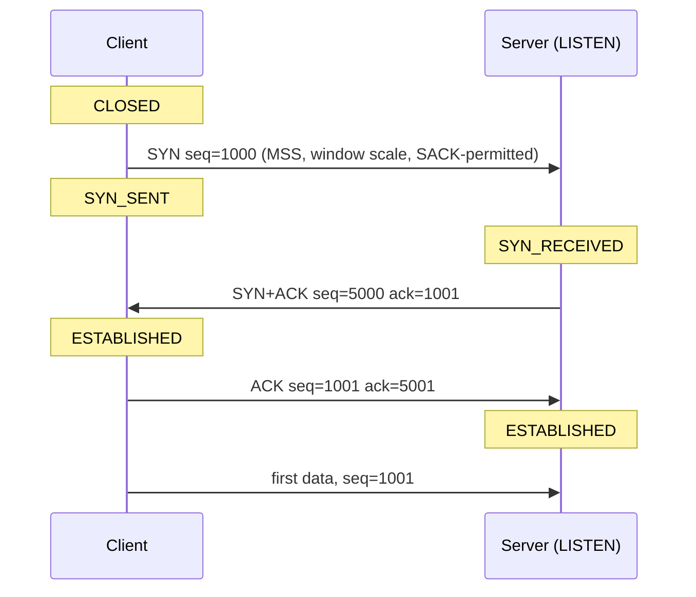
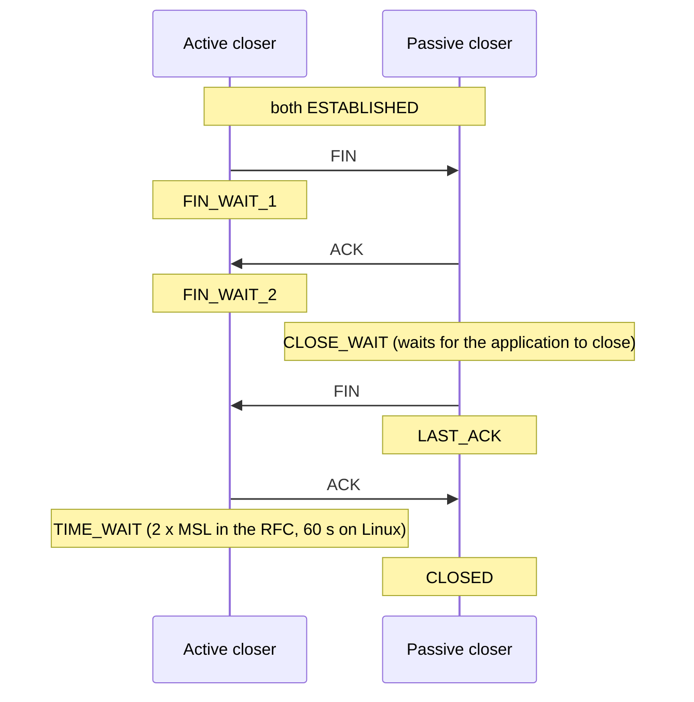
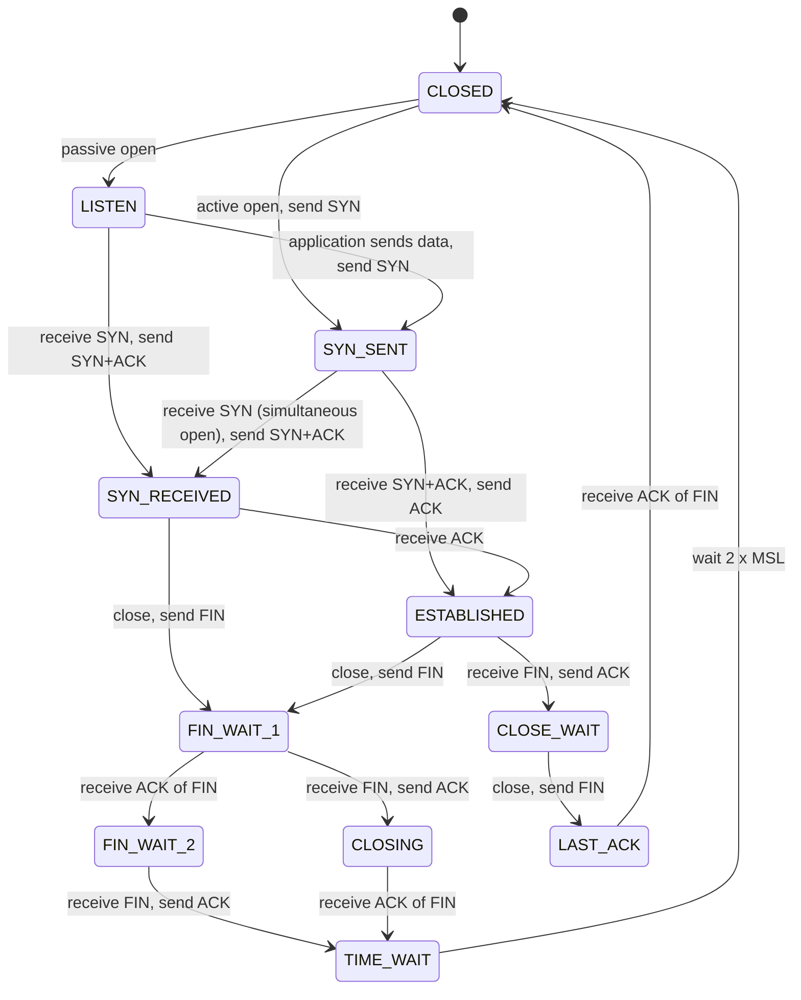

# TCP and UDP

TCP (Transmission Control Protocol) gives two programs a reliable, ordered stream of bytes over a network that loses, duplicates, delays, and reorders packets. UDP (User Datagram Protocol) gives them single messages with no promise of delivery or order. Almost every backend call that a Java developer makes (HTTP, a database driver, a message broker client) runs on TCP, so TCP behavior decides tail latency, timeouts, and many production incidents. This page explains the TCP header, the handshake and the teardown, the state machine, loss recovery, flow control, congestion control, Nagle's algorithm, keep-alive, and head-of-line blocking. It then covers UDP and the socket settings that a Java developer controls.

## Why It Matters

Interviews ask about TCP in three forms. The first is a protocol question ("Why three messages in the handshake?", "What is TIME_WAIT?"). The second is a performance question ("Why is the first request on a new connection slow?", "What does `TCP_NODELAY` do?"). The third is an incident question ("The server has 40,000 sockets in CLOSE_WAIT. What is wrong?"). On the job, the same knowledge explains `Connection reset by peer`, a read timeout that never fires, a connection pool that hides 100 ms of handshake cost, and a client that runs out of ephemeral ports. The page gives each default value with its source, and each number that the reader can check with a calculation.

## Core Concepts

**Segment**: the unit of data that TCP sends. A segment is a TCP header followed by up to one MSS of payload.

**MSS (maximum segment size)**: the largest payload that one segment carries. Each side announces its MSS in the SYN segment. On Ethernet with a 1500-byte MTU, the MSS is 1460 bytes for IPv4 without options (1500 minus a 20-byte IP header and a 20-byte TCP header). If no MSS option arrives, a TCP implementation must assume 536 bytes for IPv4 and 1220 bytes for IPv6 (RFC 9293).

**Sequence number**: a 32-bit counter of bytes, not segments. The sender numbers each byte of its stream. The number in a segment is the number of the first payload byte. SYN and FIN each use one sequence number.

**Acknowledgment number**: the sequence number that the receiver expects next. It is cumulative. "ACK 5001" means "I have received every byte up to 5000".

**Connection**: the state that two endpoints keep. Its identity is the four values *source IP, source port, destination IP, destination port* (the 4-tuple). A server port serves many connections because each client has a different 4-tuple.

**Receive window (rwnd)**: the number of bytes that the receiver tells the sender it can accept now. It protects the receiver. This is flow control.

**Congestion window (cwnd)**: the number of bytes that the sender allows itself to have in flight (sent and not yet acknowledged). It protects the network. This is congestion control. The sender sends at most `min(cwnd, rwnd)` bytes of unacknowledged data.

**RTT (round-trip time)**: the time from sending a segment to receiving its acknowledgment. **RTO (retransmission timeout)**: how long the sender waits for an acknowledgment before it sends the data again.

**Bandwidth-delay product (BDP)**: bandwidth multiplied by RTT. It is the amount of data that must be in flight to keep a path full.

**Datagram**: one self-contained message with its own header. UDP sends datagrams.

!!! note "Source of the numbers"
    The latency numbers on this page come from the table in [back-of-envelope estimation](../hld/back-of-envelope-estimation.md): about 0.5 ms for a round trip in one data center and about 150 ms for a round trip between California and the Netherlands. Dean's table is approximate and dates from 2009. Use the values as orders of magnitude.

## How It Works

### The TCP header

A TCP header has 20 bytes of fixed fields, followed by up to 40 bytes of options (RFC 9293, section 3.1).

```text
 0                   1                   2                   3
 0 1 2 3 4 5 6 7 8 9 0 1 2 3 4 5 6 7 8 9 0 1 2 3 4 5 6 7 8 9 0 1
+-------------------------------+-------------------------------+
|          Source Port          |       Destination Port        |
+-------------------------------+-------------------------------+
|                        Sequence Number                        |
+---------------------------------------------------------------+
|                    Acknowledgment Number                      |
+-------+-------+---------------+-------------------------------+
| Data  | Rsrvd |C|E|U|A|P|R|S|F|            Window             |
| Offset|       |W|E|R|C|S|S|Y|I|                               |
|       |       |R|C|G|K|H|T|N|N|                               |
+-------+-------+---------------+-------------------------------+
|           Checksum            |         Urgent Pointer        |
+-------------------------------+-------------------------------+
|                    Options (0 to 40 bytes)                    |
+---------------------------------------------------------------+
```

| Field | Size | What it does |
|---|---|---|
| Source port, destination port | 16 bits each | With the two IP addresses, they identify the connection |
| Sequence number | 32 bits | The number of the first payload byte in this segment (or the initial sequence number on a SYN) |
| Acknowledgment number | 32 bits | The next byte that the sender of this segment expects. Valid only if the ACK flag is set |
| Data offset | 4 bits | The header length in 32-bit words. It tells where the payload starts |
| Flags | 8 bits | CWR and ECE (explicit congestion notification), URG, ACK, PSH, RST, SYN, FIN |
| Window | 16 bits | The receive window in bytes, scaled by the window scale option |
| Checksum | 16 bits | Covers the header, the payload, and a pseudo header from the IP header |
| Urgent pointer | 16 bits | Used with URG. Applications almost never use it |
| Options | 0 to 40 bytes | MSS, window scale, SACK-permitted, SACK blocks, timestamps |

The flags that matter for this page:

- **SYN** opens a connection and carries the initial sequence number.
- **ACK** is set on every segment after the first SYN. It says that the acknowledgment number is valid.
- **FIN** says "I have no more data to send".
- **RST** aborts the connection at once.
- **PSH** asks the receiver to pass buffered data to the application. Applications do not set it directly.

### The three-way handshake

Before a client and a server exchange data, they agree on two initial sequence numbers (ISNs), one for each direction. Each side picks its own ISN.



1. The client sends a SYN with its ISN (here 1000). The SYN uses one sequence number.
2. The server sends a SYN+ACK. It acknowledges 1001 (the client's ISN plus one) and announces its own ISN (here 5000).
3. The client sends an ACK with acknowledgment number 5001. The client can put its first data in this segment or in the next one.

The values 1000 and 5000 are examples. A real stack picks an unpredictable ISN.

**Why three messages.** Each side must tell the other its ISN, and each side must receive an acknowledgment of its own ISN. The server combines its acknowledgment of the client's ISN and its own SYN in message 2, so three messages are enough (four would be wasteful, two would leave the server's ISN unacknowledged). The handshake also protects against old duplicates. RFC 9293 (section 3.5) names this as the principal reason for three messages. Suppose a delayed SYN of an old connection arrives at the server. The server cannot tell that it is old, so it answers with a SYN+ACK. The client did not ask for this connection. It sees that the acknowledgment number does not match any SYN that it sent, and it answers with an RST. The server drops the half-open entry and returns to LISTEN (RFC 9293, Figure 8). With a two-message handshake, the server would treat the old SYN as a real request and open a connection that nobody wants.

**The cost for the application.** The client knows that the connection is established after one RTT (when the SYN+ACK arrives). It can put its first data in the third segment, so the request reaches the server after 1.5 RTT, and the first response byte reaches the client after 2 RTT, counted from the SYN. Without the handshake, the response would take 1 RTT. In the same data center, one RTT is about 0.5 ms. Between California and the Netherlands, it is about 150 ms. A connection pool pays the handshake cost once, not for each request. TCP Fast Open (RFC 7413, Experimental) lets a client that has connected to a server before send data in the SYN. It needs support at both ends and on the path, and the Linux server side is off by default (`tcp_fastopen`, flag 0x2), so a Java service rarely uses it.

**Options in the SYN.** The SYN carries the options that both sides must agree on at the start: MSS, window scale (RFC 7323), SACK-permitted (RFC 2018), and timestamps (RFC 7323). The window scale option appears only in SYN segments. If a side leaves it out of its SYN, window scaling is off for the connection (RFC 7323).

#### SYN flood and SYN cookies

When the server receives a SYN, it keeps state for a half-open connection (state SYN_RECEIVED) and waits for the final ACK. A **SYN flood** sends many SYNs, often with spoofed source addresses that never answer the SYN+ACK. The half-open entries fill the backlog, and legitimate clients get no connection. The attack targets the connection state of the host, not its bandwidth (RFC 4987).

Defenses (RFC 4987):

- **SYN cookies**: the server keeps no state after a SYN. It encodes a keyed hash of the addresses and ports, a coarse time counter, and an index of an MSS value into its own sequence number in the SYN+ACK. When the final ACK returns, the server recomputes the value, checks it, and only then builds the connection state. The cost (RFC 4987): the server cannot store the options from the SYN, so window scaling, SACK, and similar options are lost for such a connection, and the MSS comes from a small table of values. Linux reduces this cost: if timestamps are on, it stores the window scale and the SACK flag in the low bits of the timestamp that it sends in the SYN+ACK, and it reads them back from the echoed timestamp in the final ACK (`net/ipv4/syncookies.c`).
- **A SYN cache** that stores a compact entry for each SYN instead of a full connection record.
- **Larger backlog**, **a shorter SYN_RECEIVED timer**, and **recycling the oldest half-open entry**. RFC 4987 lists the weakness of each.
- **Ingress filtering** (BCP 38) at the network edge, which removes spoofed addresses.

Linux sends SYN cookies when the SYN backlog of a listening socket overflows. `net.ipv4.tcp_syncookies` defaults to 1. The value 2 sends cookies always (for testing). The kernel documentation calls cookies a fallback against SYN floods that must not carry a legitimate connection load, and says that they violate the TCP protocol and can degrade some services. The man page `tcp(7)` says to use them "as a last resort, if at all".

A listening socket on Linux has two queues. The SYN queue holds connections in SYN_RECEIVED (its limit is `tcp_max_syn_backlog`). The accept queue holds connections that finished the handshake and wait for the application to call `accept`. The `backlog` argument of `listen` limits the accept queue, and the kernel caps it at `net.core.somaxconn` (4096 by default since Linux 5.4, 128 before). In Java, `new ServerSocket(port)` uses a backlog of 50 (JDK 21 javadoc), and `new ServerSocket(port, backlog)` sets it. If the application accepts too slowly, the accept queue fills, and new connections wait or are dropped. The default of `tcp_abort_on_overflow` is off, so the kernel does not reset them.

### Closing a connection

TCP closes each direction on its own. A **FIN** says "I have no data to send". The other side can continue to send. This is a **half-close**. RFC 9293 says: CLOSE means "I have no more to send" but does not mean "I will not receive any more".



The ACK and the second FIN can travel in one segment if the passive closer closes at once. Then the sequence has three segments. If both sides send a FIN at the same time, both pass through CLOSING.

**RST (reset)** ends a connection at once, with no handshake and no wait. A side sends an RST when it receives a segment for a connection that does not exist (for example a SYN to a port with no listener), or when the application aborts the connection. The receiver of an RST drops all connection state, and its next `read` or `write` fails (Java reports this as `SocketException: Connection reset`, see the Java section).

### The TCP state machine

The states and the events that move a connection between them are in RFC 9293, section 3.3.2.



The diagram omits the timeout and reset paths (every state returns to CLOSED when the connection aborts or an RST arrives) and the case of a FIN that carries the ACK of the first FIN, which moves FIN_WAIT_1 straight to TIME_WAIT. Tools such as `ss` show these state names. See the Java example for a table-driven model.

#### TIME_WAIT

The side that **closes first** (the active closer) ends in TIME_WAIT. It keeps the connection record for a fixed time after it sent the last ACK. RFC 9293 requires a wait of 2×MSL, and takes the MSL (maximum segment lifetime) to be 2 minutes, "an engineering choice". So the RFC wait is 4 minutes.

TIME_WAIT has two purposes:

1. **It can answer a retransmitted FIN.** If the last ACK is lost, the peer in LAST_ACK sends its FIN again. A side that has no record would answer with an RST, and the peer would see an error. A side in TIME_WAIT sends the ACK again.
2. **It lets old segments die.** A delayed segment of the old connection could arrive after a new connection with the same 4-tuple has opened, and corrupt it. Waiting 2×MSL makes sure that every old segment has left the network.

**What Linux uses.** The kernel source defines `TCP_TIMEWAIT_LEN` as `60*HZ` ("about 60 seconds") in `include/net/tcp.h`. This is a compile-time constant, not 4 minutes. The `ip-sysctl` documentation lists no parameter that changes it. Two settings are often confused with it. `tcp_fin_timeout` (default 60 seconds) limits how long an orphaned connection stays in FIN_WAIT_2, not TIME_WAIT. `tcp_max_tw_buckets` limits the number of TIME_WAIT sockets. If the count passes the limit, the kernel destroys the extra sockets at once and logs a warning, which removes the protection that TIME_WAIT gives.

**When TIME_WAIT hurts.** A TIME_WAIT connection holds one 4-tuple. A client that opens many short connections to one server address and port is limited by its ephemeral ports. The Linux default range `ip_local_port_range` is 32768 to 60999, which is 28,232 ports. With 60 seconds in TIME_WAIT, one client IP can open about 28,232 / 60 ≈ 470 new connections per second to one destination (computed; it ignores reuse). A reverse proxy or a service that calls one backend over and over reaches this limit. The symptom is `Cannot assign requested address` (`EADDRNOTAVAIL`) on `connect`, or connection timeouts.

A server that closes the connection first collects TIME_WAIT entries too. This costs memory. It does not block new clients, because each client has a different 4-tuple.

**Fixes that work**, in the order to try them:

1. **Reuse connections.** Use HTTP keep-alive and a connection pool. A reused connection pays for no handshake and creates no TIME_WAIT entry. This also removes the handshake latency.
2. **Let the other side close first** where the protocol allows it. The active closer holds the TIME_WAIT. For a client, it is cheaper that the server holds it.
3. **Widen the port range** or use more source IPs or more destination addresses. The limit applies to one (source IP, destination IP, destination port) combination.
4. **`net.ipv4.tcp_tw_reuse`**: it lets the kernel reuse a TIME_WAIT socket for a new *outgoing* connection when it is "safe from protocol viewpoint". The kernel documentation lists the values 0 (off), 1 (on everywhere), and 2 (loopback only), with a default of 2, and says not to change it without advice from experts. It does not help a server that accepts connections. The condition in the kernel source (`tcp_twsk_unique` in `net/ipv4/tcp_ipv4.c`): the old connection must have recorded a peer timestamp (so the TCP timestamps option was in use, `tcp_timestamps` not 0), and a minimum delay must have passed since the socket entered TIME_WAIT. The minimum delay is the setting `tcp_tw_reuse_delay` (default 1000 ms) in current kernels; the setting is new, and older kernels used a fixed 1 second. The new connection starts with a sequence number beyond the old one, and the PAWS check (protection against wrapped sequence numbers, RFC 7323) on the timestamps lets the peer reject old segments. This is why reuse is safe where shortening TIME_WAIT is not. A connection without timestamps gets no reuse.

**Fixes that do harm.**

- **`tcp_tw_recycle`**: it removed TIME_WAIT sockets early and rejected SYNs whose timestamp was lower than the last one seen from that source address. Clients behind one NAT address have different timestamp clocks, so the kernel dropped their connections. The kernel removed the option in Linux 4.12: the commit "tcp: remove tcp_tw_recycle" (Soheil Hassas Yeganeh, March 2017) says that the option was already broken behind NAT, and that the randomized timestamp offsets of Linux 4.10 broke it for all connections. `tcp(7)` marks it "Linux 2.4 to Linux 4.11". Do not name it as a fix.
- **Setting `SO_LINGER` to 0 to avoid TIME_WAIT.** Close then sends an RST and drops unsent data. The peer sees an error and may lose data. Use it only to abort a connection on purpose.
- **Lowering `tcp_max_tw_buckets`** to "clean up" the table. It removes the protection described above. A related setting is `tcp_rfc1337` (default 0). The kernel documentation says that leaving it off does not follow RFC 1337 but prevents TIME_WAIT assassination (the early destruction of a TIME_WAIT socket by a late RST). Leave it at the default.

`SO_REUSEADDR` (in Java, `StandardSocketOptions.SO_REUSEADDR`) solves a different problem. It lets a server `bind` to its port while old connections on that port are in TIME_WAIT. This is the restart case. Without it, a restarted server can fail with `Address already in use`.

#### CLOSE_WAIT

The passive closer is in CLOSE_WAIT after it receives the FIN and before its application calls `close`. TCP has done its work: the kernel acknowledged the FIN. The state waits for the **application**. A server with thousands of sockets in CLOSE_WAIT has a leak: it reads end-of-file from a peer and does not close the socket. Typical causes in Java are a missing `close` on an error path, a thread that blocks forever so that the code after the read never runs, and a connection pool that does not discard a connection that the server closed. The fix is in the code (`try`-with-resources), not in a kernel setting. No timer ends CLOSE_WAIT. The state stays until the application closes the socket or the process exits.

### Reliability

TCP detects loss with sequence numbers and acknowledgments, and it repairs loss by sending the data again.

**Cumulative acknowledgments.** The receiver acknowledges the highest byte that has arrived in order. If segment 3 is lost and segments 4 and 5 arrive, the receiver keeps sending ACKs that name the start of segment 3. These repeated ACKs are **duplicate ACKs**.

**Retransmission timeout (RTO).** The sender starts a timer when it sends data. If the timer expires before an ACK arrives, the sender sends the oldest unacknowledged segment again and doubles the RTO (RFC 6298). RFC 6298 computes the RTO from RTT samples:

- Before the first sample, RTO is 1 second.
- First sample R: `SRTT = R`, `RTTVAR = R/2`, `RTO = SRTT + max(G, 4 × RTTVAR)`. G is the clock granularity.
- Each later sample R': `RTTVAR = 0.75 × RTTVAR + 0.25 × |SRTT − R'|`, then `SRTT = 0.875 × SRTT + 0.125 × R'`, then `RTO = SRTT + max(G, 4 × RTTVAR)` (RFC 6298 recommends alpha = 1/8 and beta = 1/4).
- The RFC says that RTO below 1 second should be rounded up to 1 second. An implementation may limit the RTO from above, with a limit of at least 60 seconds.
- **Karn's algorithm**: the sender takes no RTT sample from a retransmitted segment, because the ACK could belong to either copy. The exception is the timestamps option, which removes the ambiguity.

Example: the first RTT sample is 100 ms. Then `SRTT = 100 ms`, `RTTVAR = 50 ms`, and `RTO = 100 + 4 × 50 = 300 ms`. RFC 6298 would round this up to 1 second. **Linux does not**: it defines `TCP_RTO_MIN` as `HZ/5`, which is 200 ms, and the initial RTO `TCP_TIMEOUT_INIT` as 1 second, as in RFC 6298 section 2.1. The Linux estimator keeps the variance term at 200 ms or more (`rttvar_us = max(mdev_us, tcp_rto_min_us(sk))` in `net/ipv4/tcp_input.c`), so its RTO is at least about SRTT + 200 ms. In this example Linux retransmits after about 300 ms, where the RFC minimum would be 1 s. A timeout is expensive: the sender waits for at least the RTO and then restarts congestion control from one segment.

**Fast retransmit.** The sender does not wait for the timer if it sees **three duplicate ACKs**. It treats them as a loss signal and sends the missing segment at once (RFC 5681). This recovers in about one RTT, not in an RTO.

**Selective acknowledgment (SACK).** A cumulative ACK says nothing about data that arrived after a gap. With SACK (RFC 2018), the receiver adds blocks to its ACK that list the ranges it has received out of order, each with a left edge and a right edge. The sender then resends only the missing ranges. Both sides negotiate SACK-permitted in the SYN. A SACK block takes 8 bytes. The 40 bytes of option space hold up to 4 blocks, or 3 if the timestamps option is also present. SACK information is advisory: the receiver may discard data that it has reported, so the sender keeps the data until the cumulative ACK covers it. Linux enables SACK by default (`tcp_sack` is 1).

If a connection keeps retransmitting without an ACK, Linux gives up after `tcp_retries2` retries (default 15). The kernel documentation says this is a "hypothetical timeout of 924.6 seconds", about 15 minutes. A Java thread that blocks in `read` on a dead peer, with no `SO_TIMEOUT`, can wait that long when the thread is sending data. A thread that only reads and sends nothing gets no signal at all. See keep-alive below.

### Flow control

The receiver has a buffer of limited size. It writes the free space of that buffer into the **Window** field of every ACK. The sender must not have more than that number of bytes unacknowledged. This is the **receive window**.

- If the application reads slowly, the buffer fills, and the window shrinks. The sender slows down. The receiver slows the sender with no extra messages.
- If the window reaches **zero**, the sender stops. It sends **zero-window probes** at growing intervals, so the connection survives the loss of the window update that would restart the data (RFC 9293, section 3.8.6.1). A receiver should not shrink a window that it already announced (RFC 9293 says "SHOULD NOT shrink the window").
- **Silly window syndrome avoidance** stops both sides from exchanging tiny windows and tiny segments: the sender sends when it has a full segment or enough data for half of the largest window, and the receiver advances its window edge in larger steps (RFC 9293, section 3.8.6.2).

**Window scaling.** The window field has 16 bits, so the largest window without scaling is 65,535 bytes. The window scale option (RFC 7323) in the SYN gives a shift count of up to 14, and the window is the field value shifted left by that count. The largest window is 65,535 × 2^14 = 1,073,725,440 bytes, just under 1 GiB (computed). The option appears only in SYN segments, so the factor is fixed for the connection. Linux enables it by default (`tcp_window_scaling` is 1).

Why it matters: the throughput of one connection is at most window ÷ RTT. With a 65,535-byte window and a 150 ms RTT, the limit is 65,535 / 0.15 ≈ 437,000 bytes per second, about 3.5 Mbit/s (computed), however fast the link is. The Linux receive buffer (`tcp_rmem`) grows by itself up to its maximum (between 131,072 bytes and 32 MB, depending on RAM, per the kernel documentation), so a long fat path works if the buffer maximum is high enough.

### Congestion control

Flow control protects the receiver. **Congestion control** protects the network. A sender that sends as fast as the receive window allows can overflow a router queue between the two hosts. The packets are dropped, every sender retransmits, and the network collapses. TCP senders therefore limit themselves with the **congestion window (cwnd)** and probe the capacity of the path.

The amount of data in flight is at most `min(cwnd, rwnd)`.

**Slow start.** A new connection starts with a small cwnd. For each ACK that acknowledges new data, cwnd grows by at most one SMSS (RFC 5681, equation 2: `cwnd += min(N, SMSS)`, where N is the number of newly acknowledged bytes). The window doubles every RTT only under these conditions: the receiver acknowledges every segment, the sender has data to send, and neither the receive window nor a loss stops the growth. If the receiver uses delayed ACKs (one ACK for two segments) and the sender adds one SMSS per ACK, the window grows by a factor of about 1.5 per round trip. Linux adds the number of segments that each ACK acknowledges (`tcp_slow_start` in `net/ipv4/tcp_cong.c`), so it stays near a factor of 2. Slow start lasts while `cwnd < ssthresh` (the slow start threshold). The initial ssthresh is set "arbitrarily high" and the sender lowers it after a loss (RFC 5681).

**The initial window.** RFC 5681 allows an initial window of 2 to 4 segments. RFC 6928 (Experimental) raised the bound to `min(10 × MSS, max(2 × MSS, 14600))`, which is 10 segments for a 1460-byte MSS. Linux defines `TCP_INIT_CWND` as 10, with the comment "as per rfc6928". So the first flight is 14,600 bytes. Example (computed, ideal path, no loss): to send 100,000 bytes, the sender sends 14,600, then 29,200, then 58,400 bytes in three consecutive round trips (total 102,200). The transfer needs the handshake RTT and three sending round trips, about 4 × 150 ms = 600 ms between California and the Netherlands. The bandwidth plays no role. This is why a small response on a new connection is slow, and why a warm connection with a large cwnd is fast.

**Congestion avoidance (AIMD).** When `cwnd ≥ ssthresh`, cwnd grows by about one segment per RTT: **additive increase**. When the sender detects a loss, it cuts the window: **multiplicative decrease**. The name is AIMD. The loss signals are:

- **Three duplicate ACKs** (fast retransmit): the network still delivers packets. The sender sets `ssthresh = max(FlightSize/2, 2 × SMSS)`, resends the lost segment, and enters **fast recovery**. In fast recovery, cwnd is `ssthresh` plus three segments, and it grows by one segment for each further duplicate ACK, so the sender keeps sending new data. When an ACK acknowledges new data, cwnd falls to ssthresh and congestion avoidance continues (RFC 5681). The sender keeps about half its previous rate.
- **A timeout** (RTO expiry): the sender has no ACKs at all. It sets ssthresh the same way, sets cwnd to one segment, and restarts slow start (RFC 5681). A timeout costs far more than a fast retransmit.

The Java example simulates these rules in whole segments per round trip.

**CUBIC (RFC 9438).** CUBIC is a Standards Track RFC (August 2023) that obsoletes RFC 8312 and updates RFC 5681. RFC 9438 states that Linux, Windows, and Apple stacks adopted CUBIC as the default. In the Linux kernel the default is set when the kernel is built, so check `net.ipv4.tcp_congestion_control` on your host. Instead of a linear increase, CUBIC grows the window as a cubic function of the time since the last loss: `W(t) = C × (t − K)³ + W_max`. `W_max` is the window at the last loss. `K` is the time that the function needs to return to `W_max`. The curve rises fast, flattens near `W_max`, and then probes beyond it. RFC 9438 recommends C = 0.4 and a decrease factor of 0.7 (so the window falls to 70% of its value at a loss, not to 50%). The window depends on elapsed time, not on the number of ACKs, so flows with different RTTs are treated more fairly than with Reno, and a long fat path recovers faster. CUBIC also tracks the window that Reno would have, and uses the larger one.

**BBR.** BBR (Bottleneck Bandwidth and Round-trip propagation time; Cardwell et al., ACM Queue 2016) does not use loss as its main signal. It builds a model of the path from two measurements: the bottleneck bandwidth, which is the maximum delivery rate that it measured over a recent window, and the minimum RTT over the last 10 seconds. The product is the BDP. BBR **paces** its sending: it spaces packets in time at a rate of `pacing_gain × bandwidth` and caps the data in flight near a small multiple of the BDP, so that it fills the path without building a long queue at the bottleneck. The pacing gain changes over time: the connection first probes upward for bandwidth (Startup), drains the queue that this created (Drain), cruises and probes in cycles (ProbeBW), and briefly cuts its window to refresh the minimum RTT (ProbeRTT). Loss-based algorithms such as CUBIC fill the bottleneck buffer until a packet drops. BBR aims to keep the queue short, which helps on paths with large buffers and random loss. The mainline Linux module `tcp_bbr` implements BBR version 1 (since Linux 4.9); the IETF draft describes a newer revision of the algorithm that also reacts to loss and ECN. As of 2026-11-05, BBR is not an RFC. The IETF draft `draft-ietf-ccwg-bbr` (revision 07, dated 2 November 2026) states "Intended status: Experimental" and is a document of the Congestion Control Working Group. Linux selects an algorithm with `tcp_congestion_control`, or per socket with the `TCP_CONGESTION` socket option. The kernel documentation says that `reno` is always available and that other choices depend on the kernel configuration. BBR runs on the sender only, so the receiver needs no change.

**The bandwidth-delay product.** To fill a path, the window must be at least the BDP. Example: a 1 Gbit/s path with a 150 ms RTT has a BDP of 125,000,000 bytes/s × 0.15 s = 18,750,000 bytes (about 18.75 MB, computed). A 64 KB window uses 0.35% of this path. A 10 Mbit/s path with a 50 ms RTT has a BDP of 1,250,000 × 0.05 = 62,500 bytes (computed), which fits in the unscaled window. Both cwnd and rwnd must reach the BDP, and the socket buffers must be large enough to hold it.

**Idle connections.** Linux applies RFC 2861 by default: `tcp_slow_start_after_idle` is 1, so a connection that has been idle shrinks its cwnd and goes through slow start again. A pooled connection that sends a large response after a pause does not run at the speed it reached before the pause.

### Nagle's algorithm and delayed ACKs

**Nagle's algorithm** reduces the number of small segments. If there is unacknowledged data in flight, the sender holds new small writes in a buffer. It sends them when the ACK arrives or when it has a full segment (RFC 9293, section 3.7.4: while data is unacknowledged, the sender "buffers all user data"). RFC 9293 says that an implementation SHOULD implement Nagle's algorithm, and MUST give the application a way to switch it off on a connection (the `TCP_NODELAY` option).

**Delayed ACK.** The receiver does not acknowledge each segment at once. It waits for data to carry the ACK. RFC 9293 (section 3.8.6.3) says that the delay MUST stay under 0.5 seconds and that an ACK SHOULD be generated for at least every second full-sized segment. In the Linux source, the delayed-ACK timer lies between `TCP_DELACK_MIN` (`HZ/25`, 40 ms) and `TCP_DELACK_MAX` (`HZ/5`, 200 ms).

**The bad interaction.** A client writes a request in two small `write` calls (a header and then a body). The first segment goes out. The second write waits under Nagle for an ACK of the first segment. The server waits for the rest of the request and delays its ACK. Both sides wait until the delayed-ACK timer fires. The result is a stall of tens of milliseconds on each request. The fixes:

1. Set `TCP_NODELAY` on the socket (in Java, `socket.setTcpNoDelay(true)` or `StandardSocketOptions.TCP_NODELAY`). The Java documentation says the default is `FALSE`, and says to enable it "only in cases where it is known that the coalescing impacts performance". Request-response protocols with small messages, such as RPC and database drivers, are those cases.
2. Build the whole message in a buffer and write it with one call. This is good with or without Nagle, because it also reduces the number of system calls and segments.

`TCP_NODELAY` has a cost: many tiny segments waste header bytes. It is the right setting for latency-sensitive request-response traffic, and a bad one for a program that writes one byte at a time in a loop. Linux also offers `TCP_CORK` (do not send partial frames, with a 200 ms limit) and `TCP_QUICKACK`.

### Keep-alive

TCP has no traffic on an idle connection. If the peer crashes, or a NAT or a firewall drops its table entry, the other side sees nothing. The connection stays ESTABLISHED in its memory. **TCP keep-alive** sends a probe on an idle connection to detect that situation. This is the home of keep-alive in the KB. HTTP persistent connections (the HTTP `Connection: keep-alive` header) are a different feature, and the [HTTP page](04-http.md) covers them.

RFC 9293 (section 3.8.4, which repeats RFC 1122 section 4.2.3.6) says that an implementation MAY include keep-alive. If it does, the application MUST be able to turn it on or off for each connection, it MUST default to off, and the idle interval before the first probe MUST be configurable and MUST default to at least two hours. A probe is a segment with no data, or with one garbage byte, and with a sequence number one below the next one to send, so the peer must answer with an ACK. The RFC also says that the failure to answer one probe must not count as a dead connection, so an implementation sends several probes. Linux follows this:

| Setting | Meaning | Linux default |
|---|---|---|
| `SO_KEEPALIVE` | The application must turn keep-alive on for the socket | off |
| `tcp_keepalive_time` (`TCP_KEEPIDLE`) | Idle time before the first probe | 7200 s (2 hours) |
| `tcp_keepalive_intvl` (`TCP_KEEPINTVL`) | Time between probes | 75 s |
| `tcp_keepalive_probes` (`TCP_KEEPCNT`) | Unanswered probes before the connection is declared dead | 9 |

With the defaults, a dead peer is found after 7200 + 9 × 75 = 7,875 seconds, about 2 hours and 11 minutes (computed). The kernel documentation says the probes give "roughly 11 minutes of retries" after the idle time. These numbers are too large for most backend uses.

Three uses of keep-alive:

1. **Find a dead peer.** Lower the idle time and the probe count for the socket. In Java 11 and later, `ExtendedSocketOptions.TCP_KEEPIDLE`, `TCP_KEEPINTERVAL`, and `TCP_KEEPCOUNT` (package `jdk.net`) set them for one socket, after `SO_KEEPALIVE` is on. The JDK documentation says that the semantics are system dependent.
2. **Keep NAT and load balancer state alive.** NAT devices and load balancers drop idle connections after an idle timeout. A keep-alive probe with an idle time shorter than that timeout resets it. See `kb/networking/09-proxies-and-nat.md` for the NAT side. The idle timeout of each product is in its documentation.
3. **Replace it with application heartbeats** where the protocol allows it (for example a WebSocket ping, or a database `SELECT 1` validation query in a pool). A heartbeat also proves that the application, not only the kernel, is alive. Keep-alive is answered by the kernel of the peer, even if the application is stuck.

`TCP_USER_TIMEOUT` (Linux, in `tcp(7)`) is a related setting: the maximum time in milliseconds that transmitted data can stay unacknowledged before the connection is closed with `ETIMEDOUT`. It limits the 15-minute retry period for data that is being sent. If keep-alive is also on, `TCP_USER_TIMEOUT` overrides the keep-alive settings in deciding when to close the connection after failed probes (`tcp(7)`). Java has no standard socket option for it.

### Head-of-line blocking in TCP

TCP delivers bytes **in order**. If one segment is lost, the receiver holds all later segments in its buffer, even though they have arrived, until the retransmission fills the gap. The application sees nothing until then. This is **head-of-line (HOL) blocking** at the TCP level. SACK speeds up the repair, but it does not release the later bytes before the gap is filled.

The effect is large when many independent logical streams share one connection. HTTP/2 puts many request streams in one TCP connection, so one lost segment stalls all of them. QUIC (RFC 9000) avoids this by running over UDP and doing loss recovery for each stream in the transport, so a lost packet stalls only the streams whose data it carried. The QUIC handshake, its streams, and the comparison across HTTP versions are in [HTTP](04-http.md).

### UDP

UDP (RFC 768) is a thin layer over IP. A UDP header has four fields of 16 bits each: source port, destination port, length (header plus data, at least 8), and checksum. A transmitted checksum of zero means that the sender computed none. The RFC describes the protocol as "a minimum of protocol mechanism" and says that delivery and duplicate protection are not guaranteed.

| UDP has | UDP does not have |
|---|---|
| Ports, so many programs share one IP address | A connection or a handshake |
| A checksum (optional over IPv4, where zero means "none"; required over IPv6, RFC 8200) | Delivery guarantee, retransmission |
| Message boundaries (one `send` is one datagram) | Ordering |
| No head-of-line blocking between datagrams | Flow control and congestion control |

A datagram must fit into one IP packet or the IP layer fragments it. The maximum UDP payload on IPv4 is 65,535 − 20 − 8 = 65,507 bytes (computed from the IP and UDP header sizes). In practice, applications keep datagrams below the path MTU (about 1,472 bytes of payload on a 1500-byte Ethernet MTU for IPv4, computed), so that they are not fragmented.

**When to choose UDP.**

- **Small request-response with a retry in the application**: DNS (port 53) sends one question and gets one answer, and it falls back to TCP for large answers. See the [DNS page](06-dns.md).
- **Real-time media and games**: an old packet is useless when a new one has arrived. Retransmission and ordering add delay. The application hides or skips a lost packet.
- **A new transport on top of UDP**: QUIC (RFC 9000) runs on UDP, because a kernel TCP stack cannot change fast and middleboxes block unknown IP protocols. QUIC rebuilds reliability, streams, and congestion control in user space. One paragraph is enough here: the details are on the [HTTP page](04-http.md).
- **Broadcast and multicast**: TCP is point to point.

If you choose UDP, you must handle loss, reordering, duplication, and congestion yourself. A UDP sender with no congestion control can harm other traffic on the path.

## Trade-offs and When to Use

| Aspect | TCP | UDP |
|---|---|---|
| Connection | Yes: handshake (1 RTT) before data | No |
| Delivery | Reliable. Retransmits lost data | Best effort. No retransmission |
| Order | Bytes arrive in order | Datagrams may arrive in any order |
| Message boundaries | None. A byte stream: one `read` can return part of a message or two messages | Kept. One datagram per `receive` |
| Flow and congestion control | Yes | No (the application must add it) |
| Header | 20 to 60 bytes | 8 bytes |
| Head-of-line blocking | Yes (a lost segment holds back later bytes) | None between datagrams |
| Typical uses | HTTP/1.1 and HTTP/2, databases, SSH, message brokers | DNS, real-time media, games, QUIC and HTTP/3 |

A byte stream has no message boundaries, so a protocol on TCP must frame its messages: a length prefix, a delimiter, or a fixed size. A Java developer who assumes that one `write` equals one `read` writes a bug that appears only under load.

| Decision | Choice | Reason |
|---|---|---|
| Latency-sensitive request-response over TCP | Set `TCP_NODELAY` and write each message with one call | Avoids the Nagle and delayed-ACK stall |
| Many short calls to one backend | Reuse connections with a pool | Skips the handshake and slow start, and avoids TIME_WAIT build-up |
| Detect a dead peer | Set a read timeout, and add keep-alive or an application heartbeat | The kernel default takes about 2 hours (keep-alive) or about 15 minutes (retransmission) |
| Long fat path (high BDP) | Keep window scaling on and set a large enough buffer maximum | The window limits throughput to window ÷ RTT |
| Data where freshness beats completeness | UDP | A late packet has no value |

## Java Example

### Slow start and AIMD over round trips

The program below models cwnd in whole segments, one step for each round trip. It starts with an initial window of 10 segments, grows in slow start up to ssthresh, grows by one segment per round trip in congestion avoidance, and then meets a triple-duplicate-ACK loss at round trip 9 and a timeout at round trip 16. It is a simplified teaching model. It assumes that the receiver acknowledges every segment, that the sender always has data, and that the receive window never limits the sender, so slow start doubles cwnd in every round trip. Real TCP grows cwnd for each ACK by at most one SMSS, counts bytes, and runs fast recovery with window inflation. The program opens no socket.

```java
import java.util.Map;

public class CongestionSim {
    // Units: segments (1 segment = 1 MSS). One loop pass = one round trip.
    public static void main(String[] args) {
        int cwnd = 10;          // initial window of 10 segments (RFC 6928)
        int ssthresh = 64;      // RFC 5681: initial value "arbitrarily high"; 64 for this demo
        Map<Integer, String> events = Map.of(9, "TRIPLE_DUP_ACK", 16, "TIMEOUT");

        System.out.println("rtt  cwnd  ssthresh  phase                event");
        for (int rtt = 1; rtt <= 22; rtt++) {
            String phase = cwnd < ssthresh ? "slow start" : "congestion avoidance";
            String event = events.getOrDefault(rtt, "-");
            System.out.printf("%3d  %4d  %8d  %-20s %s%n", rtt, cwnd, ssthresh, phase, event);

            if (event.equals("TRIPLE_DUP_ACK")) {
                ssthresh = Math.max(cwnd / 2, 2);   // multiplicative decrease
                cwnd = ssthresh;                    // fast recovery: keep sending at half rate
            } else if (event.equals("TIMEOUT")) {
                ssthresh = Math.max(cwnd / 2, 2);
                cwnd = 1;                           // loss window of 1 segment, then slow start
            } else if (cwnd < ssthresh) {
                cwnd = Math.min(cwnd * 2, ssthresh); // simplification: one ACK per segment
            } else {
                cwnd = cwnd + 1;                    // additive increase: 1 segment per round trip
            }
        }
    }
}
```

<!-- expected-output -->

```text
rtt  cwnd  ssthresh  phase                event
  1    10        64  slow start           -
  2    20        64  slow start           -
  3    40        64  slow start           -
  4    64        64  congestion avoidance -
  5    65        64  congestion avoidance -
  6    66        64  congestion avoidance -
  7    67        64  congestion avoidance -
  8    68        64  congestion avoidance -
  9    69        64  congestion avoidance TRIPLE_DUP_ACK
 10    34        34  congestion avoidance -
 11    35        34  congestion avoidance -
 12    36        34  congestion avoidance -
 13    37        34  congestion avoidance -
 14    38        34  congestion avoidance -
 15    39        34  congestion avoidance -
 16    40        34  congestion avoidance TIMEOUT
 17     1        20  slow start           -
 18     2        20  slow start           -
 19     4        20  slow start           -
 20     8        20  slow start           -
 21    16        20  slow start           -
 22    20        20  congestion avoidance -
```

Read the output in this order:

- Round trips 1 to 4: cwnd doubles from 10 to 20, 40, and 64. Slow start stops at ssthresh (the model caps the doubling at ssthresh).
- Round trips 5 to 9: cwnd grows by one segment per round trip.
- Round trip 9: three duplicate ACKs. The model sets ssthresh to 34 (half of 69, rounded down) and cwnd to 34. The window falls by about half and congestion avoidance continues.
- Round trip 16: a timeout. ssthresh becomes 20 (half of 40) and cwnd falls to 1. Slow start rebuilds the window in 5 round trips. The timeout costs far more than the duplicate ACK loss.

### The TCP state machine

The second program drives the RFC 9293 state machine with event lists. It shows the client path through TIME_WAIT, the server path through CLOSE_WAIT and LAST_ACK, and a server that never closes: it stays in CLOSE_WAIT, and no timer moves it on.

```java
import java.util.List;
import java.util.Map;

public class TcpStates {
    enum State {
        CLOSED, LISTEN, SYN_SENT, SYN_RECEIVED, ESTABLISHED,
        FIN_WAIT_1, FIN_WAIT_2, CLOSING, TIME_WAIT, CLOSE_WAIT, LAST_ACK
    }

    // Key: "STATE EVENT". Value: "NEXT_STATE segment-to-send" (RFC 9293 section 3.3.2).
    static final Map<String, String> TABLE = Map.ofEntries(
        Map.entry("CLOSED PASSIVE_OPEN", "LISTEN -"),
        Map.entry("CLOSED ACTIVE_OPEN", "SYN_SENT SYN"),
        Map.entry("LISTEN RCV_SYN", "SYN_RECEIVED SYN+ACK"),
        Map.entry("SYN_SENT RCV_SYN+ACK", "ESTABLISHED ACK"),
        Map.entry("SYN_RECEIVED RCV_ACK", "ESTABLISHED -"),
        Map.entry("ESTABLISHED CLOSE", "FIN_WAIT_1 FIN"),
        Map.entry("ESTABLISHED RCV_FIN", "CLOSE_WAIT ACK"),
        Map.entry("FIN_WAIT_1 RCV_ACK", "FIN_WAIT_2 -"),
        Map.entry("FIN_WAIT_1 RCV_FIN", "CLOSING ACK"),
        Map.entry("FIN_WAIT_2 RCV_FIN", "TIME_WAIT ACK"),
        Map.entry("CLOSING RCV_ACK", "TIME_WAIT -"),
        Map.entry("TIME_WAIT TIMEOUT_2MSL", "CLOSED -"),
        Map.entry("CLOSE_WAIT CLOSE", "LAST_ACK FIN"),
        Map.entry("LAST_ACK RCV_ACK", "CLOSED -")
    );

    static void run(String name, State start, List<String> events) {
        System.out.println(name);
        State state = start;
        for (String event : events) {
            String result = TABLE.get(state + " " + event);
            if (result == null) {
                System.out.printf("  %-13s %-14s -> no transition%n", state, event);
                continue;
            }
            String[] parts = result.split(" ");
            System.out.printf("  %-13s %-14s -> %-13s send %s%n", state, event, parts[0], parts[1]);
            state = State.valueOf(parts[0]);
        }
        System.out.println("  final state: " + state);
    }

    public static void main(String[] args) {
        run("Client (active open, active close)", State.CLOSED,
            List.of("ACTIVE_OPEN", "RCV_SYN+ACK", "CLOSE", "RCV_ACK", "RCV_FIN", "TIMEOUT_2MSL"));
        run("Server (passive open, passive close)", State.CLOSED,
            List.of("PASSIVE_OPEN", "RCV_SYN", "RCV_ACK", "RCV_FIN", "CLOSE", "RCV_ACK"));
        run("Server that never calls close() after the client sent FIN", State.ESTABLISHED,
            List.of("RCV_FIN", "TIMEOUT_2MSL"));
    }
}
```

<!-- expected-output -->

```text
Client (active open, active close)
  CLOSED        ACTIVE_OPEN    -> SYN_SENT      send SYN
  SYN_SENT      RCV_SYN+ACK    -> ESTABLISHED   send ACK
  ESTABLISHED   CLOSE          -> FIN_WAIT_1    send FIN
  FIN_WAIT_1    RCV_ACK        -> FIN_WAIT_2    send -
  FIN_WAIT_2    RCV_FIN        -> TIME_WAIT     send ACK
  TIME_WAIT     TIMEOUT_2MSL   -> CLOSED        send -
  final state: CLOSED
Server (passive open, passive close)
  CLOSED        PASSIVE_OPEN   -> LISTEN        send -
  LISTEN        RCV_SYN        -> SYN_RECEIVED  send SYN+ACK
  SYN_RECEIVED  RCV_ACK        -> ESTABLISHED   send -
  ESTABLISHED   RCV_FIN        -> CLOSE_WAIT    send ACK
  CLOSE_WAIT    CLOSE          -> LAST_ACK      send FIN
  LAST_ACK      RCV_ACK        -> CLOSED        send -
  final state: CLOSED
Server that never calls close() after the client sent FIN
  ESTABLISHED   RCV_FIN        -> CLOSE_WAIT    send ACK
  CLOSE_WAIT    TIMEOUT_2MSL   -> no transition
  final state: CLOSE_WAIT
```

### A client with explicit timeouts and options

The class below shows the socket settings that a Java developer controls. **This class has no `main` method and the runner does not run it**, because it needs a network. `connect` with a timeout limits the handshake, `setSoTimeout` limits each `read`, and the options turn on `TCP_NODELAY` and keep-alive with shorter timers.

```java
import java.io.IOException;
import java.io.InputStream;
import java.io.OutputStream;
import java.net.InetSocketAddress;
import java.net.Socket;
import java.net.StandardSocketOptions;
import jdk.net.ExtendedSocketOptions;

public class TimeoutClient {
    static byte[] call(String host, int port, byte[] request) throws IOException {
        try (Socket socket = new Socket()) {
            socket.setOption(StandardSocketOptions.TCP_NODELAY, true);
            socket.setOption(StandardSocketOptions.SO_KEEPALIVE, true);
            // Java 11 and later; the JDK says the semantics are system dependent.
            socket.setOption(ExtendedSocketOptions.TCP_KEEPIDLE, 60);
            socket.setOption(ExtendedSocketOptions.TCP_KEEPINTERVAL, 10);
            socket.setOption(ExtendedSocketOptions.TCP_KEEPCOUNT, 3);

            // Limits the handshake. Throws SocketTimeoutException if it expires.
            socket.connect(new InetSocketAddress(host, port), 2_000);
            // Limits each blocking read. The socket stays valid after the timeout.
            socket.setSoTimeout(5_000);

            OutputStream out = socket.getOutputStream();
            out.write(request);          // one write call: the whole message
            out.flush();

            InputStream in = socket.getInputStream();
            byte[] buffer = new byte[8192];
            int n = in.read(buffer);     // SocketTimeoutException after 5 s without data
            return n < 0 ? new byte[0] : java.util.Arrays.copyOf(buffer, n);
        }
    }
}
```

What a Java developer sees:

- **`connect(addr, timeout)`** with timeout 0 means "infinite". The handshake then waits for the kernel. On Linux, `tcp_syn_retries` defaults to 6, which the kernel documentation says ends in a timeout after about 131 seconds. Set the connect timeout yourself. In `java.net.http.HttpClient`, `connectTimeout` does the same and throws `HttpConnectTimeoutException`. The JDK documentation says it has no effect if the client reuses an existing connection.
- **`setSoTimeout`** limits a single blocking `read`. It throws `SocketTimeoutException`, and the socket stays usable. It is a read-inactivity timeout, not a limit on the whole call. A server that sends one byte every 4 seconds never triggers a 5-second `SO_TIMEOUT`. In `HttpClient`, `HttpRequest.Builder.timeout` throws `HttpTimeoutException` if the response is not received within the duration (JDK 21 javadoc). Without it, the wait has no limit.
- **`Connection reset by peer`** (`SocketException`, from `ECONNRESET`) means the local TCP received an RST. Common causes: the server process died or restarted, the server closed the socket with unread data in its buffer, a load balancer or firewall dropped an idle connection and answers a later segment with an RST, or a pool reused a connection that the server had already closed. `Broken pipe` (`SocketException`, from `EPIPE`) is the write-side counterpart: the local TCP already knows that the connection is dead, so the write fails. Two causes: the peer closed its end and answered an earlier write with an RST (the first write after a peer's FIN usually succeeds, because TCP allows data after a FIN, and a later write fails), or the local side shut down its own output. `SO_LINGER` with a timeout of 0 is a third source: `close` then aborts the connection and sends an RST at once (RFC 9293, ABORT call, section 3.10.5), so the peer sees `Connection reset`. The protection is a retry for idempotent requests on a fresh connection, validation of pooled connections, and an idle timeout in the pool that is shorter than the timeout of the server and of every device on the path.
- **Connection pool reuse** skips the handshake (1 RTT) and the slow start that a new connection needs. It also avoids TIME_WAIT build-up.
- **Ephemeral port exhaustion** shows as `java.net.BindException: Cannot assign requested address` on `connect`. See the TIME_WAIT section for the fix order: reuse connections first.
- **`Address already in use`** at server start: set `SO_REUSEADDR` before `bind`.

## Interview Angle

### Questions

??? question "Explain the TCP three-way handshake. Why does it need three messages?"

    The client sends a SYN with its initial sequence number (ISN). The server answers with a SYN+ACK: it acknowledges the client's ISN plus one and sends its own ISN. The client sends an ACK of the server's ISN plus one. Then both sides are ESTABLISHED.

    Three messages are the minimum for both sides to agree on both ISNs. Each ISN must be acknowledged by the other side. The server joins its ACK and its SYN in one segment, so the exchange needs three messages and not four. The handshake also stops a delayed duplicate SYN of an old connection from opening a connection that the client does not want: the client sees that the SYN+ACK acknowledges a SYN that it did not send, and it answers with an RST (RFC 9293, section 3.5).

    The trade-off: the client pays one RTT before the server can answer its first request. That is about 0.5 ms in one data center and about 150 ms between continents. Connection pools and HTTP keep-alive remove the cost for repeated calls. QUIC (one RTT for the transport and TLS handshake together) and TCP Fast Open (RFC 7413, data in the SYN on a repeat connection, rarely deployed in Java services) reduce it for new connections. The server keeps half-open state after a SYN, which is the target of a SYN flood. SYN cookies remove that state.

??? question "A server shows 30,000 connections in TIME_WAIT. Is this a problem? What do you do?"

    First, find out which side holds them. TIME_WAIT lives on the side that closed the connection first. A count of 30,000 on a server that closes connections after each response is a cost in memory and nothing more: each client has its own 4-tuple, and the entries do not block new clients. No fix is needed unless memory is short.

    The same count on a *client* (for example a reverse proxy or a service that calls one backend) is a problem if it nears the ephemeral port range. Linux has 28,232 ports by default (32768 to 60999). With the Linux TIME_WAIT of 60 seconds, that allows about 470 new connections per second to one destination. The symptom is `Cannot assign requested address`.

    The fixes, in order: reuse connections (keep-alive and a pool), let the peer close first, widen the port range or add source or destination addresses, and use `tcp_tw_reuse` for outgoing connections (it works only if TCP timestamps are on and more than `tcp_tw_reuse_delay`, 1 s by default, has passed since the socket entered TIME_WAIT). Its default value 2 enables it for loopback only, so a client that calls other hosts needs the value 1. Do not use `tcp_tw_recycle` (removed in Linux 4.12, broke clients behind NAT), do not set `SO_LINGER` 0 to skip TIME_WAIT, and do not shorten the 2×MSL wait on purpose, because TIME_WAIT protects against old segments and a lost last ACK. The RFC wait is 2×MSL, which is 4 minutes with the RFC's MSL of 2 minutes. Linux compiles in 60 seconds (`TCP_TIMEWAIT_LEN`).

??? question "What does it mean if a service has many sockets in CLOSE_WAIT?"

    The peer sent a FIN, the kernel acknowledged it, and the local application has not called `close`. No timer ends the state. A large number means an application bug: a code path that reads end-of-file and drops the socket reference without closing it, a pool that keeps dead connections, or a thread stuck before its `close`. In Java, use `try`-with-resources, close in `finally`, and make the pool validate connections. Find the owner with `ss -tanp state close-wait` and a thread dump. This is different from TIME_WAIT, which the kernel handles with no help from the application.

??? question "What is the difference between flow control and congestion control?"

    Flow control protects the receiver. The receiver announces its free buffer space in the window field of each ACK, and the sender keeps no more unacknowledged data than that. Congestion control protects the network. The sender keeps its own congestion window (cwnd), which it grows when ACKs arrive and cuts when it detects loss. The sender limits its in-flight data to the minimum of the two windows.

    The receiver knows its buffer. Nobody tells the sender about the capacity of the routers on the path, so the sender infers it from losses (CUBIC, Reno) or from delay and bandwidth estimates (BBR). A fast sender with a slow link and a large receive window is limited by cwnd. A fast network with a receiver that reads slowly is limited by rwnd.

??? question "Describe how TCP reacts to a lost packet."

    There are two detection paths. If later segments arrive, the receiver sends duplicate ACKs. After three duplicate ACKs the sender resends the missing segment at once (fast retransmit), halves ssthresh (RFC 5681 uses `max(FlightSize/2, 2 × SMSS)`), and enters fast recovery, so it keeps sending at about half its previous rate. With SACK (RFC 2018), the ACKs also list the ranges that arrived, so the sender resends only the gaps. CUBIC cuts the window to 70% and not 50% (RFC 9438).

    If no ACKs come back (the tail of a flow, or a burst loss), the retransmission timer expires. The sender resends, doubles the RTO, sets ssthresh the same way, and sets cwnd to one segment, so it restarts slow start. The RTO follows RFC 6298: `SRTT + 4 × RTTVAR`. Linux uses a minimum of 200 ms where the RFC says 1 second. A timeout costs much more than fast retransmit, which is why a short flow (one that has too few segments to produce three duplicate ACKs) suffers most from loss.

??? question "What are Nagle's algorithm and delayed ACK, and when do you set TCP_NODELAY?"

    Nagle's algorithm holds small writes in a buffer while earlier data is unacknowledged, so that small writes combine into larger segments. Delayed ACK lets the receiver wait (below 0.5 s by RFC 9293; 40 to 200 ms in the Linux source) so that the ACK can ride on response data. If a client sends a request in two small writes, the second write waits for an ACK of the first, and the server waits for the rest of the request before it answers or ACKs. Each request stalls for the delayed-ACK timer.

    Set `TCP_NODELAY` for latency-sensitive request-response protocols: RPC, database drivers, and interactive protocols. In Java, use `socket.setTcpNoDelay(true)`. Also write each message with one call. Do not set it for a program that writes one byte at a time in a loop: it sends many tiny segments. Most RPC and HTTP libraries already set it, but check the library, because the Java default is off.

??? question "When do you choose UDP over TCP? What must you build yourself?"

    Choose UDP when the application can tolerate loss or handle it better than TCP, or when ordering and retransmission add delay that the application does not want. Examples: DNS queries (one question, one answer, with a retry in the resolver), real-time voice and video (a late packet is useless), game state updates, and QUIC (a new transport that uses UDP to run in user space and to avoid kernel and middlebox limits). UDP also supports multicast.

    On UDP, the application must add what it needs: loss detection and retransmission, ordering, message size limits below the path MTU, duplicate suppression, and, importantly, congestion control, so that the application does not harm other traffic. If the application needs all of reliability, ordering, and congestion control, TCP or QUIC is the better base than a home-made protocol on UDP.

??? question "A Java service calls another service. Sometimes a request hangs for minutes. What do you check?"

    The most likely cause is a missing timeout. On the connect side, `Socket.connect` with timeout 0 waits for the kernel: about 131 seconds with the Linux default of 6 SYN retries. On the read side, `SO_TIMEOUT` of 0 waits for ever for the next byte. A peer that vanished with no FIN or RST (a crashed host, or a firewall that dropped the state) gives no signal. If the thread was writing, the kernel retries for about 15 minutes (`tcp_retries2` = 15). If it was only reading, nothing happens until keep-alive fires, and the default keep-alive starts only after 2 hours.

    Set a connect timeout, a read timeout (`SO_TIMEOUT`, or `HttpClient` request timeout), and an overall deadline for the call. Enable keep-alive with short timers or use application heartbeats. Validate pooled connections. Check for a load balancer or NAT idle timeout shorter than your pool's idle time. Then use `ss -ti` and a packet capture to look at retransmissions, zero windows, and RSTs.

??? question "What is head-of-line blocking in TCP, and how do HTTP/2 and HTTP/3 relate to it?"

    TCP gives the application an ordered byte stream. If one segment is lost, the receiver holds all later bytes in its buffer until the retransmission arrives, even though they have already arrived. The application sees a stall of at least one RTT (or an RTO).

    HTTP/2 multiplexes many requests as streams over one TCP connection. It fixed the HTTP-level blocking of HTTP/1.1, but the streams share one TCP byte stream, so one lost segment stalls every stream. The effect is worse on lossy mobile links. HTTP/3 runs over QUIC on UDP. QUIC does loss recovery for each stream, so a lost packet blocks only the streams whose data it carried. The details of HTTP-level blocking are in the HTTP page.

??? question "What is a SYN flood and how does a server defend against it?"

    A SYN flood sends many SYNs, often from spoofed addresses. For each SYN, the server stores half-open connection state and sends a SYN+ACK that nobody answers, until the backlog is full and real clients are refused. SYN cookies defend against it: the server encodes the connection parameters in its own sequence number and stores nothing. If the final ACK returns with a valid cookie, the server builds the connection then. In the classic form (RFC 4987), the cost is that some options are lost, mainly window scaling, and the MSS comes from a small table. Linux keeps window scaling and SACK when TCP timestamps are on, because it encodes them in the low bits of the timestamp value. Linux sends cookies when the SYN queue overflows (`tcp_syncookies` = 1). Other defenses are a SYN cache, a larger backlog, and ingress filtering at the network edge, and upstream DDoS mitigation for volumetric attacks.

??? question "A Java client logs `Connection reset by peer` or `Broken pipe`. What happened, and what do you do?"

    `Connection reset by peer` (`SocketException`, `ECONNRESET`) means that the local TCP received an RST while the application read or wrote. An RST means that the peer has no such connection, or that it aborted on purpose. Causes: the server process crashed or restarted, so the server host answers later segments with an RST; the server closed the socket while unread data was in its receive buffer (the kernel then sends an RST and not a FIN); the server called `close` after `SO_LINGER` 0; a load balancer, NAT, or firewall dropped its state for an idle connection and answers the next segment with an RST; or the pool reused a connection that the server had already closed after an idle timeout. `Broken pipe` (`EPIPE`) is the same family on the write side: a write to a connection that is already known to be closed or reset.

    The most common production cause is the last one: a pooled idle connection that the server or a middlebox closed. Fixes, in order: set the pool's maximum idle time and maximum lifetime below the idle timeout of the server and of every device on the path; validate a connection before use, or evict a connection after the first reset; retry the request on a fresh connection, but only if the request is idempotent, because the server may have processed a request whose response was lost; and read the server log and a packet capture to see who sent the RST.

??? question "What is the difference between TCP keep-alive and HTTP keep-alive?"

    TCP keep-alive is a feature of the TCP stack. After an idle time, the kernel sends probe segments to check that the peer still answers. It is off by default and starts after 2 hours on Linux (`tcp_keepalive_time` = 7200 s, 75 s between probes, 9 probes). It detects a dead peer and keeps NAT state alive, if the timers are shorter than the idle timeout of the device. HTTP keep-alive (persistent connection) is an application-level agreement to send several requests over one TCP connection and not to close it after the first response. It saves handshakes. The two are independent: an HTTP connection can sit idle in a pool for minutes and, with no TCP keep-alive, dies silently if a middlebox drops it.

### Follow-up Questions

- "Why does TIME_WAIT sit on the side that closes first, and can you make the server the side that closes first or last?" (The active closer sends the last ACK, so it must be ready to answer a repeated FIN. In HTTP, the side that sends `Connection: close` or that times out an idle connection closes first.)
- "Why is the first request on a new HTTPS connection slower than the tenth?" (Handshake RTTs, the TLS handshake in [TLS and HTTPS](05-tls-and-https.md), and slow start with a small initial window.)
- "How do you size socket buffers for a 1 Gbit/s link with a 150 ms RTT?" (At least the BDP of about 18.75 MB. Check `tcp_rmem` and `tcp_wmem` maxima.)
- "What happens to the TCP connection when a client changes from Wi-Fi to mobile data?" (The 4-tuple changes, so the connection breaks. QUIC connection migration addresses this, see [HTTP](04-http.md).)
- "How can a server tell that a client closed the connection?" (`read` returns end-of-file after a FIN. A write after an RST fails. With no FIN or RST, the server cannot tell until a timeout or keep-alive.)
- "Does slow start always double the window each round trip?" (No. RFC 5681 adds at most one SMSS per ACK. Doubling needs an ACK for every segment, data to send, and no limit from rwnd or loss. Delayed ACKs reduce the factor to about 1.5 with a strict per-ACK rule.)
- "Why can a `read` return fewer bytes than the message?" (TCP is a byte stream with no message boundaries. The protocol must frame messages.)

### Red Flags

- Saying that TCP "guarantees delivery". It guarantees that the application receives in-order bytes or gets an error. If the peer dies, the data in flight is lost.
- Saying that the TIME_WAIT time is "60 seconds" with no context. The RFC says 2×MSL (4 minutes with the RFC's MSL). Linux compiles in 60 seconds.
- Recommending `tcp_tw_recycle`, or recommending to "turn off TIME_WAIT". The option no longer exists, and TIME_WAIT has two safety purposes.
- Blaming the kernel for CLOSE_WAIT, or proposing a sysctl to fix it. It is an application leak.
- Saying that the three-way handshake is "to check that both sides are alive", with no mention of sequence number synchronization.
- Confusing `tcp_fin_timeout` with the TIME_WAIT time.
- Explaining slow start as slow. It grows exponentially. The name means that it starts from a small window.
- Saying "UDP is faster" with no reason. UDP has no handshake and no retransmission wait, but it also provides no reliability. The throughput of a loss-free path can be the same.
- Setting no timeouts on a client socket, or believing that `SO_TIMEOUT` limits the total duration of a call.

## Common Mistakes

| Mistake | Fix |
|---|---|
| A client socket with no connect or read timeout | Set both. Add an overall deadline. Use `HttpClient.connectTimeout` and a request timeout |
| Opening a new connection for each call | Use a pool or HTTP keep-alive. A new connection pays one RTT and restarts slow start, and each closed connection leaves TIME_WAIT |
| Two small `write` calls for one request, with Nagle on | Build the message in one buffer and write it once. Set `TCP_NODELAY` for request-response protocols |
| Assuming that one `write` is one `read` | Frame messages with a length prefix or a delimiter, and loop until the full message arrives |
| Leaving sockets open after end-of-file (CLOSE_WAIT leak) | Use `try`-with-resources. Validate pooled connections |
| Relying on default TCP keep-alive to find dead peers | Set `TCP_KEEPIDLE`, `TCP_KEEPINTERVAL`, and `TCP_KEEPCOUNT`, or use application heartbeats |
| A pool idle timeout longer than the idle timeout of the load balancer or NAT | Make the pool timeout shorter, and retry idempotent requests on a fresh connection |
| "Fixing" TIME_WAIT with `SO_LINGER` 0 or a kernel tweak | Reuse connections. Understand which side holds TIME_WAIT |
| Ignoring the listen backlog | Check `listen` backlog, `somaxconn`, and how fast the application calls `accept`. A full accept queue delays or drops new connections |
| Measuring throughput on a short connection and calling the network slow | A new connection is limited by slow start, not by bandwidth. Test with a warm connection |

## Commonly Confused With

| Looks like | Difference | Deciding question |
|---|---|---|
| Flow control and congestion control | Flow control follows the receiver's buffer (rwnd). Congestion control follows the capacity of the network (cwnd) | Whose limit is it: the receiver's buffer or the path? |
| TIME_WAIT and CLOSE_WAIT | TIME_WAIT: the local side closed first and waits 2×MSL. The kernel handles it. CLOSE_WAIT: the peer closed and the local application has not. The application must act | Who sent the first FIN, and is the local application done? |
| TCP keep-alive and HTTP keep-alive | TCP keep-alive probes an idle connection for a dead peer. HTTP keep-alive reuses one connection for several requests | Does it send probes, or does it only avoid closing the connection? |
| RST and FIN | FIN closes one direction in order, after all data. RST aborts the connection at once and drops queued data | Was the data delivered before the end? |
| `SO_TIMEOUT` and the connect timeout | The connect timeout limits the handshake. `SO_TIMEOUT` limits each blocking read afterward | Which phase can hang: the handshake or the wait for data? |
| `SO_REUSEADDR` and `tcp_tw_reuse` | `SO_REUSEADDR` lets a server `bind` its port while old connections are in TIME_WAIT. `tcp_tw_reuse` lets a client reuse a TIME_WAIT 4-tuple for a new outgoing connection | Is the problem on `bind` (server) or on `connect` (client)? |
| Nagle's algorithm and delayed ACK | Nagle is on the sender and holds small writes. Delayed ACK is on the receiver and holds ACKs. Together they stall | Does a small write wait for an ACK that the peer delays? |
| TCP head-of-line blocking and HTTP/1.1 head-of-line blocking | The TCP kind is a lost segment that holds back later bytes. The HTTP/1.1 kind is a slow response that holds back the next response on the same connection | Is the wait caused by packet loss or by request order? |
| UDP and QUIC | UDP is a datagram service. QUIC is a reliable, multiplexed, encrypted transport that uses UDP as its carrier | Does the protocol add reliability and congestion control itself? |

## Quick Reference Card

- **Handshake**: SYN, SYN+ACK, ACK. One RTT before data can flow both ways. Three messages because both ISNs need an acknowledgment.
- **Teardown**: FIN, ACK, FIN, ACK (can be three segments). Each direction closes on its own (half-close). RST aborts at once.
- **TIME_WAIT**: on the first closer. RFC: 2×MSL (MSL = 2 min). Linux: 60 s, compiled in (`TCP_TIMEWAIT_LEN`). Fix with connection reuse. `tcp_tw_recycle` is gone (4.12).
- **CLOSE_WAIT**: the application did not close. Fix the code.
- **RTO**: initial 1 s. `SRTT + 4 × RTTVAR`. RFC minimum 1 s, Linux minimum 200 ms. Doubles on each timeout. Three duplicate ACKs trigger fast retransmit. SACK lists received ranges.
- **Windows**: send at most `min(cwnd, rwnd)`. Window scaling up to 2^30 bytes. Throughput at most window ÷ RTT.
- **Congestion**: slow start (doubles per RTT) from IW 10, AIMD in congestion avoidance, fast recovery after three duplicate ACKs, cwnd 1 after a timeout. CUBIC (RFC 9438) is the common default, C = 0.4, decrease factor 0.7. BBR is an IETF draft (Experimental), not an RFC.
- **Nagle and delayed ACK**: set `TCP_NODELAY` for request-response, and write each message once.
- **Keep-alive**: off by default. Linux: 7200 s idle, 75 s interval, 9 probes. Java 11+: `ExtendedSocketOptions.TCP_KEEPIDLE` and related.
- **Backlog**: SYN queue plus accept queue. `tcp_syncookies` = 1 by default.
- **HOL blocking**: a lost segment holds back all later bytes. QUIC avoids it with per-stream loss recovery.
- **UDP**: 8-byte header, no connection, no order, no retransmission. Use for DNS, media, games, and QUIC.
- **Java**: set `connect` timeout and `SO_TIMEOUT`. Pool and reuse connections. `Connection reset by peer` means an RST arrived.

## Further Reading

- [RFC 9293, Transmission Control Protocol (TCP)](https://www.rfc-editor.org/rfc/rfc9293): the current TCP standard (it obsoletes RFC 793). Read section 3.3.2 (state machine), 3.5 (handshake and old duplicate SYNs), 3.6 (closing), 3.8 (data communication, keep-alive, windows).
- [RFC 6298, Computing TCP's Retransmission Timer](https://www.rfc-editor.org/rfc/rfc6298): the exact RTO algorithm with Karn's rule.
- [RFC 5681, TCP Congestion Control](https://www.rfc-editor.org/rfc/rfc5681): slow start, congestion avoidance, fast retransmit, fast recovery.
- [RFC 6928, Increasing TCP's Initial Window](https://www.rfc-editor.org/rfc/rfc6928): the basis of the initial window of 10 segments (Experimental).
- [RFC 2018, TCP Selective Acknowledgment Options](https://www.rfc-editor.org/rfc/rfc2018): the SACK blocks.
- [RFC 7323, TCP Extensions for High Performance](https://www.rfc-editor.org/rfc/rfc7323): window scaling and timestamps.
- [RFC 9438, CUBIC for Fast and Long-Distance Networks](https://www.rfc-editor.org/rfc/rfc9438): the window function and constants.
- [Cardwell et al., "BBR: Congestion-Based Congestion Control", ACM Queue 14(5), 2016](https://queue.acm.org/detail.cfm?id=3022184): the original description of the bandwidth and minimum RTT model and of pacing.
- [RFC 7413, TCP Fast Open](https://www.rfc-editor.org/rfc/rfc7413): data in the SYN (Experimental).
- [Linux commit "tcp: remove tcp_tw_recycle"](https://github.com/torvalds/linux/commit/4396e46187ca5070219b81773c4e65088dac50cc): the primary source for the removal in Linux 4.12.
- [draft-ietf-ccwg-bbr, BBR Congestion Control](https://datatracker.ietf.org/doc/draft-ietf-ccwg-bbr/): the current status of BBR in the IETF.
- [RFC 4987, TCP SYN Flooding Attacks and Common Mitigations](https://www.rfc-editor.org/rfc/rfc4987): SYN flood and SYN cookies, with their costs.
- [RFC 768, User Datagram Protocol](https://www.rfc-editor.org/rfc/rfc768): the complete UDP specification (three pages).
- [RFC 1122, Requirements for Internet Hosts](https://www.rfc-editor.org/rfc/rfc1122): the origin of the keep-alive (section 4.2.3.6), delayed ACK, and Nagle rules that RFC 9293 now carries.
- [tcp(7)](https://man7.org/linux/man-pages/man7/tcp.7.html) and [socket(7)](https://man7.org/linux/man-pages/man7/socket.7.html): Linux socket options and the TCP `/proc` and sysctl parameters.
- [Linux kernel `ip-sysctl`](https://www.kernel.org/doc/html/latest/networking/ip-sysctl.html): the default of each `tcp_*` parameter in this page.
- [Linux kernel `include/net/tcp.h`](https://github.com/torvalds/linux/blob/master/include/net/tcp.h): `TCP_TIMEWAIT_LEN`, `TCP_RTO_MIN`, `TCP_INIT_CWND`, and the delayed-ACK constants.
- [JDK 21 `java.net.Socket`](https://docs.oracle.com/en/java/javase/21/docs/api/java.base/java/net/Socket.html), [`StandardSocketOptions`](https://docs.oracle.com/en/java/javase/21/docs/api/java.base/java/net/StandardSocketOptions.html), [`ExtendedSocketOptions`](https://docs.oracle.com/en/java/javase/21/docs/api/jdk.net/jdk/net/ExtendedSocketOptions.html), and [`HttpClient.Builder`](https://docs.oracle.com/en/java/javase/21/docs/api/java.net.http/java/net/http/HttpClient.Builder.html): the timeout and option semantics for Java.
- [Back-of-envelope estimation](../hld/back-of-envelope-estimation.md) and [load balancing, DNS, and CDN](../hld/fundamentals/02-load-balancing-dns-cdn.md): the KB pages for latency numbers and the design view of load balancers.
