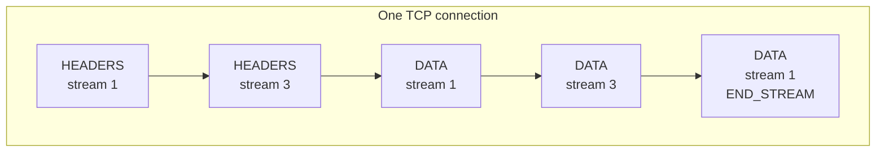
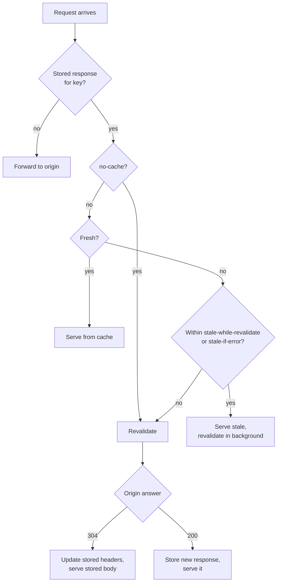
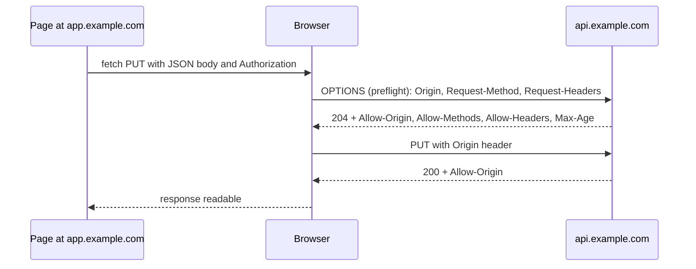

# HTTP: Semantics, HTTP/1.1, HTTP/2, HTTP/3, Caching, Cookies, and CORS

HTTP (Hypertext Transfer Protocol) is the request and response protocol that browsers, mobile apps, and services use to talk to servers. Its meaning (methods, status codes, headers, caching) is defined once, in RFC 9110. Three wire formats carry that meaning: HTTP/1.1 (RFC 9112), HTTP/2 (RFC 9113), and HTTP/3 (RFC 9114) over QUIC (RFC 9000).

## Why It Matters

Almost every backend interview touches HTTP: "What is the difference between PUT and PATCH?", "Which status code do you return for a failed validation?", "How does a browser cache a response?", "Why is HTTP/3 faster on a mobile network?", "What is a CORS preflight?". On the job, the same knowledge decides whether a retry duplicates a payment (idempotency), whether a CDN serves one user's page to another user (`Cache-Control` and `Vary`), whether a browser blocks your frontend (CORS), and whether a connection pool reuses sockets or opens a new one for each call. This page is the home of HTTP semantics, of the QUIC transport, and of head-of-line blocking across the HTTP versions. Other pages link here for those topics.

## Core Concepts

**Resource and representation**: a resource is a thing that a URI names. A representation is the bytes that a server sends for the resource at one moment, together with metadata such as `Content-Type`. `GET /orders/7` returns a representation of order 7.

**Message**: a request or a response. A request has a method, a target, headers, and an optional body. A response has a status code, headers, and an optional body. In RFC 9110 the headers are called "fields". This page writes "header" for a field, because developers use that word.

**Method**: the verb of a request. It states the intent of the client. RFC 9110 defines `GET`, `HEAD`, `POST`, `PUT`, `DELETE`, `CONNECT`, `OPTIONS`, and `TRACE`. RFC 5789 adds `PATCH`.

**Safe method**: a method whose defined semantics are read-only. The client does not request a change of state, and does not expect one. `GET`, `HEAD`, `OPTIONS`, and `TRACE` are safe (RFC 9110, section 9.2.1). The server may still write a log line or a counter. Safe does not mean "has no effect on the server".

**Idempotent method**: a method for which the intended effect of several identical requests is the same as the effect of one request. `PUT`, `DELETE`, and every safe method are idempotent (RFC 9110, section 9.2.2). `POST` and `PATCH` are not idempotent by definition. The status code of a repeated request can differ: the first `DELETE` returns `204`, and the second returns `404`. The definition covers the effect on the server, not the response.

**Status code**: a three-digit number in the response. The first digit gives the class: `1xx` informational, `2xx` success, `3xx` redirection or "use another source", `4xx` client error, `5xx` server error.

**Header**: a name and a value that carry metadata. Header names are case-insensitive in HTTP/1.1. HTTP/2 and HTTP/3 send them in lower case.

**Persistent connection**: a transport connection that carries more than one request. HTTP/1.1 uses persistent connections by default. This page owns the HTTP side (the `Connection` header, the idle timeout). The TCP keep-alive probe has its home in [TCP and UDP](03-tcp-and-udp.md).

**Multiplexing**: sending several requests and responses at the same time over one connection, in separate streams. HTTP/2 and HTTP/3 do this. HTTP/1.1 does not.

**Head-of-line (HOL) blocking**: a delay in which a message that could be processed waits behind an earlier message that is not ready. This page treats it at three levels: the HTTP message level (HTTP/1.1), the TCP byte-order level (HTTP/2), and the QUIC stream level (HTTP/3).

**Validator**: a value that identifies a version of a representation. `ETag` (an entity tag) is an opaque identifier. `Last-Modified` is a date. A client sends a validator back in a conditional request.

**Origin**: the triple of scheme, host, and port of a URL (RFC 6454). `https://app.example.com` and `https://api.example.com` are different origins. **Site** is a broader unit: the scheme plus the registrable domain (`example.com`). Cookies use "site". CORS uses "origin".

!!! note "Where the standards stand (checked on 2026-11-05)"
    - RFC 9110 (HTTP Semantics) is an Internet Standard, STD 97. It obsoleted RFC 7231, 7232, 7233, 7235, and others.
    - RFC 9111 (HTTP Caching) is STD 98. It obsoleted RFC 7234.
    - RFC 9112 (HTTP/1.1) is STD 99. RFC 9931 (March 2026, Standards Track) updates it, and RFC 9298, with security requirements for optimistic protocol transitions: a client sends data before the server confirms a protocol change, as with `Upgrade` and `CONNECT`.
    - RFC 9113 (HTTP/2) is a Proposed Standard. It obsoleted RFC 7540 and RFC 8740. It deprecates the RFC 7540 priority scheme. RFC 9218 ("Extensible Prioritization Scheme for HTTP", June 2022, Standards Track) is the replacement.
    - RFC 9114 (HTTP/3), RFC 9000 (QUIC), and RFC 9204 (QPACK) are Proposed Standards. RFC 7541 (HPACK) is the header compression of HTTP/2.
    - RFC 6265 defines cookies. Its revision, the draft `draft-ietf-httpbis-rfc6265bis`, is at revision 22 (2025-12-01) and was submitted to the IESG for publication. It is not yet an RFC (datatracker, 2026-11-05). Browsers implement `SameSite` and other features from the draft.
    - RFC 5861 (`stale-while-revalidate`, `stale-if-error`) is Informational. RFC 8246 (`immutable`) and RFC 7838 (`Alt-Svc`) are Proposed Standards.
    - CORS is defined in the WHATWG Fetch Standard, a living standard, not in an RFC.

## How It Works

### HTTP/1.1: the message format (RFC 9112)

An HTTP/1.1 message is text. A request looks like this:

```text
POST /orders HTTP/1.1\r\n
Host: api.example.com\r\n
Content-Type: application/json\r\n
Content-Length: 27\r\n
\r\n
{"item":"book","qty":1}
```

The first line is the request line (method, target, version). Each header is a `name: value` line that ends with CRLF (carriage return, line feed). An empty line ends the header section. The body follows. A response starts with a status line (`HTTP/1.1 201 Created`).

**`Host`**. An HTTP/1.1 request must have a `Host` header. One IP address and port can serve many sites, and the server uses `Host` to pick the site. A server must answer `400` to an HTTP/1.1 request that has no `Host` header, more than one `Host` header, or an invalid `Host` value (RFC 9112, section 3.2; RFC 9110, section 7.2 defines the field). HTTP/2 and HTTP/3 carry the same information in the `:authority` pseudo-header.

**Where the body ends.** The receiver must know where a message ends. There are two ways:

- `Content-Length: N` gives the body size in bytes. The sender must know the size before it sends the first byte.
- `Transfer-Encoding: chunked` sends the body as chunks. Each chunk is its size in hexadecimal, CRLF, the data, and CRLF. A chunk of size `0` ends the body. The sender can start before it knows the total size, which fits generated responses and streams.

```text
HTTP/1.1 200 OK
Transfer-Encoding: chunked

5\r\nHello\r\n7\r\n, world\r\n0\r\n\r\n
```

If a message has both `Transfer-Encoding` and `Content-Length`, a proxy and a server can disagree about where the message ends. An attacker uses that disagreement for request smuggling: the bytes after the end that the proxy sees are a second request for the back end. RFC 9112 (section 6.3, rule 3) says that `Transfer-Encoding` overrides `Content-Length`, that such a message "ought to be handled as an error", and that an intermediary that forwards it must first remove `Content-Length`. The Java example below rejects it. HTTP/2 and HTTP/3 have no chunked encoding, because their frames carry the length.

**Persistent connections.** In HTTP/1.1 a connection stays open after a response, unless a side sends `Connection: close`. The next request reuses the connection and skips the TCP and TLS handshakes (see the table of round trips below). Either side can close an idle connection at any time, with no notice. This causes a real failure: the client sends a request on a connection that the server closed a moment before, and the client sees a reset. A client that retries only idempotent requests on a fresh connection handles this safely.

**Pipelining and why browsers do not use it.** HTTP/1.1 allows a client to send request 2 before response 1 arrives (RFC 9112, section 9.3.2). The server must send the responses in the order of the requests. One slow response therefore blocks all responses behind it: this is HTTP-level head-of-line blocking. After a connection failure the client does not know which pipelined requests the server processed. RFC 9112 lets a client retry the unanswered requests, and says that idempotent methods are significant because only they can be retried automatically. A user agent should not pipeline requests after a non-idempotent method until the final response to that method arrives. Assumption (secondary sources only, no browser vendor page checked): the major browsers keep pipelining off, because many servers handled it badly. Browsers instead open about 6 parallel connections to one host (approximate, browser-specific), and each connection carries one request at a time. Older sites spread resources over several host names ("domain sharding") to get more connections. HTTP/2 makes that practice obsolete.

### HTTP/2: binary framing and multiplexing (RFC 9113)

HTTP/2 keeps the semantics of RFC 9110 and changes the wire format. One TCP connection carries many **streams**. A stream is one request and its response. The connection splits all messages into **frames**. Each frame has a fixed 9-byte header with the payload length, the frame type, flags, and a stream identifier (RFC 9113, section 4.1). Frames of different streams interleave on the connection, and the receiver assembles them by stream identifier.



Key facts, all from RFC 9113:

- A client starts a connection with the 24-byte preface `PRI * HTTP/2.0\r\n\r\nSM\r\n\r\n`, followed by a `SETTINGS` frame. Streams that a client opens have odd identifiers.
- Browsers negotiate HTTP/2 inside the TLS handshake with ALPN (Application-Layer Protocol Negotiation, RFC 7301). The protocol identifier is `h2`. RFC 9113 uses the identifier `h2c` for HTTP/2 over cleartext TCP, where the client starts with prior knowledge that the server speaks HTTP/2. RFC 9113 deprecates the `Upgrade: h2c` mechanism of RFC 7540: it "was never widely deployed".
- The request line and the status line become **pseudo-headers**: `:method`, `:scheme`, `:authority`, `:path`, and `:status`.
- **Frame types** include `DATA`, `HEADERS`, `RST_STREAM` (cancel one stream), `SETTINGS`, `PING`, `GOAWAY` (the connection will close, here are the streams that I processed), `WINDOW_UPDATE`, `PUSH_PROMISE`, and `CONTINUATION`.
- **Settings and their initial values**: `SETTINGS_MAX_FRAME_SIZE` is 16,384 bytes (2^14) and can grow to 2^24 - 1. `SETTINGS_INITIAL_WINDOW_SIZE` is 65,535 bytes. `SETTINGS_HEADER_TABLE_SIZE` is 4,096 bytes. `SETTINGS_MAX_CONCURRENT_STREAMS` is unlimited until a peer sets it, and RFC 9113 recommends no value below 100.
- **Flow control** works per stream and for the whole connection, with `WINDOW_UPDATE` frames. Only `DATA` frames use flow control. It stops one fast sender from filling the memory of a slow receiver. A receiver that is slow to send `WINDOW_UPDATE` stalls the stream.
- **Prioritization.** RFC 7540 defined a priority tree, and RFC 9113 (section 5.3.2) deprecates it, because the scheme "was not successful". The `PRIORITY` frame remains defined, but its semantics are only in RFC 7540. RFC 9218 replaces it with a simpler scheme: a `Priority` request header and the `PRIORITY_UPDATE` frame carry an urgency (0 to 7) and an incremental flag, and it works for HTTP/2 and HTTP/3.

**HPACK (RFC 7541)** compresses the headers. HTTP requests repeat the same headers (`Host`, `User-Agent`, `Cookie`, `Accept`). HPACK keeps a **dynamic table** of headers that both sides have seen, and a static table of 61 common entries (RFC 7541, Appendix A). A repeated header costs one small index number instead of its full text. Strings use a Huffman code. HPACK avoids general-purpose compression of the header block on purpose: the CRIME attack showed that compressing secrets together with attacker-controlled text leaks the secret (RFC 7541, section 7.1). A sender can mark a header (for example `Authorization`) as a "literal header field never indexed" (section 6.2.3): the sender does not add it to the dynamic table, and an intermediary must not add it when it forwards the header.

**Server push and its removal.** A server could send a `PUSH_PROMISE` frame and then the response for a resource that the client had not requested yet, for example a CSS file for an HTML page. The idea failed in practice. The server cannot know what the browser cache already holds, so it pushes bytes that the client does not need. The Chrome team reported that only 1.25% of HTTP/2 sites used push, later falling to about 0.7%, and that push "can cause performance degradation and should be used in moderation". Chrome disabled push by default in Chrome 106 (2022), and other Chromium-based browsers did the same in their next releases (Chrome team, "Removing HTTP/2 Server Push from Chrome"). Firefox turned push off by default in Firefox 132 (Mozilla bug 1915848, which sets the preference `network.http.http2.allow-push` to `false`). Mozilla kept the code in the tree at that time, so Firefox "disabled by default" is the precise statement and "removed" is not. This page did not check Safari. RFC 9113 still defines push, and a client can turn it off with `SETTINGS_ENABLE_PUSH = 0`. The alternatives are `<link rel="preload">` in the HTML and the `103 Early Hints` interim response (RFC 8297).

**HTTP/2 and head-of-line blocking.** HTTP/2 removes the HTTP-level blocking of HTTP/1.1, because a slow response does not block the others: their frames interleave. HTTP/2 runs on one TCP connection, and TCP delivers bytes in order. If one TCP segment is lost, TCP holds back all later bytes, from all streams, until the retransmission arrives. RFC 9113 states: "TCP head-of-line blocking is not addressed by this protocol". On a lossy network, one connection with many streams can be slower than the six connections of HTTP/1.1, because a single loss stalls everything. The TCP mechanism is in [TCP and UDP](03-tcp-and-udp.md).

### HTTP/3 and QUIC (RFC 9114, RFC 9000)

HTTP/3 maps the HTTP semantics onto QUIC. **QUIC** is a transport protocol that runs over UDP. It does what TCP and TLS do together, and it adds streams.

**What QUIC provides (RFC 9000):**

- **Streams in the transport.** A QUIC connection carries many ordered byte streams. QUIC gives no ordering guarantee between streams: "QUIC does not provide any means of ensuring ordering between bytes on different streams". If a packet with data of stream 3 is lost, only stream 3 waits for the retransmission. Streams 1 and 5 continue. This removes the transport-level head-of-line blocking of HTTP/2. The two least significant bits of a stream identifier give the type: `0x0` client-initiated bidirectional, `0x1` server-initiated bidirectional, `0x2` client-initiated unidirectional, `0x3` server-initiated unidirectional. HTTP/3 uses a client-initiated bidirectional stream for each request and response.
- **Integrated handshake.** The QUIC handshake carries the TLS 1.3 handshake inside QUIC frames (RFC 9001, "Using TLS to Secure QUIC"). A new connection to a new server needs 1 round trip before the client can send the request, against 2 round trips for TCP plus TLS 1.3. The TLS 1.3 messages are in [TLS and HTTPS](05-tls-and-https.md). The client pads the first UDP datagram that carries an `Initial` packet to at least 1,200 bytes (RFC 9000, section 14.1). A server pads its own ack-eliciting `Initial` datagrams to 1,200 bytes as well. Before a server has validated the client address, it sends at most three times the number of bytes that it received from that address, which limits amplification in spoofing attacks (RFC 9000, section 8.1).
- **Encryption of the transport.** QUIC encrypts nearly all of each packet, including most of the transport headers. Middleboxes cannot see or change stream data or acknowledgments. Because the QUIC implementation sits in the application process (user space), a team can update it without a kernel update.
- **Connection identifiers and migration.** A TCP connection is identified by its four-tuple (client address and port, server address and port). If the client changes its IP address, the connection breaks. A QUIC connection is identified by a **connection ID** in each packet. When a phone moves from Wi-Fi to a mobile network, the client keeps the connection ID, sends packets from the new address, and the endpoints validate the new path. The connection survives, and no new handshake is needed. Only the client migrates in version 1 of QUIC: RFC 9000 (section 9, and the security considerations) states that "this version of QUIC does not allow servers to migrate", to prevent spoofed migration attacks on clients. An endpoint must not start migration before the handshake is confirmed.
- **0-RTT.** A client that has a session ticket from an earlier connection can send application data in its first flight. RFC 9000 (QUIC) states that "0-RTT provides no protection against replay attacks". An attacker can record the first flight and send it again to the server. RFC 8470 lists three server options for HTTP: reject early data at the TLS layer, delay processing until the handshake completes, or answer `425 Too Early` for a request whose replay risk is too high. A proxy marks forwarded early data with the `Early-Data: 1` header, and a client must retry a `425` request without early data. Method safety is one way to judge the risk, and the resource decides the rest. The full replay analysis is in [TLS and HTTPS](05-tls-and-https.md).
- **Loss recovery and congestion control** run per connection, in QUIC itself (RFC 9002). Streams share the congestion window of the connection, so a congested path slows all streams. QUIC removes head-of-line blocking between streams, and it does not remove the shared congestion limit.

**What HTTP/3 adds (RFC 9114):**

- A request uses one bidirectional stream. The `HEADERS` frame and `DATA` frames of HTTP/3 travel on that stream. There are no stream identifiers in HTTP/3 frames, because the QUIC stream gives them.
- Each side opens unidirectional **control streams**. The `SETTINGS` frame goes on the control stream.
- **QPACK (RFC 9204)** compresses the headers. HPACK needs the header blocks in the order of sending, and QUIC does not keep order between streams, so HTTP/3 uses QPACK. QPACK sends updates of the dynamic table on a separate encoder stream, and the decoder acknowledges them on a decoder stream. A header block that refers to a table entry that has not arrived yet is blocked until the entry arrives. This blocking affects that one stream. The decoder limits the number of such streams with `SETTINGS_QPACK_BLOCKED_STREAMS`, whose default is 0. An encoder can still compress with the static table and with literals, which never block.

**Head-of-line blocking at a glance:**

| Version | Where one slow or lost item blocks others | Why |
|---|---|---|
| HTTP/1.1 | The responses behind it on the same connection | Responses return in request order. Pipelining has this problem, and browsers work around it with several connections |
| HTTP/2 | All streams of the connection | The streams share one TCP byte stream. One lost segment holds back all later bytes |
| HTTP/3 | Only the affected stream (and streams that wait on a QPACK table update) | QUIC streams are independent. The streams still share one congestion window |

**How a client finds HTTP/3.** A client does not know whether a server speaks QUIC. Two mechanisms tell it:

1. **`Alt-Svc` header (RFC 7838).** A server answers a request on HTTP/1.1 or HTTP/2 with `Alt-Svc: h3=":443"; ma=86400`. This says that the same origin is available on HTTP/3 (the ALPN token `h3`) at UDP port 443, and that the client may remember this for 86,400 seconds. Without `ma`, the advertisement is fresh for 24 hours. `Alt-Svc: clear` removes all remembered alternatives. The first visit to a site always uses TCP, and later visits can use QUIC.
2. **The `HTTPS` DNS record (RFC 9460).** The record carries an `alpn` parameter, for example `alpn="h3,h2"`. The client reads it in the DNS answer and can start with QUIC on the first visit. The record types are in [DNS](06-dns.md).

A browser must also work when a network blocks UDP. Browsers therefore fall back to TCP with HTTP/2 or HTTP/1.1 when the QUIC attempt fails or is too slow (the fallback logic is a browser implementation choice).

```mermaid
sequenceDiagram
    participant B as Browser
    participant D as DNS
    participant S as Server
    B->>D: query A, AAAA, HTTPS for example.com
    D-->>B: addresses and HTTPS record (alpn=h3,h2)
    alt HTTPS record present
        B->>S: QUIC Initial (UDP 443)
        S-->>B: QUIC handshake, then HTTP/3 works
    else no record: first visit
        B->>S: TCP, TLS (ALPN h2), GET
        S-->>B: 200 + Alt-Svc: h3=":443"; ma=86400
        Note over B: later visits try QUIC first
    end
```

**Round trips before the first response byte** (derived from the message flows, with the DNS lookup excluded; RTT is the round-trip time between client and server; see [back-of-envelope estimation](../hld/back-of-envelope-estimation.md) for RTT values):

| Case | Handshake round trips | Request and response | Total |
|---|---|---|---|
| HTTP/1.1 or HTTP/2, new TCP and TLS 1.2 connection | 1 (TCP) + 2 (TLS 1.2) | 1 | 4 RTT |
| HTTP/1.1 or HTTP/2, new TCP and TLS 1.3 connection | 1 (TCP) + 1 (TLS 1.3) | 1 | 3 RTT |
| HTTP/3, new QUIC connection | 1 | 1 | 2 RTT |
| HTTP/3, resumed with 0-RTT | 0 | 1 (request in the first flight) | 1 RTT |
| Any version, reused connection | 0 | 1 | 1 RTT |

"1 RTT" for "Request and response" means this: the client sends the request, and the first byte of the response comes back one round-trip time later. It excludes the server's processing time, the transmission time of large bodies, and DNS. TLS 1.3 session resumption with early data and TCP Fast Open can shorten the TCP rows. The table does not count them.

The full browser path, with DNS, is in `kb/networking/07-what-happens-when-you-load-a-url.md`.

### HTTP semantics (RFC 9110)

#### Methods

| Method | Meaning | Safe | Idempotent | Request body | Common success |
|---|---|---|---|---|---|
| `GET` | Read a representation | Yes | Yes | None (a body has no defined meaning) | `200`, `304` |
| `HEAD` | Same as `GET`, headers only | Yes | Yes | None | `200` |
| `OPTIONS` | Ask what the server supports. Browsers use it for CORS preflight | Yes | Yes | Optional | `200` or `204` |
| `POST` | Process the body by the resource's own rules (create, run an action) | No | No | Yes | `201`, `200`, `202` |
| `PUT` | Replace the state of the target resource with the body | No | Yes | Yes | `200`, `204`, `201` |
| `DELETE` | Remove the target resource | No | Yes | Optional, rarely used | `204`, `200`, `202` |
| `PATCH` (RFC 5789) | Apply a partial change | No | No (by definition) | Yes | `200`, `204` |

**Why the difference matters for retries.** A request can fail in a way that hides the outcome: the connection drops after the client sent the request and before the response arrived. The server may or may not have processed it. A client that retries must know that a second execution does no harm. Retrying an idempotent request is safe by definition (the effect equals the effect of one request). A retry of `POST` can create a second order or a second payment. RFC 9110 (section 9.2.2) says that a client should not automatically retry a request with a non-idempotent method, unless it knows that the request semantics are idempotent or can detect that the original request was never applied. A proxy must not retry non-idempotent requests automatically. Production APIs make `POST` retry-safe with an idempotency key: the client generates a unique key, sends it in a header, and the server stores the key with the result, so a retry returns the stored result (`kb/api-design/02-api-design-practices.md`). `PATCH` can be idempotent for a particular design (`{"status":"shipped"}` sets a value) and not idempotent for another (`{"op":"add","path":"/items/-"}` appends). The method definition makes no promise, so do not rely on it.

`PUT` against `POST` for creation: `PUT /orders/7` names the resource, and the client chooses the identifier, so a repeat does not create a second order. `POST /orders` lets the server choose the identifier, and a repeat creates another order.

#### Status codes

| Code | Name | When to send it | Notes that interviews probe |
|---|---|---|---|
| `200` | OK | The request succeeded and the response has a body | |
| `201` | Created | A new resource exists | Add a `Location` header with its URI |
| `204` | No Content | Success with no body | Common for `DELETE` and for `PUT` that returns nothing. A `204` response ends after the headers |
| `301` | Moved Permanently | The resource has a new permanent URI | Clients may change `POST` to `GET` on the redirect (a historical behavior that RFC 9110 keeps). Caches may store it |
| `302` | Found | A temporary redirect | Same historical `POST` to `GET` change |
| `303` | See Other | After a `POST`, go and `GET` the result at the `Location` | Always changes the follow-up to `GET`. The pattern "post, redirect, get" uses it |
| `304` | Not Modified | The client's conditional request matched | No body. It confirms that the cached copy is still valid |
| `307` | Temporary Redirect | A temporary redirect that keeps the method and the body | A `POST` stays a `POST` |
| `308` | Permanent Redirect | A permanent redirect that keeps the method and the body | The permanent form of `307` |
| `400` | Bad Request | The request is malformed (syntax, framing) | A server also sends it for a missing `Host` |
| `401` | Unauthorized | No valid authentication | The name is misleading: it means "unauthenticated". It must carry a `WWW-Authenticate` header |
| `403` | Forbidden | The client is known, and is not allowed | Re-authentication does not help |
| `404` | Not Found | No resource at the URI | A server may send `404` instead of `403` to hide that a resource exists |
| `409` | Conflict | The request conflicts with the current state of the resource | A duplicate unique value, or a version conflict |
| `412` | Precondition Failed | An `If-Match` or `If-Unmodified-Since` condition is false | The answer for a lost update in optimistic concurrency |
| `422` | Unprocessable Content | The syntax is correct, and the content violates a rule (validation) | Defined in RFC 9110. The earlier name was "Unprocessable Entity" |
| `429` | Too Many Requests | Rate limit reached | Defined in RFC 6585. Add `Retry-After` |
| `500` | Internal Server Error | An unexpected server failure | |
| `502` | Bad Gateway | A gateway or proxy received an invalid response from the upstream server | The proxy is up, and the upstream failed or sent garbage |
| `503` | Service Unavailable | The server cannot handle the request now (overload, maintenance) | May carry `Retry-After` |
| `504` | Gateway Timeout | A gateway or proxy did not receive a response from the upstream in time | The upstream is slow or unreachable |

A client may retry `502`, `503`, and `504` for idempotent requests. A `4xx` code means that a retry of the same request fails again, except `408`, `409` in some designs, and `429` after the delay. `400` against `422`: use `400` when the server cannot parse the request, and `422` when it parses and the content is invalid. Many APIs use `400` for both. Pick one rule and document it. `409` against `412`: `412` answers a failed HTTP precondition header. `409` answers a conflict in the application state. How a REST API chooses among these codes is in `kb/api-design/01-rest-principles.md`.

#### Headers that matter

- `Content-Type` (media type of the body), `Content-Length`, `Content-Encoding` (for example `gzip`), `Accept` and `Accept-Encoding` (what the client can take), `Location` (redirects and created resources), `Retry-After`, `Allow` (answer to `405`), `Authorization`, and `WWW-Authenticate`.
- **Content negotiation.** The client lists what it accepts (`Accept: application/json`, `Accept-Encoding: gzip, br`, `Accept-Language: de`). The server picks a representation and says which headers it used in `Vary`. Compression with `Content-Encoding` saves bytes for text (HTML, JSON, CSS) and does not help for formats that are already compressed (JPEG, MP4).
- **`Expect: 100-continue`.** A client with a large body can ask the server to confirm before it sends the body. The server answers `100 Continue` or an error status and saves the upload.

### Caching (RFC 9111)

An HTTP cache stores a response and reuses it for a later request. A **private cache** serves one user (the browser cache). A **shared cache** serves many users (a CDN or a reverse proxy). Cache placement and the design view are in [caching](../hld/fundamentals/03-caching.md) and [load balancing, DNS and CDN](../hld/fundamentals/02-load-balancing-dns-cdn.md). This section owns the header semantics.

**Freshness.** A stored response is **fresh** while its age is below its **freshness lifetime**. A fresh response goes to the client with no contact with the origin. The cache computes the lifetime in this order (RFC 9111, section 4.2.1): `s-maxage` (shared caches only), then `max-age`, then the `Expires` date, and then a heuristic if none exists. The `Age` response header reports how long the response has been in caches. A **stale** response is one past its lifetime. A cache must not use it without validation, with the exceptions below. The heuristic: if a response has `Last-Modified` and no explicit lifetime, a cache may assign a lifetime of a fraction of the time since the modification. RFC 9111 (section 4.2.2) says "a typical setting of this fraction might be 10%": it is an example and not a requirement. A cache may use a heuristic only for status codes that RFC 9110 calls heuristically cacheable (for example `200`, `301`, `404`) or for a response that an explicit directive such as `public` marks as cacheable. Do not depend on heuristics. Send an explicit lifetime on every cacheable response.

**`Cache-Control` response directives:**

| Directive | Meaning |
|---|---|
| `max-age=N` | The response is fresh for N seconds after the origin generated it. Applies to all caches |
| `s-maxage=N` | Like `max-age`, for shared caches only. It overrides `max-age` and `Expires` there. It includes the meaning of `proxy-revalidate`: a shared cache must not reuse a stale response with `s-maxage` until it validates the response with the origin. It also lets a shared cache reuse a response to a request with an `Authorization` header |
| `no-cache` | A cache may store the response, and must validate it with the origin before each reuse. It does **not** mean "do not store" |
| `no-store` | A cache must not store any part of the request or the response. Use it for sensitive data |
| `private` | Only a private cache (the browser) may store the response. A CDN must not |
| `public` | Any cache may store the response, even when it would not do so by default. For a shared cache, `public` is one of three directives (with `s-maxage` and `must-revalidate`) that allow reuse of a response to a request with an `Authorization` header (RFC 9111, section 3.5) |
| `must-revalidate` | After the response goes stale, a cache must not reuse it without a successful validation. If the cache cannot reach the origin, it must return an error and not the stale copy. The status code should be `504`, unless another error code fits better (RFC 9111, section 5.2.2.2) |
| `immutable` (RFC 8246) | The response does not change during its freshness lifetime. A client should not revalidate it, even when the user reloads the page. Use it with fingerprinted file names |
| `stale-while-revalidate=N` (RFC 5861) | For N seconds after expiry, a cache may serve the stale response at once and revalidate in the background |
| `stale-if-error=N` (RFC 5861) | For N seconds after expiry, a cache may serve the stale response when the origin returns an error (`500`, `502`, `503`, `504`) or cannot be reached |

RFC 5861 (Informational) defines `stale-while-revalidate` and `stale-if-error`, and RFC 9111 does not. RFC 5861 defines an error for `stale-if-error` as any situation that would result in a `500`, `502`, `503`, or `504` response, which includes a connection failure or a DNS failure. Support in CDNs and browsers differs by product, so check the documentation of your CDN. Example recipes:

```text
# Fingerprinted asset: app.3f9a1c.js (the URL changes when the content changes)
Cache-Control: public, max-age=31536000, immutable

# HTML page or API response that may be a little stale, with background refresh
Cache-Control: public, max-age=60, stale-while-revalidate=30, stale-if-error=600

# Personalized response (account page): only the browser may store it
Cache-Control: private, max-age=0, must-revalidate

# Sensitive response (token, bank statement): no cache stores it
Cache-Control: no-store
```

The value `31536000` is one year in seconds (365 x 24 x 3600). It is a common maximum choice and not a requirement of the RFC.

**Validators and conditional requests.** When a response goes stale, the cache can ask the origin whether the stored copy is still good. This is cheaper than a full download, because the origin answers `304` with no body.

```mermaid
sequenceDiagram
    participant C as Client or cache
    participant O as Origin
    C->>O: GET /items/7
    O-->>C: 200, ETag "v1", Cache-Control: max-age=60, body
    Note over C: stored; fresh for 60 s
    Note over C: 60 s later: stale
    C->>O: GET /items/7, If-None-Match: "v1"
    alt ETag unchanged
        O-->>C: 304 Not Modified (no body)
        Note over C: stored copy fresh again
    else ETag changed
        O-->>C: 200, ETag "v2", new body
    end
```

- **`ETag`** is an opaque identifier of a representation, in quotes: `"33a64df5"`. A **strong** tag (`"abc"`) changes with any byte change. A **weak** tag (`W/"abc"`) says the content is semantically equivalent. Strong comparison needs two strong tags with the same value. Weak comparison ignores the `W/` prefix.
- **`Last-Modified`** is a date with a resolution of one second. It is a weaker validator than an `ETag`.
- **`If-None-Match`** (cache validation): the client sends the `ETag` values that it holds. The server answers `304` for `GET` and `HEAD` if one matches (weak comparison). For other methods, it answers `412`. `If-None-Match: *` on a `PUT` means "only if the resource does not exist yet".
- **`If-Modified-Since`**: the date form of the same check. It applies only to `GET` and `HEAD`. A server ignores it if the request also has `If-None-Match` (RFC 9110, section 13.2.2, step 4).
- **`If-Match`** (optimistic concurrency): the client sends the `ETag` of the version it read. The server executes the `PUT` or `DELETE` only if the current `ETag` matches (strong comparison). If another client changed the resource, the server answers `412`, and the client must read again and merge. This prevents the lost update without a lock. `If-Unmodified-Since` is the date form.
- RFC 9110 (section 13.2.2) fixes the order of evaluation: `If-Match`, then `If-Unmodified-Since` (only if `If-Match` is absent), then `If-None-Match`, then `If-Modified-Since` (only for `GET` or `HEAD`, and only if `If-None-Match` is absent), then `If-Range`. A failed `If-Match` or `If-Unmodified-Since` gives `412`. A failed `If-None-Match` gives `304` for `GET` and `HEAD`, and `412` for other methods. A failed `If-Modified-Since` gives `304`. The Java example implements `If-Match` and `If-None-Match`.

**`Vary`.** The cache key of an HTTP cache is the method and the URI, plus the request headers that `Vary` names. `Vary: Accept-Encoding` tells a cache to store one copy for each value of `Accept-Encoding`. `Vary: Cookie` makes a copy for each cookie string, and the hit ratio falls. `Vary: *` means that the response never matches a later request, so a cache never reuses it without validation. A response that depends on a request header and has no `Vary` for it is a correctness bug in a shared cache: the cache gives one user's variant to another user.

**Decision flow at a cache:**



The HLD pages use these headers in designs: see [caching](../hld/fundamentals/03-caching.md) and [load balancing, DNS and CDN](../hld/fundamentals/02-load-balancing-dns-cdn.md).

### Cookies (RFC 6265 and its revision)

HTTP has no session. A server that wants to recognize a client sends `Set-Cookie: name=value; attributes`. The browser stores the cookie and sends `Cookie: name=value` with each later request that matches the cookie's scope. RFC 6265 defines this. Its revision (`draft-ietf-httpbis-rfc6265bis`, revision 22 on 2026-11-05, not yet an RFC) adds `SameSite`, cookie prefixes, and stricter rules, and browsers implement it.

| Attribute | Effect | Security purpose |
|---|---|---|
| `Domain=example.com` | The cookie also goes to all subdomains. Without `Domain`, the cookie is **host-only**: it goes only to the exact host that set it | A wide `Domain` lets every subdomain read and set the cookie. Leave it out unless you need sharing |
| `Path=/api` | The cookie goes only for URL paths that match | Not a security boundary: scripts on the same host can reach other paths |
| `Max-Age=N` | The cookie expires after N seconds. It wins over `Expires` | Limits the life of a stolen session cookie. Without `Max-Age` and `Expires`, the cookie is a **session cookie** that the browser drops when it closes |
| `Secure` | The browser sends the cookie only over HTTPS | Stops the cookie from crossing the network in clear text |
| `HttpOnly` | JavaScript (`document.cookie`) cannot read the cookie | Limits the damage of cross-site scripting (XSS): a script cannot steal the session cookie. Requests can still carry it |
| `SameSite=Strict` | The browser sends the cookie only for same-site requests | Strongest protection against cross-site request forgery (CSRF), and a link from another site arrives without the cookie |
| `SameSite=Lax` | The browser also sends the cookie for top-level navigations with a safe method (a link click) | Blocks cookies on cross-site `POST`, images, frames, and `fetch` calls. Some browsers treat a cookie without `SameSite` as `Lax`: the draft calls this the default enforcement mode, Chrome (since version 80) and Edge (since version 86) apply it, and Firefox and Safari do not apply it by default (caniuse and MDN browser compatibility data, 2026-11-05). Chrome's default is more permissive: it also sends a new cookie on a cross-site `POST` for two minutes (MDN) |
| `SameSite=None; Secure` | The browser sends the cookie on all cross-site requests. `None` needs `Secure` in browsers | For embedded services (a widget, a single sign-on frame). It removes the CSRF protection of `SameSite` |
| `__Secure-` name prefix | The browser accepts the cookie only if it has the `Secure` attribute and an HTTPS page set it | Stops a page on plain HTTP from setting a cookie that the application reads as secure |
| `__Host-` name prefix | The browser accepts the cookie only with `Secure`, `Path=/`, and no `Domain`, set by an HTTPS page | Binds the cookie to one host, so a sibling subdomain cannot overwrite it |

An example session cookie: `Set-Cookie: __Host-sid=abc123; Max-Age=3600; Path=/; Secure; HttpOnly; SameSite=Lax`.

`SameSite` is about **sites**, not origins: `app.example.com` and `api.example.com` are the same site. A CSRF attack makes the victim's browser send a request that carries the victim's cookies. `SameSite=Lax` or `Strict` removes the cookies from most cross-site requests, and CSRF tokens remain the stronger defense. The CSRF defenses are in `kb/security/04-owasp-top-10.md`, and the Spring setup is in [Spring Security](../java/21-spring-security.md). Cookies also affect caching: a response that sets a cookie should not be stored by a shared cache (`private` or `no-store`), or one user's `Set-Cookie` reaches another user.

### CORS (WHATWG Fetch Standard)

**Same-origin policy (SOP).** A browser lets a script read a response only if the script's origin equals the origin of the response. The policy stops `https://evil.example` from reading your bank's pages with your cookies. It restricts **reading**. A page can still send a cross-origin `GET` or `POST` (an image tag, a form), and the server receives it. This is why SOP does not stop CSRF.

**CORS (cross-origin resource sharing)** is the way a server relaxes SOP for chosen origins. The browser asks, and the server answers with `Access-Control-*` headers. CORS is a browser rule. `curl`, a Java client, and another server ignore it. It is not authentication and not a protection of your API.

**Requests that the browser sends directly.** The Fetch Standard calls a request that needs no preflight a request with only CORS-safelisted parts (MDN calls it a "simple request"). The request must meet all of these:

- The method is `GET`, `HEAD`, or `POST`.
- The only request headers that the script sets are CORS-safelisted: `Accept`, `Accept-Language`, `Content-Language`, `Content-Type`, and `Range` (a single byte range with a start). Each value is at most 128 bytes.
- `Content-Type`, if present, is `application/x-www-form-urlencoded`, `multipart/form-data`, or `text/plain`.

The browser adds an `Origin` header, and the server answers with `Access-Control-Allow-Origin`. If the header names the page's origin (or is `*` for a request without credentials), the script can read the response. If not, the browser hides the response from the script, although the server already processed the request.

**Preflighted requests.** A request that breaks any rule above (for example `PUT`, `DELETE`, an `Authorization` header, or `Content-Type: application/json`) needs permission first. The browser sends a **preflight**: an `OPTIONS` request without credentials.

```text
OPTIONS /orders HTTP/1.1
Host: api.example.com
Origin: https://app.example.com
Access-Control-Request-Method: PUT
Access-Control-Request-Headers: authorization, content-type

HTTP/1.1 204 No Content
Access-Control-Allow-Origin: https://app.example.com
Access-Control-Allow-Methods: GET, PUT, DELETE
Access-Control-Allow-Headers: authorization, content-type
Access-Control-Max-Age: 600
Vary: Origin
```

If the answer allows the method and headers, the browser sends the real request. If not, the browser stops, and the real request never leaves the browser. The Fetch Standard restricts a successful preflight response to an ok status (200 to 299, for example `200` or `204`). A `401`, a `403`, or a redirect to a login page therefore fails the preflight.



| Header | Direction | Meaning |
|---|---|---|
| `Origin` | Request | The origin of the page. The browser sets it, and a script cannot change it |
| `Access-Control-Request-Method`, `Access-Control-Request-Headers` | Preflight request | The method and the non-safelisted headers of the real request |
| `Access-Control-Allow-Origin` | Response | One origin, or `*`. It must name the origin for a request with credentials |
| `Access-Control-Allow-Methods`, `Access-Control-Allow-Headers` | Preflight response | The methods and headers that the server permits |
| `Access-Control-Allow-Credentials: true` | Response | The page may send and read a response with cookies or HTTP authentication |
| `Access-Control-Expose-Headers` | Response | Extra response headers that the script may read. Without it, the script reads only the CORS-safelisted response headers (`Cache-Control`, `Content-Language`, `Content-Length`, `Content-Type`, `Expires`, `Last-Modified`, `Pragma`) |
| `Access-Control-Max-Age` | Preflight response | How long the browser may reuse the preflight answer. If the header is absent, the Fetch Standard uses 5 seconds. The standard lets a browser impose a limit. MDN gives the limits as 2 hours (7,200 seconds) in Chromium since version 76 and 24 hours (86,400 seconds) in Firefox (approximate: browser-specific, not in the standard, and not checked in browser source) |

**Credentials.** By default a cross-origin `fetch` sends no cookies. A script asks for them with `credentials: "include"`. The server must then send `Access-Control-Allow-Credentials: true` and name the exact origin: the wildcard `*` does not work with credentials. A server that echoes the `Origin` header back and allows credentials lets every site read the data of a logged-in user. Compare the origin with an allow-list. Because the answer depends on `Origin`, add `Vary: Origin`, or a cache gives one origin's answer to another.

Spring configuration, the filter order, and the bean name trap are in [Spring Security](../java/21-spring-security.md#cors).

### What a Java developer sees

`java.net.http.HttpClient` (standard since Java 11) is the JDK client. A few facts from the JDK 21 javadoc:

- The default protocol preference is HTTP/2. The javadoc says that, with this setting, each request attempts to upgrade to HTTP/2, and that the client handles the response with HTTP/1.1 if the upgrade fails. The javadoc does not name the mechanism. In the JDK implementation (not specified in the javadoc), an `https` request offers `h2` and `http/1.1` with ALPN in the TLS handshake, and a cleartext `http` request sends an HTTP/1.1 request with `Upgrade: h2c`. The `Version` enum in JDK 21 has only `HTTP_1_1` and `HTTP_2`.
- **HTTP/3.** JEP 517, "HTTP/3 for the HTTP Client API", is delivered in JDK 26 (status "Closed / Delivered" on openjdk.org on 2026-11-05). It is opt-in: you set `HttpClient.Version.HTTP_3` on the client or on one request, and the default stays HTTP/2. If the server does not support HTTP/3, the client falls back to HTTP/2 or HTTP/1.1. JDK 21, the version of this KB's code, has no HTTP/3 in `HttpClient`.
- The default redirect policy is `NEVER`: the client returns the `3xx` response to your code. `Redirect.ALWAYS` follows every redirect. `Redirect.NORMAL` follows redirects except from an HTTPS URL to an HTTP URL. When the client follows `301` or `302`, it changes a `POST` into a `GET` (javadoc implementation note).
- There is no default connect timeout and no default request timeout. Set both: `connectTimeout` on the builder and `timeout` on each request.
- A client instance manages its own connection pool. The javadoc states that creating a new client for each request "will usually prevent reusing such connections". Create one client and share it.
- System properties tune the pool (JDK 21 `java.net.http` module documentation): `jdk.httpclient.keepalive.timeout` (default 30 seconds for idle connections), `jdk.httpclient.connectionPoolSize` (HTTP/1.1; default 0, which means unbounded), and `jdk.httpclient.enableAllMethodRetry` (default `false`: the client does not retry non-idempotent requests automatically, which matches the rule above).
- Keep the client idle timeout below the idle timeout of the server and of any load balancer between them. Otherwise the client reuses a connection that the other side already closed.

The class `ApiClient` in the Java example is a sample that uses a real network. The runner compiles it and does not run it.

## Trade-offs and When to Use

| Choice | Benefit | Cost | Use when |
|---|---|---|---|
| HTTP/1.1 | Simple text format, works everywhere, easy to debug with `curl` and `telnet` | One request at a time per connection, repeated headers, 6 connections per host in browsers | Internal tools, legacy clients, a protocol that must pass old proxies |
| HTTP/2 | Multiplexing on one connection, HPACK, fewer handshakes, `GOAWAY` for graceful shutdown | TCP head-of-line blocking on lossy networks, long-lived connections that unbalance an L4 load balancer | The default for public sites and for gRPC between services |
| HTTP/3 over QUIC | Independent streams, 1-RTT or 0-RTT start, connection migration | UDP can be blocked or rate-limited, possible higher CPU cost in user space (Assumption: it depends on the implementation, and this page gives no number), and less mature tooling | Mobile clients, lossy or high-latency networks, large global sites |
| `no-store` | Nothing stored, safest for sensitive data | No cache benefit, every request reaches the origin | Tokens, bank statements, medical data |
| `no-cache` + `ETag` | Always fresh, and `304` saves the body | One round trip to the origin on every use | HTML shells, API data that must be exact |
| Long `max-age` + `immutable` + fingerprinted URL | No request at all until the next release | A change needs a new URL | JS, CSS, images, fonts |
| `stale-while-revalidate` | Hides origin latency from the user, protects the origin from a stampede | The user can see data that is up to N seconds old | Pages and feeds that tolerate small staleness |
| `PUT` with `If-Match` | Lost-update protection without locks | The client needs a read before each write, and must handle `412` | Documents and records that several clients edit |
| Idempotency key on `POST` | Safe retries | The server stores keys and results | Payments, order creation |
| `SameSite=Lax` cookie | CSRF protection by default, works for normal login flows | Embedded cross-site use needs `SameSite=None; Secure` | Session cookies |

## Java Example

The program below runs without a network. It has four parts: a table of methods with their safe and idempotent flags, an HTTP/1.1 request parser (request line, headers, `Host` check, `Content-Length` bodies, chunked bodies, and rejection of the smuggling pattern), a cache decision function that follows the `max-age`, `no-cache`, and `stale-while-revalidate` rules, and an origin function that evaluates `If-Match` and `If-None-Match`. It is a teaching model: it handles ASCII text, one char equals one byte, and it leaves out `Expires`, `Age`, heuristic freshness, `Vary`, and many parser edge cases.

```java
import java.util.ArrayList;
import java.util.LinkedHashMap;
import java.util.List;
import java.util.Locale;
import java.util.Map;

public class Main {
    public static void main(String[] args) {
        System.out.println("== Methods: safe, idempotent, automatic retry ==");
        for (Method m : Method.values()) {
            System.out.printf("%-7s safe=%-5b idempotent=%-5b retry-without-key=%b%n",
                m, m.safe, m.idempotent, m.idempotent);
        }

        System.out.println();
        System.out.println("== Parse HTTP/1.1 requests ==");
        String[] wire = {
            "GET /items/7 HTTP/1.1\r\nHost: api.example.com\r\nAccept: */*\r\n\r\n",
            "POST /orders HTTP/1.1\r\nHost: api.example.com\r\n"
                + "Transfer-Encoding: chunked\r\n\r\n5\r\nHello\r\n7\r\n, world\r\n0\r\n\r\n",
            "PUT /items/7 HTTP/1.1\r\nHost: api.example.com\r\nContent-Length: 4\r\n\r\ndata",
            "GET / HTTP/1.1\r\nAccept: */*\r\n\r\n",
            "POST / HTTP/1.1\r\nHost: a\r\nContent-Length: 4\r\n"
                + "Transfer-Encoding: chunked\r\n\r\n0\r\n\r\n",
            "GET / HTTP/1.1\r\nHost : a\r\n\r\n",
        };
        for (String raw : wire) {
            try {
                Request r = Request.parse(raw);
                System.out.println("OK   " + r.method + " " + r.target + " host=" + r.host()
                    + " body=[" + r.body + "]");
            } catch (HttpException e) {
                System.out.println(e.status + "  " + e.getMessage());
            }
        }

        System.out.println();
        System.out.println("== Cache decision for a stored response ==");
        long storedAt = 1000;
        CacheEntry fresh = new CacheEntry("\"v1\"", storedAt,
            CacheControl.parse("max-age=60, stale-while-revalidate=30"));
        CacheEntry noCache = new CacheEntry("\"v1\"", storedAt, CacheControl.parse("no-cache"));
        CacheEntry noValidator = new CacheEntry(null, storedAt, CacheControl.parse("max-age=60"));
        long[] ages = {10, 59, 60, 89, 90, 200};
        for (long age : ages) {
            System.out.println("age=" + age + "s  max-age/swr entry: "
                + fresh.decide(storedAt + age));
        }
        System.out.println("no-cache entry, age=1s:    " + noCache.decide(storedAt + 1));
        System.out.println("no validator, age=100s:    " + noValidator.decide(storedAt + 100));

        System.out.println();
        System.out.println("== Origin evaluation of preconditions (current ETag \"v2\") ==");
        String[][] cases = {
            {"GET", null, "\"v2\""},
            {"GET", null, "\"v1\""},
            {"GET", null, "W/\"v2\""},
            {"GET", null, "\"v1\", \"v2\""},
            {"PUT", "\"v1\"", null},
            {"PUT", "\"v2\"", null},
            {"PUT", "W/\"v2\"", null},
            {"PUT", null, "*"},
        };
        for (String[] c : cases) {
            int status = Preconditions.evaluate(Method.valueOf(c[0]), c[1], c[2], "\"v2\"");
            System.out.println(c[0] + " If-Match=" + c[1] + " If-None-Match=" + c[2]
                + " -> " + status);
        }
    }
}

enum Method {
    GET(true, true), HEAD(true, true), OPTIONS(true, true),
    PUT(false, true), DELETE(false, true), POST(false, false), PATCH(false, false);

    final boolean safe;
    final boolean idempotent;

    Method(boolean safe, boolean idempotent) {
        this.safe = safe;
        this.idempotent = idempotent;
    }
}

class HttpException extends RuntimeException {
    final int status;

    HttpException(int status, String message) {
        super(message);
        this.status = status;
    }
}

class Request {
    final String method;
    final String target;
    final Map<String, String> headers;
    final String body;

    Request(String method, String target, Map<String, String> headers, String body) {
        this.method = method;
        this.target = target;
        this.headers = headers;
        this.body = body;
    }

    String host() {
        return headers.get("host");
    }

    // Parses one request. The input is ASCII, so one char equals one byte.
    static Request parse(String raw) {
        int end = raw.indexOf("\r\n\r\n");
        if (end < 0) {
            throw new HttpException(400, "no blank line after the header section");
        }
        String[] lines = raw.substring(0, end).split("\r\n");
        String[] start = lines[0].split(" ");
        if (start.length != 3 || !start[2].equals("HTTP/1.1")) {
            throw new HttpException(400, "bad request line");
        }
        Map<String, String> headers = new LinkedHashMap<>();
        for (int i = 1; i < lines.length; i++) {
            int colon = lines[i].indexOf(':');
            if (colon <= 0 || Character.isWhitespace(lines[i].charAt(colon - 1))) {
                throw new HttpException(400, "bad header line (space before the colon)");
            }
            String name = lines[i].substring(0, colon).toLowerCase(Locale.ROOT);
            String value = lines[i].substring(colon + 1).trim();
            headers.merge(name, value, (a, b) -> a + ", " + b);
        }
        if (!headers.containsKey("host")) {
            throw new HttpException(400, "HTTP/1.1 request without Host");
        }
        String rest = raw.substring(end + 4);
        boolean chunked = headers.getOrDefault("transfer-encoding", "").equals("chunked");
        boolean hasLength = headers.containsKey("content-length");
        if (chunked && hasLength) {
            // RFC 9112 section 6.3: this combination can be a request smuggling attempt.
            throw new HttpException(400, "both Transfer-Encoding and Content-Length");
        }
        String body = "";
        if (chunked) {
            body = decodeChunked(rest);
        } else if (hasLength) {
            int length = Integer.parseInt(headers.get("content-length"));
            if (rest.length() < length) {
                throw new HttpException(400, "body shorter than Content-Length");
            }
            body = rest.substring(0, length);
        }
        return new Request(start[0], start[1], headers, body);
    }

    static String decodeChunked(String data) {
        StringBuilder out = new StringBuilder();
        int pos = 0;
        while (true) {
            int eol = data.indexOf("\r\n", pos);
            int size = Integer.parseInt(data.substring(pos, eol).trim(), 16);
            pos = eol + 2;
            if (size == 0) {
                return out.toString();
            }
            out.append(data, pos, pos + size);
            pos += size + 2;
        }
    }
}

class CacheControl {
    final Map<String, String> directives = new LinkedHashMap<>();

    static CacheControl parse(String value) {
        CacheControl cc = new CacheControl();
        for (String part : value.split(",")) {
            String p = part.trim().toLowerCase(Locale.ROOT);
            int eq = p.indexOf('=');
            if (eq < 0) {
                cc.directives.put(p, "");
            } else {
                cc.directives.put(p.substring(0, eq), p.substring(eq + 1));
            }
        }
        return cc;
    }

    long seconds(String name) {
        String v = directives.get(name);
        return v == null || v.isEmpty() ? 0 : Long.parseLong(v);
    }

    boolean has(String name) {
        return directives.containsKey(name);
    }
}

class CacheEntry {
    final String etag;
    final long storedAt;
    final CacheControl cc;

    CacheEntry(String etag, long storedAt, CacheControl cc) {
        this.etag = etag;
        this.storedAt = storedAt;
        this.cc = cc;
    }

    // Simplified RFC 9111 logic: no Age header, no Expires, no heuristic freshness.
    String decide(long now) {
        long age = now - storedAt;
        if (cc.has("no-store")) {
            return "FETCH (no-store: nothing was stored)";
        }
        if (cc.has("no-cache")) {
            return etag == null ? "FETCH" : "REVALIDATE with If-None-Match: " + etag;
        }
        long lifetime = cc.seconds("max-age");
        if (age < lifetime) {
            return "SERVE FRESH (age " + age + " < " + lifetime + ")";
        }
        if (age < lifetime + cc.seconds("stale-while-revalidate")) {
            return "SERVE STALE, refresh in the background";
        }
        return etag == null ? "FETCH (stale, no validator)"
            : "REVALIDATE with If-None-Match: " + etag;
    }
}

class Preconditions {
    // RFC 9110 section 13.2.2: If-Match first, then If-None-Match.
    static int evaluate(Method m, String ifMatch, String ifNoneMatch, String current) {
        if (ifMatch != null && !matches(ifMatch, current, true)) {
            return 412;
        }
        if (ifNoneMatch != null && matches(ifNoneMatch, current, false)) {
            return m == Method.GET || m == Method.HEAD ? 304 : 412;
        }
        return 200;
    }

    static boolean matches(String header, String current, boolean strong) {
        if (header.trim().equals("*")) {
            return true;
        }
        List<String> tags = new ArrayList<>();
        for (String t : header.split(",")) {
            tags.add(t.trim());
        }
        for (String t : tags) {
            if (strong && (t.startsWith("W/") || current.startsWith("W/"))) {
                continue;
            }
            if (opaque(t).equals(opaque(current))) {
                return true;
            }
        }
        return false;
    }

    static String opaque(String tag) {
        return tag.startsWith("W/") ? tag.substring(2) : tag;
    }
}
```

<!-- expected-output -->
```text
== Methods: safe, idempotent, automatic retry ==
GET     safe=true  idempotent=true  retry-without-key=true
HEAD    safe=true  idempotent=true  retry-without-key=true
OPTIONS safe=true  idempotent=true  retry-without-key=true
PUT     safe=false idempotent=true  retry-without-key=true
DELETE  safe=false idempotent=true  retry-without-key=true
POST    safe=false idempotent=false retry-without-key=false
PATCH   safe=false idempotent=false retry-without-key=false

== Parse HTTP/1.1 requests ==
OK   GET /items/7 host=api.example.com body=[]
OK   POST /orders host=api.example.com body=[Hello, world]
OK   PUT /items/7 host=api.example.com body=[data]
400  HTTP/1.1 request without Host
400  both Transfer-Encoding and Content-Length
400  bad header line (space before the colon)

== Cache decision for a stored response ==
age=10s  max-age/swr entry: SERVE FRESH (age 10 < 60)
age=59s  max-age/swr entry: SERVE FRESH (age 59 < 60)
age=60s  max-age/swr entry: SERVE STALE, refresh in the background
age=89s  max-age/swr entry: SERVE STALE, refresh in the background
age=90s  max-age/swr entry: REVALIDATE with If-None-Match: "v1"
age=200s  max-age/swr entry: REVALIDATE with If-None-Match: "v1"
no-cache entry, age=1s:    REVALIDATE with If-None-Match: "v1"
no validator, age=100s:    FETCH (stale, no validator)

== Origin evaluation of preconditions (current ETag "v2") ==
GET If-Match=null If-None-Match="v2" -> 304
GET If-Match=null If-None-Match="v1" -> 200
GET If-Match=null If-None-Match=W/"v2" -> 304
GET If-Match=null If-None-Match="v1", "v2" -> 304
PUT If-Match="v1" If-None-Match=null -> 412
PUT If-Match="v2" If-None-Match=null -> 200
PUT If-Match=W/"v2" If-None-Match=null -> 412
PUT If-Match=null If-None-Match=* -> 412
```

The next class uses the real `HttpClient`. It is **not run** by the checker, because the sandbox has no network. It shows the settings that the Trade-offs section lists: one shared client, HTTP/2 preference, explicit timeouts, redirects, and a conditional `GET`.

```java
import java.io.IOException;
import java.net.URI;
import java.net.http.HttpClient;
import java.net.http.HttpRequest;
import java.net.http.HttpResponse;
import java.time.Duration;

// Not run: this class needs a network.
class ApiClient {
    // One client for the whole application, so that the connection pool is reused.
    private final HttpClient client = HttpClient.newBuilder()
        .version(HttpClient.Version.HTTP_2)
        .connectTimeout(Duration.ofSeconds(2))
        .followRedirects(HttpClient.Redirect.NORMAL)
        .build();

    // Returns the status line summary. A 304 means that the caller's cached copy is valid.
    String get(String url, String etag) throws IOException, InterruptedException {
        HttpRequest.Builder request = HttpRequest.newBuilder(URI.create(url))
            .timeout(Duration.ofSeconds(5))
            .GET();
        if (etag != null) {
            request.header("If-None-Match", etag);
        }
        HttpResponse<String> response =
            client.send(request.build(), HttpResponse.BodyHandlers.ofString());
        return response.version() + " " + response.statusCode()
            + " etag=" + response.headers().firstValue("ETag").orElse("none");
    }
}
```

## Interview Angle

### Questions

??? question "What is the difference between safe and idempotent methods, and why does it matter for retries?"

    A **safe** method asks for no state change. `GET`, `HEAD`, `OPTIONS`, and `TRACE` are safe. An **idempotent** method has the same intended effect on the server whether the client sends it once or several times. `PUT`, `DELETE`, and all safe methods are idempotent. `POST` and `PATCH` are not.

    It matters because a failed request can hide its outcome. If the connection drops after the client sent the request, the server may have processed it. RFC 9110 says that a client should not retry automatically unless the method is idempotent (or the client has another way to know that a repeat is safe). A retry of `PUT /orders/7` with the same body leaves the same state. A retry of `POST /payments` can charge twice.

    For `POST`, I use an idempotency key: the client sends a unique key in a header, the server stores the key with the response, and a repeat returns the stored response. Edge cases: idempotent describes the effect, not the response (`DELETE` returns `204` and then `404`), and a `PATCH` can be idempotent by design, but the standard does not promise it. The JDK `HttpClient` follows this rule: `jdk.httpclient.enableAllMethodRetry` is `false` by default.

??? question "A client posts a form and the server answers with a redirect. When do you use 301, 302, 303, 307, and 308?"

    The two questions are "is the move permanent?" and "does the client keep the method?".

    - `301` permanent, `302` temporary. Historically, clients change `POST` to `GET` on both, and RFC 9110 keeps that behavior as allowed. They are ambiguous for non-`GET` methods.
    - `303` See Other: the client must follow with `GET`. I use it after a `POST` that created something: "post, redirect, get". A browser refresh then repeats the `GET`, not the `POST`.
    - `307` temporary and `308` permanent: the client must keep the method and the body. A `POST` stays a `POST`. I use them for an API that moves, or for a redirect from `http` to `https` that must not change a `POST` into a `GET`.

    Permanent redirects (`301`, `308`) can be cached by browsers, so a wrong one is hard to undo. Test with a temporary code first.

??? question "How do you choose between 400, 401, 403, 404, 409, 412, and 422?"

    - `400`: the server cannot parse the request (bad syntax, framing, a missing `Host`).
    - `401`: no valid authentication. The name says "unauthorized", and the meaning is "unauthenticated". The response must include `WWW-Authenticate`.
    - `403`: the client is known and is not allowed. Logging in again does not help.
    - `404`: no resource at this URI. Some APIs return `404` instead of `403` so that outsiders cannot learn that a resource exists.
    - `409`: the request conflicts with the state of the resource (a duplicate unique key, an invalid state transition).
    - `412`: an HTTP precondition failed (`If-Match` did not match). This is the lost-update answer for optimistic concurrency.
    - `422`: the request parses and the content breaks a rule (a field validation error). Many teams use `400` for this. Both are acceptable if the API documents the choice and applies it consistently.

    I would also mention `429` with `Retry-After` for rate limits, and `502`, `503`, `504` for failures behind a gateway.

??? question "What are the differences between HTTP/1.1, HTTP/2, and HTTP/3?"

    All three carry the same semantics (RFC 9110). They differ in the wire format and the transport.

    **HTTP/1.1** is text. A connection handles one request at a time, so browsers open about 6 connections per host. Pipelining exists and fails because responses must return in order. **HTTP/2** is binary. It multiplexes many streams over one TCP connection, compresses headers with HPACK, and has per-stream flow control. Its weakness is TCP: one lost segment stalls all streams. **HTTP/3** runs over QUIC on UDP. QUIC has independent streams, so a loss stalls only the affected stream. QUIC merges the transport and the TLS 1.3 handshake, so a new connection needs 1 round trip instead of 2 (TCP and TLS 1.3), and a resumed one can send data in the first flight (0-RTT). QUIC connections survive an address change by connection ID. HTTP/3 uses QPACK instead of HPACK.

    Trade-off: HTTP/3 needs UDP to pass the network, and a user-space QUIC stack can use more CPU than TCP in the kernel (it depends on the implementation, so I would measure). Clients therefore keep a TCP fallback. I would also mention that HTTP/2 push is gone in practice (Chrome 106 and Firefox 132 disabled it by default), and that the `Alt-Svc` header or the `HTTPS` DNS record tells a client to use HTTP/3.

??? question "HTTP/2 solves head-of-line blocking, right? Explain what it solves and what it does not."

    HTTP/2 solves the blocking at the HTTP level. In HTTP/1.1 one connection carries one response at a time, and pipelined responses must come back in order. In HTTP/2 the responses are separate streams whose frames interleave, so a slow response does not delay a fast one.

    HTTP/2 does not solve the blocking at the TCP level. All streams share one TCP connection, and TCP delivers bytes in order. If one segment is lost, TCP holds back every later byte, for all streams, until the retransmission arrives. RFC 9113 says that TCP head-of-line blocking is not addressed. On a lossy mobile network this can make one HTTP/2 connection slower than several HTTP/1.1 connections.

    HTTP/3 fixes this at the transport: QUIC streams are independent, so a loss delays only the stream that lost data. What remains in HTTP/3: all streams share one congestion window, and a QPACK header block that needs a table update that has not arrived blocks its own stream (the decoder limits this with `SETTINGS_QPACK_BLOCKED_STREAMS`).

??? question "What does `Cache-Control: no-cache` mean, and how does it differ from `no-store`?"

    `no-cache` does **not** mean "do not cache". A cache may store the response, and it must validate it with the origin before each reuse. With an `ETag`, the validation is a conditional request, and the origin answers `304` with no body if the copy is current. The user gets the exact data and saves the body transfer.

    `no-store` means that a cache must not store any part of the request or the response. Use it for sensitive data: a token, an account statement. It costs a full request each time.

    A third directive matters here: `private` allows the browser cache and forbids shared caches such as a CDN. For a personalized page, `private` (with `no-cache` or a short `max-age`) is the right choice. For a secret, use `no-store`. One more caveat: `no-store` is a request to compliant caches and is not a security control by itself. It does not protect data on a compromised machine.

??? question "Design the caching headers for a single-page app: the HTML shell, the fingerprinted JS bundle, and a public JSON API."

    - **Fingerprinted bundle** (`app.3f9a1c.js`): `Cache-Control: public, max-age=31536000, immutable`. The file name changes when the content changes, so the browser and the CDN keep it for a year, and a release needs no purge. `immutable` (RFC 8246) stops revalidation on reload.
    - **HTML shell** (`index.html`): `Cache-Control: no-cache` with an `ETag`, or a short `max-age` with `stale-while-revalidate`. The shell references the new bundle names, so it must show the new names right after a release. A `304` keeps it cheap.
    - **Public JSON API**: `Cache-Control: public, max-age=30, stale-while-revalidate=60, stale-if-error=600`, plus an `ETag`. A CDN absorbs the load, users see data at most 30 seconds old (more while the cache refreshes in the background), and the cache serves the stale copy for 10 minutes if the origin fails. If the response depends on a request header (`Accept-Language`), add `Vary` for it.
    - **Personalized API** (`/me`): `Cache-Control: private, no-cache`, or `no-store` for sensitive data. A shared cache must not hold it.

    Pitfalls to name: a cookie-based page without `private` in a CDN serves one user's page to another, and `Vary: Cookie` or `Vary: User-Agent` destroys the hit ratio.

??? question "How do you prevent two clients from overwriting each other's changes through a REST API?"

    I use optimistic concurrency with `ETag` and `If-Match`. The `GET` returns an `ETag` (a version number or a hash of the representation). The client sends `PUT` or `PATCH` with `If-Match: "<etag>"`. The server compares the header with the current `ETag` (strong comparison). If they match, it applies the change and returns the new `ETag`. If another client changed the resource first, the tags differ, and the server answers `412 Precondition Failed`. The client reads the new version, merges, and retries.

    This avoids locks held across requests, and it works through caches and proxies because it is plain HTTP. If the client sends no `If-Match`, the server can require it and answer `428 Precondition Required` (RFC 6585). The same idea in a database is a version column (`UPDATE ... WHERE id = ? AND version = ?`). Limits: it detects the conflict and does not resolve it, and a high conflict rate calls for a different design (a queue, or per-field updates).

??? question "Explain CORS. What is a preflight, and when does the browser send one?"

    The same-origin policy stops a script from reading responses from another origin (scheme, host, or port differ). CORS lets a server allow it for chosen origins with `Access-Control-*` headers. It is enforced by the browser only. `curl` and server-to-server calls ignore it, and it does not authenticate anyone.

    A **preflight** is an `OPTIONS` request that the browser sends first, without credentials, with `Origin`, `Access-Control-Request-Method`, and `Access-Control-Request-Headers`. The browser sends it when the real request is not CORS-safelisted: a method other than `GET`, `HEAD`, `POST`, a header such as `Authorization` or a custom header, or a `Content-Type` other than `application/x-www-form-urlencoded`, `multipart/form-data`, or `text/plain`. A JSON `POST` therefore triggers a preflight. The server answers with `Access-Control-Allow-Origin`, `Allow-Methods`, `Allow-Headers`, and `Access-Control-Max-Age`. If the answer permits the request, the browser sends the real one.

    With cookies, the page needs `credentials: "include"`, the server must send `Access-Control-Allow-Credentials: true`, and `Access-Control-Allow-Origin` must be one exact origin and not `*`. Echoing any `Origin` with credentials is a vulnerability. Add `Vary: Origin` when the answer depends on the origin. CORS does not stop CSRF: a simple cross-site form post still reaches the server.

??? question "Which cookie attributes do you set on a session cookie, and why?"

    `Secure` (HTTPS only), `HttpOnly` (a script cannot read it, which limits XSS damage), `SameSite=Lax` or `Strict` (the browser withholds the cookie on most cross-site requests, which blocks most CSRF), `Max-Age` (a bounded life), and `Path=/`. I leave out `Domain`, so the cookie is host-only and subdomains cannot read it. The `__Host-` prefix makes browsers enforce `Secure`, `Path=/`, and no `Domain`, which stops a sibling subdomain from overwriting it.

    `SameSite=None; Secure` is only for cookies that must travel on cross-site requests (an embedded widget). `SameSite` works on the level of a site (registrable domain), not an origin, so it does not separate `app.example.com` from `api.example.com`, and a CSRF token stays necessary for state-changing requests. The prefixes and the `SameSite` enforcement modes come from the RFC 6265 revision draft, which is not yet an RFC. A cookie without `SameSite` gets the `Lax` default in Chrome and Edge only, so I set the attribute explicitly and do not rely on the default.

??? question "How does a browser learn that a server supports HTTP/3, and what happens on a network that blocks UDP?"

    There are two ways. First, the server sends `Alt-Svc: h3=":443"; ma=86400` (RFC 7838) in a response over HTTP/1.1 or HTTP/2. The browser remembers it for `ma` seconds (24 hours by default) and uses QUIC for later connections to that origin. The first visit uses TCP. Second, the site publishes an `HTTPS` DNS record (RFC 9460) with `alpn="h3,h2"`. The browser reads it during resolution and can try QUIC on the first visit.

    If a network blocks or drops UDP on port 443, the QUIC attempt fails or times out, and the browser falls back to TCP with HTTP/2 or HTTP/1.1. The site keeps working, with the TCP latency. This is why a server must keep serving HTTP/2 beside HTTP/3, and why `Alt-Svc` is a hint and not a guarantee.

??? question "What are QUIC connection migration and 0-RTT, and what is the risk of 0-RTT?"

    **Connection migration.** A TCP connection is bound to a four-tuple, so a client that changes its address (Wi-Fi to mobile) breaks it. A QUIC packet carries a connection ID. The client keeps the ID, sends from the new address, and the endpoints validate the new path. The connection and its streams continue with no new handshake.

    **0-RTT.** A client with a session ticket from an earlier connection sends its request in the first flight, so the response arrives after 1 round trip. The risk is replay. An attacker who records the first flight can send it again, and the server cannot tell the copy from the original, because 0-RTT data has no replay protection. A server must therefore not run a request with unsafe side effects as early data: it can reject early data, delay processing until the handshake ends, or answer `425 Too Early`, and the client then retries without early data. HTTP gives the `Early-Data` header and the `425` status for this (RFC 8470). A `POST /pay` must not run as early data. The TLS side of this risk is in [TLS and HTTPS](05-tls-and-https.md).

??? question "What does Java's HttpClient do by default, and which settings do you change in production?"

    The default version is HTTP/2, with a fall back to HTTP/1.1 if the server does not select `h2` in the TLS handshake. The default redirect policy is `NEVER`. There is no connect timeout and no request timeout by default, so a hung server can block a call forever. The client keeps a connection pool, so one shared instance reuses connections, and a new client for each call prevents reuse.

    In production I set `connectTimeout` on the builder and `timeout` on every request, I choose a redirect policy, and I create one client per application. I keep the idle timeout of the client (`jdk.httpclient.keepalive.timeout`, default 30 seconds) below the idle timeout of the server and the load balancer, to avoid a reused connection that the other side already closed. I retry only idempotent requests, with backoff. HTTP/3 in `HttpClient` arrives in JDK 26 (JEP 517) as an opt-in setting, so on JDK 21 it is not available.

### Follow-up Questions

- Why does HTTP/2 need a `GOAWAY` frame, and how does it help a rolling deploy? (The server announces the last stream that it will process, and the client opens a new connection for new requests. See the load-balancing page for the L4 and L7 balancing view.)
- How does request smuggling work, and which header combination causes it? (A proxy and a back end disagree on where a message ends because of `Content-Length` and `Transfer-Encoding`.)
- Why does HTTP/2 compress headers with HPACK, and not with gzip? (To avoid compression oracle attacks such as CRIME.)
- What is the difference between `max-age=0, must-revalidate` and `no-cache`? (The two have a close effect for a private cache. `must-revalidate` governs only the stale state, and `no-cache` requires validation before every reuse.)
- What is a weak `ETag`, and why can it not be used with `If-Match`? (`If-Match` needs strong comparison, and `W/"x"` never matches strongly.)
- Why is `SameSite=Lax` not a complete CSRF defense? (Same-site attacks from a sibling subdomain, top-level `GET` navigations that change state, and a missing attribute in old clients.)
- How does a server decide whether to send `Vary: Origin`? (If the `Access-Control-Allow-Origin` value changes with the request's `Origin`.)
- Why does the browser not cache preflight answers for long by default? (The Fetch Standard default is 5 seconds, and browsers cap larger values: MDN gives 2 hours in Chromium and 24 hours in Firefox.)

### Red Flags

- "`PUT` and `POST` are the same, one creates and one updates." The key difference is idempotency and who names the resource.
- "`no-cache` means do not cache." It means validate before reuse.
- "`401` means forbidden." `401` is unauthenticated, `403` is forbidden.
- "HTTP/2 removed head-of-line blocking." It moved the blocking from HTTP to TCP.
- "HTTP/3 is HTTP/2 over UDP." QUIC is a new transport with its own streams, loss recovery, and TLS handshake.
- "CORS protects my API." CORS only controls whether a browser page can read a response. The server still receives the request.
- "Set `Access-Control-Allow-Origin: *` and `Allow-Credentials: true`." Browsers reject this, and echoing any origin instead is a vulnerability.
- "Retry every failed request three times." That duplicates non-idempotent operations and creates retry storms.
- "HTTP/2 server push speeds up every site." Chrome (106) and Firefox (132) disable it by default, and few sites used it.
- "Cookies are secure because the user is logged in." Without `Secure`, `HttpOnly`, and `SameSite`, they leak or are sent in forged requests.

## Common Mistakes

| Mistake | Consequence | Fix |
|---|---|---|
| Sending no cache headers and relying on heuristic freshness | Browsers and CDNs pick a lifetime from `Last-Modified`, and users see stale data | Send an explicit `Cache-Control` on every response |
| `Cache-Control: public, max-age=...` on a personalized page | A shared cache serves one user's page to another | Use `private` or `no-store`, and `Vary` for headers that change the response |
| `Vary: Cookie` or `Vary: User-Agent` on a public response | Almost no cache hits | Vary on a few normalized headers only |
| Long `max-age` on a URL that does not change when its content changes | Users keep old files after a release | Fingerprint the file name, and keep HTML short-lived |
| Using `POST` for a read with a large query | No caching, no safe retry | Use `GET`, or document an idempotent search endpoint |
| Retrying `POST` after a timeout | Duplicate orders or payments | Add an idempotency key, or do not retry |
| Returning `200` with an error body | Clients, monitors, and caches treat the response as a success | Return the right `4xx` or `5xx` code |
| `302` after a `POST` that must stay a `POST` | The client turns it into a `GET` | Use `307` or `308`, or `303` when a `GET` of the result is the goal |
| `Access-Control-Allow-Origin` echoes the `Origin` header with credentials allowed | Any site can read a logged-in user's data | Compare against an allow-list |
| CORS configured only on the controller, not before authentication | The preflight gets `401` | Answer the preflight before authentication (see [Spring Security](../java/21-spring-security.md#cors)) |
| Session cookie without `Secure`, `HttpOnly`, and `SameSite` | Theft over HTTP, theft by XSS, forged cross-site requests | Set all three, and use the `__Host-` prefix |
| Creating a new `HttpClient` for each call | No connection reuse, a new handshake each time | Share one client |
| No timeouts on `HttpClient` | A hung upstream blocks threads | Set `connectTimeout` and a request `timeout` |
| A client idle timeout longer than the server's | Reuse of a closed connection, then reset errors | Keep the client's timeout shorter |
| An L4 load balancer in front of HTTP/2 or gRPC clients | One client's calls all reach one back end | Use an L7 balancer or client-side balancing (see [communication patterns](../hld/fundamentals/09-communication-patterns.md)) |
| Trusting `Content-Length` and `Transfer-Encoding` together | Request smuggling | Reject the message, and keep proxy and server versions aligned |

## Commonly Confused With

| Looks like | Difference | Deciding question |
|---|---|---|
| Safe vs idempotent | Safe: no state change is requested. Idempotent: repeats have the same effect. `PUT` and `DELETE` are idempotent and not safe | Can the client send it twice with no harm (idempotent), and does it change anything at all (safe)? |
| `PUT` vs `POST` vs `PATCH` | `PUT` replaces a whole resource at a known URI. `POST` processes the body by the resource's rules. `PATCH` changes part of a resource | Does the client name the resource, and does it send the whole state? |
| `401` vs `403` | `401`: unauthenticated. `403`: authenticated and not allowed | Does the server know who the client is? |
| `301`/`302` vs `307`/`308` | The first pair may change `POST` to `GET`. The second pair keeps the method | Must the method and body survive the redirect? |
| `no-cache` vs `no-store` | `no-cache` stores and validates. `no-store` does not store | Is stale data bad, or is storage bad? |
| `private` vs `no-store` | `private`: the browser may store it, shared caches may not. `no-store`: nobody stores it | Is the data sensitive, or only personal? |
| `max-age` vs `s-maxage` | `max-age`: all caches. `s-maxage`: shared caches only, and it overrides `max-age` there | Should the CDN keep it longer than the browser? |
| `ETag` vs `Last-Modified` | `ETag`: opaque, byte-exact or semantic identity. `Last-Modified`: a date with one-second resolution | Can two different versions appear within one second? |
| `If-None-Match` vs `If-Match` | The first validates a cache (`304`). The second protects a write (`412`) | Am I reading with a cache or writing with a version? |
| HTTP/2 multiplexing vs HTTP/1.1 pipelining | Pipelining returns responses in order. Multiplexing interleaves frames of independent streams | Can a slow response delay a fast one on the same connection? |
| HTTP/2 vs HTTP/3 head-of-line blocking | HTTP/2: one lost TCP segment stalls all streams. HTTP/3: a loss stalls one stream | Do the streams share one ordered byte stream? |
| `Alt-Svc` vs the `HTTPS` DNS record | `Alt-Svc` is learned after a first response. The DNS record is learned before the first connection | Is the client's first visit already on QUIC? |
| CORS vs CSRF | CORS controls what a page reads. CSRF is a forged request that uses the victim's cookies | Is the problem a blocked read or an unwanted action? |
| Origin vs site | Origin: scheme, host, port. Site: scheme and registrable domain | Is the check CORS (origin) or `SameSite` (site)? |
| `Secure` vs `HttpOnly` | `Secure`: HTTPS transport only. `HttpOnly`: hidden from scripts | Is the threat the network or a script? |
| Session cookie vs persistent cookie | A session cookie has no `Max-Age` or `Expires`. A persistent cookie has one | Should the cookie survive a browser restart? |

## Quick Reference Card

- **Safe**: `GET`, `HEAD`, `OPTIONS`, `TRACE`. **Idempotent**: safe methods, `PUT`, `DELETE`. **Not idempotent**: `POST`, `PATCH`. Retry only idempotent requests, or use an idempotency key.
- **Codes**: `201` + `Location`, `204` no body, `304` no body, `303` always `GET`, `307`/`308` keep the method, `401` unauthenticated, `403` forbidden, `409` state conflict, `412` precondition failed, `422` invalid content, `429` + `Retry-After`, `502` bad upstream response, `503` overload, `504` upstream timeout.
- **HTTP/1.1**: text, `Host` required, `Content-Length` or chunked, persistent by default, pipelining unused, about 6 connections per host in browsers.
- **HTTP/2** (RFC 9113): binary frames (9-byte header), streams, HPACK, flow control on `DATA`, one TCP connection, TCP head-of-line blocking remains, push is off by default in Chrome (106) and Firefox (132).
- **HTTP/3** (RFC 9114): QUIC streams, QPACK, 1-RTT start (2 RTT with the request), 0-RTT with replay risk, connection migration by connection ID, discovered by `Alt-Svc` or the `HTTPS` DNS record.
- **Round trips to the first response byte** (without DNS): TCP + TLS 1.3 = 3. TCP + TLS 1.2 = 4. QUIC = 2. QUIC 0-RTT = 1. Reused connection = 1.
- **Caching**: freshness = `s-maxage` > `max-age` > `Expires` > heuristic. `no-cache` = validate. `no-store` = do not store. `private` = browser only. `immutable` = no revalidation. `stale-while-revalidate` and `stale-if-error` = RFC 5861. Validators: `ETag`, `Last-Modified`. `Vary` adds request headers to the key.
- **Concurrency**: `If-Match` + `ETag` on writes, `412` on conflict.
- **Cookies**: `Secure; HttpOnly; SameSite=Lax; Max-Age; Path=/`, no `Domain`, prefix `__Host-`.
- **CORS**: browser-only. Preflight = `OPTIONS` for non-safelisted requests. Credentials need an exact origin and `Allow-Credentials: true`. Add `Vary: Origin`.
- **Java**: `HttpClient` default HTTP/2, redirects `NEVER`, no default timeouts, pool per client, `jdk.httpclient.keepalive.timeout` 30 s, HTTP/3 opt-in in JDK 26 (JEP 517).

## Further Reading

- [RFC 9110, HTTP Semantics](https://www.rfc-editor.org/rfc/rfc9110). The method, status code, and header definitions, and the order of precondition evaluation (section 13.2.2).
- [RFC 9111, HTTP Caching](https://www.rfc-editor.org/rfc/rfc9111). Freshness, validation, `Cache-Control`, and `Vary` in caches.
- [RFC 9112, HTTP/1.1](https://www.rfc-editor.org/rfc/rfc9112). The message format, chunked coding, persistent connections, and request smuggling.
- [RFC 9113, HTTP/2](https://www.rfc-editor.org/rfc/rfc9113). Frames, streams, flow control, settings, and server push.
- [RFC 7541, HPACK](https://www.rfc-editor.org/rfc/rfc7541). The header compression of HTTP/2.
- [RFC 9114, HTTP/3](https://www.rfc-editor.org/rfc/rfc9114) and [RFC 9204, QPACK](https://www.rfc-editor.org/rfc/rfc9204). The HTTP mapping on QUIC and its header compression.
- [RFC 9000, QUIC](https://www.rfc-editor.org/rfc/rfc9000), [RFC 9001, Using TLS to Secure QUIC](https://www.rfc-editor.org/rfc/rfc9001), and [RFC 9002, QUIC loss detection and congestion control](https://www.rfc-editor.org/rfc/rfc9002). The transport.
- [RFC 7838, HTTP Alternative Services](https://www.rfc-editor.org/rfc/rfc7838) and [RFC 9460, SVCB and HTTPS records](https://www.rfc-editor.org/rfc/rfc9460). How a client finds HTTP/3.
- [RFC 5861, stale content extensions](https://www.rfc-editor.org/rfc/rfc5861) and [RFC 8246, immutable responses](https://www.rfc-editor.org/rfc/rfc8246). `stale-while-revalidate`, `stale-if-error`, and `immutable`.
- [RFC 8470, Using Early Data in HTTP](https://www.rfc-editor.org/rfc/rfc8470). The `Early-Data` header and `425 Too Early`.
- [RFC 6265, HTTP State Management Mechanism](https://www.rfc-editor.org/rfc/rfc6265) and the [revision draft](https://datatracker.ietf.org/doc/draft-ietf-httpbis-rfc6265bis/). Cookie rules, `SameSite`, and prefixes.
- [WHATWG Fetch Standard](https://fetch.spec.whatwg.org/). The CORS protocol, the safelists, and the preflight cache.
- [Chrome team, "Removing HTTP/2 Server Push from Chrome"](https://developer.chrome.com/blog/removing-push). The usage numbers and the reason for the removal.
- [Mozilla bug 1915848, "Pref off HTTP/2 push"](https://bugzilla.mozilla.org/show_bug.cgi?id=1915848). Firefox 132 turns push off by default.
- [RFC 8297, 103 Early Hints](https://www.rfc-editor.org/rfc/rfc8297) and [RFC 9218, Extensible Prioritization Scheme for HTTP](https://www.rfc-editor.org/rfc/rfc9218). The push alternative and the replacement of the HTTP/2 priority tree.
- [OpenJDK, JEP 517: HTTP/3 for the HTTP Client API](https://openjdk.org/jeps/517) and the [JDK 21 `java.net.http` documentation](https://docs.oracle.com/en/java/javase/21/docs/api/java.net.http/module-summary.html). The Java client and its system properties.
- [MDN, Access-Control-Max-Age](https://developer.mozilla.org/en-US/docs/Web/HTTP/Reference/Headers/Access-Control-Max-Age). The browser caps of the preflight cache.
- [MDN, HTTP caching](https://developer.mozilla.org/en-US/docs/Web/HTTP/Guides/Caching) and [MDN, CORS](https://developer.mozilla.org/en-US/docs/Web/HTTP/Guides/CORS). Readable guides with browser behavior.
