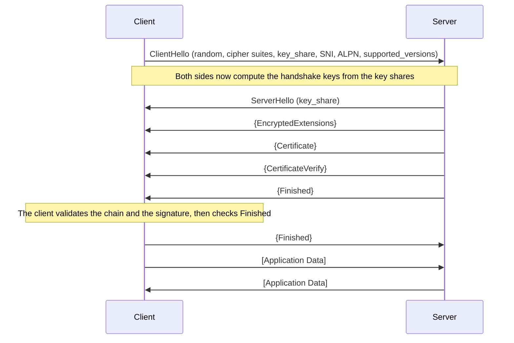
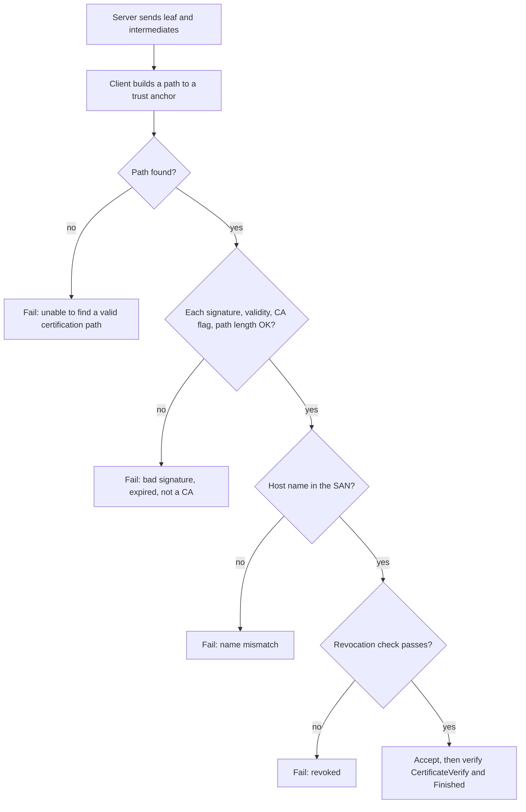

# TLS and HTTPS

TLS (Transport Layer Security) is the protocol that protects a connection between two programs. It gives confidentiality (an eavesdropper cannot read the data), integrity (an attacker cannot change the data without detection), and authentication of the server (the client knows which server it talks to). It can also authenticate the client. HTTPS is HTTP carried over TLS. This page explains the TLS 1.3 handshake message by message, the certificates that give the authentication, the changes in the Web PKI (the public system of certificate authorities) that matter in 2026, and what a Java developer sees when TLS fails.

!!! info "Which RFC is TLS 1.3"
    RFC 8446 (August 2018) defined TLS 1.3. RFC 9846 (July 2026) obsoletes RFC 8446. RFC 9846 keeps the same protocol version and stays backward compatible. It tightens some rules and renumbers some sections (section 1.2 of RFC 9846 lists the technical changes: for example, a client must not reuse a key share between connections, and no endpoint may negotiate TLS 1.0 or 1.1). RFC 9846 also obsoletes RFC 5246 (TLS 1.2) and the TLS 1.2 ticket mechanism of RFC 5077, and it adds new requirements for TLS 1.2 implementations (section 1.4 and Appendix D). TLS 1.2 itself stays in use. This page cites RFC 9846 and gives the RFC 8446 section number where it differs. Many books, blog posts, and older KB pages cite RFC 8446, and their section numbers are the old ones.

## Why It Matters

Every backend interview that asks "what happens when you type a URL" reaches TLS, and a senior round goes one level deeper: why the handshake needs one round trip, what a certificate chain proves, why 0-RTT is dangerous, and why an `SSLHandshakeException` appears at 3 a.m. On the job, TLS is the cause of a large share of outages that have no code change: an expired certificate, a missing intermediate certificate, a trust store that lacks a new root, a clock that is wrong, a load balancer that offers only TLS versions that an old client cannot speak. Certificate lifetimes shrink in 2026 and 2027 (maximum 200 days now, 100 days from 2027-03-15, 47 days from 2029-03-15), so a team that renews certificates by hand will miss more renewals each year. A Java developer must also know how the JDK chooses a trust store, how to read a handshake log, and why a service-to-service call fails with `PKIX path building failed`.

## Core Concepts

**TLS record**: the unit of data that TLS sends. A record carries up to 2^14 bytes (16,384 bytes) of plaintext, protected by an authenticated cipher (RFC 9846 section 5.1, 5.2).

**Handshake**: the first exchange of messages. The handshake negotiates the parameters, authenticates the endpoints, and derives the keys. After the handshake, the endpoints send application data in protected records.

**Cipher suite**: in TLS 1.3, a pair of an AEAD algorithm and a hash algorithm, for example `TLS_AES_128_GCM_SHA256`. The key exchange and the signature algorithm are negotiated apart from the cipher suite. RFC 9846 section 9.1 requires `TLS_AES_128_GCM_SHA256` and recommends `TLS_AES_256_GCM_SHA384` and `TLS_CHACHA20_POLY1305_SHA256`.

**AEAD (authenticated encryption with associated data)**: a cipher that encrypts data and checks its integrity in one step. TLS 1.3 uses only AEAD ciphers (`kb/security/05-cryptography-basics.md`).

**Key exchange**: the step in which the client and the server compute a shared secret without sending it. TLS 1.3 uses ephemeral Diffie-Hellman over elliptic curves (ECDHE, for example the group `x25519`). "Ephemeral" means that each connection uses a new key pair (`kb/security/05-cryptography-basics.md`).

**Key share**: the public value of a key exchange. The client sends one or more key shares in the `ClientHello` and the server answers with one key share in the `ServerHello`.

**Forward secrecy**: the property that a recorded connection stays unreadable even if an attacker steals the server's long-term private key later. Ephemeral key exchange gives it, because the session keys do not depend on the long-term key.

**HKDF**: the key derivation function that TLS 1.3 uses to turn the shared secret and the handshake transcript into keys (RFC 5869). It has two steps, extract and expand.

**Certificate**: a signed statement that binds a public key to an identity, such as a DNS name. The format is X.509 (RFC 5280).

**Certificate authority (CA)**: an organization that signs certificates. A **root CA** signs its own certificate. An **intermediate CA** holds a certificate signed by another CA.

**Chain of trust (certification path)**: the list of certificates from the server's **leaf** certificate, through the intermediates, to a **trust anchor** (a root certificate that the client already trusts).

**Trust store**: the set of trust anchors that a client holds. Operating systems, browsers, and the JDK each ship a trust store. The JDK file is `cacerts`.

**Subject alternative name (SAN)**: the certificate field that lists the DNS names and IP addresses that the certificate covers. Clients match the server name against the SAN (RFC 9525).

**SNI (Server Name Indication)**: a `ClientHello` extension in which the client names the host it wants (RFC 6066 section 3). One IP address can then serve many certificates.

**ALPN (Application-Layer Protocol Negotiation)**: a `ClientHello` extension in which the client lists the application protocols it speaks, such as `h2` and `http/1.1` (RFC 7301). The server picks one. This is how HTTP/2 starts without an extra round trip.

**Session ticket and PSK**: after a handshake, the server can send a `NewSessionTicket` message. The ticket lets the client resume later with a pre-shared key (PSK) derived from the first session.

**0-RTT (early data)**: application data that the client sends in its first flight, together with the `ClientHello`, when it resumes a session. Its security properties are weaker (see "0-RTT and replay" below).

**Mutual TLS (mTLS)**: TLS in which the server also requests a certificate from the client and verifies it.

**Revocation**: the withdrawal of a certificate before its expiry date. The mechanisms are CRLs (certificate revocation lists) and OCSP (Online Certificate Status Protocol).

**Certificate Transparency (CT)**: public append-only logs of issued certificates. A log returns an SCT (signed certificate timestamp) as a receipt.

**ACME (Automatic Certificate Management Environment)**: the protocol that a client uses to request and renew certificates from a CA without human steps (RFC 8555).

**HSTS (HTTP Strict Transport Security)**: a response header that tells a browser to use only HTTPS for a host (RFC 6797).

## How It Works

### What TLS protects, and what it does not

TLS runs between the transport (TCP) and the application protocol (HTTP). It gives the three properties from the first paragraph. RFC 9846 section 1 states the authentication rule: "The server side of the channel is always authenticated; the client side is optionally authenticated."

TLS does not hide everything. An observer on the path still sees the IP addresses, the connection timing, the packet sizes (TLS does not hide the length of the data, although an endpoint can add padding to a record, RFC 9846 section 5.4), and (without Encrypted Client Hello, see below) the server name in the `ClientHello`. TLS also does not protect data once the endpoint decrypts it: a server that logs a password logs it in plain text.

TLS over TCP needs the TCP handshake first ([TCP and UDP](03-tcp-and-udp.md)). QUIC, the transport under HTTP/3, carries a TLS 1.3 handshake inside its own packets and takes its keys from it (RFC 9001). The QUIC handshake has its home on the HTTP page ([HTTP](04-http.md)).

### The TLS 1.3 handshake in one round trip

The client starts. The client sends its key share in the first message, because it guesses a group that the server supports. The server answers with its key share and finishes its part of the handshake in the same flight. So the client can send application data after one round trip. RFC 9846 section 2 gives the flow in Figure 1.



In the diagram, `{ }` means "protected with the handshake keys" and `[ ]` means "protected with the application keys". Only `ClientHello` and `ServerHello` are in plain text. The server can send application data after its own `Finished`, before it has seen the client `Finished`. That data goes to a peer that is not yet authenticated (RFC 9846 section 2).

### The messages, one by one

The table gives the section number in RFC 9846 and the old number in RFC 8446.

| Message | RFC 9846 | RFC 8446 | What it carries and what it does |
|---|---|---|---|
| `ClientHello` | 4.2.2 | 4.1.2 | A 32-byte random value, the offered cipher suites, and extensions. The important extensions: `supported_versions` (the client offers 1.3), `supported_groups` and `key_share` (the key exchange groups and the public values), `signature_algorithms` (the signature schemes that the client accepts), `server_name` (SNI), `application_layer_protocol_negotiation` (ALPN), `psk_key_exchange_modes` and `pre_shared_key` (resumption), and `early_data` (0-RTT) |
| `ServerHello` | 4.2.3 | 4.1.3 | The chosen cipher suite, the server key share (or the chosen PSK), and its own random value. After this message, both sides can compute the handshake keys. Everything after `ServerHello` is encrypted. A TLS 1.3 server that negotiates TLS 1.2 puts a fixed downgrade marker in the last 8 bytes of its random value (the ASCII text `DOWNGRD` followed by `01`, or `00` for TLS 1.1 or lower), so a TLS 1.3 client detects an attacker who forces a lower version |
| `HelloRetryRequest` | 4.2.4 | 4.1.4 | A special `ServerHello`. The server sends it if the client offered no key share for a group that the server accepts. The client sends a second `ClientHello` with the right share. This costs one more round trip (RFC 9846 section 2.1) |
| `EncryptedExtensions` | 4.4.1 | 4.3.1 | The answers to `ClientHello` extensions that are not needed to compute the keys (ALPN result, for example), now encrypted. In TLS 1.2 they were in plain text |
| `EndOfEarlyData` | 4.6 | 4.5 | Sent by a client that sent 0-RTT data, after the server accepted it. It marks the end of the early data. The client sends it under the early traffic keys, and then switches to the handshake keys for its `Finished` |
| `CertificateRequest` | 4.4.2 | 4.3.2 | Sent only if the server wants client authentication (mTLS) |
| `Certificate` | 4.5.1 | 4.4.2 | The certificate chain of the sender: the leaf first, then the intermediates. The sender can leave the root out, because the receiver holds its own trust anchors. The server can staple an OCSP response and send SCTs as extensions of this message (section 4.5.1.1) |
| `CertificateVerify` | 4.5.2 | 4.4.3 | A signature over the hash of the handshake so far, made with the private key that matches the leaf certificate. It proves that the sender holds the private key |
| `Finished` | 4.5.3 | 4.4.4 | A MAC (message authentication code) over the whole handshake. It confirms that both sides computed the same keys and that no one changed the handshake messages |
| `NewSessionTicket` | 4.7.1 | 4.6.1 | Sent after the handshake. It gives the client a ticket for resumption. The lifetime must not be more than 604,800 seconds (7 days) |
| `KeyUpdate` | 4.7.3 | 4.6.3 | Sent after the handshake. It asks the peer to derive new application traffic keys. An endpoint must update keys or close the connection before it reaches the key usage limits of the cipher (RFC 9846 section 5.5; for AES-GCM, up to 2^24.5 full-size records, about 24 million). RFC 9846 also limits the number of `KeyUpdate` messages that an endpoint accepts |

The mapping rule for sections 4 and later: RFC 9846 inserted section 4.1 ("The Transcript Hash", RFC 8446 section 4.4.1). So the key exchange messages moved from 4.1.x to 4.2.x, the extensions from 4.2.x to 4.3.x (for example `supported_versions` is 4.3.1, `key_share` is 4.3.8, `early_data` is 4.3.10, `pre_shared_key` is 4.3.11), the server parameters from 4.3.x to 4.4.x, the authentication messages from 4.4.x to 4.5.x, and the post-handshake messages from 4.6.x to 4.7.x. The post-handshake authentication extension is 4.3.6 (RFC 8446: 4.2.6) and its message flow is 4.7.2 (RFC 8446: 4.6.2). These sections do not move: protocol overview and resumption (2, 2.1, 2.2, 2.3), record protection (5.1 to 5.5), the key schedule (7.1), and anti-replay (8, 8.1 to 8.3). The appendices after Appendix C moved by one letter: Backward Compatibility is Appendix E in RFC 9846 (D in RFC 8446), and the security properties, with the replay text, are Appendix F in RFC 9846 (E in RFC 8446). So the replay text is Appendix F.5 in RFC 9846 and Appendix E.5 in RFC 8446. RFC 9846 has no mapping table of its own. This mapping comes from comparing the two tables of contents.

The server proves its identity in two steps. The `Certificate` message gives the public key and a statement from a CA that the key belongs to the name. The `CertificateVerify` message proves that the server holds the private key now, in this handshake, because the signature covers the transcript, which contains the client random value. Without the second step, an attacker could replay a captured `Certificate` message.

### The key schedule and the record layer

Both sides derive all keys from the handshake with HKDF. HKDF has an extract step and an expand step (RFC 5869). TLS 1.3 chains them (RFC 9846 section 7.1):

1. **Early Secret** = HKDF-Extract(salt = 0, IKM = PSK). If there is no PSK, both inputs are strings of zero bytes as long as the hash output. It gives the binder key and the 0-RTT traffic key (`client_early_traffic_secret`).
2. **Handshake Secret** = HKDF-Extract(salt = Derive-Secret(Early Secret, "derived", ""), IKM = the ECDHE shared secret). It gives the client and server handshake traffic secrets (used from `EncryptedExtensions` to `Finished`).
3. **Main Secret** = HKDF-Extract(salt = Derive-Secret(Handshake Secret, "derived", ""), IKM = zeros). It gives the client and server application traffic secrets, the exporter secret, and the resumption secret. (RFC 8446 called it the "master secret". RFC 9846 renamed it "main". The derivation labels still use the string "master", for example `res master`, for compatibility, as the note in section 7.1 says.)

Each traffic secret comes from `Derive-Secret(secret, label, transcript)`, which hashes the handshake messages up to a defined point (the transcript hash). The handshake traffic secrets cover `ClientHello` to `ServerHello`. The application traffic secrets cover `ClientHello` to the server `Finished`. A change to any message changes all later keys, so a tampered handshake fails at `Finished`. After the handshake, the record layer encrypts each record with an AEAD cipher. The nonce of each record comes from a 64-bit sequence number XORed with a static value derived from the key schedule (section 5.3), so no nonce repeats. TLS 1.3 also hides the real record type: the plain header of every protected record says `application_data` (23), and the real content type is the last non-zero byte inside the encrypted payload (`TLSInnerPlaintext.type`, section 5.2). That is why an observer cannot tell a handshake record or an alert from application data after `ServerHello`. The Java example below runs HKDF on the test vector of RFC 5869.

The cryptographic primitives (ECDHE, AEAD, hash, signature) have their home on `kb/security/05-cryptography-basics.md`. This page uses each primitive for one purpose: ECDHE gives a shared secret with forward secrecy, AEAD protects records, HKDF derives keys, and a signature (RSA or ECDSA) in `CertificateVerify` authenticates the server.

### What changed from TLS 1.2

RFC 9846 section 1.3 lists the major differences from TLS 1.2. The table gives the ones that matter in an interview.

| Topic | TLS 1.2 | TLS 1.3 |
|---|---|---|
| Round trips for a full handshake | 2 before the client sends data (with the usual ECDHE suites) | 1 |
| Key exchange | Static RSA (the client encrypts the secret with the server key), static DH, or ephemeral DH | Only ephemeral (EC)DHE or PSK. Static RSA and static DH suites are removed |
| Forward secrecy | Optional (only with ephemeral suites) | Every public-key exchange gives forward secrecy |
| Cipher modes | CBC, RC4, and AEAD suites | AEAD only |
| What is encrypted | The certificate and most extensions are in plain text | All messages after `ServerHello` are encrypted |
| Key derivation | A PRF built on HMAC | HKDF, with better separation of keys |
| Resumption | Session IDs and session tickets (two mechanisms) | One mechanism: PSK from a `NewSessionTicket` |
| Removed | Compression, renegotiation, DSA, custom DHE groups, point format negotiation | |
| 0-RTT | Not available | Optional |

"Static RSA" is the reason that the removal matters. With static RSA, the client encrypts the pre-master secret to the server's long-term RSA key. An attacker who records the traffic and later steals or breaks that key can decrypt all recorded connections. With ephemeral key exchange, the long-term key only signs the handshake, so a stolen key does not reveal old traffic.

### HelloRetryRequest, resumption, and tickets

If the server does not support any group that the client sent a key share for, it sends `HelloRetryRequest`, and the handshake takes 2 round trips. Clients avoid this by sending a key share for the group that most servers accept. A client that sends `x25519` and a hybrid share (see below) covers both cases. RFC 9846 forbids a client to reuse a key share between connections, so each connection makes a new ephemeral key pair.

After the first connection, the server sends a `NewSessionTicket`. The ticket is either a database key (the server keeps the state) or a self-contained encrypted blob (the server keeps no state). The client stores the ticket and a PSK derived from the resumption secret. In the next connection, the client sends the ticket in the `pre_shared_key` extension. If the server accepts, the handshake needs no certificate and no signature, so it is cheaper. RFC 9846 section 2.2 describes resumption. Two limits matter: a server must not issue a ticket lifetime above 7 days (section 4.7.1), and a ticket should be used with a fresh key exchange (the `psk_dhe_ke` mode) if the client wants forward secrecy for the resumed session.

In the JDK, the server property `jdk.tls.server.sessionTicketTimeout` has the default 86,400 seconds (24 hours), and stateless tickets are on by default (`jdk.tls.server.enableSessionTicketExtension`, default `true`) (JSSE reference guide, JDK 21).

### 0-RTT and replay

This section is the home of 0-RTT in the KB. The HTTP page and the HLD pages link here.

**What 0-RTT does.** A client that holds a ticket for a server that allows early data can put application data right after its `ClientHello`, in the same first flight. The client protects this data with a key derived from the PSK alone (`client_early_traffic_secret`). The server can process the request before it has finished the handshake. The saving is one round trip. With TCP and TLS 1.3 resumption with 0-RTT, the first response byte arrives after 2 round trips (1 for TCP, 1 for the request and its early data). With QUIC, it arrives after 1 round trip, as the HTTP page shows ([HTTP](04-http.md)).

**The two weaker properties.** RFC 9846 section 2.3 states them in an "IMPORTANT NOTE":

1. *No forward secrecy guarantee.* The early data is encrypted only with a key derived from the PSK. If the attacker later gets the ticket key (or the PSK), the attacker can decrypt recorded early data. The server's behavior decides whether any forward secrecy applies, and the protocol does not tell the client. So "the client should assume that this data is not forward secret".
2. *No protection against replay between connections.* For normal 1-RTT data, the server's random value in `ServerHello` makes each connection unique. 0-RTT data does not depend on `ServerHello`, so an attacker who records the first flight can send it again to the server (or to another server in the same cluster), and the server cannot tell the copy from the original. The RFC states that 0-RTT data "cannot be duplicated within a connection", and that an attacker cannot make it look like 1-RTT data.

**What a replay does.** RFC 9846 Appendix F.5 lists three attacks. The attacker can duplicate an action with a side effect (a payment, a purchase). The attacker can reorder messages (move a delete after a create). The attacker can use a cache side channel: replay a request to a cache node that does not hold a resource, then check from another connection whether the resource is now cached, which leaks the content of the request. If the attacker can replay many times, the attacker can also measure the time of cryptographic operations or overload a rate limiter. The RFC says that the data is safe under replay only if the application is "specifically engineered to be safe under replay (minimally, this means idempotent, but in many cases may also require other stronger conditions, such as constant-time response)".

**The server defenses (RFC 9846 section 8).** The RFC sets one firm minimum: the server "MUST ensure that any instance of it (be it a machine, a thread, or any other entity within the relevant serving infrastructure) would accept 0-RTT for the same 0-RTT handshake at most once". This limits the number of replays to the number of server instances. It does not stop the retry attack described below, which "cannot be prevented at the TLS layer" and which the application must handle. The RFC says servers should do better when feasible. Three mechanisms exist:

| Defense | How it works | Cost and limit |
|---|---|---|
| Single-use tickets (8.1) | The server accepts each ticket once. It keeps a database of valid tickets and deletes a ticket when it is used. If the ticket is unknown, the server falls back to a full handshake | Needs storage that all servers share. In a cluster this is hard to do for a high rate of resumptions. It also gives forward secrecy for the PSK after deletion |
| ClientHello recording (8.2) | The server stores a unique value from each `ClientHello` (the random value or the PSK binder) inside a time window, and rejects duplicates. It uses `obfuscated_ticket_age` to reject tickets that are outside the window | A cluster rarely has globally consistent storage. The best design makes one zone authoritative for a ticket, and refuses 0-RTT for that ticket in other zones. Separate stores per zone allow one replay per zone. A freshly started server must reject 0-RTT while its window overlaps the start time |
| Freshness check (8.3) | The server compares the expected arrival time (ticket creation time plus the ticket age that the client reports) with its own clock, and rejects 0-RTT if the difference is too large | The RFC gives windows "on the order of ten seconds" for Internet clients. A freshness check alone is not enough: it does not catch replays inside the window, which "could include billions of replays in real-world settings" |

**The cluster attack.** If a server in another cluster has no state about the ticket, it falls back to a 1-RTT handshake. Then the client (or the application protocol) retransmits the request over the new connection. The attacker sends the original `ClientHello` to both clusters. The first cluster processes the early data at once. The second cluster ignores the early data and processes the retransmitted request later. The request runs twice. The scale of this attack is limited by the client's willingness to retry (RFC 9846 Appendix F.5).

**The rules.** Because of these risks, RFC 9846 sets three rules:

- A client "MUST NOT send messages in early data which are not safe to have replayed and which they would not be willing to retry across multiple 1-RTT connections".
- "Application protocols MUST NOT use 0-RTT data without a profile that defines its use." The profile says which messages are safe and what to do when the server rejects 0-RTT.
- A TLS implementation must not enable 0-RTT (to send or to accept) unless the application asks for it, and must not resend rejected 0-RTT data unless the application instructs it.

**The HTTP profile.** RFC 8470 is the profile for HTTP. A gateway that accepts early data adds the request header `Early-Data: 1` when it forwards a request that arrived in early data. An origin that cannot accept that request answers `425 Too Early`, and the client retries after the handshake completes. RFC 8470 section 5.2 says that a user agent that sent a request in early data is expected to retry it after a 425 response. The user agent SHOULD retry automatically, and the retry MUST NOT use early data. A gateway MUST NOT forward a request that arrived in early data unless it knows that the origin understands the `Early-Data` header and answers 425 correctly (RFC 8470 section 6.1). An origin that never sees `Early-Data: 1` cannot tell that the request was replayable. RFC 9001 section 5.6 says that HTTP/3 uses this profile. In practice: allow `GET` of static content and nothing else, or turn 0-RTT off. A `POST /pay` must never run as early data. Recommendation: for an API, leave 0-RTT off unless a measured latency gain justifies the review of every endpoint behind the gateway.

**QUIC.** QUIC uses the same TLS 1.3 mechanism for 0-RTT, and RFC 9001 section 9.2 says that QUIC 0-RTT has the same replay exposure. The QUIC and HTTP/3 details are on [HTTP](04-http.md).

**Java.** JEP 332 (TLS 1.3 in JDK 11) lists 0-RTT data as not supported by the JDK implementation, and the JDK 21 JSSE guide describes no 0-RTT setting. I found no later JEP or JSSE setting that adds it: JEP 527 (JDK 27) adds hybrid key exchange and does not mention 0-RTT (checked 2026-11-05). A Java server behind a JDK TLS stack therefore does not accept early data. A gateway in front of the Java service (a CDN, an NGINX, an Envoy) is where 0-RTT is decided.

### Certificates

An X.509 certificate (RFC 5280) holds these fields that matter to a developer:

| Field | Meaning |
|---|---|
| Subject | The name of the owner. Modern clients do not use the common name (CN) to match a host name (RFC 9525) |
| Subject alternative name (SAN) | The DNS names and IP addresses that the certificate covers. A wildcard `*.example.com` covers one label (`a.example.com`, not `a.b.example.com` and not `example.com`) |
| Issuer | The name of the CA that signed the certificate |
| Validity (`notBefore`, `notAfter`) | The time window in which the certificate is valid |
| Subject public key | The key that the server proves it holds in `CertificateVerify` |
| Key usage and extended key usage | What the key may do. A TLS server certificate carries the extended key usage `serverAuth`; a client certificate carries `clientAuth` |
| Basic constraints | `CA:TRUE` or `CA:FALSE`, and an optional `pathLenConstraint` (the maximum number of intermediates below this CA). Only a certificate with `CA:TRUE` may sign other certificates |
| Authority information access | A URL for the issuer certificate and, in older certificates, for the OCSP responder |
| CRL distribution points | URLs of revocation lists |
| Embedded SCTs | Certificate Transparency receipts |
| Signature | The CA's signature over the certificate |

**Chain validation.** RFC 5280 section 6.1 defines the path validation algorithm. The client builds a path from the leaf to a trust anchor and checks, for each certificate: the signature verifies with the issuer's public key (6.1.3 (a)(1)), the validity period includes the current time ((a)(2)), the certificate is not revoked ((a)(3)), the issuer name equals the name of the previous certificate's subject ((a)(4)), the name constraints hold, and (for each CA certificate) the basic constraints and the path length are correct. The client also checks that the host name it wanted matches the SAN (RFC 9525). Then it decides. If any step fails, the handshake fails with a fatal alert, and the TLS library throws an exception.



The server must send the intermediates. The client holds only the roots. If the server sends only the leaf, a browser can sometimes fetch the missing intermediate from the "authority information access" (AIA) URL in the certificate (the `caIssuers` access method). A Java client does not do this by default. The JDK 21 PKI guide says that support for `caIssuers` "is disabled by default for compatibility", and that it works only if you set the system property `com.sun.security.enableAIAcaIssuers` to `true`. The system and security property `com.sun.security.allowedAIALocations` filters the URIs that the JDK may follow, and its blank default denies all of them. Without both settings, the Java client fails with `PKIX path building failed`. This is a frequent cause of "works in Chrome, fails in Java". Recommendation: fix the server so that it sends the chain, and do not turn on AIA fetching to hide the fault.

**Trust stores.** The trust store decides which roots a client believes. Browsers and operating systems keep their own stores, and each root program has its own rules. The JDK ships `cacerts`. For the default trust manager, the JDK looks for a trust store in this order (JSSE reference guide): the file named by the system property `javax.net.ssl.trustStore`; if the property is not set, `<java-home>/lib/security/jssecacerts` if it exists; and then `<java-home>/lib/security/cacerts`. If the property names a file that does not exist, the JDK uses an empty trust store, and every server fails validation.

**Revocation.** A certificate can need withdrawal before `notAfter`, for example after a key leak. Two mechanisms exist:

- *CRL (RFC 5280 section 5)*: the CA publishes a signed list of revoked serial numbers. The list can be large.
- *OCSP (RFC 6960)*: the client asks a responder about one certificate and gets a signed answer ("good", "revoked", "unknown"). This has two problems. It adds a round trip to a third party in the middle of the handshake. And the responder learns which sites the user visits.
- *OCSP stapling*: the server fetches its own OCSP response and sends it in the handshake, as the `status_request` extension (RFC 6066 section 8; in TLS 1.3 the response travels in an extension of the `Certificate` message, RFC 9846 section 4.5.1.1). The client asks the third party nothing. A stapled response has a validity period of its own. *Must-Staple* (RFC 7633) is a certificate extension that tells the client to reject a certificate whose handshake has no stapled response.

**The status of OCSP in the Web PKI (checked 2026-11-05).** Let's Encrypt, the largest CA by number of certificates, stopped OCSP. Its published timeline (post of 2024-12-05): on 2025-01-30, issuance requests that include the Must-Staple extension began to fail, unless the account had issued such a certificate before; on 2025-05-07 it dropped the OCSP URLs from certificates and all Must-Staple requests, including renewals, failed; on 2025-08-06 it turned off its OCSP responders. Its stated reasons are privacy (an OCSP responder sees which sites a user's IP address checks), simpler and cheaper infrastructure, and the weak browser support for Must-Staple. It publishes CRLs instead. The post warns that non-browser software, such as a VPN, must work when a certificate has no OCSP URL. The CA/Browser Forum made OCSP optional and CRLs mandatory for publicly trusted TLS certificates in Baseline Requirements version 2.0.1 (ballot SC-063, effective 2024-03-15). Consequence for a Java service: do not build a design that needs OCSP from a Let's Encrypt certificate. In the JDK, revocation checking is off by default (`com.sun.net.ssl.checkRevocation` is `false`), and the client sends the OCSP stapling request by default (`jdk.tls.client.enableStatusRequestExtension` is `true`) but uses a stapled response only if you turn on revocation checking.

The trend of short lifetimes is also a revocation strategy: a certificate that lives 6 days or 47 days needs less revocation machinery.

**Certificate Transparency.** A CA submits each certificate (or a "precertificate") to public, append-only logs before it issues the certificate. Each log returns an SCT, which the CA embeds in the certificate (or the server sends with the handshake). A browser can then require proof that the certificate is in public logs, so a CA cannot issue a certificate for `example.com` in secret. The domain owner can monitor the logs for unexpected certificates. RFC 6962 defined CT. RFC 9162 (December 2021, category Experimental) obsoletes RFC 6962 and defines a revised protocol ("CT 2.0"). Browser vendors publish their own CT policies, which say how many SCTs a certificate needs. Chrome's policy (checked 2026-11-05): a certificate with a lifetime up to 180 days needs embedded SCTs from at least 2 distinct logs, and a longer one needs 3, and at least two SCTs must come from different log operators. The JDK does not check SCTs (JEP 332 lists SCT support as not supported).

**Certificate lifetimes.** The CA/Browser Forum Baseline Requirements set the maximum validity of a publicly trusted TLS certificate. Ballot SC-081v3 (vote ended 2025-04-11, effective in the Baseline Requirements version 2.1.5 on 2025-05-16) set this schedule in section 6.3.2 of the Baseline Requirements (checked against version 2.3.1 of 2026-10-04):

| Certificates issued | Maximum validity |
|---|---|
| Before 2026-03-15 | 398 days |
| 2026-03-15 up to 2027-03-15 | 200 days (in force today) |
| 2027-03-15 up to 2029-03-15 | 100 days |
| From 2029-03-15 | 47 days |

The schedule keys on the issue date of the certificate, and a certificate that a CA issued before a date keeps its original term. The same ballot also shortens the period during which a CA may reuse a completed domain validation (section 4.2.1 of the Baseline Requirements). The "data reuse period" is the maximum age of the validation at the moment of issuance:

| Certificates issued | Maximum domain validation reuse |
|---|---|
| Before 2026-03-15 | 398 days |
| 2026-03-15 up to 2027-03-15 | 200 days |
| 2027-03-15 up to 2029-03-15 | 100 days |
| From 2029-03-15 | 10 days |

 Let's Encrypt announced its own schedule (post of 2025-12-02): the opt-in `tlsserver` profile issues 45-day certificates from 2026-05-13; the default `classic` profile moves to 64-day certificates with a 10-day authorization reuse period on 2027-02-10, and to 45-day certificates with a 7-hour reuse period on 2028-02-16; a `shortlived` profile issues 6-day certificates. Consequence: at 47 days, a certificate renews about 8 times a year, and manual renewal does not scale. Automate it with ACME.

**ACME (RFC 8555).** The ACME client (certbot, cert-manager in Kubernetes, the Caddy server, or a cloud service) creates an account at the CA and then follows this loop:

1. The client asks for a certificate for a set of names (an "order").
2. For each name, the CA gives a challenge that proves control of the name. `http-01`: the client serves a token at `http://<name>/.well-known/acme-challenge/<token>` on port 80. `dns-01`: the client publishes a TXT record at `_acme-challenge.<name>`. (Wildcard names need `dns-01`.) `tls-alpn-01` (RFC 8737) proves control over a TLS connection.
3. The client sends a certificate signing request (CSR) that holds its public key.
4. The CA validates, signs, and returns the chain.
5. A scheduler repeats this before expiry. RFC 8555 gives no renewal time. Let's Encrypt says that a client without ACME Renewal Information may renew at roughly two thirds of the certificate lifetime, so that about one third is left, and that a hardcoded 60-day interval no longer works for 45-day certificates. ACME Renewal Information (ARI, RFC 9773, June 2025, Standards Track) is the better way: the CA publishes a suggested renewal window for each certificate, for example earlier if it plans to revoke the certificate, and the client asks for it before each check.

The private key never leaves the server. The CA signs the public key from the CSR. A domain owner can also publish a CAA DNS record that lists the CAs that may issue for the name (the DNS record types are on [DNS](06-dns.md)).

### SNI and Encrypted Client Hello

One IP address can host many sites (a CDN or a shared load balancer). The server cannot choose the certificate until it knows the host name, but the name is inside the `Host` header, which is encrypted. So the client puts the name in the `server_name` extension of the `ClientHello` (SNI, RFC 6066 section 3). SNI carries a DNS host name. RFC 6066 does not permit a literal IPv4 or IPv6 address in it. The `ClientHello` is in plain text, so an observer on the path reads the name of every site that the user visits.

**Encrypted Client Hello (ECH)** closes this gap. RFC 9849 (March 2026, Standards Track) is published. The client builds a private `ClientHelloInner` that holds the real SNI and extensions, encrypts it with a public key of the server, and sends a public `ClientHelloOuter` whose SNI is the `public_name` of the "client-facing server" (for example a CDN). The client-facing server decrypts the inner hello. In shared mode, the same server completes the handshake. In split mode, it forwards the inner hello to a backend server. If the server cannot decrypt, it completes the handshake with the outer hello and can send `retry_configs` with a fresh key, so a stale configuration costs a retry, not a failure. The client learns the ECH configuration from DNS: RFC 9848, "Bootstrapping TLS Encrypted ClientHello with DNS Service Bindings" (March 2026, Standards Track), defines the `ech` parameter of the `SVCB` and `HTTPS` DNS records (the records have their home on [DNS](06-dns.md)).

What ECH does not hide: the IP address of the server (an observer can still map a well-known IP to a site, so ECH helps most when many sites share an address), the traffic pattern, and the DNS query (unless the client uses encrypted DNS). The JDK 21 JSSE guide does not describe an ECH setting.

### Post-quantum hybrid key exchange

A large quantum computer could break the elliptic curve key exchange that TLS uses today. An attacker can record encrypted traffic now and decrypt it later ("harvest now, decrypt later"). Signatures are not at that risk, because an attacker cannot go back in time to forge a signature during the handshake, so the first step is to protect the key exchange.

The deployed answer is a hybrid: the client and the server run two key exchanges and combine the secrets. The connection is safe if at least one of the two is secure. `X25519MLKEM768` combines X25519 (classical ECDHE) and ML-KEM-768 (a post-quantum key encapsulation mechanism standardized by NIST in FIPS 203). Facts from RFC 10024 ("Post-Quantum Traditional (PQ/T) Hybrid Key Agreement Mechanisms for TLS 1.3", August 2026, Standards Track), which applies the framework of RFC 9954 ("Hybrid Key Exchange in TLS 1.3", July 2026, Informational): the client share is 1,216 bytes (1,184 for the ML-KEM encapsulation key and 32 for X25519), the server share is 1,120 bytes, and the shared secret is 64 bytes. The code point of the group is 0x11EC (4588). The client share is the ML-KEM-768 encapsulation key followed by the X25519 share. The larger share is the practical cost: the `ClientHello` of a hybrid client no longer fits in one small packet, and the extra bytes also grow the first flight for QUIC.

Deployment status (checked 2026-11-05):

- Standard: RFC 10024 defines `X25519MLKEM768`, `SecP256r1MLKEM768`, and `SecP384r1MLKEM1024`.
- Clients: Cloudflare's support table (a third-party list, last updated 2026-06-24) lists `X25519MLKEM768` as the default in Chrome 131 and later, Edge 131 and later, Firefox 132 and later (desktop), Safari 26 and later, OpenSSL 3.5.0 and later, Go 1.24 and later, and Java 27 and later. Two vendor sources confirm part of this list. Apple's Platform Security guide says that TLS 1.3 with `X25519MLKEM768` is on by default in `URLSession` and the Network APIs on iOS 26, iPadOS 26, and later. Mozilla bug 1919097 turned the hybrid key exchange on by default on desktop in Firefox 132. I did not find a primary Chrome release note for Chrome 131, so the Chrome and Edge versions rest on Cloudflare's table. These are Cloudflare's own measurements, not a neutral census: Cloudflare Radar reports that more than 60% of client traffic to Cloudflare used post-quantum encryption in February 2026, and that about 10% of origin servers could use a post-quantum key agreement (Cloudflare blog, 2026-02-27).
- Java: JDK 21 does not have it. JEP 527 ("Post-Quantum Hybrid Key Exchange for TLS 1.3") is delivered in JDK 27. `X25519MLKEM768` is on by default there and first in the preference list, and the client sends two key shares (`X25519MLKEM768` and `x25519`). The other two hybrid groups are available but not on by default. On JDK 21, a TLS terminator in front of the service (a load balancer or a proxy) can give the hybrid exchange to clients.
- Not covered: post-quantum certificates and signatures. The certificate chain and `CertificateVerify` still use RSA or ECDSA.

### Mutual TLS

In mTLS the server sends a `CertificateRequest`, and the client answers with its `Certificate` and `CertificateVerify` before its `Finished` (RFC 9846 sections 4.4.2, 4.5). The server validates the client chain against its own trust store for client certificates. Between services, mTLS gives each side a verified identity and an encrypted channel. The hard part is operations: issue, distribute, rotate, and revoke many short-lived certificates, which a service mesh or a workload identity system does. The design view is on [security in design](../hld/fundamentals/21-security-in-design.md). TLS 1.3 does not allow the TLS 1.2 renegotiation for late client authentication; it has an optional post-handshake authentication mechanism (the extension in RFC 9846 section 4.3.6 and the message flow in section 4.7.2), which the JDK does not support (JEP 332).

### TLS termination and the user's handshake

A TLS terminator is a server (a load balancer, a CDN edge, or a reverse proxy) that ends the client's TLS connection and forwards the request to a backend. The design trade-offs (where to terminate, re-encryption, pass-through) are on [load balancing, DNS and CDN](../hld/fundamentals/02-load-balancing-dns-cdn.md). Here is the protocol reason that a nearby terminator shortens the handshake for the user.

A cold HTTPS request that reaches a server over TCP needs: 1 round trip for the TCP handshake, 1 round trip for the TLS 1.3 handshake, and 1 round trip for the request and the first response byte. That is 3 round trips (the same number as on [HTTP](04-http.md), which counts from the end of the DNS lookup). TLS 1.2 needs 4.

Worked example. Assumptions: the user is 10 ms (round trip) from the edge and 150 ms (round trip) from the origin. The 150 ms figure is the California to the Netherlands round trip from Jeff Dean's latency table (approximate, see [back-of-envelope estimation](../hld/back-of-envelope-estimation.md)). The 10 ms figure is an assumption for a nearby point of presence. Server processing time is not counted.

| Design | Calculation | Time to the first response byte |
|---|---|---|
| No edge. The user connects to the origin | 3 round trips x 150 ms | 450 ms |
| Edge terminates TLS, cache hit | 3 x 10 ms | 30 ms |
| Edge terminates TLS, cache miss, warm edge-to-origin connection | 3 x 10 ms for the user side, then 1 x 150 ms for the request to the origin | 180 ms |
| Edge terminates TLS, cache miss, cold edge-to-origin connection | 30 ms, then 3 x 150 ms | 480 ms |

The TCP and TLS handshakes (2 of the 3 round trips) now cost 2 x 10 ms = 20 ms instead of 2 x 150 ms = 300 ms. The edge also keeps connections to the origin open and reuses them, so the user rarely pays the long handshake on the long path. A cold edge-to-origin connection is the exception, and it explains why the first request after a quiet period is slower.

### HTTPS-specific items

**HTTP to HTTPS.** A site that serves both schemes lets an attacker on the path strip the upgrade: the first request goes out in plain text, and the attacker proxies it. **HSTS** (RFC 6797) removes this after the first visit. The server sends `Strict-Transport-Security: max-age=31536000; includeSubDomains` over HTTPS. The browser stores the host as an HSTS host for `max-age` seconds. For that period the browser rewrites `http://` to `https://` before it sends anything, and it refuses to continue after a certificate error, so the user cannot click through a warning (RFC 6797 section 8.1 for header processing; "no user recourse" in section 12.1). The browser ignores the header if it arrives over plain HTTP (section 8.1). A `max-age` of 0 removes the entry. The first visit has no protection (a trust-on-first-use gap). Browsers ship a preload list to close the gap for listed hosts. The list that Chrome maintains is at hstspreload.org, and Firefox, Safari, and Edge base their lists on it. To enter the list, a site must serve a valid certificate, redirect HTTP to HTTPS on the same host, support HTTPS on all sub-domains, and send an HSTS header on the base domain with `max-age` of at least 31,536,000 seconds (1 year), `includeSubDomains`, and `preload`. The site owner cannot undo inclusion quickly: hstspreload.org says that removal takes months to reach users through browser updates. Submit a site only if every sub-domain will support HTTPS for the long term.

**Mixed content.** An HTTPS page that loads a subresource (a script, an image, a stylesheet) over plain HTTP exposes that subresource to tampering. A script loaded that way lets an attacker control the page. The W3C Mixed Content specification (Candidate Recommendation Draft, 2023-02-23) splits subresources into two groups. *Upgradeable* content is images, audio, and video. The browser rewrites such a request from `http` to `https`, and blocks it if the HTTPS request fails. *Blockable* content is everything else (scripts, stylesheets, `XMLHttpRequest` and `fetch` requests), and the browser blocks it. The older names were "optionally-blockable" and "blockable". The `Content-Security-Policy: upgrade-insecure-requests` directive asks the browser to upgrade blockable content as well. The fix is to serve every subresource over HTTPS.

**ALPN and HTTP/2.** The client lists `h2` and `http/1.1` in ALPN (RFC 7301). The server picks one in `EncryptedExtensions`. No extra round trip is needed. HTTP/3 over QUIC uses the ALPN token `h3` and has its own page section ([HTTP](04-http.md)).

**Secure cookies.** The `Secure` cookie attribute makes the browser send the cookie only over HTTPS. The cookie attributes have their home on the HTTP page ([HTTP](04-http.md)).

### What a Java developer sees

**Defaults in JDK 21.** The SunJSSE provider documentation lists TLS 1.0 and 1.1 as enabled in its protocol table, and both are disabled because `jdk.tls.disabledAlgorithms` in `java.security` contains `TLSv1` and `TLSv1.1` (the file of JDK 21.0.7 has `jdk.tls.disabledAlgorithms=SSLv3, TLSv1, TLSv1.1, DTLSv1.0, RC4, DES, MD5withRSA, DH keySize < 1024, ...`). So a default JDK 21 client and server speak TLS 1.3 and TLS 1.2. The default `SSLContext.getInstance("TLS")` enables the TLS 1.3 cipher suites `TLS_AES_256_GCM_SHA384`, `TLS_AES_128_GCM_SHA256`, and `TLS_CHACHA20_POLY1305_SHA256`, and a long list of TLS 1.2 suites. I ran `keytool -showinfo -tls` on JDK 21.0.7: the TLS 1.2 list starts with ECDHE suites with GCM and ChaCha20, and it also includes DHE suites, CBC suites, and `TLS_RSA_WITH_AES_*` suites. The `TLS_RSA_*` suites use static RSA key exchange, which gives no forward secrecy. A TLS 1.3 connection never uses them, but a TLS 1.2 connection can. Recommendation: if you must give forward secrecy on TLS 1.2, set the enabled suites explicitly (`SSLParameters.setCipherSuites`) or add the `TLS_RSA_*` suites to `jdk.tls.disabledAlgorithms`. To list the current defaults, run `keytool -showinfo -tls` or `java -XshowSettings:security:tls`. Do not re-enable TLS 1.0 or 1.1 to fix an old client; upgrade the client.

**System properties.** These are the `javax.net.ssl` and `jdk.tls` properties that you use most:

| Property | Meaning |
|---|---|
| `javax.net.ssl.trustStore`, `javax.net.ssl.trustStorePassword`, `javax.net.ssl.trustStoreType` | The trust store of the default trust manager. If you set it, the JDK ignores `cacerts` |
| `javax.net.ssl.keyStore`, `javax.net.ssl.keyStorePassword`, `javax.net.ssl.keyStoreType` | The private key and certificate chain that this process presents (a server certificate, or a client certificate for mTLS) |
| `javax.net.debug` | Handshake logging, for example `-Djavax.net.debug=ssl:handshake`. Run with `help` to list the options |
| `jdk.tls.client.protocols`, `jdk.tls.server.protocols` | The default protocol list. It affects only the default `SSLContext`, not a version-specific one |
| `jdk.tls.namedGroups` | The key exchange groups, in preference order |
| `com.sun.net.ssl.checkRevocation` | Revocation checking. The default is `false` |

**Trust store and key store are two things.** A *trust store* holds the certificates that you trust (the roots and, for private CAs, your own roots). A *key store* holds your own private key and chain. Both can be PKCS12 files; PKCS12 is the default keystore type of JDK 21 (`keystore.type=pkcs12`). Inspect and edit them with `keytool`.

**The errors.**

`javax.net.ssl.SSLHandshakeException` is the umbrella for failures of the handshake. Read the cause chain.

- `PKIX path building failed: sun.security.provider.certpath.SunCertPathBuilderException: unable to find valid certification path to requested target`. The JDK could not build a path from the server's certificate to a trust anchor. I reproduced this exact text on JDK 21.0.7 with the default trust manager and a self-signed certificate. Causes: the server omits an intermediate; the server uses a private or self-signed CA that is not in the trust store; a corporate proxy re-signs traffic with its own root; or the JDK trust store is old and lacks a new root. Fix: send the full chain from the server, or add the missing root to the trust store that the process uses (not to the whole JDK without a plan).
- A name error (the certificate does not match the host name). The JDK class `sun.security.util.HostnameChecker` throws a `CertificateException`. For a DNS name, if the certificate has any DNS subject alternative name and none matches, the text is `No subject alternative DNS name matching <host> found.`. If it has no DNS subject alternative name, the checker falls back to the subject common name, and the text is `No name matching <host> found` (source: `HostnameChecker.java` in the OpenJDK 21 update repository). The handshake reports it as an `SSLHandshakeException` whose message is this text. `HttpsURLConnection` and `HttpClient` check the name by default. For an `SSLSocket` or `SSLEngine`, the JSSE guide says that the classes "do not automatically verify" the host name, so call `SSLParameters.setEndpointIdentificationAlgorithm("HTTPS")`. An application that skips this check accepts a certificate for any name.
- An expired certificate: a validity-period failure in the path validation. I ran a check on JDK 21.0.7 with a leaf certificate that a test CA signed with a validity that ended in 2020. The result was `sun.security.validator.ValidatorException: PKIX path validation failed: java.security.cert.CertPathValidatorException: validity check failed`, and the innermost cause was `java.security.cert.CertificateExpiredException: NotAfter: <date>`. The fix is renewal. Also check the clock of the machine: a wrong clock makes a valid certificate look expired or not yet valid.
- `Received fatal alert: handshake_failure` or `protocol_version`. The peers share no protocol version or cipher suite, for example a server that accepts only TLS 1.0 or 1.1.
- `Remote host terminated the handshake` or `Connection reset` during the handshake: the peer closed the TCP connection. A load balancer with a TLS policy that excludes your suites does this, or a server that expects plain text on that port.

**Never "fix" the error by trusting everything.** A custom `X509TrustManager` that accepts all certificates, or a `HostnameVerifier` that returns `true`, removes authentication, and any attacker on the path then reads the traffic. Add the right root instead.

**mTLS in Java.** Configure a key store (your identity) and a trust store (the roots that sign the peers). For Spring Boot, the `server.ssl.*` properties configure a server ([Spring Boot](../java/18-spring-boot.md)). For authorization after authentication, see [Spring Security](../java/21-spring-security.md).

**Connection reuse.** A TLS handshake costs round trips and CPU. A connection pool that reuses connections (for example `HttpClient`, or a JDBC pool with TLS) pays the handshake once. See [HTTP](04-http.md) for persistent connections and [TCP](03-tcp-and-udp.md) for the TCP side.


## Trade-offs and When to Use

| Decision | Option A | Option B | Choose A when | Choose B when |
|---|---|---|---|---|
| Where TLS ends | Terminate at the edge or the load balancer | Re-encrypt to the backend, or pass through | Public static or low-risk traffic, and you want L7 features and one place for certificates | Sensitive data, zero trust, or compliance. See [security in design](../hld/fundamentals/21-security-in-design.md) |
| Protocol version | TLS 1.3 only | TLS 1.3 and TLS 1.2 | All your clients are recent | You have older clients (old Android, old Java 8 builds, embedded devices). Check your client mix before you drop TLS 1.2 |
| 0-RTT | Off | On for idempotent requests | The default. You have non-idempotent endpoints, or you cannot review them | Static content or read-only APIs behind a gateway that adds `Early-Data: 1` and an origin that answers `425` |
| Resumption tickets | Stateless (self-contained, rotating keys) | Stateful (server database) | You have many servers and you want resumption without shared storage | You need single-use tickets for anti-replay, and you can share the store |
| Revocation | Short-lived certificates, no live check | CRL or OCSP checking | Automated renewal exists. A 6-day to 47-day certificate limits the exposure window | You must support long-lived certificates (a partner or an internal CA) |
| Certificate source | Public CA with ACME | Private CA (internal PKI) | Names are public | mTLS between your services, or internal names that a public CA cannot validate |
| Key exchange | X25519 only | Hybrid `X25519MLKEM768` | Short-lived data, and a client base that cannot handle larger handshakes | Data that must stay secret for years. The cost is about 1.1 KB more in each direction (see the sizes above) |
| Trust store in Java | Default `cacerts` | A custom trust store | Public servers | A private CA, or a service pinned to specific roots. Keep the custom store small and under version control |
| Client authentication | mTLS | A token (OAuth, JWT) | The caller is a service with a managed identity | The caller is a user or a third party. Many systems use both: mTLS for the service, a token for the user |

## Java Example

The program below uses only the JDK. It does not open a socket and does not read the system trust store. It does three things. It computes HKDF-Extract and HKDF-Expand with `javax.crypto.Mac` on the test vector of RFC 5869 Appendix A.1 and compares the result with the value in the RFC. It prints a trace of three TLS 1.3 handshake shapes (full, with client authentication, and resumption with 0-RTT) and counts the round trips before the client sends data. It runs a model of chain validation over in-memory certificate records. The chain model is a simulation: a "signature" check compares key names, and no cryptography runs.

```java
import java.time.LocalDate;
import java.util.ArrayList;
import java.util.List;
import javax.crypto.Mac;
import javax.crypto.spec.SecretKeySpec;

public class Main {
    // ---- Part 1: HKDF (RFC 5869) with the JDK HMAC. Test Case 1 of RFC 5869, Appendix A.1.
    static byte[] hmac(byte[] key, byte[] data) throws Exception {
        Mac mac = Mac.getInstance("HmacSHA256");
        mac.init(new SecretKeySpec(key, "HmacSHA256"));
        return mac.doFinal(data);
    }

    static byte[] extract(byte[] salt, byte[] ikm) throws Exception {
        return hmac(salt, ikm);
    }

    static byte[] expand(byte[] prk, byte[] info, int length) throws Exception {
        byte[] okm = new byte[length];
        byte[] previous = new byte[0];
        int filled = 0;
        for (int counter = 1; filled < length; counter++) {
            byte[] input = new byte[previous.length + info.length + 1];
            System.arraycopy(previous, 0, input, 0, previous.length);
            System.arraycopy(info, 0, input, previous.length, info.length);
            input[input.length - 1] = (byte) counter;
            previous = hmac(prk, input);
            int n = Math.min(previous.length, length - filled);
            System.arraycopy(previous, 0, okm, filled, n);
            filled += n;
        }
        return okm;
    }

    static String hex(byte[] bytes) {
        StringBuilder sb = new StringBuilder();
        for (byte b : bytes) {
            sb.append(String.format("%02x", b));
        }
        return sb.toString();
    }

    static byte[] fill(int value, int count) {
        byte[] bytes = new byte[count];
        java.util.Arrays.fill(bytes, (byte) value);
        return bytes;
    }

    // ---- Part 2: a trace of the TLS 1.3 handshake (messages only, no cryptography).
    record Step(String side, String message, String protection) { }

    static List<Step> fullHandshake(boolean clientAuth) {
        List<Step> steps = new ArrayList<>();
        steps.add(new Step("client", "ClientHello (key_share, SNI, ALPN)", "plaintext"));
        steps.add(new Step("server", "ServerHello (key_share)", "plaintext"));
        steps.add(new Step("server", "EncryptedExtensions", "handshake keys"));
        if (clientAuth) {
            steps.add(new Step("server", "CertificateRequest", "handshake keys"));
        }
        steps.add(new Step("server", "Certificate", "handshake keys"));
        steps.add(new Step("server", "CertificateVerify", "handshake keys"));
        steps.add(new Step("server", "Finished", "handshake keys"));
        if (clientAuth) {
            steps.add(new Step("client", "Certificate", "handshake keys"));
            steps.add(new Step("client", "CertificateVerify", "handshake keys"));
        }
        steps.add(new Step("client", "Finished", "handshake keys"));
        steps.add(new Step("client", "Application Data", "application keys"));
        return steps;
    }

    static List<Step> zeroRttHandshake() {
        List<Step> steps = new ArrayList<>();
        steps.add(new Step("client", "ClientHello (pre_shared_key, early_data)", "plaintext"));
        steps.add(new Step("client", "Application Data (early data)", "early keys"));
        steps.add(new Step("server", "ServerHello (pre_shared_key)", "plaintext"));
        steps.add(new Step("server", "EncryptedExtensions (early_data)", "handshake keys"));
        steps.add(new Step("server", "Finished", "handshake keys"));
        steps.add(new Step("client", "EndOfEarlyData", "early keys"));
        steps.add(new Step("client", "Finished", "handshake keys"));
        steps.add(new Step("client", "Application Data", "application keys"));
        return steps;
    }

    // Counts the round trips that pass before the client sends application data.
    // A flight is a run of messages from one side. One round trip is two flights.
    static int roundTripsBeforeFirstData(List<Step> steps) {
        int flights = 0;
        String last = "";
        for (Step step : steps) {
            if (step.message().startsWith("Application Data")) {
                break;
            }
            if (!step.side().equals(last)) {
                flights++;
                last = step.side();
            }
        }
        return flights / 2;
    }

    static void print(String title, List<Step> steps) {
        System.out.println("== " + title);
        int number = 1;
        for (Step step : steps) {
            System.out.printf("%2d %-6s %-40s [%s]%n", number++, step.side(), step.message(),
                    step.protection());
        }
    }

    // ---- Part 3: a model of chain validation. This is a simulation: the signature
    // check compares key names and uses no cryptography.
    record Cert(String subject, String issuer, List<String> san, LocalDate notBefore,
                LocalDate notAfter, boolean isCa, int pathLen, String keyId, String signedByKey) { }

    static String validate(List<Cert> chain, List<Cert> trustStore, String host, LocalDate today) {
        Cert leaf = chain.get(0);
        if (!matches(leaf.san(), host)) {
            return "FAIL: no subject alternative name matches " + host;
        }
        for (int i = 0; i < chain.size(); i++) {
            Cert c = chain.get(i);
            if (today.isBefore(c.notBefore()) || today.isAfter(c.notAfter())) {
                return "FAIL: " + c.subject() + " is outside its validity period";
            }
            if (i > 0) {
                if (!c.isCa()) {
                    return "FAIL: " + c.subject() + " is not a CA (basicConstraints)";
                }
                int below = i - 1;
                if (c.pathLen() >= 0 && below > c.pathLen()) {
                    return "FAIL: " + c.subject() + " pathLenConstraint exceeded";
                }
            }
        }
        for (int i = 0; i + 1 < chain.size(); i++) {
            Cert c = chain.get(i);
            Cert issuer = chain.get(i + 1);
            if (!c.issuer().equals(issuer.subject()) || !c.signedByKey().equals(issuer.keyId())) {
                return "FAIL: " + c.subject() + " is not signed by " + issuer.subject();
            }
        }
        Cert top = chain.get(chain.size() - 1);
        for (Cert anchor : trustStore) {
            if (anchor.keyId().equals(top.signedByKey()) || anchor.keyId().equals(top.keyId())) {
                return "OK: chain ends at trust anchor " + anchor.subject();
            }
        }
        return "FAIL: unable to find valid certification path to requested target";
    }

    static boolean matches(List<String> san, String host) {
        for (String name : san) {
            if (name.equals(host)) {
                return true;
            }
            if (name.startsWith("*.")) {
                int dot = host.indexOf('.');
                if (dot > 0 && host.substring(dot).equals(name.substring(1))) {
                    return true;
                }
            }
        }
        return false;
    }

    public static void main(String[] args) throws Exception {
        System.out.println("== HKDF, RFC 5869 Appendix A.1 (SHA-256)");
        byte[] ikm = fill(0x0b, 22);
        byte[] salt = new byte[13];
        for (int i = 0; i < salt.length; i++) {
            salt[i] = (byte) i;
        }
        byte[] info = new byte[10];
        for (int i = 0; i < info.length; i++) {
            info[i] = (byte) (0xf0 + i);
        }
        byte[] prk = extract(salt, ikm);
        byte[] okm = expand(prk, info, 42);
        System.out.println("PRK = " + hex(prk));
        System.out.println("OKM = " + hex(okm));
        String expected = "3cb25f25faacd57a90434f64d0362f2a2d2d0a90cf1a5a4c5db02d56ecc4c5bf"
                + "34007208d5b887185865";
        System.out.println("OKM matches the RFC value: " + hex(okm).equals(expected));

        List<Step> full = fullHandshake(false);
        print("TLS 1.3 full handshake", full);
        int fullRtt = roundTripsBeforeFirstData(full);
        System.out.println("round trips before first client data: " + fullRtt);
        print("TLS 1.3 full handshake with client authentication (mTLS)", fullHandshake(true));
        List<Step> zero = zeroRttHandshake();
        print("TLS 1.3 resumption with 0-RTT", zero);
        int zeroRtt = roundTripsBeforeFirstData(zero);
        System.out.println("round trips before first client data: " + zeroRtt
                + " (early data goes in the first flight)");

        System.out.println("== Chain validation model");
        LocalDate today = LocalDate.of(2026, 11, 5);
        Cert root = new Cert("Example Root", "Example Root", List.of(), LocalDate.of(2020, 1, 1),
                LocalDate.of(2040, 1, 1), true, -1, "K-root", "K-root");
        Cert inter = new Cert("Example Issuing CA", "Example Root", List.of(),
                LocalDate.of(2024, 1, 1), LocalDate.of(2034, 1, 1), true, 0, "K-inter", "K-root");
        Cert leaf = new Cert("www.example.com", "Example Issuing CA",
                List.of("www.example.com", "*.api.example.com"), LocalDate.of(2026, 10, 1),
                LocalDate.of(2027, 1, 1), false, -1, "K-leaf", "K-inter");
        Cert oldLeaf = new Cert("www.example.com", "Example Issuing CA",
                List.of("www.example.com"), LocalDate.of(2025, 1, 1), LocalDate.of(2025, 7, 1),
                false, -1, "K-old", "K-inter");
        List<Cert> trust = List.of(root);

        System.out.println("1 good chain       : " + validate(List.of(leaf, inter), trust,
                "www.example.com", today));
        System.out.println("2 wildcard name    : " + validate(List.of(leaf, inter), trust,
                "v1.api.example.com", today));
        System.out.println("3 wrong host name  : " + validate(List.of(leaf, inter), trust,
                "shop.example.com", today));
        System.out.println("4 expired leaf     : " + validate(List.of(oldLeaf, inter), trust,
                "www.example.com", today));
        System.out.println("5 missing inter.   : " + validate(List.of(leaf), trust,
                "www.example.com", today));
        System.out.println("6 empty trust store: " + validate(List.of(leaf, inter), List.of(),
                "www.example.com", today));
    }
}
```

<!-- expected-output -->

```text
== HKDF, RFC 5869 Appendix A.1 (SHA-256)
PRK = 077709362c2e32df0ddc3f0dc47bba6390b6c73bb50f9c3122ec844ad7c2b3e5
OKM = 3cb25f25faacd57a90434f64d0362f2a2d2d0a90cf1a5a4c5db02d56ecc4c5bf34007208d5b887185865
OKM matches the RFC value: true
== TLS 1.3 full handshake
 1 client ClientHello (key_share, SNI, ALPN)       [plaintext]
 2 server ServerHello (key_share)                  [plaintext]
 3 server EncryptedExtensions                      [handshake keys]
 4 server Certificate                              [handshake keys]
 5 server CertificateVerify                        [handshake keys]
 6 server Finished                                 [handshake keys]
 7 client Finished                                 [handshake keys]
 8 client Application Data                         [application keys]
round trips before first client data: 1
== TLS 1.3 full handshake with client authentication (mTLS)
 1 client ClientHello (key_share, SNI, ALPN)       [plaintext]
 2 server ServerHello (key_share)                  [plaintext]
 3 server EncryptedExtensions                      [handshake keys]
 4 server CertificateRequest                       [handshake keys]
 5 server Certificate                              [handshake keys]
 6 server CertificateVerify                        [handshake keys]
 7 server Finished                                 [handshake keys]
 8 client Certificate                              [handshake keys]
 9 client CertificateVerify                        [handshake keys]
10 client Finished                                 [handshake keys]
11 client Application Data                         [application keys]
== TLS 1.3 resumption with 0-RTT
 1 client ClientHello (pre_shared_key, early_data) [plaintext]
 2 client Application Data (early data)            [early keys]
 3 server ServerHello (pre_shared_key)             [plaintext]
 4 server EncryptedExtensions (early_data)         [handshake keys]
 5 server Finished                                 [handshake keys]
 6 client EndOfEarlyData                           [early keys]
 7 client Finished                                 [handshake keys]
 8 client Application Data                         [application keys]
round trips before first client data: 0 (early data goes in the first flight)
== Chain validation model
1 good chain       : OK: chain ends at trust anchor Example Root
2 wildcard name    : OK: chain ends at trust anchor Example Root
3 wrong host name  : FAIL: no subject alternative name matches shop.example.com
4 expired leaf     : FAIL: www.example.com is outside its validity period
5 missing inter.   : FAIL: unable to find valid certification path to requested target
6 empty trust store: FAIL: unable to find valid certification path to requested target
```

Read the output in three parts. The HKDF line shows that the code gives the OKM that RFC 5869 lists, so the extract and expand steps are correct. The traces show that a full handshake sends application data after 1 round trip, and that 0-RTT sends it in the first flight (0 round trips). The chain cases 5 and 6 print the same message that the JDK prints for a missing intermediate and for an empty trust store: "unable to find valid certification path to requested target".

The next class uses the real JSSE API. It has no `main`, and it is not run: it opens no socket by itself. It shows the three usual setups: a client with a private trust store, a client for mTLS, and a strict `SSLParameters` for a raw `SSLSocket`.

```java
import java.io.InputStream;
import java.net.http.HttpClient;
import java.nio.file.Files;
import java.nio.file.Path;
import java.security.KeyStore;
import javax.net.ssl.KeyManagerFactory;
import javax.net.ssl.SSLContext;
import javax.net.ssl.SSLParameters;
import javax.net.ssl.TrustManagerFactory;

public class TlsClients {

    // Not run by the KB tools. Loads a PKCS12 file into a KeyStore.
    static KeyStore load(Path file, char[] password) throws Exception {
        KeyStore store = KeyStore.getInstance("PKCS12");
        try (InputStream in = Files.newInputStream(file)) {
            store.load(in, password);
        }
        return store;
    }

    // A client that trusts only the roots in one trust store (for example a private CA).
    static SSLContext withTrustStore(Path trustStoreFile, char[] password) throws Exception {
        TrustManagerFactory tmf = TrustManagerFactory.getInstance(
                TrustManagerFactory.getDefaultAlgorithm());   // "PKIX"
        tmf.init(load(trustStoreFile, password));
        SSLContext context = SSLContext.getInstance("TLS");
        context.init(null, tmf.getTrustManagers(), null);
        return context;
    }

    // A client for mTLS: a key store (our identity) and a trust store (the roots of the server).
    static SSLContext mutual(Path keyStoreFile, char[] keyPassword,
                             Path trustStoreFile, char[] trustPassword) throws Exception {
        KeyManagerFactory kmf = KeyManagerFactory.getInstance(
                KeyManagerFactory.getDefaultAlgorithm());
        kmf.init(load(keyStoreFile, keyPassword), keyPassword);
        TrustManagerFactory tmf = TrustManagerFactory.getInstance(
                TrustManagerFactory.getDefaultAlgorithm());
        tmf.init(load(trustStoreFile, trustPassword));
        SSLContext context = SSLContext.getInstance("TLS");
        context.init(kmf.getKeyManagers(), tmf.getTrustManagers(), null);
        return context;
    }

    // Parameters for a raw SSLSocket or SSLEngine: TLS 1.3 and 1.2 only, and check the host name.
    static SSLParameters strict() {
        SSLParameters parameters = new SSLParameters();
        parameters.setProtocols(new String[] {"TLSv1.3", "TLSv1.2"});
        parameters.setEndpointIdentificationAlgorithm("HTTPS");
        return parameters;
    }

    static HttpClient httpClient(SSLContext context) {
        return HttpClient.newBuilder()
                .sslContext(context)
                .sslParameters(strict())
                .build();
    }
}
```

Commands for the same work on a machine with a JDK. The output of these commands depends on your files and servers, so this page shows none.

```bash
# List the certificates in the default JDK trust store (the password is "changeit").
keytool -list -cacerts -storepass changeit | head

# Show the chain that a server sends (needs network access to the server).
openssl s_client -connect example.com:443 -servername example.com -showcerts </dev/null

# Add a private root CA to a project trust store (not to the JDK cacerts).
keytool -importcert -alias my-root -file my-root.pem -keystore truststore.p12 \
    -storetype PKCS12 -storepass changeit

# Log the handshake of a Java process.
java -Djavax.net.debug=ssl:handshake -jar app.jar
```

## Interview Angle

### Questions

??? question "Walk through the TLS 1.3 handshake. Why does it take one round trip?"

    The client sends a `ClientHello` that already contains its key share, because it guesses a group that the server supports. The server answers with a `ServerHello` that holds its key share. After that message, both sides compute the handshake keys from the ECDHE shared secret, so the server encrypts everything that follows: `EncryptedExtensions`, `Certificate`, `CertificateVerify`, and `Finished`. The client validates the certificate chain, checks the signature in `CertificateVerify` and the MAC in `Finished`, and then sends its own `Finished` and the first application data. The client sends data after one round trip.

    TLS 1.2 needed two round trips, because the key exchange started only after the server's hello. TLS 1.3 saves the round trip by sending the key share in the first message. The cost of a wrong guess is a `HelloRetryRequest` and one more round trip. Over TCP the connection setup totals 3 round trips to the first response byte (TCP, TLS, request), against 4 for TLS 1.2.

??? question "What does a certificate prove, and what does `CertificateVerify` add?"

    A certificate is a statement from a CA that a public key belongs to a name (the SAN). It proves nothing about who sends it, because anyone can copy a certificate. `CertificateVerify` is a signature over the hash of the handshake, made with the private key that matches the certificate. It proves that the peer holds the private key now, in this handshake. The `Finished` message then binds the identity to the negotiated keys and confirms that no one changed the handshake. The client still must check that the host name matches the SAN, and that the chain leads to a trusted root. Without the name check, a valid certificate for another site would be accepted.

??? question "How does a client validate a certificate chain?"

    The client builds a path from the leaf, through the intermediates that the server sent, to a trust anchor in its trust store. For each certificate, it checks the signature with the issuer's public key, the validity period against the clock, that the issuer name matches, that every CA certificate has `CA:TRUE` and a path length that allows the certificates below it, the name constraints, and that the certificate is not revoked (RFC 5280 section 6.1). Then it matches the host name against the SAN of the leaf (RFC 9525), and it checks the key usage. If the server did not send an intermediate, a Java client fails with `PKIX path building failed`, because the JDK 21 does not fetch missing intermediates from the AIA URL unless you set `com.sun.security.enableAIAcaIssuers=true` (and allow the URI with `com.sun.security.allowedAIALocations`). The fix is to send the full chain from the server.

??? question "What is forward secrecy, and how does TLS 1.3 guarantee it?"

    Forward secrecy means that an attacker who records traffic and later steals the server's long-term private key still cannot decrypt the recorded sessions. TLS 1.3 gives it for every public-key key exchange, because it removed static RSA and static DH. Each connection uses a new ephemeral ECDHE key pair, and the long-term key only signs the handshake. The exceptions are PSK-only resumption (no new key exchange), and 0-RTT early data, which is encrypted under a key derived from the PSK alone. So the guarantee for resumed sessions depends on the server's ticket handling. A server that rotates ticket keys on a short schedule and uses `psk_dhe_ke` keeps most of the benefit.

??? question "What is 0-RTT, and why is it dangerous?"

    0-RTT lets a client that resumes a session send application data in its first flight, together with the `ClientHello`, so the request reaches the server one round trip earlier. The early data is encrypted under a key derived from the PSK, and the server's random value does not take part. So an attacker who records the first flight can send it again, and the server cannot tell the copy from the original. The early data also has no forward secrecy guarantee. A replayed `POST /pay` could run twice. RFC 9846 Appendix F.5 lists duplication, reordering, and cache side channels as attacks.

    The defenses are single-use tickets, recording of `ClientHello` values in a time window, and freshness checks (RFC 9846 section 8). RFC 9846 requires that each server instance accepts a given 0-RTT handshake at most once, which limits a replay to one per instance. None of the defenses gives full protection in a cluster without shared state, and a fallback to 1-RTT plus an application retry can still duplicate a request. So the rule is that an application protocol must have a profile before it uses 0-RTT. For HTTP, RFC 8470 defines the `Early-Data: 1` header, which a gateway adds, and the `425 Too Early` response, which an origin sends for requests that are not safe to replay. The client then retries the request after the handshake, and not in early data. I leave 0-RTT off for APIs, and allow it only for idempotent reads of public content.

??? question "A request fails in Java with `PKIX path building failed`, but the same URL works in a browser. What do you check?"

    The message means that the JDK could not build a path from the server certificate to a trust anchor. I check in this order. First, does the server send the full chain? A browser can fetch a missing intermediate from the authority information access URL, and a JDK 21 client does not unless the AIA property is on, so I run `openssl s_client -showcerts` and look at the chain. Second, which trust store does the process use? If `javax.net.ssl.trustStore` is set, the JDK ignores `cacerts`, so the root may be missing from the custom store. Third, is the root new? An old JDK build can lack a recent root. Fourth, does a corporate proxy re-sign the traffic with a private root that only the browser's store holds? Fifth, is the clock correct? I fix the cause: send the intermediate, or import the right root into the trust store of this application. I do not disable validation.

??? question "How does revocation work on the Web today, and what changed with OCSP?"

    A CA can revoke a certificate before it expires. The old mechanisms are CRLs (a signed list) and OCSP (a signed answer for one certificate). OCSP has a cost and a privacy problem: the client makes a request to the CA in the middle of the handshake, and the CA sees which sites the user visits. OCSP stapling lets the server fetch the answer and send it in the handshake, which removes both problems for the client. Let's Encrypt removed OCSP URLs from certificates on 2025-05-07 (Must-Staple requests had begun to fail on 2025-01-30) and shut down its OCSP responders on 2025-08-06, and it publishes CRLs. The direction of the industry is short-lived certificates, because a certificate that expires in a few days to a few weeks needs less revocation. In the JDK, revocation checking is off by default, so a service that must check revocation has to turn it on, and it must have a source of revocation data.

??? question "Certificate lifetimes are getting shorter. What is the schedule, and what does it mean for your service?"

    The CA/Browser Forum ballot SC-081v3 sets the maximum validity of a public TLS certificate by issue date: 398 days before 2026-03-15, 200 days from 2026-03-15, 100 days from 2027-03-15, and 47 days from 2029-03-15. The reuse period of a domain validation shrinks in step: 200, 100, and finally 10 days. Let's Encrypt moves its default profile to 64-day certificates on 2027-02-10 and to 45 days on 2028-02-16. At 47 days, a team renews about 8 times a year, so manual renewal fails sooner or later, and an expired certificate causes an outage with no code change. I automate with ACME (cert-manager, certbot, or the cloud provider's managed certificates) and use ACME Renewal Information (RFC 9773) where the client supports it, I monitor the expiry date of every endpoint and alert well before it (the alert is a separate check from the renewal job), and I make sure that the service reloads a renewed certificate without a restart or that a restart is routine.

??? question "What are SNI and Encrypted Client Hello, and what does ECH not hide?"

    SNI is an extension in the `ClientHello` that names the host. One IP address can then serve many certificates. The `ClientHello` is in plain text, so the network sees the host name. ECH (RFC 9849, published in March 2026) encrypts the real `ClientHello` (the inner hello) with a public key that the client takes from the `ech` parameter of the `HTTPS` DNS record (RFC 9848, which defines the parameter for SVCB and HTTPS records). The visible outer hello carries only a generic name of the client-facing server, such as a CDN. ECH does not hide the destination IP address, the amount and timing of the traffic, or the DNS query when DNS is not encrypted. It works best when many sites share the address of a provider.

??? question "What is a post-quantum hybrid key exchange, and where is it deployed?"

    Today's key exchange (X25519) would break under a large quantum computer. An attacker can record traffic now and decrypt it later. `X25519MLKEM768` runs X25519 and ML-KEM-768 together and combines the two secrets, so the connection stays secure if at least one of them holds. RFC 10024 (August 2026, Standards Track) standardizes it. Chrome and Edge 131 or later, Firefox 132 or later, Safari 26 or later, and OpenSSL 3.5 or later use it by default (Cloudflare's support table, backed by Mozilla and Apple sources for Firefox and Safari), and Cloudflare measured more than 60% of client traffic to its network with post-quantum encryption in February 2026 (Cloudflare's own figure). The cost is a client share of 1,216 bytes. JDK 21 does not have it: JEP 527 delivers it in JDK 27, so on JDK 21 a terminating proxy provides it. Certificates and signatures are not yet post-quantum.

??? question "What is mTLS, and when do you use it?"

    In mTLS the server sends a `CertificateRequest`, the client sends its certificate and a `CertificateVerify` signature, and the server validates the client chain against its own trust store. Both sides know who the peer is. I use it between services, where each service has a workload identity and short-lived certificates from a mesh or an internal CA. It authenticates the service, not the user, so I still pass the user identity in a token. The hard part is the lifecycle: issue, rotate, and revoke many certificates automatically. In Java I configure a key store for my identity and a trust store for the peer's roots.

??? question "Why does terminating TLS at a nearby edge make the page load faster for the user?"

    A cold HTTPS request needs 3 round trips before the first response byte: TCP, TLS 1.3, and the request. The time of each round trip is the distance to the server. If the origin is 150 ms away, the user waits 3 x 150 = 450 ms. If a CDN edge 10 ms away terminates TLS, the user does the TCP and TLS handshakes with the edge for 2 x 10 = 20 ms instead of 2 x 150 = 300 ms. On a cache hit the response arrives after 30 ms. On a cache miss, the edge reuses a warm connection to the origin, so the user pays one long round trip (about 180 ms in total) and not three. The edge keeps its origin connections open, so the long handshake on the long path is rare. The trade-off is that the edge reads the plain text, so it is inside the trust boundary, and I re-encrypt to the origin for sensitive data.

??? question "What does HSTS protect against, and what are its limits?"

    A user who types `example.com` sends the first request over plain HTTP. An attacker on the path can answer it and keep the user on HTTP (SSL stripping). With HSTS, the server sends `Strict-Transport-Security: max-age=...` over HTTPS. The browser then upgrades every request to this host to HTTPS before it sends anything, for `max-age` seconds, and it blocks the user from clicking through certificate errors (RFC 6797). Limits: the first visit is not protected, because the browser has no policy yet (the preload list closes this gap for listed hosts, and entry needs `max-age` of at least one year, `includeSubDomains`, and `preload`, and is slow to undo); the browser ignores the header over plain HTTP; and `includeSubDomains` can break a sub-domain that lacks HTTPS. Set a long `max-age` only after every sub-domain works over HTTPS.

### Follow-up Questions

??? question "Why does TLS 1.3 send `Certificate` encrypted, and what does that change for an observer?"

    The server certificate comes after the `ServerHello`, so it travels under the handshake keys. An observer no longer reads the certificate (and so the subject names) in plain text. The observer still reads the SNI in the `ClientHello` unless ECH is in use.

??? question "A client sends only an X25519 share, and the server wants only P-256. What happens?"

    The server sends a `HelloRetryRequest` that names the group it wants. The client sends a new `ClientHello` with a P-256 share. The handshake takes one more round trip (RFC 9846 section 2.1). A client avoids this by sending the shares that most servers accept.

??? question "How do you rotate a certificate with no downtime?"

    I issue the new certificate before the old one expires, and I load it without a restart (a reload signal, or a certificate watcher in the proxy). The new and the old certificates are both valid for a while, so connections that started before the change finish normally. With mTLS, the peers must trust the new issuer before the first use, so I distribute the new root first. I then alert if any endpoint still serves a certificate that expires within a set number of days.

??? question "Does a Java service behind a CDN or proxy face 0-RTT replay?"

    A JDK TLS stack does not accept early data (JEP 332), so a plain Java server has no 0-RTT exposure. A CDN or a proxy in front can accept early data. It must pass the `Early-Data: 1` header, and the Java service must answer `425 Too Early` for requests that are not safe. If the gateway accepts early data and does not add the header, the service cannot tell a replayable request from a normal one.

??? question "What is the difference between a trust store and a key store in Java?"

    The trust store holds the certificates that this process trusts: the roots that sign the peers. The key store holds the private key and the certificate chain that this process presents as its own identity. A TLS server needs a key store. A TLS client needs a trust store (the default is `cacerts`). An mTLS client needs both.

### Red Flags

- "TLS encrypts the data, so we do not need to validate the certificate." Without validation, an attacker on the path can present any certificate.
- Disabling certificate validation or host name verification in code to fix an `SSLHandshakeException`.
- "Turn on 0-RTT, it is free latency", with no mention of replay.
- "HTTPS makes the site secure." HTTPS protects the channel and does not protect against server bugs or a compromised endpoint.
- Saying that TLS 1.3 still allows static RSA key exchange, or that a stolen server key decrypts recorded TLS 1.3 sessions. TLS 1.3 removed static RSA, and every full handshake uses an ephemeral key exchange.
- Saying that OCSP is the standard revocation mechanism of the Web today, with no mention of stapling or the end of OCSP at Let's Encrypt.
- Saying that TLS needs 2 round trips ("TCP and TLS") and forgetting that the request is a third.
- Renewing certificates by hand with a calendar reminder.
- Adding every certificate to the JDK `cacerts` without a plan for who maintains it.

## Common Mistakes

| Mistake | Effect | Fix |
|---|---|---|
| The server sends only the leaf certificate | Java and other non-browser clients fail with `PKIX path building failed` | Send the leaf and every intermediate. Do not send the root |
| An `X509TrustManager` that accepts all, or a `HostnameVerifier` that returns `true` | No authentication. Any attacker on the path reads and changes the traffic | Fix the trust store. Keep the default name check |
| `SSLSocket` or `SSLEngine` with no endpoint identification | The client accepts a valid certificate for any name | Call `SSLParameters.setEndpointIdentificationAlgorithm("HTTPS")` |
| Setting `javax.net.ssl.trustStore` to a small file | The JDK stops using `cacerts`, so public sites fail | Put the public roots in the custom store too, or build an `SSLContext` for only the private calls |
| Manual certificate renewal | An expired certificate and an outage. The risk grows as lifetimes shrink | ACME automation, and a separate expiry monitor that alerts weeks ahead |
| Treating the clock as reliable | A machine with a wrong date rejects valid certificates | Run NTP. Check the date first when every handshake fails |
| 0-RTT on for `POST` endpoints | A replay repeats a payment or an order | Leave 0-RTT off, or allow it only for idempotent reads, and return `425` for the rest |
| HSTS with a long `max-age` and `includeSubDomains` before all sub-domains work over HTTPS | A sub-domain becomes unreachable, and the browser cache keeps the policy for the whole `max-age` | Start with a short `max-age`, test every sub-domain, then increase it |
| Mixed content | The browser blocks the subresource, or the page is open to tampering | Serve all subresources over HTTPS |
| Re-enabling TLS 1.0 or 1.1 in `java.security` for an old client | The whole service accepts broken protocol versions | Upgrade the client. Isolate the legacy path if you cannot |
| Keeping a private key in the image or the repository | A leak lets anyone impersonate the server | Keep keys in a secret store. Use short-lived certificates from ACME or an internal CA |
| Relying on the JDK to check revocation | The default is off, so a revoked certificate is accepted | Turn on revocation checking where you need it, or use short-lived certificates |

## Commonly Confused With

| Looks like | Difference | Deciding question |
|---|---|---|
| TLS and SSL | SSL 3.0 and earlier are the old, broken protocols. TLS 1.0 to 1.3 replace them. "SSL certificate" and `javax.net.ssl` are names that survived | Which protocol version is on the wire? Only TLS 1.2 and 1.3 are in use today |
| HTTPS and TLS | HTTPS is HTTP over TLS. TLS also protects SMTP, databases, and gRPC | Is the application protocol HTTP? |
| Trust store and key store | The trust store holds the roots that you trust. The key store holds your own private key and chain | Does the file verify the peer, or prove who I am? |
| Certificate and private key | The certificate is public and holds the public key. The private key is secret and stays on the server | Can I publish it? |
| `Certificate` and `CertificateVerify` | The first sends the certificate chain. The second proves that the sender holds the private key | Does the message prove possession of the key? |
| Resumption (PSK) and 0-RTT | Resumption skips the certificate and the signature. 0-RTT also sends data in the first flight, and only 0-RTT has the replay risk | Does the client send application data before the handshake finishes? |
| Forward secrecy and encryption | Encryption hides data now. Forward secrecy keeps recorded data hidden after a key leak | Does a stolen long-term key reveal old traffic? |
| OCSP and OCSP stapling | OCSP asks the CA from the client. Stapling makes the server send the CA's answer | Who contacts the responder, the client or the server? |
| CRL and OCSP | A CRL is a list of revoked serial numbers. OCSP answers for one certificate | Do I download a list, or ask about one serial number? |
| SNI and ECH | SNI sends the host name in plain text. ECH encrypts it | Can an observer read the name in the `ClientHello`? |
| TLS termination and TLS pass-through | A terminator decrypts and can read HTTP. A pass-through proxy forwards encrypted bytes | Does the proxy hold the private key? |
| TLS and a VPN | TLS protects one connection between two programs. A VPN tunnels the traffic of a whole network link | Does the protection cover one connection or the whole network path? |
| TLS 1.3 handshake and QUIC handshake | QUIC runs the TLS 1.3 handshake inside its packets and combines it with the transport setup ([HTTP](04-http.md)) | Is the transport TCP or UDP? |

## Quick Reference Card

- TLS gives confidentiality, integrity, and server authentication. Client authentication is optional (mTLS).
- TLS 1.3 is RFC 9846 (July 2026). It obsoletes RFC 8446 and keeps the protocol the same. Section numbers moved: `ClientHello` is 4.2.2 now (4.1.2 before).
- Handshake: `ClientHello` (key share) -> `ServerHello` (key share) -> `{EncryptedExtensions, Certificate, CertificateVerify, Finished}` -> `{Finished}` -> application data. 1 round trip. Over TCP, first response byte after 3 round trips (TCP, TLS, request). TLS 1.2 needs 4.
- Removed from TLS 1.2: static RSA and static DH key exchange, CBC and RC4, compression, renegotiation. Forward secrecy for every public-key exchange. AEAD only.
- Keys come from HKDF over a chain: Early Secret, Handshake Secret, Main Secret.
- 0-RTT: no forward secrecy, and replayable. Defenses: single-use tickets, `ClientHello` recording, freshness checks. A profile is a must (HTTP: RFC 8470, `Early-Data: 1`, `425 Too Early`). JDK TLS 1.3 does not support 0-RTT. Leave it off for non-idempotent requests.
- Chain: leaf, intermediates (the server sends them), root (in the client trust store). Checks: signatures, validity, `CA:TRUE`, path length, name match, revocation.
- Revocation: CRL, OCSP, stapling. Let's Encrypt ended OCSP on 2025-08-06. The JDK checks revocation only if you turn it on.
- Lifetimes by issue date (Baseline Requirements 6.3.2): 398 days before 2026-03-15, 200 days from 2026-03-15, 100 days from 2027-03-15, 47 days from 2029-03-15. Automate with ACME (RFC 8555) and ARI (RFC 9773).
- SNI shows the host name. ECH (RFC 9849) encrypts it. It does not hide the IP address.
- Hybrid `X25519MLKEM768` (RFC 10024, Standards Track): default in current browsers and in OpenSSL 3.5. JDK 27 (JEP 527) has it. JDK 21 does not.
- JDK 21: TLS 1.3 and 1.2 are on by default (the TLS 1.2 list includes `TLS_RSA_*` suites without forward secrecy). The JDK does not fetch a missing intermediate unless `com.sun.security.enableAIAcaIssuers=true`. TLS 1.0 and 1.1 are disabled by `jdk.tls.disabledAlgorithms`. Trust store order: `javax.net.ssl.trustStore`, then `jssecacerts`, then `cacerts`. `PKIX path building failed` means no path to a trusted root.
- HSTS: `Strict-Transport-Security: max-age=...`, honored only over HTTPS. Mixed content: serve every subresource over HTTPS.
- Termination at a close edge: handshake RTT 10 ms instead of 150 ms, so 2 of the 3 round trips become cheap.

## Further Reading

- [RFC 9846, The Transport Layer Security (TLS) Protocol Version 1.3](https://www.rfc-editor.org/rfc/rfc9846). The current TLS 1.3 specification. Read section 2 (overview and 0-RTT), section 4 (messages), section 7.1 (key schedule), section 8 (anti-replay), and Appendix F.5 (replay attacks).
- [RFC 8446, TLS 1.3 (obsoleted by RFC 9846)](https://www.rfc-editor.org/rfc/rfc8446). The original text, which many references cite. Read it to map old section numbers.
- [RFC 5869, HKDF](https://www.rfc-editor.org/rfc/rfc5869). The key derivation function, with the test vectors that the Java example uses (Appendix A.1).
- [RFC 9001, Using TLS to Secure QUIC](https://www.rfc-editor.org/rfc/rfc9001). How QUIC uses the TLS handshake. Section 5.6 and 9.2 cover 0-RTT.
- [RFC 8470, Using Early Data in HTTP](https://www.rfc-editor.org/rfc/rfc8470). The `Early-Data` header and `425 Too Early`.
- [RFC 6066, TLS Extensions: Extension Definitions](https://www.rfc-editor.org/rfc/rfc6066). SNI (section 3) and the certificate status request (section 8).
- [RFC 7301, TLS ALPN Extension](https://www.rfc-editor.org/rfc/rfc7301). How HTTP/2 is negotiated.
- [RFC 5280, Internet X.509 PKI Certificate and CRL Profile](https://www.rfc-editor.org/rfc/rfc5280). Certificate fields and the path validation algorithm (section 6).
- [RFC 9525, Service Identity in TLS](https://www.rfc-editor.org/rfc/rfc9525). How a client matches a name against a certificate.
- [RFC 6960, OCSP](https://www.rfc-editor.org/rfc/rfc6960) and [RFC 7633, the TLS feature extension (Must-Staple)](https://www.rfc-editor.org/rfc/rfc7633). Online revocation checking.
- [RFC 6962, Certificate Transparency](https://www.rfc-editor.org/rfc/rfc6962) and [RFC 9162, Certificate Transparency Version 2.0](https://www.rfc-editor.org/rfc/rfc9162) (Experimental). The log and SCT mechanism.
- [Chrome Certificate Transparency policy](https://googlechrome.github.io/CertificateTransparency/ct_policy.html). What a browser requires in practice.
- [RFC 8555, ACME](https://www.rfc-editor.org/rfc/rfc8555) and [RFC 8737, the `tls-alpn-01` challenge](https://www.rfc-editor.org/rfc/rfc8737). Automated issuance and renewal.
- [RFC 6797, HTTP Strict Transport Security](https://www.rfc-editor.org/rfc/rfc6797). The HSTS header and the browser rules.
- [RFC 9849, TLS Encrypted Client Hello](https://www.rfc-editor.org/rfc/rfc9849) and [RFC 9848, Bootstrapping TLS Encrypted ClientHello with DNS Service Bindings](https://www.rfc-editor.org/rfc/rfc9848). The ECH mechanism and its DNS delivery.
- [RFC 10024, Post-Quantum Traditional (PQ/T) Hybrid Key Agreement Mechanisms for TLS 1.3](https://www.rfc-editor.org/rfc/rfc10024) and [RFC 9954, Hybrid Key Exchange in TLS 1.3](https://www.rfc-editor.org/rfc/rfc9954) (Informational). The hybrid groups and the framework.
- [RFC 9773, ACME Renewal Information (ARI)](https://www.rfc-editor.org/rfc/rfc9773). How a CA tells a client when to renew.
- [hstspreload.org](https://hstspreload.org/) and [W3C, Mixed Content](https://www.w3.org/TR/mixed-content/). The HSTS preload requirements and the browser rules for mixed content.
- [JDK 21 Java PKI Programmer's Guide](https://docs.oracle.com/en/java/javase/21/security/java-pki-programmers-guide.html) and [OpenJDK `HostnameChecker.java`](https://github.com/openjdk/jdk21u/blob/master/src/java.base/share/classes/sun/security/util/HostnameChecker.java). The AIA `caIssuers` property and the host name error texts.
- [Apple Platform Security guide](https://support.apple.com/guide/security/welcome/web) and [Mozilla bug 1919097](https://bugzilla.mozilla.org/show_bug.cgi?id=1919097). Vendor sources for hybrid key exchange in Apple systems and in Firefox 132.
- [JEP 527, Post-Quantum Hybrid Key Exchange for TLS 1.3](https://openjdk.org/jeps/527) and [JEP 332, Transport Layer Security (TLS) 1.3](https://openjdk.org/jeps/332). What the JDK supports, and from which release.
- [JSSE Reference Guide, JDK 21](https://docs.oracle.com/en/java/javase/21/security/java-secure-socket-extension-jsse-reference-guide.html) and [JDK Providers Documentation, JDK 21](https://docs.oracle.com/en/java/javase/21/security/oracle-providers.html). The trust store lookup, the system properties, and the SunJSSE defaults.
- [Let's Encrypt, Ending OCSP Support in 2025](https://letsencrypt.org/2024/12/05/ending-ocsp/) and [Let's Encrypt, Decreasing Certificate Lifetimes to 45 Days](https://letsencrypt.org/2025/12/02/from-90-to-45). The CA's own schedule.
- [CA/Browser Forum, ballot SC-081v3](https://cabforum.org/2025/04/11/ballot-sc081v3-introduce-schedule-of-reducing-validity-and-data-reuse-periods/) and the [TLS Baseline Requirements](https://github.com/cabforum/servercert/blob/main/docs/BR.md). The ballot page gives the vote dates. Sections 4.2.1 and 6.3.2 of the Baseline Requirements give the exact schedule.
- [Cloudflare, Post-quantum cryptography support](https://developers.cloudflare.com/ssl/post-quantum-cryptography/pqc-support/) and [Cloudflare blog, origin readiness on Radar](https://blog.cloudflare.com/radar-origin-pq-key-transparency-aspa/). Client support and deployment numbers.
