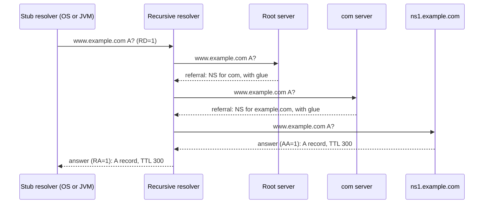

# DNS: Resolution, Caching, Records, and Security

DNS (Domain Name System) is the distributed database that maps names such as `www.example.com` to records: mostly IP addresses, but also mail servers, service ports, certificate rules, and protocol hints. Its core is specified in RFC 1034 (concepts) and RFC 1035 (implementation), which are Internet Standards (STD 13). Later RFCs update them: RFC 2181 clarifies the specification, including the TTL, RFC 2308 adds negative caching, and RFC 6891 adds EDNS(0). RFC 9499 is the current DNS terminology document (BCP 219, 2024). It obsoletes RFC 8499, and this page uses its terms.

## Why It Matters

"What happens when you type a URL in the browser?" always starts with DNS, and interviewers probe it: "Who answers first? What is cached where? Why can't a CNAME sit at the root of a domain? What does a TTL of 60 seconds change?" On the job, DNS is the cause of many incidents that do not look like DNS problems: a migration that half the users do not see for an hour, a service that keeps calling a server that was removed, a record that you created but a client reports as "not found", and a container that sends several useless queries for each lookup. A Java developer also owns a DNS cache of their own: the JVM caches lookups and does not read the TTL of the record. This page is the home of the DNS protocol in this KB. The design view (GeoDNS, anycast, failover, CDN) is on [load balancing, DNS, and CDN](../hld/fundamentals/02-load-balancing-dns-cdn.md). The TCP and UDP behavior that DNS depends on is on [TCP and UDP](03-tcp-and-udp.md).

## Core Concepts

**Domain name**: a sequence of labels that are separated by dots, read from the most specific label to the root. `www.example.com` has three labels: `www`, `example`, and `com`. The root has an empty label, so the full form is `www.example.com.` with a final dot. A label has at most 63 octets, and a name has at most 255 octets in the wire format (RFC 1035, section 2.3.4). This page writes names without the final dot, except where the dot matters.

**Name space**: the tree of all names. The root is at the top, the top-level domains (TLDs) such as `com` and `org` are below it, and each domain can have child domains. The tree is a naming hierarchy. It is also the delegation hierarchy: the owner of a domain decides which servers answer for its child domains.

**Resource record (RR)**: one entry of data. It has an owner name, a type (A, MX, and others), a class (`IN` for the Internet), a TTL, and type-specific data (RDATA). **RRset**: all records with the same owner name, class, and type. The records of an RRset must have the same TTL (RFC 2181, section 5.2).

**Zone**: a connected part of the name space that one administrative unit manages, stored as one set of records. A **domain** is a name and everything below it. A zone ends where the owner **delegates** a child domain to other servers: the parent zone then holds NS records for the child (RFC 1034, section 4.2). `example.com` can be one zone that holds `www.example.com`. If the owner delegates `eu.example.com`, that name and everything below it belongs to another zone.

**Authoritative server**: a server that holds the zone data and answers for it with the AA (Authoritative Answer) flag set. **Recursive resolver** (also called a caching resolver): a server that finds the answer for a client by asking other servers, and caches the result. **Stub resolver**: the small resolver in the client's operating system or library. It sends the question to a recursive resolver and waits for the final answer (RFC 1034, section 5.3.1). **Forwarder**: a resolver that sends its queries to another recursive resolver instead of contacting authoritative servers. RFC 9499 defines these terms. One program can have several roles, but each role has its own rules.

**Root servers**: the servers at the top of the tree. The root zone has 13 root server identities, named `a.root-servers.net` to `m.root-servers.net`. IANA lists the 13 and the 12 organizations that operate them (Verisign operates two). root-servers.org reports 2048 operational instances on 2026-11-05. The instances share the 13 addresses by anycast (one IP address, announced from many places). The count changes over time. A resolver does not look the root servers up in DNS: it starts with a built-in list, the **root hints**. IANA publishes the list as `named.root`, and the file is dated 2026-11-03 at the time of writing.

**Referral**: an answer from a server that does not hold the data but knows who does. It carries the NS records of the child zone in the authority section. **Glue**: the address records for those name servers, in the additional section. Glue is needed if the name server's name is inside the zone that it serves. `ns1.example.com` serves `example.com`, so a resolver cannot look the address up without already asking `example.com`. The parent zone therefore stores the address as glue, and uses it only in referrals (RFC 1034, section 4.2.1).

**TTL (time to live)**: the number of seconds that a cache may keep a record (RFC 1034, section 3.6). The field is a 32-bit unsigned number with a maximum of 2,147,483,647. A receiver treats a value with the highest bit set as 0 (RFC 2181, section 8).

**Negative answer**: a reply that says "there is no such data". **NXDOMAIN** (RCODE 3, "Name Error") means that the name does not exist. **NODATA** means that the name exists but has no record of the requested type. NODATA is not a code of its own. It is a reply with RCODE 0 (NOERROR) and an empty answer section (RFC 2308, sections 1 and 2.2). **SERVFAIL** (RCODE 2) means that the server could not process the query.

## How It Works

### The Resolution Walk for `www.example.com`

A browser or a JVM asks the stub resolver of the operating system for the address of `www.example.com`. The stub resolver sends one **recursive query** (the RD flag, "Recursion Desired", is set) to the configured recursive resolver. The recursive resolver does the work with **iterative queries**: it asks one server, and the server answers with the result or with a referral to a closer server. The resolver then asks the next server (RFC 1034, section 5.3.3). The walk below is for a resolver with an empty cache.



1. **Local information.** The stub resolver checks the `hosts` file and its own cache, if it has one. A program such as the JVM checks its own cache before that (see the JVM section).
2. **The recursive resolver checks its cache.** If it has the answer, it replies at once. The remaining steps run only on a cache miss.
3. **Find the best servers to ask.** The resolver looks for the longest known suffix of the name in its cache of NS records. In an empty cache that is the root, from the root hints (RFC 1034, section 5.3.3, step 2).
4. **Ask the root server.** The root servers hold the root zone, which delegates every TLD. They answer with a referral to the `com` name servers and the glue addresses.
5. **Ask a `com` server.** It answers with a referral to the name servers of `example.com`, with glue (`ns1.example.com` is inside `example.com`).
6. **Ask the authoritative server of `example.com`.** It holds the zone, so it answers with the A record and the AA flag.
7. **Cache and reply.** The resolver stores each record, including the NS and glue records from the referrals, for the TTL. It sends the answer to the stub resolver with the RA flag ("Recursion Available") set.

A resolver validates what it caches. It accepts data only from a server that is authoritative for that name or for a parent of it (RFC 5452, section 6). RFC 2181, section 5.4.1, ranks the data: data from an authoritative answer outranks additional data from a referral. The ranking prevents a server from placing records for names that it does not own into the cache.

A resolver that follows the minimal-disclosure rule of **QNAME minimisation** (RFC 9156, Proposed Standard) does not send the full name to every server. It asks the root for `com`, and the `com` server for `example.com`, so each server sees only the labels that it needs. This page describes the classic walk for clarity.

**Cost of a cold lookup (derived from the message flow).** The stub resolver sends one query. The recursive resolver sends up to three queries with an empty cache: root, TLD, and authoritative. Each query costs one round trip between the resolver and that server. In the root zone (the IANA copy with serial 2026110500) the NS records of `com` have a TTL of 172,800 seconds (2 days). The NS records for `com` are therefore already in the cache of a busy resolver, and the common cost of a cache miss is one query to the authoritative server.

### A CNAME in the Walk

If `www.example.com` is a CNAME for `cdn.example.net`, the authoritative server answers with the CNAME record. The resolver then restarts the walk for `cdn.example.net` and returns both records to the client. The second walk can go to completely different servers (here: `net`, then `example.net`), and each part has its own TTL. The Java example below shows this.

### Caching at Each Level

Each level between the application and the authoritative server can cache a record.

| Level | What caches | How long | Who controls it |
|---|---|---|---|
| Application | A browser, a JVM, a Go or Python library | The application decides. The JVM does not read the record's TTL (see below) | The developer |
| Operating system | A stub resolver with a cache, if the OS has one | The record's TTL, or an OS limit | The OS configuration |
| Local network | A home router or a company forwarder | The record's TTL, or its own limit | The network administrator |
| Recursive resolver | The resolver of the ISP, the company, or a public service | The record's TTL, counted down from the moment of the fetch. Operators can set a minimum or maximum | The resolver operator |
| Authoritative server | Not a cache: the source of the data | The zone sets the TTL | The zone owner |

A recursive resolver returns the **remaining** TTL, not the original one. A client that asks the resolver 100 seconds after the fetch of a record with TTL 300 receives TTL 200. A downstream cache that honors the TTL therefore does not hold the record longer than the original TTL. An application cache that ignores the TTL restarts the clock. A JVM that caches for 30 seconds can keep a record for up to the remaining TTL of the resolver plus 30 seconds (derived from the two rules). A resolver that has an expired record may serve it if it cannot reach the authoritative servers: RFC 8767 (Proposed Standard) allows this ("serve stale"). A resolver can also keep a record shorter than the TTL, for example when its cache is full.

The OS-level cache depends on the system. The `resolv.conf(5)` man page describes the search list, `ndots`, the timeout (default 5 seconds), and the number of attempts (default 2), and it does not describe a cache. A Linux host has an OS-level cache only if a caching daemon runs on it. Two such daemons exist: `systemd-resolved`, which `systemd-resolved.service(8)` describes as "a caching and validating DNS/DNSSEC stub resolver", and `nscd`, which caches the `hosts` database among others (`nscd(8)`). Do not assume that one runs: check the host.

### Negative Caching

A resolver also caches "no". RFC 2308 defines the rules:

- **What is cached.** A reply with NXDOMAIN, for the name and class (so the entry covers every type), or with NODATA, for the name, type, and class that were asked (RFC 2308, section 5).
- **For how long.** The authoritative server sends the SOA record of the zone in the authority section, and it sets the TTL of that record to the lower of the SOA's own TTL and the MINIMUM field (RFC 2308, section 3). The resolver caches the negative answer for that TTL (section 5). RFC 2308 redefined the MINIMUM field to mean exactly this negative TTL (section 4). The older meaning, the default TTL of the zone, moved to the `$TTL` directive of the zone file.
- **How long is sensible.** RFC 2308, section 5, says that values of one to three hours have worked well and that values above one day have been problematic.
- **Server failures.** A resolver may cache a SERVFAIL reply, and it must not cache one for longer than five minutes (RFC 2308, section 7.1).
- **Whole subtrees.** If a name does not exist, no name below it exists either. RFC 8020 ("NXDOMAIN cut") says that a resolver that holds NXDOMAIN for `a.example.com` should treat every name below it as nonexistent and answer NXDOMAIN for `b.a.example.com` without a query (section 2, a SHOULD). The RFC also lets a resolver keep serving cached data that it holds below the cut until that data expires, and lets a validating resolver apply the rule only to NXDOMAIN replies that it validated with DNSSEC. A name that has no record of its own but has children (an **empty non-terminal**) returns NODATA, not NXDOMAIN.

**The pitfall.** You deploy a new service, and someone queries `new.example.com` one minute before you create the record. Every resolver that saw the NXDOMAIN keeps it for the negative TTL, even after you add the record. The record is correct, and the error is a cache. The fix is to wait for the negative TTL, or to keep the SOA MINIMUM low (for example 60 to 300 seconds) on zones where you add records often.

### The JVM Cache

The JDK has its own name cache in front of the operating system. The sources: the `InetAddress` javadoc ("InetAddress Caching"), the comments in the `java.security` file of the JDK 21 installation (`conf/security/java.security`), and the class `sun.net.InetAddressCachePolicy` in OpenJDK.

| Property | What it controls | Default in JDK 21 |
|---|---|---|
| `networkaddress.cache.ttl` | Seconds that a successful lookup stays in the cache. `-1` means "cache forever". `0` means "do not cache" | "An implementation specific period of time" in the javadoc. OpenJDK uses 30 seconds if no security manager is installed. If a security manager is installed, the default is "forever" |
| `networkaddress.cache.negative.ttl` | Seconds that a failed lookup stays in the cache. `-1` means "cache forever". `0` means "never cache" | 10 seconds (the javadoc, and the active line in `java.security`) |
| `networkaddress.cache.stale.ttl` | Seconds that a name whose TTL has expired stays usable if a new lookup fails | 0: no stale names are used (the javadoc and `java.security`). The JDK 21 source of `InetAddressCachePolicy` reads this property only if the positive TTL is greater than 0 |

Facts that follow from these sources:

- **The JVM does not use the DNS TTL.** By default `InetAddress` calls the native resolver of the operating system (JEP 418). The native call returns addresses and no TTL. The JVM cache time is a setting of the JVM and is the same for each record. A record with TTL 5 stays 30 seconds in the JVM, and a record with TTL 3600 stays 30 seconds too.
- **The security manager condition.** The comments of `java.security` say that the default is "forever" for security reasons if a security manager is set, and 30 seconds if not. The JDK 21 javadoc describes the same condition. A security manager is rare in a modern service.
- **The properties are security properties, not system properties.** Set them in `java.security`, with `Security.setProperty` before the first lookup, or in a file that you give with `-Djava.security.properties=<file>` (the JDK enables this because `security.overridePropertiesFile=true`). A flag `-Dnetworkaddress.cache.ttl=10` does not set them. OpenJDK reads the system properties `sun.net.inetaddr.ttl`, `sun.net.inetaddr.negative.ttl`, and `sun.net.inetaddr.stale.ttl` as a fallback, which is an implementation detail and not an API.
- **A pooled connection does not look up again.** A connection pool keeps a socket to the old address until the connection closes. A DNS change reaches the application only when a new connection opens. Recommendation: set a maximum lifetime for pooled connections, and let the client reconnect on errors.
- **The JDK 21 header of the file warns about `-1`.** The comment says that setting a value other than the default "can have serious security implications", and the `-1` value keeps an address for the whole life of the JVM: if the service moves, the JVM does not follow.

The page [load balancing, DNS, and CDN](../hld/fundamentals/02-load-balancing-dns-cdn.md) states the same defaults. I checked them against the javadoc and against `java.security` of JDK 21.0.7 and they agree.

JEP 418 (delivered in JDK 18) adds a service-provider interface, `java.net.spi.InetAddressResolverProvider`, that lets you replace the resolver of `InetAddress` (for example with one that speaks the DNS protocol directly). Neither the JEP nor the javadoc says whether the `InetAddress` cache applies to a custom resolver. In the JDK 21 source (`java.net.InetAddress`, an implementation detail that can change), the cache sits in front of the resolver: `InetAddress` calls the system-wide resolver only on a cache miss, so the cache properties also apply to a custom resolver. The JEP states that it is not a goal to give an asynchronous resolution API.

### Record Types

| Type | Purpose | RDATA and notes |
|---|---|---|
| A | An IPv4 address | 32-bit address (RFC 1035) |
| AAAA | An IPv6 address | 128-bit address (RFC 3596, Internet Standard) |
| CNAME | An alias: the canonical name for this name | One target name. A CNAME must be the only record at its name (RFC 1034, section 3.6.2; RFC 2181, section 10.1). Exception: DNSSEC records |
| NS | The name servers of a zone or of a delegated child | One server name. At a delegation point the NS records are not authoritative data of the parent |
| SOA | The start of authority of a zone: one for each zone | MNAME (primary server), RNAME (the contact mailbox), SERIAL, REFRESH, RETRY, EXPIRE, MINIMUM (RFC 1035, section 3.3.13). MINIMUM is the negative-caching TTL (RFC 2308) |
| MX | A mail exchanger for a domain | A PREFERENCE (lower is preferred) and a server name that must not be an alias (RFC 1035; RFC 2181, section 10.3) |
| TXT | Free text | Used for domain ownership checks and email authentication records, among other uses |
| SRV | A server for a named service | `_service._proto.name TTL IN SRV priority weight port target` (RFC 2782). The client picks the lowest priority, and shares load among equal priorities by weight |
| CAA | The certificate authorities that may issue certificates for the name | Flags, a tag (`issue`, `issuewild`, `iodef`), and a value (RFC 8659). A CA must check it before it issues a certificate |
| PTR | The name for an address ("reverse DNS") | The record for `10.2.0.52` is at `52.0.2.10.in-addr.arpa` (RFC 1035, section 3.5). IPv6 uses `ip6.arpa` |
| HTTPS, SVCB | How to connect to a service: protocols, port, address hints, ECH keys | Type numbers 65 and 64 (RFC 9460). See the next section |
| DNSKEY, RRSIG, DS, NSEC | DNSSEC data | Type numbers 48, 46, 43, and 47 (RFC 4034). See the security section |

**Why a CNAME cannot sit at the zone apex.** The apex (the name of the zone itself, such as `example.com`) must hold the SOA and NS records of the zone. A CNAME at a name forbids every other record there. A CNAME at the apex would therefore conflict with SOA and NS, and it would also hide any MX record for the domain's mail. The rule comes from RFC 1034, section 3.6.2, and RFC 2181, section 10.1. The program below checks it.

**Workarounds for the apex.** There is no standard record that is "a CNAME at the apex". Providers add their own record types that behave like an alias but answer with A and AAAA records: the Route 53 *alias record* is an example (it can sit at the apex, with an A or AAAA type, and it is a Route 53 extension of DNS). Other providers call the feature *ANAME*, *ALIAS*, or *CNAME flattening*. The IETF draft `draft-ietf-dnsop-aname` is expired and did not become an RFC. The standard mechanism for web traffic is the HTTPS record in AliasMode (next section). Recursive resolvers see ordinary A records from such a provider, so the TTL and the failover behavior depend on the provider.

**CNAME rules to remember.**

- A CNAME applies to all types: a query for the A, AAAA, or MX record of an alias name follows the alias. A CNAME and an MX record cannot share a name.
- The target of an NS or MX record must not be an alias (RFC 2181, section 10.3).
- A chain of aliases costs one extra lookup for each hop, and a loop breaks the lookup. Resolvers limit the chain length.

### The HTTPS and SVCB Records

RFC 9460 (Proposed Standard, 2023) defines the **SVCB** record (service binding, type 64) and its HTTPS variant, the **HTTPS** record (type 65). They let a client learn how to connect to a service in the DNS answer, before the first connection. For HTTPS, they carry the protocols that the server supports, so that a browser can use HTTP/3 on its first visit. [HTTP](04-http.md) explains HTTP/3 and its other discovery method, the `Alt-Svc` header.

Presentation format: `owner TTL IN HTTPS SvcPriority TargetName SvcParams`. Two modes exist, set by the priority:

- **AliasMode** (priority 0): the record says "the service for this name is at another name". It is like a CNAME for the service, but it is a separate type, so it can sit at the zone apex beside SOA and NS. RFC 9460 shows `@ 7200 IN HTTPS 0 pool.svc.example.` for an apex (section 10.4.2).
- **ServiceMode** (priority 1 or higher): the record carries the connection parameters. Lower priorities are preferred. The TargetName `.` means "use the owner name of this record" (section 2.5.2). In the zone, a ServiceMode record with the TargetName `.` should not carry address hints, because they bring no benefit (section 7.3).

Parameters (SvcParamKeys, RFC 9460 section 14.3.2 and RFC 9848):

| Key | Number | Meaning |
|---|---|---|
| `mandatory` | 0 | A list of keys that the client must understand. If the client does not recognize one of them, it ignores the record (section 8) |
| `alpn` | 1 | The application protocols that the endpoint supports, for example `h3,h2` |
| `no-default-alpn` | 2 | Do not add the default protocol set to the `alpn` list. For HTTPS the default set is the single value `http/1.1` (sections 7.1 and 9). The key has an empty value, and `alpn` must also be present |
| `port` | 3 | The port to use. If the key is absent, the client uses the port of the origin |
| `ipv4hint` | 4 | IPv4 addresses that the client may use to connect (section 7.3). If the client already has the A and AAAA records of the TargetName, it should ignore the hints. Otherwise it should query for them and use the answers for later connections |
| `ech` | 5 | The Encrypted Client Hello configuration (RFC 9848). RFC 9849 defines ECH itself. See [TLS and HTTPS](05-tls-and-https.md) |
| `ipv6hint` | 6 | IPv6 addresses, as for `ipv4hint`. A zone that has `ipv4hint` should also have `ipv6hint` |

Example, as in the RFC (section 10.4.1): `@ 7200 IN HTTPS 1 . alpn=h3`. A client that reads this record knows that the server accepts HTTP/3 and can open a QUIC connection first. Because the default set is added, the same record also tells the client that HTTP/1.1 over TLS works. The record names no address, so the client still needs the A and AAAA records of the name. A recursive resolver that follows RFC 9460 (section 4) puts them into the additional section of the HTTPS answer. If the resolver does not, the client should send speculative A and AAAA queries in parallel with the HTTPS query, so that the record adds no round trip (section 5).

For HTTPS records, `port` and `no-default-alpn` are "automatically mandatory": a client must either implement them or ignore the record (section 9).

Other rules from RFC 9460:

- **Port prefix naming.** For `https://host:8443` the record is at `_8443._https.host`. For port 443 there is no prefix (section 9.1).
- **Upgrade from HTTP to HTTPS.** Before an `http` request, a client should look up the HTTPS record of the corresponding `https` name. If it finds an AliasMode record or a compatible ServiceMode record, it should behave as if it received a 307 (Temporary Redirect) to the `https` URL. A client trusts this signal no more than a 307 over cleartext HTTP (section 9.5).
- **Failure.** A client should fall back to a normal connection if it cannot use the record, unless an `ech` parameter forbids the fallback (RFC 9848).

### Message Format and Transport

A DNS message has a 12-byte header and four sections (RFC 1035, section 4.1).

| Part | Content |
|---|---|
| Header | ID (16 bits, copied from query to reply), flags, and four 16-bit counts |
| Question | The name, the type, and the class that the client asks for |
| Answer | The records that answer the question |
| Authority | NS records of a referral, or the SOA record of a negative answer |
| Additional | Extra records such as glue, and the EDNS OPT record |

Flags: QR (query or response), OPCODE (4 bits), AA, TC (truncated), RD, RA, a reserved bit, AD and CD (DNSSEC, RFC 4035), and RCODE (4 bits). The RCODE values from RFC 1035: 0 NOERROR, 1 FORMERR (format error), 2 SERVFAIL, 3 NXDOMAIN, 4 NOTIMP, and 5 REFUSED.

**Names in the wire format.** Each label has a length byte and the label bytes. A zero byte ends the name. A **compression pointer** (two bits set to 1, then a 14-bit offset) lets a name point back to an earlier name in the same message, so that repeated suffixes cost two bytes (RFC 1035, section 4.1.4).

**UDP and TCP.** A DNS server listens on port 53 for both UDP and TCP. UDP is the first choice: one query packet and one reply packet, and no connection setup. The limits:

- **512 bytes.** Without extensions the maximum size of a UDP message is 512 bytes (RFC 1035, section 4.2.1). If the answer does not fit, the server sets the **TC** (truncated) flag and sends what fits. The client then repeats the query over TCP (RFC 2181, section 9; RFC 7766, section 4).
- **TCP framing.** A DNS message over TCP has a two-byte length field in front of it (RFC 1035, section 4.2.2; RFC 7766). RFC 7766 requires that all general-purpose DNS implementations support both UDP and TCP, treats TCP as a full alternative and not only a retry, and recommends connection reuse and pipelining.
- **EDNS(0).** RFC 6891 (Internet Standard) adds an **OPT pseudo-record** to the additional section. In it, the client states the largest UDP payload that it accepts (in the CLASS field), an extended RCODE, a version, and flags, among them the **DO** bit ("DNSSEC OK"). A value below 512 counts as 512. RFC 6891 suggests 4096 bytes as a starting point, but large UDP messages are fragmented in the network, and fragments are lost or filtered more often than normal packets. Operators therefore lowered the default. DNS Flag Day 2020 recommends 1232 bytes, and RFC 9715 (Informational, 2025) recommends 1400 as the maximum payload. If the answer is larger than the advertised size, the server truncates and the client uses TCP.
- **Why this matters now.** DNSSEC answers carry signatures and keys, so they are larger than plain answers, and TCP fallback is more common than it was.

The second Java program in this page builds these bytes for a query.

### Security

**Threats.** The original protocol has no authentication and no encryption. An attacker can (1) forge an answer, so that a resolver caches a wrong record (**cache poisoning**), (2) read the queries on the network path, (3) change answers on the path, and (4) use open resolvers to amplify a flood (RFC 5358). The sections below cover the first three.

**Cache poisoning and the Kaminsky attack.** A resolver accepts the first reply that matches its query. The match rule uses the source and destination address, the destination port, the 16-bit query ID, and the question (RFC 5452, section 9.1). An attacker who does not see the query must guess the ID. CERT vulnerability note VU#800113 (first published on 2008-07-08, revised 2014-04-14) lists three weaknesses: the ID has only 16 bits, several identical outstanding queries make a "birthday attack" possible, and many implementations used a fixed or predictable source port. In 2008 Dan Kaminsky showed that a forged reply could do more than answer one name. CERT VU#800113 describes the result (forged information in the cache of a caching name server) but not the NS and glue steps. The steps below follow a contemporary report (Cory Wright, Linux Journal, 2008-07-25), which is a secondary source:

1. The attacker asks the victim resolver for a name that does not exist under the target domain, such as `a1b2.example.com`. The name is random, so it is never in the cache, and each attempt forces the resolver to send a query. Before this technique, the attacker had to wait for the TTL of a real record to expire before each new try.
2. The attacker floods the resolver with forged replies for that query. Each reply guesses a query ID. It contains, in the authority section, an NS record that makes the attacker's server the name server of `example.com`, and in the additional section a glue record with the attacker's address. These records are inside the domain of the query, so the in-domain check accepts them.
3. If one forged reply with the correct ID arrives before the real reply, the resolver caches the NS and glue records. It now sends all later queries for `example.com` to the attacker, until the NS record expires.

The CERT note states that source port randomization adds about 16 bits of unpredictability. The defenses:

- **Randomize the source port and the ID.** RFC 5452 requires an unpredictable ID over the full range (0 to 65535), an unpredictable source port from the available range, and several different source ports for several outstanding queries (section 9.2). With a random port per query, the port acts as an additional ID of up to 16 bits (section 4.5). The usable port range is smaller than 65,536, so the real gain is less than 16 bits.
- **Accept only in-domain data.** Do not cache records from a reply unless the sender is authoritative for them (RFC 5452, section 6; RFC 2181, section 5.4.1).
- **Fall back to TCP** if the resolver detects spoofing attempts. TCP has sequence numbers, so it is far more resilient against forgery by a third party (RFC 5452, section 9.3).
- **DNSSEC** (below). The CERT note says that these mitigations cannot completely prevent cache poisoning without protocol changes such as DNSSEC, and it quotes the ISC vendor statement: "The only solution to fully counter this sort of attack is to deploy DNSSEC".
- **NAT devices can reduce the randomness** of the source port: the CERT note says that a PAT (port address translation) device can reduce or eliminate the gain from source port randomization.

**DNSSEC.** DNS Security Extensions (RFC 4033, 4034, and 4035) add digital signatures to DNS data. The services are origin authentication, data integrity, and authenticated denial of existence. They do **not** provide confidentiality, and they do not protect against denial of service (RFC 4033, sections 1 and 4).

- **Records.** `RRSIG` (type 46) is the signature over an RRset. Its fields include the type covered, the algorithm, the original TTL, the signature inception and expiration times, the key tag, and the signer name. `DNSKEY` (type 48) is a public key of the zone. `DS` (type 43), stored in the **parent** zone, holds the key tag, the algorithm, the digest type, and a digest of the child's `DNSKEY`. `NSEC` (type 47) proves that a name or type does not exist by naming the next existing name. RFC 5155 defines `NSEC3`, which uses hashed names.
- **Keys.** A zone commonly has a **key signing key (KSK)** that signs the `DNSKEY` set, and a **zone signing key (ZSK)** that signs the other records. The split is an operational choice (RFC 4033, section 2): one key can do both jobs.
- **The chain of trust.** A validating resolver starts with a **trust anchor**: a configured key or `DS` for the root. The root zone signs the `DS` record of `com`. The `com` key signs the `DS` record of `example.com`. The `example.com` key signs the A record of `www.example.com`. Each link vouches for the next (RFC 4033, section 2, "authentication chain"). If the chain breaks, the data is "bogus".
- **What the resolver returns.** If validation fails, the data is **bogus** (RFC 4033, section 5: the resolver has a trust anchor and a secure delegation, but the response does not validate). A validating recursive resolver then returns RCODE 2 (SERVFAIL) to the client. It returns the full response only if the query had the CD (Checking Disabled) bit set (RFC 4035, section 5.5). A signature is valid only between its inception and expiration times (section 5.3.1). A signature that has expired fails validation. A `DS` record in the parent must match a `DNSKEY` of the child (same algorithm and key tag, and the digest of the key equals the digest in the `DS` record), and that key must sign the child's `DNSKEY` set (section 5.2). If it does not, the resolver cannot authenticate the child's keys. So a zone whose signatures expire, or whose `DS` record does not match its keys, becomes unreachable for clients that use a validating resolver. The failure looks like an outage of the name, not like a security alert.
- **The AD bit.** A validating resolver sets the AD ("Authenticated Data") bit in its reply. A stub resolver can use it as a hint, or it can validate itself (RFC 4033, section 7). A stub that trusts an unauthenticated network path to its resolver gets protection only as far as the resolver.
- **What it does not protect.** Queries and answers stay readable on the network. A signed record can still be wrong if the zone owner made a mistake or an account was taken over. DNSSEC does not secure the connection to the address that it returns (that is the job of TLS: see [TLS and HTTPS](05-tls-and-https.md)). A signed answer is also larger.

**Encrypted transports.** These protect the path between the client and its recursive resolver. They do not encrypt the lookups of the resolver to authoritative servers, and the resolver still sees every query.

| Protocol | RFC | Transport and port | Notes |
|---|---|---|---|
| DNS over TLS (DoT) | 7858 (Proposed Standard; RFC 8310 updates it) | TLS over TCP, port 853 | A server must accept TCP connections on port 853 (unless it agrees another port with its clients). The abstract says that TLS eliminates eavesdropping and on-path tampering with queries. RFC 7858 defines two usage profiles: opportunistic privacy and out-of-band key-pinned authentication. RFC 8310 defines the Strict Privacy and Opportunistic Privacy profiles |
| DNS over HTTPS (DoH) | 8484 (Proposed Standard) | HTTPS, a URI template that the client is configured with | The message type is `application/dns-message`. GET carries the query in a `dns` parameter in base64url, and POST carries it in the body. The HTTP freshness lifetime must not exceed the smallest TTL. HTTP/2 is the minimum recommended version. Clients should use DNS ID 0 so that equal queries are cacheable |
| DNS over QUIC (DoQ) | 9250 (Proposed Standard) | QUIC, UDP port 853 | One query for each QUIC stream. The DNS ID is 0. 0-RTT may carry only replayable transactions such as queries |

DoT has its own port, so a network operator can identify it by the port and block it. DoH uses the HTTPS default port 443. RFC 8484 (section 8.1) says that this port, and the option to mix DoH traffic with other HTTPS traffic on the same connection, can deter unprivileged on-path devices from interfering with DNS and make DNS traffic analysis more difficult. It does not say that DoH is invisible: the resolver name and address are still visible to the network. The JDK uses the native resolver of the operating system (JEP 418), so an application that uses `InetAddress` gets the DNS transport of the OS. Some applications contain their own DoH client and can bypass the OS setting. Firefox is one: its Trusted Recursive Resolver (TRR) sends DNS queries over DoH itself, and the Firefox documentation says that this bypasses the system DNS (see the Firefox source docs in Further Reading). Chrome has its own "Secure DNS" setting. For other products, check the documentation.

### DNS in Operations

**Choose the TTL before a migration.** A cache holds the old record until its TTL ends, so the old value can stay visible for up to the old TTL after you change it. Recommendation: lower the TTL to a short value (for example 60 seconds) at least one old TTL before the change, make the change, check, and then raise the TTL again. [Load balancing, DNS, and CDN](../hld/fundamentals/02-load-balancing-dns-cdn.md) gives the trade-off between a short and a long TTL.

**"Propagation" is cache expiry.** DNS does not push a change to the caches. Each cache drops the old record when its TTL ends. Two clients can see different answers for as long as the old TTL, plus the JVM or browser cache time. A change of the **name servers** is slower: the parent zone holds the NS and glue records, the registry operator sets their TTL, and your TTL does not apply to them. Check the TTL of the delegation in the parent zone before you plan a change of DNS provider.

**Zone transfers.** An operator runs several authoritative servers for one zone: one primary, and secondaries that copy the zone. A secondary compares the SOA SERIAL with the primary every REFRESH seconds, retries after RETRY seconds if the primary does not answer, and stops answering for the zone after EXPIRE seconds without contact (RFC 1035, section 3.3.13). The primary can send a NOTIFY message so that secondaries check at once (RFC 1996). The copy itself is a **zone transfer** over TCP: AXFR sends the whole zone (RFC 5936), and IXFR sends only the changes (RFC 1995). Restrict transfers to your secondaries, because a transfer reveals every name in the zone. A secondary that lags behind serves the old data, so a change reaches clients later than the TTL alone suggests.

**Split-horizon DNS.** The same name returns different answers inside and outside a network. An operator serves an internal view and an external view of a zone, for example `db.example.com` resolves to a private address only for clients inside the network. The costs: two sets of records to keep in sync, clients that use a public resolver while on a VPN and see the wrong view, and internal names that a resolver may leak.

**Service discovery with DNS.** An SRV record names the host and port of a service, so a client needs no fixed port. A name with several A records returns them in rotating order, which spreads load but does not check health (see the HLD page for the limits).

**Kubernetes DNS** (from "DNS for Services and Pods" in the Kubernetes documentation):

- A normal Service gets an A and AAAA record `my-svc.my-namespace.svc.cluster-domain.example` that resolves to the cluster IP.
- A headless Service (no cluster IP) resolves to the set of IPs of all the selected Pods. The client must pick one, or use round robin.
- A named port of a Service gets an SRV record `_port-name._port-protocol.my-svc.my-namespace.svc.cluster-domain.example`.
- The kubelet writes `/etc/resolv.conf` in each Pod with a `search` list (`<namespace>.svc.cluster.local svc.cluster.local cluster.local`) and `options ndots:5`.
- The default `dnsPolicy` is `ClusterFirst`: a query that does not match the cluster domain suffix goes to an upstream name server. The Pod `dnsConfig` field can change the nameservers, the search domains, and the options.

**The `ndots:5` effect.** The `ndots` option sets a threshold for the number of dots in a name (`resolv.conf(5)`, glibc). With the default of 1, a name that has at least one dot is tried as an absolute name first. With `ndots:5`, a name with fewer than five dots, such as `api.example.com` (two dots), is first tried with each search suffix: `api.example.com.<namespace>.svc.cluster.local`, then `api.example.com.svc.cluster.local`, then `api.example.com.cluster.local`, and only then as `api.example.com`. Each failed attempt is an NXDOMAIN query (and for A and AAAA, two). A Pod that calls an external API makes several useless queries for each new connection. Fixes: write the name with a final dot (`api.example.com.`), lower `ndots` in `dnsConfig.options` (the Kubernetes example uses `ndots` with value 2), or reuse connections. This is a derived explanation of the documented behavior: measure it in your cluster before you change a setting.

**Failure behavior.** The `resolv.conf(5)` defaults are a 5-second timeout and 2 attempts for each name server, so a dead resolver can delay a lookup by several seconds. A name server that answers SERVFAIL, a signature that expired, or a lame delegation (a listed name server that does not serve the zone) all appear in the application as a slow or failed `UnknownHostException`.

**GeoDNS and anycast.** DNS can answer with different addresses by the location or latency of the client, and root servers and public resolvers use anycast. Both have their home on [load balancing, DNS, and CDN](../hld/fundamentals/02-load-balancing-dns-cdn.md). Why there are 13 root server identities: the ICANN RSSAC FAQ (entry 1.1) explains that DNS messages over UDP are limited to 512 bytes, and that more root servers would have made the priming response (the answer to the query for the root NS records) larger than 512 bytes. Operators renamed the servers under `root-servers.net`, which lets name compression shorten the response, and added four servers in 1997 to reach 13. Anycast then let each identity run from many places: the FAQ reports more than 1500 instances, and root-servers.org reports 2048 on 2026-11-05.

## Trade-offs and When to Use

| Choice | Option A | Option B | Choose A when | Choose B when |
|---|---|---|---|---|
| Record TTL | Short (30 to 300 s) | Long (1 hour to 1 day) | You may need to switch the target fast (failover, entry points) | The record is stable, and you want fewer queries and resilience to a short provider outage |
| Name for a service | A or AAAA record | CNAME | You control the address and it is stable, or the name is the zone apex | The target is run by another party and its address changes (a CDN or a managed balancer), and the name is not the apex |
| Apex pointing to a managed service | Provider alias, ANAME, or CNAME flattening | HTTPS record in AliasMode | Every client type must reach the service (the A and AAAA answers work for all) | Only clients that read HTTPS records need the alias, as an addition to A and AAAA records |
| Transport of queries | UDP with EDNS(0) | TCP | Small answers, which is almost every query | The answer is truncated, the answer is large (DNSSEC), or a zone transfer |
| Client privacy | Plain DNS | DoT, DoH, or DoQ | You trust the network path, or a private network | The path is shared or untrusted. The resolver still sees the query |
| Integrity | No DNSSEC | DNSSEC | Your risk is low, and you want less operational work | You need protection against forged answers, and you can run key rollover and monitor signatures |
| Failover by DNS | Short TTL and health checks | Anycast or a load balancer in front | A region decision that can accept a delay of the TTL and the client cache | You need failover in seconds (see the HLD page) |
| JVM cache | The default (30 s) | An explicit TTL | A static dependency | The target changes (set 30 or 60 seconds explicitly, and check that no library sets `-1`) |

## Java Example

The first program is an iterative resolver over an in-memory set of zones. It does not open a socket and does not resolve a real name. It follows NS referrals from the root hints, accepts glue only from inside the zone of the server that sent it, follows a CNAME to another zone, and keeps a cache with TTLs on a simulated clock (`now`). It caches NXDOMAIN and NODATA for the negative TTL (the lower of the SOA TTL and the SOA MINIMUM). It also shows that an operator change is invisible until the cache entry expires. The addresses come from the documentation ranges, and the TTLs are values of this simulation. The method `cnameViolations` applies the CNAME rule that forbids an apex CNAME.

```java
import java.util.ArrayList;
import java.util.HashMap;
import java.util.LinkedHashMap;
import java.util.List;
import java.util.Map;

public class Main {
    record RR(String name, String type, int ttl, String data) {
        public String toString() {
            return name + " " + type + " " + ttl + " " + data;
        }
    }

    record Reply(String rcode, List<RR> answer, List<RR> authority, List<RR> additional) {}

    record Result(String rcode, List<RR> records, int queries) {}

    /** Names have no trailing dot. The root is the empty string. */
    static List<String> suffixes(String name) {
        List<String> out = new ArrayList<>();
        String s = name;
        while (!s.isEmpty()) {
            out.add(s);
            int dot = s.indexOf('.');
            s = dot < 0 ? "" : s.substring(dot + 1);
        }
        out.add("");
        return out;
    }

    static boolean inside(String name, String zone) {
        return zone.isEmpty() || name.equals(zone) || name.endsWith("." + zone);
    }

    /** An authoritative server for one zone. */
    static class Server {
        final String label;
        final String apex;
        final List<RR> records = new ArrayList<>();
        int soaMinimum;

        Server(String label, String apex, int soaMinimum) {
            this.label = label;
            this.apex = apex;
            this.soaMinimum = soaMinimum;
            add(apex, "SOA", 3600, "ns hostmaster 1 7200 900 1209600 " + soaMinimum);
        }

        void add(String name, String type, int ttl, String data) {
            records.add(new RR(name, type, ttl, data));
        }

        void replace(String name, String type, String data) {
            RR old = get(name, type).get(0);
            records.set(records.indexOf(old), new RR(name, type, old.ttl(), data));
        }

        List<RR> get(String name, String type) {
            return records.stream()
                .filter(r -> r.name().equals(name) && r.type().equals(type)).toList();
        }

        Reply query(String qname, String qtype) {
            for (String s : suffixes(qname)) {
                if (s.equals(apex)) {
                    break;
                }
                List<RR> ns = get(s, "NS");
                if (!ns.isEmpty()) {
                    List<RR> glue = new ArrayList<>();
                    ns.forEach(n -> glue.addAll(get(n.data(), "A")));
                    return new Reply("NOERROR", List.of(), ns, glue);
                }
            }
            List<RR> alias = get(qname, "CNAME");
            if (!alias.isEmpty() && !qtype.equals("CNAME")) {
                return new Reply("NOERROR", alias, List.of(), List.of());
            }
            List<RR> match = get(qname, qtype);
            if (!match.isEmpty()) {
                return new Reply("NOERROR", match, List.of(), List.of());
            }
            boolean exists = records.stream()
                .anyMatch(r -> r.name().equals(qname) || r.name().endsWith("." + qname));
            RR soa = get(apex, "SOA").get(0);
            RR negative = new RR(apex, "SOA", Math.min(soa.ttl(), soaMinimum), soa.data());
            return new Reply(exists ? "NOERROR" : "NXDOMAIN", List.of(), List.of(negative),
                List.of());
        }
    }

    /** RFC 1034 section 3.6.2 and RFC 2181 section 10.1: a CNAME owns its name alone. */
    static List<String> cnameViolations(List<RR> zone) {
        List<String> bad = new ArrayList<>();
        for (RR c : zone) {
            if (!c.type().equals("CNAME")) {
                continue;
            }
            for (RR other : zone) {
                if (other != c && other.name().equals(c.name())) {
                    bad.add(c.name() + " has CNAME and " + other.type());
                }
            }
        }
        return bad;
    }

    /** An iterative resolver with a TTL cache on a simulated clock. */
    static class Resolver {
        record Entry(long expires, String rcode, List<RR> rrs) {}

        record Start(String zone, List<String> addresses) {}

        final Map<String, Server> network;
        final Map<String, Entry> cache = new HashMap<>();
        long now;
        int sent;

        Resolver(Map<String, Server> network, List<RR> rootHints) {
            this.network = network;
            for (RR r : rootHints) {
                cache.put(r.name() + "/" + r.type(),
                    new Entry(Long.MAX_VALUE, "NOERROR", List.of(r)));
            }
        }

        private void store(String name, String type, int ttl, String rcode, List<RR> rrs) {
            cache.put(name + "/" + type, new Entry(now + ttl, rcode, rrs));
        }

        private Entry cached(String name, String type) {
            Entry e = cache.get(name + "/" + type);
            if (e == null || e.expires() <= now) {
                return null;
            }
            List<RR> aged = new ArrayList<>();
            for (RR r : e.rrs()) {
                int left = (int) Math.min(r.ttl(), e.expires() - now);
                aged.add(new RR(r.name(), r.type(), left, r.data()));
            }
            return new Entry(e.expires(), e.rcode(), aged);
        }

        private Start bestStart(String name) {
            for (String s : suffixes(name)) {
                Entry ns = cached(s, "NS");
                if (ns == null) {
                    continue;
                }
                List<String> addresses = new ArrayList<>();
                for (RR n : ns.rrs()) {
                    Entry a = cached(n.data(), "A");
                    if (a != null) {
                        a.rrs().forEach(r -> addresses.add(r.data()));
                    }
                }
                if (!addresses.isEmpty()) {
                    return new Start(s, addresses);
                }
            }
            throw new IllegalStateException("no server known");
        }

        Result resolve(String qname, String qtype) {
            int before = sent;
            String name = qname;
            List<RR> out = new ArrayList<>();
            for (int hop = 0; hop < 8; hop++) {
                Entry e = cached(name, qtype);
                if (e == null) {
                    e = cached(name, "CNAME");
                }
                if (e == null) {
                    e = iterate(name, qtype);
                }
                out.addAll(e.rrs());
                boolean alias = !e.rrs().isEmpty() && e.rrs().get(0).type().equals("CNAME");
                if (alias && !qtype.equals("CNAME")) {
                    name = e.rrs().get(0).data();
                    continue;
                }
                return new Result(e.rcode(), out, sent - before);
            }
            return new Result("SERVFAIL", out, sent - before);
        }

        private Entry iterate(String name, String type) {
            for (int step = 0; step < 10; step++) {
                Start start = bestStart(name);
                Server server = network.get(start.addresses().get(0));
                sent++;
                Reply r = server.query(name, type);
                System.out.println("  t=" + now + " ask " + server.label + " for " + name + " "
                    + type + " -> " + describe(r));
                if (r.answer().isEmpty() && !r.authority().isEmpty()
                    && r.authority().get(0).type().equals("NS")) {
                    String cut = r.authority().get(0).name();
                    if (cut.equals(start.zone()) || !inside(cut, start.zone())) {
                        return new Entry(now, "SERVFAIL", List.of());
                    }
                    store(cut, "NS", r.authority().get(0).ttl(), "NOERROR", r.authority());
                    for (RR g : r.additional()) {
                        if (inside(g.name(), start.zone())) {
                            store(g.name(), "A", g.ttl(), "NOERROR", List.of(g));
                        }
                    }
                    continue;
                }
                if (!r.answer().isEmpty()) {
                    Map<String, List<RR>> sets = new LinkedHashMap<>();
                    for (RR a : r.answer()) {
                        sets.computeIfAbsent(a.name() + "/" + a.type(), k -> new ArrayList<>())
                            .add(a);
                    }
                    sets.forEach((k, v) -> store(v.get(0).name(), v.get(0).type(),
                        v.get(0).ttl(), "NOERROR", v));
                    RR first = r.answer().get(0);
                    return cached(first.name(), first.type());
                }
                int ttl = r.authority().get(0).ttl();
                store(name, type, ttl, r.rcode(), List.of());
                return cached(name, type);
            }
            return new Entry(now, "SERVFAIL", List.of());
        }

        private static String describe(Reply r) {
            if (!r.answer().isEmpty()) {
                return "answer " + r.answer().get(0).type();
            }
            if (r.authority().isEmpty()) {
                return r.rcode();
            }
            RR a = r.authority().get(0);
            return a.type().equals("NS") ? "referral to " + a.name()
                : r.rcode() + " (negative TTL " + a.ttl() + ")";
        }
    }

    static void show(Resolver res, String name, String type) {
        System.out.println("t=" + res.now + " resolve " + name + " " + type);
        Result r = res.resolve(name, type);
        String kind = r.rcode().equals("NOERROR") && r.records().isEmpty() ? "NODATA" : r.rcode();
        System.out.println("  = " + kind + ", queries sent: " + r.queries());
        r.records().forEach(x -> System.out.println("    " + x));
    }

    public static void main(String[] args) {
        Server root = new Server("root", "", 86400);
        root.add("com", "NS", 172800, "ns.com-servers.test");
        root.add("ns.com-servers.test", "A", 172800, "198.51.100.2");
        root.add("net", "NS", 172800, "ns.net-servers.test");
        root.add("ns.net-servers.test", "A", 172800, "198.51.100.3");
        Server com = new Server("com", "com", 900);
        com.add("example.com", "NS", 172800, "ns1.example.com");
        com.add("ns1.example.com", "A", 172800, "198.51.100.4");
        Server net = new Server("net", "net", 900);
        net.add("example.net", "NS", 172800, "ns1.example.net");
        net.add("ns1.example.net", "A", 172800, "198.51.100.5");
        Server exampleCom = new Server("example.com", "example.com", 30);
        exampleCom.add("www.example.com", "CNAME", 300, "cdn.example.net");
        Server exampleNet = new Server("example.net", "example.net", 30);
        exampleNet.add("cdn.example.net", "A", 60, "192.0.2.10");

        Map<String, Server> network = new HashMap<>();
        network.put("198.51.100.1", root);
        network.put("198.51.100.2", com);
        network.put("198.51.100.3", net);
        network.put("198.51.100.4", exampleCom);
        network.put("198.51.100.5", exampleNet);
        List<RR> hints = List.of(
            new RR("", "NS", 0, "a.root-servers.test"),
            new RR("a.root-servers.test", "A", 0, "198.51.100.1"));
        Resolver res = new Resolver(network, hints);

        show(res, "www.example.com", "A");
        res.now = 10;
        show(res, "www.example.com", "A");
        res.now = 70;
        show(res, "www.example.com", "A");
        res.now = 80;
        exampleNet.replace("cdn.example.net", "A", "192.0.2.99");
        System.out.println("t=80 operator changes cdn.example.net to 192.0.2.99");
        res.now = 100;
        show(res, "www.example.com", "A");
        res.now = 131;
        show(res, "www.example.com", "A");
        res.now = 200;
        show(res, "nope.example.com", "A");
        res.now = 210;
        show(res, "nope.example.com", "A");
        res.now = 240;
        show(res, "nope.example.com", "A");
        show(res, "cdn.example.net", "AAAA");
        res.now = 241;
        show(res, "cdn.example.net", "AAAA");

        List<RR> badZone = List.of(
            new RR("example.org", "SOA", 3600, "ns hostmaster 1 7200 900 1209600 30"),
            new RR("example.org", "NS", 3600, "ns1.example.org"),
            new RR("example.org", "CNAME", 300, "lb.example.net"));
        System.out.println("zone check: " + cnameViolations(badZone));
    }
}
```

<!-- expected-output -->

```text
t=0 resolve www.example.com A
  t=0 ask root for www.example.com A -> referral to com
  t=0 ask com for www.example.com A -> referral to example.com
  t=0 ask example.com for www.example.com A -> answer CNAME
  t=0 ask root for cdn.example.net A -> referral to net
  t=0 ask net for cdn.example.net A -> referral to example.net
  t=0 ask example.net for cdn.example.net A -> answer A
  = NOERROR, queries sent: 6
    www.example.com CNAME 300 cdn.example.net
    cdn.example.net A 60 192.0.2.10
t=10 resolve www.example.com A
  = NOERROR, queries sent: 0
    www.example.com CNAME 290 cdn.example.net
    cdn.example.net A 50 192.0.2.10
t=70 resolve www.example.com A
  t=70 ask example.net for cdn.example.net A -> answer A
  = NOERROR, queries sent: 1
    www.example.com CNAME 230 cdn.example.net
    cdn.example.net A 60 192.0.2.10
t=80 operator changes cdn.example.net to 192.0.2.99
t=100 resolve www.example.com A
  = NOERROR, queries sent: 0
    www.example.com CNAME 200 cdn.example.net
    cdn.example.net A 30 192.0.2.10
t=131 resolve www.example.com A
  t=131 ask example.net for cdn.example.net A -> answer A
  = NOERROR, queries sent: 1
    www.example.com CNAME 169 cdn.example.net
    cdn.example.net A 60 192.0.2.99
t=200 resolve nope.example.com A
  t=200 ask example.com for nope.example.com A -> NXDOMAIN (negative TTL 30)
  = NXDOMAIN, queries sent: 1
t=210 resolve nope.example.com A
  = NXDOMAIN, queries sent: 0
t=240 resolve nope.example.com A
  t=240 ask example.com for nope.example.com A -> NXDOMAIN (negative TTL 30)
  = NXDOMAIN, queries sent: 1
t=240 resolve cdn.example.net AAAA
  t=240 ask example.net for cdn.example.net AAAA -> NOERROR (negative TTL 30)
  = NODATA, queries sent: 1
t=241 resolve cdn.example.net AAAA
  = NODATA, queries sent: 0
zone check: [example.org has CNAME and SOA, example.org has CNAME and NS]
```

Read the output in this order:

1. **t=0, cold cache.** Six queries: root, `com`, and `example.com` for the CNAME, and then root, `net`, and `example.net` for the target. The CNAME and the A record have separate TTLs (300 and 60).
2. **t=10.** No queries. The cache returns the remaining TTLs (290 and 50).
3. **t=70.** The A record (TTL 60) has expired and the CNAME (TTL 300) has not. The resolver already knows the `example.net` name server from the cached referral, so it sends one query and skips the root and `net`.
4. **t=80 and t=100.** The operator changes the address. The resolver still returns the old one, because its entry is valid until t=130. This is "propagation": the old value ends when the cache entry ends.
5. **t=131.** The new address appears.
6. **NXDOMAIN at t=200.** The SOA record of the zone has TTL 3600 and MINIMUM 30, so the negative TTL is 30. At t=210 the cache answers. At t=240 the entry has expired and a new query goes out.
7. **NODATA.** `cdn.example.net` exists but has no AAAA record. The reply is NOERROR with no records, and the resolver caches it under the AAAA type.
8. **The zone check** rejects a CNAME at the same name as the SOA and NS records.

The simulation leaves out things that a real resolver does: it takes only the first address of a server, it does not resolve name servers that have no glue, it does not retry or time out, it keys an NXDOMAIN entry by name and type (RFC 2308 keys it by name and class, and RFC 8020 extends it to the names below), and it does not validate DNSSEC.

The second program builds the bytes of a DNS query: the 12-byte header, the question, and the EDNS(0) OPT record. It prints the message in hexadecimal, so you can read the fields against RFC 1035 and RFC 6891.

```java
import java.io.ByteArrayOutputStream;
import java.util.HexFormat;

public class Main {
    static void u16(ByteArrayOutputStream out, int value) {
        out.write(value >> 8);
        out.write(value & 0xFF);
    }

    /** Builds a DNS query message (RFC 1035 section 4.1) with an optional OPT record. */
    static byte[] query(int id, String name, int qtype, boolean edns, boolean dnssecOk) {
        ByteArrayOutputStream out = new ByteArrayOutputStream();
        u16(out, id);
        u16(out, 0x0100);                 // QR=0, OPCODE=0, RD=1
        u16(out, 1);                      // QDCOUNT
        u16(out, 0);                      // ANCOUNT
        u16(out, 0);                      // NSCOUNT
        u16(out, edns ? 1 : 0);           // ARCOUNT
        for (String label : name.split("\\.")) {
            out.write(label.length());    // a label is at most 63 octets
            out.writeBytes(label.getBytes(java.nio.charset.StandardCharsets.US_ASCII));
        }
        out.write(0);                     // the root label ends the name
        u16(out, qtype);
        u16(out, 1);                      // QCLASS IN
        if (edns) {
            out.write(0);                 // OPT owner name: the root
            u16(out, 41);                 // TYPE OPT (RFC 6891)
            u16(out, 1232);               // CLASS field: requestor UDP payload size
            out.write(0);                 // TTL byte 1: extended RCODE
            out.write(0);                 // TTL byte 2: EDNS version
            u16(out, dnssecOk ? 0x8000 : 0); // TTL bytes 3-4: flags, DO is the first bit
            u16(out, 0);                  // RDLENGTH
        }
        return out.toByteArray();
    }

    static void show(String title, byte[] msg) {
        System.out.println(title + ": " + msg.length + " bytes");
        HexFormat hex = HexFormat.ofDelimiter(" ");
        for (int i = 0; i < msg.length; i += 16) {
            System.out.println("  " + hex.formatHex(msg, i, Math.min(i + 16, msg.length)));
        }
        int flags = ((msg[2] & 0xFF) << 8) | (msg[3] & 0xFF);
        System.out.println("  QR=" + (flags >> 15) + " RD=" + ((flags >> 8) & 1)
            + " QDCOUNT=" + msg[5] + " ARCOUNT=" + msg[11]);
    }

    public static void main(String[] args) {
        show("A www.example.com", query(0x1234, "www.example.com", 1, false, false));
        show("same with EDNS(0)", query(0x1234, "www.example.com", 1, true, false));
        show("same with EDNS(0) and DO", query(0x1234, "www.example.com", 1, true, true));
        byte[] https = query(0x1234, "example.com", 65, true, false);
        show("HTTPS example.com", https);
        System.out.println("TCP framing adds 2 length bytes: " + (https.length + 2) + " bytes");
    }
}
```

<!-- expected-output -->

```text
A www.example.com: 33 bytes
  12 34 01 00 00 01 00 00 00 00 00 00 03 77 77 77
  07 65 78 61 6d 70 6c 65 03 63 6f 6d 00 00 01 00
  01
  QR=0 RD=1 QDCOUNT=1 ARCOUNT=0
same with EDNS(0): 44 bytes
  12 34 01 00 00 01 00 00 00 00 00 01 03 77 77 77
  07 65 78 61 6d 70 6c 65 03 63 6f 6d 00 00 01 00
  01 00 00 29 04 d0 00 00 00 00 00 00
  QR=0 RD=1 QDCOUNT=1 ARCOUNT=1
same with EDNS(0) and DO: 44 bytes
  12 34 01 00 00 01 00 00 00 00 00 01 03 77 77 77
  07 65 78 61 6d 70 6c 65 03 63 6f 6d 00 00 01 00
  01 00 00 29 04 d0 00 00 80 00 00 00
  QR=0 RD=1 QDCOUNT=1 ARCOUNT=1
HTTPS example.com: 40 bytes
  12 34 01 00 00 01 00 00 00 00 00 01 07 65 78 61
  6d 70 6c 65 03 63 6f 6d 00 00 41 00 01 00 00 29
  04 d0 00 00 00 00 00 00
  QR=0 RD=1 QDCOUNT=1 ARCOUNT=1
TCP framing adds 2 length bytes: 42 bytes
```

Read it as follows: bytes 0 and 1 are the ID `12 34`. Bytes 2 and 3 are the flags `01 00`: only RD is set. The four counts follow. The name `3www7example3com0` starts at byte 12: each label has a length byte, and `00` ends the name. The type and class follow (`00 01 00 01` for A and IN, and `00 41` for type 65 in the HTTPS query). The OPT record is `00` (root name), `00 29` (type 41), `04 d0` (payload size 1232), `00 00` (extended RCODE and version), the flags (`80 00` if DO is set), and a zero RDLENGTH.

The next two classes use the real JDK APIs. They are not run, because they read the network configuration of the machine. The first one sets the cache properties. The second one uses the resolver SPI from JEP 418 to wrap the built-in resolver, for example to count the lookups that miss the `InetAddress` cache. A provider is found by the `ServiceLoader`: list its class name in `META-INF/services/java.net.spi.InetAddressResolverProvider`.

```java
import java.net.InetAddress;
import java.net.UnknownHostException;
import java.net.spi.InetAddressResolver;
import java.net.spi.InetAddressResolverProvider;
import java.security.Security;
import java.util.Arrays;
import java.util.List;
import java.util.concurrent.atomic.AtomicInteger;
import java.util.stream.Stream;

/** Not run: these classes touch the resolver of the machine. */
class JvmDnsSettings {
    /** Call before the first lookup of the JVM. */
    static void configureCacheTimes() {
        Security.setProperty("networkaddress.cache.ttl", "30");
        Security.setProperty("networkaddress.cache.negative.ttl", "5");
    }

    static List<String> addressesOf(String host) throws UnknownHostException {
        return Arrays.stream(InetAddress.getAllByName(host))
            .map(InetAddress::getHostAddress)
            .toList();
    }
}

/** Not run. Wraps the built-in resolver and counts the lookups that miss the cache. */
public class CountingResolverProvider extends InetAddressResolverProvider {
    static final AtomicInteger LOOKUPS = new AtomicInteger();

    @Override
    public InetAddressResolver get(Configuration configuration) {
        InetAddressResolver builtIn = configuration.builtinResolver();
        return new InetAddressResolver() {
            @Override
            public Stream<InetAddress> lookupByName(String host, LookupPolicy policy)
                    throws UnknownHostException {
                LOOKUPS.incrementAndGet();
                return builtIn.lookupByName(host, policy);
            }

            @Override
            public String lookupByAddress(byte[] address) throws UnknownHostException {
                return builtIn.lookupByAddress(address);
            }
        };
    }

    @Override
    public String name() {
        return "counting";
    }
}
```

## Interview Angle

### Questions

??? question "What happens when a Java service calls `InetAddress.getByName("api.example.com")`? Walk through the layers."

    The JVM checks its own name cache first. By default the `InetAddress` cache keeps a successful lookup for 30 seconds if no security manager is installed (`networkaddress.cache.ttl`, an implementation-specific default in the javadoc), and a failed lookup for 10 seconds. On a miss, the JDK calls the native resolver of the operating system (JEP 418). The OS checks the `hosts` file and its own cache, if it has one, and then sends a recursive query to the resolver in `resolv.conf` (or the OS equivalent), with the search list and the `ndots` rule applied.

    The recursive resolver checks its cache. On a miss it walks the tree: the root servers return a referral to `com`, the `com` servers return a referral to the name servers of `example.com` (with glue), and the authoritative server returns the A record with its TTL. The resolver caches every record and returns the answer with the remaining TTL.

    Trade-off to state: the JVM does not see the TTL of the record, so its cache time is a fixed setting. A record with a TTL of 5 seconds can stay 30 seconds in the JVM, and a pooled connection stays on the old address until it closes.

??? question "What is the difference between a recursive and an iterative query? Who does which?"

    In a recursive query the client asks the server to return the final answer or an error, and the server does the work. The stub resolver sends recursive queries (RD set) to the recursive resolver. In an iterative query the server answers with the best data it has: the answer, or a referral to servers that are closer to the name. The recursive resolver sends iterative queries to the root, the TLD, and the authoritative servers, and follows each referral.

    Authoritative servers do not have to offer recursion (RFC 1035 says that recursive support is optional). A recursive resolver that answers queries from any client on the Internet is an **open resolver**. Attackers use open resolvers to amplify a flood: the attacker sends a small query with the victim's source address, and the resolver sends a larger answer to the victim (RFC 5358, BCP 140). The practical rule from RFC 5358: a recursive resolver answers only its own clients, and an authoritative server answers only for its zones and does not offer recursion.

??? question "Why can't you put a CNAME record at the apex of a domain, and what do you do instead?"

    A CNAME means "this name is an alias for another name", so no other record may exist at that name (RFC 1034, section 3.6.2; RFC 2181, section 10.1). The apex of a zone must hold the SOA and NS records, and often MX and TXT records. A CNAME there would conflict with them and would redirect the mail too.

    Instead, I use an A and AAAA record with the addresses, or a provider feature that answers with A and AAAA records but is configured like an alias (a Route 53 alias record, ANAME, or CNAME flattening). These are not standard records, and their TTL and failover behavior belong to the provider. For web traffic, the standard solution is an HTTPS record in AliasMode (RFC 9460), which can sit at the apex. It does not replace the A and AAAA records for clients that do not read HTTPS records.

??? question "You change an A record, and some users still reach the old server an hour later. Why, and how do you plan the next change?"

    DNS has no push. Each cache holds the old record until its TTL ends, so the old address stays visible for up to the old TTL. Two more delays add to it: clients that cache longer than the TTL (the JVM caches for its own fixed time, a browser caches too), and open connections in pools that do not look up again. Resolvers may also serve stale data when they cannot reach the authoritative server (RFC 8767). If I changed the name servers at the registrar, the parent zone holds the NS and glue records with a TTL that the registry sets.

    The plan: lower the TTL at least one old TTL before the change (for example to 60 seconds), check that the short TTL is visible, make the change, keep the old target running until the old TTL plus the client cache times have passed, and then raise the TTL. For connection pools, set a maximum connection lifetime.

??? question "A new record exists in the zone, but one client keeps getting `NXDOMAIN`. What is the cause?"

    Negative caching. Someone queried the name before I created the record, and a resolver cached the NXDOMAIN answer (RFC 2308). It keeps it for the lower of the TTL of the zone's SOA record and the SOA MINIMUM field. RFC 2308 says that one to three hours work well and values above one day are problematic. A JVM caches a failed lookup for 10 seconds by default (`networkaddress.cache.negative.ttl`).

    I confirm by asking the authoritative server directly: it answers with the record, and the resolver answers NXDOMAIN with a TTL that counts down. The fix is to wait for the negative TTL, or to flush the cache of a resolver that I control. For the future: create records before anything queries them, and keep the SOA MINIMUM low (60 to 300 seconds) in zones where records are added often. Also note NODATA: the name may exist with other types, so the client asked for a type that does not exist. That case is also cached.

??? question "What is the difference between NXDOMAIN, NODATA, and SERVFAIL?"

    NXDOMAIN (RCODE 3) means that the name does not exist at all. RFC 8020 adds that nothing exists below it, so a resolver should answer NXDOMAIN for the whole subtree from its cache. NODATA is a NOERROR reply with an empty answer: the name exists but has no record of the type that was asked, for example an AAAA query for a name that has only an A record. SERVFAIL (RCODE 2) means that the server could not process the query: a broken zone, unreachable authoritative servers, or a failed DNSSEC validation.

    Caching differs. NXDOMAIN and NODATA are cached for the negative TTL from the SOA (RFC 2308). A SERVFAIL may be cached, and not for longer than five minutes. In an incident, SERVFAIL is the one that points to a server or DNSSEC problem, and NXDOMAIN points to a missing or wrong name.

??? question "How does the JVM cache DNS results, and how do you configure it for a service that fails over by DNS?"

    The `InetAddress` cache is controlled by the security properties `networkaddress.cache.ttl` (successful lookups), `networkaddress.cache.negative.ttl` (failed lookups, 10 seconds by default), and `networkaddress.cache.stale.ttl` (stale names, off by default). In OpenJDK the default for successful lookups is 30 seconds if no security manager is installed. With a security manager, the default is to cache forever. A value of -1 means "cache forever" and 0 means "do not cache".

    They are security properties, not system properties. I set them in `java.security`, in a file that I give with `-Djava.security.properties`, or with `Security.setProperty` before the first lookup. A `-Dnetworkaddress.cache.ttl` flag does not work. The JVM does not read the TTL of the record, because the JDK uses the native resolver, so the value is one setting for all names.

    For DNS failover I set an explicit TTL of 30 to 60 seconds (matching the record TTL), check that no library sets -1, set a maximum lifetime on pooled connections, and reconnect on errors. A JVM cache of 30 seconds adds to the TTL of the record in the worst case.

??? question "Why does DNS use UDP, and when does it use TCP?"

    A typical query is one small packet and one small answer. UDP avoids the handshake, so a lookup costs one round trip, and a server holds no state for each query. The cost is that UDP has no delivery guarantee, so the resolver retries on a timeout.

    DNS uses TCP when the answer does not fit in the UDP message. Without EDNS(0) the limit is 512 bytes (RFC 1035). The server sets the TC flag, and the client repeats the query over TCP, with a two-byte length field in front of the message. With EDNS(0) (RFC 6891) the client states a larger UDP size in the OPT record. Because large UDP messages are fragmented and fragments are often dropped, the common recommendations are 1232 bytes (DNS Flag Day 2020) or 1400 (RFC 9715). TCP is also used for zone transfers and by DoT. RFC 7766 requires every general-purpose implementation to support TCP. DNSSEC makes answers larger, so TCP is more important than before.

??? question "Explain the Kaminsky attack and how it was fixed."

    A resolver accepts a reply that matches its query on the addresses, the port, the 16-bit query ID, and the question. In 2008 (CERT VU#800113) the weak points were the small ID space and fixed source ports. Dan Kaminsky showed that the attacker can try again and again without waiting for a TTL: ask for random names under the target (`x1y2.example.com`) so that each query is a cache miss, and race forged replies. A forged reply answers the random name, and it carries an NS record and a glue record that name the attacker's server for `example.com`. If the ID matches, the resolver caches the delegation, and all of `example.com` goes to the attacker.

    The fix was source port randomization, which adds up to 16 bits of entropy to the 16-bit ID (RFC 5452), and unpredictable query IDs. Other defenses: only cache in-domain data, and fall back to TCP on suspected spoofing. The complete fix is DNSSEC, because it authenticates the data and not the path. NAT devices that rewrite ports can weaken the port randomization.

??? question "What does DNSSEC protect, and what does it not protect?"

    It protects the origin and the integrity of the DNS data, and it proves that a name or type does not exist (RFC 4033). Each zone signs its RRsets (`RRSIG`) with its keys (`DNSKEY`). The parent zone holds a `DS` record, a digest of the child's key. A validating resolver starts at a trust anchor (the root key) and follows `DS` and `DNSKEY` records down to the answer. A forged or modified answer fails validation, and the resolver returns SERVFAIL.

    It does not provide confidentiality (queries and answers stay readable), it does not protect against denial of service, and it does not protect the last hop if the stub resolver trusts an unauthenticated path to its resolver. It does not secure the connection to the server (that is TLS). It also adds operational risk: expired signatures or a `DS` record that does not match the key make the whole zone fail for validating resolvers. So I say: DNSSEC against forged answers, DoT or DoH against eavesdropping on the client path, TLS for the connection.

??? question "Compare DNS over TLS, DNS over HTTPS, and DNS over QUIC. What do they not protect?"

    All three encrypt the path between the stub resolver and the recursive resolver. DoT (RFC 7858) is DNS in TLS over TCP on port 853, which a network operator can see and block. DoH (RFC 8484) sends DNS messages as `application/dns-message` over HTTPS, with GET (base64url `dns` parameter) or POST, so the traffic uses port 443 and can share a connection with other HTTPS traffic (RFC 8484, section 8.1), and the HTTP stack, caching rules, and proxies apply. DoQ (RFC 9250) maps one query to one QUIC stream on UDP port 853, which avoids head-of-line blocking between queries.

    None of them hides the query from the resolver that you chose, and none of them encrypts the resolver's own queries to authoritative servers. They do not authenticate the data: for that you need DNSSEC. In Java, `InetAddress` uses the OS resolver, so DoT or DoH is configured in the OS (or in a browser that has its own client), not in `java.net`.

??? question "What are the HTTPS and SVCB records, and why do browsers query them?"

    RFC 9460 defines the SVCB record (type 64) and its HTTPS variant (type 65). They give the client connection information in the DNS answer, before the first connection: the protocols (`alpn`, for example `h3,h2`), a port, address hints, and the Encrypted Client Hello configuration (`ech`, RFC 9848). A browser that sees `alpn=h3` can try HTTP/3 over QUIC on the first visit, without the TCP connection and the `Alt-Svc` header that it would need otherwise (see the HTTP page).

    Two modes exist. In ServiceMode (priority 1 or higher), the record carries the parameters. In AliasMode (priority 0), it points to another name, like a CNAME for the service, and it is allowed at the zone apex because it is a separate type. The client still needs the A and AAAA records of the target: the resolver returns them in the additional section, or the client queries for them in parallel (RFC 9460, sections 4 and 5). A client that finds an HTTPS record for a name treats an `http` URL as a 307 redirect to `https` (section 9.5).

??? question "A Pod in Kubernetes calls an external API, and the DNS server shows many NXDOMAIN queries. What is happening?"

    The kubelet writes `options ndots:5` and a search list (`<namespace>.svc.cluster.local svc.cluster.local cluster.local`) into the `resolv.conf` of the Pod. A name with fewer than five dots, such as `api.example.com`, is tried first with each search suffix, and each attempt returns NXDOMAIN, and only then as the absolute name. For each lookup of the external name the resolver sends several useless queries (and two types, A and AAAA, double them).

    Fixes: use a name with a trailing dot (`api.example.com.`), lower `ndots` in the Pod `dnsConfig.options` (the Kubernetes documentation shows `ndots` with value 2 in its example), and reuse connections so that fewer lookups happen. I measure first, because the extra queries are small. I also remember that the JVM caches the result for 30 seconds.

??? question "Why are there 13 root servers, and how can that handle the load of the Internet?"

    There are 13 root server identities (`a.root-servers.net` to `m.root-servers.net`), operated by 12 organizations. The number comes from the 512-byte UDP limit of RFC 1035: more servers would have made the priming response larger than 512 bytes, and renaming the servers under one domain let name compression fit 13 (ICANN RSSAC FAQ, entry 1.1). Each identity is an anycast service: the same address is announced from many places, and root-servers.org reports 2048 operational instances on 2026-11-05.

    The load is small for two more reasons. Resolvers cache the delegation records of the TLDs (the `com` NS records have a TTL of 2 days in the root zone), so a busy resolver asks a root server rarely. A client does not look up root servers at all: every resolver ships with root hints (`named.root`).

### Follow-up Questions

??? question "How do you debug an intermittent `UnknownHostException` in production?"

    Find the layer. First, check the JVM cache settings and whether a library sets them. Second, check that the name resolves from the same host with the same resolver, and look at the time of the lookup: a slow lookup that ends in a failure points to a dead name server in `resolv.conf` (timeout 5 seconds, 2 attempts by default). Third, check the answer code: SERVFAIL points to an authoritative or DNSSEC problem, NXDOMAIN to a wrong name (or a search-list effect, such as `ndots`), and a timeout to the network or the resolver. Fourth, ask the authoritative servers directly, and compare all of them: a lame or out-of-sync server returns different answers for the same name. Record the result of each step. Do not rely on a dig result from a laptop to explain a server.

??? question "How would you design DNS-based failover for an API, and what are its limits?"

    Use health-checked records with a short TTL (30 to 60 seconds) and a provider with several anycast name servers. The limits are in the HLD page: resolvers and clients that ignore the TTL, the JVM cache, and pooled connections. A DNS failover takes at least the TTL, so for faster failover I put an anycast address or a load balancer in front and use DNS only for the region choice.

??? question "What is QNAME minimisation?"

    A privacy feature of the resolver (RFC 9156). Instead of sending the full name `www.example.com` to the root and TLD servers, the resolver sends only the labels that the server needs: `com` to the root, `example.com` to the `com` server. Root and TLD servers then do not learn the full name. It can cost extra queries.

??? question "Why does a DNS answer carry a TTL for each record, and why do all records of an RRset share one?"

    The owner of the data chooses how long a cache may keep it. Records of an RRset must have the same TTL (RFC 2181, section 5.2) because the set is the unit of caching and of DNSSEC signing: a resolver returns the whole set, or no part of it. If a client receives an RRset with different TTLs, RFC 2181 (section 5.2) says that it should treat this as an error. If the set came from a non-authoritative source, the client should ignore it and ask an authoritative source. If an authoritative source sent it, the client should treat all records as if they had the lowest TTL of the set.

### Red Flags

- "DNS propagation takes 24 to 48 hours." The delay is the TTL of the old records (and of the delegation, for a name server change). It is not a fixed time, and you control most of it.
- "Set the JVM property with `-Dnetworkaddress.cache.ttl`." It is a security property.
- "A CNAME at the apex is fine if the provider allows it." A real CNAME there breaks SOA, NS, and MX. The provider uses a different mechanism.
- "DNSSEC encrypts DNS" or "DoH makes DNS authentic". Mixing authentication with encryption.
- "There are only 13 root servers." There are 13 identities and about 2000 instances.
- "DNS round robin is a load balancer." See the HLD page.
- "Failover by DNS is instant", or no mention of the TTL, the JVM cache, and pooled connections.
- "The resolver asks the root server for every lookup." It caches the delegations.

## Common Mistakes

| Mistake | Effect | Fix |
|---|---|---|
| Changing a record without lowering the TTL first | Users see the old value for the old TTL | Lower the TTL one old TTL ahead, then change, then raise it |
| Leaving `networkaddress.cache.ttl` at -1, or running with a security manager that makes it "forever" | The JVM keeps an old address until restart | Set an explicit TTL (30 to 60 s) and test it |
| Setting the cache property with `-D` | No effect | `java.security`, `-Djava.security.properties`, or `Security.setProperty` before the first lookup |
| A connection pool with no maximum lifetime | Connections stay on removed servers | Set a maximum lifetime and reconnect on errors |
| A CNAME and other records on the same name | The zone is invalid, or answers differ | One CNAME alone, or A and AAAA records. Use a provider alias or an HTTPS AliasMode record at the apex |
| An NS or MX record that points to a CNAME | Extra lookups, or a failed delivery | Point to a name that has A and AAAA records (RFC 2181, section 10.3) |
| A name server inside the zone that it serves, with no glue at the parent | The zone cannot be resolved | Register the glue records at the registrar |
| Testing a new name before the record exists | The NXDOMAIN is cached for the negative TTL | Create the record first. Keep the SOA MINIMUM low where you add records often |
| DNSSEC with expired signatures or a stale `DS` record after a provider change | The zone fails at validating resolvers | Automate signing and key rollover. Remove or update the `DS` record before you change the provider. Monitor signature expiry |
| `ndots:5` with external names in a Pod | Several NXDOMAIN queries per lookup | A trailing dot, a lower `ndots`, and connection reuse |
| One DNS provider with one set of name servers | The provider outage makes the service unreachable | A second provider, or one with anycast (see the HLD page) |
| Treating one `dig` result as the state of the world | The result depends on the resolver and its cache | Ask the authoritative servers and the resolvers of the affected clients |

## Commonly Confused With

| Looks like | Difference | Deciding question |
|---|---|---|
| A record vs CNAME | A maps a name to an address. CNAME maps a name to another name, and no other record may share its name | Is the target a name that another party controls? |
| CNAME vs ALIAS, ANAME, or flattening | CNAME is a standard record visible to resolvers. The others are provider features that return A and AAAA records | Is the name the zone apex? |
| CNAME vs HTTPS AliasMode | CNAME aliases the name for all types. AliasMode aliases only the service (for clients that read HTTPS records), and it is a separate type | Does a client need only a service endpoint, and is the name an apex? |
| Recursive resolver vs authoritative server | A recursive resolver finds answers and caches them. An authoritative server holds a zone | Does it hold the zone, or does it ask others? |
| Stub resolver vs recursive resolver | The stub resolver sits in the client and sends one recursive query. The recursive resolver walks the tree | Does it send the iterative queries? |
| Recursive vs iterative query | Recursive: the server finds the final answer. Iterative: the server returns what it knows or a referral | Who does the walk? |
| NXDOMAIN vs NODATA vs SERVFAIL | NXDOMAIN: the name does not exist. NODATA: the name exists without that type. SERVFAIL: the server failed | Did the server answer "no", or fail to answer? |
| Record TTL vs JVM cache time | The record TTL is set by the zone. The JVM cache time is a JVM setting that ignores the TTL | Which cache holds the value now? |
| DNS propagation vs cache expiry | There is no push. Old values end when caches expire | When was the old TTL fetched? |
| DNSSEC vs DoT, DoH, DoQ | DNSSEC authenticates the data. The others encrypt the path to the resolver | Is the threat a forged answer or an eavesdropper? |
| HTTPS record vs `Alt-Svc` | The record is read before the first connection. `Alt-Svc` is learned from a response | Is the first visit already on HTTP/3? |
| SRV vs A record | SRV gives host, port, priority, and weight of a service. A gives an address | Does the client need the port or the priority? |
| Registrar vs DNS host | The registrar holds the registration and the delegation at the parent. The DNS host serves the zone | Where is the NS record set, and who serves it? |
| Root hints vs root zone | Root hints are the list of root server addresses in a resolver. The root zone is the data they serve | Is it the starting list or the content? |

## Quick Reference Card

- **Walk:** stub resolver -> recursive resolver -> root -> TLD -> authoritative. Referrals carry NS and glue. A busy resolver skips the first two steps from its cache.
- **TTL:** seconds, 32 bits, maximum 2,147,483,647. A cache returns the remaining TTL. An RRset has one TTL.
- **Negative cache:** the lower of the SOA TTL and the SOA MINIMUM (RFC 2308). NXDOMAIN: no name. NODATA: no type. SERVFAIL: cached at most 5 minutes.
- **JVM:** `networkaddress.cache.ttl` (30 s in OpenJDK without a security manager, forever with one, -1 forever), `networkaddress.cache.negative.ttl` (10 s), `networkaddress.cache.stale.ttl` (0). Security properties, not `-D` flags. The JVM ignores record TTLs.
- **CNAME:** alone at its name, so never at the apex. NS and MX targets are not aliases.
- **Records:** A, AAAA, CNAME, NS, SOA, MX, TXT, SRV, CAA, PTR, HTTPS (65), SVCB (64).
- **Transport:** UDP and TCP on port 53. 512 bytes without EDNS. EDNS(0) OPT record. TC flag, then TCP with a two-byte length. 1232 or 1400 bytes as the EDNS size.
- **Kaminsky:** forged referral and glue for random names. Defense: random ID and source port (RFC 5452), in-domain checks, DNSSEC.
- **DNSSEC:** RRSIG, DNSKEY, DS, NSEC. Authenticity and integrity, no confidentiality, no DoS protection.
- **DoT:** port 853, TCP. **DoH:** HTTPS, `application/dns-message`. **DoQ:** UDP port 853, one query for each stream.
- **Migration:** lower the TTL one old TTL ahead, change, check, raise. "Propagation" is cache expiry.
- **Kubernetes:** `svc.cluster.local` names, headless services return all Pod IPs, `ndots:5` adds search-list queries.
- **Root:** 13 identities, 12 organizations, 2048 anycast instances (2026-11-05, root-servers.org).

## Further Reading

- [RFC 1034](https://www.rfc-editor.org/rfc/rfc1034) and [RFC 1035](https://www.rfc-editor.org/rfc/rfc1035): the core DNS specification (Internet Standard, STD 13). The name space, zones, the resolution algorithm, and the message format.
- [RFC 2181](https://www.rfc-editor.org/rfc/rfc2181): clarifications, including the TTL, RRsets, CNAME rules, and data ranking.
- [RFC 2308](https://www.rfc-editor.org/rfc/rfc2308): negative caching and the meaning of the SOA MINIMUM field.
- [RFC 8020](https://www.rfc-editor.org/rfc/rfc8020): NXDOMAIN and the empty subtree. [RFC 8767](https://www.rfc-editor.org/rfc/rfc8767): serving stale data.
- [RFC 6891](https://www.rfc-editor.org/rfc/rfc6891): EDNS(0) and the OPT record. [RFC 7766](https://www.rfc-editor.org/rfc/rfc7766): DNS over TCP. [RFC 9715](https://www.rfc-editor.org/rfc/rfc9715): avoiding IP fragmentation. [DNS Flag Day 2020](https://www.dnsflagday.net/2020/): the 1232-byte recommendation.
- [RFC 5452](https://www.rfc-editor.org/rfc/rfc5452): resilience against forged answers, source port and ID randomization. [CERT VU#800113](https://www.kb.cert.org/vuls/id/800113): the primary advisory for the 2008 cache poisoning weaknesses. Cory Wright, [Understanding Kaminsky's DNS Bug](https://www.linuxjournal.com/content/understanding-kaminskys-dns-bug), Linux Journal, 2008: a secondary description of the steps of the attack.
- [RFC 4033](https://www.rfc-editor.org/rfc/rfc4033), [RFC 4034](https://www.rfc-editor.org/rfc/rfc4034), and [RFC 4035](https://www.rfc-editor.org/rfc/rfc4035): DNSSEC. [RFC 5155](https://www.rfc-editor.org/rfc/rfc5155): NSEC3.
- [RFC 7858](https://www.rfc-editor.org/rfc/rfc7858) (DoT), [RFC 8310](https://www.rfc-editor.org/rfc/rfc8310) (DoT profiles), [RFC 8484](https://www.rfc-editor.org/rfc/rfc8484) (DoH, section 8 on privacy), and [RFC 9250](https://www.rfc-editor.org/rfc/rfc9250) (DoQ): encrypted DNS transports. [Firefox: DNS over HTTPS (Trusted Recursive Resolver)](https://firefox-source-docs.mozilla.org/networking/dns/dns-over-https-trr.html): a browser with its own DoH client. [RFC 5358](https://www.rfc-editor.org/rfc/rfc5358) (BCP 140): open resolvers and reflector attacks. RFC 5936, 1995, and 1996: zone transfer, IXFR, and NOTIFY.
- [RFC 9460](https://www.rfc-editor.org/rfc/rfc9460): SVCB and HTTPS records. [RFC 9848](https://www.rfc-editor.org/rfc/rfc9848): the `ech` parameter. [RFC 9849](https://www.rfc-editor.org/rfc/rfc9849): Encrypted Client Hello.
- [RFC 8659](https://www.rfc-editor.org/rfc/rfc8659) (CAA), [RFC 2782](https://www.rfc-editor.org/rfc/rfc2782) (SRV), [RFC 3596](https://www.rfc-editor.org/rfc/rfc3596) (AAAA), [RFC 9156](https://www.rfc-editor.org/rfc/rfc9156) (QNAME minimisation, Proposed Standard, obsoletes the Experimental RFC 7816).
- [RFC 9499](https://www.rfc-editor.org/rfc/rfc9499): DNS terminology (BCP 219). It obsoletes RFC 8499.
- [IANA root servers](https://www.iana.org/domains/root/servers), [root-servers.org](https://root-servers.org/), and the [ICANN RSSAC FAQ](https://www.icann.org/groups/rssac/faq): the 13 identities, the instance count, and why there are 13.
- [`InetAddress` javadoc, "InetAddress Caching"](https://docs.oracle.com/en/java/javase/21/docs/api/java.base/java/net/InetAddress.html) and the `conf/security/java.security` file of the JDK: the JVM cache properties and their defaults. [JEP 418](https://openjdk.org/jeps/418): the resolver SPI (JDK 18).
- [Kubernetes: DNS for Services and Pods](https://kubernetes.io/docs/concepts/services-networking/dns-pod-service/): Service and Pod records, `dnsPolicy`, `dnsConfig`. [resolv.conf(5)](https://man7.org/linux/man-pages/man5/resolv.conf.5.html): `ndots`, the search list, timeout, and attempts.
- Related pages: [TCP and UDP](03-tcp-and-udp.md), [HTTP](04-http.md), [TLS and HTTPS](05-tls-and-https.md), [load balancing, DNS, and CDN](../hld/fundamentals/02-load-balancing-dns-cdn.md), [multi-region and disaster recovery](../hld/fundamentals/19-multi-region-and-disaster-recovery.md), [web crawler](../hld/case-studies/08-web-crawler.md), and [What Happens When You Load a URL](07-what-happens-when-you-load-a-url.md).
