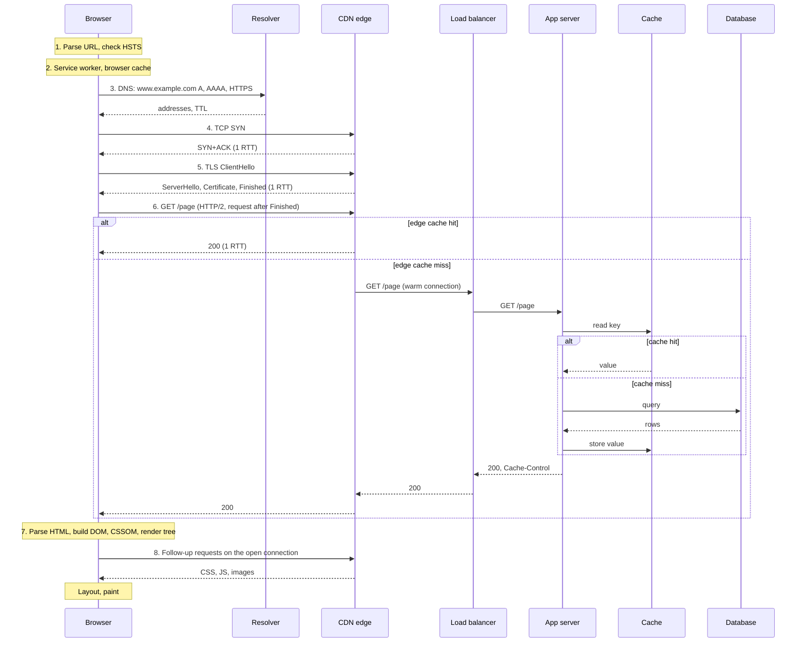

# What Happens When You Load a URL

You type `https://www.example.com/page` and press Enter. The browser parses the URL, checks its security policy and its caches, resolves the name, opens a connection, secures it, sends a request, and receives a response that crosses a CDN, a load balancer, an application server, a cache, and a database on the way. It then builds the page and sends more requests. This page walks through each step in order. It gives the round-trip cost of each step, summarizes the step in a few sentences, and links to the page of this KB that explains the step. It does not repeat those pages.

## Why It Matters

"What happens when you type a URL into the browser and press Enter?" is the most common open question in backend, full-stack, and system design interviews. It tests breadth (DNS, TCP, TLS, HTTP, load balancing, caching, rendering) and depth (the interviewer picks one step and keeps asking). A candidate who knows each step and its cost in round trips can also answer the questions that follow: why the first request is slow, what a CDN saves, why HSTS exists, what a connection pool saves, and where to look when a page is slow. On the job, the same path is the map for a latency investigation. Each step has its own timer in the browser's developer tools, and each step has a different owner: the DNS provider, the network team, the CDN configuration, the application, or the front-end code.

## Core Concepts

**Round trip time (RTT)**: the time for a message to reach a peer and for the answer to come back. This page counts cost in round trips, because on a small request the network delay decides the time, not the bandwidth. See [TCP and UDP](03-tcp-and-udp.md) for how RTT limits TCP.

**Cold and warm**: a **cold** request pays every setup step: a DNS lookup, a connection, and a TLS handshake. A **warm** request finds the DNS answer in a cache and sends the request on a connection that is already open.

**Time to first byte (TTFB)**: the time from the start of the request until the first byte of the response arrives. This page counts the time before the first response byte and ignores the time to transfer the rest of the body.

**URL**: the address of a resource. `https://www.example.com/page` has the scheme `https`, the host `www.example.com`, no explicit port, and the path `/page`. The URL Standard of WHATWG defines how a browser parses a URL.

**Origin**: the triple of scheme, host, and port. The browser opens connections and applies security rules for each origin.

**Browser cache (HTTP cache)**: a private cache in the browser that stores responses and reuses them by the rules of RFC 9111. [HTTP](04-http.md) owns those rules.

**Service worker**: a script that the page registers for a scope of URLs. The script can answer a request from its own cache or from code, before the browser uses the network (W3C Service Workers).

**HSTS (HTTP Strict Transport Security)**: a policy that tells the browser to use only HTTPS for a host. RFC 6797 defines it. [TLS and HTTPS](05-tls-and-https.md) owns the header details.

**CDN edge**: a cache server of a content delivery network, near the user. **Origin**: the server that holds the source content. The design view is on [load balancing, DNS, and CDN](../hld/fundamentals/02-load-balancing-dns-cdn.md).

**Critical rendering path**: the sequence of steps that turns HTML, CSS, and JavaScript into pixels (MDN).

## How It Works

The overview diagram shows the whole path for a cold request that misses every cache. Each section after it explains one step. The diagram uses these names: the **Browser** includes its caches and its service worker, **Resolver** is the recursive resolver, **Edge** is the CDN edge, **LB** is the load balancer, **App** is the application server, and **Cache** and **DB** are the data tier.



### Step 1: URL parsing and the HSTS check

**What happens.** The browser parses the text into a URL record. The WHATWG URL Standard defines the parser: the scheme `https` is a *special scheme* (the list is `ftp`, `file`, `http`, `https`, `ws`, `wss`), the host is a domain, and the default port of `https` is 443, so the parser stores the port as null. A host with non-ASCII characters goes through IDNA processing and becomes ASCII with Punycode (`faß.example` becomes `xn--fa-hia.example`). The parser percent-encodes characters in the path that a URL cannot hold. Browsers also decide whether typed text is a URL or a search query, and which scheme to assume when the user types no scheme. Those two decisions belong to the browser UI, not to the URL Standard, and they differ between browsers.

The browser then checks its HSTS list. If the host is a known HSTS host (a host that sent `Strict-Transport-Security` earlier, or a host on the preload list), the browser rewrites an `http` URL to `https` before it sends anything. RFC 6797 section 8.3 requires this: "The UA MUST replace the URI scheme with "https"", and an explicit port 80 becomes 443. The Fetch Standard puts this step in its main fetch algorithm, before the request goes to HTTP fetch. The same step also upgrades the scheme if DNS resolution finds a matching HTTPS record (see step 3). The Fetch Standard says that how a browser finds the HTTPS record is implementation-defined, and that a browser may do the DNS work earlier or undo the upgrade later. For a known HSTS host, a TLS error ends the connection and the user cannot click through the warning (RFC 6797 section 8.4).

**Cost.** Zero round trips. The browser decides locally. The HSTS check matters for cost because it removes a whole connection: without HSTS, a user who types `http://www.example.com` pays a TCP handshake and a request to port 80 to receive a `301` or `308` redirect, and then pays for the full HTTPS path. Scenario 10 in the Java example shows 2 extra round trips for this redirect (a TCP handshake, then the request and the redirect response).

**Home page.** HSTS header details, the preload list, and the first-visit gap: [TLS and HTTPS](05-tls-and-https.md).

### Step 2: The service worker and the browser cache

**What happens.** Before the browser uses the network, it looks for a stored answer. The order follows the Fetch Standard and the Service Workers specification:

1. **Service worker.** If a service worker is registered for a scope that matches the URL, the browser fires a `fetch` event in it. The worker can answer from its own storage, from code, or from the network. If the worker does not call `respondWith()`, the "Handle Fetch" algorithm returns null (or a network error if the handler called `preventDefault()`), and the HTTP fetch algorithm of the Fetch Standard continues with its normal path: the HTTP cache and then the network (MDN: `respondWith()` "prevents the browser's default fetch handling"). HTTP fetch calls "handle fetch" before the cache lookup of HTTP-network-or-cache fetch.
2. **HTTP cache.** The "HTTP-network-or-cache fetch" algorithm of the Fetch Standard looks up a stored response in the HTTP cache, unless the cache mode is `no-store` or `reload`. A fresh entry goes to the page with no network use. A stale entry with a validator (`ETag` or `Last-Modified`) causes a conditional request, and a `304` answer renews the stored entry. Under `stale-while-revalidate`, a cache that supports it returns the stale entry and revalidates in the background. [HTTP](04-http.md) owns these rules.
3. **Network.** If no earlier step produced a response, the request goes to the network (step 3 and later).

**Browser-specific behavior.** Chrome partitions its HTTP cache. Since Chrome 86 the cache key is the top-frame site, the frame site, and the resource URL, so a resource that another site cached does not count as a hit (Chrome blog, "Gaining security and privacy by partitioning the cache"). That article reports that the overall miss rate rises by about 3.6%. The same article lists Safari as keyed on the top-level site only. The article is from 2020, so check each browser's current documentation before you state its cache key in an interview. The Fetch Standard defines cache modes (`default`, `no-store`, `reload`, and others) for a request. A user's reload action maps to a mode in a browser-specific way, so this page makes no claim about it.

**Cost.** Zero round trips on a hit. A fresh entry in the browser cache is the fastest answer of the whole path, and it is the reason that `Cache-Control: max-age` on fingerprinted files has a large effect. A conditional request costs one round trip to the cache that holds the entry (an origin or a CDN) and sends no body when the answer is `304`.

**Home pages.** Cache rules and headers: [HTTP](04-http.md). Cache placement in a design: [caching](../hld/fundamentals/03-caching.md).

### Step 3: DNS resolution

**What happens.** The browser needs an IP address for `www.example.com`. It checks its own host cache and the operating system, and then asks the stub resolver, which sends one recursive query to the configured recursive resolver. A resolver with an empty cache asks the root server, a `com` server, and the authoritative server of `example.com`, with iterative queries. Every level can cache the answer for the TTL of the record. A browser that supports the `HTTPS` record sends a query for it next to the A and AAAA queries (one query for each record type, not one combined query, and support differs by browser and resolver): its `alpn` parameter (for example `alpn="h3,h2"`) lets the browser start with HTTP/3 on the first visit. For a Java client, the JVM has its own name cache (30 seconds by default in JDK 21 when no security manager is installed), and it does not use the record's TTL.

**Cost.** The stub resolver costs 1 round trip to the recursive resolver, which is usually close. If the resolver has the answer, that is all. If the resolver must ask the authoritative server, add one round trip to it per query. A resolver with an empty cache sends up to three queries (root, TLD, authoritative). The NS records of `com` have a TTL of 172,800 seconds (2 days), so on a busy resolver the common cost of a miss is one query to the authoritative server ([DNS](06-dns.md)). The Java example assumes 10 ms to the resolver and 30 ms from the resolver to the authoritative server (assumptions, not measurements). A cached answer costs no round trip.

**Home page.** The resolution walk, TTL and negative caching, record types, and the JVM cache: [DNS](06-dns.md). GeoDNS, anycast, and DNS failover in a design: [load balancing, DNS, and CDN](../hld/fundamentals/02-load-balancing-dns-cdn.md).

### Step 4: The transport handshake

**What happens.** HTTP/1.1 and HTTP/2 run on TCP. The client sends a SYN, the server answers with SYN+ACK, and the client sends an ACK, and may put its first data in that segment. The client knows that the connection is established after 1 RTT. HTTP/3 runs on QUIC over UDP, and QUIC combines this step with the TLS handshake (step 5). The browser decides which one to use from the `HTTPS` DNS record or from an earlier `Alt-Svc` header. If QUIC fails or is too slow, the browser falls back to TCP (the fallback logic is a browser implementation choice, [HTTP](04-http.md)).

**Cost.** 1 round trip for TCP. TCP keeps the connection for later requests, so a connection pool pays this cost once. A new TCP connection also starts with a small congestion window (10 segments, 14,600 bytes in Linux), so the first response is slow on a long path even when the bandwidth is large ([TCP and UDP](03-tcp-and-udp.md)).

**Home pages.** The handshake, the state machine, slow start, and timeouts: [TCP and UDP](03-tcp-and-udp.md). QUIC: [HTTP](04-http.md).

### Step 5: The TLS handshake

**What happens.** The client sends a `ClientHello` with a key share, the server name (SNI), and the protocols that it offers in ALPN (`h2`, `http/1.1`). The server answers with its key share, its certificate chain, a signature, and `Finished`, all in one flight. The client validates the chain against its trust store, checks `Finished`, and sends its own `Finished` together with the first application data. Both sides now have the keys. TLS 1.3 needs 1 round trip. TLS 1.2 needs 2. A resumed connection can skip the certificate, and 0-RTT lets the client send a request in its first flight with a replay risk that the TLS page explains.

**Cost.** 1 round trip for TLS 1.3 over TCP, 2 for TLS 1.2, and 0 extra for QUIC, which carries the TLS 1.3 handshake inside its own handshake (1 round trip in total). This is the step that a nearby TLS terminator shortens most: the TLS page works out that the handshake with an edge 10 ms away costs 20 ms for TCP and TLS together, against 300 ms for an origin 150 ms away.

**Home page.** The handshake messages, certificates, resumption, 0-RTT and replay: [TLS and HTTPS](05-tls-and-https.md). Termination as a design choice: [load balancing, DNS, and CDN](../hld/fundamentals/02-load-balancing-dns-cdn.md).

### Step 6: The HTTP request

**What happens.** The browser sends `GET /page` with the headers `Host` (or `:authority` on HTTP/2 and HTTP/3), `Accept`, `Accept-Encoding`, and any cookies that match. The server answers with a status code, headers (`Cache-Control`, `ETag`, `Content-Type`, `Set-Cookie`), and a body. On HTTP/2, many requests share the one connection as streams. On HTTP/3, the streams are independent in the transport.

**Cost.** 1 round trip from the request until the first response byte, plus the time that the server needs to produce the response. The HTTP page counts the total round trips before the first response byte, excluding DNS:

| Case | Handshake round trips | Request and response | Total |
|---|---|---|---|
| HTTP/1.1 or HTTP/2, new TCP and TLS 1.2 connection | 1 (TCP) + 2 (TLS 1.2) | 1 | 4 RTT |
| HTTP/1.1 or HTTP/2, new TCP and TLS 1.3 connection | 1 (TCP) + 1 (TLS 1.3) | 1 | 3 RTT |
| HTTP/3, new QUIC connection | 1 | 1 | 2 RTT |
| HTTP/3, resumed with 0-RTT | 0 | 1 | 1 RTT |
| Any version, reused connection | 0 | 1 | 1 RTT |

**Home page.** Methods, status codes, headers, caching, cookies, and CORS: [HTTP](04-http.md).

### Step 7: The server side

**What happens.** The request reaches the CDN edge, usually because DNS returned the address of a nearby edge (GeoDNS or anycast). The edge answers from its cache if it holds a fresh copy that matches the cache key. If not, it forwards the request, possibly through an origin shield, to the origin. The path in a typical data center is:

1. **CDN edge.** Terminates TLS for the user, applies the cache key and the `Cache-Control` rules, and keeps warm connections to the origin. A hit ends the path here.
2. **Load balancer.** An L4 balancer forwards TCP connections. An L7 balancer reads the HTTP request, applies routing rules, checks backend health, and may terminate TLS ([load balancing, DNS, and CDN](../hld/fundamentals/02-load-balancing-dns-cdn.md)).
3. **Reverse proxy or API gateway.** Handles routing, authentication, rate limits, compression, and sometimes a response cache. A load balancer and a reverse proxy are often the same product.
4. **Application server.** Runs the code. A Java service reads the request from a socket, hands it to a worker thread or a virtual thread, and runs the handler.
5. **Cache.** The handler reads a key from a cache such as Redis. On a hit, the path ends here ([caching](../hld/fundamentals/03-caching.md)).
6. **Database.** On a cache miss, the handler queries the database and usually stores the result in the cache ([choosing a database](../hld/fundamentals/04-choosing-a-database.md)).

Each hop adds network time and processing time, and each layer is a place where a stale copy can hide. When a user sees stale data, list the layers in this order and check each one.

**Cost.** Each hop inside one data center costs about 0.5 ms for the round trip (approximate; the Jeff Dean table in [back-of-envelope estimation](../hld/back-of-envelope-estimation.md)). A request that passes a load balancer, an application server, a cache call, and a database call makes about four sequential hops, which is about 2 ms of network time (derived: 4 x 0.5 ms), plus the processing time of each component. A database read that misses memory adds a disk read: the table gives a disk seek of about 10 ms (2009 hardware), and Colin Scott's model gives about 16 microseconds for a random SSD read (both approximate). The edge-to-origin leg is the large term: a far origin costs about 150 ms for each round trip (California to the Netherlands, approximate). A cold edge-to-origin connection pays 3 of these (TCP, TLS 1.3, request), and a warm one pays 1.

**Home pages.** All HLD pages above.

### Step 8: The response and rendering

**What happens.** The response headers decide caching ([HTTP](04-http.md)). The browser starts to parse the HTML while it arrives, so it does not wait for the whole body. The critical rendering path has these steps (MDN):

1. **DOM.** The HTML turns into tokens, then nodes, then the DOM tree. This work is incremental.
2. **CSSOM.** CSS builds a second tree. CSS is render blocking: "the browser blocks page rendering until it receives and processes all the CSS", because later rules can override earlier ones.
3. **Render tree.** The DOM and the CSSOM combine into the render tree, which holds only visible content (an element with `display: none` and its descendants are not in it).
4. **Layout.** The browser computes the size and position of each box.
5. **Paint.** The browser draws the pixels. Later changes repaint only the affected areas.

JavaScript changes this order. A classic `<script src>` element with neither `async` nor `defer` is "fetched and evaluated immediately, blocking parsing until these are both complete" (WHATWG HTML Standard). With `async`, the script runs as soon as it arrives, possibly before parsing ends. With `defer`, it downloads in parallel and runs after parsing ends. The `defer` attribute has no effect on module scripts, which are deferred by default.

**Follow-up requests.** The HTML names more resources: stylesheets, scripts, images, fonts, and API calls from the scripts. The browser finds many of them early with a *preload scanner* that reads ahead in the HTML while the parser waits for a blocking resource (web.dev, "Preload critical assets": the page must send complete markup so that the scanner works, and resources that only JavaScript requests are invisible to it). Three tools move work earlier:

- `<link rel="preload" href="..." as="...">` tells the browser to fetch a resource sooner than it would find it. The `as` attribute sets the priority and the headers. A font needs the `crossorigin` attribute, or the browser fetches it twice (web.dev).
- `<link rel="preconnect" href="https://other.example">` does the DNS lookup, the TCP handshake, and the TLS handshake for another origin ahead of time. `rel="dns-prefetch"` does only the DNS lookup. web.dev states that "the browser closes any connection that isn't used within 10 seconds", so limit the hints to critical origins (web.dev, "Establish network connections early"). The 10 seconds is web.dev's statement for Chrome, not a standard.
- The `103 Early Hints` interim response (RFC 8297) lets a server send `Link` headers before the final response. [HTTP](04-http.md) lists it as the replacement for HTTP/2 push.

**Cost.** Requests to the same origin reuse the open connection and cost 1 round trip each at most, and on HTTP/2 they share the connection in parallel. A request to a new origin (an analytics host, a font host, an API on another domain) pays the cold cost again: DNS, TCP, TLS, request. This is the reason for `preconnect`, and one reason that many third-party origins slow a page.

### Step 9: Connection reuse

After the first response, the connection stays open. An HTTP/1.1 connection is persistent by default (RFC 9112), and HTTP/2 and HTTP/3 multiplex many requests on one connection. Browsers open up to 6 HTTP/1.1 connections per host ([HTTP](04-http.md) gives the number and the reason). A reused connection skips the handshakes: the next request costs 1 round trip. The connection ends after an idle timeout, which differs by browser, server, and load balancer. If the connection idles longer than the timeout of a middlebox on the path, the next request pays the handshake again, or fails and retries. TCP keep-alive and the NAT idle timeout are on [TCP and UDP](03-tcp-and-udp.md) and [proxies and NAT](09-proxies-and-nat.md). On the server side, a Java client reuses connections through its pool, with the idle timeout set below the idle timeout of the server and of every load balancer on the path ([HTTP](04-http.md)).

### Round trips: cold against warm, and the three HTTP versions

The table counts round trips to the server for the first response byte, and it adds the DNS cost separately. A "cold" row pays DNS, and a "warm" row has the answer in a cache. The HTTP/1.1 and HTTP/2 columns have the same count, because both use TCP and TLS the same way before the first request. They differ after that: HTTP/2 multiplexes the next requests, and HTTP/1.1 uses up to 6 connections.

| Situation | HTTP/1.1 and HTTP/2 (TCP, TLS 1.3) | HTTP/3 (QUIC) |
|---|---|---|
| Cold: new connection, DNS answer not cached | DNS + 3 RTT | DNS + 2 RTT |
| Cold with TLS 1.2 | DNS + 4 RTT | not applicable (QUIC uses TLS 1.3) |
| New connection, DNS cached | 3 RTT | 2 RTT |
| Resumed with 0-RTT, DNS cached | 2 RTT (1 for TCP, 1 for the request) | 1 RTT |
| Warm: connection open | 1 RTT | 1 RTT |
| Warm: fresh entry in the browser cache | 0 RTT | 0 RTT |

All rows come from the HTTP page and the TLS page, except the last, which follows from the cache rules of RFC 9111. Where the first byte comes from decides which RTT applies: the CDN edge (near, for example 10 ms) or the origin (far, for example 150 ms).

## Trade-offs and When to Use

The comparisons that the walkthrough raises:

| Comparison | Option A | Option B | Choose A when | Choose B when |
|---|---|---|---|---|
| Connection state | Cold connection | Warm connection (pool, HTTP/2 or HTTP/3 reuse) | Never by choice. A cold start happens for the first visit and after an idle timeout | Always aim for it: reuse connections, set client idle timeouts below the server's, and use `preconnect` for known origins |
| Protocol | HTTP/1.1 | HTTP/2 | The client or a proxy cannot speak HTTP/2, or the service is a simple internal tool | The default for public sites: one connection, multiplexing, HPACK. A lossy network can hurt it because of TCP head-of-line blocking |
| Protocol | HTTP/2 | HTTP/3 | The network blocks UDP, or you cannot operate QUIC | Mobile users, lossy or long paths, large global sites: 2 RTT cold, 1 RTT with 0-RTT, and connection migration |
| Where the answer comes from | CDN hit | Origin request | The content is cacheable and many users share it | The content is personal, or has changed since the last fill. A miss through a cold edge-to-origin connection costs 3 origin round trips |
| Where TLS ends | At the edge | End to end to the backend | The user's handshake time matters most, and the internal network is trusted. The user pays 2 handshake round trips to a nearby edge | Compliance or zero-trust rules need encryption on the internal hop. The edge re-encrypts, so the origin leg keeps its own handshake |
| Caching in the browser | Long `max-age` and fingerprinted URL | `no-cache` with `ETag` | Static assets: 0 RTT on a repeat visit | HTML shells and API data that must be exact: 1 RTT with a `304` answer |
| First-visit HTTPS | HSTS (with preload for the first visit) | A redirect from `http` to `https` | The site is HTTPS-only. This removes the redirect connection | The site must still serve some hosts or ports over HTTP. Keep the redirect as the fallback for the first visit |
| Loading third-party origins | `preconnect` to critical origins | No hint | The origin is on the critical path (fonts, the main API) | The origin loads late. web.dev says the browser closes an unused connection after 10 seconds, so the hint wastes work |

Worked example of the numbers (the Java example computes them from assumptions: a user 10 ms from the edge, 150 ms from the origin, a DNS miss that costs 40 ms): a cold HTTP/2 request that hits the edge needs 70 ms before the first byte. The same cold request that goes straight to the origin needs 490 ms. A warm request that hits the edge needs 10 ms. These are the shape of the problem, not a prediction for a real site, because the assumptions are round numbers and the server time is not counted.

## Java Example

The program adds up the round trips of each step for ten scenarios. It does not open a socket or resolve a name. It multiplies a count of round trips by an assumed RTT for each step, and prints a table. The numbers are assumptions that the constants at the top of the program state: 10 ms from the browser to its resolver, 30 ms from the resolver to the authoritative server, 10 ms to a nearby edge, 150 ms to a far origin. The round-trip counts come from the HTTP, TLS, TCP, and DNS pages. Server processing time is not counted.

```java
import java.util.ArrayList;
import java.util.List;
import java.util.Locale;

public class Main {
    // One step of the path: how many round trips it needs, and the RTT of the peer it talks to.
    record Step(String name, int roundTrips, int rttMs) {
        int cost() {
            return roundTrips * rttMs;
        }
    }

    record Scenario(String name, List<Step> steps) {
        int total() {
            int sum = 0;
            for (Step step : steps) {
                sum += step.cost();
            }
            return sum;
        }
    }

    // Assumptions for this run (milliseconds, round-trip times). Server time is not counted.
    static final int RESOLVER_RTT = 10; // browser to its recursive resolver
    static final int AUTH_RTT = 30;     // resolver to the authoritative server (one query)
    static final int EDGE_RTT = 10;     // browser to a nearby CDN edge
    static final int ORIGIN_RTT = 150;  // browser to a far origin, or edge to the far origin

    static List<Step> dnsCold() {
        return List.of(new Step("DNS: stub to resolver", 1, RESOLVER_RTT),
                new Step("DNS: resolver to authoritative", 1, AUTH_RTT));
    }

    static List<Step> dnsCached() {
        return List.of(new Step("DNS: answer from OS or browser cache", 0, RESOLVER_RTT));
    }

    static Scenario build(String name, List<Step> dns, int rtt, int tcp, int tls, int quic,
                          int request, Step... extra) {
        List<Step> steps = new ArrayList<>(dns);
        if (tcp > 0) steps.add(new Step("TCP handshake", tcp, rtt));
        if (tls > 0) steps.add(new Step("TLS handshake", tls, rtt));
        if (quic > 0) steps.add(new Step("QUIC handshake (with TLS 1.3)", quic, rtt));
        steps.add(new Step("HTTP request and first response byte", request, rtt));
        steps.addAll(List.of(extra));
        return new Scenario(name, steps);
    }

    public static void main(String[] args) {
        List<Scenario> scenarios = new ArrayList<>();
        scenarios.add(build("1. Cold, TLS 1.2, edge cache hit",
                dnsCold(), EDGE_RTT, 1, 2, 0, 1));
        scenarios.add(build("2. Cold, TLS 1.3 over TCP, edge cache hit",
                dnsCold(), EDGE_RTT, 1, 1, 0, 1));
        scenarios.add(build("3. Cold, HTTP/3, edge cache hit",
                dnsCold(), EDGE_RTT, 0, 0, 1, 1));
        scenarios.add(build("4. TCP and TLS 1.3 resumed with 0-RTT, DNS cached",
                dnsCached(), EDGE_RTT, 1, 0, 0, 1));
        scenarios.add(build("5. HTTP/3 resumed with 0-RTT, DNS cached",
                dnsCached(), EDGE_RTT, 0, 0, 0, 1));
        scenarios.add(build("6. Warm connection, DNS cached, edge cache hit",
                dnsCached(), EDGE_RTT, 0, 0, 0, 1));
        scenarios.add(build("7. Cold, TLS 1.3, no CDN, user connects to the far origin",
                dnsCold(), ORIGIN_RTT, 1, 1, 0, 1));
        scenarios.add(build("8. Cold, TLS 1.3, edge miss, warm edge-to-origin connection",
                dnsCold(), EDGE_RTT, 1, 1, 0, 1,
                new Step("Edge to origin on a warm connection", 1, ORIGIN_RTT)));
        scenarios.add(build("9. Cold, TLS 1.3, edge miss, cold edge-to-origin connection",
                dnsCold(), EDGE_RTT, 1, 1, 0, 1,
                new Step("Edge to origin: TCP, TLS 1.3, request", 3, ORIGIN_RTT)));
        scenarios.add(build("10. Typed http:// without HSTS: redirect first",
                dnsCold(), EDGE_RTT, 1, 0, 0, 1,
                new Step("Second connection: TCP", 1, EDGE_RTT),
                new Step("Second connection: TLS 1.3", 1, EDGE_RTT),
                new Step("Second connection: request", 1, EDGE_RTT)));

        for (Scenario scenario : scenarios) {
            System.out.println(scenario.name());
            for (Step step : scenario.steps()) {
                System.out.println(String.format(Locale.ROOT, "  %-44s %d x %3d ms = %4d ms",
                        step.name(), step.roundTrips(), step.rttMs(), step.cost()));
            }
            System.out.println(String.format(Locale.ROOT, "  %-44s %17s %4d ms",
                    "Total before the first response byte", "", scenario.total()));
        }
    }
}
```

<!-- expected-output -->
```text
1. Cold, TLS 1.2, edge cache hit
  DNS: stub to resolver                        1 x  10 ms =   10 ms
  DNS: resolver to authoritative               1 x  30 ms =   30 ms
  TCP handshake                                1 x  10 ms =   10 ms
  TLS handshake                                2 x  10 ms =   20 ms
  HTTP request and first response byte         1 x  10 ms =   10 ms
  Total before the first response byte                             80 ms
2. Cold, TLS 1.3 over TCP, edge cache hit
  DNS: stub to resolver                        1 x  10 ms =   10 ms
  DNS: resolver to authoritative               1 x  30 ms =   30 ms
  TCP handshake                                1 x  10 ms =   10 ms
  TLS handshake                                1 x  10 ms =   10 ms
  HTTP request and first response byte         1 x  10 ms =   10 ms
  Total before the first response byte                             70 ms
3. Cold, HTTP/3, edge cache hit
  DNS: stub to resolver                        1 x  10 ms =   10 ms
  DNS: resolver to authoritative               1 x  30 ms =   30 ms
  QUIC handshake (with TLS 1.3)                1 x  10 ms =   10 ms
  HTTP request and first response byte         1 x  10 ms =   10 ms
  Total before the first response byte                             60 ms
4. TCP and TLS 1.3 resumed with 0-RTT, DNS cached
  DNS: answer from OS or browser cache         0 x  10 ms =    0 ms
  TCP handshake                                1 x  10 ms =   10 ms
  HTTP request and first response byte         1 x  10 ms =   10 ms
  Total before the first response byte                             20 ms
5. HTTP/3 resumed with 0-RTT, DNS cached
  DNS: answer from OS or browser cache         0 x  10 ms =    0 ms
  HTTP request and first response byte         1 x  10 ms =   10 ms
  Total before the first response byte                             10 ms
6. Warm connection, DNS cached, edge cache hit
  DNS: answer from OS or browser cache         0 x  10 ms =    0 ms
  HTTP request and first response byte         1 x  10 ms =   10 ms
  Total before the first response byte                             10 ms
7. Cold, TLS 1.3, no CDN, user connects to the far origin
  DNS: stub to resolver                        1 x  10 ms =   10 ms
  DNS: resolver to authoritative               1 x  30 ms =   30 ms
  TCP handshake                                1 x 150 ms =  150 ms
  TLS handshake                                1 x 150 ms =  150 ms
  HTTP request and first response byte         1 x 150 ms =  150 ms
  Total before the first response byte                            490 ms
8. Cold, TLS 1.3, edge miss, warm edge-to-origin connection
  DNS: stub to resolver                        1 x  10 ms =   10 ms
  DNS: resolver to authoritative               1 x  30 ms =   30 ms
  TCP handshake                                1 x  10 ms =   10 ms
  TLS handshake                                1 x  10 ms =   10 ms
  HTTP request and first response byte         1 x  10 ms =   10 ms
  Edge to origin on a warm connection          1 x 150 ms =  150 ms
  Total before the first response byte                            220 ms
9. Cold, TLS 1.3, edge miss, cold edge-to-origin connection
  DNS: stub to resolver                        1 x  10 ms =   10 ms
  DNS: resolver to authoritative               1 x  30 ms =   30 ms
  TCP handshake                                1 x  10 ms =   10 ms
  TLS handshake                                1 x  10 ms =   10 ms
  HTTP request and first response byte         1 x  10 ms =   10 ms
  Edge to origin: TCP, TLS 1.3, request        3 x 150 ms =  450 ms
  Total before the first response byte                            520 ms
10. Typed http:// without HSTS: redirect first
  DNS: stub to resolver                        1 x  10 ms =   10 ms
  DNS: resolver to authoritative               1 x  30 ms =   30 ms
  TCP handshake                                1 x  10 ms =   10 ms
  HTTP request and first response byte         1 x  10 ms =   10 ms
  Second connection: TCP                       1 x  10 ms =   10 ms
  Second connection: TLS 1.3                   1 x  10 ms =   10 ms
  Second connection: request                   1 x  10 ms =   10 ms
  Total before the first response byte                             90 ms
```

Scenario 4 (TCP with TLS 1.3 and 0-RTT) shows why 0-RTT saves 1 round trip against scenario 2, and scenario 5 shows that QUIC with 0-RTT removes the handshake entirely. Scenario 10 shows the cost of a missing HSTS entry: 2 extra round trips against scenario 2 (a TCP handshake to port 80 and the request that returns the redirect, then the full TCP, TLS, and request path). Scenario 8 and scenario 9 differ only in the edge-to-origin connection: warm costs 150 ms and cold costs 450 ms.

A real Java client uses `java.net.http.HttpClient`. The [HTTP](04-http.md) page shows that class and the connect and request timeouts that a client must set. The note below says what a developer can measure in a real browser.

!!! note "Measure the real path"
    In a browser, the W3C Resource Timing API gives one `PerformanceResourceTiming` record per request. Its attributes are `domainLookupStart` and `domainLookupEnd` (DNS), `connectStart` and `connectEnd` (the connection, which includes the TLS handshake), `secureConnectionStart` (the start of TLS), `requestStart`, `responseStart` (first response byte), and `responseEnd`. A cross-origin resource returns zero for most of these unless its server sends `Timing-Allow-Origin`. The developer tools show the same split. For a command-line view, `curl -w` prints the variables `time_namelookup`, `time_connect`, `time_appconnect` (TLS done), and `time_starttransfer` (first byte). Each is the time in seconds from the start of the transfer, so subtract the previous value to get the phase (curl(1)). A result from your laptop describes only your own network, not your users.

## Interview Angle

### How to structure the answer

Use the same order as this page: the browser (URL, HSTS, caches, service worker), the name (DNS), the connection (TCP or QUIC, then TLS), the request (HTTP), the server side (CDN, load balancer, application, cache, database), and the page (render, follow-up requests, reuse). Say each step in one or two sentences, give its cost in round trips, and ask the interviewer where to go deeper. A good first answer takes about two minutes. Then go deeper where the interviewer points, and say which pages of your knowledge back each step. Match the depth to the role:

| Role | Go deeper on |
|---|---|
| Backend or system design | DNS and CDN, load balancing, TLS termination, caching layers, the database, and failure of each hop |
| Front-end or full-stack | Caches and service workers, the critical rendering path, preload and preconnect, third-party origins |
| Infrastructure or SRE | DNS TTL and failover, the TCP and TLS cost, health checks, connection draining, timeouts at each hop |

### Questions

??? question "What happens when you type https://www.example.com/page in the browser and press Enter?"

    Start with the order, then give the cost of each step. A strong answer in two minutes:

    1. **Browser.** The browser parses the URL into scheme, host, port (443 by default), and path. It checks its HSTS list, and it looks in the service worker and the HTTP cache. A fresh cache entry ends the path with no network use.
    2. **DNS.** The browser asks the stub resolver for the address. The stub resolver asks the recursive resolver, which answers from its cache or walks root, TLD, and authoritative servers. Cost: 1 round trip to the resolver, plus 1 query to the authoritative server on a miss.
    3. **Connection.** The browser opens a TCP connection (1 round trip) or a QUIC connection (1 round trip that includes TLS).
    4. **TLS.** TLS 1.3 adds 1 round trip over TCP. The client validates the certificate chain and sends the request after the server's `Finished`.
    5. **HTTP.** The request and the first response byte cost 1 round trip. A cold request over TCP with TLS 1.3 therefore costs 3 round trips to the server, plus DNS.
    6. **Server side.** The request reaches a CDN edge, which answers from its cache or forwards to the origin. At the origin, a load balancer routes to an application server, which reads a cache and then the database.
    7. **Rendering.** The browser parses the HTML while it arrives, builds the DOM and the CSSOM, and builds the render tree, the layout, and the paint. It requests the page's other resources on the open connection and on new connections for other origins.

    Then name the trade-off: every setup step is a round trip, so the optimizations (CDN, caching, connection reuse, HTTP/3, preconnect) either remove a step or shorten its round trip.

??? question "How many round trips does a cold HTTPS request need, and how do you reduce them?"

    Over TCP with TLS 1.3: 1 round trip for the TCP handshake, 1 for the TLS handshake, and 1 for the request and the first response byte, which is 3 round trips after the DNS lookup. With TLS 1.2 it is 4. With HTTP/3 over QUIC it is 2, because QUIC combines the transport and TLS handshakes. With 0-RTT on a resumed QUIC connection it is 1.

    To reduce the cost:

    - **Remove the connection.** Reuse connections (a pool, HTTP/2 and HTTP/3 multiplexing). A warm connection costs 1 round trip.
    - **Shorten the round trip.** Terminate TLS at a nearby edge. With a 10 ms edge and a 150 ms origin, the handshakes cost 20 ms instead of 300 ms (the TLS page).
    - **Remove the request.** A fresh browser cache entry costs 0 round trips.
    - **Move to HTTP/3** where the network allows UDP.
    - **Move setup earlier.** Use `preconnect` for known origins, and the `HTTPS` DNS record so that the browser can start with HTTP/3.

    The edge case: 0-RTT removes a round trip but allows replay of the early data, so use it only for requests that are safe to replay, and prefer to leave it off for APIs.

??? question "What does HSTS do in this path, and what does it save?"

    HSTS is a browser-side check in step 1, before any network use. For a host that is a known HSTS host, the browser rewrites an `http` URL to `https` and treats a TLS error as fatal. RFC 6797 section 8.3 requires the rewrite, and an explicit port 80 becomes 443.

    It saves a connection. Without HSTS, a user who types `http://` pays a TCP handshake and a request to port 80 (2 round trips) to receive a redirect, and then pays for the HTTPS path. It also closes the window in which an attacker on the path answers the plain HTTP request and strips the upgrade. The limits: the first visit has no protection unless the host is on the preload list, the browser ignores the header over plain HTTP, and removal from the preload list takes months to reach users (see the TLS page).

??? question "In what order does the browser look for a response: service worker, memory cache, HTTP cache, network?"

    The Fetch Standard and the Service Workers specification give this order for a request: the browser first applies the HSTS upgrade (main fetch), then HTTP fetch consults a matching service worker through the "handle fetch" algorithm, and then the "HTTP-network-or-cache fetch" algorithm looks in the HTTP cache. If nothing answers, the request goes to the network.

    A service worker that does not call `respondWith()` leaves the default handling, so the request continues to the cache and the network (if the handler calls `preventDefault()` and not `respondWith()`, the request fails with a network error). A service worker that does call it can return any response, including one from its own cache, so it overrides the HTTP cache. The HTTP cache serves a fresh entry directly, sends a conditional request for a stale one (a `304` answer costs a round trip and no body), and returns a stale one in the background under `stale-while-revalidate`.

    Be precise about what the standards cover. Browsers have more internal caches (a memory cache for the current page, a DNS cache, a connection pool, a preload cache). These are implementation details of each browser. Chrome also partitions its HTTP cache by the top-frame site since Chrome 86, so a copy cached for one site is not a hit for another.

??? question "A user in Europe reports that the first page load is slow but later loads are fast. Where does the time go, and what do you check?"

    A first load is a cold request, so it pays the setup steps that a later load skips. Split the time into the phases that the browser measures:

    1. **DNS.** A miss at the recursive resolver costs one or more queries. Check the TTL. A very short TTL causes frequent misses.
    2. **TCP.** 1 round trip. If the user is far from the server (150 ms), this is 150 ms.
    3. **TLS.** 1 round trip for TLS 1.3. If the server only offers TLS 1.2, it is 2. A large certificate chain adds transfer time.
    4. **Waiting for the first byte.** This is the server time plus 1 round trip. A CDN miss or a cold edge-to-origin connection adds 1 or 3 origin round trips.
    5. **Download and render.** Large bodies and render-blocking CSS and scripts.

    The fix depends on the phase. A far origin needs a CDN or a regional deployment (the edge turns 3 x 150 ms into 3 x 10 ms). A slow DNS answer needs a longer TTL or a better DNS provider. A slow server needs the server-side analysis (the next question). Later loads are fast because DNS is cached, the connection is warm, and the static assets are fresh in the browser cache.

??? question "Which DNS answers can the browser skip, and what does the HTTPS record change?"

    The browser can skip the network lookup when the name is in its own cache or in the operating system's cache, or when the recursive resolver has the answer (1 round trip to the resolver, which is nearby). The TTL of the record limits each cache. A Java client has its own cache in front of the operating system: 30 seconds by default in JDK 21 without a security manager, and it ignores the record's TTL.

    The `HTTPS` record (RFC 9460) changes two things. Its `alpn` parameter tells the browser that the server speaks HTTP/3, so the first visit can use QUIC (2 round trips cold) and not TCP and TLS (3 round trips). A matching HTTPS record also makes the browser upgrade `http` to `https`, as the Fetch Standard step for scheme upgrade describes. Without the record, the browser learns about HTTP/3 from the `Alt-Svc` header after the first response over TCP, so only later visits use QUIC.

??? question "Why does terminating TLS at the CDN edge make the page faster, and what does it not fix?"

    The TLS handshake takes 1 round trip over TCP, and the TCP handshake takes 1. Both run between the user and the TLS terminator. If the terminator is 10 ms away and not 150 ms, the two handshakes cost 20 ms instead of 300 ms. The edge also keeps warm connections to the origin, so the user rarely pays a long handshake on the long path. For a cache hit at the edge, the time to the first byte is about 3 x 10 ms = 30 ms against 3 x 150 ms = 450 ms with no edge (the TLS page, worked example, with assumed round trips).

    It does not fix a cache miss. A miss with a warm edge-to-origin connection costs 30 ms plus 1 x 150 ms = 180 ms, and a miss with a cold edge-to-origin connection costs 30 ms plus 3 x 150 ms = 480 ms. It also does not fix a slow origin, and it moves a security question: the edge sees the plain text, so sensitive data may need re-encryption to the origin or end-to-end encryption (the design trade-off is on the load balancing page).

??? question "Walk through the server side of the path. Where can it fail or slow down, and what do you measure at each hop?"

    The path is: CDN edge, load balancer, reverse proxy or gateway, application server, cache, database.

    - **Edge.** A miss, a wrong cache key (a cookie in the key lowers the hit ratio), or a purge that sends many requests to the origin at once. Measure the hit ratio.
    - **Load balancer.** A backend that fails its health check, an uneven distribution, or a connection limit. Measure the active connections and the errors for each backend.
    - **Reverse proxy.** A timeout that is shorter than the backend's work, or a buffer that is too small. Measure the status codes, in particular `502`, `503`, and `504`.
    - **Application server.** A saturated thread pool or a pool of database connections that is too small. Measure the queue length and the latency percentiles.
    - **Cache.** A cache stampede after an expiry, or a hot key. Measure the hit ratio and the latency.
    - **Database.** A slow query, a missing index, or lock waits. Measure the query time.

    Each hop inside one data center costs about 0.5 ms for the round trip, so the network is small against a 10 ms disk seek (2009) or a slow query. A request that makes 20 sequential calls spends at least 10 ms on the network alone ([back-of-envelope estimation](../hld/back-of-envelope-estimation.md)). Make independent calls in parallel, and measure with tracing.

??? question "What blocks rendering, and how do you make the first paint faster?"

    CSS blocks rendering, because the browser must have the whole CSSOM before it builds the render tree (MDN). A classic script without `async` or `defer` blocks the HTML parser until it downloads and runs (WHATWG HTML Standard).

    To speed up the first paint:

    - Send complete HTML from the server, so that the preload scanner finds the resources early.
    - Keep the critical CSS small, and load the rest later.
    - Use `defer` (or `async` for independent scripts) for scripts.
    - Use `preload` for a resource that the browser finds late (a font, with `crossorigin`), and `preconnect` for a critical third-party origin.
    - Use compression, long `max-age` on fingerprinted files, and HTTP/2 or HTTP/3 so that the many requests share one connection.

    Do not claim a number without a measurement. Use the browser's performance tools and report the metric (for example the time of the first contentful paint), not a guess.

??? question "The page loads 80 resources. Does the browser need 80 handshakes?"

    No. Resources of the same origin share a connection. On HTTP/2, all 80 requests run as streams on one TCP connection, so the browser pays one TCP handshake and one TLS handshake. On HTTP/3, they run as independent streams on one QUIC connection. On HTTP/1.1, a browser opens up to 6 connections for each host, and each connection serves one request at a time, so the browser pays up to 6 handshakes and queues the rest.

    Each different origin needs its own connection: the browser pays DNS, TCP, TLS, and the request again for an analytics host, a font host, or an API on another domain. Many third-party origins are a common reason for a slow page. `preconnect` starts the setup early, and a CDN or a reverse proxy that serves several origins can reduce the number of origins.

??? question "How do you find where the time goes when a page is slow?"

    Measure first and split the time by phase. The browser exposes one record for each request: DNS lookup, connection, TLS, waiting for the first byte (the server time plus 1 round trip), and the download. The developer tools show it as a waterfall. Then take the phase that dominates and use the right tool:

    - DNS: `dig` against the resolver and the authoritative server, and a check of the TTL.
    - Connection and TLS: the round trip to the server (`ping` or a trace) and the TLS version and chain size.
    - Waiting: the server logs and traces, the CDN hit status header, and the database query times.
    - Download and render: the size of the body, compression, and the number of blocking resources.

    State the limit of a local measurement: a test from the developer's own network describes that network. Use real user monitoring or tests from the regions of your users, and compare percentiles, not averages.

### Follow-up Questions

??? question "At step 3, what if the DNS record changed an hour ago and some users still reach the old server?"

    DNS does not push changes. Each cache holds the old record until its TTL ends, and the JVM or a browser can hold it longer. The remaining TTL is at most the TTL that the record had before the change, plus any application cache time. Lower the TTL at least one old TTL before a migration. A change of name servers is slower, because the parent zone's TTL applies (see [DNS](06-dns.md)).

??? question "At step 4, what if the client connects but the server never answers?"

    The connect succeeds when the kernel of the server completes the handshake, even if the application does not call `accept` fast enough. The accept queue can fill, and new connections wait or are dropped. The client needs a connect timeout and a read timeout, because neither has a default in many clients (the JDK `HttpClient` has no default connect timeout or request timeout). See [TCP and UDP](03-tcp-and-udp.md).

??? question "At step 5, what if the certificate is not trusted?"

    The client stops the handshake with an error before it sends the request. In a browser, the user sees a warning, unless the host is a known HSTS host, in which case the user cannot continue (RFC 6797 section 8.4). In Java, the client throws an `SSLHandshakeException` (often `PKIX path building failed`) when the chain does not lead to a root in the trust store. See [TLS and HTTPS](05-tls-and-https.md).

??? question "At step 7, what if the load balancer sends the request to a server that is shutting down?"

    A load balancer with connection draining stops new connections to the backend and lets in-flight requests finish. Health checks remove a backend that stops answering. Without draining, the client sees a reset or a `502`/`503`, and an idempotent request can be retried. See [load balancing, DNS, and CDN](../hld/fundamentals/02-load-balancing-dns-cdn.md).

??? question "At step 8, what if the HTML references a script that never loads?"

    A synchronous script blocks the parser until the request ends or fails, so the page can hang with part of the content. Use `defer` or `async`, set timeouts on the server side of the script, and keep third-party scripts out of the critical path.

??? question "What changes for a POST, a WebSocket, or an API call from JavaScript?"

    The connection steps are the same. A `POST` is not safe or idempotent, so a client must not retry it automatically without an idempotency key ([HTTP](04-http.md)). A cross-origin call from JavaScript can need a CORS preflight, which adds one round trip. A WebSocket starts as an HTTP request with `Upgrade` and then keeps the connection open (see [WebSockets and real-time](08-websockets-and-realtime.md)).

### Red Flags

- Starting with "the browser sends a request to the server" and skipping DNS, TCP, and TLS.
- Saying that DNS goes straight to the server, or that DNS caches nothing.
- Giving wrong round-trip counts: 2 round trips for TLS 1.3 (the count is 1), or 2 messages for the TCP handshake (the count is 3).
- Saying that a CDN "makes the server faster". A CDN shortens the round trip and answers from a cache. It does not speed up the origin.
- Confusing the HTTP cache, a CDN cache, and a server-side cache such as Redis.
- Giving every step the same weight, and spending ten minutes on one step before the others.
- Claiming exact times for DNS, TLS, or rendering with no source and no assumption.
- Saying "it is just `GET /`" and ignoring the redirect, the HSTS check, and the service worker.
- Not asking the interviewer where to go deeper.

## Common Mistakes

| Mistake | Fix |
|---|---|
| Counting the total time as one number | Split it into DNS, connect, TLS, wait, and download. Each phase has a different cause and a different owner |
| Forgetting the DNS lookup in a latency estimate | Add 0 round trips for a cached answer and 1 or more for a miss. The HTTP page excludes DNS from its table, so add it |
| Assuming a redirect from `http` to `https` is free | It costs a TCP handshake and a request (2 round trips). Use HSTS and the preload list to remove it |
| Creating a new HTTP client or connection for each request | Share one client. A new connection pays the handshakes and slow start every time ([HTTP](04-http.md)) |
| Setting a client idle timeout longer than the server's | Set it below the idle timeout of the server and of every load balancer. Otherwise the client reuses a closed connection |
| Putting a cookie or `User-Agent` in the CDN cache key | Key only on what changes the response. A wide key lowers the hit ratio ([load balancing, DNS, and CDN](../hld/fundamentals/02-load-balancing-dns-cdn.md)) |
| Loading render-blocking scripts in the head | Use `defer` or `async`, and inline or preload the critical CSS |
| Preloading a font without `crossorigin` | Add `crossorigin`. Without it, the browser fetches the font twice (web.dev) |
| Using a local `curl` or browser result as the timing of your service | Measure from the regions of your users with real user monitoring. A laptop on your office network describes only that network |
| Describing the path as a single-server system | Name the edge, the load balancer, the application, the cache, and the database, and say which one answers most requests |

## Commonly Confused With

| Looks like | Difference | Deciding question |
|---|---|---|
| DNS resolution against an HTTP redirect | DNS resolution turns a name into an IP address and happens before any connection. An HTTP redirect (`301`, `302`, `307`, `308`) is an HTTP response that tells the client to request another URL, and it needs a connection first | Did the browser already have a connection to a server when the change of address happened? If yes, it was a redirect. If not, it was DNS |
| CNAME against an HTTP redirect | A CNAME is a DNS alias: the URL in the address bar stays the same, and the browser connects to the target's address. A redirect changes the URL and costs a full request | Does the address bar change? If yes, it is a redirect |
| TLS termination at the edge against end-to-end TLS | Termination ends the user's TLS at the edge, and the edge forwards the request on another connection, which can be plain or encrypted again. End-to-end TLS passes the encrypted bytes to the backend (pass-through) or the edge re-encrypts | Who holds the private key of the certificate, and does the internal hop carry plain text? |
| Browser cache against CDN cache | The browser cache is private, on the user's device, and has 0 round trips for a fresh hit. A CDN cache is shared by many users, near them, and has 1 short round trip for a hit. You cannot purge a browser cache on demand | Is the cache shared between users (CDN) or private (browser)? |
| CDN cache against an application cache (Redis) | A CDN caches HTTP responses at the edge for many users. An application cache holds objects or query results inside the data center, behind the load balancer | Does the request reach your data center? If a hit ends it earlier, it was the CDN or the browser |
| HTTP persistent connection against TCP keep-alive | A persistent connection (HTTP) means the client reuses the connection for more requests. TCP keep-alive sends probe segments on an idle connection to detect a dead peer | Does the feature decide whether another request reuses the connection (HTTP), or whether a silent connection is still alive (TCP)? |
| `preload` against `preconnect` | `preload` fetches one resource earlier. `preconnect` opens the connection to an origin earlier and fetches nothing | Do you know the exact resource (`preload`), or only the origin (`preconnect`)? |
| `async` against `defer` | `async` runs the script as soon as it arrives, possibly before parsing ends. `defer` runs it after parsing ends and keeps the order | Does the script depend on the DOM or on other scripts? If yes, use `defer` |
| The service worker cache against the HTTP cache | The service worker cache is a store that your script controls and fills. The HTTP cache is controlled by the response headers and the browser | Who decides what is stored and when it expires: your code or the headers? |
| Time to first byte against page load time | Time to first byte ends when the first response byte arrives. Page load continues through parsing, subresources, and rendering | Does the measurement include the rendering and the follow-up requests? |

## Quick Reference Card

- Order: parse URL, HSTS, service worker, HTTP cache, DNS, TCP or QUIC, TLS, HTTP request, CDN, load balancer, app, cache, database, response, render, follow-up requests, reuse.
- Cold over TCP and TLS 1.3: DNS + 3 RTT. TLS 1.2: DNS + 4 RTT. HTTP/3: DNS + 2 RTT. HTTP/3 with 0-RTT: 1 RTT. Warm connection: 1 RTT. Fresh browser cache: 0 RTT.
- HSTS removes the redirect connection (2 round trips) and fixes the scheme before any network use.
- DNS: 1 RTT to the resolver, plus one query to the authoritative server on a miss. The JVM caches for 30 seconds by default and ignores the TTL.
- Edge near (10 ms) and origin far (150 ms): handshakes cost 20 ms at the edge against 300 ms at the origin. A cache miss through a cold edge-to-origin connection costs 3 origin round trips.
- Inside a data center: about 0.5 ms per round trip (approximate). A far continent: about 150 ms.
- CSS blocks rendering. A classic script without `async` or `defer` blocks parsing. Use `defer`, `preload`, and `preconnect`.
- One origin shares one connection on HTTP/2 and HTTP/3. Each new origin pays DNS, TCP, TLS, and the request again.
- Answer structure: the whole path in two minutes, one cost for each step, then ask where to go deeper.

## Further Reading

- [WHATWG URL Standard](https://url.spec.whatwg.org/): how a browser parses a URL, special schemes, default ports, and host processing.
- [WHATWG Fetch Standard](https://fetch.spec.whatwg.org/): main fetch, the HSTS upgrade, HTTP fetch, and the cache lookup in HTTP-network-or-cache fetch.
- [WHATWG HTML Standard, the script element](https://html.spec.whatwg.org/multipage/scripting.html): parser-blocking, `async`, and `defer`.
- [W3C Service Workers](https://www.w3.org/TR/service-workers/): the `fetch` event and the "handle fetch" algorithm.
- [RFC 6797: HTTP Strict Transport Security](https://www.rfc-editor.org/rfc/rfc6797.html): section 8.3 for the scheme rewrite and section 8.4 for fatal TLS errors.
- [RFC 9460: SVCB and HTTPS resource records](https://www.rfc-editor.org/rfc/rfc9460.html): how DNS tells a client about HTTP/3 and the HTTPS upgrade.
- [RFC 9111: HTTP Caching](https://www.rfc-editor.org/rfc/rfc9111.html): freshness and validation in the browser and CDN caches.
- [RFC 9114: HTTP/3](https://www.rfc-editor.org/rfc/rfc9114.html) and [RFC 9000: QUIC](https://www.rfc-editor.org/rfc/rfc9000.html): the 2-round-trip cold start and 0-RTT.
- [MDN: Critical rendering path](https://developer.mozilla.org/en-US/docs/Web/Performance/Guides/Critical_rendering_path): the DOM, CSSOM, render tree, layout, and paint steps.
- [MDN: FetchEvent.respondWith()](https://developer.mozilla.org/en-US/docs/Web/API/FetchEvent/respondWith): what a service worker overrides.
- [web.dev: Preload critical assets](https://web.dev/articles/preload-critical-assets): `rel=preload`, the `as` attribute, and the preload scanner.
- [web.dev: Establish network connections early](https://web.dev/articles/preconnect-and-dns-prefetch): `preconnect` and `dns-prefetch`.
- [W3C Resource Timing](https://www.w3.org/TR/resource-timing/): the timing attribute names.
- [curl(1) man page, `--write-out`](https://curl.se/docs/manpage.html): the `time_*` variables.
- [Chrome blog: Gaining security and privacy by partitioning the cache](https://developer.chrome.com/blog/http-cache-partitioning): the Chrome cache key and its cost in hit rate.
- [Back-of-envelope estimation](../hld/back-of-envelope-estimation.md): the latency numbers that this page uses.
- The protocol pages of this subject: [DNS](06-dns.md), [TCP and UDP](03-tcp-and-udp.md), [TLS and HTTPS](05-tls-and-https.md), [HTTP](04-http.md). For the layers under the path, see [OSI and TCP/IP models](01-osi-and-tcp-ip-models.md) and [IP addressing and routing](02-ip-addressing-and-routing.md). The question bank is `kb/networking/interview-question-bank.md`.
