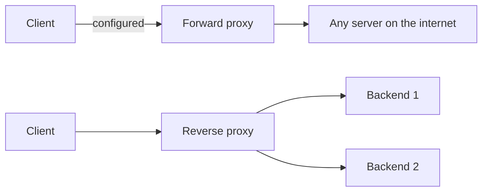
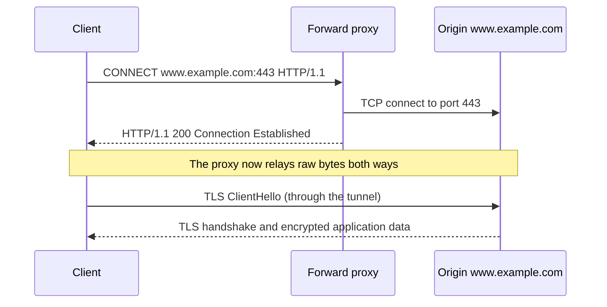
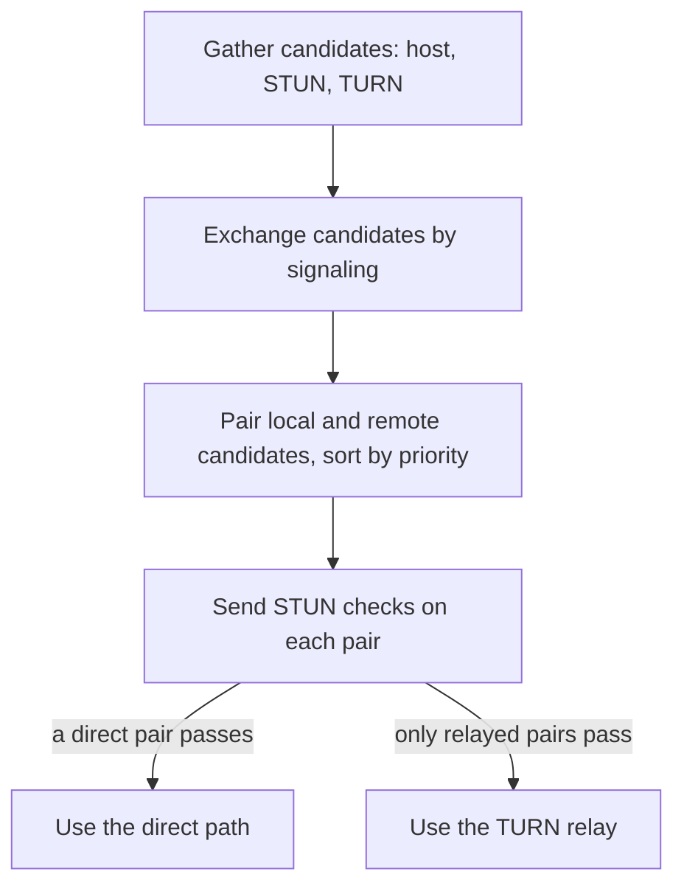

# Proxies and NAT

A proxy is a server that sits between a client and another server and passes messages between them. NAT (Network Address Translation) is a router function that rewrites the addresses in packets so that many private hosts can share a few public addresses. Both hide one side of a connection from the other side, and both keep state for each connection. That state explains many production problems: a server that logs the load balancer's address instead of the client's, a forged `X-Forwarded-For` header that bypasses an IP rule, a TCP connection that dies silently after five idle minutes, and a video call that needs a relay server. This page explains what each device does at the protocol level: the HTTP forward proxy and the `CONNECT` tunnel, the reverse proxy and the headers it adds, the PROXY protocol for layer 4 proxies, NAT and its translation table and timeouts, NAT traversal with STUN, TURN, and ICE, and carrier-grade NAT. The design view of load balancers and reverse proxies has its home in [load balancing, DNS, and CDN](../hld/fundamentals/02-load-balancing-dns-cdn.md). This page does not repeat it.

!!! info "Where the standards stand (checked on 2026-11-05)"
    - RFC 9110 (HTTP Semantics, Internet Standard STD 97) defines `CONNECT`, `Via`, and the roles of proxy, gateway, and tunnel. RFC 9112 (HTTP/1.1, STD 99) defines the request-target forms. See [HTTP](04-http.md).
    - RFC 7239 (June 2014, Proposed Standard) defines the `Forwarded` header. `X-Forwarded-For`, `X-Forwarded-Proto`, and `X-Forwarded-Host` are conventions, not standards.
    - The PROXY protocol is a specification by HAProxy Technologies (version 2, dated 2020-03-05), not an RFC.
    - NAT terms come from RFC 2663 (Informational, 1999). RFC 3022 describes traditional NAT and NAPT (Informational, 2001, obsoletes RFC 1631). RFC 4787 (UDP, BCP 127) and RFC 5382 (TCP, BCP 142) set the behavior that a NAT should have. RFC 6888 (BCP 127, updates RFC 4787) sets requirements for carrier-grade NAT. RFC 6598 (BCP 153) reserves `100.64.0.0/10`.
    - STUN is RFC 8489 (Proposed Standard, obsoletes RFC 5389). TURN is RFC 8656 (Proposed Standard, obsoletes RFC 5766 and RFC 6156). ICE is RFC 8445 (Proposed Standard, obsoletes RFC 5245).

## Why It Matters

Almost every request that a Java service receives passes through at least one proxy (a CDN, a load balancer, an ingress controller, a sidecar) and at least one NAT (the home router of the user, the mobile carrier, the cloud gateway of the service). Interviewers ask "what is the difference between a forward proxy and a reverse proxy?", "how does HTTPS work through a proxy?", "how does the server know the real client IP?", and "why does my connection die after a few minutes of silence?". Engineers who cannot answer these questions trust the wrong header, run a security rule on the wrong address, or lose hours on a timeout that comes from a device they do not own. This page gives the mechanisms and the rules to apply.

## Core Concepts

**Proxy**: an intermediary that receives a message and forwards it. RFC 9110 (section 3.7) names three kinds of HTTP intermediary: a proxy, a gateway, and a tunnel.

**Forward proxy**: a proxy that the client chooses, usually through configuration. It acts for the client. The server sees the proxy and not the client. RFC 9110 calls this a "proxy": a "message-forwarding agent that is chosen by the client".

**Reverse proxy**: a proxy that acts for the server. The client believes that it talks to the origin server. RFC 9110 calls it a **gateway** ("a.k.a. reverse proxy") that "acts as an origin server for the outbound connection". A layer 7 load balancer, a CDN edge, and an API gateway are reverse proxies.

**Tunnel**: an intermediary that relays bytes between two connections and does not change them. A tunnel "acts as a blind relay" (RFC 9110). The `CONNECT` method opens a tunnel.

**Transparent proxy** (also *interception proxy*): a proxy that the client did not choose and does not know about. A network device redirects the client's traffic to it. RFC 9110 says that it "differs from an HTTP proxy because it is not chosen by the client".

**Hop-by-hop header**: a header that applies to one connection and not to the whole path. A proxy removes the headers that the `Connection` header lists, and it removes `Connection` itself, before it forwards a message (RFC 9110, section 7.6.1). `Upgrade` is one of them.

**PROXY protocol**: a short header that a layer 4 proxy writes at the start of a TCP connection to tell the next hop the real client address. See [The PROXY protocol](#the-proxy-protocol).

**NAT (Network Address Translation)**: a function in a router that rewrites the IP addresses (and often the transport ports) in packets that cross it. RFC 2663 defines the terms.

**Basic NAT**: NAT that maps one IP address to another, one to one. **NAPT (Network Address and Port Translation)**: NAT that also maps the transport port, so many private hosts share one public address. RFC 3022 defines both. Most home routers and cloud NAT gateways run NAPT. People often call NAPT "NAT".

**Source NAT (SNAT)**: NAT that rewrites the source address of packets that leave a network. **Destination NAT (DNAT)**: NAT that rewrites the destination address of packets that enter a network. Port forwarding is a static DNAT rule.

**Translation table** (also *NAT binding*, *mapping*): the state in the NAT device. Each entry ties an internal endpoint (address and port) to an external endpoint, for one flow.

**Carrier-grade NAT (CGN)**: a NAT in the network of an Internet service provider that serves many subscribers at once. RFC 6888 sets its requirements.

## How It Works

### Forward proxy and reverse proxy



| Aspect | Forward proxy | Reverse proxy |
|---|---|---|
| Acts for | The client | The server |
| Who chooses it | The client (configuration), or the network (transparent) | The server operator. The client does not know it |
| What the far side sees | The server sees the address of the proxy | The client sees the address of the proxy. The backends stay hidden |
| Typical use | Company egress control, caching, filtering, anonymity | Load balancing, TLS termination, caching, compression, routing, protection |
| Request-target form | Absolute-form (see below) | Origin-form, as for a direct request |
| Headers added | `Via`. Some add `X-Forwarded-For`, and an anonymizing proxy does not | `Via`, `X-Forwarded-For`, `X-Forwarded-Proto`, or `Forwarded`, toward the backend |

Both proxies terminate the incoming TCP connection and open a separate connection onward (the exception is a transparent layer 4 device). Each leg has its own TCP state, timers, and TLS session. The connection from a proxy to a backend can reuse one connection for many clients, and it can use a different HTTP version than the client leg (for example HTTP/2 from the client and HTTP/1.1 to the backend). See [HTTP](04-http.md) for request smuggling, which exists because two hops can disagree about where a message ends.

### The request-target forms

The request line of an HTTP/1.1 request carries a **request-target**. RFC 9112 (section 3.2) defines four forms. The form tells you what kind of server the client believes it talks to.

| Form | Example | Used when |
|---|---|---|
| origin-form | `GET /page?x=1 HTTP/1.1` plus `Host: www.example.com` | A client sends a request to an origin server (the usual case) |
| absolute-form | `GET http://www.example.com/page?x=1 HTTP/1.1` | A client sends a request to a **proxy**. A client "MUST send the target URI in absolute-form" to a proxy. A server must accept it |
| authority-form | `CONNECT www.example.com:443 HTTP/1.1` | Only for `CONNECT` |
| asterisk-form | `OPTIONS * HTTP/1.1` | Only for a server-wide `OPTIONS` request |

The proxy needs the full URI because it does not know which origin the client wants. The origin-form has a path and a `Host` header, which is enough for a server that is already the destination. A proxy that receives the absolute-form replaces the `Host` header with the host from the request-target (RFC 9112, section 3.2), then forwards the request to the origin in the origin-form.

### `CONNECT`: HTTPS through a forward proxy

An HTTPS request needs a TLS session between the client and the origin, and the proxy must not read it. The client therefore asks the proxy to open a tunnel (RFC 9110, section 9.3.6).



Facts from RFC 9110 (section 9.3.6):

- The request-target is the authority-form: host and port. The client must send the port, even when the URI omits it. A server rejects an empty or invalid port, typically with `400`.
- A `2xx` response means that the sender and the proxy switch to tunnel mode at once after the response header section. The response must not carry `Content-Length` or `Transfer-Encoding`.
- After the `2xx`, the bytes belong to the end-to-end protocol. The proxy sees only the host and the port, the amount of data, and the timing. It does not see the path, the headers, or the body. The TLS `ClientHello` still shows the host name in the SNI extension, unless the client uses Encrypted Client Hello (see [TLS and HTTPS](05-tls-and-https.md)).
- A tunnel closes when the proxy sees that either side closed its connection. The proxy then sends the data that is still pending from the closed side to the other side, closes both connections, and discards the rest (RFC 9110, section 9.3.6).
- A proxy that supports `CONNECT` should allow it only to a small set of well-known ports. A tunnel to a port such as 25 (SMTP) is a risk.
- A proxy cannot cache inside a tunnel (RFC 9110, section 3.8: a cache "cannot be used while acting as a tunnel"), and responses to `CONNECT` are not cacheable (section 9.3.6).

The proxy can require authentication on the `CONNECT` request: it answers `407 Proxy Authentication Required` with a `Proxy-Authenticate` header, and the client repeats the request with `Proxy-Authorization`.

**Plain HTTP through a forward proxy** uses the absolute-form request and no tunnel. The proxy reads the whole request and can cache the response.

**HTTPS inspection.** A company proxy that must read HTTPS traffic acts as a TLS endpoint toward the client with a certificate that a company CA signs, and it opens a second TLS session to the origin. The client trusts the company CA through its trust store. This proxy is a deliberate machine-in-the-middle. It breaks certificate pinning and end-to-end authentication, and its CA key is a high-value target.

### Transparent proxies

A transparent (interception) proxy needs no client configuration. A router or firewall redirects traffic for port 80 (and sometimes 443) to the proxy. The proxy reads the original destination from the redirect or from the `Host` header. Facts to know:

- The client sends origin-form requests, because it believes it talks to the origin.
- The proxy cannot read HTTPS traffic without a certificate that the client trusts (see HTTPS inspection above).

### Headers that proxies add

A server behind a proxy sees the proxy's address as the peer of the TCP connection. The proxy therefore passes the original information in headers.

| Header | Source | Content |
|---|---|---|
| `Via` | RFC 9110 (section 7.6.3), standard | One entry for each hop: `received-protocol received-by`, for example `1.1 proxy1.example.com, 2 edge.example.net`. A proxy must add its entry to each message that it forwards. A sender may replace a host name with a pseudonym when the name is sensitive. It shows the proxies on the path. It does not carry the client address |
| `X-Forwarded-For` | De facto standard | A comma-separated list of addresses. Each proxy appends the address of the peer that it received the request from. The first entry is the client address as the first proxy saw it |
| `X-Forwarded-Proto` | De facto standard | The scheme of the original request (`http` or `https`). The backend needs it to build redirect URLs and to decide on secure cookies |
| `X-Forwarded-Host` | De facto standard | The original `Host` value. The backend needs it to build absolute URLs |
| `X-Forwarded-Port` | De facto standard | The original port |
| `Forwarded` | RFC 7239, standard | One header with the parameters `for` (the client or previous node), `by` (the interface of the proxy that received the request), `host`, and `proto`. Example: `Forwarded: for=192.0.2.60;proto=http;by=203.0.113.43`. IPv6 addresses and values with a port are quoted: `for="[2001:db8:cafe::17]:4711"`. An identifier that starts with an underscore (`for=_hidden`) hides the real address |

RFC 7239 states that the header "cannot be relied upon to be correct" in general, because any node, including the client, can change it. It also warns that the header can leak the internal structure of a network, and that client addresses are private data. The RFC suggests that a proxy convert `X-Forwarded-For` to `Forwarded` by adding `for=` to each element.

**Trust rule.** A client can send any `X-Forwarded-For` value. A proxy appends to the header and does not replace it, so the real header holds the forged values first and the true values last. A backend must read the header only when the TCP peer is a proxy that it trusts, and it must read the header from the right: start with the TCP peer, and while the current address is a trusted proxy, move one entry to the left. The first address that is not a trusted proxy is the client. Take that address and ignore every entry to its left, because the client could have written them. The second program in the [Java example](#java-example) does this. Frameworks have a setting for it (for example, a list of trusted proxies or a "number of proxies" value). A wrong value gives a wrong client address: too small trusts a proxy address, and too large trusts a forged one. The HLD page for [load balancing](../hld/fundamentals/02-load-balancing-dns-cdn.md) states the same rule.

**Why this matters.** A rate limit, a block list, a geo rule, and an audit log use the client address. If the backend takes the first `X-Forwarded-For` entry from an untrusted source, an attacker changes the address with one request header and bypasses the rule.

### The PROXY protocol

A layer 4 proxy (a TCP load balancer) does not read HTTP, so it cannot add `X-Forwarded-For`. If it proxies the connection (it terminates the client connection and opens a new one), the backend sees the proxy's address. The PROXY protocol (HAProxy specification, version 2 of 2020-03-05) solves this. The proxy writes one header at the start of the new connection, before any application bytes. The backend reads the header and then treats the real client address as the peer address.

**Version 1** is one line of US-ASCII text that ends with CRLF and has at most 107 characters, including the CRLF:

```text
PROXY TCP4 192.0.2.10 198.51.100.5 56324 443\r\n
```

The fields are the protocol (`TCP4`, `TCP6`, or `UNKNOWN`), the source address, the destination address, the source port, and the destination port. With `UNKNOWN`, the receiver uses the real connection addresses.

**Version 2** is binary. It starts with a 12-byte signature (`0D 0A 0D 0A 00 0D 0A 51 55 49 54 0A`), then a byte with the version (high nibble `2`) and the command (`0` LOCAL, `1` PROXY), a byte with the address family and transport (for example `0x11` for TCP over IPv4), a 2-byte length, the addresses, and optional TLV (type-length-value) fields. The TLV fields can carry the ALPN protocol, the SNI authority, a unique ID, and TLS details. Version 2 also handles UDP and Unix sockets.

**Security rule.** The receiver must be configured to expect the header on a connection, and it must not guess whether a header is present. The receiver should accept the header only from trusted proxies. If a backend accepts the header from any peer, any client can claim any address. If a backend expects the header and a client connects without it, the backend must reject the connection. Enable the PROXY protocol on both the proxy and the backend together, or the connection fails.

**Compared with `X-Forwarded-For`.** `X-Forwarded-For` works only for HTTP, and only if the proxy parses HTTP. The PROXY protocol works for any TCP protocol, including TLS that passes through the proxy untouched, but both sides must support it. The HLD page for load balancing states how an AWS Network Load Balancer preserves the client IP address.

### NAT: why it exists and what it rewrites

IPv4 has about 4.3 billion addresses, and far more devices exist. A private network uses addresses from the ranges of RFC 1918 (see [IP addressing and routing](02-ip-addressing-and-routing.md)), and these addresses are not routable on the public internet. A NAPT device in front of the network maps many private endpoints to one public address and many ports. IPv6 has enough addresses to give each device a public one, so IPv6 does not need NAT for address supply (see the same page).

**What a NAPT device does for an outbound TCP packet.**

1. A host `192.168.1.10` sends a packet from `192.168.1.10:51000` to `198.51.100.20:443`.
2. The NAT device looks up the flow in its translation table. If there is no entry, it creates one and picks an unused external port, for example `40000`. The entry ties `192.168.1.10:51000` to `203.0.113.7:40000`.
3. The device rewrites the source of the packet to `203.0.113.7:40000`, fixes the IP and TCP checksums, and sends the packet.
4. The reply comes back to `203.0.113.7:40000`. The device finds the entry, rewrites the destination to `192.168.1.10:51000`, and delivers the packet.

RFC 3022 describes this. The device also rewrites ICMP error messages (including the packet that they quote) and the identifier of ICMP echo requests, because ICMP has no ports.

**Unsolicited inbound packets.** A packet from outside that matches no entry has no private destination, so the device drops it. This works like a stateful firewall, but it is a side effect of the missing mapping, not a security feature. For TCP, RFC 5382 (requirement 4) says that a NAT must not answer an unsolicited inbound `SYN` for at least 6 seconds, so that a simultaneous open can complete, and then it should send an ICMP "port unreachable" error, or drop the packet silently if a security policy requires it.

**DNAT and port forwarding.** An administrator adds a static mapping from `203.0.113.7:8443` to `192.168.1.50:443`. A packet from outside to that address reaches the host. 

**What NAT breaks.** NAT removes "the end-to-end significance of an IP address" (RFC 3022). Protocols that write an IP address inside the payload (FTP is the example in RFC 3022) need an application layer gateway (ALG) that rewrites the payload too, or a way around the NAT. RFC 4787 says that NAT ALGs for UDP-based protocols should be turned off. RFC 3022 says that end-to-end IPsec cannot be assumed when a NAT device sits on the path. Inbound connections from the internet to a host behind NAT fail without a static mapping.

### The translation table and its timeouts

A NAT device keeps one entry for each flow, and it deletes the entry after an idle timeout. The device does not know when a TCP peer has gone away silently, so the timer is its only way to free the entry. After the entry is gone, packets of the old flow find no mapping.

| Source | Value | Meaning |
|---|---|---|
| RFC 4787, requirement 5 (UDP) | At least 2 minutes. A default of 5 minutes or more is recommended | A UDP mapping must not expire in less than 2 minutes (a shorter timer is allowed for well-known ports below 1024) |
| RFC 4787, requirement 6 | Outbound refresh must be on. Inbound refresh may be on | A packet from the inside resets the timer. A packet from the outside may reset it |
| RFC 5382, requirement 5 (TCP, established) | At least 2 hours 4 minutes | The requirement applies to a NAT that cannot tell whether the endpoints are active and abandons idle sessions: its "established connection idle-timeout" must not be below 2 hours 4 minutes. This follows the 2-hour default of TCP keep-alive and adds 4 minutes for packets in flight |
| RFC 5382, requirement 5 (TCP, transitory) | At least 4 minutes | The timeout for connections that are not yet established or are closing |

The RFC values describe what a conforming NAT should do. Real devices use other values. Examples from documentation (checked on 2026-11-05): the Linux connection tracker (`nf_conntrack`) uses 432000 seconds (5 days) for an established TCP connection, 30 seconds for UDP with one packet, and 120 seconds for a UDP stream that has seen traffic in both directions. An AWS Network Load Balancer tracks a TCP connection for 350 seconds of idle time by default (range 60 to 6000 seconds) and answers the next packet with a TCP RST. The value on a device that you do not run is a fact that you must look up.

**The effect on long-lived TCP connections.** A TCP connection sends no packets when it is idle. If the idle time exceeds the timeout of a NAT device (or a firewall or a load balancer) on the path, the device deletes its entry, and neither endpoint learns about it. The connection is still ESTABLISHED at both ends. The next packet shows the problem:

- A packet from the outside (the server sends data) finds no mapping, and the device drops it. The server retransmits and then fails after its retransmission timeout, which is minutes long on Linux ([TCP and UDP](03-tcp-and-udp.md)).
- A packet from the inside (the client sends data) may create a new mapping (for UDP) or may get a TCP RST or no answer (for TCP), depending on the device. A new mapping for TCP would carry a new external port, and the server would not know the connection.
- The application sees a read timeout, a `Connection reset by peer`, or a hang.

The fixes: (1) Send data or a keep-alive probe more often than the shortest idle timeout on the path. TCP keep-alive has its home in [TCP and UDP](03-tcp-and-udp.md): it is off by default and starts after 2 hours on Linux, so set `TCP_KEEPIDLE` below the timeout, or use an application heartbeat. A WebSocket ping does this job, as [WebSockets and real-time protocols](08-websockets-and-realtime.md) describes. (2) For a database or a pool, validate a connection before use, and set the maximum idle time of the pool below the idle timeout of the network (the same rule as for the HTTP client idle timeout in [HTTP](04-http.md)). (3) Retry a failed idempotent request on a new connection.

### Mapping and filtering behavior, and the NAT types

RFC 4787 describes a NAT with two independent properties. Both matter for peer-to-peer traffic.

**Mapping behavior**: which external endpoint a NAT gives to an internal endpoint that talks to different destinations.

- **Endpoint-independent mapping**: the internal endpoint `192.168.1.10:51000` gets the same external endpoint `203.0.113.7:40000` for every destination. Other hosts can use that external endpoint to reach the host (if the filter allows it).
- **Address-dependent mapping**: a different external port for each destination address.
- **Address-and-port-dependent mapping**: a different external port for each destination address and port. People call this a symmetric NAT.

**Filtering behavior**: which inbound packets a NAT lets through to an existing mapping.

- **Endpoint-independent filtering**: a packet from any external host to the mapped external endpoint passes.
- **Address-dependent filtering**: a packet passes only if the internal host sent a packet to that external address earlier.
- **Address-and-port-dependent filtering**: a packet passes only if the internal host sent a packet to that exact address and port earlier.

RFC 4787 requires endpoint-independent mapping (requirement 1), and it recommends endpoint-independent filtering for application transparency, or address-dependent filtering for stricter control (requirement 8). RFC 5382 requires endpoint-independent mapping for TCP. The older names come from the first STUN specification (RFC 3489, UDP only). RFC 4787 (section 3) says that this terminology "has proven inadequate at describing real-life NAT behavior" and uses the mapping and filtering terms above instead. The old names map to the new terms like this (derived from the RFC 3489 definitions):

| Old name (RFC 3489) | Mapping | Filtering |
|---|---|---|
| Full cone | Endpoint-independent | Endpoint-independent: any external host can send to the mapped address |
| Restricted cone | Endpoint-independent | Address-dependent: only an address that the internal host contacted |
| Port-restricted cone | Endpoint-independent | Address-and-port-dependent |
| Symmetric | Address-and-port-dependent (a new external endpoint for each destination) | Address-and-port-dependent: only the contacted address and port can reply |

A symmetric NAT is the hard case for peer-to-peer connections.

Also from RFC 4787: a NAT must not use "port overloading", where it keeps the internal port even when another host already uses it (requirement 3). It should use "paired" address pooling, so one internal host keeps one external address (requirement 2). It must support hairpinning (requirement 9): two hosts behind the same NAT can reach each other through the external address.

### NAT traversal: STUN, TURN, and ICE

Two hosts that both sit behind NAT cannot connect directly. Each NAT drops the unsolicited packet from the other side. Applications such as video calls and games need a path anyway. Three protocols solve this.

**STUN** (RFC 8489) is a small request-response protocol. A host behind NAT sends a `Binding` request to a STUN server on the public internet (default port 3478, and 5349 for STUN over TLS). The server reads the source address and port of the request, as the NAT rewrote them, and returns them in the `XOR-MAPPED-ADDRESS` attribute. The host now knows its **server-reflexive address**, the public address and port that the NAT gave it. The message has a 20-byte header with the magic cookie `0x2112A442` and a 96-bit transaction ID. The RFC states that "STUN is not a NAT traversal solution by itself": it is a tool. Binding messages can also keep a NAT mapping alive.

**Hole punching.** Both hosts learn their server-reflexive addresses with STUN and send them to each other through a signaling channel (for example, a WebSocket to a server). Then both hosts send UDP packets to the other's server-reflexive address at the same time. The outbound packet of each host creates a mapping in its own NAT. With endpoint-independent mapping, that mapping is the one that STUN reported. The packet from the other host then passes the filter, because the first host already sent a packet to that address. The path works until a NAT with address-and-port-dependent mapping gives each flow a new external port, so that the address that STUN reported does not match the address toward the peer.

**TURN** (RFC 8656) is the fallback. A TURN server relays the traffic. The client asks the server for an allocation (an `Allocate` request, which needs authentication). The server gives it a **relayed transport address**, a public address and port on the server. The client tells the peer to send there. The server forwards data between the relayed address and the client. TURN uses the same ports as STUN (3478, and 5349 for TLS). An allocation lasts 10 minutes unless the client refreshes it. A permission lasts 5 minutes unless refreshed. TURN works when hole punching fails, at the cost of the relay's bandwidth and an extra hop.

**ICE** (RFC 8445) chooses among all the paths. Each agent gathers **candidates**:

| Candidate type | Source |
|---|---|
| Host | An address on a local interface |
| Server-reflexive | The public address and port that a NAT gave, learned from a STUN server |
| Relayed | An address on a TURN server |
| Peer-reflexive | An address that an agent learns during the connectivity checks themselves |

The agents exchange their candidate lists through signaling. Each agent forms pairs of a local and a remote candidate, sorts them by priority (the RFC recommends preference values of 126 for host, 110 for peer-reflexive, 100 for server-reflexive, and 0 for relayed), and sends STUN `Binding` requests on each pair as connectivity checks. A pair that passes in both directions is valid. One agent has the **controlling** role and **nominates** a valid pair with the `USE-CANDIDATE` attribute. Both then use that pair. The effect is that a direct path wins when it works, and a relay serves the case in which it does not. WebRTC uses ICE: the browser gathers candidates and runs the checks, and the application provides the STUN and TURN servers and the signaling.



### Carrier-grade NAT

IPv4 addresses ran out, so a provider that cannot give each subscriber a public IPv4 address puts the subscribers behind a NAT in the provider network: a carrier-grade NAT (CGN). RFC 6888 and RFC 6598 were written for this case. Which mobile and home networks do it differs by provider and by country, so do not assume it for a given user. The subscriber's home router has a private (or shared) address on its provider side, and then the provider's CGN maps it to a public address. A packet passes two NAT devices.

- **The shared address space.** RFC 6598 reserves `100.64.0.0/10` for the link between a CGN and the customer equipment. A provider uses it where the RFC 1918 ranges could clash with the ranges that subscribers use at home. It is not globally routable, and the RFC says that providers must not put it in external-facing DNS zone files. A `100.64.x.x` address on the WAN side of a router suggests that the provider runs a CGN.
- **Port quotas.** One public address serves many subscribers, and a public address has at most 65,535 ports for each transport protocol, so a CGN limits the ports for each subscriber (RFC 6888, requirement 4: a CGN must support such a limit, and the administrator must be able to configure it). A subscriber who opens many connections (a busy browser or a crawler) can use up the quota, and new connections then fail.
- **Shared IP addresses.** Hundreds of subscribers can share one public address. An IP-based rate limit, block list, or "one account per address" rule then affects innocent users. A service that blocks one abusive address blocks the others too. Prefer an account or token for a limit, and use the IP address as one signal.
- **Logging.** To trace a flow to a subscriber, the provider logs the internal address, the external address and port, and the time (RFC 6888, section 4). A service that wants to trace an address needs the port and the time.
- **Inbound connections and peer-to-peer.** Port forwarding on the home router does not work, because the provider's NAT sits in front of it. Traversal needs STUN and TURN, and a relay is more likely.
- **Port reuse and exhaustion.** RFC 6888 (requirement 8) says that a CGN should not give a freed external port to a new mapping until at least 120 seconds have passed, with some exceptions (for example, a CGN that tracks TCP sessions may reuse a TCP port at once). When the CGN cannot create a mapping, it drops the packet, and it must not delete an existing mapping to make room (requirement 11).

IPv6 removes the need for CGN. Dual-stack clients use IPv6 where it exists. See [IP addressing and routing](02-ip-addressing-and-routing.md).

## Trade-offs and When to Use

| Choice | Option A | Option B | Deciding factor |
|---|---|---|---|
| Pass the client address to the backend | `X-Forwarded-For` or `Forwarded` (HTTP, layer 7) | PROXY protocol (any TCP, layer 4) | Does the proxy parse HTTP? Do both ends support the PROXY protocol? |
| Header standard | `Forwarded` (RFC 7239) | `X-Forwarded-*` (convention) | Library and proxy support. Many products read `X-Forwarded-*` first. Use one format at all hops |
| Proxy type for clients | Explicit forward proxy | Transparent proxy | Can you configure clients? A transparent proxy needs no client change but cannot read TLS without a trusted CA |
| HTTPS through a proxy | `CONNECT` tunnel (end-to-end TLS) | TLS interception (proxy reads data) | Do you need to inspect the content, and can you distribute a CA? |
| Peer-to-peer connection | Direct (host or reflexive candidate) | TURN relay | Direct costs no bandwidth. A relay works for every NAT type |
| Keep a long connection alive across NAT | TCP keep-alive below the idle timeout | Application heartbeat | Does the application protocol have a heartbeat? A heartbeat also tests the application |
| Address supply | IPv6 | NAT44 or CGN | Do the clients and the networks support IPv6? |

## Java Example

The first program is a NAPT translation table on a simulated clock. It maps internal endpoints to external ports with endpoint-independent mapping, expires an entry after 30 idle seconds, refreshes the timer on outbound packets only, and drops unsolicited inbound packets and packets from a remote that the internal host never contacted. It opens no socket and prints no time from the machine.

```java
import java.util.ArrayList;
import java.util.HashMap;
import java.util.LinkedHashMap;
import java.util.List;
import java.util.Map;

public class NaptSim {
    record Endpoint(String ip, int port) {
        public String toString() { return ip + ":" + port; }
    }

    // One row of the translation table. The key is the internal side plus the remote side.
    static class Mapping {
        final Endpoint internal;
        final Endpoint remote;
        final int externalPort;
        long lastSeen;
        Mapping(Endpoint internal, Endpoint remote, int externalPort, long now) {
            this.internal = internal;
            this.remote = remote;
            this.externalPort = externalPort;
            this.lastSeen = now;
        }
    }

    static class Napt {
        final String externalIp;
        final long idleTimeout; // seconds
        long now = 0;
        int nextPort = 40000;
        // Endpoint-independent mapping: one external port per internal endpoint, for any remote.
        final Map<Endpoint, Integer> portOf = new LinkedHashMap<>();
        // Filter: a packet from outside passes only from a remote that this mapping contacted.
        final Map<String, Mapping> byExternalPort = new HashMap<>();
        final Map<String, Mapping> byFlow = new LinkedHashMap<>();
        final List<String> log = new ArrayList<>();

        Napt(String externalIp, long idleTimeout) {
            this.externalIp = externalIp;
            this.idleTimeout = idleTimeout;
        }

        void advance(long seconds) {
            now += seconds;
            expire();
        }

        void expire() {
            var it = byFlow.entrySet().iterator();
            while (it.hasNext()) {
                Mapping m = it.next().getValue();
                if (now - m.lastSeen >= idleTimeout) {
                    log.add("t=" + now + " expire  " + m.internal + " <-> " + externalIp + ":"
                            + m.externalPort + " (remote " + m.remote + ")");
                    it.remove();
                    byExternalPort.remove(flowId(m.externalPort, m.remote));
                }
            }
        }

        static String flowId(int externalPort, Endpoint remote) {
            return externalPort + "<" + remote;
        }

        String outbound(Endpoint internal, Endpoint remote) {
            expire();
            int port = portOf.computeIfAbsent(internal, k -> nextPort++);
            String flow = internal + ">" + remote;
            Mapping m = byFlow.get(flow);
            if (m == null) {
                m = new Mapping(internal, remote, port, now);
                byFlow.put(flow, m);
                byExternalPort.put(flowId(port, remote), m);
                log.add("t=" + now + " create  " + internal + " -> " + externalIp + ":" + port
                        + " (remote " + remote + ")");
            } else {
                m.lastSeen = now; // an outbound packet refreshes the timer
            }
            return externalIp + ":" + port;
        }

        String inbound(Endpoint remote, int externalPort) {
            expire();
            Mapping m = byExternalPort.get(flowId(externalPort, remote));
            if (m == null) {
                log.add("t=" + now + " DROP    " + remote + " -> " + externalIp + ":" + externalPort
                        + " (no mapping)");
                return "dropped";
            }
            // This model does not refresh the timer on inbound packets (RFC 4787 REQ-6 allows it).
            return "delivered to " + m.internal;
        }
    }

    public static void main(String[] args) {
        Napt nat = new Napt("203.0.113.7", 30);
        Endpoint laptop = new Endpoint("192.168.1.10", 51000);
        Endpoint phone = new Endpoint("192.168.1.11", 51000);
        Endpoint server = new Endpoint("198.51.100.20", 443);
        Endpoint other = new Endpoint("198.51.100.99", 443);

        System.out.println("laptop out: " + nat.outbound(laptop, server));
        System.out.println("phone out:  " + nat.outbound(phone, server));
        System.out.println("laptop to second server: " + nat.outbound(laptop, other));
        System.out.println("reply from server to laptop port: " + nat.inbound(server, 40000));
        String stray = nat.inbound(other, 40001);
        System.out.println("unsolicited packet from other to phone port: " + stray);

        nat.advance(20);
        System.out.println("laptop sends keep-alive at t=20: " + nat.outbound(laptop, server));
        nat.advance(20);
        System.out.println("t=40: reply from server: " + nat.inbound(server, 40000));
        System.out.println("t=40: phone reply from server: " + nat.inbound(server, 40001));
        nat.advance(20);
        System.out.println("t=60: reply from server: " + nat.inbound(server, 40000));
        System.out.println("laptop sends again: " + nat.outbound(laptop, server));
        System.out.println();
        nat.log.forEach(System.out::println);
    }
}
```

Expected output:

<!-- expected-output -->
```text
laptop out: 203.0.113.7:40000
phone out:  203.0.113.7:40001
laptop to second server: 203.0.113.7:40000
reply from server to laptop port: delivered to 192.168.1.10:51000
unsolicited packet from other to phone port: dropped
laptop sends keep-alive at t=20: 203.0.113.7:40000
t=40: reply from server: delivered to 192.168.1.10:51000
t=40: phone reply from server: dropped
t=60: reply from server: dropped
laptop sends again: 203.0.113.7:40000

t=0 create  192.168.1.10:51000 -> 203.0.113.7:40000 (remote 198.51.100.20:443)
t=0 create  192.168.1.11:51000 -> 203.0.113.7:40001 (remote 198.51.100.20:443)
t=0 create  192.168.1.10:51000 -> 203.0.113.7:40000 (remote 198.51.100.99:443)
t=0 DROP    198.51.100.99:443 -> 203.0.113.7:40001 (no mapping)
t=40 expire  192.168.1.11:51000 <-> 203.0.113.7:40001 (remote 198.51.100.20:443)
t=40 expire  192.168.1.10:51000 <-> 203.0.113.7:40000 (remote 198.51.100.99:443)
t=40 DROP    198.51.100.20:443 -> 203.0.113.7:40001 (no mapping)
t=60 expire  192.168.1.10:51000 <-> 203.0.113.7:40000 (remote 198.51.100.20:443)
t=60 DROP    198.51.100.20:443 -> 203.0.113.7:40000 (no mapping)
t=60 create  192.168.1.10:51000 -> 203.0.113.7:40000 (remote 198.51.100.20:443)
```

Read the output in this order:

- The laptop and the phone use the same internal port `51000`. The NAT gives them different external ports (`40000`, `40001`), so it can tell the replies apart. The laptop uses one external port for both servers (endpoint-independent mapping).
- The packet from `198.51.100.99` to the phone's port is dropped: the phone never contacted that remote, and the filter is address-and-port dependent.
- At t=20 the laptop sends a packet to the first server. That outbound packet refreshes the timer of that entry. At t=40, the entry of the laptop still exists, and the reply passes. The phone entry (idle since t=0) has expired, so the phone's reply is dropped. The entry to the second server (idle since t=0) has expired too.
- At t=60, the laptop entry has been idle for 40 seconds and has expired. The reply is dropped. A new outbound packet creates a new entry. The external port is the same (`40000`) in this model because the model remembers the port for each internal endpoint. A real NAT may pick another port, and the old connection would not recover. The log lines show each event in order.

The second program shows proxy header handling. It parses a PROXY protocol version 1 line, reads the client address from `X-Forwarded-For` under a trust rule (right to left, through trusted proxies only), and reads the `for` parameter of a `Forwarded` header. It uses plain string comparison and does not resolve any address.

```java
import java.util.ArrayList;
import java.util.List;
import java.util.Set;

public class ProxyHeaders {
    // Parses a PROXY protocol version 1 line: "PROXY TCP4 src dst sport dport\r\n".
    record ProxyLine(String protocol, String srcIp, String dstIp, int srcPort, int dstPort) {}

    static ProxyLine parseProxyV1(String line) {
        if (!line.endsWith("\r\n") || line.length() > 107) { // the limit includes the CRLF
            throw new IllegalArgumentException("invalid PROXY line");
        }
        String[] p = line.substring(0, line.length() - 2).split(" ");
        if (!p[0].equals("PROXY")) {
            throw new IllegalArgumentException("not a PROXY line");
        }
        if (p[1].equals("UNKNOWN")) {
            return new ProxyLine("UNKNOWN", null, null, 0, 0); // use the real connection addresses
        }
        return new ProxyLine(p[1], p[2], p[3], Integer.parseInt(p[4]), Integer.parseInt(p[5]));
    }

    // Walks X-Forwarded-For from the right. The socket peer is the first hop to check.
    // A hop is believed only if the hop to its right is a trusted proxy.
    static String clientIp(String socketPeer, String xForwardedFor, Set<String> trusted) {
        List<String> chain = new ArrayList<>();
        if (xForwardedFor != null && !xForwardedFor.isBlank()) {
            for (String s : xForwardedFor.split(",")) {
                chain.add(s.trim());
            }
        }
        String current = socketPeer;
        for (int i = chain.size() - 1; i >= 0 && trusted.contains(current); i--) {
            current = chain.get(i);
        }
        return current;
    }

    // Reads the first for= value of a Forwarded header (RFC 7239). Removes the quotes.
    static String forwardedFor(String header) {
        String first = header.split(",")[0];
        for (String param : first.split(";")) {
            String[] kv = param.trim().split("=", 2);
            if (kv[0].equalsIgnoreCase("for")) {
                return kv[1].replace("\"", "");
            }
        }
        return null;
    }

    public static void main(String[] args) {
        System.out.println(parseProxyV1("PROXY TCP4 192.0.2.10 198.51.100.5 56324 443\r\n"));
        System.out.println(parseProxyV1("PROXY UNKNOWN\r\n"));

        Set<String> trusted = Set.of("10.0.0.5", "10.0.0.6"); // the load balancer and a CDN node
        System.out.println("1: " + clientIp("10.0.0.5", "192.0.2.10", trusted));
        System.out.println("2: " + clientIp("10.0.0.5", "203.0.113.99, 192.0.2.10", trusted));
        String chain = "203.0.113.99, 192.0.2.10, 10.0.0.6";
        System.out.println("3: " + clientIp("10.0.0.5", chain, trusted));
        System.out.println("4: " + clientIp("192.0.2.77", "203.0.113.99", trusted));
        System.out.println("5: " + clientIp("10.0.0.5", null, trusted));

        System.out.println("6: " + forwardedFor("for=192.0.2.60;proto=http;by=203.0.113.43"));
        String quoted = "for=\"[2001:db8:cafe::17]:4711\", for=198.51.100.17";
        System.out.println("7: " + forwardedFor(quoted));
    }
}
```

Expected output:

<!-- expected-output -->
```text
ProxyLine[protocol=TCP4, srcIp=192.0.2.10, dstIp=198.51.100.5, srcPort=56324, dstPort=443]
ProxyLine[protocol=UNKNOWN, srcIp=null, dstIp=null, srcPort=0, dstPort=0]
1: 192.0.2.10
2: 192.0.2.10
3: 192.0.2.10
4: 192.0.2.77
5: 10.0.0.5
6: 192.0.2.60
7: [2001:db8:cafe::17]:4711
```

Read the output in this order:

- Case 1: the peer is a trusted proxy, and the single entry is the client.
- Case 2: the client sent a forged leftmost entry (`203.0.113.99`), and the proxy appended the real address `192.0.2.10`. The program stops at the first entry that is not a trusted proxy and returns the real address. A program that reads the first entry returns the forged one.
- Case 3: two trusted proxies in the chain. The program skips the trusted `10.0.0.6` and returns `192.0.2.10`.
- Case 4: the TCP peer is not a trusted proxy. The program ignores the header and returns the peer. A client that connects directly cannot forge its address.
- Case 5: no header, so the answer is the peer.
- Cases 6 and 7: the `for` value of `Forwarded`, with the quotes removed. Case 7 shows the quoted IPv6 form with a port.

The class below configures the JDK 21 `HttpClient` with a proxy. **It has no `main` method and the runner does not run it**, because it needs a proxy. For an `https` URL through an HTTP proxy, the JDK client opens a `CONNECT` tunnel, as described above (the JDK 21 source has a `PlainTunnelingConnection` class that sends the `CONNECT` request, and `HttpRequestImpl` describes it as "SSL tunneling through a HTTP/1.1 proxy"). If you do not call `proxy(...)`, the builder uses the default proxy selector, which reads the system properties `http.proxyHost`, `https.proxyHost`, and `http.nonProxyHosts` (default `localhost|127.*|[::1]`, which the HTTPS handler also uses). `HttpClient.Builder.NO_PROXY` forces a direct connection.

```java
import java.net.InetSocketAddress;
import java.net.ProxySelector;
import java.net.URI;
import java.net.http.HttpClient;
import java.net.http.HttpRequest;
import java.net.http.HttpResponse;
import java.time.Duration;

// This class has no main method. The runner compiles it and does not run it.
public class ProxyClient {
    // An https request through an HTTP proxy uses a CONNECT tunnel (RFC 9110).
    static HttpClient viaProxy(String proxyHost, int proxyPort) {
        return HttpClient.newBuilder()
                .proxy(ProxySelector.of(new InetSocketAddress(proxyHost, proxyPort)))
                .connectTimeout(Duration.ofSeconds(5))
                .build();
    }

    // Without proxy(...), the client uses the default proxy selector (system properties).
    // NO_PROXY forces a direct connection.
    static HttpClient direct() {
        return HttpClient.newBuilder().proxy(HttpClient.Builder.NO_PROXY).build();
    }

    static int status(HttpClient client, String url) throws Exception {
        HttpRequest request = HttpRequest.newBuilder(URI.create(url))
                .timeout(Duration.ofSeconds(10))
                .build();
        return client.send(request, HttpResponse.BodyHandlers.discarding()).statusCode();
    }
}
```

## Interview Angle

### Questions

??? question "What is the difference between a forward proxy and a reverse proxy?"

    A forward proxy acts for the client. The client (or the network) chooses it, and the origin server sees the proxy's address and not the client's. Typical uses: company egress control, filtering, caching, and anonymity. A reverse proxy acts for the server. The client believes it talks to the origin, and the proxy forwards the request to one of several backends. Typical uses: load balancing, TLS termination, caching, compression, and routing. RFC 9110 calls a reverse proxy a gateway.

    The test question is whose identity the proxy hides. A forward proxy hides the client from the server. A reverse proxy hides the servers from the client. At the protocol level, a client that talks to a forward proxy sends the absolute-form request target, and a client that talks to a reverse proxy sends the normal origin-form. A layer 7 load balancer is a reverse proxy with a balancing rule.

??? question "How does HTTPS work through an HTTP proxy?"

    The client sends `CONNECT www.example.com:443 HTTP/1.1` to the proxy. The proxy opens a TCP connection to that host and port, and it answers `200`. From that point the proxy relays raw bytes in both directions, and the client runs the TLS handshake with the origin through the tunnel. The proxy sees the host and the port, the sizes of the data, and the timing, but not the path, the headers, or the body. The TLS `ClientHello` still shows the host name in SNI unless the client uses Encrypted Client Hello. A proxy that must inspect HTTPS acts as a TLS endpoint with a certificate from a CA that the client trusts, and opens a second TLS session to the origin. That breaks end-to-end authentication and certificate pinning. RFC 9110 advises that a proxy allow `CONNECT` only to a few well-known ports.

??? question "A request reaches your Java service through a CDN and a load balancer. How do you get the real client IP? Which header do you trust?"

    The TCP peer is the load balancer, so the application reads the client address from a header that the proxies add: `X-Forwarded-For` (a convention) or `Forwarded` (RFC 7239). Each proxy appends the address of its peer. A client can send its own value, so the leftmost entries can be forged. The rule: trust the header only if the TCP peer is a known proxy. Then read from the right: while the current address belongs to a trusted proxy, move one entry to the left. The first address that is not a trusted proxy is the client. Ignore entries to its left. In Spring Boot, enable the forwarded-header handling (`server.forward-headers-strategy`: `NATIVE`, `FRAMEWORK`, or `NONE`) and, on Tomcat, restrict it to your proxies (`server.tomcat.remoteip.internal-proxies`, a regular expression whose default is in the Spring Boot property appendix), and do not take the first entry blindly. If the first hop is a layer 4 balancer, it passes the address with the PROXY protocol or keeps the client address in the packets. The same rule decides whether an IP rate limit works.

??? question "What is the PROXY protocol, and when do you use it?"

    It is a header that a layer 4 proxy writes at the start of a TCP connection to the backend. It carries the real client address and port and the destination address and port. A layer 4 proxy does not parse HTTP, so it cannot add `X-Forwarded-For`, and the backend would see the proxy's address. Version 1 is one text line (`PROXY TCP4 src dst sport dport`, at most 107 bytes). Version 2 is binary, starts with a fixed 12-byte signature, and supports TLV extensions (ALPN, SNI, TLS details). It works for any TCP protocol, including TLS that passes through the proxy.

    The backend must be configured to expect it, and it must accept it only from trusted proxies. The backend must not guess whether a header is present, because a client could then forge it. If one side expects the header and the other does not send it, the connection fails, so turn it on at both ends together.

??? question "A connection between your service and a database works for hours under load, but a connection that is idle for a few minutes fails on the next query. Why?"

    A NAT device, a firewall, or a load balancer on the path deleted its state for the idle connection. RFC 5382 says an established TCP mapping should live at least 2 hours 4 minutes, but real devices use other values: an AWS Network Load Balancer uses 350 seconds by default and then answers with a TCP RST. Neither endpoint knows that the mapping is gone. The next packet from the service gets a RST or no answer, and the application sees `Connection reset` or a timeout.

    Fixes: set the maximum idle time of the connection pool below the shortest idle timeout on the path, validate a connection before use, send TCP keep-alive probes more often than the timeout (`TCP_KEEPIDLE` below it, because the Linux default of 2 hours is too long), and retry an idempotent query on a new connection. Find the timeout of each device in its documentation, because the RFC values do not bind a real device.

??? question "Explain NAPT. What happens to a packet, and what happens to an unsolicited packet from outside?"

    A NAPT device keeps a table of flows. For an outbound packet, it creates an entry that ties the internal address and port to an external port on its public address. It rewrites the source address and port, fixes the checksums, and sends the packet. A reply to that external port matches the entry, and the device rewrites the destination back to the internal address and port and delivers it. A packet from outside that matches no entry has no private destination, so the device drops it (or answers with an ICMP error, as RFC 5382 describes for TCP). Entries expire after an idle timeout. This is why a host behind NAT cannot accept a connection that it did not start, unless the administrator adds a static DNAT rule (port forwarding). Hosts that connect to different destinations from one internal port get one external port with endpoint-independent mapping, which RFC 4787 requires, and different ports with address-and-port-dependent mapping (a symmetric NAT).

??? question "How do two hosts behind different NATs open a video call?"

    They use ICE (RFC 8445), with STUN and TURN. Each host gathers candidate addresses: its local addresses, its public address and port learned from a STUN server (the server-reflexive address), and a relayed address from a TURN server. The hosts exchange candidates through a signaling channel, for example a WebSocket to an application server. They pair the candidates, sort them by priority, and send STUN checks on each pair. Sending the checks at the same time opens a mapping in each NAT (hole punching), so a direct path works if the NATs use endpoint-independent mapping. One host nominates the best valid pair. If both NATs use address-and-port-dependent mapping (a symmetric NAT), the direct pairs fail, and the call uses the TURN relay, which costs bandwidth and one more hop. WebRTC runs this procedure in the browser.

??? question "Why do many users appear to have the same IP address, and how does it affect your design?"

    Carrier-grade NAT, corporate NAT, and mobile networks put many users behind one public address. RFC 6888 describes the CGN requirements, including a limit on the ports for each subscriber. An IP-based rate limit or block list then hits innocent users, so the design uses an account or a token as the key of the limit, and the IP address as one input among others. A service that must trace an abusive flow needs the source port and the time, because the same address and a different port belong to a different subscriber. A `100.64.0.0/10` address on a client's WAN side shows a CGN (RFC 6598).

### Follow-up Questions

- "What is the difference between `Via` and `X-Forwarded-For`?" (`Via` lists the proxies and their protocol versions. `X-Forwarded-For` lists client addresses. `Via` is in RFC 9110, and `X-Forwarded-For` is a convention.)
- "What is a transparent proxy, and why is it a problem for HTTPS?" (The client does not know it. The proxy cannot read TLS without a trusted CA.)
- "Why does a proxy need the absolute-form request target?" (It does not know the origin. The `Host` header alone does not tell a proxy that the client wants it to forward.)
- "What does `407` mean?" (The proxy requires authentication. `401` is for the origin server.)
- "What is hairpinning?" (Two hosts behind the same NAT reach each other through the NAT's external address. RFC 4787 requires support.)
- "How does a DNAT rule differ from a reverse proxy?" (DNAT rewrites addresses in packets and keeps one connection. A reverse proxy terminates the connection and opens a new one.)
- "What does a layer 4 balancer in NAT mode do to the client address?" (It replaces the source address, so the backend sees the balancer, unless the balancer uses the PROXY protocol or another way.)

### Red Flags

- "Use the first address in `X-Forwarded-For`." (A client can set it.)
- "NAT is a firewall, so my internal hosts are safe." (The drop of unsolicited packets is a side effect. Use a firewall rule for security.)
- "TCP keeps the connection open, so an idle connection stays valid." (A middle box can delete its state after minutes.)
- "A proxy can read HTTPS traffic in a `CONNECT` tunnel." (It sees only the host, the port, the sizes, and the timing.)
- "IP address equals user." (CGN and corporate NAT break that.)
- Describing a reverse proxy and a forward proxy without saying whom each one acts for.

## Common Mistakes

| Mistake | Why it hurts | Fix |
|---|---|---|
| Trust `X-Forwarded-For` from any source | An attacker forges the client address and bypasses IP rules | Trust the header only from known proxies. Read it from the right |
| A wrong "number of proxies" setting | Too small gives a proxy address. Too large gives a forged address | Match the setting to the real chain. Test with a forged header |
| Different proxies append and replace the header differently | The chain loses entries | Append at every hop. Use one format |
| The backend builds `http://` redirect URLs behind a TLS-terminating proxy | Redirect loops and mixed content | Read `X-Forwarded-Proto` (from a trusted proxy) |
| PROXY protocol on only one side | The backend reads the header as application data, or rejects the connection | Enable it on the proxy and the backend together |
| Accept PROXY protocol headers from the internet | A client can claim any address | Accept them only from the proxy's network |
| An idle timeout in the pool higher than the network's | The pool reuses connections that a middle box deleted | Set the pool idle time below the shortest idle timeout on the path |
| Rate limits keyed by IP alone | CGN users share a limit, and one abuser blocks many | Key by account or token. Combine with IP |
| Open `CONNECT` to any port on a proxy | An attacker tunnels to internal services or SMTP | Allow only the needed ports |
| Port forwarding behind CGN | It cannot work, because the provider's NAT sits in front | Use an outbound connection (a tunnel or a relay) |
| Assume peer-to-peer works for every user | Symmetric NAT and CGN block hole punching | Provide a TURN server |

## Commonly Confused With

| Looks like | Difference | Deciding question |
|---|---|---|
| Forward proxy and reverse proxy | A forward proxy acts for the client. A reverse proxy acts for the server | Whose identity does it hide? |
| Proxy and NAT | A proxy terminates a connection and opens another, at layer 4 or 7, and the client may know it. NAT rewrites packet headers at layer 3 and 4 and keeps one end-to-end connection. The client does not know it | Does it terminate the TCP connection? |
| `CONNECT` tunnel and TLS interception | In a tunnel the proxy relays the bytes and cannot read them. With interception, the proxy ends the TLS session and reads the data | Does the client trust a CA that the proxy controls? |
| `Via` and `X-Forwarded-For` | `Via` names the proxies on the path. `X-Forwarded-For` names the client addresses | Do I want the path or the client? |
| `Forwarded` and `X-Forwarded-For` | `Forwarded` is a standard header with parameters (`for`, `by`, `host`, `proto`). `X-Forwarded-For` is an older convention with one value | Which one do my proxies and my framework read? |
| PROXY protocol and `X-Forwarded-For` | The PROXY protocol is a connection prefix for any TCP protocol. `X-Forwarded-For` is an HTTP header | Does the proxy parse HTTP? |
| SNAT and DNAT | SNAT rewrites the source of outbound packets. DNAT rewrites the destination of inbound packets | Which end of the packet does it change? |
| NAT and a firewall | NAT rewrites addresses. A firewall decides what is allowed. NAT drops unsolicited packets only because it has no mapping | Is there a rule, or is there just no table entry? |
| STUN and TURN | STUN tells a host its public address and port. TURN relays the traffic | Does the data pass through the server? |
| CGN address `100.64.0.0/10` and RFC 1918 | `100.64.0.0/10` is shared space for provider networks. The RFC 1918 ranges are for private networks | Is it the link between a provider's NAT and a subscriber's router? |

## Quick Reference Card

- **Forward proxy:** acts for the client, absolute-form request target. **Reverse proxy (gateway):** acts for the server, origin-form.
- **Request-target forms (RFC 9112):** origin, absolute (to a proxy), authority (only `CONNECT`), asterisk (only `OPTIONS *`).
- **`CONNECT host:443`:** the proxy opens a tunnel, answers `2xx` with no `Content-Length`, then relays bytes. It sees host and port only. Restrict the ports.
- **Headers:** `Via` (RFC 9110), `X-Forwarded-For`, `X-Forwarded-Proto` (conventions), `Forwarded` (RFC 7239). Trust them only from known proxies. Read `X-Forwarded-For` from the right.
- **PROXY protocol:** v1 text line (at most 107 bytes), v2 binary (12-byte signature). Enable on both ends. Accept only from the proxy.
- **NAPT:** a table of (internal address, port) to (external port). Unsolicited inbound packets are dropped. Entries expire after an idle timeout.
- **Timeouts:** RFC 4787 UDP at least 2 minutes. RFC 5382 TCP established at least 2 hours 4 minutes. Real devices: Linux conntrack 5 days (TCP), AWS NLB 350 seconds. Look up each device.
- **Mapping types:** endpoint-independent mapping lets hole punching work. Address-and-port-dependent mapping (symmetric) needs a relay.
- **STUN:** learn the public address. **TURN:** relay. **ICE:** try all candidates and pick the best pair.
- **CGN:** `100.64.0.0/10`, a port quota for each subscriber, many users on one IP address.
- **Java:** `HttpClient.newBuilder().proxy(ProxySelector.of(...))`, `NO_PROXY`, system properties `http.proxyHost`, `https.proxyHost`, `http.nonProxyHosts`.

## Further Reading

- [RFC 9110, HTTP Semantics](https://www.rfc-editor.org/rfc/rfc9110): intermediaries (section 3.7), `Via` (section 7.6.3), `Connection` (section 7.6.1), and `CONNECT` (section 9.3.6).
- [RFC 9112, HTTP/1.1](https://www.rfc-editor.org/rfc/rfc9112): the four request-target forms (section 3.2).
- [RFC 7239, Forwarded HTTP Extension](https://www.rfc-editor.org/rfc/rfc7239): the `Forwarded` header, its parameters, and its security and privacy notes.
- [The PROXY protocol specification](https://www.haproxy.org/download/3.0/doc/proxy-protocol.txt): version 1 and version 2 formats, the TLV types, and the security rules.
- [RFC 2663, IP Network Address Translator (NAT) Terminology and Considerations](https://www.rfc-editor.org/rfc/rfc2663): the NAT terms.
- [RFC 3022, Traditional IP Network Address Translator](https://www.rfc-editor.org/rfc/rfc3022): Basic NAT and NAPT, and what NAT breaks.
- [RFC 4787, NAT Behavioral Requirements for Unicast UDP](https://www.rfc-editor.org/rfc/rfc4787): mapping and filtering behavior, the UDP timer, and hairpinning.
- [RFC 5382, NAT Behavioral Requirements for TCP](https://www.rfc-editor.org/rfc/rfc5382): TCP mapping, unsolicited `SYN`, and the idle timeouts.
- [RFC 6888, Common Requirements for Carrier-Grade NATs (CGNs)](https://www.rfc-editor.org/rfc/rfc6888): port quotas, pooling, port reuse, and logging.
- [RFC 6598, IANA-Reserved IPv4 Prefix for Shared Address Space](https://www.rfc-editor.org/rfc/rfc6598): `100.64.0.0/10`.
- [RFC 8489, Session Traversal Utilities for NAT (STUN)](https://www.rfc-editor.org/rfc/rfc8489): the `Binding` method and `XOR-MAPPED-ADDRESS`.
- [RFC 8656, Traversal Using Relays around NAT (TURN)](https://www.rfc-editor.org/rfc/rfc8656): allocations, permissions, and relayed addresses.
- [RFC 8445, Interactive Connectivity Establishment (ICE)](https://www.rfc-editor.org/rfc/rfc8445): candidates, connectivity checks, and nomination.
- [JDK 21 `HttpClient.Builder`](https://docs.oracle.com/en/java/javase/21/docs/api/java.net.http/java/net/http/HttpClient.Builder.html) and [JDK 21 networking properties](https://docs.oracle.com/en/java/javase/21/docs/api/java.base/java/net/doc-files/net-properties.html): the proxy selector and the proxy system properties.
- [Linux kernel, nf_conntrack sysctl](https://docs.kernel.org/networking/nf_conntrack-sysctl.html) and [AWS Network Load Balancer connection idle timeout](https://docs.aws.amazon.com/elasticloadbalancing/latest/network/network-load-balancers.html#connection-idle-timeout): real idle timeouts.
- Related pages: [load balancing, DNS, and CDN](../hld/fundamentals/02-load-balancing-dns-cdn.md), [HTTP](04-http.md), [TCP and UDP](03-tcp-and-udp.md), [TLS and HTTPS](05-tls-and-https.md), [IP addressing and routing](02-ip-addressing-and-routing.md), [WebSockets and real-time protocols](08-websockets-and-realtime.md).
