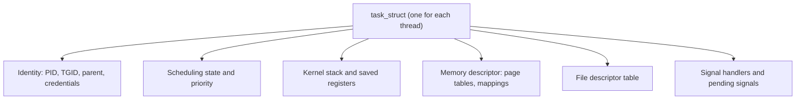
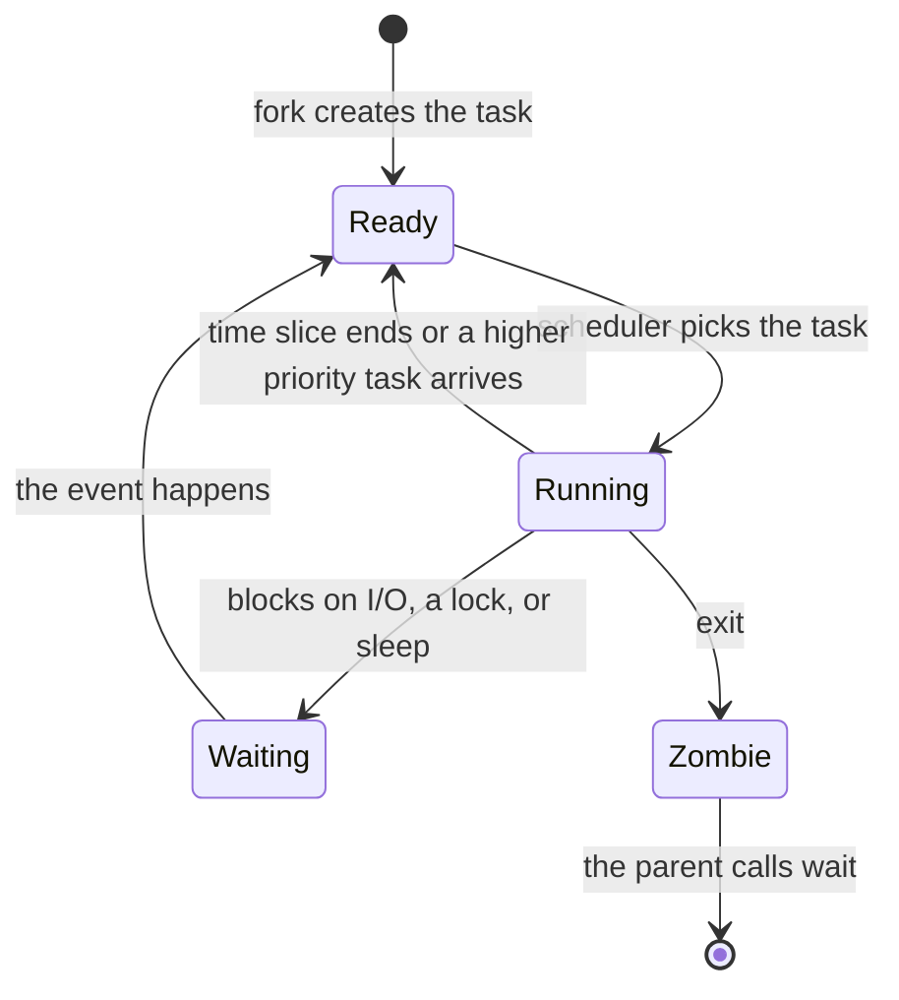
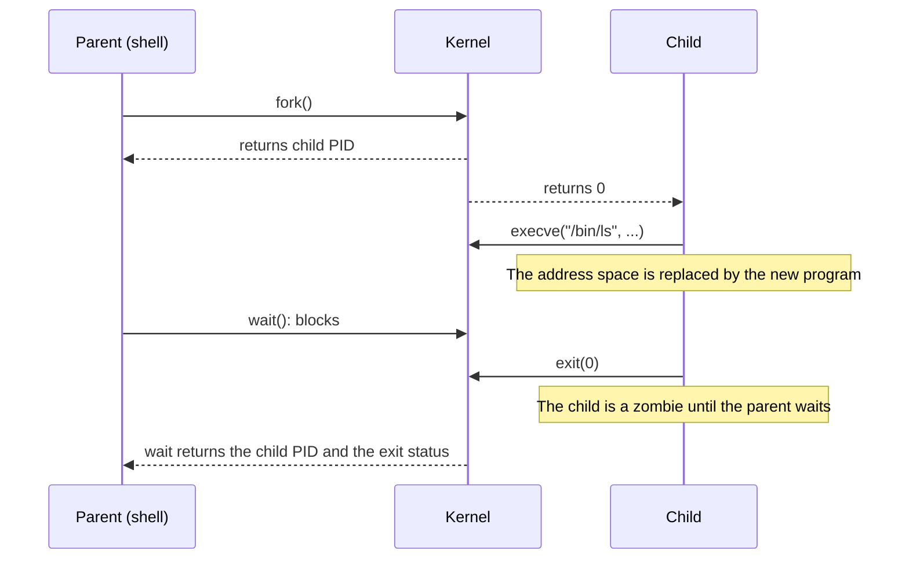
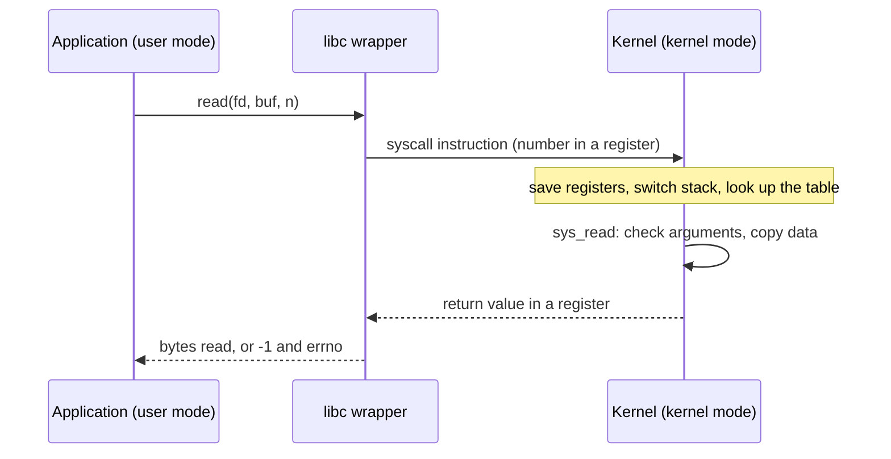
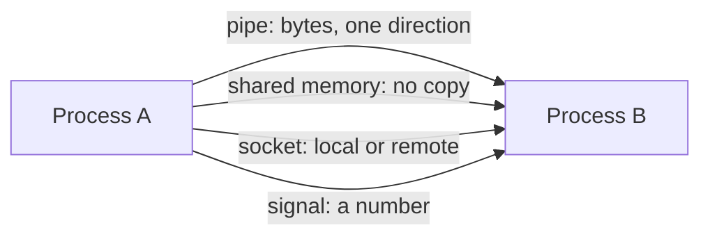

# Processes and Threads

A process is a running program with its own address space. A thread is one flow of execution inside a process. This page explains what the Linux kernel stores for each, how `fork`, `exec`, `wait`, and `exit` create and end processes, how a thread differs from a process in the kernel, what a system call and a context switch cost, and how a Java thread maps to an operating system (OS) thread. CPU scheduling policy is in [CPU Scheduling](02-cpu-scheduling.md). Locks and deadlock at the OS level are in [Synchronization](03-synchronization.md). Virtual memory is in [Memory Management](04-memory-management.md). The Java side of threads is in [Concurrency Basics](../java/07-concurrency-basics.md).

## Why It Matters

Interviews ask "What is the difference between a process and a thread?", "What happens when you call `fork`?", "What is a zombie process?", and "What does a context switch cost?". A candidate who lists definitions gets partial credit. A candidate who says that a Linux thread is a task that shares the address space of its siblings, that `fork` copies page tables and not pages, and that the indirect cost of a switch is the cold cache and the TLB, gets full credit. On the job, the same knowledge explains `java.lang.OutOfMemoryError: unable to create native thread`, a container that fills with zombies, a service that slows down when the thread count grows, and a system call that appears in a profile. It also explains why a JVM uses threads, and a browser uses processes.

## Core Concepts

**Process**: a running instance of a program. The kernel gives a process its own virtual address space, a table of open file descriptors, credentials, and a set of signal dispositions. A process contains one or more threads.

**Thread**: one flow of execution. A thread has its own stack, its own register values (including the program counter), and its own thread-local state. All threads of a process share the address space, the open file descriptors, and the signal dispositions. `pthreads(7)` lists the shared and the per-thread attributes (see "Threads in Linux").

**Task**: the Linux kernel's name for the schedulable entity. The kernel describes each task with a `task_struct`. A single-threaded process is one task. A process with ten threads is ten tasks. The scheduler schedules tasks, not processes.

**Process control block (PCB)**: the kernel's record of a process. In Linux, the PCB is spread over the `task_struct` and the structures that it points to: the memory descriptor, the file descriptor table, the signal handlers, and the credentials. The textbook term is PCB. The Linux source says `task_struct`.

**Address space**: the range of virtual addresses that a process can use. The hardware translates a virtual address to a physical address with the page tables of the process. See [Memory Management](04-memory-management.md).

**File descriptor**: a small integer that a process uses to refer to an open file, a pipe, a socket, or another kernel object. The process keeps a table that maps each descriptor to an *open file description* in the kernel.

**Credentials**: the user ID, the group IDs, and the capabilities that the kernel checks when the process asks for a privileged operation.

**User mode and kernel mode**: two privilege levels of the CPU. Code in user mode cannot execute privileged instructions and cannot access kernel memory. Code in kernel mode can. The kernel runs in kernel mode. Application code runs in user mode.

**System call**: a request from a user-mode program to the kernel, for example `read`, `write`, `fork`, `mmap`. The program executes a special instruction that switches the CPU to kernel mode at a fixed kernel entry point.

**Context switch**: the act of stopping one task on a CPU and starting another. The kernel saves the registers of the first task and restores the registers of the second task. If the two tasks belong to different processes, the kernel also changes the address space.

**Zombie process**: a process that has ended but that its parent has not yet waited for. The process keeps only its entry in the process table, so that the parent can read the exit status.

**Orphan process**: a running process whose parent has ended. The kernel gives the orphan a new parent: `init` (PID 1) or the nearest ancestor that is a *subreaper* (`wait(2)`).

**Copy-on-write (COW)**: a technique that lets two owners share a page until one of them writes to it. The write triggers a page fault, and the kernel then copies the page.

**Inter-process communication (IPC)**: the mechanisms that let separate processes exchange data: pipes, signals, shared memory, sockets, and message queues.

## How It Works

### What the kernel stores for a process



In the diagram, the memory descriptor, the file descriptor table, and the signal handlers are separate objects. A thread and its siblings point to the same objects. A new process gets copies. This split is the whole difference between a thread and a process in Linux, and the next sections show it in `clone`.

The address space of a process on Linux has these regions. The exact addresses depend on the architecture and on address space layout randomization.

```text
high addresses
+--------------------------+
| kernel (not accessible)  |
+--------------------------+
| stack (grows down)       |   one stack for each thread
+--------------------------+
| memory-mapped files and  |   shared libraries, mmap, thread stacks
| anonymous mappings       |
+--------------------------+
| heap (grows up)          |   brk, and mmap for large malloc
+--------------------------+
| bss, data                |   global variables
+--------------------------+
| text                     |   program code, read-only
+--------------------------+
low addresses
```

### Process states

A Linux task is in one of a few states. The `ps(1)` man page lists these codes: `R` (running or runnable), `S` (interruptible sleep), `D` (uninterruptible sleep, usually I/O), `T` (stopped by a job control signal), `t` (stopped by a debugger), `Z` (zombie), and `I` (idle kernel thread). The state `X` (dead) should never be visible. The textbook model has five states: new, ready, running, waiting, and terminated. The table maps one to the other.

| Textbook state | Linux `ps` code | Meaning |
|---|---|---|
| New | (not visible) | The kernel builds the process. It is not yet runnable |
| Ready | `R` | The task waits in a run queue for a CPU |
| Running | `R` | The task runs on a CPU. `ps` shows `R` for both ready and running |
| Waiting | `S` or `D` | The task waits for an event. `S` accepts signals. `D` does not |
| Terminated | `Z` | The task ended. The parent has not collected the exit status |
| (not in the five-state model) | `T` or `t` | A job control signal (`SIGSTOP`, `SIGTSTP`) or a debugger stopped the task |



The `D` state matters on the job. A task in `D` state usually does not react to signals, because it waits inside the kernel for I/O (for example on a failed network file system). Some kernel code waits in a *killable* sleep, which `ps` also shows as `D` but which a fatal signal such as `SIGKILL` can end. Linux counts tasks in `R` and `D` state in the load average (`uptime(1)`). Section "Diagnostic tools" in [Linux for Developers](07-linux-for-developers.md) covers how to read it.

!!! note "The Java thread states are not the OS states"
    `Thread.State` has six values: `NEW`, `RUNNABLE`, `BLOCKED`, `WAITING`, `TIMED_WAITING`, and `TERMINATED`. The javadoc says that they are "virtual machine states which do not reflect any operating system thread states". A Java thread that blocks in a `read` on a socket is `RUNNABLE` in Java and `S` in the kernel. See [Concurrency Basics](../java/07-concurrency-basics.md).

### Creating a process: `fork`, `exec`, `wait`, `exit`

Unix creates a new program in two steps. `fork` creates a copy of the calling process. `exec` replaces the program in the process with another program. The shell does this for every command that you type.



#### `fork`

`fork(2)` creates a child process. The man page states these rules:

- The child has its own unique PID. Its parent PID is the PID of the caller.
- The child has a single thread: the one that called `fork`.
- The child gets a copy of the whole virtual address space of the parent. Under Linux, `fork` uses copy-on-write pages, so the main cost is the copy of the page tables and the creation of the child's task structure.
- The child inherits copies of the open file descriptors. Each copy refers to the same open file description as the descriptor in the parent. The two processes share the file offset and the status flags.
- The child does not inherit memory locks or timers. Its set of pending signals starts empty, and its resource usage counters start at zero.

The return value tells the two processes apart. The parent gets the PID of the child. The child gets 0. On failure, the parent gets -1.

##### Why COW makes `fork` cheap

At `fork`, the kernel does not copy the memory pages. It copies the page tables, and it marks every writable private page read-only in both processes. When either process writes to such a page, the CPU raises a page fault. The kernel then allocates a new page, copies the content, and maps the new page as writable for the writing process. A process that calls `exec` right after `fork` writes to almost none of the shared pages, so almost nothing is copied. The cost of `fork` still grows with the size of the parent, because the kernel copies the page tables. A parent with a large address space takes longer to fork than a small one.

!!! warning "`fork` in a multithreaded program"
    The child has only the thread that called `fork`, but it has a copy of the state of every mutex and condition variable. If another thread of the parent held a lock at the moment of `fork`, the lock stays locked in the child, and no thread exists in the child that can release it. The man page says that after `fork` in a multithreaded program, the child can safely call only async-signal-safe functions until it calls `execve`. For this reason, a program with threads should call `exec` right after `fork`, or use a spawn API.

##### `vfork`, `posix_spawn`, and `clone3`

`fork` followed by `exec` is the classic pattern, but the copy of the page tables is wasted work if the child replaces its program at once. Two alternatives avoid it. `vfork` and `clone` with `CLONE_VFORK` suspend the parent until the child calls `execve` or exits, and the child borrows the memory of the parent (`clone(2)`). `posix_spawn` is a library call that creates a child and runs a new program in one step. `clone3(2)` is the newer system call that has all the features of `clone`. Java is an example: `ProcessBuilder` on Linux uses `posix_spawn` by default in JDK 21. The launch mechanism can be changed with the system property `jdk.lang.Process.launchMechanism` to `FORK` or `VFORK` (`ProcessImpl.java` in the JDK source).

#### `exec`

`execve(2)` replaces the program of the calling process. The man page says:

- The PID stays the same.
- The text, data, bss, and stack of the process are overwritten with the new program, and memory mappings are not preserved.
- File descriptors stay open unless the descriptor has the close-on-exec flag.
- All threads other than the caller are destroyed.
- Signals that had a handler return to the default action. Ignored signals stay ignored.

The stay-open rule is how a shell connects a pipeline. The shell forks a child, changes the descriptors 0 and 1 of the child to the ends of a pipe, and then calls `exec`. The new program reads and writes on those descriptors without knowing it. It is also a security risk: a child that you start can inherit an open descriptor that it should not have, unless the descriptor has close-on-exec.

#### `exit` and `wait`

A process ends with `exit` (or by a signal). The kernel frees the address space and closes the descriptors. It keeps a small record with the exit status. The process is now a zombie (`Z` in `ps`).

The parent collects the record with `wait(2)` or `waitpid`. The call returns the PID of the child and the status. The macros `WIFEXITED`, `WEXITSTATUS`, `WIFSIGNALED`, and `WTERMSIG` decode the status. `WEXITSTATUS` returns the low 8 bits of the exit code, so `exit(256)` looks like `exit(0)` to the parent. After the `wait`, the kernel removes the record.

!!! info "Zombie and orphan"
    A **zombie** is a child that ended and that the parent did not wait for. A zombie uses no CPU and almost no memory, but it holds a slot in the kernel process table. `wait(2)` says: "If this table fills, it will not be possible to create further processes." A zombie cannot be killed, because it is already dead. You remove it by making the parent call `wait`, or by ending the parent.

    An **orphan** is a running child whose parent ended. The kernel reparents it to `init` or to the nearest subreaper. `init` calls `wait` for its children, so an orphan does not stay a zombie.

If the parent sets the action for `SIGCHLD` to `SIG_IGN`, or sets the `SA_NOCLDWAIT` flag, the children that end do not become zombies. A later `wait` then blocks until all children have ended and fails with `ECHILD`, so the parent loses the exit statuses (`wait(2)`, Linux 2.6 and later).

A container shows the zombie problem. The first process in a container has PID 1. If that process is your application, and it does not call `wait`, the orphans that it adopts become zombies, and nothing reaps them. The usual fixes are a small init program as PID 1, or a runtime option that starts one. The details are in [Linux for Developers](07-linux-for-developers.md).

### Threads in Linux

Linux has no separate thread object. A thread is a task that the kernel creates with `clone(2)`. The `clone` call takes flags that say which resources the new task shares with the caller:

| Flag | What it shares |
|---|---|
| `CLONE_VM` | The address space. Writes and `mmap` calls of one task are visible to the other |
| `CLONE_FS` | The root directory, the current directory, and the `umask` |
| `CLONE_FILES` | The file descriptor table |
| `CLONE_SIGHAND` | The table of signal handlers (requires `CLONE_VM`) |
| `CLONE_THREAD` | The thread group: the new task has the same process ID as the caller (requires `CLONE_SIGHAND`) |
| `CLONE_SETTLS` | Not a sharing flag. It sets the thread-local storage pointer of the new task |

A `fork` is a `clone` that shares none of these. A thread is a `clone` that shares all of these. The man pages say that `fork` creates a child "in a manner similar to" `clone`, and that `clone` gives finer control over what the two share. The C library (glibc) implements `pthread_create` on top of `clone`, with the sharing flags set. `pthreads(7)` says that the NPTL implementation (Native POSIX Thread Library, available since glibc 2.3.2 and Linux 2.6) is a *1:1* implementation: "each thread maps to a kernel scheduling entity", and that it uses futexes for synchronization.

The thread group has an ID. Since Linux 2.4, `getpid()` returns the thread group ID (TGID), which all threads of the process share. `gettid()` returns the unique ID of each thread. The thread that starts the process is the group leader, and its thread ID equals the process ID. This is why `ps -L` and `top -H` show many thread IDs for one PID.

What threads share and what they own (`pthreads(7)`):

| Shared by all threads | Own to each thread |
|---|---|
| Process ID, parent process ID | Thread ID |
| User and group IDs | Signal mask |
| Open file descriptors | The stack (local variables) |
| Signal dispositions | `errno` |
| Current and root directory, `umask` | Alternate signal stack |
| Resource limits | Real-time scheduling policy and priority |
| Interval timers | CPU affinity |
| The address space (heap, globals, code) | Thread-local storage (the pointer is per thread) |

The default stack size of a new thread comes from the soft limit `RLIMIT_STACK` (`ulimit -s`), if the limit is not unlimited (`pthreads(7)`). A common value is 8 MiB. That is virtual memory: the kernel backs a stack page with RAM only after the thread touches it. One measurement of 10,000 threads that Bendersky made on Linux showed about 80 GiB of virtual memory and about 80 MiB of resident memory (2018, approximate, see "Further Reading"). The JVM does not use this default: it sets the stack size itself (see "How a Java thread maps to an OS thread").

#### Kernel threads and user threads

A **kernel thread** is a task that runs only in kernel mode and has no user address space. The kernel uses kernel threads for background work, for example flushing dirty pages and handling interrupt work. `ps` shows them with the command name in square brackets, such as `[kworker/0:1]`, because they have no command line (`ps(1)` prints the executable name in brackets when the arguments are not available). Most of them have the parent `kthreadd`, the kernel thread that creates other kernel threads. The kernel starts `kthreadd` right after `init`, so on a normal system it has PID 2 (`rest_init` in `init/main.c`).

A **user thread** (also called a user-level or green thread) is a thread that a library or a runtime schedules in user space. The kernel does not know that it exists. A **kernel-supported thread** is a thread that the kernel schedules, which is what `clone` creates. Do not confuse the two pairs: "kernel thread" means a thread that belongs to the kernel itself, and "kernel-supported thread" means an application thread that the kernel schedules.

#### Thread models: 1:1, M:N, N:1

| Model | Mapping | Example | Strength | Weakness |
|---|---|---|---|---|
| 1:1 | One user thread for each kernel task | Linux NPTL, Java platform threads | Uses all CPUs. A blocking call blocks only that thread. The kernel schedules everything | Each thread costs a kernel task and a stack. A context switch enters the kernel |
| N:1 | Many user threads on one kernel task | Early green threads | A switch needs no system call | One blocking system call blocks all threads. Uses one CPU |
| M:N | M user threads on N kernel tasks | Go goroutines, Java virtual threads | Cheap threads (many thousands). Uses all CPUs | The runtime needs its own scheduler. A blocking system call that the runtime cannot intercept blocks a kernel task |

Java platform threads use the 1:1 model: each `Thread` runs on its own OS thread for its whole life. Java virtual threads (JEP 444, final in Java 21) use the M:N model: the JDK mounts many virtual threads on a small pool of carrier platform threads. The model, the scheduler, and the pinning rules are in [Virtual Threads](../java/10-virtual-threads.md). The Go runtime also uses M:N scheduling. Its scheduler comment in `runtime/proc.go` defines G (a goroutine), M (a worker thread, which is an OS thread), and P (a processor, "a resource that is required to execute Go code"). An M needs a P to run Go code, but an M that blocks in a system call can release its P, so that another M runs the other goroutines.

### User mode, kernel mode, and the system call path

The CPU enforces the two modes. x86 has four privilege rings, and Linux uses only ring 3 (user) and ring 0 (kernel) (Intel SDM, volume 3, chapter 5). On Arm (AArch64), the levels are EL0 (user) and EL1 (kernel) (Arm Architecture Reference Manual). The kernel sets up the page tables so that user code cannot read kernel memory (the hardware then raises a fault).

A system call works in these steps. The steps below describe x86-64 Linux. Other architectures use a different instruction and different registers: AArch64 uses `svc #0`. The `syscall(2)` man page lists the details for each architecture. On x86-64, the system call number goes in `rax`, and the arguments go in `rdi`, `rsi`, `rdx`, `r10`, `r8`, and `r9`.

1. The program puts the system call number and the arguments into registers. In practice, the C library wrapper (`read`, `write`) does this.
2. The program executes the `syscall` instruction. The CPU switches to kernel mode and jumps to the kernel entry point.
3. The kernel saves the user registers, and it switches to the kernel stack of the task.
4. The kernel looks up the number in the system call table and calls the handler function. The handler checks the arguments. It copies data between user memory and kernel memory.
5. The handler returns a result. The kernel restores the user registers and executes the instruction that returns to user mode.



Two points explain the cost and the design.

**The switch itself is not a context switch.** A system call changes the privilege level on the same task. Without KPTI, the address space is the same (the kernel is mapped into each process, and the page table protection bits keep user code out). The task does not go through the scheduler, unless the call blocks.

**Some mitigations add cost.** Kernel page-table isolation (KPTI) is the mitigation for the Meltdown vulnerability. With KPTI, the kernel unmaps most of its memory while the CPU runs user code, so each system call must switch page tables. The kernel documentation says that a write to the page-table base register costs on the order of a hundred cycles and happens at every entry and exit, and that PCID (see the context switch section) reduces the cost because the CPU does not then flush the whole TLB (`docs.kernel.org`, x86 page table isolation). A kernel can be booted with `nopti` to turn KPTI off. In one benchmark on a Linux 5.10-rc4 kernel, a `getpid` call took about 0.08 microseconds without KPTI and about 0.20 microseconds with KPTI. The author of the post (Alexandre Chartre, Linux kernel mailing list, 2020) measured with `perf bench syscall basic` and libMicro, did not state the CPU, and called this "a very extreme case". For a system call of about 2 microseconds he estimated an overhead of about 6%. Treat these numbers as approximate and as the cost of the cheapest call. A system call that copies data, or that waits for a device, costs far more.

The rule for developers: a system call costs more than a function call, and the per-call cost is small against a disk or a network wait. It matters in a loop that makes millions of calls, for example a read of one byte at a time from an unbuffered stream. A buffer reduces the number of calls. This is the reason that `BufferedInputStream` and `BufferedReader` exist.

The *vDSO* (virtual dynamic shared object) removes the switch for a few calls. The kernel maps a small shared library into each process. On x86-64, it exports `clock_gettime`, `gettimeofday`, `time`, and `getcpu`. The kernel places the needed data in memory that the process can read, so the call is an ordinary function call (`vdso(7)`). A side effect: these calls do not appear in `strace` output.

### Context switch

A context switch happens when the kernel stops the running task and runs another one on the same CPU. Reasons: the time slice ended, the task blocked (on I/O, a lock, or `sleep`), a task with higher priority became runnable, or the task yielded. An interrupt does not by itself cause a context switch: the kernel handles the interrupt on the current task, and then it may decide to switch.

#### What the kernel saves and restores

- The user-mode registers of the old task: the kernel already saved them on its kernel stack when the task entered the kernel (by a system call, an interrupt, or an exception). The floating-point and vector registers are also part of the state of a task, and the kernel saves and restores them as well (the details depend on the architecture and the kernel version).
- The kernel stack pointer: each task has its own kernel stack. On x86-64, the assembly function `__switch_to_asm` pushes the callee-saved registers (`rbp`, `rbx`, `r12` to `r15`) on the stack of the old task, saves the stack pointer in the old `task_struct`, loads the stack pointer of the new task, and pops the same registers from the new stack (`arch/x86/entry/entry_64.S`).
- If the new task belongs to another process, the address space: the kernel loads the page-table base register of the new process (`CR3` on x86-64).

The kernel does not copy the stack of the task. The stack stays in memory. The kernel only changes the pointer to it. It updates the run queue and the accounting data.

#### Why a thread switch is cheaper than a process switch

If both tasks are threads of the same process, they use the same address space. The kernel does not change the page-table base. The Linux source for x86 says so in a comment: "we are just switching from one thread in a process to another thread in the same process. No TLB flush required" (`arch/x86/mm/tlb.c`). If the two tasks belong to different processes, the kernel loads another page-table base (`CR3` on x86-64). The TLB (translation lookaside buffer) is the CPU cache of address translations, and PCID tags its entries with an address space ID, so that x86-64 Linux can often keep the entries of a recently used process. [Memory Management](04-memory-management.md) explains the TLB.

#### Direct and indirect costs

| Cost | What it is | Size |
|---|---|---|
| Direct | The kernel code that saves state, picks the next task, and restores state | About 1.2 to 1.5 microseconds for a thread switch when both threads are pinned to one core, and about 2.2 microseconds when they are not. Bendersky measured two threads that wake each other through a pipe, and through a condition variable, on an Intel Haswell i7-4771 (2018). He reports only the direct cost, and he found that a low-end Xeon was 50 to 75 percent slower. These numbers are approximate and depend on the CPU and the kernel |
| Indirect: CPU caches | The new task finds the caches (L1, L2) full of data of the old task. Its first accesses miss and go to a lower level or to memory | Depends on the working set of the task. It can exceed the direct cost |
| Indirect: TLB | The new process finds the TLB without its translations (partly avoided by PCID) | Each TLB miss costs a page-table walk |
| Indirect: branch predictor | The predictor state belongs to the old task | Small, and hard to measure |

Use the number as an order of magnitude: a context switch takes microseconds, not nanoseconds. The latency numbers on [Back-of-Envelope Estimation](../hld/back-of-envelope-estimation.md) put a memory reference at about 100 ns, so a switch costs the time of tens of memory references, and the cold cache adds to that. This page does not give a measured process switch time against a thread switch time, because the source that it uses measured only thread switches. The comparison above follows from the mechanism.

Consequences for a Java backend:

- A pool with far more runnable threads than CPU cores makes the kernel switch often. The throughput can fall, because the CPU does switch work instead of request work.
- A thread that blocks (on a lock, on I/O) causes a switch. A design that avoids blocking, such as an event loop or virtual threads, causes fewer kernel switches.
- A *voluntary* switch means the task blocked. A *nonvoluntary* switch means the kernel preempted the task. The per-process counters appear in `/proc/<pid>/status` as `voluntary_ctxt_switches` and `nonvoluntary_ctxt_switches` (`proc_pid_status(5)`). Many nonvoluntary switches mean that the CPUs are oversubscribed.

### Inter-process communication

Processes do not share memory, so they need a kernel mechanism to exchange data.

| Mechanism | How it works | Notes |
|---|---|---|
| Pipe | A kernel buffer with a read end and a write end. A parent creates it before `fork`, and the child inherits it | One direction. The default capacity is 16 pages on Linux, which is 65,536 bytes with 4 KiB pages, and a write of up to `PIPE_BUF` (4096 bytes on Linux) is atomic. A read on a pipe with no writers returns 0 (end of file). A write on a pipe with no readers raises `SIGPIPE` (`pipe(7)`) |
| Named pipe (FIFO) | A pipe with a name in the file system | Unrelated processes can open it |
| Signal | The kernel interrupts a process and runs a handler, or takes a default action | Carries almost no data (a number). See below |
| Shared memory | Two processes map the same memory object into their address spaces. POSIX shared memory uses `shm_open`, `ftruncate`, and `mmap`. On Linux, the object lives in a `tmpfs` file system, normally at `/dev/shm` (`shm_overview(7)`) | The fastest option: after the setup, no system call or copy is needed to exchange data. The processes must synchronize access themselves (for example, with a semaphore in the shared region) |
| Socket | A two-way endpoint. A Unix domain socket connects processes on one machine, and it can also pass an open file descriptor or the credentials of the sender to another process (`unix(7)`). A TCP socket connects processes on any machine | The same API for local and remote communication. See [TCP and UDP](../networking/03-tcp-and-udp.md) |
| Message queue | The kernel keeps a queue of messages with a priority. POSIX queues (`mq_open`) have names such as `/myqueue` | Message boundaries are kept. The default limits on Linux are 10 messages of 8,192 bytes (`mq_overview(7)`) |

**Signals** (one paragraph; the home is [Linux for Developers](07-linux-for-developers.md)). A signal is a notification that the kernel delivers to a process. The process can ignore it, handle it, or let the default action run. `SIGTERM` asks a process to end, and the process can catch it. `SIGKILL` cannot be caught. `SIGCHLD` tells a parent that a child ended. On Linux, the JDK registers handlers for `SIGHUP`, `SIGINT`, and `SIGTERM`. Each handler starts the JVM shutdown sequence, which runs the shutdown hooks, and the exit code is 128 plus the signal number (`java.lang.Terminator` in the JDK source). The `Runtime` javadoc says only that an external event such as a signal starts the shutdown sequence. `SIGKILL` cannot be caught, so no hook runs.



Choose by need. Use a pipe for a parent and child in a command pipeline. Use a socket if the processes may run on different machines later, or if you need two-way communication with many clients. Use shared memory if the data volume is high and you can accept the synchronization work. Use a message queue (or, in a distributed system, a broker) if messages need priorities or must survive a slow consumer.

### Process against thread

| Property | Process | Thread |
|---|---|---|
| Address space | Own | Shared with the process |
| Isolation | Strong: a bug cannot write into another process | None: a thread can overwrite the data of any other thread in the process |
| Crash containment | A crash (for example `SIGSEGV`) ends only that process | An uncaught fatal signal ends the whole process, with all threads |
| Creation cost | High: the kernel copies the page tables, the descriptor table, and more | Lower: the new task shares them. The stack is the main new resource |
| Switch cost | Higher (address space change, TLB and cache effects) | Lower (same address space) |
| Communication | Needs IPC with a system call or setup | Reads and writes shared memory directly. Needs locks |
| Memory overhead | Own page tables and own copy of any written page. Shared libraries and unwritten COW pages are shared | A stack (virtual memory of 1 MiB to 8 MiB, resident only for the touched pages) and a `task_struct` |

**Why Chrome uses processes.** The Chromium design document says that it is nearly impossible to build a rendering engine that never crashes or hangs. If the renderers run in separate processes, a crash affects only the affected tabs or frames, and the browser shows a "sad tab" that the user can reload. Separate processes also let Chromium restrict what each renderer can reach on the system (a sandbox). The browser accepts a higher memory cost for this isolation.

**Why a JVM uses threads.** A Java server runs one process with many threads that share the heap. The threads exchange objects by reference, with no copy and no IPC. This suits a request handler that needs shared caches, connection pools, and configuration. The price is that the threads must synchronize access to shared state (see [Concurrency Basics](../java/07-concurrency-basics.md)), and a fatal error in native code, or an `OutOfMemoryError` that is not handled, can end all requests. Many deployments run several JVM processes behind a load balancer, which gives process-level isolation between the instances.

### How a Java thread maps to an OS thread

`Thread.start()` on a platform thread asks the JVM to create a native thread. On Linux, the HotSpot function `os::create_thread` (in `os_linux.cpp`) calls `pthread_attr_setstacksize` with the stack size, `pthread_attr_setdetachstate`, and `pthread_create`. The new native thread runs the JVM's entry function, which then calls the `run()` method of the Java thread. Through `pthread_create` and `clone`, the Java thread becomes one Linux task, with its own task ID.

Facts that follow from this:

- **The stack size** of a Java thread comes from `-Xss` (or the `Thread` constructor argument). The `java` command documentation gives 1024 KB as the default on Linux x64 and 2048 KB on Linux AArch64, and says that the size may be rounded up to a multiple of the page size. `os::create_thread` passes the size to `pthread_attr_setstacksize` (HotSpot also adds guard pages and aligns the size to the page size), so the `RLIMIT_STACK` default of the C library does not apply, and `ulimit -s` does not set the stack size of Java threads. The `java` launcher does not run `main` on the primordial thread of the process either: `ContinueInNewThread` in `java.c` creates a new thread with the `-Xss` size (or the JVM default) for it. HotSpot reads `RLIMIT_STACK` only to find the extent of the primordial thread (`os::Linux::capture_initial_stack`).
- **`OutOfMemoryError: unable to create native thread`** means that `pthread_create` failed. Causes: a limit on the number of processes and threads (`ulimit -u`, which is `RLIMIT_NPROC` and counts threads; the sysctl `kernel.threads-max`; `kernel.pid_max`; a container or cgroup `pids.max` limit), a limit on memory mappings (`vm.max_map_count`, because each thread stack and its guard page are mappings), or too little virtual or physical memory for the stack. Each of these limits is a Linux setting, so the fix is to find which one the host or container sets. It does not mean that the Java heap is full.
- **Thread IDs.** The Java thread ID from `Thread.threadId()` (Java 19 and later; `getId()` is deprecated) is a number that the JVM generates when it creates the `Thread` object (`Thread` javadoc). The native thread ID is a different number: on Linux it is the kernel thread ID that `gettid` returns. A thread dump from `jstack` or `jcmd <pid> Thread.print` prints the native ID in the field `nid`. JDK 21 prints it in decimal (`nid=12345`, HotSpot `osThread.cpp`), and JDK 17 and earlier print it in hexadecimal (`nid=0x3039`). To find the Java thread that uses the CPU, run `top -H -p <pid>`, take the thread ID of the busy thread, and search the dump for that `nid`. Convert the ID to hexadecimal (`printf '%x\n' 12345`) only for a JDK 17 or older dump.
- **Scheduling** is the kernel's task. The Java priority is only a hint. The JVM may map it to an OS priority or ignore it. Do not use it for correctness.
- **A virtual thread** is not a native thread. It runs on a carrier, which is a platform thread. See [Virtual Threads](../java/10-virtual-threads.md).

A thread on the JVM also costs more than the Java stack. The JVM thread has its own native structures. The JIT compiler threads and the garbage collector threads are native threads of the same process, and they are not Java application threads, so a thread dump lists them without Java stacks. The `jcmd <pid> Thread.print` command lists all of them.

## Trade-offs and When to Use

| Decision | Choose A | Choose B |
|---|---|---|
| Isolation against sharing | Separate processes: fault isolation, security, no shared state bugs | Threads: cheap sharing of data, one deployment unit |
| Thread model | 1:1 platform threads: simple, uses all CPUs, a blocking call is fine for a small number of threads | M:N (virtual threads, goroutines): many thousands of blocking tasks, with a runtime scheduler |
| IPC mechanism | Pipe or socket: simple, the kernel synchronizes | Shared memory: highest throughput, you synchronize |
| Concurrency level | Few threads close to the core count for CPU work | Many threads (or virtual threads) for I/O-bound work |
| `fork` against a new program | `fork` (without `exec`) when the child needs the parent's state, for example a copy-on-write snapshot | `fork` and `exec`, or a spawn call, to start a different program |

A snapshot is the classic use of `fork` without `exec`. A parent forks, and the child writes its memory image to disk while the parent continues to serve requests. The copy-on-write pages keep the child's view consistent. The memory use of the parent grows as it writes.

Recommendation: start with a thread-per-request design only if the thread count stays below a few thousand. For more concurrent blocking tasks, use virtual threads or an event loop. Check the thread count in production with `jcmd <pid> Thread.print` or `ps -L`.

## Java Example

The first program simulates the process lifecycle that this page describes. A tiny kernel holds a process table. It supports `fork`, `exit`, and `wait`. When a process exits, the kernel reparents its children to `init` and marks it as a zombie. The program shows a zombie, an orphan, and the reap. It models states and relations only: it does not run real processes. The state letters are `R` (runnable), `S` (sleeping), and `Z` (zombie).

In the output, PID 2 is the shell, 3 is process `a`, 4 is process `b`, and 5 is a child of `a`. The notation `5<-3:R` means "PID 5, parent 3, state R". At the end, `init` is in state `S`, because it called `wait` while it still had a child (the shell).

```java
import java.util.ArrayList;
import java.util.List;
import java.util.Map;
import java.util.TreeMap;

public class ProcessSim {
    enum State { RUNNABLE, SLEEPING, ZOMBIE }

    static final class Proc {
        final int pid;
        int ppid;
        State state = State.RUNNABLE;
        int exitStatus = -1;
        Proc(int pid, int ppid) {
            this.pid = pid;
            this.ppid = ppid;
        }
    }

    static final class Kernel {
        private final Map<Integer, Proc> table = new TreeMap<>();
        private int nextPid = 2;

        Kernel() {
            table.put(1, new Proc(1, 0)); // init
        }

        /** fork: the child gets a new pid and the parent's pid as its parent. */
        int fork(int parent) {
            int pid = nextPid++;
            table.put(pid, new Proc(pid, parent));
            return pid;
        }

        /** exit: the process becomes a zombie. Its children go to init. */
        void exit(int pid, int status) {
            Proc p = table.get(pid);
            p.state = State.ZOMBIE;
            p.exitStatus = status;
            for (Proc c : table.values()) {
                if (c.ppid == pid) {
                    c.ppid = 1;
                }
            }
            // If the parent sleeps in wait(), it wakes up.
            Proc parent = table.get(p.ppid);
            if (parent != null && parent.state == State.SLEEPING) {
                parent.state = State.RUNNABLE;
            }
        }

        /** wait: reap one zombie child, or sleep if there is none. Returns the reaped pid. */
        int waitFor(int parent) {
            boolean hasChild = false;
            for (Proc c : table.values()) {
                if (c.ppid == parent) {
                    hasChild = true;
                    if (c.state == State.ZOMBIE) {
                        table.remove(c.pid);
                        return c.pid;
                    }
                }
            }
            if (hasChild) {
                table.get(parent).state = State.SLEEPING;
            }
            return -1;
        }

        /** init reaps every zombie that it adopted. */
        void initReaps() {
            while (waitFor(1) != -1) {
                // keep reaping
            }
        }

        void dump(String title) {
            List<String> rows = new ArrayList<>();
            for (Proc p : table.values()) {
                rows.add(p.pid + "<-" + p.ppid + ":" + p.state.name().charAt(0));
            }
            System.out.println(title);
            System.out.println("  " + rows);
        }
    }

    public static void main(String[] args) {
        Kernel k = new Kernel();
        int shell = k.fork(1);
        int a = k.fork(shell);
        int b = k.fork(shell);
        int grandchild = k.fork(a);
        k.dump("after fork");

        k.exit(b, 0);
        k.dump("b exits, no wait yet");

        System.out.println("shell wait -> " + k.waitFor(shell));
        k.dump("shell reaped b");

        k.exit(a, 3);
        k.dump("a exits: 5 is an orphan");

        System.out.println("shell wait -> " + k.waitFor(shell));
        k.exit(grandchild, 0);
        k.dump("5 exits: zombie under init");
        k.initReaps();
        k.dump("init reaped 5");

        System.out.println("shell wait with no child -> " + k.waitFor(shell));
    }
}
```

<!-- expected-output -->
```text
after fork
  [1<-0:R, 2<-1:R, 3<-2:R, 4<-2:R, 5<-3:R]
b exits, no wait yet
  [1<-0:R, 2<-1:R, 3<-2:R, 4<-2:Z, 5<-3:R]
shell wait -> 4
shell reaped b
  [1<-0:R, 2<-1:R, 3<-2:R, 5<-3:R]
a exits: 5 is an orphan
  [1<-0:R, 2<-1:R, 3<-2:Z, 5<-1:R]
shell wait -> 3
5 exits: zombie under init
  [1<-0:R, 2<-1:R, 5<-1:Z]
init reaped 5
  [1<-0:S, 2<-1:R]
shell wait with no child -> -1
```

Read the output step by step. After `b` exits, entry `4<-2:Z` is a zombie: the shell has not called `wait`. After the shell waits, the entry is gone. After `a` exits, process 5 changes its parent from 3 to 1 (`5<-1`): it is an orphan, adopted by `init`. Process 3 stays a zombie until the shell waits. When 5 exits, it is a zombie under `init`, and `init` reaps it.

The second program shows what threads share and what they own. Four threads run the same loop. A local variable lives on each thread's own stack, so each thread counts to 1000. A `ThreadLocal` also gives each thread its own copy. The `AtomicInteger` is one object in the heap, so all threads add to it, and it ends at 4,000. The main thread joins the workers before it prints, so the output does not depend on the schedule.

```java
import java.util.ArrayList;
import java.util.Arrays;
import java.util.List;
import java.util.concurrent.atomic.AtomicInteger;

public class SharedVsStack {
    // Shared by all threads: one object in the heap.
    static final AtomicInteger sharedCounter = new AtomicInteger();
    // One copy for each thread: thread-local state.
    static final ThreadLocal<Integer> perThread = ThreadLocal.withInitial(() -> 0);

    public static void main(String[] args) throws InterruptedException {
        int threads = 4;
        int[] stackResults = new int[threads];
        int[] localResults = new int[threads];
        List<Thread> list = new ArrayList<>();
        for (int i = 0; i < threads; i++) {
            final int index = i;
            Thread t = new Thread(() -> {
                int onStack = 0; // a local variable lives on this thread's stack
                for (int n = 0; n < 1000; n++) {
                    onStack++;
                    perThread.set(perThread.get() + 1);
                    sharedCounter.incrementAndGet();
                }
                stackResults[index] = onStack;
                localResults[index] = perThread.get();
            });
            list.add(t);
            t.start();
        }
        for (Thread t : list) {
            t.join(); // join makes the writes above visible and the output deterministic
        }
        System.out.println("each stack counter:        " + Arrays.toString(stackResults));
        System.out.println("each ThreadLocal counter:  " + Arrays.toString(localResults));
        System.out.println("one shared heap counter:   " + sharedCounter.get());
        System.out.println("main thread ThreadLocal:   " + perThread.get());
    }
}
```

<!-- expected-output -->
```text
each stack counter:        [1000, 1000, 1000, 1000]
each ThreadLocal counter:  [1000, 1000, 1000, 1000]
one shared heap counter:   4000
main thread ThreadLocal:   0
```

The main thread sees its own `ThreadLocal` value, 0, because the workers changed only their own copies. In a real Linux process, the heap object is in the one shared address space, and each stack is a separate memory region of the same address space. The JVM threads are separate tasks in one thread group.

## Interview Angle

### Questions

??? question "What is the difference between a process and a thread?"

    A process is a running program with its own virtual address space, its own table of file descriptors, and its own credentials. A thread is one flow of execution inside a process. It has its own stack, registers, and thread-local state, and it shares the address space, the descriptors, and the signal handlers with the other threads of the process.

    The reason that the difference matters is isolation against cost. A process cannot write into the memory of another process, and a crash stays inside the process. Creating and switching processes costs more, and communication needs IPC. A thread shares memory directly, so communication is cheap, but a bug in one thread can corrupt the data of all threads, and a fatal fault ends the whole process.

    On Linux, the kernel does not have two separate objects. Both are tasks that `clone(2)` creates. A thread is a task that shares the address space, the descriptor table, and the signal handlers (`CLONE_VM`, `CLONE_FILES`, `CLONE_SIGHAND`, `CLONE_THREAD`). A process created by `fork` shares none of these.

??? question "What happens when a process calls `fork`? Why is it not slow for a large process?"

    The kernel creates a child task with a new PID. The child gets a copy of the page tables of the parent, a copy of the descriptor table (the copies refer to the same open file descriptions, so the two processes share file offsets), and a copy of the signal setup. The child has one thread: the one that called `fork`. `fork` returns the child PID to the parent and 0 to the child.

    The kernel does not copy the memory pages. It marks the writable private pages read-only in both processes (copy-on-write). The first write to a shared page causes a page fault, and the kernel copies that one page. A child that calls `exec` right after `fork` writes to almost nothing, so almost nothing is copied.

    The cost still grows with the size of the address space, because the kernel copies the page tables. For a very large process, a fork takes noticeable time. In a multithreaded parent, the child may hold a lock that no thread can release, so the child may call only async-signal-safe functions until `exec`.

??? question "What is a zombie process? How is it different from an orphan? How do you get rid of zombies?"

    A zombie is a process that ended and whose parent has not yet called `wait`. The kernel keeps the exit status and a process table entry so that the parent can read the status. The zombie uses no CPU and almost no memory. If the table fills, the system cannot create new processes. You cannot kill a zombie, because it is already dead.

    An orphan is a process that is still running and whose parent ended. The kernel reparents it to `init` (PID 1) or to the nearest subreaper. `init` calls `wait`, so an orphan that later ends does not stay a zombie.

    To remove a zombie, make the parent call `wait` or `waitpid`, set `SIGCHLD` to `SIG_IGN` (the kernel then does not create zombies, but `wait` fails with `ECHILD` and you lose the exit statuses), or end the parent so that `init` adopts and reaps the zombie. In a container, a PID 1 application that does not reap its adopted children collects zombies. Use a small init process as PID 1.

??? question "What does a context switch cost, and why is a thread switch cheaper than a process switch?"

    A context switch saves the registers of the running task and restores those of the next task, and it switches the kernel stack. If the next task is in another process, the kernel also loads the page-table base of that process. The direct cost is on the order of microseconds. One measurement on an Intel Haswell CPU gave 1.2 to 1.5 microseconds for a thread switch pinned to one core, and about 2.2 microseconds unpinned. These numbers vary by CPU and kernel.

    A thread switch inside one process keeps the address space, so the kernel does not change the page tables, and the TLB entries stay valid. A process switch changes the address space, so the TLB entries of the old process are not valid for the new one. PCID reduces this cost on modern x86-64 CPUs, because the TLB can hold entries of several address spaces.

    The indirect cost is often larger: the new task finds the L1 and L2 caches full of the old task's data, and its first accesses miss. For a Java service, this means that a thread count far above the core count costs throughput.

??? question "What is a system call, and what happens when a program calls `read`?"

    A system call is a request from user mode to the kernel. The C library wrapper puts the system call number and the arguments into registers and executes the `syscall` instruction. The CPU switches to kernel mode and jumps to the fixed kernel entry. The kernel saves the user registers, switches to the kernel stack of the task, and looks up the number in the system call table. The handler (`sys_read`) checks the arguments and copies data from the kernel buffer (for example the page cache) to the user buffer. If no data is ready, the task blocks and the scheduler runs another task. At the end, the kernel restores the registers and returns to user mode, and the wrapper returns the byte count or sets `errno`.

    A system call is not a context switch: it is a privilege change on the same task. It costs more than a function call (the cheapest call took about 0.08 to 0.2 microseconds in one kernel benchmark, depending on the Meltdown mitigation). This is why buffered streams exist: they make fewer system calls.

??? question "How does a Java thread map to an operating system thread?"

    A Java platform thread maps 1:1 to an OS thread. `Thread.start()` makes HotSpot create a native thread. On Linux, HotSpot calls `pthread_create` with the stack size from `-Xss` (1024 KB by default on Linux x64), and the C library creates a task with `clone`. The new thread runs a JVM entry function that calls `run()`. The kernel schedules the thread like any other task.

    The consequences: each thread costs a kernel task and a stack (virtual memory, resident only where touched). The OS limits the thread count (`ulimit -u`, `kernel.threads-max`, a container PID limit). `OutOfMemoryError: unable to create native thread` means that the thread creation failed, not that the heap is full. A blocking call blocks the native thread, and that is cheap for hundreds of threads and expensive for hundreds of thousands. Virtual threads (Java 21) use M:N scheduling to remove that limit for blocking code.

??? question "Why does Chrome use a process for each tab, but a JVM uses threads?"

    The two make opposite choices because they have opposite needs. A browser renders untrusted content with a large engine that has bugs. If a renderer crashes or is exploited, separate processes limit the damage to one tab, and the operating system can sandbox each renderer. The browser pays for this with more memory and with IPC for communication.

    A Java server runs code that the team trusts. Its requests share caches, connection pools, and configuration, so threads that share the heap are the natural fit: sharing needs no copy and no IPC. The price is that the code must synchronize access to shared state, and a fatal fault ends the whole process. A team gets fault isolation back by running several JVM instances behind a load balancer.

??? question "Compare the IPC mechanisms. When do you choose a pipe, shared memory, or a socket?"

    A pipe is a one-direction kernel buffer. It suits a parent and child, or a shell pipeline, and the kernel handles the synchronization: a read blocks on an empty pipe and a write blocks on a full one. A socket gives two-way communication, and a Unix domain socket and a TCP socket use the same API, so a design that starts local can later span machines. Shared memory maps one memory object into two processes. After the setup, the processes exchange data with no system call and no copy, so it has the highest throughput, but the processes must synchronize access themselves. A message queue keeps message boundaries and priorities. A signal carries almost no data and fits notification only.

    My choice: a socket by default, because it scales to several machines. A pipe for a simple parent-child stream. Shared memory only for a measured throughput need, and only with a synchronization plan.

??? question "What is the difference between the 1:1 and M:N thread models? Which does Java use?"

    In the 1:1 model, each user thread has its own kernel task. The kernel schedules every thread, so the threads run in parallel on all cores, and a blocking system call blocks only that thread. The cost is a kernel task and a stack for each thread, and a kernel context switch for each thread switch. Linux NPTL and Java platform threads use 1:1.

    In the M:N model, a runtime schedules M user-level tasks onto N kernel threads. A task is cheap, so the program can run hundreds of thousands of them. The runtime needs its own scheduler, and it must handle a blocking system call so that the call does not block a kernel thread that other tasks need. Go goroutines and Java virtual threads (Java 21, JEP 444) use M:N. A virtual thread that blocks on supported I/O unmounts from its carrier thread, so the carrier runs another virtual thread.

??? question "What does `exec` do, and why does Unix split process creation into `fork` and `exec`?"

    `exec` replaces the program in the calling process. The PID stays the same, the address space (text, data, stack, mappings) is replaced by the new program, other threads are destroyed, and caught signals return to their default action. File descriptors stay open unless they have the close-on-exec flag.

    The split lets the code between the two calls change the child's environment. A shell forks, then in the child it redirects descriptors 0, 1, and 2, changes the working directory, or sets limits, and only then calls `exec`. The new program inherits that setup without knowing it. A single "spawn" call would need many parameters to describe all these changes. Because `fork` uses copy-on-write, the extra step costs little.

### Follow-up Questions

??? question "A Java service shows 400 threads and a load average of 30 on an 8-core machine. What do you check?"

    Load average on Linux counts tasks that are runnable (`R`) or in uninterruptible sleep (`D`) (`uptime(1)`). Check which one it is. If many tasks are in `R`, the CPUs are oversubscribed: look at the context switch counters (`voluntary_ctxt_switches` and `nonvoluntary_ctxt_switches` in `/proc/<pid>/status`) and at the thread pool sizes. If many tasks are in `D`, they wait for I/O: look at the disk and the network file systems. Then use `top -H` to find the busy thread IDs and match them to `nid` in a `jstack` thread dump. On JDK 21 both are decimal. On JDK 17 and earlier, `nid` is hexadecimal, so convert the number first (`printf '%x\n' 12345`).

??? question "Can a thread and a process share a file offset?"

    Yes, in two cases. Threads of one process share the descriptor table, so they share the open file descriptions and the offsets. After `fork`, the parent and the child have separate descriptor tables, but the entries point to the same open file description, so they also share the offset and the status flags (`fork(2)`).

??? question "Why does `wait` return only the low 8 bits of an exit code?"

    The status that the parent reads encodes the exit code and the termination cause. `WEXITSTATUS` returns the low 8 bits of the exit code (`wait(2)`), so the range is 0 to 255. A program that calls `exit(256)` looks like `exit(0)` to the parent.

??? question "What happens to the other threads if one thread calls `exec`?"

    The kernel destroys all threads other than the caller (`execve(2)`). The caller continues in the new program as the only thread, and the PID stays the same.

### Red Flags

- "A thread is a lightweight process, and that is all." The statement ignores the shared address space, which is the real difference.
- "`fork` copies all the memory." On Linux it copies the page tables and uses copy-on-write for the pages.
- "You kill a zombie with `kill -9`." A zombie is already dead. You must make the parent wait, or end the parent.
- "A context switch costs nanoseconds." It costs microseconds directly, and more with cold caches.
- "A system call and a context switch are the same thing." A system call changes the privilege level of one task. A context switch changes the task.
- "`Thread.State.RUNNABLE` means the thread is on a CPU." It means that the thread can run, and it includes a thread that blocks in native I/O.
- "`OutOfMemoryError: unable to create native thread` means the heap is full." It means that the OS refused to create a thread.

## Common Mistakes

| Mistake | Why it hurts | Fix |
|---|---|---|
| A PID 1 application that never reaps children | Orphans become zombies, and the PID table fills | Run a small init as PID 1, or let the container runtime add one. See [Linux for Developers](07-linux-for-developers.md) |
| A thread pool with thousands of threads for CPU work | The kernel switches tasks often, and each thread holds a stack | Size a CPU-bound pool near the core count. Use virtual threads for blocking I/O |
| Reading one byte at a time from an unbuffered stream | Each byte is one system call | Wrap the stream in a buffer, or read blocks of 8 KiB or more |
| Raising `-Xss` for all threads to fix a `StackOverflowError` | The memory cost of every thread rises | Fix the recursion, or set a larger stack only for the thread that needs it (the `Thread` constructor takes a stack size) |
| Treating the Java thread priority as a guarantee | The JVM may ignore it, and Linux does not schedule by it | Do not use priority for correctness |
| Calling plain `fork` in a program with threads | The child can hold a lock that no thread releases | Call `exec` right after `fork`, or use a spawn API |
| Leaking descriptors into child processes | A child that you start inherits an open file or a socket | Set close-on-exec on descriptors that the child does not need |
| Assuming a `D`-state process dies on `SIGKILL` | Most waits in uninterruptible sleep ignore signals, because the task waits for the kernel | Fix the I/O cause (the device or the remote file system) |

## Commonly Confused With

| Looks like | Difference | Deciding question |
|---|---|---|
| Process against thread | A process has its own address space. A thread shares the address space of its process | Does the unit share memory with its siblings? |
| Zombie against orphan | A zombie ended and waits for the parent to collect its status. An orphan still runs and has lost its parent | Is it still running? |
| System call against context switch | A system call changes the privilege level of one task. A context switch changes which task runs | Did the CPU change the task, or only the mode? |
| Kernel thread against kernel-supported thread | A kernel thread is a task that belongs to the kernel and has no user space. A kernel-supported thread is an application thread that the kernel schedules | Does the task run user code? |
| `fork` against `exec` | `fork` creates a copy of the process. `exec` replaces the program in the same process | Does the PID change? (`fork` creates a new one. `exec` keeps it) |
| Java `RUNNABLE` against Linux `R` | `RUNNABLE` is a JVM state that includes threads blocked in native I/O. `R` means ready or running on a CPU | Which layer reports the state, the JVM or the kernel? |
| Platform thread against virtual thread | A platform thread has its own OS thread. A virtual thread shares carrier threads | Does the thread hold an OS thread while it blocks? |
| Voluntary against nonvoluntary context switch | A voluntary switch happens when the task blocks. A nonvoluntary switch happens when the kernel preempts the task | Did the task give up the CPU or lose it? |

## Quick Reference Card

- Process: own address space, descriptor table, credentials. Thread: own stack, registers, thread-local state. Linux makes both with `clone`. The flags decide what the new task shares.
- `fork` copies the page tables and uses copy-on-write for pages. The child has one thread. `fork` returns the child PID to the parent and 0 to the child.
- `exec` replaces the program. The PID and the open descriptors (without close-on-exec) stay. Other threads are destroyed.
- Zombie: ended, not reaped. Fix: the parent calls `wait`. Orphan: running, parent ended. `init` or a subreaper adopts it.
- System call: privilege change on one task. About 0.1 to 0.2 microseconds for the cheapest call (approximate, one benchmark). The vDSO avoids the switch for `clock_gettime` and a few more.
- Context switch: saves and restores registers. A process switch also changes the address space. Direct cost is on the order of 1 to 2 microseconds (approximate, one measurement). The cold cache and the TLB add an indirect cost.
- Linux threads are 1:1 (NPTL). Java platform threads are 1:1. Virtual threads and goroutines are M:N.
- Java: `Thread.start()` calls `pthread_create`. The default stack is 1024 KB on Linux x64. `unable to create native thread` means the OS refused. `jstack` prints the native ID as `nid` (decimal on JDK 21, hexadecimal on JDK 17 and earlier).
- IPC: pipe (one direction, parent and child), socket (local or remote), shared memory (fastest, you synchronize), message queue (priorities), signal (notification only).
- Chrome uses processes for isolation. A JVM uses threads for cheap sharing.

## Further Reading

- [fork(2)](https://man7.org/linux/man-pages/man2/fork.2.html): the exact rules for what the child inherits and what it does not, and the multithreaded-program caveat.
- [clone(2)](https://man7.org/linux/man-pages/man2/clone.2.html): the sharing flags and the thread group, `getpid`, and `gettid`.
- [execve(2)](https://man7.org/linux/man-pages/man2/execve.2.html): what `exec` keeps and what it resets.
- [wait(2)](https://man7.org/linux/man-pages/man2/wait.2.html): zombies, orphans, subreapers, and the exit status macros.
- [pthreads(7)](https://man7.org/linux/man-pages/man7/pthreads.7.html): NPTL, the 1:1 model, and the list of shared and per-thread attributes.
- [vdso(7)](https://man7.org/linux/man-pages/man7/vdso.7.html): why some system calls skip the kernel entry.
- [pipe(7)](https://man7.org/linux/man-pages/man7/pipe.7.html), [shm_overview(7)](https://man7.org/linux/man-pages/man7/shm_overview.7.html), and [mq_overview(7)](https://man7.org/linux/man-pages/man7/mq_overview.7.html): the limits and rules of three IPC mechanisms.
- [ps(1), process state codes](https://man7.org/linux/man-pages/man1/ps.1.html): the meaning of `R`, `S`, `D`, `T`, and `Z`.
- [uptime(1)](https://man7.org/linux/man-pages/man1/uptime.1.html) and [proc_pid_status(5)](https://man7.org/linux/man-pages/man5/proc_pid_status.5.html): what the load average counts, and the context switch counters.
- [Linux `arch/x86/mm/tlb.c`](https://github.com/torvalds/linux/blob/master/arch/x86/mm/tlb.c): the comments and code on address space IDs and the same-process switch.
- [syscall(2)](https://man7.org/linux/man-pages/man2/syscall.2.html) and [unix(7)](https://man7.org/linux/man-pages/man7/unix.7.html): the register convention of each architecture, and Unix domain sockets.
- [Linux x86 page table isolation](https://docs.kernel.org/arch/x86/pti.html): what KPTI does at each kernel entry and exit, and the role of PCID.
- [Linux `arch/x86/entry/entry_64.S`](https://github.com/torvalds/linux/blob/master/arch/x86/entry/entry_64.S): `__switch_to_asm`, the registers that a task switch saves. [`init/main.c`](https://github.com/torvalds/linux/blob/master/init/main.c): `rest_init` starts `init` and `kthreadd`.
- [Go `runtime/proc.go`](https://github.com/golang/go/blob/master/src/runtime/proc.go): the scheduler comment that defines G, M, and P.
- [JDK `Terminator.java`](https://github.com/openjdk/jdk21u/blob/master/src/java.base/unix/classes/java/lang/Terminator.java), [`ProcessImpl.java`](https://github.com/openjdk/jdk21u/blob/master/src/java.base/unix/classes/java/lang/ProcessImpl.java), and [`java.c`](https://github.com/openjdk/jdk21u/blob/master/src/java.base/share/native/libjli/java.c): the signal handlers for shutdown, the process launch mechanism, and the thread that runs `main`.
- [HotSpot `os_linux.cpp`](https://github.com/openjdk/jdk21u/blob/master/src/hotspot/os/linux/os_linux.cpp): `os::create_thread`, the call to `pthread_create`.
- [The `java` command, `-Xss`](https://docs.oracle.com/en/java/javase/21/docs/specs/man/java.html): the default thread stack size on each platform.
- [JEP 444: Virtual Threads](https://openjdk.org/jeps/444): the M:N model in Java 21.
- Eli Bendersky, [Measuring context switching and memory overheads for Linux threads](https://eli.thegreenplace.net/2018/measuring-context-switching-and-memory-overheads-for-linux-threads/): a measurement with its method, hardware, and limits.
- [Linux kernel mailing list: x86/pti benchmark of `getpid`](https://lkml.iu.edu/hypermail/linux/kernel/2011.2/04453.html): the system call cost with and without page-table isolation.
- [Chromium multi-process architecture](https://www.chromium.org/developers/design-documents/multi-process-architecture/): the reasons for one process for each renderer.
