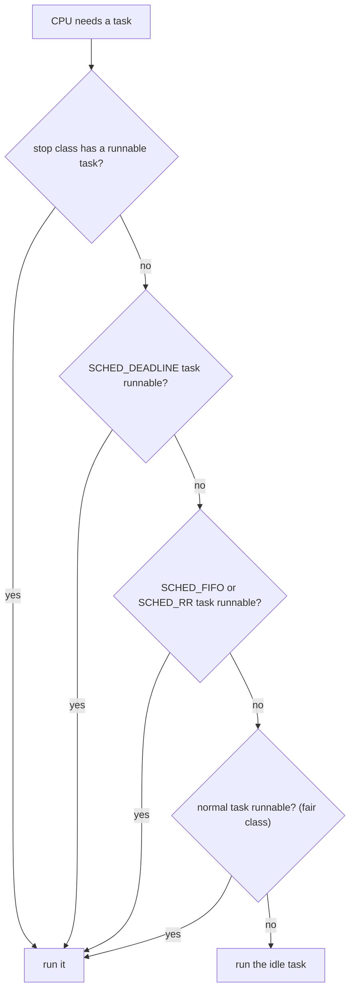

# CPU Scheduling

## Why It Matters

A computer has more runnable threads than CPU cores, so the operating system (OS) must decide which thread runs on which core, and for how long. Interviews ask about this in two forms. The textbook form is "Compare FCFS, SJF, round robin, and priority scheduling", "What is starvation, and how does aging fix it?", and "How does a multilevel feedback queue work?". The production form is "How does the Linux scheduler pick the next thread?", "What does `nice` do?", and "A Java service in a Kubernetes pod with a CPU limit of 2 shows latency spikes while the node is idle. Why?". A candidate who knows only the algorithm names gets partial credit. A candidate who explains virtual runtime, the change from the Completely Fair Scheduler (CFS) to the Earliest Eligible Virtual Deadline First (EEVDF) scheduler in Linux 6.6, and CFS bandwidth throttling gets full credit. On the job, the same knowledge explains why a container with spare node capacity still stalls, why a JVM sizes its thread pools from a number that the container sets, and why a real-time priority can freeze a machine. This page explains the scheduling goals, the classic algorithms, the Linux scheduler, multiprocessor scheduling, and the effect of container CPU limits on a JVM. The cost of a context switch is in [Processes and Threads](01-processes-and-threads.md). Locks and priority inversion are in [Synchronization](03-synchronization.md). The hardware that makes a migrated thread slower is in [Computer Architecture for Developers](06-computer-architecture-for-developers.md).

## Core Concepts

**Scheduler**: the part of the kernel that chooses which runnable task runs next on a CPU. **Dispatcher**: the code that performs the switch to the chosen task. Linux uses the word *task* for a thread or a process (see [Processes and Threads](01-processes-and-threads.md)).

**CPU burst**: the time that a task runs before it blocks (for example on I/O) or ends. A task alternates between CPU bursts and waits. An I/O-bound task has short bursts. A CPU-bound task has long bursts.

**Ready queue (run queue)**: the set of tasks that are runnable and wait for a CPU. Linux keeps one run queue for each CPU.

**Preemptive scheduling**: the kernel can take the CPU from a running task before the task blocks or ends. **Non-preemptive scheduling**: the task keeps the CPU until it blocks, ends, or yields.

**Time quantum (time slice)**: the longest time that a task runs before the scheduler may preempt it.

**Scheduling metrics** (the textbook definitions, for example Silberschatz, Galvin, and Gagne, *Operating System Concepts*):

| Metric | Definition |
|---|---|
| CPU utilization | The share of time that the CPU does useful work |
| Throughput | The number of tasks that finish in a time unit |
| Turnaround time | The time from the arrival of a task to its end |
| Waiting time | The time that a task spends in the ready queue. Turnaround time minus the sum of CPU burst times |
| Response time | The time from the arrival of a request to the first response (the first time the task runs) |
| Fairness | Each task gets a share of the CPU that matches its weight, and no task waits without a bound |

**Starvation**: a runnable task never gets the CPU because other tasks always have priority. **Aging**: the scheduler raises the priority of a task while it waits, so that it cannot starve.

**Convoy effect**: short tasks wait behind one long task in a first-come first-served queue.

**Nice value**: a number from -20 (favored) to +19 (disfavored) that changes the share of CPU time of a normal task (`sched(7)`). **Weight**: the number that the Linux scheduler computes from the nice value. **Virtual runtime (`vruntime`)**: the CPU time that a task has used, scaled by the inverse of its weight.

**Scheduling class**: a Linux module that holds one family of policies. The kernel asks each class, from the highest to the lowest, for a runnable task.

**CFS bandwidth control**: the Linux feature that limits the CPU time of a group of tasks to a quota in each period. **Throttling**: the kernel stops all tasks of a group that used its quota until the next period.

**CPU affinity**: the set of CPUs on which a task may run. **NUMA (non-uniform memory access)**: a machine design where each CPU socket has local memory, and access to memory of another socket takes longer.

## How It Works

### Goals and their conflicts

No scheduler optimizes every metric. The goals pull in opposite directions:

| Goal | What favors it | What it costs |
|---|---|---|
| High throughput | Long quanta, few switches | Poor response time for interactive tasks |
| Low response time | Short quanta, frequent switches | More context switches, so less useful work (see [Processes and Threads](01-processes-and-threads.md) for the cost of a switch) |
| Low average waiting time | Run short bursts first | Long tasks can starve |
| Fairness | Equal shares, preemption | Less throughput than "run the best task to the end" |
| Strict priority for important work | Always run the highest priority | Starvation of low priority work, priority inversion |

A server and a laptop choose differently. A batch server wants throughput. A desktop wants response time. A hard real-time system wants a guaranteed deadline. This is why Linux has several scheduling classes and not one policy.

### When the scheduler runs

The textbook lists four moments when the CPU scheduler decides: a task moves from running to waiting (for example an I/O request), a task moves from running to ready (an interrupt, such as a timer), a task moves from waiting to ready (an I/O completes), and a task ends. If the scheduler acts only at the first and the last moment, it is non-preemptive. If it also acts at the other two, it is preemptive. All general-purpose kernels today are preemptive.

### Classic algorithms

**First-come first-served (FCFS).** The ready queue is a FIFO queue. It is simple and has no starvation. The average waiting time is long if a long task arrives first (the convoy effect).

**Shortest job first (SJF).** The scheduler runs the task with the shortest next CPU burst. SJF gives the smallest average waiting time for a set of tasks that are all ready at the same time (textbook result: Silberschatz et al.). When tasks arrive at different times, the preemptive form (SRTF) has the lower average, as the simulator below shows. The problem is that the kernel does not know the next burst. The textbook estimate is an exponential average of the previous bursts: the next estimate is `a * (last burst) + (1 - a) * (last estimate)`, with `0 <= a <= 1`. With `a = 1/2`, recent and past bursts weigh the same. Long tasks can starve if short tasks keep arriving.

**Shortest remaining time first (SRTF).** This is the preemptive form of SJF. When a new task arrives with a burst shorter than the remaining time of the running task, the scheduler preempts the running task. SRTF gives a lower average waiting time than SJF, and it has a higher number of switches.

**Round robin (RR).** Each task runs for at most one quantum, and then goes to the end of the ready queue. RR is fair and it has a good response time. The quantum is the trade-off:

- A very large quantum makes RR behave like FCFS.
- A very small quantum makes the switch cost a large share of the time. The quantum must be large compared with the time of a context switch.
- A common textbook rule is that most CPU bursts should be shorter than one quantum, so that most tasks finish a burst without preemption.

**Priority scheduling.** Each task has a priority, and the scheduler runs the runnable task with the highest priority. SJF is a priority algorithm where the priority is the inverse of the predicted burst. Strict priority can starve low-priority tasks. **Aging** fixes this: the priority of a waiting task grows with its waiting time. Priority inversion is a related problem with locks, and its home is [Synchronization](03-synchronization.md).

**Multilevel queue.** The ready queue splits into several queues, for example system tasks, interactive tasks, and batch tasks. Each queue has its own algorithm, and a fixed rule decides between queues.

**Multilevel feedback queue (MLFQ).** A task moves between queues according to its behavior. The OSTEP textbook (Arpaci-Dusseau) states the rules that this page uses:

1. If task A has a higher priority than task B, A runs.
2. If A and B have the same priority, they run in round robin.
3. A new task enters at the highest priority.
4. Once a task uses up its time allotment at a level, regardless of how many times it gave up the CPU, its priority drops one level.
5. After some period S, the scheduler moves all tasks to the top queue (a priority boost). The boost stops starvation and lets a task that became interactive get a good response time.

MLFQ approximates SJF without knowing the burst. A short interactive task stays at a high level, because it blocks before it uses its allotment. A long CPU-bound task sinks to a low level. The anti-gaming form of rule 4 (it counts the total time at a level, not the time of one run) stops a task from yielding just before the end of its quantum to keep its priority. The simulator below uses three queues with quanta of 2, 4, and 8 time units and no boost.

**Lottery and stride scheduling.** Waldspurger and Weihl (OSDI 1994) proposed lottery scheduling: each task holds tickets, the scheduler draws a random ticket, and the owner runs. The expected CPU share of a task equals its share of the tickets. It supports proportional-share control with a simple mechanism, but the result is random, so short-term shares vary. Stride scheduling (Waldspurger and Weihl, MIT/LCS/TM-528, June 1995) is the deterministic form. Each task has a stride (a large constant divided by its tickets) and a pass value. The scheduler runs the task with the lowest pass value and adds the stride to its pass. The idea of proportional shares by weight is the same idea that CFS uses with virtual runtime.

### A scheduling simulator

The first program below runs FCFS, non-preemptive SJF, SRTF, round robin (quantum 4), and MLFQ on one job list, and prints the timeline, the waiting time, and the turnaround time. The model uses discrete time units. It has no context switch cost. In round robin, a job that arrives during a time unit enters the queue before the preempted job returns to it (one common convention). In the MLFQ, a running job that a higher queue preempts keeps its level, and its quantum starts again when it runs next.

```java
import java.util.ArrayDeque;
import java.util.ArrayList;
import java.util.Deque;
import java.util.List;

public class Main {
    record Job(String name, int arrival, int burst) {}

    /** One simulation: the job that ran in each time unit, and the finish time of each job. */
    static final class Result {
        final String policy;
        final List<Job> jobs;
        final StringBuilder timeline = new StringBuilder();
        final int[] finish;

        Result(String policy, List<Job> jobs) {
            this.policy = policy;
            this.jobs = jobs;
            this.finish = new int[jobs.size()];
        }

        void run(int jobIndex, int time) {
            timeline.append(jobIndex < 0 ? '.' : jobs.get(jobIndex).name().charAt(1));
            if (jobIndex >= 0) {
                finish[jobIndex] = time + 1;
            }
        }
    }

    static Result fcfs(List<Job> jobs) {
        Result r = new Result("FCFS", jobs);
        boolean[] done = new boolean[jobs.size()];
        int time = 0;
        for (int n = 0; n < jobs.size(); n++) {
            int pick = -1;
            for (int i = 0; i < jobs.size(); i++) {
                if (!done[i] && jobs.get(i).arrival() <= time
                        && (pick < 0 || jobs.get(i).arrival() < jobs.get(pick).arrival())) {
                    pick = i;
                }
            }
            if (pick < 0) {
                r.run(-1, time++);
                n--;
                continue;
            }
            for (int t = 0; t < jobs.get(pick).burst(); t++) {
                r.run(pick, time++);
            }
            done[pick] = true;
        }
        return r;
    }

    static Result sjf(List<Job> jobs) {
        Result r = new Result("SJF (non-preemptive)", jobs);
        boolean[] done = new boolean[jobs.size()];
        int time = 0;
        for (int n = 0; n < jobs.size(); n++) {
            int pick = -1;
            for (int i = 0; i < jobs.size(); i++) {
                if (!done[i] && jobs.get(i).arrival() <= time
                        && (pick < 0 || jobs.get(i).burst() < jobs.get(pick).burst())) {
                    pick = i;
                }
            }
            if (pick < 0) {
                r.run(-1, time++);
                n--;
                continue;
            }
            for (int t = 0; t < jobs.get(pick).burst(); t++) {
                r.run(pick, time++);
            }
            done[pick] = true;
        }
        return r;
    }

    static Result srtf(List<Job> jobs) {
        Result r = new Result("SRTF (preemptive SJF)", jobs);
        int[] left = new int[jobs.size()];
        for (int i = 0; i < left.length; i++) {
            left[i] = jobs.get(i).burst();
        }
        int remaining = jobs.size();
        for (int time = 0; remaining > 0; time++) {
            int pick = -1;
            for (int i = 0; i < jobs.size(); i++) {
                if (left[i] > 0 && jobs.get(i).arrival() <= time
                        && (pick < 0 || left[i] < left[pick])) {
                    pick = i;
                }
            }
            r.run(pick, time);
            if (pick >= 0 && --left[pick] == 0) {
                remaining--;
            }
        }
        return r;
    }

    static Result roundRobin(List<Job> jobs, int quantum) {
        Result r = new Result("Round robin, quantum " + quantum, jobs);
        int[] left = new int[jobs.size()];
        for (int i = 0; i < left.length; i++) {
            left[i] = jobs.get(i).burst();
        }
        Deque<Integer> queue = new ArrayDeque<>();
        boolean[] queued = new boolean[jobs.size()];
        int remaining = jobs.size();
        int time = 0;
        while (remaining > 0) {
            admit(jobs, queue, queued, time);
            if (queue.isEmpty()) {
                r.run(-1, time++);
                continue;
            }
            int cur = queue.pollFirst();
            int slice = Math.min(quantum, left[cur]);
            for (int t = 0; t < slice; t++) {
                r.run(cur, time++);
                left[cur]--;
                admit(jobs, queue, queued, time);
            }
            if (left[cur] == 0) {
                remaining--;
            } else {
                queue.addLast(cur);
            }
        }
        return r;
    }

    static void admit(List<Job> jobs, Deque<Integer> queue, boolean[] queued, int time) {
        for (int i = 0; i < jobs.size(); i++) {
            if (!queued[i] && jobs.get(i).arrival() <= time) {
                queued[i] = true;
                queue.addLast(i);
            }
        }
    }

    /** MLFQ: 3 levels with quanta 2, 4, 8. A new job starts at level 0. A job that uses its
     *  whole quantum moves down one level. A job that a higher level preempts keeps its level,
     *  and its quantum restarts when it runs again. No priority boost in this model. */
    static Result mlfq(List<Job> jobs) {
        int[] quanta = {2, 4, 8};
        Result r = new Result("MLFQ, quanta 2/4/8", jobs);
        List<Deque<Integer>> queues = new ArrayList<>();
        for (int i = 0; i < quanta.length; i++) {
            queues.add(new ArrayDeque<>());
        }
        int[] left = new int[jobs.size()];
        int[] level = new int[jobs.size()];
        boolean[] queued = new boolean[jobs.size()];
        for (int i = 0; i < left.length; i++) {
            left[i] = jobs.get(i).burst();
        }
        int remaining = jobs.size();
        int cur = -1;
        int used = 0;
        for (int time = 0; remaining > 0; time++) {
            for (int i = 0; i < jobs.size(); i++) {
                if (!queued[i] && jobs.get(i).arrival() <= time) {
                    queued[i] = true;
                    queues.get(0).addLast(i);
                }
            }
            if (cur >= 0) {
                for (int lv = 0; lv < level[cur]; lv++) {
                    if (!queues.get(lv).isEmpty()) {
                        queues.get(level[cur]).addLast(cur);
                        cur = -1;
                        break;
                    }
                }
            }
            if (cur < 0) {
                for (Deque<Integer> q : queues) {
                    if (!q.isEmpty()) {
                        cur = q.pollFirst();
                        used = 0;
                        break;
                    }
                }
            }
            r.run(cur, time);
            if (cur < 0) {
                continue;
            }
            left[cur]--;
            used++;
            if (left[cur] == 0) {
                remaining--;
                cur = -1;
            } else if (used == quanta[level[cur]]) {
                level[cur] = Math.min(level[cur] + 1, quanta.length - 1);
                queues.get(level[cur]).addLast(cur);
                cur = -1;
            }
        }
        return r;
    }

    static void print(Result r) {
        System.out.println(r.policy);
        System.out.println("  timeline: " + r.timeline);
        double wait = 0;
        double turn = 0;
        for (int i = 0; i < r.jobs.size(); i++) {
            Job j = r.jobs.get(i);
            int turnaround = r.finish[i] - j.arrival();
            int waiting = turnaround - j.burst();
            wait += waiting;
            turn += turnaround;
            System.out.println("  " + j.name() + " waiting=" + waiting
                    + " turnaround=" + turnaround);
        }
        System.out.printf("  average waiting=%.2f average turnaround=%.2f%n",
                wait / r.jobs.size(), turn / r.jobs.size());
    }

    public static void main(String[] args) {
        List<Job> jobs = List.of(
                new Job("P1", 0, 8), new Job("P2", 1, 4), new Job("P3", 2, 9), new Job("P4", 3, 5));
        StringBuilder list = new StringBuilder("Jobs (name, arrival, burst):");
        for (Job j : jobs) {
            list.append(" ").append(j.name()).append("(").append(j.arrival()).append(", ")
                    .append(j.burst()).append(")");
        }
        System.out.println(list);
        System.out.println("In a timeline, the digit is the job and '.' is an idle CPU.");
        print(fcfs(jobs));
        print(sjf(jobs));
        print(srtf(jobs));
        print(roundRobin(jobs, 4));
        print(mlfq(jobs));
    }
}
```

<!-- expected-output -->
```text
Jobs (name, arrival, burst): P1(0, 8) P2(1, 4) P3(2, 9) P4(3, 5)
In a timeline, the digit is the job and '.' is an idle CPU.
FCFS
  timeline: 11111111222233333333344444
  P1 waiting=0 turnaround=8
  P2 waiting=7 turnaround=11
  P3 waiting=10 turnaround=19
  P4 waiting=18 turnaround=23
  average waiting=8.75 average turnaround=15.25
SJF (non-preemptive)
  timeline: 11111111222244444333333333
  P1 waiting=0 turnaround=8
  P2 waiting=7 turnaround=11
  P3 waiting=15 turnaround=24
  P4 waiting=9 turnaround=14
  average waiting=7.75 average turnaround=14.25
SRTF (preemptive SJF)
  timeline: 12222444441111111333333333
  P1 waiting=9 turnaround=17
  P2 waiting=0 turnaround=4
  P3 waiting=15 turnaround=24
  P4 waiting=2 turnaround=7
  average waiting=6.50 average turnaround=13.00
Round robin, quantum 4
  timeline: 11112222333344441111333343
  P1 waiting=12 turnaround=20
  P2 waiting=3 turnaround=7
  P3 waiting=15 turnaround=24
  P4 waiting=17 turnaround=22
  average waiting=11.75 average turnaround=18.25
MLFQ, quanta 2/4/8
  timeline: 11223344111122333344411333
  P1 waiting=15 turnaround=23
  P2 waiting=9 turnaround=13
  P3 waiting=15 turnaround=24
  P4 waiting=13 turnaround=18
  average waiting=13.00 average turnaround=19.50
```

How to read the output:

- **FCFS** has an average waiting time of 8.75. The 8-unit job P1 holds the CPU while P2, P3, and P4 wait (the convoy effect).
- **SJF** lowers it to 7.75, and **SRTF** to 6.50. SRTF has the smallest average waiting time of the five, which matches the textbook result that shortest-remaining-time scheduling minimizes the average waiting time. P3, the longest job, waits 15 under SJF and SRTF: the price of the gain.
- **Round robin** has the highest average waiting time among the first four (11.75) because it switches often and finishes every job late. In exchange, every job gets the CPU within one round: under RR with quantum 4, P4 first runs at time 12, while under FCFS P4 first runs at time 21. Response time, not waiting time, is the goal of RR.
- **MLFQ** (13.00) starts every job early: P1 at time 0, P2 at 2, P3 at 4, and P4 at 6. Its average waiting time is the highest here, because this list has no job that blocks for I/O and no clearly short job, so the demotion rule gives no gain. MLFQ pays off on a mix of interactive and CPU-bound tasks, which this list does not model.

### The Linux scheduler

#### Scheduling classes and policies

Linux has several scheduling classes. The kernel source (`kernel/sched/sched.h`, Linux 6.6) declares them in this order from the highest to the lowest: `stop`, `dl` (deadline), `rt` (real-time), `fair`, and `idle`. The kernel asks each class in this order for a runnable task, so a runnable deadline task always runs before a real-time task, and a real-time task always runs before a normal task. The `stop` class is internal (the kernel uses it, for example, to migrate tasks). The `sched(7)` man page lists the policies that a program can choose:

| Policy | Class | Behavior (`sched(7)`) |
|---|---|---|
| `SCHED_OTHER` (named `SCHED_NORMAL` in the kernel source) | fair | The default time-sharing policy. The nice value changes the share |
| `SCHED_BATCH` | fair | For CPU-intensive work. The scheduler assumes that the task is CPU-intensive. Static priority 0 only |
| `SCHED_IDLE` | fair | For jobs at "extremely low priority". The nice value has no influence |
| `SCHED_FIFO` | rt | Fixed priority 1 (low) to 99 (high), without time slicing. The task runs until it blocks, yields, or a higher-priority real-time task preempts it |
| `SCHED_RR` | rt | `SCHED_FIFO` plus a maximum time quantum for each task among tasks of equal priority |
| `SCHED_DEADLINE` | dl | Earliest deadline first, with a constant bandwidth server. The task declares runtime, deadline, and period |



Real-time policies need privilege. The man page states that a thread must be privileged (`CAP_SYS_NICE`) to set or change a `SCHED_DEADLINE` policy. Real-time policies carry a risk: a `SCHED_FIFO` task that never blocks starves all normal tasks on its CPU. Linux limits this with real-time throttling. `sched(7)` gives the defaults: `/proc/sys/kernel/sched_rt_period_us` is 1,000,000 (1 second) and `/proc/sys/kernel/sched_rt_runtime_us` is 950,000, so real-time tasks get at most 0.95 seconds of each second, and 5 percent of the CPU time stays for other tasks.

The default quantum of `SCHED_RR` is 100 ms. The constant `RR_TIMESLICE` in `include/linux/sched/rt.h` is `100 * HZ / 1000` jiffies, which is 100 ms for any value of the tick rate `HZ`. A program reads the real value with `sched_rr_get_interval(2)`.

`SCHED_DEADLINE` is the policy for tasks with a known period and a known worst-case run time. The kernel document gives the model: a task receives `runtime` microseconds of CPU time in each `period`, and the scheduler picks the ready task with the earliest scheduling deadline (EDF). The constant bandwidth server (CBS) throttles a task that uses more than its runtime until its next deadline, so that one task cannot break the guarantee of the others. Admission control runs when a program calls `sched_setattr(2)`: the kernel accepts the task only if the sum of `runtime / period` over all deadline tasks stays below a cap. The default cap is 95 percent of the CPUs in the root domain, which leaves at least 5 percent for other tasks (kernel documentation, `sched-deadline`). The man page says that `SCHED_DEADLINE` was added in Linux 3.14.

#### Weights, nice values, and virtual runtime

For normal tasks, the kernel turns the nice value into a **weight** with the table `sched_prio_to_weight` in `kernel/sched/core.c`. Nice 0 has weight 1024. Nice 1 has 820, nice 5 has 335, nice 10 has 110, nice -20 has 88761, and nice 19 has 15. Each step of one nice level changes the weight by a factor of about 1.25, which matches `sched(7)`: "each unit of difference in the nice values of two processes results in a factor of 1.25". The kernel document on nice design adds that one nice level gives the same relative effect at every level: with a nice +10 task and a nice +11 task, one gets about 55 percent of the CPU and the other 45 percent, the same split as for nice -5 and nice -4.

The time that a task has run is scaled into **virtual runtime**: `vruntime` grows by `delta_exec * 1024 / weight`. A heavy task (a low nice value) has a small `vruntime` growth per real millisecond, so it runs longer before another task has less `vruntime`. A light task grows fast and loses the CPU soon. In the long run, each task gets CPU time in proportion to its weight. The kernel source scales time with `calc_delta_fair`, which applies this ratio when the weight is not the nice 0 weight.

The second program shows this effect. It runs three tasks (nice 0, 5, 10) for 10,000 ticks. At each tick, it runs the task with the lowest `vruntime`. This is the core of CFS, without the red-black tree and without preemption granularity.

```java
public class Main {
    // Weights from the Linux table sched_prio_to_weight (kernel/sched/core.c): nice 0, 5, 10.
    static final String[] NAMES = {"nice 0", "nice 5", "nice 10"};
    static final long[] WEIGHT = {1024, 335, 110};

    public static void main(String[] args) {
        int ticks = 10_000;
        long[] vruntime = new long[WEIGHT.length];
        int[] ran = new int[WEIGHT.length];
        for (int t = 0; t < ticks; t++) {
            int pick = 0;
            for (int i = 1; i < vruntime.length; i++) {
                if (vruntime[i] < vruntime[pick]) {
                    pick = i;
                }
            }
            ran[pick]++;
            // One tick of real time advances virtual time by 1024 / weight (scaled by 1000).
            vruntime[pick] += 1024L * 1000 / WEIGHT[pick];
        }
        long total = 0;
        for (long w : WEIGHT) {
            total += w;
        }
        for (int i = 0; i < NAMES.length; i++) {
            System.out.printf("%-8s weight=%4d ticks=%5d share=%5.1f%% expected=%5.1f%%%n",
                    NAMES[i], WEIGHT[i], ran[i], 100.0 * ran[i] / ticks, 100.0 * WEIGHT[i] / total);
        }
    }
}
```

<!-- expected-output -->
```text
nice 0   weight=1024 ticks= 6970 share= 69.7% expected= 69.7%
nice 5   weight= 335 ticks= 2281 share= 22.8% expected= 22.8%
nice 10  weight= 110 ticks=  749 share=  7.5% expected=  7.5%
```

#### CFS: the Completely Fair Scheduler

CFS was merged in Linux 2.6.23 (`sched(7)` and the kernelnewbies page for Linux 6.6 give this version). The kernel document on CFS describes the design:

- CFS keeps the tasks of a run queue in a time-ordered red-black tree and runs the task with the lowest `vruntime`, the "leftmost" node of the tree. A task that has run moves to the right, so each task reaches the left.
- The tree gives `O(log n)` insert and remove. Picking the leftmost node is cached.
- `min_vruntime` is a monotonically increasing value that tracks the smallest `vruntime` in the run queue. A task that wakes up after a long sleep gets a `vruntime` near `min_vruntime`, so it cannot claim the CPU for a long time to "catch up".
- A running task is preempted only when another task is ahead by a small "granularity" in virtual time. This limits the number of switches and the thrashing of the CPU caches.

#### EEVDF replaces the CFS pick logic (Linux 6.6)

The kernelnewbies page for Linux 6.6 (released 29 October 2023) states that the release "replaces the CFS process scheduler with a new one called EEVDF". The kernel documentation says that the kernel "began transitioning to EEVDF in version 6.6" and that CFS "is making room for EEVDF". The class is still named `fair`, and `SCHED_OTHER` is still the policy, so the code is in `kernel/sched/fair.c`, and many people still write "CFS" for it. The change is in the way the scheduler picks a task.

The kernel document and the comments in `fair.c` define the terms:

- **Lag**: the CPU time that a task should have received minus the time that it received. A task with positive lag is owed CPU time. A task with negative lag used more than its share. The sum of the lags of all tasks is zero (the `fair.c` comment says that fair schedulers "conserve lag").
- **Eligible**: a task is eligible if its lag is zero or positive.
- **Virtual deadline**: the point in virtual time when the task would finish its requested slice. The source comment gives the formula `vd = ve + r / w`, where `ve` is the virtual eligible time, `r` is the requested slice, and `w` is the weight. The code in 6.6 is `se->deadline = se->vruntime + calc_delta_fair(se->slice, se)`.
- **Pick**: EEVDF runs the eligible task with the earliest virtual deadline (kernel document: "picks tasks with lag greater or equal to zero and calculates a virtual deadline (VD) for each", and runs the task "with the earliest VD").

The effect is on latency. In CFS, a task with a short wake-up latency need had no way to say it, except through nice values and heuristics. In EEVDF, a task with a shorter requested slice gets an earlier deadline, so it runs sooner and for shorter periods, and its total share does not change. In Linux 6.6 the slice of every normal task is the same value, `sysctl_sched_base_slice`, which starts at 0.75 ms and is multiplied by `1 + ilog2(min(online CPUs, 8))` (so 3 ms on a machine with 8 or more CPUs; source `kernel/sched/fair.c` at tag v6.6). The kernel documentation says that later kernels let a task request its own slice with `sched_setattr(2)` (the `sched_runtime` field), and that the request is what gives a latency-sensitive task an earlier deadline. The current mainline source (7.4-rc1, released 1 November 2026; the newest stable release on kernel.org on 5 November 2026 is 7.3.1) has 0.70 ms as the base value, with the same scaling (2.8 ms on 8 or more CPUs), and uses it for a task that has not set a slice. The kernel document names the tunable `/sys/kernel/debug/sched/base_slice_ns`. Read the value on the machine that you tune, because the base value changed between releases.

The kernel still stores the entities in a red-black tree. In 6.6 the tree is ordered by `vruntime` and each node holds the earliest deadline of its subtree (`min_deadline` in `fair.c`), so the kernel finds the eligible entity with the earliest deadline in `O(log n)`.

#### `sched_ext`: schedulers as BPF programs

`sched_ext` is a scheduler class whose behavior comes from a set of BPF programs. The kernelnewbies page for Linux 6.12 (released 17 November 2024) states: "This release includes the first pieces of sched_ext, a feature that enables to write task scheduler algorithms in BPF". The kernel document gives these facts:

- A user-space program loads a BPF scheduler. The only mandatory field of the `sched_ext_ops` table is the name. Every other operation is optional.
- A task opts in with the `SCHED_EXT` policy. While no BPF scheduler is loaded, such a task runs as `SCHED_NORMAL`. When one is loaded, it handles `SCHED_NORMAL`, `SCHED_BATCH`, `SCHED_IDLE`, and `SCHED_EXT` tasks, unless the loader sets `SCX_OPS_SWITCH_PARTIAL`, in which case only `SCHED_EXT` tasks use it.
- If the BPF scheduler misbehaves, for example a runnable task stalls, the kernel falls back to the default scheduling behavior.
- The kernel option is `CONFIG_SCHED_CLASS_EXT`.

The use case is to try a scheduling policy for one workload (a game, a database host) without a kernel build.

### Multiprocessor scheduling

On a machine with several CPUs, the scheduler has a second question: on which CPU does a task run?

**Run queue for each CPU.** Linux keeps one run queue for each CPU. This avoids a global lock, and it keeps a task on one CPU, where its data stays in the CPU caches. The cost is imbalance: one run queue can be long while another is empty.

**Load balancing.** The kernel moves tasks between run queues. The kernel document on scheduling domains describes the structure. Each CPU has a base scheduling domain, and domains form a hierarchy through parent pointers. For example, the lowest domain spans the hardware threads (SMT siblings) of one core, the next spans the cores of one socket, and the top domain on a NUMA machine spans the whole machine, where each group holds the CPUs of one node. On each scheduler tick, the kernel checks whether the balance interval of a domain has expired. If so, it finds the busiest group in the domain and the busiest run queue in that group, and it moves tasks to reduce the imbalance. A CPU that becomes idle also tries to pull a task. Balancing is hierarchical so that the kernel moves tasks across a socket boundary less often than within a socket, because a move to another socket costs more cache and memory locality.

**CPU affinity.** `sched_setaffinity(2)` sets the affinity mask of a thread. The man page states that a child created by `fork(2)` inherits the mask, and that the mask is intersected with the CPUs that exist and that cpusets allow. The man page also notes that pinning a thread to one CPU avoids the cost of cache invalidation when the thread moves to another CPU. The command `taskset` sets the mask from the shell. Pinning has costs: the scheduler cannot balance a pinned task, so a pinned task can wait while another CPU is idle.

**NUMA.** On a NUMA machine, memory access time depends on which node holds the memory. The kernel document on NUMA memory policy states that the default policy is local allocation: a page comes from the node of the CPU that triggers the allocation (at the page fault). So the node of the thread that first touches a page decides where the page lives. If the scheduler then moves the thread to another node, the thread accesses remote memory. The policies `MPOL_BIND`, `MPOL_PREFERRED`, and `MPOL_INTERLEAVE` (and the command `numactl`) override the default. The JDK 21 `java` documentation states that `-XX:+UseNUMA` is off by default. The same text says that the option is available only with the parallel garbage collector (`-XX:+UseParallelGC`), but that sentence is out of date: JEP 345 added NUMA-aware allocation to G1 in JDK 14, and `-XX:+UseNUMA` enables it. The hardware view of NUMA is in [Computer Architecture for Developers](06-computer-architecture-for-developers.md).

### Containers: CPU weight and CPU quota

A container shares the kernel scheduler with other containers. Two controls apply, and they have different effects. The kernel documentation on control group v2 gives the file names and defaults.

| Control | cgroup v2 file | What it does | When it acts |
|---|---|---|---|
| CPU weight (cgroup v1 name: CPU shares) | `cpu.weight` (default 100, range 1 to 10000) | A relative share. A group with weight 200 gets twice the CPU of a group with weight 100 | Only when CPUs are contended. An idle CPU is free to use |
| CPU quota | `cpu.max` (format `$MAX $PERIOD`, default `max 100000`) | A hard limit: at most `$MAX` microseconds of CPU time in each `$PERIOD` microseconds | Always, even if the node is idle |

Kubernetes maps the two. The Kubernetes documentation states that a `cpu` limit "is enforced by CPU throttling" and is "a hard limit the kernel enforces", and the request reserves a share of the node. The kubelet turns a request into cgroup v1 style shares (`milliCPU * 1024 / 1000`), and the container runtime (runc or crun) converts the shares to `cpu.weight` on cgroup v2. The Kubernetes blog post of 30 January 2026 states that the original linear formula, `1 + ((shares - 2) * 9999) / 262142` (KEP-2254), gives a weight of about 39 for a request of 1 CPU (a 100m request gives 4), and that a newer non-linear formula gives 102 for 1 CPU (17 for 100m). The newer formula is in runc 1.3.2 and later and in crun 1.23 and later. So the weight that a request produces depends on the runtime version, and only the ratio between two containers on the same node matters.

**How the quota works** (kernel document on CFS bandwidth control). The group receives `quota` microseconds of run time for each `period`. The kernel hands the quota out in small slices to the CPUs where the group runs (the default slice is 5 ms, `/proc/sys/kernel/sched_cfs_bandwidth_slice_us`). When the group has used all of its quota in the period, "any additional requests for quota will result in those threads being throttled": every runnable task of the group stops until the next period starts. The default period in the documentation is 100 ms. The statistics are in `cpu.stat`: `nr_periods`, `nr_throttled` (the number of periods in which the group was throttled), and `throttled_usec` (the total time of throttling; the cgroup v1 file calls it `throttled_time` and counts nanoseconds). Kernel PSI also reports CPU pressure in `cpu.pressure`.

**Worked example** (arithmetic, not a measurement). A container has `cpu.max` of `200000 100000`, so a quota of 200 ms in each 100 ms period, which is "2 CPUs". The container runs on a node with 16 cores. A request burst starts 8 busy threads at the beginning of a period. The 8 threads run in parallel on 8 cores, and they use 8 × 25 ms = 200 ms of CPU time in the first 25 ms of the period. The quota is gone. The kernel throttles all 8 threads for the remaining 75 ms of the period. A request that arrives during the throttled time waits up to 75 ms, although the node CPUs are idle and the average CPU use of the container is only 2 cores. The signs are a growing `nr_throttled` and `throttled_usec`, and a latency tail that looks like a multiple of the period.

**What this means for a JVM** (JDK 21):

- The JVM reads the container limits (`-XX:+UseContainerSupport` is on by default on Linux, JDK 21 `java` documentation). `Runtime.availableProcessors()` returns a number that the JVM computes from the CPU affinity and the quota. The source of the JDK 21.0.7 tag (`cgroupSubsystem_linux.cpp`, `active_processor_count`) divides the quota by the period, rounds up, and never returns more than the number of active processors. For example, a quota of 150 ms with a period of 100 ms gives 2. The comment in that function lists CPU shares as an input, but the code reads only the quota and the period. A change in JDK 19 (JDK-8281181, "Do not use CPU Shares to compute active processor count", fixed in build b13 and backported to 17.0.5 and 11.0.17) removed the use of shares, because Kubernetes sets shares from requests, and a request is not a limit. If a container has only a request and no limit, the JVM sees all the CPUs of the node.
- The flag `-XX:ActiveProcessorCount=<n>` overrides this number. The `java` documentation states that it "overrides the number of CPUs that the VM will use to calculate the size of thread pools it will use for various operations such as Garbage Collection and ForkJoinPool", and that it is honored even if container support is off.
- The JVM sizes the garbage collector threads and the common `ForkJoinPool` from this number. `-XX:ParallelGCThreads` has a default that depends on "the number of CPUs available to the JVM and the garbage collector selected" (`java` documentation). The default parallelism of the common pool is `availableProcessors() - 1` (see [`java.util.concurrent`](../java/08-java-util-concurrent.md)). With a limit of fewer than 2 CPUs, JDK 21 picks the Serial collector unless you set another one (see [Memory and Garbage Collection](../java/06-memory-and-gc.md)).
- A stop-the-world pause with several GC threads is a burst of parallel CPU use. If the container has a small quota, the GC threads can use the quota of a whole period in a few milliseconds, and the kernel throttles the application threads and the GC threads for the rest of the period. A pause that takes 30 ms of wall time on 4 free cores can last for most of a period under a quota of 1 CPU. Recommendation: for a latency-sensitive service, set the CPU request and the limit with care, watch `nr_throttled` and `throttled_usec`, and consider no CPU limit with a CPU request (this relies on the weight, which acts only under contention) if the platform policy allows it. This is a recommendation and a trade-off: a limit protects neighbors, and no limit shares idle CPU but lets a noisy service take a larger share.
- A thread pool that sizes itself with `availableProcessors()` gets the rounded-up quota. A pool that sizes itself from a fixed number of cores on the node can have more runnable threads than the quota allows, and then throttling follows.

The class below shows the sizing pattern. It uses the CPU count that the JVM reports. The class has no `main`, because its output depends on the machine.

```java
import java.util.concurrent.ExecutorService;
import java.util.concurrent.Executors;

/** Not run by the KB runner: the result depends on the machine and on the container. */
class CpuBoundPool {
    /** Sizes a pool for CPU-bound work from the CPU count that the JVM reports. */
    static ExecutorService create() {
        int cpus = Runtime.getRuntime().availableProcessors();
        return Executors.newFixedThreadPool(cpus);
    }
}
```

## Trade-offs and When to Use

| Algorithm or class | Strength | Weakness | Used where |
|---|---|---|---|
| FCFS | Simple, no starvation | Convoy effect, long average wait | Batch queues, a single I/O device queue |
| SJF and SRTF | Smallest average waiting time | Needs the burst length. Starves long tasks | A reference point. Shortest-job ideas inside estimators |
| Round robin | Fair, good response time | Throughput falls with a small quantum. Average waiting time is higher | Time-sharing, as the base of many schedulers |
| Priority with aging | Controls the importance of work | Starvation without aging. Priority inversion | Real-time and mixed systems |
| MLFQ | Needs no burst knowledge. Good for mixed workloads | Many parameters. A task can game the rules without a total allotment | The base of several desktop schedulers |
| Lottery and stride | Proportional shares by tickets | Random lottery has short-term variance. Stride needs a pass value for each task | Research systems. The idea lives on in weights |
| Linux fair class (CFS, EEVDF) | Proportional fairness by weight. Good latency | Not a hard guarantee of latency | Default for normal tasks |
| `SCHED_FIFO` and `SCHED_RR` | Fixed priority. Predictable preemption | A busy task starves all normal tasks. Needs privilege | Audio, control loops, kernel threads |
| `SCHED_DEADLINE` | A guarantee of runtime in each period (with admission control) | The task must know its runtime and period. Needs privilege | Periodic real-time work |
| `sched_ext` | A custom policy without a kernel build | A bug in the BPF scheduler can stall tasks, and the kernel then falls back | Experiments, special workloads |

| Decision | Choose | Condition |
|---|---|---|
| CPU quota against CPU weight in a container | Weight (request only) | You want to share idle CPU, and a neighbor limit is not needed |
| | Quota (limit) | You need a hard cap for cost or isolation, and you accept throttling |
| Pin threads to CPUs | Pin | A fixed set of latency-critical threads, with CPUs reserved for them, and a measured gain |
| | Leave to the scheduler | Most services. The scheduler balances the load |

## Java Example

The two programs above are the Java examples of this page. The first compares five algorithms on one job list. The second shows that selection by lowest `vruntime` gives each task a share in proportion to its weight. Both are simulations with a fixed input. They do not measure time. The class `CpuBoundPool` in the container section shows how a pool takes its size from `availableProcessors()`.

To see the scheduler of a real Linux host from Java, read `/proc/<pid>/status` (the counters `voluntary_ctxt_switches` and `nonvoluntary_ctxt_switches`, see [Processes and Threads](01-processes-and-threads.md)) and `/sys/fs/cgroup/cpu.stat` inside a container. The JDK has no API for a scheduling policy.

## Interview Angle

### Questions

??? question "Compare FCFS, SJF, SRTF, and round robin. Which gives the lowest average waiting time, and what does it cost?"

    FCFS runs jobs in arrival order. It has no starvation but a convoy effect: short jobs wait behind a long job. SJF runs the job with the shortest next CPU burst. SRTF is its preemptive form: a new job with a shorter remaining time preempts the running job. Round robin gives each job one quantum in turn.

    SRTF has the lowest average waiting time of the four. On the job list of the simulator above (bursts 8, 4, 9, 5 with arrivals 0, 1, 2, 3), the average waiting time is 8.75 for FCFS, 7.75 for SJF, 6.50 for SRTF, and 11.75 for round robin with quantum 4. The cost of SJF and SRTF is twofold. The kernel does not know the next burst, so it must estimate it, for example with an exponential average of past bursts. And long jobs can starve if short jobs keep arriving (P3 waits 15 units under SRTF). Round robin does not give the lowest waiting time, but it gives every job the CPU within one round, so its response time is bounded. That is the goal of a time-sharing system.

??? question "How do you choose the time quantum in round robin?"

    The quantum is a trade-off between response time and overhead. If the quantum is very large, round robin behaves like FCFS and the response time grows. If the quantum is very small, the scheduler spends a large share of the time on context switches, and the throughput falls. A switch costs microseconds directly and more through cold caches and TLB entries (see [Processes and Threads](01-processes-and-threads.md)), so the quantum must be much longer than that cost. The textbook guideline is that most CPU bursts should be shorter than one quantum, so that most tasks finish a burst without preemption. In Linux, the equivalent value is the base slice of EEVDF: 0.75 ms in 6.6, scaled to 3 ms on a machine with 8 or more CPUs.

??? question "What is starvation, and how do aging and MLFQ address it?"

    Starvation means that a runnable task waits without a bound because other tasks always have priority. It happens with strict priority scheduling and with SJF. Aging raises the priority of a waiting task in proportion to its waiting time, so that it eventually runs. A multilevel feedback queue handles it with a priority boost: after a period S, the scheduler moves all tasks to the top queue. The boost also lets a task that changed from CPU-bound to interactive get a good response time. Without the boost, a long job at the bottom can wait for as long as short jobs keep arriving at the top. MLFQ also needs an anti-gaming rule: it counts the total time that a task uses at a level, so that a task cannot yield just before the quantum ends to keep a high priority.

??? question "How does the Linux scheduler decide which task runs next? What changed in Linux 6.6?"

    Linux has scheduling classes. The kernel asks the classes in this order: stop, deadline, real-time (`SCHED_FIFO` and `SCHED_RR`), fair (normal tasks), and idle. Normal tasks use the fair class. Each CPU has its own run queue. The nice value maps to a weight (nice 0 is 1024, and each nice step changes it by about 1.25 times), and each task has a virtual runtime that grows by the real run time scaled by 1024 divided by the weight. Over time, each task gets a CPU share in proportion to its weight.

    Until Linux 6.5, the CFS pick rule was "run the task with the lowest virtual runtime", the leftmost node of a red-black tree. Linux 6.6 (29 October 2023) replaced it with EEVDF. EEVDF tracks the lag of each task (the time it is owed). A task is eligible if its lag is not negative. Each task has a virtual deadline, which is its eligible time plus its slice divided by its weight. The scheduler runs the eligible task with the earliest deadline. The share of each task is still proportional to its weight, but a task with a shorter slice (a request that later kernels accept through `sched_setattr`) gets an earlier deadline and so better latency, which CFS could express only with heuristics.

??? question "What is the difference between `SCHED_FIFO`, `SCHED_RR`, and `SCHED_DEADLINE`? Why can a real-time priority freeze a machine?"

    `SCHED_FIFO` and `SCHED_RR` are fixed-priority real-time policies with priorities 1 to 99. `SCHED_FIFO` has no time slicing: the task runs until it blocks, yields, or a higher-priority real-time task preempts it. `SCHED_RR` adds a time quantum among tasks of equal priority (100 ms by default). `SCHED_DEADLINE` is different: the task declares a runtime, a deadline, and a period, and the kernel schedules by earliest deadline first with a constant bandwidth server, after an admission test that keeps the total bandwidth under a cap (95 percent by default).

    A real-time task runs before every normal task. If a `SCHED_FIFO` task never blocks, normal tasks on that CPU never run, including the shell that you would use to stop it. Linux limits this with real-time throttling: by default real-time tasks get 0.95 s of each second (`sched_rt_runtime_us` over `sched_rt_period_us`). These policies need `CAP_SYS_NICE`. A related risk is priority inversion, where a real-time task waits for a lock that a low-priority task holds (see [Synchronization](03-synchronization.md)).

??? question "A Java service in a Kubernetes pod has a CPU limit of 2 and shows latency spikes of about 70 ms, while the node CPUs are idle. What do you check?"

    This pattern points to CFS bandwidth throttling. A CPU limit of 2 sets a quota of 200 ms in each 100 ms period. If several threads run at once, for example a burst of requests or a parallel GC pause, the group uses its whole quota in a fraction of the period. The kernel then stops all its threads until the next period, so a request can wait for up to the rest of the period although the node is idle.

    I read `cpu.stat` in the container cgroup and look at `nr_throttled` and `throttled_usec`: if they grow, throttling is the cause. Then I look at what burns the quota: GC threads (`-XX:ParallelGCThreads`), the common `ForkJoinPool`, and thread pools that size themselves from `availableProcessors()`, which the JVM computes as the rounded-up quota divided by the period. Fixes: raise the limit, reduce the number of parallel threads (`-XX:ActiveProcessorCount`, smaller pools, fewer GC threads), or remove the limit and keep the request, which acts as a weight only under contention. The trade-off is isolation: a limit protects neighbors.

??? question "What is the difference between CPU shares (weight) and a CPU quota in a container?"

    CPU shares (cgroup v2 `cpu.weight`) are a relative weight. They matter only when CPUs are contended: a group with weight 200 gets twice the CPU of a group with weight 100 when both want more than is available. If CPUs are idle, a group with a small weight can use them all. A CPU quota (`cpu.max`) is an absolute cap: a number of microseconds of CPU time in each period. The kernel enforces it even when the node is idle, by throttling the group.

    In Kubernetes, the request gives the weight and the node reservation, and the limit gives the quota. For a JVM, the quota (not the shares) sets `availableProcessors()` since JDK 19, because a quota is a limit and a request is not. So a pod with a request and no limit makes the JVM see all the CPUs of the node.

??? question "How does the Linux scheduler balance load across CPUs, and when would you pin threads?"

    Each CPU has its own run queue, which avoids a global lock and keeps a task near its cached data. The kernel balances the run queues through a hierarchy of scheduling domains: SMT siblings, cores of a socket, sockets of a NUMA machine. On the scheduler tick, and when a CPU becomes idle, the kernel moves tasks from the busiest queue of a domain to a less busy one. It balances less often across expensive boundaries (sockets), because a migrated task loses its cache contents and, on NUMA, may access remote memory.

    I pin threads (`sched_setaffinity`, `taskset`) only when I have measured a gain and I can reserve the CPUs: for example a latency-critical thread that suffers from migrations. Pinning has a cost, because the scheduler cannot move a pinned task to an idle CPU. For most services I leave placement to the scheduler.

### Follow-up Questions

??? question "Why is SJF optimal, and why can a kernel not use it directly?"

    For jobs that are all ready at the same time, SJF minimizes the average waiting time because moving a short job before a long job reduces the wait of the short job by more than it increases the wait of the long job. When jobs arrive over time, only the preemptive form (SRTF) stays optimal. The kernel cannot use either as stated because it does not know the length of the next CPU burst. It can predict it from history, with an exponential average, but a prediction can be wrong, and the algorithm can starve long jobs. MLFQ approximates SJF by observing behavior: a job that uses little CPU before it blocks stays at a high priority.

??? question "Why does a small `nice` change matter on Linux?"

    Each nice step changes the weight by about 25 percent, and the effect is relative: a task at nice 0 against a task at nice 5 gets 1024 against 335, so about 75.4 percent of the CPU against 24.6 percent when both are runnable. The effect shows only when tasks compete. An idle CPU makes the nice value irrelevant.

??? question "What does the load average count on Linux, and how does it relate to scheduling?"

    On Linux, the load average counts tasks that are runnable or in uninterruptible sleep (`uptime(1)`). A load above the number of CPUs can mean a CPU queue (runnable tasks) or a blocked disk or network file system (uninterruptible sleep). The home of this topic is [Processes and Threads](01-processes-and-threads.md), which also shows how to tell the two cases apart.

### Red Flags

- "Round robin always has the lowest waiting time." It does not. SRTF does, and RR trades waiting time for response time.
- "Linux uses a round-robin scheduler with priorities." The normal class uses weighted fairness (CFS, then EEVDF). Round robin is a real-time policy (`SCHED_RR`).
- "CPU shares limit the CPU of a container." Shares are a weight and act only under contention. The quota is the limit.
- "A Java container with a CPU request of 1 sees 1 CPU." Without a limit, the JVM sees all the CPUs of the node (JDK 21).
- "The Linux scheduler is still CFS." Since Linux 6.6 the fair class uses EEVDF. Many sources still say CFS, so name the release.
- Naming real-time priority as the fix for slow response without the starvation risk.

## Common Mistakes

| Mistake | Why it hurts | Fix |
|---|---|---|
| Setting a small CPU limit on a JVM service and ignoring `cpu.stat` | Throttling gives latency spikes that no profiler shows as CPU use | Alert on `nr_throttled` and `throttled_usec`. Raise the limit, or reduce parallel threads |
| Sizing thread pools from the node core count | More runnable threads than the quota allows, and throttling follows | Size from `availableProcessors()` or set `-XX:ActiveProcessorCount` |
| Assuming that a request without a limit gives the JVM a CPU count equal to the request | The JVM sees all CPUs of the node and sizes GC and pools for them | Set `-XX:ActiveProcessorCount` or set a limit |
| Running a long loop at `SCHED_FIFO` without a block | The CPU starves normal tasks and the OS can become unresponsive | Use a bounded run time. Rely on real-time throttling only as a safety net |
| Pinning threads to CPUs without a measurement | The scheduler cannot balance them, and a pinned task waits while other CPUs idle | Measure first. Reserve CPUs for pinned threads |
| Using `nice` to fix a latency problem on an idle host | The nice value matters only when tasks compete | Find out whether CPUs are contended (run queue length, PSI `cpu.pressure`) |
| Quoting SJF numbers without stating the model | Results change with arrival times, preemption, and the cost of a switch | State the job list, the quantum, and whether a switch costs time |
| Naming a kernel scheduler without a release | The answer is wrong for kernels before 6.6 or after it | Say "CFS until 6.5, EEVDF from 6.6" |
| Relying on a tunable name from an old blog post | EEVDF removed the CFS latency tunables. The base slice replaced them | Read `/sys/kernel/debug/sched/` on the target kernel |

## Commonly Confused With

| Looks like | Difference | Deciding question |
|---|---|---|
| Waiting time and response time | Waiting time is the total time in the ready queue. Response time is the time to the first run | Is the question about the whole wait or about the first reply? |
| Turnaround time and waiting time | Turnaround time includes the run time. Waiting time does not | Does the number include the CPU bursts? |
| Preemptive and non-preemptive scheduling | A preemptive scheduler can take the CPU away from a running task. A non-preemptive one cannot | Can a timer interrupt end the run? |
| Priority and nice value | A priority orders tasks by importance. A nice value changes the weight of a normal task, so the share | Does the value order tasks, or scale a share? |
| `SCHED_RR` and the normal class | `SCHED_RR` is a fixed-priority real-time policy with a quantum. The normal class shares by weight | Does a higher-priority task always run first? |
| CFS and EEVDF | Both give shares by weight. CFS picks the lowest virtual runtime. EEVDF picks the eligible task with the earliest virtual deadline | Does the question concern the pick rule, or fairness in general? |
| CPU shares and CPU quota | Shares are a weight under contention. A quota is a hard cap in each period | Does the limit apply when the node is idle? |
| Throttling and preemption | Throttling stops a whole group until the next period. Preemption takes the CPU from one task for another | Does the stop last until a period boundary? |
| CPU affinity and NUMA policy | Affinity restricts the CPUs of a task. A NUMA policy decides which node supplies the memory | Is the question about where the thread runs or where the page lives? |
| Context switch and scheduling | Scheduling chooses the task. The switch is the mechanism that runs it | Is the question about the choice or the cost? |

## Quick Reference Card

- **Metrics**: throughput, turnaround, waiting, response time, fairness. They conflict.
- **FCFS**: convoy effect. **SJF/SRTF**: lowest average waiting time, needs the burst, starves long jobs. **RR**: fair, quantum decides. **Priority**: needs aging. **MLFQ**: learns behavior, needs a boost and anti-gaming.
- **Simulator result** (bursts 8, 4, 9, 5): FCFS 8.75, SJF 7.75, SRTF 6.50, RR (q 4) 11.75, MLFQ 13.00 average waiting time.
- **Linux classes**: stop, deadline, real-time (`SCHED_FIFO`, `SCHED_RR`), fair (`SCHED_OTHER`, `SCHED_BATCH`, `SCHED_IDLE`), idle. `sched_ext` since 6.12.
- **Nice**: -20 to +19. Weight 1024 at nice 0, about 1.25 times for each step. `vruntime` grows by `delta * 1024 / weight`.
- **CFS** (2.6.23): lowest `vruntime`, red-black tree. **EEVDF** (6.6): eligible (lag at least 0), earliest virtual deadline.
- **Real-time throttling**: 0.95 s of each 1 s by default. `SCHED_RR` quantum 100 ms. `SCHED_DEADLINE` admission cap 95 percent.
- **Multiprocessor**: a run queue for each CPU, balancing through domains, affinity with `sched_setaffinity`, NUMA local allocation.
- **Containers**: `cpu.weight` is a share under contention. `cpu.max` is a hard cap with throttling. Check `nr_throttled`.
- **JVM**: `availableProcessors()` is the rounded-up quota divided by the period, at most the CPU count. Shares are ignored. `-XX:ActiveProcessorCount` overrides it. Below 2 CPUs JDK 21 selects Serial by default.

## Further Reading

- [Linux kernel documentation: EEVDF scheduler](https://docs.kernel.org/scheduler/sched-eevdf.html). Lag, eligibility, virtual deadlines, and the transition from CFS in 6.6.
- [Linux kernel documentation: CFS scheduler design](https://docs.kernel.org/scheduler/sched-design-CFS.html). Virtual runtime, the red-black tree, and scheduling classes.
- [Linux kernel documentation: nice levels](https://docs.kernel.org/scheduler/sched-nice-design.html). Why one nice level has the same relative effect at every level.
- [Linux kernel documentation: CFS bandwidth control](https://docs.kernel.org/scheduler/sched-bwc.html). Quota, period, slice, throttling, and the statistics.
- [Linux kernel documentation: control group v2](https://docs.kernel.org/admin-guide/cgroup-v2.html). `cpu.weight`, `cpu.max`, and `cpu.stat`.
- [Linux kernel documentation: deadline task scheduling](https://docs.kernel.org/scheduler/sched-deadline.html). EDF, the constant bandwidth server, and admission control.
- [Linux kernel documentation: extensible scheduler class](https://docs.kernel.org/scheduler/sched-ext.html). How BPF schedulers load, and the fallback rule.
- [Linux kernel documentation: scheduling domains](https://docs.kernel.org/scheduler/sched-domains.html). The hierarchy that load balancing uses.
- [Linux kernel documentation: NUMA memory policy](https://docs.kernel.org/admin-guide/mm/numa_memory_policy.html). Local allocation and the policy modes.
- [sched(7)](https://man7.org/linux/man-pages/man7/sched.7.html) and [sched_setaffinity(2)](https://man7.org/linux/man-pages/man2/sched_setaffinity.2.html). The policies, the nice range, real-time throttling, and the affinity mask.
- [Linux source: `kernel/sched/fair.c`](https://github.com/torvalds/linux/blob/v6.6/kernel/sched/fair.c) at tag v6.6, and [`kernel/sched/core.c`](https://github.com/torvalds/linux/blob/v6.6/kernel/sched/core.c). The EEVDF code, the base slice, and the weight table.
- [Linux 6.6 on kernelnewbies](https://kernelnewbies.org/Linux_6.6) and [Linux 6.12 on kernelnewbies](https://kernelnewbies.org/Linux_6.12). The releases that brought EEVDF and `sched_ext`.
- [JDK 21 `java` command reference](https://docs.oracle.com/en/java/javase/21/docs/specs/man/java.html). `-XX:ActiveProcessorCount`, `-XX:+UseContainerSupport`, `-XX:ParallelGCThreads`, and `-XX:+UseNUMA`.
- [OpenJDK 21u source: `cgroupSubsystem_linux.cpp`](https://github.com/openjdk/jdk21u/blob/jdk-21.0.7-ga/src/hotspot/os/linux/cgroupSubsystem_linux.cpp). The `active_processor_count` function and its quota rule. [JDK-8281181](https://bugs.openjdk.org/browse/JDK-8281181) records the removal of CPU shares (fixed in JDK 19).
- [Kubernetes documentation: resource management for pods and containers](https://kubernetes.io/docs/concepts/configuration/manage-resources-containers/). How a CPU request and a CPU limit are enforced. [Kubernetes blog: new conversion from cgroup v1 CPU shares to v2 CPU weight](https://kubernetes.io/blog/2026/01/30/new-cgroup-v1-to-v2-cpu-conversion-formula/). How a request becomes `cpu.weight`.
- [JEP 345: NUMA-Aware Memory Allocation for G1](https://openjdk.org/jeps/345). `-XX:+UseNUMA` with G1 since JDK 14.
- C. A. Waldspurger and W. E. Weihl, "Lottery Scheduling: Flexible Proportional-Share Resource Management", OSDI 1994, and "Stride Scheduling: Deterministic Proportional-Share Resource Management", MIT/LCS/TM-528, 1995. The origin of proportional-share scheduling.
- [OSTEP, chapter 8: Multi-level Feedback](https://pages.cs.wisc.edu/~remzi/OSTEP/cpu-sched-mlfq.pdf) and [chapter 9: Lottery Scheduling](https://pages.cs.wisc.edu/~remzi/OSTEP/cpu-sched-lottery.pdf). The MLFQ rules and the stride algorithm.
- A. Silberschatz, P. B. Galvin, and G. Gagne, *Operating System Concepts*, chapter "CPU Scheduling". The scheduling criteria and the textbook algorithms.
- I. Stoica and H. Abdel-Wahab, "Earliest Eligible Virtual Deadline First: A Flexible and Accurate Mechanism for Proportional Share Resource Allocation", Technical Report TR-95-22, Department of Computer Science, Old Dominion University, 1995. The scientific publication that the kernel EEVDF document refers to.
