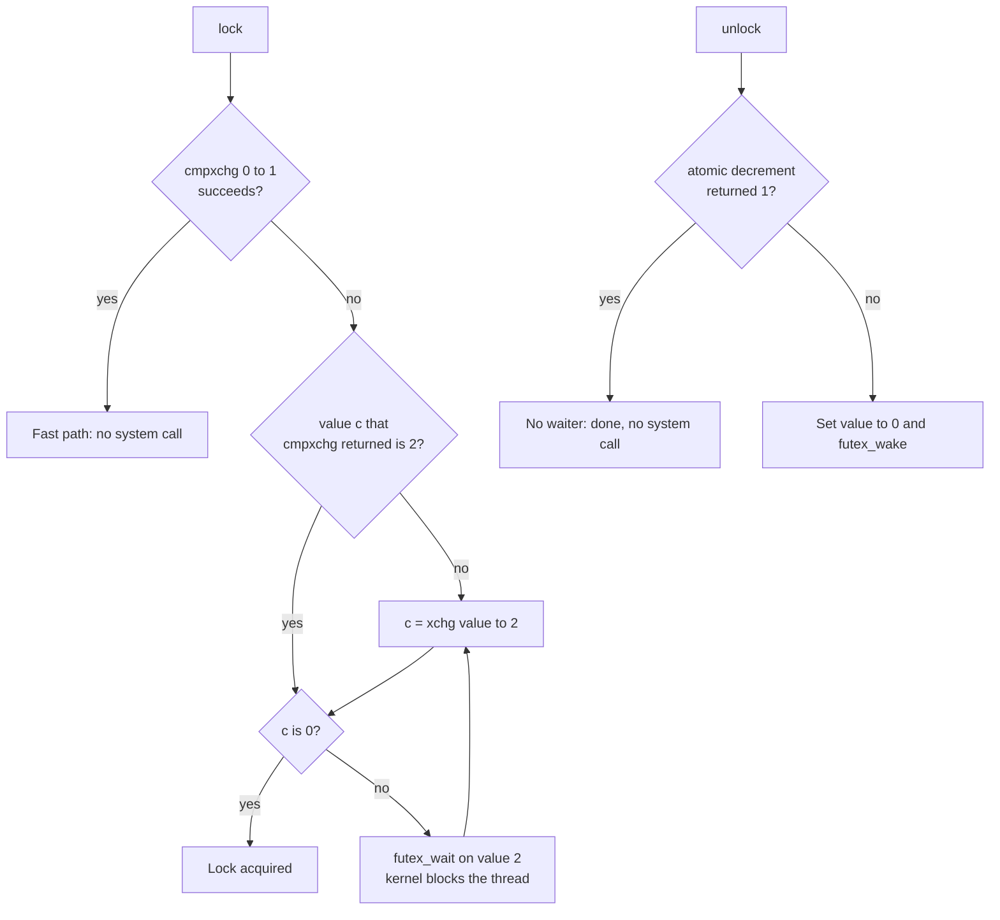
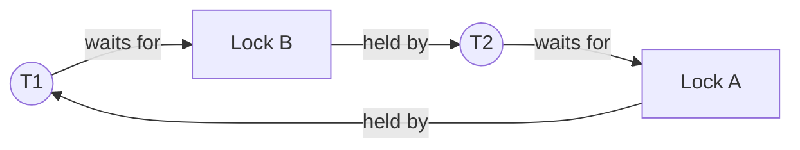
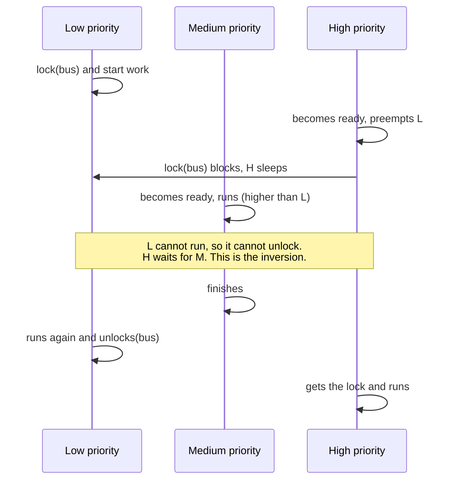
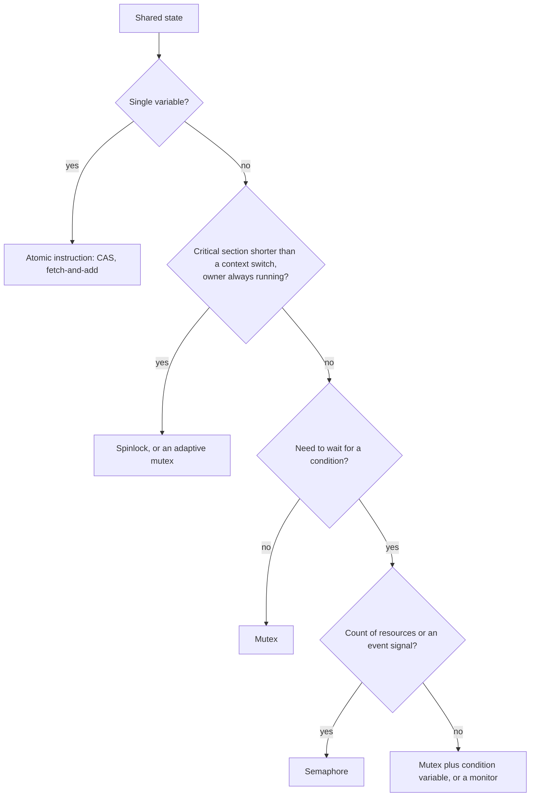

# Synchronization: Locks, Semaphores, Monitors, and Deadlock

## Why It Matters

Every interview on concurrency ends at the same questions: what is a mutex, how does it differ from a semaphore, what are the four conditions of a deadlock, and what is priority inversion. A candidate who answers only at the Java level (`synchronized`, `ReentrantLock`) cannot say what happens when a thread waits, what the CPU does to make a lock atomic, or why the `while` loop around `wait()` exists. This page explains the operating system and hardware side. It starts with the atomic instructions that every lock needs, builds the spinlock, the futex-based mutex, the semaphore, and the monitor on them, and then covers deadlock, priority inversion, and the classic problems. On the job, the same knowledge explains why a service that is "waiting" shows low CPU use, why a lock-heavy service shows high system CPU time, and why a real-time task misses its deadline. The Java code for these tools lives on other pages: [Concurrency Basics](../java/07-concurrency-basics.md) (monitors, `wait` and `notify`, deadlock in Java), [java.util.concurrent](../java/08-java-util-concurrent.md) (CAS, locks, semaphores), and [Concurrency Coding Problems](../java/11-concurrency-coding-problems.md) (producer-consumer, reader-writer lock, dining philosophers). This page links to them and does not repeat their code.

## Core Concepts

**Critical section**: a part of a program that accesses a shared resource and must not run in two threads at the same time.

**Race condition**: a result that depends on the order in which threads run their steps. A race on a memory location without synchronization is a *data race*. The Java side is in [Concurrency Basics](../java/07-concurrency-basics.md).

**Mutual exclusion (mutex)**: the property that at most one thread is in a critical section. A *mutex* is the lock object that enforces it: a thread locks it before the critical section and unlocks it after. The thread that locked a mutex is its *owner*.

**Atomic operation**: an operation that other CPUs see as one step: either not started or complete. A *read-modify-write* instruction (test-and-set, compare-and-swap, fetch-and-add) reads a memory location and writes a new value to it as one atomic step.

**Spinlock**: a lock whose waiting thread loops on the CPU until the lock is free (busy waiting). **Blocking lock**: a lock whose waiting thread tells the kernel to remove it from the CPU until the lock is free.

**Futex** (fast userspace mutex): a Linux system call, `futex(2)`, that lets a user-space lock ask the kernel to block a thread on a memory address and to wake it later. Man page futex(7): "The kernel is involved only to arbitrate the contended case."

**Semaphore**: an integer that is never below zero, with two atomic operations. Dijkstra's names are **P** (wait: decrease the value, and block while it is zero) and **V** (signal: increase the value, and wake one waiter). A *binary semaphore* has the values 0 and 1. A *counting semaphore* has any non-negative value.

**Monitor**: a language-level structure that bundles shared data, the procedures that access it, and one implicit lock, so that only one thread is inside the monitor at a time. A **condition variable** is a wait queue that belongs to a monitor (or to a mutex): a thread waits on it for a condition to become true, and another thread signals it.

**Deadlock**: a state in which each thread of a set waits for a resource that another thread of the set holds, so none can continue. **Livelock**: threads keep running and reacting to each other, and none makes progress. **Starvation**: a thread waits indefinitely because other threads always get the resource first. The Java examples are in [Concurrency Basics](../java/07-concurrency-basics.md#deadlock).

**Priority inversion**: a high-priority thread waits for a lock that a low-priority thread holds, while a medium-priority thread keeps the low-priority thread off the CPU. **Priority inheritance**: the lock owner temporarily runs with the priority of the highest-priority waiter.

## How It Works

### The critical-section problem

A solution to the critical-section problem must meet three requirements. This is the textbook formulation (for example Silberschatz, Galvin, and Gagne, *Operating System Concepts*). Dijkstra's note "Cooperating Sequential Processes" (EWD123) states the problem for two processes. It asks for mutual exclusion and adds three requirements: make no assumption about the relative speeds of the processes; a process that stops well outside its critical section must not block the other; and the decision which process enters first must not be postponable forever. The last two requirements correspond to progress. Bounded waiting is the textbook addition that no single thread loses every time.

| Requirement | Meaning |
|---|---|
| Mutual exclusion | If a thread is in its critical section, no other thread is in its critical section |
| Progress | If no thread is in its critical section and some threads want to enter, only threads that are not in their remainder section decide which one enters next, and the decision does not wait forever |
| Bounded waiting | After a thread asks to enter, only a bounded number of other threads can enter before it. This prevents starvation |

Software-only solutions exist. Peterson's algorithm (Peterson, "Myths About the Mutual Exclusion Problem", *Information Processing Letters* 12(3), 1981) solves the problem for two threads with two shared variables (a `flag` array and a `turn` variable). It is correct only if memory operations happen in program order (sequential consistency). Each thread first stores its own flag and then loads the other thread's flag. A store followed by a load of a different location is the one reordering that x86 CPUs do (Intel SDM volume 3A, section 8.2.3.4: loads may be reordered with earlier stores to different locations). If the CPU runs both loads before both stores, each thread sees the other flag as clear and both enter. A full memory barrier between the store and the load (`mfence` on x86) repairs this, and compilers need the same barrier. So Peterson's algorithm needs memory barriers on modern CPUs, and it does not scale to many threads. A real lock uses one atomic instruction.

Two simple attempts fail:

- **A plain `locked` flag.** A thread reads the flag (free), and before it writes "taken", another thread reads the flag (free) as well. Both enter. The test and the set must be one atomic step.
- **Disabling interrupts.** On one CPU, a kernel can disable interrupts around a critical section, so that the scheduler cannot preempt it. This works only in kernel mode and only for one CPU. On a multiprocessor, another CPU still enters the section. A user program cannot disable interrupts at all.

### Hardware support: atomic instructions

A CPU gives a read-modify-write instruction that no other CPU can interleave. The three that matter:

| Operation | What it does | x86-64 instruction | Arm instruction |
|---|---|---|---|
| Test-and-set / exchange | Writes a new value and returns the old value | `xchg` with a memory operand (it is atomic without a `lock` prefix) | `swp` (Armv8.1 LSE), or a `ldxr`/`stxr` loop |
| Compare-and-swap (CAS) | Writes a new value only if the memory holds the expected value, and returns the old value | `lock cmpxchg` | `cas` (Armv8.1 LSE), or a `ldxr`/`stxr` loop |
| Fetch-and-add | Adds a number and returns the old value | `lock xadd` | `ldadd` (Armv8.1 LSE), or a `ldxr`/`stxr` loop |

Sources. Intel SDM, `XCHG`: "If a memory operand is referenced, the processor's locking protocol is automatically implemented for the duration of the exchange operation, regardless of the presence or absence of the LOCK prefix." For `CMPXCHG` and `XADD` the SDM says the instruction "can be used with a LOCK prefix to allow the instruction to be executed atomically", so without `lock` they are not atomic across CPUs. On Arm, the Linux kernel source uses `ldadd` and `cas` in `arch/arm64/include/asm/atomic_lse.h`, `swp` in `arch/arm64/include/asm/cmpxchg.h`, and the `ldxr`/`stxr` pair in `arch/arm64/include/asm/atomic_ll_sc.h`. The `swp`, `cas`, and `ldadd` instructions belong to the Armv8.1 Large System Extensions (LSE). Without LSE, the CPU provides a *load-exclusive* and *store-exclusive* pair (LL/SC, load-linked and store-conditional). The store succeeds only if no other CPU wrote the location since the load. A compiler builds CAS from the pair with a retry loop.

A CAS is the base of every lock-free algorithm. The Java side (`AtomicInteger`, `compareAndSet`, the retry loop, and the ABA problem) is in [java.util.concurrent](../java/08-java-util-concurrent.md#what-a-cas-does).

A lock does two jobs. It gives mutual exclusion, and it gives *ordering*: everything that a thread wrote before it unlocked is visible to the next thread that locks. The Linux kernel's memory-barrier documentation defines a lock operation as an ACQUIRE and an unlock operation as a RELEASE: later accesses cannot move before the acquire, and earlier accesses cannot move after the release. The same documentation warns that an ACQUIRE followed by a RELEASE is not a full barrier. The Java guarantee, "an unlock happens-before a later lock of the same monitor", is the same idea at the language level ([Concurrency Basics](../java/07-concurrency-basics.md)). Why CPUs reorder memory operations (store buffers, weak ordering on Arm) belongs to [Computer Architecture for Developers](06-computer-architecture-for-developers.md).

### Spinlocks

A spinlock repeats an atomic instruction until it succeeds. The simplest form is a test-and-set loop. It has a cost problem: every attempt is a write, so the CPUs that wait move the cache line that holds the lock between their caches on every attempt, and they slow the lock holder. The usual improvement is *test-and-test-and-set* (TTAS): wait with a plain read, which each CPU serves from its own cached copy of the line, and attempt the atomic write only when the read shows a free lock. The Java class below uses this form. A real kernel uses queue-based spinlocks that let each waiter spin on its own memory location (the Linux kernel's mutex design page mentions an MCS-style queue for spinners), which also gives a first-come, first-served order.

```java
import java.util.concurrent.atomic.AtomicBoolean;

public class SpinLockDemo {
    /** Test-and-test-and-set spinlock. Not reentrant, not fair, burns CPU while it waits. */
    static class SpinLock {
        private final AtomicBoolean locked = new AtomicBoolean(false);

        void lock() {
            while (true) {
                // test: read only, so waiting CPUs spin on their own cached copy of the line
                while (locked.get()) {
                    Thread.onSpinWait();
                }
                // test-and-set: one atomic read-modify-write, only when the lock looked free
                if (locked.compareAndSet(false, true)) {
                    return;
                }
            }
        }

        void unlock() {
            locked.set(false);   // a volatile write: a release store
        }
    }

    static int counter;   // guarded by lock

    public static void main(String[] args) throws InterruptedException {
        SpinLock lock = new SpinLock();
        Thread[] threads = new Thread[4];
        for (int i = 0; i < threads.length; i++) {
            threads[i] = new Thread(() -> {
                for (int n = 0; n < 50_000; n++) {
                    lock.lock();
                    try {
                        counter++;      // a very short critical section: spinning is acceptable
                    } finally {
                        lock.unlock();
                    }
                }
            });
            threads[i].start();
        }
        for (Thread t : threads) {
            t.join();
        }
        System.out.println("counter = " + counter);
    }
}
```

The output does not depend on the schedule, because the lock protects the counter and the main thread joins all workers first:

<!-- expected-output -->
```text
counter = 200000
```

In real code, use `ReentrantLock` or `synchronized`. The class above is not reentrant, not fair, and it wastes CPU while it waits.

**Rules for kernel spinlocks.** The kernel documentation on lock types states: "Spinning locks implicitly disable preemption." A thread that holds a spinlock must not sleep, because other threads that spin on the lock would wait for a thread that is not running. For this reason the kernel keeps spinlock critical sections very short. (On a kernel built with `PREEMPT_RT`, `spinlock_t` becomes a sleeping lock built on `rt_mutex`; `raw_spinlock_t` stays a true spinlock.)

**When does spinning win?** A blocking lock needs at least two context switches (the waiter leaves the CPU and later returns) and two system calls. The cost of a context switch has its home in [Processes and Threads](01-processes-and-threads.md). Spinning costs CPU time for as long as the wait lasts. So:

- Spin if the owner holds the lock for less time than a block-and-wake cycle costs, and the owner is running on another CPU. The owner then releases the lock soon.
- Do not spin on a single CPU. The owner cannot run while the waiter spins, so the waiter wastes its whole time slice.
- Do not spin if the owner can be descheduled or can block (for example on I/O) inside the critical section.

Most user-space locks and the Linux kernel `mutex` combine both: spin for a short time while the owner runs, then block. The kernel mutex design page calls this *optimistic spinning* and says: "While formally kernel mutexes are sleepable locks, it is path (ii) that makes them more practically a hybrid type." HotSpot does the same for `synchronized`: it spins for a short, adaptive time, then parks ([Concurrency Basics](../java/07-concurrency-basics.md#cost-and-implementation)).

### The futex-based mutex

A blocking mutex needs a place to wait. A user program cannot put itself to sleep without the kernel, but a system call on every `lock` is too expensive. The futex design solves this: the lock state lives in user-space memory, and the kernel is called only when a thread must block or wake.

Man page futex(2): the kernel blocks a thread only if the futex word still has the expected value: "The loading of the futex word's value, the comparison of that value with the expected value, and the actual blocking will happen atomically." This check closes the race in which the lock is released between the failed lock attempt and the sleep. `FUTEX_WAKE` wakes waiters. Man page futex(7): "Futex operation occurs entirely in user space for the noncontended case."

Ulrich Drepper's paper "Futexes Are Tricky" shows a mutex with three states in one 32-bit integer (`mutex3` in the paper):

| Value | State |
|---|---|
| 0 | Unlocked |
| 1 | Locked, no waiter |
| 2 | Locked, and there may be waiters |



State 2 exists so that `unlock` knows whether it must call `futex_wake`. If a thread finds the lock held, it sets the value to 2 before it sleeps. Unlock then sees that the old value was not 1 and wakes one waiter. A mutex that is never contended never enters the kernel. The model below replays the sequence from the paper in one thread, so the output is deterministic. It models the algorithm, not the kernel: it has no real blocking.

```java
import java.util.ArrayList;
import java.util.List;

public class FutexMutexModel {
    // Sequential model of Drepper's three-state mutex ("Futexes Are Tricky", mutex3).
    // 0 = unlocked, 1 = locked and no waiter, 2 = locked and possibly waiters.
    static int val = 0;
    static int syscalls = 0;
    static final List<String> log = new ArrayList<>();

    static void note(String thread, String text) {
        log.add(String.format("%-3s %-52s val=%d syscalls=%d", thread, text, val, syscalls));
    }

    static int cmpxchg(int expected, int newValue) {
        int old = val;
        if (old == expected) {
            val = newValue;
        }
        return old;
    }

    static int xchg(int newValue) {
        int old = val;
        val = newValue;
        return old;
    }

    static void lockFast(String t) {
        int c = cmpxchg(0, 1);
        if (c == 0) {
            note(t, "lock: cmpxchg(0->1) succeeded, no system call");
        } else {
            if (c != 2) {            // the paper skips the xchg if cmpxchg already saw 2
                c = xchg(2);
            }
            note(t, "lock: cmpxchg failed, xchg(2) returned " + c);
            if (c != 0) {
                syscalls++;
                note(t, "lock: futex_wait(&val, 2) blocks the thread");
            }
        }
    }

    static void wakeUpAndRetry(String t) {
        int c = xchg(2);
        note(t, "wakes up, xchg(2) returned " + c + (c == 0 ? ": lock acquired" : ""));
    }

    static void unlock(String t) {
        int before = val;
        val = before - 1;
        if (before != 1) {
            val = 0;
            syscalls++;
            note(t, "unlock: dec returned " + before + " (not 1), val=0, futex_wake");
        } else {
            note(t, "unlock: dec returned 1, no system call");
        }
    }

    public static void main(String[] args) {
        log.add("-- uncontended case: no system call");
        lockFast("T1");
        unlock("T1");
        log.add("-- contended case: T2 asks while T1 holds the lock");
        lockFast("T1");
        lockFast("T2");
        unlock("T1");
        wakeUpAndRetry("T2");
        unlock("T2");
        log.forEach(System.out::println);
    }
}
```

<!-- expected-output -->
```text
-- uncontended case: no system call
T1  lock: cmpxchg(0->1) succeeded, no system call        val=1 syscalls=0
T1  unlock: dec returned 1, no system call               val=0 syscalls=0
-- contended case: T2 asks while T1 holds the lock
T1  lock: cmpxchg(0->1) succeeded, no system call        val=1 syscalls=0
T2  lock: cmpxchg failed, xchg(2) returned 1             val=2 syscalls=0
T2  lock: futex_wait(&val, 2) blocks the thread          val=2 syscalls=1
T1  unlock: dec returned 2 (not 1), val=0, futex_wake    val=0 syscalls=2
T2  wakes up, xchg(2) returned 0: lock acquired          val=2 syscalls=2
T2  unlock: dec returned 2 (not 1), val=0, futex_wake    val=0 syscalls=3
```

Notes on the trace. When T2 wakes, it sets the value to 2 (not 1) because it cannot know whether other waiters exist. So the later unlock by T2 calls `futex_wake` although nobody waits. This costs one extra system call and keeps the algorithm correct.

**What glibc and the JVM do.** Drepper's paper says that the modern thread library uses futexes (a footnote names NPTL, the Native POSIX Thread Library of Linux). The glibc source (`sysdeps/nptl/lowlevellock.h`) documents the same three states for a normal `pthread_mutex_t`: 0 is not acquired, 1 is acquired with no waiters, and a value above 1 is acquired with possible waiters. The details differ from the paper. glibc unlocks with an atomic exchange to 0 and calls `futex_wake` if the old value was above 1, where the paper decrements. These internals are an implementation detail of one glibc version, not a documented interface. HotSpot parks a Java thread with `pthread_cond_wait` on a pthread mutex and condition variable (`Parker::park` in `os_posix.cpp`, JDK 21 source), so a parked Java thread ends in a futex wait inside glibc. `LockSupport.park`, `ReentrantLock`, and a contended `synchronized` all use it. The approximate cost of an uncontended lock and unlock is 25 ns, from [Back-of-the-Envelope Estimation](../hld/back-of-envelope-estimation.md). A contended lock adds system calls and context switches.

**The POSIX mutex types** (`pthread_mutex_lock`, POSIX.1-2017):

| Type | Relock by the owner | Unlock by a non-owner |
|---|---|---|
| `PTHREAD_MUTEX_NORMAL` | Deadlocks | Undefined behavior |
| `PTHREAD_MUTEX_ERRORCHECK` | Returns `EDEADLK` | Returns `EPERM` |
| `PTHREAD_MUTEX_RECURSIVE` | Succeeds, and the hold count increases | Returns `EPERM` |

A *robust* mutex handles an owner that dies while it holds the lock. The next thread to lock the mutex receives `EOWNERDEAD`, owns the mutex, and must repair the protected state and call `pthread_mutex_consistent`. Java's `ReentrantLock` is recursive, and `synchronized` is recursive.

### Semaphores

Dijkstra introduced the semaphore. In his note EWD123, P decreases the value by 1 "as soon as the resulting value would be non-negative", and V increases it by 1 as one indivisible action. He distinguishes *binary* and *general* semaphores.

```text
P(s):  wait until s > 0, then s = s - 1     (atomic)
V(s):  s = s + 1                            (atomic; wakes one waiter if there is one)
```

A kernel implements P as: take the semaphore's internal lock; if the value is positive, decrease it and return; otherwise add the thread to the wait queue and block. V takes the internal lock, increases the value (or hands the permit to the first waiter), and wakes one waiter. POSIX semaphores (man page sem_overview(7)) work the same way: "an integer whose value is never allowed to fall below zero", changed with `sem_post` (V) and `sem_wait` (P). Java's `Semaphore` has `release` and `acquire` ([java.util.concurrent](../java/08-java-util-concurrent.md)).

Three patterns cover most uses:

- **Mutual exclusion**: a semaphore with initial value 1 around the critical section.
- **Resource counting**: a semaphore with initial value N guards N identical resources (a connection pool of size N).
- **Signaling**: a semaphore with initial value 0. One thread calls V when an event has happened, and another thread calls P to wait for it. Unlike a condition variable signal, V is not lost if nobody waits yet: the value remembers it.

**Semaphore against mutex.** A binary semaphore and a mutex both give mutual exclusion, but they are not the same:

| | Mutex | Binary semaphore |
|---|---|---|
| Owner | Yes: the thread that locked it must unlock it | No: any thread can call V |
| Typical use | Protect a critical section | Signal an event from one thread to another |
| Priority inheritance | Possible, because the lock has a known owner | Not possible, because there is no owner to boost |
| Recursive locking | A recursive type exists | Not applicable: a second P blocks |
| Error on wrong unlock | Detectable (`EPERM` for error-checking and recursive types) | Not an error |

The kernel documentation on lock types states the ownership rule: "The context (task) that acquired the lock must release it", and it lists semaphores as the exception. Priority inheritance (below) needs an owner, so a semaphore used for exclusion cannot boost anyone, and priority inversion goes unnoticed. The Mars Pathfinder failure (below) is a related but different case: its lock was a VxWorks mutual-exclusion semaphore, which has an owner, but its creator had not enabled the priority-inheritance option.

### Monitors and condition variables

A semaphore is a low-level tool: a missing or misplaced P or V gives a bug that the compiler cannot find. Hoare (CACM 1974, "Monitors: An Operating System Structuring Concept") describes the monitor, which makes the compiler enforce mutual exclusion: the monitor's data is accessible only through its procedures, and the system lets one thread run in the monitor at a time. A thread that cannot continue calls `wait` on a *condition variable*. `wait` releases the monitor and blocks the thread. Another thread calls `signal` to resume a waiter.

The question is what happens at the moment of the `signal`, because two threads would be inside the monitor.

| | Hoare (signal and wait) | Mesa (signal and continue) |
|---|---|---|
| Source | Hoare, CACM 1974 | Lampson and Redell, CACM 1980 (Mesa language) |
| After `signal` | The signaler suspends and the waiter runs at once | The signaler keeps running. The waiter becomes ready and runs later |
| What the waiter may assume on return | The condition is true, because nobody ran in between | Nothing but the monitor invariant: another thread may have run first |
| Waiting code | `if (!condition) wait(c)` | `while (!condition) wait(c)` |
| Cost | Extra context switches at every signal | None |
| Signal meaning | A promise | A hint |

Hoare's paper says that a `signal` is "followed immediately by resumption of a waiting program". Lampson and Redell state the Mesa rule: "A NOTIFY is regarded as a hint to a waiting process" and "nothing more than the monitor invariant may be assumed after a WAIT, and the waiter must reevaluate the situation each time it resumes." They give the code pattern `WHILE NOT (OK to proceed) DO WAIT C`, and say that Hoare's version, `IF NOT (OK to proceed) THEN WAIT C`, needs fewer evaluations but "requires several additional process switches". They add that it is "perfectly all right to run the waiting process even if there is not any NOTIFY". A design that allows a wakeup without a notify is the background of the spurious wakeup that POSIX and Java document.

**Java and POSIX threads use Mesa semantics.** The POSIX standard for `pthread_cond_wait` says "Spurious wakeups from the pthread_cond_timedwait() or pthread_cond_wait() functions may occur" and recommends "a condition wait be enclosed in the equivalent of a while loop". Java's `Object.wait` documents the same. Three reasons make the `while` loop necessary:

1. A thread can wake and find that another thread has already taken the item (the signaler does not hand over the monitor).
2. `notifyAll` or `broadcast` wakes all waiters, but only one can proceed.
3. A thread can wake without any signal.

The code for the guarded block and the lost-wakeup cases is in [Concurrency Basics](../java/07-concurrency-basics.md#the-guarded-block-pattern-and-the-spurious-wakeup). Lampson and Redell also describe `BROADCAST`: since NOTIFY is only a hint, "it is always correct to use BROADCAST", at the cost of waking threads that cannot proceed.

In a POSIX program the lock and the condition variable are separate objects: `pthread_cond_wait(cond, mutex)` releases the mutex and blocks as one atomic step, and it reacquires the mutex before it returns. The kernel again has only the futex. The wait-and-release step is the reason that the user-space check and the sleep must be atomic (see futex above).

### Readers-writers locks

Many threads can read shared data together, but a writer needs exclusive access. A *readers-writers lock* lets many readers or one writer in. When both wait, the lock must choose a side:

| Policy | Behavior | Risk |
|---|---|---|
| Reader preference ("first readers-writers problem") | A new reader enters while a writer waits, as long as a reader is inside | A steady stream of readers starves the writer |
| Writer preference ("second problem") | When a writer waits, new readers wait | A steady stream of writers starves the readers, and readers wait behind a writer |
| Fair (arrival order; textbooks call it the "third problem") | The queue decides | Lower throughput, because readers that arrive after a waiting writer cannot share with the readers that run |

Courtois, Heymans, and Parnas ("Concurrent Control with 'Readers' and 'Writers'", *Communications of the ACM* 14(10), 1971, pp. 667-668) posed the first two problems. Problem 1 demands that "no reader be kept waiting unless a writer has already obtained permission to use the resource", so a writer can wait indefinitely while a stream of readers arrives. Problem 2 demands that once a writer is ready, it writes as soon as possible, so "a reader who arrives after a writer has announced that he is ready to write must wait", and readers can wait indefinitely while a stream of writers works. The paper has no third problem: the fair variant comes from later textbooks. What real systems do:

- glibc: man page `pthread_rwlockattr_setkind_np(3)`: `PTHREAD_RWLOCK_PREFER_READER_NP` is the default, and "As long as there are readers, the writer will be starved". `PTHREAD_RWLOCK_PREFER_WRITER_NONRECURSIVE_NP` avoids writer starvation, but a reader must not take the read lock twice (a recursive read lock can deadlock behind a waiting writer). glibc ignores `PTHREAD_RWLOCK_PREFER_WRITER_NP`.
- Linux kernel `rw_semaphore`: on kernels without `PREEMPT_RT`, "the implementation is fair, thus preventing writer starvation" (kernel documentation, lock types).
- Java: `ReentrantReadWriteLock` in non-fair mode blocks a reader that sees a waiting writer at the head of the queue, and allows a downgrade but not an upgrade ([java.util.concurrent](../java/08-java-util-concurrent.md#reentrantreadwritelock)). The from-scratch version with `waitingWriters` is in [Concurrency Coding Problems](../java/11-concurrency-coding-problems.md).

Why a readers-writers lock can be slower than a plain mutex: every reader still performs an atomic update of the shared reader count. All readers write to the same cache line, so the line moves between CPUs, and a short read section pays more for the lock than for the work. A read-write lock pays off when the read section is long and the writes are rare.

### Deadlock

Coffman, Elphick, and Shoshani ("System Deadlocks", *ACM Computing Surveys* 3(2), 1971) name four conditions (the paper calls the second one the "wait for" condition, and it defines a deadlock state by the four conditions together). A deadlock exists only if all four hold. [Concurrency Basics](../java/07-concurrency-basics.md#deadlock) lists them with the Java fixes. The OS view adds the model, the graph, and the strategies.

| Condition | Meaning | Prevention: break it by |
|---|---|---|
| Mutual exclusion | A resource has at most one holder | Make the resource shareable (read-only data, lock-free structures, spooling). Not possible for every resource |
| Hold and wait | A thread holds a resource and waits for another | Request all resources at once, or release everything before a new request. It lowers resource use and can starve a thread that needs many resources |
| No preemption | The system cannot take a resource away | Let the system take the resources of a waiting thread (works for CPU registers and memory pages, not for a lock whose critical section is half done) |
| Circular wait | A cycle of threads, each waits for the next | Number the resource classes and require requests in increasing order (lock ordering). This is the practical choice |

**The resource-allocation graph.** Draw a node for each thread and for each resource. An edge from a resource to a thread means the thread holds the resource. An edge from a thread to a resource means the thread waits for it. If every resource has one instance, a deadlock exists if and only if the graph has a cycle. If a resource has several instances (a counting semaphore), a cycle is necessary but not sufficient: another thread outside the cycle can release an instance. Removing the resource nodes gives the *wait-for graph*: an edge from thread A to thread B means that A waits for a resource that B holds.



**Four strategies.**

| Strategy | Idea | Cost |
|---|---|---|
| Prevention | Break one Coffman condition by design | Lower resource use, or a coding rule (lock order) |
| Avoidance | Grant a request only if the resulting state is *safe* (the banker's algorithm) | The system must know each thread's maximum need in advance, and it must run a check at each request |
| Detection and recovery | Let deadlock happen, find the cycle, and break it | The cost of the search, plus the cost of recovery (abort a thread, roll back a transaction, preempt a resource) |
| Ignore it (the "ostrich algorithm") | Assume deadlock is rare and let the user restart | No cost, and no help when it happens |

**The banker's algorithm** (Dijkstra, EWD108, circa 1965, written in Dutch). Each thread declares its maximum need for each resource type. A state is *safe* if some order exists in which every thread can get its maximum, finish, and return its resources. The algorithm grants a request only if the state after the grant is still safe. The safety check repeats this: find a thread whose remaining need is not more than the free resources, assume that the thread finishes, add its resources to the free pool, and continue. If all threads finish, the state is safe and the order is a *safe sequence*. An unsafe state is not a deadlock, but it can lead to one. EWD108 describes a banker who lends money to customers. Each customer states an upper limit in advance, and the banker grants a request only if the situation after the payment is "safe", which means that he can still get all his money back by waiting prudently. A later generalization to several resource types is the matrix form that textbooks use.

The program below runs the textbook example (five threads, three resource types with 10, 5, and 7 instances). It checks the safe sequence, then applies five requests in order (each granted request changes the state that the next request sees, as in the textbook), and then finds a cycle in a wait-for graph with a depth-first search.

```java
import java.util.ArrayList;
import java.util.Arrays;
import java.util.List;

public class DeadlockTools {
    // Banker's algorithm (Dijkstra, EWD108) in the matrix form of the textbooks.
    static final int[] TOTAL = {10, 5, 7};
    static final int[][] MAX = {{7, 5, 3}, {3, 2, 2}, {9, 0, 2}, {2, 2, 2}, {4, 3, 3}};
    // The current state. A granted request changes it, so the next request sees the new state.
    static final int[][] ALLOC = {{0, 1, 0}, {2, 0, 0}, {3, 0, 2}, {2, 1, 1}, {0, 0, 2}};

    static int[] available(int[][] alloc) {
        int[] avail = TOTAL.clone();
        for (int[] row : alloc) {
            for (int r = 0; r < avail.length; r++) {
                avail[r] -= row[r];
            }
        }
        return avail;
    }

    static boolean leq(int[] a, int[] b) {
        for (int i = 0; i < a.length; i++) {
            if (a[i] > b[i]) {
                return false;
            }
        }
        return true;
    }

    /** Returns a safe sequence, or null if the state is unsafe. */
    static List<Integer> safeSequence(int[] avail, int[][] alloc) {
        int n = alloc.length;
        int[] work = avail.clone();
        boolean[] done = new boolean[n];
        List<Integer> order = new ArrayList<>();
        boolean progress = true;
        while (progress) {
            progress = false;
            for (int p = 0; p < n; p++) {
                if (done[p]) {
                    continue;
                }
                int[] need = new int[work.length];
                for (int r = 0; r < work.length; r++) {
                    need[r] = MAX[p][r] - alloc[p][r];
                }
                if (leq(need, work)) {          // p can run to completion
                    for (int r = 0; r < work.length; r++) {
                        work[r] += alloc[p][r];  // p returns everything it holds
                    }
                    done[p] = true;
                    order.add(p);
                    progress = true;
                }
            }
        }
        return order.size() == n ? order : null;
    }

    static void request(int p, int[] req) {
        int[] avail = available(ALLOC);
        int[] need = new int[req.length];
        for (int r = 0; r < req.length; r++) {
            need[r] = MAX[p][r] - ALLOC[p][r];
        }
        String head = "P" + p + " requests " + Arrays.toString(req) + ": ";
        if (!leq(req, need)) {
            System.out.println(head + "error, exceeds its declared maximum");
            return;
        }
        if (!leq(req, avail)) {
            System.out.println(head + "wait, not enough free resources");
            return;
        }
        int[][] trial = new int[ALLOC.length][];
        for (int i = 0; i < trial.length; i++) {
            trial[i] = ALLOC[i].clone();
        }
        for (int r = 0; r < req.length; r++) {
            trial[p][r] += req[r];
        }
        List<Integer> seq = safeSequence(available(trial), trial);
        if (seq == null) {
            System.out.println(head + "denied, the new state is unsafe");
            return;
        }
        for (int r = 0; r < req.length; r++) {
            ALLOC[p][r] += req[r];            // grant: the state changes for the next request
        }
        System.out.println(head + "granted, available = " + Arrays.toString(available(ALLOC))
                + ", safe sequence " + seq);
    }

    /** Wait-for graph: edge i -> j means thread i waits for a lock that thread j holds. */
    static List<Integer> findCycle(int[][] waitsFor) {
        int n = waitsFor.length;
        int[] color = new int[n];   // 0 unvisited, 1 on the DFS path, 2 finished
        int[] parent = new int[n];
        Arrays.fill(parent, -1);
        for (int start = 0; start < n; start++) {
            if (color[start] == 0) {
                List<Integer> cycle = dfs(start, waitsFor, color, parent);
                if (cycle != null) {
                    return cycle;
                }
            }
        }
        return null;
    }

    static List<Integer> dfs(int u, int[][] g, int[] color, int[] parent) {
        color[u] = 1;
        for (int v : g[u]) {
            if (color[v] == 1) {                 // back edge: cycle v -> ... -> u -> v
                List<Integer> cycle = new ArrayList<>();
                for (int x = u; x != v; x = parent[x]) {
                    cycle.add(0, x);
                }
                cycle.add(0, v);
                return cycle;
            }
            if (color[v] == 0) {
                parent[v] = u;
                List<Integer> cycle = dfs(v, g, color, parent);
                if (cycle != null) {
                    return cycle;
                }
            }
        }
        color[u] = 2;
        return null;
    }

    public static void main(String[] args) {
        System.out.println("available = " + Arrays.toString(available(ALLOC)));
        System.out.println("each granted request changes the state for the requests after it");
        System.out.println("safe sequence = " + safeSequence(available(ALLOC), ALLOC));
        request(1, new int[] {1, 0, 2});
        request(4, new int[] {3, 3, 0});
        request(0, new int[] {0, 2, 0});
        request(3, new int[] {0, 1, 0});
        request(1, new int[] {5, 0, 0});

        // T0 waits for T1, T1 waits for T2, T2 waits for T0; T3 waits for T0.
        int[][] cyclic = {{1}, {2}, {0}, {0}};
        System.out.println("wait-for cycle = " + findCycle(cyclic));
        // After the system aborts T2 (no waits), the graph has no cycle.
        int[][] aborted = {{1}, {2}, {}, {0}};
        System.out.println("after abort of T2 = " + findCycle(aborted));
    }
}
```

<!-- expected-output -->
```text
available = [3, 3, 2]
each granted request changes the state for the requests after it
safe sequence = [1, 3, 4, 0, 2]
P1 requests [1, 0, 2]: granted, available = [2, 3, 0], safe sequence [1, 3, 4, 0, 2]
P4 requests [3, 3, 0]: wait, not enough free resources
P0 requests [0, 2, 0]: denied, the new state is unsafe
P3 requests [0, 1, 0]: granted, available = [2, 2, 0], safe sequence [1, 3, 4, 0, 2]
P1 requests [5, 0, 0]: error, exceeds its declared maximum
wait-for cycle = [0, 1, 2]
after abort of T2 = null
```

Reading the output (the first three requests are the textbook sequence). P1 asks for `[1, 0, 2]`. The free resources `[3, 3, 2]` cover it, and the state after the grant is still safe, so the banker grants it. Now `[2, 3, 0]` is free. P4 asks for `[3, 3, 0]`: the request needs 3 instances of the first resource and only 2 are free, so P4 waits (a plain shortage, no safety check needed). P0 asks for `[0, 2, 0]`. The resources are free, but the state after the grant is unsafe: no thread could then reach its maximum. So the banker denies the request, although the resources exist. That case shows the difference between a shortage and an unsafe state. P3's small request `[0, 1, 0]` leaves a safe state and is granted. P1's request `[5, 0, 0]` exceeds what P1 declared as its maximum, so it is an error.

**What real systems do.**

- **General-purpose operating systems and applications mostly ignore deadlock.** The banker's algorithm needs each thread's maximum need in advance, which a general program does not know, and the number of threads changes at run time. The operating system does not search for a cycle among the locks of user programs. Prevention by lock order is the coding rule.
- **The Linux kernel** prevents deadlock by lock-order rules and checks them in development with `lockdep`. The lockdep documentation says that the validator checks whether locks "can be acquired in a circular fashion", and that "complex deadlocks that would normally need more than 3 CPUs and a very unlikely constellation of tasks, irq-contexts and timings to occur, can be detected on a plain, lightly loaded single-CPU system as well". Each simple locking chain has to occur only once. So lockdep reports a lock order that can deadlock without the unlucky interleaving.
- **Databases** use detection. A database keeps a wait-for graph of transactions, finds a cycle, and aborts one transaction (the victim). The application retries it. See [Transactions and Isolation](../databases/04-transactions-and-isolation.md).
- **The JVM** detects Java-level deadlocks on request: `jstack` and `ThreadMXBean.findDeadlockedThreads()` search for a cycle among monitor and `java.util.concurrent` lock owners. The JVM does not break the deadlock ([Concurrency Basics](../java/07-concurrency-basics.md#deadlock)).
- **`tryLock` with a timeout** is detection by timeout: it breaks "no preemption" in application code.

**Livelock and starvation** differ from deadlock because threads are not blocked (livelock) or because only some threads wait (starvation). An unfair lock, a reader preference, or a scheduler that always picks the same thread can starve a thread. *Aging* (raise the priority of a waiting thread with time) and FIFO queues prevent it. The Java examples are in [Concurrency Basics](../java/07-concurrency-basics.md).

### Priority inversion and priority inheritance

*Priority inversion* occurs with three threads of different priorities. Low (L) holds a lock. High (H) becomes ready and waits for that lock, so H blocks. Medium (M) becomes ready. M has a higher priority than L, so the scheduler runs M, and L cannot run to release the lock. H waits for as long as M runs, although H has a higher priority than M. The time that H waits has no upper bound that the lock design controls, because it depends on all medium-priority work.



Lampson and Redell described this problem for monitors in 1980: "the ordering implied by the assignment of priorities can be subverted by monitors", with three processes P1, P2, and P3. They propose giving each monitor the priority of the highest-priority process that ever enters it, and raising a process to that priority while it is inside (what is today called a *priority ceiling*).

**The fixes.**

- **Priority inheritance**: while H waits, the owner L runs with H's priority, so M cannot preempt L. When L unlocks, its priority returns to normal. Inheritance is transitive: if L waits for another lock, the owner of that lock inherits the priority too (the kernel's rt-mutex documentation states this). The Linux kernel documentation on rt-mutexes says: "A low priority owner of a rt-mutex inherits the priority of a higher priority waiter until the rt-mutex is released."
- **Priority ceiling**: each lock has a ceiling, the highest priority of any thread that uses it. A thread that holds the lock runs at the ceiling. POSIX provides `PTHREAD_PRIO_PROTECT` for this (lock fails with `EINVAL` if the caller's priority is higher than the ceiling), and `PTHREAD_PRIO_INHERIT` for inheritance.
- **Avoid the shared lock** between tasks of different priorities, or keep the critical section so short that the inversion lasts only microseconds.

**Linux.** The kernel provides `rt_mutex` with priority inheritance. User space gets it through PI futexes: `pthread_mutex_t` with `PTHREAD_PRIO_INHERIT` uses them. The kernel documentation on PI futexes describes the protocol: the futex word is 0 when free and holds the owner's thread ID when locked, so the uncontended acquire is one atomic change from 0 to the thread ID with no system call. If the acquire fails, the thread calls `FUTEX_LOCK_PI`, and the kernel attaches an rt-mutex that boosts the owner. Inference (the kernel documentation describes the mechanism but does not rank use cases): this matters most for the real-time scheduling policies (`SCHED_FIFO`, `SCHED_RR`, `SCHED_DEADLINE`), where a runnable high-priority thread always preempts a lower one. The CPU scheduling page is [CPU Scheduling](02-cpu-scheduling.md). Java does not specify priority inheritance: chapter 17 of the JLS (SE 21) does not mention thread priorities or priority inheritance, and the `Thread` javadoc says that the priority of a virtual thread is always `NORM_PRIORITY`.

**The Mars Pathfinder case (1997).** The Pathfinder spacecraft ran the VxWorks real-time operating system. The two primary accounts differ in detail, so this page states what both support and marks the differences.

- **Reeves** (Glenn Reeves led the flight software team at JPL). A high-priority bus distribution task (`bc_dist`) and a bus scheduler task (`bc_sched`, the highest priority task apart from the VxWorks `tExec` task) ran in an 8 Hz cycle. A low-priority meteorological science task (`ASI/MET`) received its data through a VxWorks `pipe`, and tasks waited on pipes with `select()`. The `select()` service guards its list of file descriptors with a mutual-exclusion semaphore. `ASI/MET` held that mutex and several medium-priority tasks preempted it. `bc_dist` then blocked on the mutex (in `pipeWrite()`). When `bc_sched` started the next cycle, it found that `bc_dist` had not finished, treated this as an error, and reset the computer.
- **Jones** (Mike Jones, summary of a keynote by David Wilner of Wind River). The shared lock is a mutex on an "information bus". The bus management task has high priority, the meteorological data task has low priority, and a communications task has medium priority. The medium-priority task prevents the low-priority task from releasing the mutex, and a watchdog timer notices that the bus task did not run and resets the system.
- **Agreed by both.** The cause is priority inversion on a mutex that was created without priority inheritance. JPL reproduced the reset on a ground copy of the system with tracing (Reeves: in less than 18 hours). The fix is to enable the priority-inheritance option, which VxWorks accepts when the code creates the semaphore (`semMCreate`), through a global configuration variable. Reeves says that the team sent the change as a patch of the flight software and did not use the VxWorks shell. Jones says that a short C program was interpreted on the spacecraft. Reeves' account is the one by the team lead, so this page follows it.

The lesson for interviews: the failure was not a rare deadlock but a scheduling effect of a mutex without inheritance, and it needed real-time priorities, three kinds of task, and heavy load. Reeves adds that the pre-launch tests used the best-case data rates, so the case did not appear.

### The classic problems at the OS level

Each problem tests one idea. The OS-level analysis is below. Java code: [Concurrency Coding Problems](../java/11-concurrency-coding-problems.md).

**Producer-consumer (bounded buffer).** A producer puts items into a buffer of N slots, and a consumer takes them. Needs: the producer waits when the buffer is full, the consumer waits when it is empty, and the buffer is not corrupted. The classic solution uses three semaphores:

```text
semaphore empty = N       // free slots; the producer waits on it
semaphore full  = 0       // filled slots; the consumer waits on it
semaphore mutex = 1       // protects the buffer indexes

producer:                      consumer:
  P(empty)                       P(full)
  P(mutex)                       P(mutex)
  put(item)                      item = take()
  V(mutex)                       V(mutex)
  V(full)                        V(empty)
```

Analysis: the semaphores `empty` and `full` count, so they replace the condition variables and do not lose a signal. The order of the two P calls matters. If the producer does `P(mutex)` before `P(empty)`, then on a full buffer it holds the mutex while it waits for a free slot, and the consumer cannot take the mutex to free one. That is a deadlock by *hold and wait*. The monitor version uses a mutex and two conditions (not-full, not-empty) with Mesa `while` loops. Java code: `wait`/`notify`, `BlockingQueue`, and a bounded queue from scratch are in [Concurrency Coding Problems](../java/11-concurrency-coding-problems.md).

**Readers-writers.** See the policy table above. The question to ask in an interview: "Which side may starve?" Java code: [Concurrency Coding Problems](../java/11-concurrency-coding-problems.md) (reader-writer lock from scratch).

**Dining philosophers.** Five philosophers, five forks, and each philosopher needs two forks. If each takes the left fork and then waits for the right, all four Coffman conditions hold, and the system deadlocks. Each solution breaks one condition or limits the state:

| Solution | What it breaks |
|---|---|
| Number the forks, take the lower number first | Circular wait |
| At most four philosophers at the table (a semaphore of 4) | Circular wait: five forks and four philosophers cannot form a cycle of five |
| Take both forks at once, in a critical section (or `tryLock` and release both on failure) | Hold and wait |
| Dijkstra's state-based solution (a philosopher eats only if neither neighbor eats) | Hold and wait |

These solutions remove deadlock and not starvation. Dijkstra noted that his own solution can starve a philosopher whose two neighbors take turns eating (EWD310, 1971: "a particular philosopher being starved to death by a conspiration of his two neighbours"). The Java code, the failing demo, and the fair-lock variant are in [Concurrency Coding Problems](../java/11-concurrency-coding-problems.md#problem-7-dining-philosophers).

**Sleeping barber.** [Concurrency Coding Problems](../java/11-concurrency-coding-problems.md) has no Java version of this problem, so it appears here. The name comes from Dijkstra's EWD123 (1965), where "The Sleeping Barber" is the name of a producer-consumer program with an unbounded buffer: the barber is the consumer, and the waiting room is the buffer. The version below, with a fixed number of chairs and customers who leave, is the form in operating-systems textbooks (for example Tanenbaum, *Modern Operating Systems*). A barber shop has one barber and N waiting chairs. If no customer is present, the barber sleeps. A customer who arrives wakes the barber, or sits in a chair, or leaves if all chairs are full. The solution has two signaling semaphores and a mutex:

```text
semaphore customers = 0   // customers waiting; the barber sleeps on it
semaphore barber    = 0   // the barber is ready; customers wait on it
semaphore mutex     = 1   // protects waiting
int waiting = 0           // customers in chairs (a semaphore value cannot be read)

barber:                         customer:
  loop:                           P(mutex)
    P(customers)  // sleeps       if waiting < N:
    P(mutex)                        waiting = waiting + 1
    waiting = waiting - 1           V(customers)   // wake the barber
    V(barber)                       V(mutex)
    V(mutex)                        P(barber)      // wait for the barber
    cut_hair()                      get_haircut()
                                  else:
                                    V(mutex)       // shop full: leave
```

Analysis. (1) The race that the problem tests is the lost wakeup: the barber checks for customers and goes to sleep while a customer arrives. The counting semaphore `customers` removes the race, because a V that comes before the P is remembered in the value. A bare condition variable would lose that signal. (2) `waiting` is a separate counter, because a semaphore's value cannot be read. The mutex protects it. (3) No thread holds the mutex while it blocks in a P, so the mutex cannot take part in a deadlock. (4) The shop is a bounded buffer: the chairs are the slots, and customers are the items. A full shop drops the customer instead of blocking, which a bounded blocking queue does not do (`offer` instead of `put`). (5) The order of service follows the order of the semaphore's wait queue: with a FIFO semaphore, no customer starves.

Check of the pseudocode: no wakeup is lost (a V before the matching P raises the value, and the P then returns at once), and no deadlock exists (the mutex is never held across a P, and each P has a matching V in the other role). The customer's `V(customers)` comes before its `V(mutex)`, so the barber that wakes up sees the updated `waiting`. Assumption: a Java version is a direct translation to `Semaphore` and `ReentrantLock`; it is not in the KB.

### Putting it together: which tool for which job



## Trade-offs and When to Use

| Primitive | Waiting | Owner | Strength | Weakness |
|---|---|---|---|---|
| Atomic instruction (CAS) | None: retry loop | None | No kernel, no blocking; basis of lock-free code | Complex for more than one variable. ABA. Heavy contention wastes CPU |
| Spinlock | Busy waiting | Yes | Lowest latency for very short sections. Usable where the code cannot sleep (interrupt handler) | Wastes CPU. Dangerous if the owner is preempted. Bad on one CPU |
| Mutex (futex-based) | Blocks | Yes | No cost when uncontended. Priority inheritance is possible. Does not waste CPU while waiting | A contended lock costs system calls and context switches |
| Semaphore | Blocks | No | Counts resources. Signals between threads. Never loses a signal | Easy to misuse. No ownership, so no inheritance and no misuse checks |
| Monitor and condition variable | Blocks | Yes | The compiler or the language enforces the lock. Waits for arbitrary conditions | The `while` loop discipline. Signal hygiene (`notifyAll`) |
| Readers-writers lock | Blocks | Yes (writer) | Parallel reads | Starvation choice. Reader count is a shared write. Often slower than a mutex for short sections |

**Deadlock strategies compared.**

| Strategy | Run-time cost | Needs advance knowledge | Used by |
|---|---|---|---|
| Prevention (lock order) | None at run time | The set of locks | Kernels, application code |
| Avoidance (banker's algorithm) | A safety check at each request | Each thread's maximum need | Rare: mainly a teaching tool. Assumption (no source found): no mainstream general-purpose kernel uses it for locks |
| Detection and recovery | A graph search from time to time | None | Databases, JVM thread dumps (detect only) |
| Ignore | None | None | Most application and OS code for user-level locks |

Recommendations: in application code, lock in a global order, hold few locks for a short time, and call no foreign code while you hold a lock. Use a monitor or a `Condition` for waiting, never a sleep loop. Use a semaphore for counting and for signaling, not for exclusion.

## Java Example

The three programs on this page are in the sections above: a test-and-test-and-set spinlock (the real lock that Java gives, `ReentrantLock`, is in [java.util.concurrent](../java/08-java-util-concurrent.md)), a model of the futex mutex states, and the banker's safety check with a wait-for-graph cycle finder. The programs use only the JDK, print deterministic output, and open no sockets. The model and the banker's program do not use threads. The spinlock program joins its threads before it prints.

To use a real futex-based lock in Java, use `ReentrantLock`, `synchronized`, or `Semaphore`: the JVM calls `pthread_cond_wait` and `pthread_mutex_lock` for you, and glibc calls `futex`. Java code does not call `futex` directly. Observing it needs Linux tools: `strace -f -e trace=futex -p <pid>` shows `futex` calls of a JVM. Illustrative output, not from a real run:

```text
[pid 4123] futex(0x7f2c4c001a28, FUTEX_WAIT_PRIVATE, 2, NULL) = 0
[pid 4124] futex(0x7f2c4c001a28, FUTEX_WAKE_PRIVATE, 1) = 1
```

The number after `FUTEX_WAIT_PRIVATE` is the expected value. In the glibc source (`sysdeps/nptl/lowlevellock.h`), a value above 1 means "acquired, possibly with waiters", and a waiter blocks on the value 2. This is an internal detail of glibc, and it can change. A PI mutex or a robust mutex stores the owner's thread ID instead.

## Interview Angle

### Questions

??? question "What are the three requirements of a solution to the critical-section problem, and why does a plain boolean flag fail?"

    The requirements are mutual exclusion (at most one thread in the section), progress (when the section is free, the threads that want to enter choose among themselves without waiting forever, and a thread outside its section cannot block them), and bounded waiting (after a thread asks to enter, only a bounded number of other threads enter before it, so no thread starves).

    A plain flag fails mutual exclusion because the test ("is it free?") and the set ("take it") are two steps. Two threads can both see "free" and both enter. A software fix exists (Peterson's algorithm for two threads), but it assumes that memory operations happen in program order, and CPUs and compilers reorder them. A real lock needs an atomic read-modify-write instruction: test-and-set (`xchg` on x86-64), compare-and-swap (`lock cmpxchg`), or a load-exclusive and store-exclusive pair on Arm. Disabling interrupts works only for one CPU in kernel mode, not on a multiprocessor and not in user space.

??? question "How does a mutex work in Linux? What happens when two threads call lock at the same time?"

    A pthread mutex lives in user space as an integer. This is the futex design: 0 is unlocked, 1 is locked with no waiter, and 2 is locked with possible waiters (Drepper, "Futexes Are Tricky").

    Lock: the thread tries one atomic compare-and-swap from 0 to 1. If it works, the thread owns the lock and made no system call. That is the fast path, and it is the common case. If it fails, the thread sets the value to 2 and calls `futex(FUTEX_WAIT, ..., 2)`. The kernel checks atomically that the value is still 2, and only then blocks the thread. This check prevents a lost wakeup when the owner unlocks in between.

    Unlock: in Drepper's version the owner atomically decrements the value (glibc exchanges it with 0 and tests the old value, with the same result). If the old value was 1, nobody waits, and there is no system call. Otherwise, the owner sets the value to 0 and calls `FUTEX_WAKE` for one waiter. The woken thread tries again. So the kernel is involved only when the lock is contended ("The kernel is involved only to arbitrate the contended case", futex(7)). The trade-off: a contended lock costs system calls and context switches. In Java, `ReentrantLock` and `synchronized` park a thread with `pthread_cond_wait`, which ends in the same futex call.

??? question "When is a spinlock better than a mutex that blocks?"

    A spinlock wins when the wait is shorter than a block-and-wake cycle, which needs two context switches and two system calls. That means a critical section of a few instructions, and an owner that is running on another CPU, so that it releases the lock soon. It is also the only choice where code cannot sleep, for example in a kernel interrupt handler.

    A spinlock loses on a single CPU (the waiter spins while the owner cannot run), when the owner can be preempted or can block inside the section, and when many threads contend (they waste CPU and move the cache line between cores; a test-and-test-and-set or a queue-based lock reduces this). Practical locks are hybrid: the Linux kernel mutex spins while the owner runs ("optimistic spinning"), then sleeps, and HotSpot spins briefly before it parks a thread. A kernel spinlock disables preemption, so the holder must not sleep.

??? question "What is the difference between a mutex and a semaphore?"

    A mutex has an owner: the thread that locks it must unlock it. A semaphore has no owner: any thread can call V. So a mutex protects a critical section, and a semaphore counts resources (a pool of N connections) or signals an event between threads (a thread calls V when work is ready, another calls P to wait).

    The ownership has consequences. A system can detect a wrong unlock of an error-checking mutex (`EPERM`) and can apply priority inheritance (the system knows whom to boost), but a semaphore allows neither. A binary semaphore used as a lock cannot apply priority inheritance, so it leaves priority inversion unbounded. (The Mars Pathfinder lock was a mutex with inheritance switched off, not a plain semaphore: see the next questions.) A mutex can be recursive, and a semaphore cannot. A semaphore is also not lost when V comes before P, because the value remembers it, while a condition variable signal with no waiter is lost.

??? question "What is the difference between Hoare and Mesa monitors, and why does Java require a `while` loop around `wait()`?"

    With Hoare semantics (Hoare, CACM 1974), `signal` hands the monitor to the waiter at once, and the signaler suspends. The waiter can assume that the condition is true, so an `if` is enough. Mesa semantics (Lampson and Redell, CACM 1980) treat `notify` as a hint: the signaler continues, and the waiter becomes ready and must reacquire the monitor later. Another thread can enter first and make the condition false again. Hoare's version needs extra context switches at each signal, which Mesa avoids.

    Java and POSIX threads use Mesa semantics. So a waiter must test the condition again after it wakes: `while (!condition) wait();`. Three reasons: another thread can take the item first, `notifyAll` wakes threads that cannot all proceed, and a thread can wake without a signal (a spurious wakeup, which POSIX and the `Object.wait` javadoc allow). With `if`, the thread would continue with a false condition. The code is in [Concurrency Basics](../java/07-concurrency-basics.md#the-guarded-block-pattern-and-the-spurious-wakeup).

??? question "Name the four conditions for a deadlock and the four strategies for dealing with it. What do real systems do?"

    The conditions (Coffman et al., 1971) are mutual exclusion, hold and wait, no preemption, and circular wait. All four must hold. Prevention breaks one of them: the practical choice is a global lock order, which breaks circular wait. Avoidance grants a request only if the resulting state is safe (the banker's algorithm). Detection and recovery finds a cycle in the wait-for graph and aborts or rolls back one participant. Ignoring deadlock accepts the rare failure.

    Real systems mix the strategies. Databases detect with a wait-for graph and abort a victim transaction. The Linux kernel prevents deadlock with lock-order rules and checks them in development with `lockdep`. The JVM can report a deadlock (`jstack`, `ThreadMXBean`) but does not break it. General operating systems do not use avoidance, because it needs each thread's maximum need in advance. Application code uses lock ordering and `tryLock` with a timeout.

??? question "How does the banker's algorithm work, and what is a safe state?"

    Each thread declares its maximum need of each resource. A state is safe if some order exists in which every thread can get its maximum, finish, and release its resources. The algorithm computes the remaining need of each thread (maximum minus allocation) and the free resources. It looks for a thread whose remaining need fits in the free resources, assumes that the thread finishes and returns its resources, and repeats. If every thread finishes, the state is safe, and the order is a safe sequence. If it gets stuck, the state is unsafe.

    On a request, the system pretends to grant it and runs the safety check. If the new state is safe, it grants the request. Otherwise the thread waits, even if the resources are free. An unsafe state is not yet a deadlock, but a deadlock becomes possible. Systems rarely use it, because threads rarely know their maximum need in advance, and the check runs at every request. It is a teaching tool, and it shows the difference between prevention (a rule) and avoidance (a run-time check).

??? question "What is priority inversion, and how did it affect the Mars Pathfinder?"

    Priority inversion happens when a high-priority thread waits for a lock that a low-priority thread holds, and a medium-priority thread preempts the low-priority holder. The holder cannot run, so it cannot release the lock, and the high-priority thread waits as long as the medium thread runs. The wait has no bound that the lock controls.

    On Pathfinder (1997, VxWorks), a low-priority science task held a mutex that guarded the `select()` file-descriptor list. The high-priority bus distribution task blocked on it while medium-priority tasks ran. The bus scheduler then saw that the distribution task had not finished its cycle and reset the system. The mutex had been created without priority inheritance. JPL reproduced the reset on a ground copy with tracing, enabled the inheritance option, and sent the change as a patch (Reeves' account). The fixes: priority inheritance (the owner runs with the priority of the highest waiter; Linux has `PTHREAD_PRIO_INHERIT` through PI futexes and `rt_mutex`), priority ceiling (`PTHREAD_PRIO_PROTECT`), or no shared lock between tasks of different priorities. A semaphore cannot use inheritance because it has no owner.

??? question "Readers-writers: what are the fairness choices, and what does Linux do?"

    A readers-writers lock lets many readers or one writer in. When a writer waits, there are two choices. Reader preference lets new readers in while any reader is inside, which maximizes read throughput and can starve the writer. Writer preference makes new readers wait when a writer waits, which prevents writer starvation and makes readers wait behind a writer, and a stream of writers can starve readers. A fair lock uses arrival order and gives up some read parallelism.

    glibc's `pthread_rwlock_t` prefers readers by default, and the man page says that writers can be starved. `PTHREAD_RWLOCK_PREFER_WRITER_NONRECURSIVE_NP` avoids that but forbids recursive read locks. The kernel `rw_semaphore` is fair on kernels without `PREEMPT_RT`. Java's `ReentrantReadWriteLock` blocks a reader behind a waiting writer, and supports a downgrade but not an upgrade (an upgrade would wait for itself). Also note: a read-write lock still writes the shared reader count, so for very short reads a plain mutex can be faster.

??? question "Analyze the dining philosophers problem. Which Coffman condition does each solution break, and does any solution prevent starvation?"

    The naive solution (take the left fork, then the right) has all four conditions: forks are exclusive, a philosopher holds one and waits for the next, nobody takes a fork away, and the five waits form a cycle. The solutions: number the forks and take the lower number first (breaks circular wait); admit at most four philosophers at the table (no cycle of five can form); take both forks as one step, or release the first on a failed `tryLock` (breaks hold and wait); and Dijkstra's state-based solution, where a philosopher eats only if neither neighbor eats (breaks hold and wait).

    None of these prevents starvation. Dijkstra noted in EWD310 (1971) that his own solution can starve a philosopher whose two neighbors alternate. Starvation needs an extra rule: fair locks, or an order of service such as a queue or aging. The code is in [Concurrency Coding Problems](../java/11-concurrency-coding-problems.md#problem-7-dining-philosophers).

??? question "Why is the order of P(mutex) and P(empty) important in the bounded-buffer solution?"

    If the producer calls `P(mutex)` first and then `P(empty)`, and the buffer is full, the producer holds the mutex while it waits for a free slot. The consumer needs the mutex to remove an item, so it blocks on the mutex. Neither can proceed. This is a deadlock caused by hold and wait. The correct order waits for the counting semaphore first, without holding the mutex, and then takes the mutex only for the short update of the buffer. The general rule: do not block on one resource while you hold a lock that the thread who can release that resource needs.

??? question "Why does a test-and-set spinlock slow down under contention, and what is test-and-test-and-set?"

    Every test-and-set is a write, even when it fails. The CPU needs exclusive ownership of the cache line for a write, so each waiting CPU pulls the line away from the others and from the lock holder. The traffic grows with the number of waiters and slows the holder, which delays the release. Test-and-test-and-set waits with a plain read, which each CPU serves from its own shared copy of the line, and attempts the atomic write only when the read shows a free lock. The line moves only when the lock changes. Queue-based locks (MCS) let each waiter spin on its own location. The same line traffic is why a `LongAdder` beats an `AtomicLong` under contention ([java.util.concurrent](../java/08-java-util-concurrent.md)).

### Follow-up Questions

- **Can a thread unlock a mutex that another thread locked?** For a `PTHREAD_MUTEX_NORMAL` mutex, the behavior is undefined. For error-checking and recursive types (and for robust mutexes), `pthread_mutex_unlock` returns `EPERM`. Java's `ReentrantLock` throws `IllegalMonitorStateException`. A semaphore allows it.
- **What happens to a mutex if its owner dies?** A normal mutex stays locked forever. A robust mutex gives the next locker `EOWNERDEAD`, and that thread must repair the state and call `pthread_mutex_consistent`.
- **What is a lost wakeup, and which primitives prevent it?** A signal that nobody receives because the waiter has not started waiting. A semaphore stores the signal in its value. A condition variable does not: the waiter must test the condition and wait inside one critical section. The futex system call makes the check and the block atomic for the same reason.
- **Why does a lock need memory barriers?** The lock must make the writes of the previous owner visible to the next owner. A lock operation is an ACQUIRE and an unlock is a RELEASE in the Linux kernel memory-barrier documentation.
- **How can a deadlock occur with one lock?** With a non-recursive mutex that the same thread locks twice (`PTHREAD_MUTEX_NORMAL` deadlocks), or with a read lock that a thread tries to upgrade to a write lock.
- **What does a wait-for graph show that a resource-allocation graph does not?** Nothing new for single-instance resources: it is the same graph without the resource nodes, and it is cheaper to search. With multi-instance resources, a cycle in the allocation graph is not enough to prove a deadlock.

### Red Flags

- "A mutex and a binary semaphore are the same." They differ in ownership, and the difference decides whether inheritance and misuse checks are possible.
- "Use `if` around `wait()`." This is Hoare thinking, and Java and POSIX threads have Mesa semantics.
- "Deadlock needs only a circular wait." All four conditions are necessary; the answer should name how to break each one.
- "Spinlocks are always faster." A spinlock wastes CPU and is wrong on a single CPU or with a preemptible owner.
- "Priority inversion is a kind of deadlock." The low-priority thread eventually finishes (when the medium thread ends), so there is no cycle. It is a scheduling problem with an unbounded delay.
- "The OS prevents deadlock for me." General-purpose systems do not, apart from the kernel's own checks.
- Claiming that the banker's algorithm is used in production to prevent deadlock among locks.

## Common Mistakes

| Mistake | Why it hurts | Fix |
|---|---|---|
| Testing a wait condition with `if` | A spurious or stolen wakeup lets the thread continue with a false condition | Use `while (!condition) wait()` |
| Locking in different orders in different code paths | Circular wait gives a deadlock that appears rarely | Define a global lock order, or use `tryLock` with a timeout and release everything on failure |
| Calling a callback or foreign code while holding a lock | The foreign code can take another lock in the opposite order | Collect the work under the lock and run it after the unlock |
| Using a semaphore as a lock where priorities differ | No owner, so no inheritance | Use a mutex with priority inheritance (`PTHREAD_PRIO_INHERIT`) |
| Creating a mutex that tasks of different priorities share without priority inheritance | Priority inversion: the Pathfinder failure | Enable inheritance (`PTHREAD_PRIO_INHERIT`; on VxWorks the inversion-safe option at creation) |
| Spinning on a single-CPU or oversubscribed machine | The owner cannot run while the waiter spins | Use a blocking or adaptive lock |
| Sleeping while holding a kernel spinlock | The spinlock disables preemption, and waiters spin on a thread that does not run | Use a mutex where the code may sleep |
| Taking the semaphore of a bounded buffer after the mutex | The producer holds the mutex while it waits for space: deadlock | Wait on the counting semaphore first, then take the mutex |
| Upgrading a read lock to a write lock | The thread waits for itself | Release the read lock, take the write lock, and test the state again |
| Choosing `notify` where several kinds of waiter share one queue | The signal can wake a thread that cannot proceed, and the thread that needed it waits forever | Use `notifyAll`, or separate condition variables |
| Assuming a plain read-write lock is always faster than a mutex | The shared reader count is a write, and the line moves between CPUs | Measure. Use it for long read sections and rare writes |

## Commonly Confused With

| Looks like | Difference | Deciding question |
|---|---|---|
| Mutex vs binary semaphore | A mutex has an owner and supports inheritance and recursion. A semaphore has no owner | Must the same thread release it? Then use a mutex |
| Deadlock vs livelock vs starvation | Deadlock: all blocked in a cycle. Livelock: running and not progressing. Starvation: one thread never gets the resource | Is any thread running? Is it a cycle or one victim? |
| Deadlock vs priority inversion | Inversion has no cycle: the low thread finishes and the high thread then runs, late | Is there a cycle of waits? |
| Spinlock vs blocking mutex | Spinlock burns CPU while it waits. A mutex removes the thread from the CPU | Is the wait shorter than a context switch, and does the owner run? |
| Hoare vs Mesa monitor | Hoare: the waiter runs at once and may assume the condition. Mesa: the waiter must test again | Does the code use `while`? |
| Safe state vs deadlock | An unsafe state can still finish if the threads do not request their maximum. A deadlock is already stuck | Is any thread blocked in a cycle now? |
| Prevention vs avoidance | Prevention breaks a Coffman condition by design. Avoidance checks each request at run time | Does the system need to know the maximum need in advance? |
| Condition variable vs semaphore | A condition variable has no memory: a signal with no waiter is lost. A semaphore counts | Can the signal arrive before the wait? |
| Futex vs mutex | A futex is the kernel call that blocks and wakes. A mutex is the user-space lock that uses it | Is the code in the library or the kernel? |
| Priority inheritance vs priority ceiling | Inheritance boosts the owner when a high thread waits. Ceiling raises the owner at lock time | Does the lock know the highest user in advance? |

## Quick Reference Card

- Critical-section requirements: mutual exclusion, progress, bounded waiting.
- Every lock needs an atomic read-modify-write: `xchg`, `lock cmpxchg`, `lock xadd` (x86-64), `ldxr`/`stxr` or LSE `cas` (Arm).
- Spinlock: short sections, owner running, more than one CPU. Test-and-test-and-set cuts cache traffic. Kernel spinlocks disable preemption.
- Futex mutex: states 0, 1, 2. Fast path in user space, `FUTEX_WAIT` and `FUTEX_WAKE` only under contention. The kernel checks the value atomically before it blocks.
- Semaphore: P decreases and may block, V increases and wakes. No owner. Uses: exclusion, counting, signaling.
- Mutex has an owner: unlock by the owner, priority inheritance possible.
- Mesa monitor: always `while (!cond) wait()`. Hoare: signal hands over at once. Java and POSIX are Mesa.
- Readers-writers: choose reader, writer, or fair. glibc prefers readers by default. Kernel `rw_semaphore` is fair.
- Coffman: mutual exclusion, hold and wait, no preemption, circular wait. Break circular wait with a lock order.
- Strategies: prevention, avoidance (banker's), detection and recovery, ignore. Databases detect. Kernels use lock order and `lockdep`. The JVM only reports.
- Priority inversion: low holds, medium preempts low, high waits. Fix with inheritance or ceiling. Pathfinder 1997: inheritance was off on the `select()` mutex.
- Bounded buffer: `P(empty)` before `P(mutex)`. Sleeping barber: a counting semaphore prevents the lost wakeup.
- Lock ordering and the other fixes in Java: [Concurrency Basics](../java/07-concurrency-basics.md). CAS and locks: [java.util.concurrent](../java/08-java-util-concurrent.md). Problems with code: [Concurrency Coding Problems](../java/11-concurrency-coding-problems.md).

## Further Reading

- Linux man pages: [futex(2)](https://man7.org/linux/man-pages/man2/futex.2.html) and [futex(7)](https://man7.org/linux/man-pages/man7/futex.7.html). The atomic check-and-block rule, and "the kernel is involved only to arbitrate the contended case".
- Ulrich Drepper, [Futexes Are Tricky](https://www.akkadia.org/drepper/futex.pdf) (version 1.6, 2011). Derives the three-state mutex step by step.
- [sem_overview(7)](https://man7.org/linux/man-pages/man7/sem_overview.7.html). POSIX semaphores: named and unnamed.
- [pthread_mutex_lock (POSIX.1-2017)](https://pubs.opengroup.org/onlinepubs/9699919799/functions/pthread_mutex_lock.html). Mutex types, robust mutexes, priority protocols. [pthread_cond_wait](https://pubs.opengroup.org/onlinepubs/9699919799/functions/pthread_cond_wait.html). The spurious wakeup and the `while` loop.
- [pthread_rwlockattr_setkind_np(3)](https://man7.org/linux/man-pages/man3/pthread_rwlockattr_setkind_np.3.html). The glibc readers-writers preferences.
- Linux kernel documentation: [lock types](https://docs.kernel.org/locking/locktypes.html), [mutex design](https://docs.kernel.org/locking/mutex-design.html) (fast path and optimistic spinning), [RT-mutex](https://docs.kernel.org/locking/rt-mutex.html), [PI-futex](https://docs.kernel.org/locking/pi-futex.html), [lockdep design](https://docs.kernel.org/locking/lockdep-design.html), and [memory barriers](https://docs.kernel.org/core-api/wrappers/memory-barriers.html).
- Dijkstra, [EWD123, "Cooperating Sequential Processes"](https://www.cs.utexas.edu/~EWD/transcriptions/EWD01xx/EWD123.html). The semaphore and the critical-section conditions. [EWD108](https://www.cs.utexas.edu/~EWD/transcriptions/EWD01xx/EWD108.html). The banker's algorithm (in Dutch). EWD123 also names "The Sleeping Barber".
- C. A. R. Hoare, "Monitors: An Operating System Structuring Concept", *Communications of the ACM* 17(10), 1974, pp. 549-557. Condition variables with signal-and-wait.
- Lampson and Redell, "Experience with Processes and Monitors in Mesa", *Communications of the ACM* 23(2), 1980, pp. 105-117. Notify as a hint, the `WHILE` loop, and the priority problem of monitors.
- Coffman, Elphick, and Shoshani, "System Deadlocks", *ACM Computing Surveys* 3(2), June 1971, pp. 67-78. The four conditions and the graph methods.
- Courtois, Heymans, and Parnas, "Concurrent Control with 'Readers' and 'Writers'", *Communications of the ACM* 14(10), 1971, pp. 667-668. The first two readers-writers problems with semaphore solutions.
- Dijkstra, [EWD310, "Hierarchical Ordering of Sequential Processes"](https://www.cs.utexas.edu/~EWD/transcriptions/EWD03xx/EWD310.html) (1971). The dining philosophers, the state-based solution, and the starvation remark.
- Peterson, "Myths About the Mutual Exclusion Problem", *Information Processing Letters* 12(3), 1981. Peterson's two-thread algorithm. Intel 64 and IA-32 Architectures Software Developer's Manual, volume 3A, section 8.2.3.4 (loads may be reordered with earlier stores to different locations), and the `XCHG`, `CMPXCHG`, and `XADD` entries in volume 2.
- Linux kernel source: `arch/arm64/include/asm/atomic_lse.h`, `cmpxchg.h`, and `atomic_ll_sc.h` for the Arm instructions. glibc source: `sysdeps/nptl/lowlevellock.h` for the futex lock states.
- JLS SE 21, [chapter 17, Threads and Locks](https://docs.oracle.com/javase/specs/jls/se21/html/jls-17.html). It has no priority-inheritance requirement.
- Glenn Reeves, ["What really happened on Mars?"](https://www.cs.unc.edu/~anderson/teach/comp790/papers/mars_pathfinder_long_version.html) (JPL). The primary account of the Pathfinder reset. Mike Jones, [summary of the Wind River keynote](https://www.cs.cornell.edu/courses/cs614/1999sp/papers/pathfinder.html) (1997). The two accounts differ in details: Reeves names the `select()` mutex, and Jones names an information-bus mutex.
- OpenJDK, `os_posix.cpp` (JDK 21): `Parker::park`, which calls `pthread_cond_wait`.
