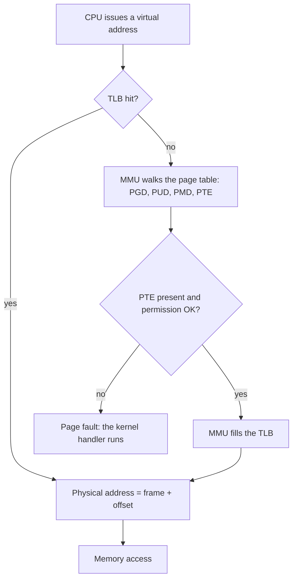
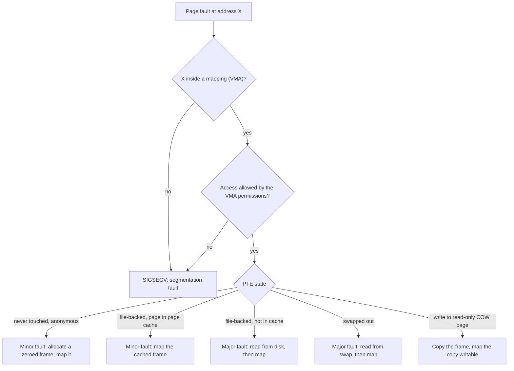

# Memory Management

## Why It Matters

Interviews ask about memory management in two forms. The first is the textbook form: "What is virtual memory?", "What happens on a page fault?", "What is the TLB?", "Compare FIFO, LRU, and clock", "What is Belady's anomaly?", "What is thrashing?". The second is the production form: "A container shows `OOMKilled` but the Java heap was only half full. Why?", "Why does the resident size of the JVM differ from `-Xms`?", "Should we turn on huge pages for the heap?". A candidate who knows only the vocabulary cannot answer the second form. A candidate who knows how the page tables, the page fault handler, and the reclaim code work answers both. On the job, the same knowledge explains latency spikes at the start of a service (page faults on first touch), memory growth that no heap dump explains (native memory, thread stacks, the page cache), and kills by the kernel. This page covers virtual memory, address translation, page faults, page replacement, the out-of-memory (OOM) killer, memory-mapped files, and what each means for a JVM. The Java heap and garbage collection are in [memory and garbage collection](../java/06-memory-and-gc.md). The structure of the JVM is in [JVM architecture](../java/05-jvm-architecture.md).

Page sizes depend on the processor and the operating system. This page states the **x86-64 Linux** values (4 KB base page) and says when a value is architecture-specific. Apple Silicon Macs use a 16 KB base page. A command on a Mac is not evidence for a Linux claim, and the page does not use one.

## Core Concepts

**Physical memory**: the RAM chips. The hardware addresses a byte of RAM with a **physical address**.

**Virtual memory**: the abstraction in which each process uses **virtual addresses**, and the hardware and the kernel translate each virtual address to a physical address. The Linux kernel documentation states: "The virtual memory abstracts the details of physical memory from the application software", and the mappings "are described by page tables that allow translation from a virtual address".

**Address space**: the set of virtual addresses that one process can use. Each process has its own address space. Threads of one process share it.

**Page**: a fixed-size block of virtual memory. **Frame** (or page frame): a block of physical memory of the same size. The kernel maps a page to a frame. The base page size on x86-64 is 4 KB (4,096 bytes).

**Page table**: the data structure that maps pages to frames. The kernel builds one for each address space. The **memory management unit (MMU)** is the hardware in the CPU that reads the page table and translates addresses.

**Page table entry (PTE)**: one entry of a page table. It holds the frame number and the control bits (present, writable, user-accessible, accessed, dirty, no-execute).

**Translation lookaside buffer (TLB)**: a small cache inside the CPU that stores recent translations from page number to frame number. The kernel documentation states: "CPUs maintain a cache of such translations called Translation Lookaside Buffer (or TLB)."

**Page fault**: an exception that the MMU raises when a translation cannot complete: the page is not present, or the access violates the permission bits. The kernel runs the page fault handler.

**Minor page fault**: a fault that the kernel resolves without disk I/O. **Major page fault**: a fault that needs disk I/O. The `getrusage(2)` man page defines `ru_minflt` as "the number of page faults serviced without any I/O activity" and `ru_majflt` as "the number of page faults serviced that required I/O activity".

**Demand paging**: the kernel gives a page a frame only when the program first touches the page, not when the program asks for the memory.

**Anonymous memory**: memory that no file backs, such as the heap and the stack. The kernel documentation states: "The anonymous memory or anonymous mappings represent memory that is not backed by a filesystem." **File-backed memory**: pages that map a file, such as program code and `mmap`ed files.

**Resident set size (RSS)**: the part of the address space of a process that sits in physical frames now. **Virtual size (VSZ)**: the size of all mappings, whether or not frames back them.

**Copy-on-write (COW)**: two address spaces share one frame, marked read-only. The first write causes a fault. The kernel copies the frame, gives the writer the copy, and makes it writable.

**Swap**: disk space (a partition or a file) where the kernel stores anonymous pages that it evicts from RAM.

**Working set**: the set of pages that a program uses during a recent time window. Denning defined it in 1968.

**Thrashing**: the state in which the system spends more time on paging than on useful work, because the working sets of the running processes do not fit in RAM.

**Huge page**: a page much larger than the base page. On x86-64 the sizes are 2 MB and 1 GB. **Transparent huge pages (THP)**: the Linux feature that backs memory with huge pages without a change in the program. The kernel documentation states: "THP manages such mappings transparently to the user and hence the name."

**Overcommit**: the kernel grants more virtual memory than the system has RAM and swap, and bets that programs will not touch all of it.

**OOM killer**: the kernel code that kills a process when memory is exhausted and reclaim fails. The kernel documentation states: "The OOM killer selects a task to sacrifice for the sake of the overall system health."

## How It Works

### Why virtual memory exists

Virtual memory gives the system four properties:

| Property | What it means | What breaks without it |
|---|---|---|
| Isolation | A process can touch only the pages that its page table maps. A pointer bug in one process cannot read or write another process or the kernel | Any process could corrupt any other process |
| A large, contiguous space | The program sees one flat range of addresses. The frames behind it can be scattered anywhere in RAM | The allocator must find physical runs of the needed size, and RAM fragments |
| Sharing | Two page tables can map the same frame: shared libraries, `fork` before a write (copy-on-write), `mmap` with `MAP_SHARED` | Each process needs its own copy of every library |
| Overcommit and demand paging | The program can reserve more address space than RAM, and the kernel gives frames only on first touch. The kernel can also evict a page to disk and bring it back | The program must fit in RAM at start, and an idle page uses a frame |

Isolation is the property that the other pages of this subject rely on. A process is an address space plus resources (see [processes and threads](01-processes-and-threads.md)).

### Pages, frames, and the address split

With a 4 KB page, the low 12 bits of an address are the **offset** inside the page. The remaining bits are the **page number**. The MMU translates the page number and copies the offset.

A single flat table that maps every page of a 48-bit address space has 2^36 entries. At 8 bytes each, that table needs 512 GB for every process. Most of the address space is unused, so the table is a **tree** with several levels. A level that covers an unused range does not exist, and the kernel allocates it on demand.

### Multi-level page tables on x86-64

A page table is one 4 KB page. A PTE has 8 bytes, so one table holds 512 entries and an index has 9 bits. Linux names the levels from the top: **PGD** (page global directory), **P4D** (used only with five levels), **PUD** (page upper directory), **PMD** (page middle directory), and **PTE** (the lowest level). The kernel documentation states that the hierarchy is "currently five levels in height", that the P4D level is "only used on systems which actually have 5 levels of page tables, otherwise it is folded", and that each process has its own PGD.

| Mode | Virtual address bits | Levels | Bits per level | User address space |
|---|---|---|---|---|
| 4-level paging | 48 | PGD, PUD, PMD, PTE | 9 + 9 + 9 + 9 + 12 offset | about 128 TB |
| 5-level paging | 57 | PGD, P4D, PUD, PMD, PTE | 9 + 9 + 9 + 9 + 9 + 12 offset | about 64 PB |

The kernel document `x86_64/mm` states: "Currently supported are 48- and 57-bit virtual addresses", and for 5-level paging that user space "gets expanded by a factor of 512x, from 0.125 PB to 64 PB". The two numbers are consistent: the virtual address has 57 bits in total, and the user half of the sign-extended space has 56 bits (2^56 bytes = 64 PB). The document's 5-level section calls the layout "56-bit" because it counts the user half. 4-level paging has 48 bits in total and a 47-bit user half (2^47 bytes = 128 TB). The CPU uses 5-level paging only if the CPU supports it and the kernel is configured for it.

```text
 48-bit virtual address (4-level paging, 4 KB pages)

  63        48 47     39 38     30 29     21 20     12 11          0
 +------------+---------+---------+---------+---------+-------------+
 | sign ext.  | PGD idx | PUD idx | PMD idx | PTE idx |   offset    |
 +------------+---------+---------+---------+---------+-------------+
                  9 bits    9 bits    9 bits    9 bits     12 bits

  CR3 -> PGD page -> PUD page -> PMD page -> PTE page -> data frame
          (512)       (512)       (512)       (512)
```

A **page walk** is the MMU reading the tables for one address. With 4 levels the walk reads up to four table entries from memory before it reads the data. This is the reason for the TLB.



### The page table entry bits

A PTE holds the frame number in its middle bits and control bits at the ends. The Linux source `arch/x86/include/asm/pgtable_types.h` defines these x86 bits:

| Bit | Name | Meaning |
|---|---|---|
| 0 | `PRESENT` | The page has a frame. If 0, any access raises a page fault, and the kernel can use the other bits to record where the page is (for example the swap slot) |
| 1 | `RW` | If 1, writes are allowed. COW pages have 0 here |
| 2 | `USER` | If 1, code in user mode may access the page. Kernel pages have 0 |
| 5 | `ACCESSED` | The CPU sets it on any read or write. Page reclaim reads it to find recent use |
| 6 | `DIRTY` | The CPU sets it on a write. A dirty page must go to disk or swap before the kernel reuses its frame |
| 7 | `PSE` | In a PMD or PUD entry, 1 means that the entry maps a huge page directly (2 MB or 1 GB) and no lower table exists |
| 8 | `GLOBAL` | The translation survives a switch of address space (used for kernel pages) |
| 63 | `NX` | If 1, the CPU does not run code from the page. It stops code injection |

The `ACCESSED` bit is the only recency information that the hardware gives to the replacement algorithm. This is why exact LRU is not practical, as the section on page replacement shows.

### The TLB

The TLB maps a page number to a frame number and the permission bits. A hit costs no memory access for the translation. A miss costs a page walk. Two facts decide the effect on a program:

- The TLB is small. The kernel documentation states that "usually TLB is pretty scarce resource".
- A TLB entry covers one page. A program that touches more distinct pages than the TLB holds in a short time takes TLB misses, even if the data fits in the CPU caches.

**Reach** is the memory that the TLB covers: entries times page size. With huge pages, the same number of entries covers 512 times more memory (2 MB divided by 4 KB).

On a switch between two processes, the kernel changes the page table root (the `CR3` register on x86). The old translations are wrong for the new process. Without tags, every write to `CR3` flushes the whole TLB. x86 CPUs have a tag, the **process-context identifier (PCID)**, and the kernel can skip the flush with it. The kernel document on page table isolation states that PCID "allows us to skip flushing the entire TLB". The source `arch/x86/mm/tlb.c` says that PCID "is similar to what is traditionally called ASID on the RISC processors", and that Linux does not give every process its own tag. It keeps a small per-CPU array of tags (`TLB_NR_DYN_ASIDS`) and caches the last few address spaces on that CPU. Arm CPUs have the same idea under the name ASID. So a process switch does not always flush the TLB, but the new process still finds only the entries that fit in that cache. A switch between two threads of one process keeps the same address space, so it needs no flush. This is one reason why a thread switch costs less than a process switch (the home of the context switch cost is [processes and threads](01-processes-and-threads.md)). The cache hierarchy and the CPU caches are in `kb/operating-systems/06-computer-architecture-for-developers.md`.

When the kernel changes a PTE that other CPUs might have cached (for example `munmap` or a COW copy), it must invalidate those TLB entries on every CPU that runs the address space. This is called a **TLB shootdown**. The kernel sends an inter-processor interrupt (IPI) to those CPUs, and each CPU invalidates the entries (`arch/x86/mm/tlb.c` sends the flush request with `smp_call_function`-style IPIs and traces it as `TLB_REMOTE_SEND_IPI`). Frequent `munmap` and `mprotect` calls in a multi-threaded program make the shootdown cost visible.

### Huge pages and transparent huge pages

A PMD entry with the `PSE` bit maps a 2 MB page, and a PUD entry maps a 1 GB page. The kernel page-table document states that huge pages "are respectively mapped by the PMD and PUD page entries" and that "higher level pages can directly map them, with no need to use lower level page entries (PTE)". Huge pages give three gains:

1. One TLB entry covers 2 MB, so the reach grows 512 times.
2. The page walk is one level shorter.
3. A first touch causes one fault for 2 MB. The kernel THP document states that THP means "taking a single page fault for each 2M virtual region touched by userland".

There are two ways to use them on Linux:

| | `hugetlbfs` (explicit huge pages) | Transparent huge pages (THP) |
|---|---|---|
| Who asks | The program: `mmap` with `MAP_HUGETLB`, or a `hugetlbfs` file | The kernel decides, and the program can hint with `madvise(MADV_HUGEPAGE)` |
| Supply | The administrator reserves a pool in advance (for example `nr_hugepages`) | The kernel allocates from free memory and may compact memory to make a 2 MB run |
| Swappable | No | Yes (the kernel splits the page first) |
| Risk | A reserved pool is memory that other programs cannot use | Stalls from direct compaction, and memory bloat when a program touches one byte of a 2 MB region |

The THP document states that `enabled` accepts `always`, `madvise`, or `never`, that with `always` applications "will stall on allocation failure and directly reclaim pages and compact memory", and that the `khugepaged` daemon "runs usually at low frequency" to collapse small pages into huge pages. It also states: "As the system ages, allocating huge pages may be expensive as the system uses memory compaction." The default of `enabled` depends on the kernel configuration of the distribution. Read `/sys/kernel/mm/transparent_hugepage/enabled` on the machine. The `defrag` setting (`always`, `defer`, `defer+madvise`, `madvise`, `never`) controls whether a fault waits for compaction.

**Copy-on-write and splits.** A write fault on a shared anonymous THP (for example in a child after `fork`) does not copy 2 MB. Since the 2020 commit "thp: change CoW semantics for anon-THP" (`3917c80280c9`, Kirill A. Shutemov), the kernel splits the PMD mapping into PTEs and copies one 4 KB page, so the child does not unshare the whole 2 MB range on its first write. The kernel THP document also states that `split_huge_pmd()` "never fails", and that `split_huge_page()` "can fail if the page is pinned". A `munmap` or `mprotect` of part of a huge page also splits the PMD mapping (the `thp_split_pmd` counter).

Databases and latency-sensitive services often advise against `always` because of the compaction stalls. A JVM can use huge pages for the heap (see the JVM section).

### Page faults

A page fault is not an error in most cases. It is the mechanism that implements demand paging, copy-on-write, swap, and memory-mapped files. The kernel handler looks up the faulting address in the process's list of mappings (each is a **virtual memory area**, VMA). The handler then does one of the following:



| Fault | Cause | Needs disk I/O |
|---|---|---|
| Minor, first touch of an anonymous page | The program touched memory that it got from `mmap` or `brk` for the first time. The kernel allocates a zero-filled frame | No |
| Minor, page cache hit | A file page is in RAM, but this process has not mapped it yet | No |
| Minor, copy-on-write | A write to a shared read-only page after `fork` or on a `MAP_PRIVATE` file mapping. The kernel copies the page | No |
| Major, file-backed | The file page is not in the page cache | Yes |
| Major, swap-in | The page was evicted to swap | Yes |
| Invalid | The address is not mapped, or the access violates the permissions | The kernel sends `SIGSEGV` to the process |

A major fault costs a disk read. Jeff Dean's table (see [back-of-envelope estimation](../hld/back-of-envelope-estimation.md)) gives about 10 ms for a disk seek and about 100 ns for a main memory reference (approximate, 2009 hardware). The ratio is about 100,000. A solid-state disk is faster, but the gap to a RAM access remains large. A program that takes many major faults is slow, and a program that takes many minor faults pays for kernel entries but not for I/O.

**Copy-on-write on `fork`.** `fork` does not copy the memory of the parent. The child gets a copy of the page table, and the kernel marks every writable page read-only in both. The first write by either process faults, and the kernel copies that one page. `fork` followed by `exec` copies almost nothing, because `exec` discards the child's address space (see [processes and threads](01-processes-and-threads.md)).

**Pre-faulting.** A program can force the faults early. `mmap` with `MAP_POPULATE`, or a loop that writes one byte in each page, makes the kernel allocate the frames before the hot path. The JVM flag `-XX:+AlwaysPreTouch` does this for the heap.

### Page replacement

When RAM is full and a fault needs a frame, the kernel must **evict** a page. The **page replacement algorithm** chooses the victim. A good algorithm evicts the page that the program will not use for the longest time. The algorithms below are the ones that interviews ask. The textbook reference is chapter 22 of *Operating Systems: Three Easy Pieces* (OSTEP).

| Algorithm | Victim | Strength | Weakness |
|---|---|---|---|
| FIFO | The page that has been in memory longest | Trivial to implement: a queue | Ignores use. A hot page that arrived early gets evicted. It shows Belady's anomaly |
| OPT (optimal, Belady's MIN) | The page whose next use is farthest in the future | The fewest faults possible for the reference string | It needs the future. It is a benchmark for other algorithms, not an implementation |
| LRU (least recently used) | The page whose last use is oldest | Uses the past to predict the future. It has the stack property, so it has no anomaly | It needs a timestamp or a list update on every memory access. The hardware does not give that |
| Clock (second chance) | The first page on a circular list that has its use bit at 0. The hand clears use bits as it passes | Approximates LRU with one bit per page, which the hardware sets (`ACCESSED`) | Coarse: one bit has no ordering. It can show Belady's anomaly, because it has no stack property |
| Random | A random page | No state | Worse than LRU on typical workloads, and better than FIFO on a loop (see the loop example) |

OSTEP states that OPT was developed by Belady, and that LRU has "what is known as a stack property": "a cache of size N + 1 naturally includes the contents of a cache of size N", so "hit rate will either stay the same or improve". FIFO and random do not have it.

**The clock algorithm.** The kernel keeps the pages in a circular list. Each page has a use bit, which the hardware sets on each access. On a fault, the hand moves around the list. If the page under the hand has use bit 1, the algorithm clears the bit and moves on (the page gets a second chance). If the bit is 0, the algorithm evicts that page and puts the new page in its slot. The Java example below implements this.

**Belady's anomaly.** For some algorithms, more frames can cause more faults. Belady, Nelson, and Shedler published the first example in 1969 for FIFO. With the reference string 1, 2, 3, 4, 1, 2, 5, 1, 2, 3, 4, 5, FIFO takes 9 faults with 3 frames and 10 faults with 4 frames. The cause: FIFO does not have the stack property. With 4 frames the set of resident pages is not a superset of the set with 3 frames, so a page that was resident with 3 frames can be missing with 4. LRU and OPT have the stack property and never show the anomaly. The Java example reproduces the numbers.

**What Linux does.** Linux does not run textbook LRU. It uses the `ACCESSED` bit (read through reverse mappings) to approximate LRU. Two implementations exist:

- **The classic active and inactive lists.** The kernel keeps, for each node (and each memory cgroup), an active list and an inactive list for anonymous pages and for file pages, plus an unevictable list (kernel document on the unevictable LRU: "LRU-ordered anonymous and file, active and inactive folio lists"). The comments in `mm/vmscan.c` state that `shrink_active_list()` "moves folios from the active LRU to the inactive LRU", and that the `inactive_ratio` is "the target ratio of ACTIVE to INACTIVE folios on this LRU, maintained by the pageout code". Reclaim scans the inactive list. A page that the program uses again gets activated, and the kernel finds the use through the `ACCESSED` bit of the PTEs that map the page (found through reverse mappings, "rmap"), or through a counter for file accesses by `read` and `write`. `folio_check_references()` in `mm/vmscan.c` decides to reclaim, to keep, or to activate a page. The exact promotion rules differ between kernel versions, so this page does not list them.
- **The multi-generational LRU (MGLRU).** The kernel documentation describes it as "an alternative LRU implementation that optimizes page reclaim and improves performance under memory pressure". It groups pages into **generations** by age. The documentation states that "`min_gen_nr` contains the coldest pages and `max_gen_nr` contains the hottest pages", and that the aging "uses page table walks and rmap walks to find young PTEs". The two generations of the old design (the "young and the old") correspond to "the counterparts to the active and the inactive". MGLRU was merged in **Linux 6.1** (the kernelnewbies page for Linux 6.1 lists "Multi-Gen LRU Framework" as a featured change, and says that it "can be configured at compilation time"). In the mainline `mm/Kconfig`, `LRU_GEN` ("Multi-Gen LRU") and `LRU_GEN_ENABLED` ("Enable by default", "This option enables the multi-gen LRU by default") have no `default` line, so both are off unless a distribution turns them on. The kernel document states that the runtime switch `/sys/kernel/mm/lru_gen/enabled` has a default that "depends on `CONFIG_LRU_GEN_ENABLED`". The documentation also describes the `min_ttl_ms` setting, which protects a working set of that age from eviction and lets the OOM killer act if the working set cannot stay in memory.

The kernel does not evict only on a fault. The `kswapd` daemon reclaims in the background. The kernel documentation states that when free memory falls below the low watermark, "an allocation request will awaken the `kswapd` daemon", and if reclaim is too slow, "allocation is stalled until enough memory pages are reclaimed to satisfy the request" (this stall is **direct reclaim**). The reclaimable categories are "page cache and anonymous memory". The kernel drops a clean file page for free, because it can read the page from the file again. It must write a dirty file page to its file first. It can evict an anonymous page only if swap space exists. The sysctl `vm.swappiness` (default 60, `proc_sys_vm(5)`) sets the preference between file pages and anonymous pages.

### Thrashing and the working set

A process runs well if its working set is resident. If the sum of the working sets of the running processes exceeds RAM, every fault evicts a page that another process needs soon. The processes fault continuously, the disk is busy, and the CPU idles. This is **thrashing**. Throughput falls sharply, not gradually.

The fixes, in the order of cost:

1. Reduce the number of running processes or the memory that each uses (the real fix).
2. Add RAM.
3. Reduce the working set of the program: a better data layout, a smaller cache, a smaller heap.

Linux does not run a working-set scheduler. MGLRU's `min_ttl_ms` is a protection for the working set, and the OOM killer is the last resort. A JVM with a heap larger than the RAM that its container grants swaps heap pages. A full garbage collection then touches every page of the heap and thrashes. For this reason JVM services on production hosts run without swap, or with a heap that always fits in RAM.

### Swap, overcommit, and the OOM killer

**Overcommit.** `malloc` or `mmap` can succeed even if the system has not enough RAM and swap for all granted memory, because the kernel gives frames only on first touch. The sysctl `vm.overcommit_memory` (`proc_sys_vm(5)`) sets the policy:

| Value | Name | Behavior (kernel overcommit-accounting document) |
|---|---|---|
| 0 | Heuristic (default) | "Obvious overcommits of address space are refused." A single wild request fails. Many moderate requests succeed |
| 1 | Always | "Always overcommit." The kernel never refuses. Used for programs with large sparse arrays |
| 2 | Strict | "Don't overcommit." The total commit may not exceed swap plus a share of RAM. The share is `vm.overcommit_ratio` (default 50 percent, `proc_sys_vm(5)`) or `vm.overcommit_kbytes`. `/proc/meminfo` shows the result as `CommitLimit` |

In modes 0 and 1, the failure moves from the allocation call to the first touch: the program writes to a page, the kernel finds no frame, and the kernel cannot return an error to the store instruction. The kernel then runs the OOM killer.

**The OOM killer.** When reclaim cannot free enough memory, the kernel selects a process and sends it `SIGKILL`. The function `oom_badness()` in `mm/oom_kill.c` computes the score of a process:

```text
points = RSS in pages + swap entries + page table bytes / PAGE_SIZE
points += oom_score_adj * (totalpages / 1000)
```

The code excludes kernel threads and init, and also excludes a task whose `oom_score_adj` is `OOM_SCORE_ADJ_MIN`. The process with the highest score dies. The file `/proc/<pid>/oom_score_adj` accepts values from -1000 to +1000 (`proc_pid_oom_score_adj(5)`): "-1000 ... is equivalent to disabling OOM-killing entirely for that task", and the value "is added to the badness score before it is used to determine which task to kill". A large positive value marks a sacrificial process, and a large negative value protects an important one (for example a database). Kubernetes sets `oom_score_adj` from the pod quality-of-service (QoS) class. The Kubernetes documentation ("Node out of memory behavior") gives these values: `Guaranteed` -997, `BestEffort` 1000, and `Burstable` `min(max(2, 1000 - (1000 × memoryRequestBytes) / machineMemoryCapacityBytes), 999)`. The kubelet also sets -997 for containers of pods with `system-node-critical` priority. So a container that uses much more memory than it requested, in a low QoS pod, dies first.

The kernel logs each kill. The message (`Out of memory: Killed process ...`) appears in `dmesg` and in the journal. The tools for reading it are in `kb/operating-systems/07-linux-for-developers.md`.

**Containers.** A container is a process group in a **cgroup** with a memory limit. The cgroup v2 documentation states that `memory.max` is the "hard limit" and that "if a cgroup's memory usage reaches this limit and can't be reduced, the OOM killer is invoked in the cgroup". The OOM killer in a cgroup considers only the tasks of the cgroup. The setting `memory.high` is softer: "Going over the high limit never invokes the OOM killer", and the kernel instead throttles the processes and puts them "under heavy reclaim pressure". The setting `memory.oom.group` makes the kernel kill all tasks of the cgroup together. The counter `oom_kill` in `memory.events` counts the kills.

!!! warning "OOMKilled is not OutOfMemoryError"
    A Java `OutOfMemoryError` is an exception that the JVM throws when the Java heap (or another JVM area) is full. A container `OOMKilled` (exit code 137, which is 128 + signal 9) is the kernel killing the whole process because RSS passed the cgroup limit. The JVM gets no chance to throw anything. The heap can be half full at that moment, because the limit counts the heap plus Metaspace, thread stacks, the code cache, direct buffers, and the page cache charged to the cgroup. See [memory and garbage collection](../java/06-memory-and-gc.md).

### Memory-mapped files

`mmap` maps a file (or anonymous memory) into the address space. The call creates a VMA and fills no PTEs. The first access to each page faults, and the kernel maps the frame from the page cache. The `mmap(2)` man page defines the main flags:

| Flag | Behavior |
|---|---|
| `MAP_SHARED` | "Share this mapping." Writes are visible to other mappers and are carried to the file. `msync(2)` controls when |
| `MAP_PRIVATE` | "Create a private copy-on-write mapping." Writes go to a private copy, not to the file |
| `MAP_ANONYMOUS` | "The mapping is not backed by any file; its contents are initialized to zero." This is how an allocator gets memory |
| `MAP_HUGETLB` | "Allocate the mapping using 'huge' pages." Needs a reserved pool |
| `MAP_NORESERVE` | "Do not reserve swap space for this mapping." |

A file read through `mmap` avoids the copy from the kernel buffer to a user buffer that `read` does, and the program uses the page cache directly. The costs: a page fault for each first touch of a page, no clean error path (an I/O error on a mapped page, or an access beyond the end of the file, arrives as the signal `SIGBUS`), and TLB pressure for large files. The **page cache** is the kernel's cache of file contents in RAM. Its home is `kb/operating-systems/05-file-systems-and-io-models.md`. The one fact that this page needs: the page cache and the process memory compete for the same frames, and the kernel evicts clean cache pages first. This is why `free` shows low "free" memory on a healthy Linux host. A file read by `read` and a file read through `mmap` share the same cached frames.

### Segmentation

Early x86 processors divided memory into **segments**, each with a base address, a limit, and permissions. A logical address was a segment selector plus an offset. Segmentation provided protection and relocation, but segments have variable sizes, so memory fragments, and a segment is hard to swap. Paging replaced it. In 64-bit mode on x86-64, address calculations through `ES`, `DS`, and `SS` use a segment base of zero, and the processor checks that a linear address is canonical instead of checking a segment limit (Intel SDM volume 3, section "Segmentation in IA-32e mode", as quoted in copies of the manual). The kernel document on `FS` and `GS` states: "In 64-bit mode the CS/SS/DS/ES segments are ignored and the base address is always 0". Only the `FS` and `GS` segment bases remain in use: "The FS and GS segments are still functional in 64-bit mode." User space uses `FS` for thread-local storage ("The FS segment is commonly used to address Thread Local Storage"), and the kernel keeps its per-CPU pointer in `GS`. Protection comes from paging only.

### The process address space layout

Linux lays out the address space of a process from low to high addresses:

```text
 high addresses
 +----------------------------+
 | kernel (not accessible     |   upper half of the 48-bit space
 | from user mode)            |
 +----------------------------+
 | stack (main thread)        |   grows toward lower addresses
 |             |              |
 |             v              |
 |                            |
 |             ^              |
 |             |              |
 | mmap area: shared libraries|   thread stacks, mmap'ed files,
 | and anonymous mappings     |   large malloc blocks, the JVM heap
 |                            |
 |             ^              |
 |             |              |
 | heap (brk)                 |   grows toward higher addresses
 +----------------------------+
 | .bss (zero-initialized)    |
 | .data (initialized data)   |
 | .text (program code)       |   read-only, executable, file-backed
 +----------------------------+
 low addresses
```

The layout is randomized on each start (address space layout randomization, ASLR), so the addresses differ between runs. The command `cat /proc/<pid>/maps` on Linux lists each VMA with its range, permissions, and backing file. (Do not copy addresses between hosts.)

**`brk` against `mmap` for `malloc`.** A program asks the kernel for memory with two system calls:

- `brk` (or `sbrk`) moves the end of the **program break**, the top of the heap segment. It grows one contiguous region. Freed memory in the middle cannot go back to the kernel, only memory at the top can.
- `mmap` with `MAP_ANONYMOUS` creates an independent region. `munmap` returns it to the kernel at any time.

The glibc allocator uses both. The `mallopt(3)` man page states that glibc uses `mmap` instead of the program break for allocations at or above `M_MMAP_THRESHOLD`: "a default setting of 128*1024" (128 KB), and that "nowadays, glibc uses a dynamic mmap threshold by default", which "is adjusted upward to the size of the freed block". `M_TRIM_THRESHOLD` controls when the allocator gives memory at the top of the heap back with `sbrk`. A consequence: a process can hold a large resident size after it frees most of its memory, because small freed blocks stay inside the break region. A long-running native process can look like a leak while it is not.

The JVM does not use `malloc` for the Java heap. HotSpot reserves the heap range with `mmap` and commits parts of it. In the JDK 21 source `src/hotspot/os/linux/os_linux.cpp`, `os::pd_reserve_memory` calls `anon_mmap`, which maps the range with `PROT_NONE` and `MAP_PRIVATE | MAP_NORESERVE | MAP_ANONYMOUS`, so that "we fail early if we touch an uncommitted page". `os::Linux::commit_memory_impl` commits a part with `mmap(addr, size, PROT_READ|PROT_WRITE, MAP_PRIVATE|MAP_FIXED|MAP_ANONYMOUS, ...)` over the reserved range. The source comment adds that the Linux kernel "does not really reserve the pages" at that point.

### What this means for a JVM

The Java heap is virtual memory. The consequences:

1. **`-Xmx` reserves address space, not RAM.** The JVM reserves a range of virtual addresses for the maximum heap. The kernel gives frames when the program first touches pages. A new JVM with `-Xmx8g` has a small RSS.
2. **`-Xms` commits, but does not touch.** The JDK 21 `java` documentation states that `-Xms` "sets the minimum and the initial size (in bytes) of the heap". The kernel still allocates a frame on first touch. So a heap with `-Xms4g` can have an RSS of 100 MB at start, and the RSS grows as the allocator and the collector touch new regions. The consequence: RSS lags the committed heap, and the first use of each page costs a minor fault.
3. **`-XX:+AlwaysPreTouch` moves the faults to startup.** The `java` documentation states that it "requests the VM to touch every page on the Java heap after requesting it from the operating system and before handing memory out to the application. By default, this option is disabled and all pages are committed as the application uses the heap space." The effect: a slower start (the JVM touches the whole committed heap), a steady RSS equal to the committed heap from the start, and no page faults on the allocation path later. The memory is then really used, so it has a cost in a container that counts RSS. Recommendation: use it for a latency-sensitive service that sets `-Xms` equal to `-Xmx`, and measure the start time.
4. **Large pages for the heap.** The `java` documentation states that `-XX:+UseLargePages` "enables the use of large page memory" and that it is disabled by default. Without `-XX:+UseTransparentHugePages`, "the number of large pages must be pre-allocated" (the documentation example writes to `/sys/kernel/mm/hugepages/hugepages-2048kB/nr_hugepages`), and the JVM can fail to allocate the heap with large pages "because other areas such as the code cache might already have used some of the configured large pages". The flag `-XX:+UseTransparentHugePages` (Linux only) "enables the use of large pages that can dynamically grow or shrink", and the documentation warns: "You may encounter performance problems with transparent huge pages as the OS moves other pages around to create huge pages; this option is made available for experimentation." The benefit is fewer TLB misses for a large heap that the garbage collector walks. The cost is the risk of compaction stalls and, with explicit huge pages, a reserved pool. Recommendation: measure with a realistic load before you enable them, and check `/sys/kernel/mm/transparent_hugepage/enabled` on the host.
5. **Container limits.** The JVM reads the cgroup limits. The `java` documentation states that the default of `-XX:+UseContainerSupport` is `true` and that the VM then "determine[s] the amount of memory and number of processors that are available to a Java process running in docker containers". `-XX:MaxRAM` defaults to the maximum available memory (the smaller of the machine memory and the environment limit, such as a container) "or 128 GB, whichever is lower", and **`-XX:MaxRAMPercentage` defaults to 25 percent** of that. A container with a 4 GB limit gets a heap of at most 1 GB by default. For a small heap (about 125 MB) the JDK uses `-XX:MinRAMPercentage`, which defaults to 50 percent. `-XX:InitialRAMPercentage` (default 1.5625 percent) sets the initial heap if `-Xms` is absent. The existing guidance (50 to 75 percent of the limit through `MaxRAMPercentage`) is on the [memory and garbage collection page](../java/06-memory-and-gc.md). The rest of the limit must hold Metaspace, thread stacks, the code cache, direct buffers, and the page cache of mapped files.
6. **Thread stacks and direct buffers are not heap.** Each Java platform thread has a native stack in the mmap area. A direct `ByteBuffer` or a `MappedByteBuffer` lives outside the heap, and the garbage collector does not count it as heap. Both count toward the container limit.
7. **Swap.** A JVM that swaps heap pages makes each garbage collection touch swapped pages (a major fault per page). Keep the heap in RAM.

The Java garbage collector also affects the page table. G1 and ZGC can uncommit heap memory, which the kernel then reclaims, and a later growth touches new pages again. The details are on the memory and garbage collection page.

## Trade-offs and When to Use

### Page size

| Choice | Gain | Cost |
|---|---|---|
| 4 KB base pages | Fine-grained: little internal waste and cheap COW copies | A large working set needs many TLB entries and deep walks |
| 2 MB huge pages | The reach is 512 times larger. One fault maps 2 MB | Internal fragmentation, compaction stalls (THP), a split of the mapping on a COW fault (see the THP paragraph), and a reserved pool (hugetlbfs) |
| 1 GB huge pages | The largest reach | A boot-time or reserved allocation, and few use cases beyond databases and virtual machine hosts |

### Replacement algorithm

| Algorithm | Fault count | Cost per access | Verdict |
|---|---|---|---|
| OPT | Lowest | Needs the future | Benchmark only |
| LRU | Close to OPT on locality-heavy loads | High if exact | Use an approximation |
| Clock | Close to LRU | One bit per page, set by the hardware | The basis of real kernels |
| FIFO | Higher, and anomalous | Trivial | Teaching tool |

### Overcommit mode

| Mode | When to use | Failure you get |
|---|---|---|
| 0 (heuristic) | General servers | A late OOM kill at first touch |
| 1 (always) | Programs with huge sparse address spaces (some scientific code, and tools that reserve address space) | A late OOM kill |
| 2 (strict) | Systems that need a predictable error at allocation, and not a kill at a random time | `malloc` or `mmap` returns an error. The `CommitLimit` can be small, so many programs fail early |

Recommendation for Java services: keep mode 0, set a container memory limit, and size the heap and the non-heap areas so that the sum stays below the limit. A kill at first touch is hard to debug, so watch RSS and the `oom_kill` counter.

### Heap sizing against RSS

| Setting | RSS at start | RSS later | Latency effect |
|---|---|---|---|
| `-Xms` small, no pre-touch | Small | Grows with use, the collector may resize the heap | Minor faults while the heap grows, and resize cost |
| `-Xms` equal to `-Xmx`, no pre-touch | Small | Grows to the full heap | Minor faults on first touch of each page |
| `-Xms` equal to `-Xmx`, `AlwaysPreTouch` | Full heap | Full heap | Slow start, no faults on the allocation path |

## Java Example

The first program splits a 48-bit virtual address into the four table indexes and the offset, as the MMU does. It shows what a 2 MB page does to the split.

```java
public class Split {
    static final int PAGE_SHIFT = 12;
    static final int INDEX_BITS = 9;
    static final String[] LEVELS = {"PGD", "PUD", "PMD", "PTE"};

    public static void main(String[] args) {
        long address = 0x00007f1234567abcL;
        System.out.printf("virtual address  = 0x%016x%n", address);
        for (int level = 0; level < LEVELS.length; level++) {
            int shift = PAGE_SHIFT + INDEX_BITS * (LEVELS.length - 1 - level);
            long index = (address >>> shift) & ((1L << INDEX_BITS) - 1);
            System.out.printf("%-4s bits %2d..%2d -> index %3d%n",
                    LEVELS[level], shift + INDEX_BITS - 1, shift, index);
        }
        long offset = address & ((1L << PAGE_SHIFT) - 1);
        System.out.printf("offset bits 11..0 -> 0x%03x%n", offset);

        long hugeOffset = address & ((1L << 21) - 1);
        System.out.printf("2 MB page (PMD maps it): offset bits 20..0 -> 0x%06x%n",
                hugeOffset);

        long entries = 1L << INDEX_BITS;
        System.out.println("entries in one page table: " + entries);
        System.out.println("memory one PTE page maps: "
                + (entries << PAGE_SHIFT) / 1024 + " KB");
        System.out.println("memory one PMD page maps: "
                + ((entries * entries) << PAGE_SHIFT) / (1024 * 1024) + " MB");
    }
}
```

<!-- expected-output -->

```text
virtual address  = 0x00007f1234567abc
PGD  bits 47..39 -> index 254
PUD  bits 38..30 -> index  72
PMD  bits 29..21 -> index 418
PTE  bits 20..12 -> index 359
offset bits 11..0 -> 0xabc
2 MB page (PMD maps it): offset bits 20..0 -> 0x167abc
entries in one page table: 512
memory one PTE page maps: 2048 KB
memory one PMD page maps: 1024 MB
```

The second program simulates FIFO, LRU, OPT, and clock on a reference string and prints the number of page faults. A fault happens when the page is not in one of the frames. The clock implementation sets the use bit on load and on each hit. The program shows Belady's anomaly for FIFO (9 faults with 3 frames, 10 with 4), shows that LRU and OPT improve with more frames, and uses a loop over 4 pages to show that LRU and FIFO fault on every access when the loop is one page larger than the memory.

```java
import java.util.ArrayDeque;
import java.util.ArrayList;
import java.util.Arrays;
import java.util.Deque;
import java.util.LinkedHashSet;
import java.util.List;

public class Repl {
    interface Policy {
        int faults(int[] refs, int frames);
    }

    static int fifo(int[] refs, int frames) {
        Deque<Integer> queue = new ArrayDeque<>();
        int faults = 0;
        for (int page : refs) {
            if (queue.contains(page)) continue;
            faults++;
            if (queue.size() == frames) queue.removeFirst();
            queue.addLast(page);
        }
        return faults;
    }

    static int lru(int[] refs, int frames) {
        LinkedHashSet<Integer> order = new LinkedHashSet<>();
        int faults = 0;
        for (int page : refs) {
            if (order.remove(page)) {
                order.add(page);
                continue;
            }
            faults++;
            if (order.size() == frames) {
                order.remove(order.iterator().next());
            }
            order.add(page);
        }
        return faults;
    }

    static int opt(int[] refs, int frames) {
        List<Integer> memory = new ArrayList<>();
        int faults = 0;
        for (int i = 0; i < refs.length; i++) {
            int page = refs[i];
            if (memory.contains(page)) continue;
            faults++;
            if (memory.size() < frames) {
                memory.add(page);
                continue;
            }
            int victim = -1;
            int farthest = -1;
            for (int candidate : memory) {
                int next = Integer.MAX_VALUE;
                for (int j = i + 1; j < refs.length; j++) {
                    if (refs[j] == candidate) {
                        next = j;
                        break;
                    }
                }
                if (next > farthest) {
                    farthest = next;
                    victim = candidate;
                }
            }
            memory.set(memory.indexOf(victim), page);
        }
        return faults;
    }

    static int clock(int[] refs, int frames) {
        int[] page = new int[frames];
        boolean[] use = new boolean[frames];
        Arrays.fill(page, -1);
        int hand = 0;
        int faults = 0;
        for (int ref : refs) {
            int slot = -1;
            for (int i = 0; i < frames; i++) {
                if (page[i] == ref) slot = i;
            }
            if (slot >= 0) {
                use[slot] = true;
                continue;
            }
            faults++;
            while (use[hand]) {
                use[hand] = false;
                hand = (hand + 1) % frames;
            }
            page[hand] = ref;
            use[hand] = true;
            hand = (hand + 1) % frames;
        }
        return faults;
    }

    static void report(String title, int[] refs, int[] frameCounts) {
        System.out.println(title);
        String[] names = {"FIFO", "LRU", "OPT", "CLOCK"};
        Policy[] policies = {Repl::fifo, Repl::lru, Repl::opt, Repl::clock};
        for (int p = 0; p < names.length; p++) {
            StringBuilder line = new StringBuilder(String.format("  %-5s", names[p]));
            for (int frames : frameCounts) {
                line.append(String.format("  %d frames: %2d faults", frames,
                        policies[p].faults(refs, frames)));
            }
            System.out.println(line);
        }
    }

    public static void main(String[] args) {
        int[] belady = {1, 2, 3, 4, 1, 2, 5, 1, 2, 3, 4, 5};
        report("Belady string " + Arrays.toString(belady), belady, new int[] {3, 4});
        int[] ostep = {0, 1, 2, 0, 1, 3, 0, 3, 1, 2, 1};
        report("OSTEP string " + Arrays.toString(ostep), ostep, new int[] {3});
        int[] loop = {1, 2, 3, 4, 1, 2, 3, 4, 1, 2, 3, 4};
        report("Loop over 4 pages", loop, new int[] {3, 4});
    }
}
```

<!-- expected-output -->

```text
Belady string [1, 2, 3, 4, 1, 2, 5, 1, 2, 3, 4, 5]
  FIFO   3 frames:  9 faults  4 frames: 10 faults
  LRU    3 frames: 10 faults  4 frames:  8 faults
  OPT    3 frames:  7 faults  4 frames:  6 faults
  CLOCK  3 frames:  9 faults  4 frames: 10 faults
OSTEP string [0, 1, 2, 0, 1, 3, 0, 3, 1, 2, 1]
  FIFO   3 frames:  7 faults
  LRU    3 frames:  5 faults
  OPT    3 frames:  5 faults
  CLOCK  3 frames:  7 faults
Loop over 4 pages
  FIFO   3 frames: 12 faults  4 frames:  4 faults
  LRU    3 frames: 12 faults  4 frames:  4 faults
  OPT    3 frames:  6 faults  4 frames:  4 faults
  CLOCK  3 frames: 12 faults  4 frames:  4 faults
```

How to read the output:

- **Belady string.** FIFO and clock fault more with 4 frames (10) than with 3 frames (9). This is Belady's anomaly. LRU and OPT fault less with 4 frames. (LRU has more faults than FIFO with 3 frames on this string. LRU is not better than FIFO on every string. The stack property only guarantees that more frames never hurt.) The clock result equals FIFO here because every page has its use bit set when the hand arrives, so the hand clears all bits and then evicts in FIFO order.
- **OSTEP string.** The counts match OSTEP's figures: 7 faults for FIFO (a hit rate of 4 of 11, which OSTEP gives as 36.4 percent), 5 for LRU and OPT.
- **Loop.** A loop over N+1 pages with N frames is the worst case for LRU and FIFO: every access faults, because each page is evicted just before its next use. OPT keeps pages that return soon and faults 6 times. This is the **sequential flooding** pattern, and it is the reason why real kernels protect a working set against a one-time scan of a large file.

## Interview Angle

### Questions

??? question "What is virtual memory, and why do operating systems use it?"

    Virtual memory gives each process its own address space of virtual addresses. The MMU translates each virtual address to a physical address through page tables that the kernel maintains. The frames behind a range of addresses can be anywhere in RAM, or on disk, or not yet allocated.

    It provides four things. **Isolation**: a process can access only the pages that its page table maps, so a bug in one process cannot corrupt another or the kernel. **A contiguous space**: the program sees one flat range, and the kernel can back it with scattered frames, so physical fragmentation does not matter. **Sharing**: two page tables can map one frame, which is how shared libraries, copy-on-write after `fork`, and `MAP_SHARED` work. **Overcommit and demand paging**: the kernel can grant more address space than RAM and allocate a frame at first touch, and it can evict cold pages to disk.

    The cost is translation. Every access needs a translation, and the TLB hides it for the pages in use. A TLB miss costs a page walk of up to four memory reads on x86-64 with 4-level paging.

??? question "Walk through address translation on x86-64. Why are page tables multi-level, and what does the TLB do?"

    With 4 KB pages and 48-bit addresses, the low 12 bits are the offset. The other 36 bits are four 9-bit indexes. The CPU register `CR3` points to the top-level table (the PGD). The MMU uses the first index to select an entry in the PGD, which points to a PUD page. The next index selects an entry that points to a PMD page, the next to a PTE page, and the PTE holds the frame number. The MMU concatenates the frame number and the offset.

    The tables are a tree because a flat table for a 48-bit space needs 2^36 entries, 512 GB at 8 bytes each, for every process. A tree allocates a lower-level table only for ranges that the process uses. 5-level paging adds a P4D level for 57-bit addresses (about 64 PB of user space, against 128 TB).

    A walk reads up to four table entries from memory, so the CPU caches translations in the TLB. A TLB hit adds no memory reads. A miss costs the walk. The TLB is small, so a program with a large working set and poor locality misses often. Huge pages cut the misses: one 2 MB entry covers 512 base pages.

??? question "What happens on a page fault? Distinguish a minor fault from a major fault."

    The MMU raises an exception and the kernel handler runs. The handler finds the virtual memory area that contains the address. If no area contains it, or the access violates the permissions, the kernel sends `SIGSEGV`. Otherwise the fault is legal and the kernel resolves it by the state of the page.

    A **minor fault** needs no disk I/O: first touch of an anonymous page (the kernel maps a zero-filled frame), a file page that is already in the page cache, or a copy-on-write copy of a shared page. A **major fault** needs disk I/O: a file page that is not cached, or a page that the kernel swapped out. The `getrusage` counters `ru_minflt` and `ru_majflt` count them separately.

    After the handler sets up the PTE, the CPU restarts the faulting instruction. The program does not see the fault. The cost difference is large: a major fault waits for a disk (about 10 ms for a seek on the 2009 numbers in Dean's table, and much less on an SSD), while a minor fault costs a kernel entry and some bookkeeping.

??? question "What does `fork` do to memory, and why is it cheap?"

    `fork` creates a child with a copy of the parent's page table, not a copy of the parent's memory. The kernel marks all writable private pages read-only in both processes and lets them share the frames. The first write by either process causes a protection fault. The kernel copies that one page, maps the copy writable for the writer, and continues. This is copy-on-write.

    The result is that `fork` costs about the size of the page tables, not the size of the memory, and that `fork` followed by `exec` copies almost nothing, because `exec` replaces the child's address space. The cost shows later: a parent that keeps writing to its pages after a `fork` (for example a Redis snapshot child that reads while the parent serves writes) copies pages and can double its memory in the worst case. With overcommit mode 2, a `fork` of a large process can fail with `ENOMEM`, because the kernel accounts for each private writable mapping again for the child (the overcommit-accounting document lists "PRIVATE WRITABLE - size of mapping per instance" and "Account and check on fork"), and the total commit may exceed the limit. `posix_spawn` avoids this cost: since glibc 2.24 it calls `clone(2)` with `CLONE_VM` and `CLONE_VFORK` (`posix_spawn(3)`), so the child shares the parent's memory and the kernel copies no page table.

??? question "What are huge pages? When would you enable them for a JVM, and what is the risk?"

    A huge page is a page of 2 MB (or 1 GB) on x86-64. A PMD entry (or a PUD entry) maps it directly, with no PTE level below. One TLB entry then covers 512 times more memory, the page walk is shorter, and the first touch of 2 MB costs one fault.

    Linux offers explicit huge pages (`hugetlbfs`, a pool that the administrator reserves) and transparent huge pages (THP, which the kernel assembles on its own, with a `madvise` option). For a JVM, `-XX:+UseLargePages` uses the explicit pool, and `-XX:+UseTransparentHugePages` asks for THP. Both are off by default.

    I would try them for a service with a large heap (tens of GB) and a measured TLB miss problem, or a garbage collector that walks the whole heap. The risks: with THP, direct compaction can stall an allocation, and the JDK documentation itself says that THP "may encounter performance problems" and is "available for experimentation". With explicit pages, the reserved pool is memory that nothing else can use, and the heap allocation can fail if the pool is too small. I would not enable them without a before and after measurement under realistic load.

??? question "Compare FIFO, LRU, OPT, and clock page replacement. What does Linux use?"

    **FIFO** evicts the oldest page. It is trivial, but it evicts hot pages that arrived early. **OPT** evicts the page whose next use is farthest away. It gives the minimum number of faults, but needs the future, so it is a benchmark. **LRU** evicts the page that has not been used for the longest time. It predicts the future from the past and performs well on programs with locality, but exact LRU needs an update on every memory access, which the hardware does not support. **Clock** (second chance) approximates LRU with the hardware `ACCESSED` bit: the hand sweeps a circular list, clears the bit of a used page (a second chance), and evicts the first page with the bit at 0.

    Linux does not run exact LRU. It approximates it with the `ACCESSED` bit. The classic design keeps active and inactive lists, and reclaim takes pages from the tail of the inactive list. Since Linux 6.1, the multi-generational LRU (MGLRU) groups pages into generations by age and uses page table walks to find recently used pages. Each distribution decides whether MGLRU is on by default, and `/sys/kernel/mm/lru_gen/enabled` shows the state. A clean file page is cheap to evict, because the kernel can read it again, so reclaim prefers it to anonymous memory (tuned by `vm.swappiness`).

??? question "What is Belady's anomaly? Why does LRU not have it?"

    Belady's anomaly is the effect that more page frames cause more page faults. Belady, Nelson, and Shedler found it in 1969 for FIFO. For the reference string 1, 2, 3, 4, 1, 2, 5, 1, 2, 3, 4, 5, FIFO faults 9 times with 3 frames and 10 times with 4 frames.

    The reason: FIFO does not have the **stack property**. An algorithm has it if, at every point in time, the set of pages that are resident with N frames is a subset of the set that is resident with N+1 frames. LRU has it: the N most recently used pages are always a subset of the N+1 most recently used pages. OPT has it too. FIFO's resident set depends on the arrival order, which changes with the number of frames, so the sets are not nested. Clock also lacks the stack property, so it can show the anomaly (the Java example on this page shows it).

    The practical lesson is not that real systems fail with FIFO. It is that an algorithm without the stack property can behave worse when you add memory, and that this makes tuning by "add RAM" unreliable.

??? question "What is thrashing, and how do you detect and stop it?"

    Thrashing is the state in which the system spends most of its time moving pages between RAM and disk, and little time on useful work. It happens when the working sets of the running processes together exceed RAM. Each fault evicts a page that another process needs soon, so the processes fault again and again. CPU use falls, disk use rises, and throughput collapses.

    Detection: a high rate of major faults and swap-in and swap-out, a long disk queue, and a low CPU use with a high load. Tools: `vmstat` (`si`, `so` columns), `sar -B` (paging statistics, including major faults per second), and the pressure stall information (PSI) file `/proc/pressure/memory`, which reports the share of time that tasks stall on memory. In a cgroup, the file `memory.pressure` reports the same for the group.

    Fixes, in order: reduce the memory demand (fewer processes, smaller caches, a smaller heap), add RAM, and then limit the load that the system accepts. Turning off swap does not remove the problem: the kernel then evicts file pages, including program code, and the system still thrashes, until the OOM killer acts. For a JVM, a heap larger than the RAM that the container grants is the common cause, because a full garbage collection touches every heap page.

??? question "A Java service in Kubernetes is `OOMKilled`, but the heap was only half full and there was no `OutOfMemoryError`. Explain."

    `OOMKilled` (exit code 137, which is 128 plus signal 9) means that the kernel killed the process. The container has a cgroup memory limit, `memory.max`. When the cgroup's memory usage reaches the limit and the kernel cannot reclaim enough, the OOM killer in that cgroup sends `SIGKILL`. The JVM cannot catch `SIGKILL`, so it throws nothing.

    The limit counts all memory of the container, not only the heap: Metaspace, the code cache, thread stacks (one per platform thread), direct byte buffers and mapped files, native libraries, the garbage collector's own structures (remembered sets, mark bitmaps), and the page cache that the cgroup holds. A heap set to 75 percent or more of the limit leaves too little room for these. The default `-XX:MaxRAMPercentage` of 25 percent leaves a lot of room, and a manual `-Xmx` equal to the limit leaves none.

    Diagnosis: read `memory.events` (the `oom_kill` count) and `memory.current`, enable Native Memory Tracking (`-XX:NativeMemoryTracking=summary`, `jcmd <pid> VM.native_memory`), compare the RSS to the sum of the heap and the NMT total, and check `dmesg` or the kubelet events. Fix: lower `-Xmx` or the percentage, cap the direct memory and thread count, and raise the limit if the sum of the parts requires it.

??? question "What is the difference between `-Xms`, the committed heap, and the resident set size? What does `-XX:+AlwaysPreTouch` change?"

    `-Xmx` sets the size of the virtual range that the JVM reserves for the heap. `-Xms` sets the initial committed size. Committing tells the kernel that the range is in use, but under demand paging the kernel still allocates a frame only when the program first touches a page. So the **resident set size (RSS)** starts well below the committed heap and grows as the allocator and the collector touch regions. After a garbage collection frees memory, the RSS usually stays high, because the JVM keeps the committed pages.

    `-XX:+AlwaysPreTouch` makes the JVM touch every page of the committed heap at startup (the JDK documentation: "touch every page on the Java heap after requesting it from the operating system and before handing memory out to the application"). The start takes longer, the RSS equals the committed heap from the start, and no allocation later waits for a page fault. I use it for a latency-sensitive service where `-Xms` equals `-Xmx`, and I account for the full heap in the container limit. I skip it for short-lived tools and for services whose start time or memory cost matters more than the first-touch faults.

??? question "How does `malloc` get memory from the kernel? When does it use `brk` and when `mmap`?"

    A user-space allocator asks the kernel for large regions and divides them into small blocks. glibc uses two system calls. `brk` or `sbrk` moves the program break and so grows the heap segment, which is one contiguous region. `mmap` with `MAP_ANONYMOUS` creates an independent zero-filled region.

    glibc serves small requests from the break region and requests at or above `M_MMAP_THRESHOLD` through `mmap`. The default is 128 KB, and glibc adjusts the threshold upward dynamically when the program frees an `mmap`ed block (`mallopt(3)`). The reason for two paths: memory at the middle of the break region cannot go back to the kernel, only the top can, so a large block in the break region would pin memory after the free. An `mmap`ed block goes back with `munmap` at once.

    The consequence for operations: the resident size of a native process can stay high after the process frees memory, because small freed blocks stay inside the break region. This looks like a leak and is fragmentation. The JVM does not use `malloc` for the Java heap. It reserves and commits the heap with its own `mmap` calls.

??? question "What are `vm.overcommit_memory` and `oom_score_adj`? How does the OOM killer choose a victim?"

    `vm.overcommit_memory` sets what the kernel does when a program asks for more virtual memory than the system can back. Mode 0 (the default) refuses only obvious overcommit. Mode 1 never refuses. Mode 2 refuses a request if the total commit would exceed swap plus `overcommit_ratio` percent (default 50) of RAM. In modes 0 and 1, an allocation succeeds and the failure moves to first touch: when no frame is free and reclaim fails, the kernel runs the OOM killer.

    The OOM killer computes a badness score for each process: the resident pages, plus the swap entries, plus the page-table pages, plus `oom_score_adj` scaled by the total pages divided by 1000. The process with the highest score gets `SIGKILL`. `oom_score_adj` ranges from -1000 to +1000. A value of -1000 exempts the process, and +1000 makes it the first victim. In a container the same logic runs inside the cgroup when `memory.max` is reached, and `memory.oom.group` can kill all processes of the cgroup together.

    In Kubernetes, the kubelet sets `oom_score_adj` from the pod QoS class: -997 for `Guaranteed`, 1000 for `BestEffort`, and a value between 2 and 999 for `Burstable` that grows as the memory request shrinks against the node memory. So a `BestEffort` pod dies before a `Guaranteed` one.

    Operations: protect the database with a negative `oom_score_adj`, set container limits, alert on the `oom_kill` counter, and read `dmesg` after a kill.

### Follow-up Questions

??? question "Why do page table entries have a dirty bit and an accessed bit?"

    The hardware sets the accessed bit on any read or write and the dirty bit on a write. The kernel uses the accessed bit to estimate recency for page replacement, and the dirty bit to decide whether a page must be written back before the frame is reused. A clean file page can be dropped. A dirty page cannot.

??? question "What is a TLB shootdown, and when does it hurt?"

    When the kernel changes or removes a mapping, other CPUs that run threads of the same process can hold the old translation in their TLBs. The kernel sends an inter-processor interrupt to each such CPU, and each CPU invalidates the entry. The cost grows with the number of CPUs that run the address space. A multi-threaded program that calls `munmap` or `mprotect` often, or a garbage collector that remaps memory often, shows it as system CPU time.

??? question "Why is a thread switch cheaper than a process switch in memory terms?"

    Two threads of one process share one address space, so the page table root and the TLB entries stay valid. A process switch loads another page table root, and the kernel flushes the TLB or relies on address space tags. The new process then takes TLB misses and cache misses. See [processes and threads](01-processes-and-threads.md) for the full cost.

??? question "Why does `free` show little free memory on a healthy Linux server?"

    The kernel uses unused RAM for the page cache, and drops clean cache pages when a program needs frames. The number that matters is the available memory (`MemAvailable` in `/proc/meminfo`), not the free memory. A server with 95 percent used memory that is mostly cache is healthy. A server whose swap-in rate is high is not.

??? question "What is the difference between `memory.high` and `memory.max` in a cgroup?"

    `memory.max` is a hard limit: when usage reaches it and the kernel cannot reclaim, the OOM killer runs in the cgroup. `memory.high` is a throttle: going over it never invokes the OOM killer. The kernel slows the processes and reclaims from them. A service with `memory.high` below `memory.max` slows down before it dies, which gives a signal that the limit is too low.

### Red Flags

- "Virtual memory means swap" or "virtual memory is disk space". Swap is one use of the mechanism. Virtual memory exists for isolation and mapping, with or without swap.
- "A page fault is an error." Most faults are normal: first touch, copy-on-write, and mapped files. Only the invalid fault ends with `SIGSEGV`.
- "More frames always means fewer faults." Belady's anomaly shows that this is false for FIFO.
- "LRU is what Linux does." Linux approximates it with the accessed bit, active and inactive lists, or generations.
- "`-Xms` allocates the memory at start", or "the JVM heap is physical memory". The heap is virtual memory that backs frames at first touch, unless you set `AlwaysPreTouch`.
- "`OOMKilled` means a Java `OutOfMemoryError`", or "raise `-Xmx` to fix `OOMKilled`". A larger heap makes the kill more likely if the limit stays.
- "Turn on huge pages everywhere for speed." They help a TLB-bound workload. They add compaction stalls and fragmentation for others.
- "A page is always 4 KB." x86-64 Linux uses 4 KB base pages, but macOS on Apple Silicon uses 16 KB pages, and arm64 Linux kernels can be built with 16 KB or 64 KB pages. Code that assumes 4 KB (for example in alignment or in buffer sizes) must ask the system instead.
- "Free memory is low, so the server needs more RAM." This ignores the page cache.

## Common Mistakes

| Mistake | Why it hurts | Fix |
|---|---|---|
| Setting `-Xmx` equal to the container limit | The limit also covers Metaspace, stacks, the code cache, direct buffers, and native memory. The kernel kills the container | Set the heap to a fraction of the limit (see the [JVM memory page](../java/06-memory-and-gc.md)), and measure the rest with Native Memory Tracking |
| Reading the RSS of a JVM as the heap in use | RSS includes touched but free heap, native memory, and mapped files | Use the GC log and `jcmd` for the heap, and NMT for the native areas |
| Enabling THP `always` on a latency-critical host without a test | Direct compaction stalls an allocation, and `khugepaged` moves memory in the background | Use `madvise`, measure, and read `compact_stall` in `/proc/vmstat` |
| Reserving `hugetlbfs` pages but sizing the pool to the heap exactly | Other JVM areas (the code cache) take huge pages, and the heap allocation fails (JDK documentation) | Reserve more than the heap needs, or use THP with `madvise` |
| Running a large JVM with swap enabled and a heap larger than RAM | Garbage collection touches swapped pages, and the pauses grow from milliseconds to minutes | Keep the heap in RAM, and set the container limit with the heap |
| Ignoring `oom_kill` and `dmesg` after a restart | The root cause stays invisible: the process left without a log line from the application | Alert on `oom_kill`, read `dmesg`, and keep the exit code |
| Treating `Committed_AS` or `VSZ` as memory use | They count promises, not frames | Use RSS, PSS (shared memory split among processes), and `MemAvailable` |
| Using exact LRU in an exam answer for Linux | Linux uses approximations (the accessed bit, lists, generations) | Say that exact LRU needs a per-access update, and name the approximation |
| Using `fork` in a large multi-threaded process without thought | The page table copy takes time, and COW faults follow | Use `posix_spawn` or a small helper process where the platform allows (glibc 2.24 and later starts the child with `CLONE_VM | CLONE_VFORK`, `posix_spawn(3)`), and keep the parent's writes low after `fork` |

## Commonly Confused With

| Looks like | Difference | Deciding question |
|---|---|---|
| Virtual memory and swap | Virtual memory is the translation mechanism. Swap is a place on disk for evicted anonymous pages | Does the question concern address translation (virtual memory) or a disk area (swap)? |
| A page and a frame | A page is a block of virtual memory. A frame is a block of physical memory | Which side of the translation is it? |
| Minor and major page fault | A minor fault needs no disk I/O. A major fault needs it | Did the kernel read from disk? |
| Page fault and segmentation fault | A page fault is a normal exception that the kernel often resolves. A segmentation fault is the `SIGSEGV` that the kernel sends when the fault is invalid | Did the kernel find a valid mapping for the address? |
| The TLB and a CPU data cache | The TLB caches address translations. A data cache stores the data | Does the cache store a mapping or the bytes? |
| Huge pages and THP | Huge pages are a size. `hugetlbfs` reserves them in advance. THP is the kernel feature that builds them on demand | Does the administrator reserve the pool, or does the kernel assemble pages? |
| RSS, VSZ, and PSS | RSS is the resident memory. VSZ is the total mapped size. PSS splits shared pages among the processes that map them | Does the number count frames, mappings, or a fair share? |
| `OutOfMemoryError` and `OOMKilled` | The first is a Java exception from the JVM. The second is a `SIGKILL` from the kernel | Is there a Java stack trace, or only exit code 137? |
| `memory.high` and `memory.max` | `memory.high` throttles. `memory.max` kills | Does the limit slow the process or invoke the OOM killer? |
| `brk` and `mmap` | `brk` grows one contiguous heap. `mmap` creates independent regions that `munmap` can return | Does the memory need to go back to the kernel on its own? |
| Overcommit and memory leak | Overcommit is a policy for granting address space. A leak is memory that the program holds and does not use | Is the memory granted but untouched, or held but unused? |
| Thrashing and a memory leak | Thrashing is a shortage of RAM against the working set, with a high fault rate. A leak is steady growth | Is the fault rate high while the memory use is stable? |

## Quick Reference Card

- **Virtual memory**: isolation, a flat address space, sharing, overcommit, demand paging.
- **x86-64**: 4 KB base page, 12-bit offset, 9 bits per level. 4 levels give 48 bits (128 TB user space). 5 levels give 57 bits (64 PB).
- **Levels**: PGD, (P4D), PUD, PMD, PTE. A PMD entry with `PSE` maps 2 MB. A PUD entry maps 1 GB.
- **PTE bits**: present (0), RW (1), user (2), accessed (5), dirty (6), PSE (7), global (8), NX (63).
- **TLB**: caches page to frame translations. A miss costs a walk of up to 4 memory reads. Huge pages raise the reach 512 times.
- **Faults**: minor (no disk I/O: first touch, page cache hit, COW) and major (disk read: file page, swap-in). Invalid gives `SIGSEGV`.
- **Replacement**: FIFO (anomaly), OPT (benchmark), LRU (stack property, too costly exactly), clock (use bit, the practical form). FIFO 3 frames: 9 faults. FIFO 4 frames: 10 faults, on 1 2 3 4 1 2 5 1 2 3 4 5.
- **Linux reclaim**: `kswapd` in the background, direct reclaim in the allocating thread. Active and inactive lists, or MGLRU (merged in 6.1, off by default in the mainline `Kconfig`).
- **Thrashing**: working sets exceed RAM. The fix is less demand, not a faster disk.
- **Overcommit**: 0 heuristic (default), 1 always, 2 strict (swap + 50 percent of RAM by default).
- **OOM killer**: score is RSS + swap + page tables + `oom_score_adj` scaled. -1000 exempts, +1000 first. In a container, `memory.max` triggers it.
- **`OOMKilled` (137) is a kernel kill, not `OutOfMemoryError`.** The limit covers the heap plus native memory plus the page cache.
- **JVM**: `-Xmx` reserves address space, `-Xms` commits it, first touch makes it resident. `AlwaysPreTouch` touches at start. Large pages are off by default. `MaxRAMPercentage` defaults to 25 percent.
- **`malloc`**: `brk` for small blocks, `mmap` at or above 128 KB (dynamic threshold).

## Further Reading

- [Linux kernel documentation: concepts overview (memory management)](https://docs.kernel.org/admin-guide/mm/concepts.html). Virtual memory, huge pages, the TLB, the page cache, reclaim, and the OOM killer, in the kernel's own words.
- [Linux kernel documentation: page tables](https://docs.kernel.org/mm/page_tables.html). The PGD, P4D, PUD, PMD, and PTE levels and how huge pages map at the PMD and PUD levels.
- [Linux kernel documentation: page table isolation](https://docs.kernel.org/arch/x86/pti.html). PCID, `CR3` writes, and TLB flushes on a context switch. The source `arch/x86/mm/tlb.c` on GitHub holds the per-CPU tag cache and the shootdown IPIs.
- [Linux kernel documentation: using FS and GS segments in user space](https://docs.kernel.org/arch/x86/x86_64/fsgs.html). Segmentation in 64-bit mode, and the use of `FS` for thread-local storage. The Intel 64 and IA-32 Architectures Software Developer's Manual, volume 3, is the primary source for the segment rules.
- [Linux kernel documentation: x86-64 memory map](https://docs.kernel.org/arch/x86/x86_64/mm.html). The 48-bit and 57-bit virtual address layouts and the user space sizes.
- [Linux source: `arch/x86/include/asm/pgtable_types.h`](https://github.com/torvalds/linux/blob/master/arch/x86/include/asm/pgtable_types.h). The definitions of the x86 page table entry bits.
- [Linux kernel documentation: transparent hugepage support](https://docs.kernel.org/admin-guide/mm/transhuge.html). The `enabled` and `defrag` settings, `khugepaged`, and the compaction cost.
- [Linux kernel documentation: overcommit accounting](https://docs.kernel.org/mm/overcommit-accounting.html). The three overcommit modes.
- [proc_sys_vm(5)](https://man7.org/linux/man-pages/man5/proc_sys_vm.5.html). `overcommit_memory`, `overcommit_ratio`, and `swappiness`, with their defaults.
- [PSI, pressure stall information](https://docs.kernel.org/accounting/psi.html). The `/proc/pressure/memory` file.
- [proc_pid_oom_score_adj(5)](https://man7.org/linux/man-pages/man5/proc_pid_oom_score_adj.5.html). The range and meaning of `oom_score_adj`.
- [Linux source: `mm/oom_kill.c`](https://github.com/torvalds/linux/blob/master/mm/oom_kill.c). The `oom_badness()` function that scores each process.
- [Linux kernel documentation: unevictable LRU](https://docs.kernel.org/mm/unevictable-lru.html). The active, inactive, and unevictable lists. [Linux 6.1 on kernelnewbies](https://kernelnewbies.org/Linux_6.1) lists the release that merged MGLRU.
- [Kubernetes documentation: node-pressure eviction, "Node out of memory behavior"](https://kubernetes.io/docs/concepts/scheduling-eviction/node-pressure-eviction/). The `oom_score_adj` value for each QoS class.
- [OpenJDK 21u source: `os_linux.cpp`](https://github.com/openjdk/jdk21u/blob/master/src/hotspot/os/linux/os_linux.cpp). `anon_mmap`, `pd_reserve_memory`, and `commit_memory_impl`: how HotSpot reserves and commits memory.
- [posix_spawn(3)](https://man7.org/linux/man-pages/man3/posix_spawn.3.html). The `CLONE_VM` and `CLONE_VFORK` implementation in glibc.
- [Linux kernel documentation: multi-gen LRU (admin guide)](https://docs.kernel.org/admin-guide/mm/multigen_lru.html) and [multi-gen LRU (design)](https://docs.kernel.org/mm/multigen_lru.html). The generations, the runtime switch, and `min_ttl_ms`.
- [Linux kernel documentation: control group v2](https://docs.kernel.org/admin-guide/cgroup-v2.html). The `memory.max`, `memory.high`, `memory.oom.group`, and `memory.events` files.
- [mmap(2)](https://man7.org/linux/man-pages/man2/mmap.2.html), [getrusage(2)](https://man7.org/linux/man-pages/man2/getrusage.2.html), and [mallopt(3)](https://man7.org/linux/man-pages/man3/mallopt.3.html). The mapping flags, the fault counters, and the `brk` against `mmap` thresholds of glibc.
- [JDK 21 `java` command reference](https://docs.oracle.com/en/java/javase/21/docs/specs/man/java.html). `-Xms`, `-XX:+AlwaysPreTouch`, `-XX:+UseLargePages`, `-XX:+UseTransparentHugePages`, `-XX:MaxRAMPercentage`, and container support.
- L. A. Belady, R. A. Nelson, and G. S. Shedler, "An anomaly in space-time characteristics of certain programs running in a paging machine", Communications of the ACM 12(6), 1969, pp. 349-353, DOI 10.1145/363011.363155. The original description of the anomaly.
- P. J. Denning, "The working set model for program behavior", Communications of the ACM 11(5), 1968. The working set and the origin of the thrashing analysis.
- [OSTEP, chapter 22: Beyond Physical Memory: Policies](https://pages.cs.wisc.edu/~remzi/OSTEP/vm-beyondphys-policy.pdf). A clear treatment of OPT, FIFO, LRU, clock, and the stack property, with the figures that the Java example reproduces.
- [Back-of-envelope estimation](../hld/back-of-envelope-estimation.md) in this KB. The latency numbers for memory and disk that this page uses.
