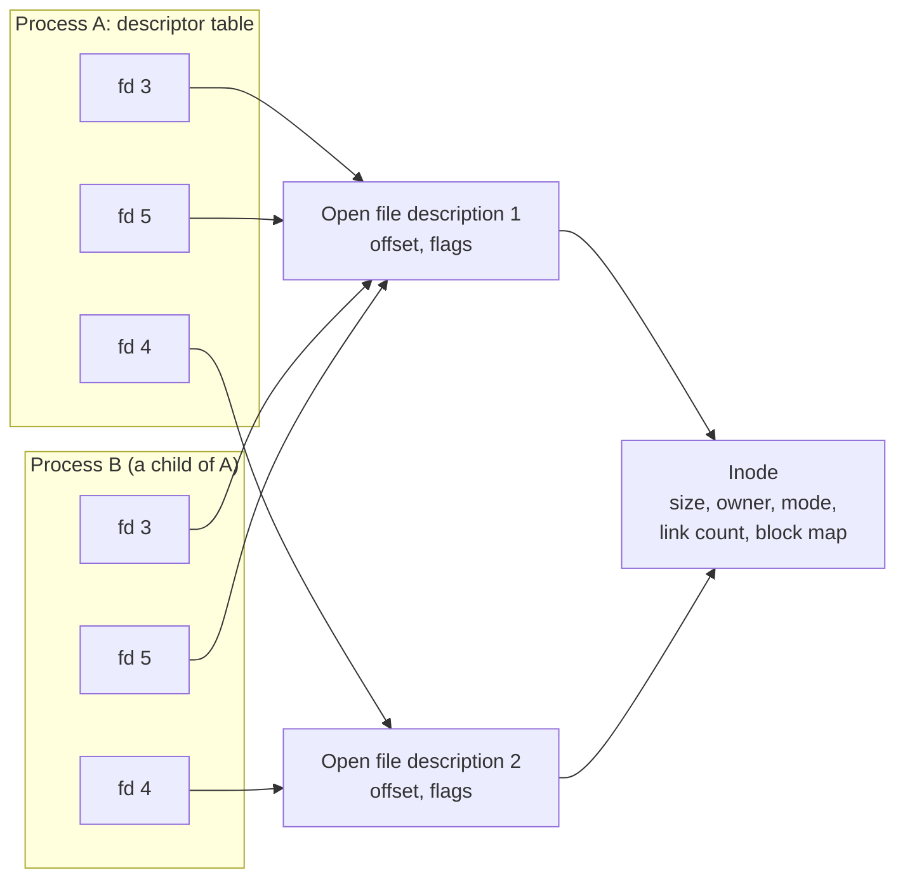
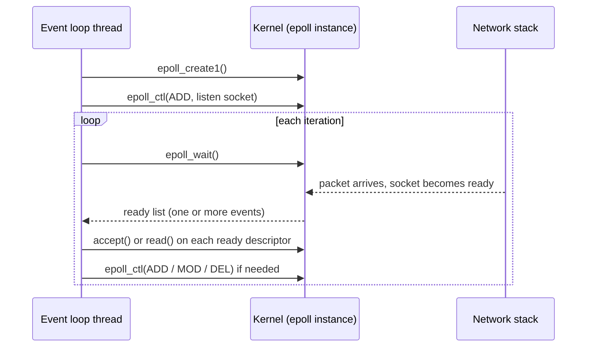

# File Systems and I/O Models

## Why It Matters

Interviews ask about this page in two forms. The first is the textbook form: "What is an inode?", "What is the difference between a hard link and a symbolic link?", "What happens if you delete a file that a process has open?", "Compare `select`, `poll`, and `epoll`", "What is the C10K problem?", "What is zero-copy?". The second is the production form: "A disk is full, but `du` shows little data. Why?", "The server crashed and the last write is gone, although `write` returned success. Why?", "Why does a Netty or Node.js server run on a few threads and serve tens of thousands of connections?", "Why can a virtual thread block on a socket for free?". On the job, the same knowledge explains why a log rotation does not free space, why a database calls `fsync`, why `free` shows little free memory, and why a server that reads a file and writes it to a socket spends its CPU on copying. This page covers files and file descriptors, inodes and links, durability (`fsync`), the page cache, the I/O models, `select`, `poll`, `epoll`, the event loop, `io_uring`, and zero-copy. The Java API for streams, channels, and selectors is on [I/O, NIO, and serialization](../java/15-io-nio-and-serialization.md). This page explains what the kernel does below that API. The database use of `fsync` is on [storage engines](../databases/06-storage-engines.md).

Page sizes, kernel versions, and tool details in this page come from the Linux man pages (man7.org), the kernel documentation (docs.kernel.org), and the JDK 21 sources and javadoc. The kernel version that kernel.org lists as stable on 2026-11-05 is 7.3.1. A command on a Mac does not show Linux behavior, so this page contains no output from a local run.

## Core Concepts

**File descriptor (fd)**: a small non-negative integer that a process uses to refer to an open file, a socket, a pipe, or another kernel object. `open(2)` returns "the lowest-numbered file descriptor not currently open for the process". By convention, 0 is standard input, 1 is standard output, and 2 is standard error.

**Open file description**: the kernel object that a successful `open` creates. It holds the file offset and the status flags (for example `O_NONBLOCK`), and it points to the file. `open(2)` calls it "the entries in the system-wide table of open files". Several descriptors can refer to one open file description.

**Inode**: the kernel's record of a file. `inode(7)` lists the metadata that a file has: device, inode number, mode (type and permissions), link count, owner, group, size, block count, and the access, modification, and status-change times. The list has no field for the file name. The name belongs to a directory entry.

**Directory entry**: a pair of a name and an inode number, stored in a directory. A directory is a file whose content is a list of such pairs.

**Hard link**: a directory entry that points to an existing inode. `link(2)`: "both names refer to the same file", and it is impossible to tell which name was the original.

**Symbolic link (symlink)**: a file of a special type whose content is the path of another file (`symlink(7)`). The kernel follows the path when it resolves a name.

**Page cache**: the kernel's cache of file contents in RAM, in units of pages. This page is its home. `/proc/meminfo` calls it "Cached".

**Dirty page**: a page of the page cache that a program changed and the kernel has not yet written to the device.

**Write-back**: the kernel's background writing of dirty pages to the device.

**Journal**: a log that a file system writes before it changes its own structures, so that it can finish or undo the change after a crash.

**`fsync`**: the system call that forces the changes of one file to the storage device. It is the only way that a program knows that its data is on the device.

**Blocking I/O**: an I/O call that does not return until the operation can finish, so the calling thread waits.

**Non-blocking I/O**: an I/O call on a descriptor with `O_NONBLOCK` that returns at once with the error `EAGAIN` if it cannot finish.

**Readiness**: the state in which an I/O call on a descriptor would not block (`select(2)`: "possible to perform a corresponding I/O operation without blocking").

**I/O multiplexing**: waiting for readiness on many descriptors with one call (`select`, `poll`, `epoll`).

**Level-triggered**: a readiness mode that reports a descriptor for as long as the descriptor is ready.

**Edge-triggered**: a readiness mode that reports a descriptor only when it changes (when new data arrives).

**Event loop**: a loop that waits for readiness events and calls a handler for each event. A single thread usually runs it.

**Reactor**: the design pattern behind an event loop. A demultiplexer waits for events, and the reactor dispatches each event to the handler that the program registered.

**Zero-copy**: a way to move data between a file and a socket without copying it through a user-space buffer.

**C10K problem**: the problem of serving ten thousand clients at the same time on one server. Dan Kegel named it in 1999.

## How It Works

### Files, descriptors, and the three tables

A process does not hold a file. It holds a number. The kernel maps the number to the file through three tables.



1. **The descriptor table** belongs to one process. It maps a number to an open file description. A descriptor also has a flag, close-on-exec (`O_CLOEXEC`, "Enable the close-on-exec flag for the new file descriptor", `open(2)`).
2. **The open file description** (the system-wide open file table) holds the file offset and the status flags. Two rules from `open(2)` decide what is shared:
    - "Each `open()` of a file creates a new open file description". Two `open` calls on the same path give two descriptions, with separate offsets.
    - `dup` and `fork` copy descriptors, not descriptions. "A child process created via `fork(2)` inherits duplicates of its parent's file descriptors, and those duplicates refer to the same open file descriptions", so "the two file descriptors consequently share the file offset and file status flags".
3. **The inode** holds the file's metadata and the location of its data blocks. Many open file descriptions can point to one inode.

The shared offset has a consequence for programs. A parent and a child that both read from an inherited descriptor take turns on the same offset. A program that wants its own offset opens the file again, or uses `pread`.

**Limits.** `RLIMIT_NOFILE` "specifies a value one greater than the maximum file descriptor number that can be opened by this process" (`getrlimit(2)`). When a process goes over it, `open` fails with `EMFILE` (in Java, the message "Too many open files"). A child inherits the limits of its parent. The soft limit is the one that the kernel enforces, and the hard limit is the ceiling for the soft limit. Every socket also uses a descriptor, so a server with 20,000 connections needs a limit above 20,000. The usual cause of `EMFILE` on a service is a leak: code that does not close a stream or a socket.

**Regular files and `O_NONBLOCK`.** The `open(2)` page says that `O_NONBLOCK` "has no effect for regular files and block devices; that is, I/O operations will (briefly) block". A read from a regular file waits for the disk if the data is not in the page cache. This is the reason that event loops use a thread pool for file I/O (section "The event loop").

### Inodes, directories, and links

A path lookup walks the directories. The kernel reads the root directory, finds the entry for the first name, takes its inode number, reads that inode (a directory), and repeats for each name in the path. The last inode is the file. Because the name is not in the inode, one inode can have several names.

```text
directory /data                inode 100 (regular file)
+--------------+------+        +-----------------------+
| name         | ino  |        | links = 2             |
+--------------+------+   +--> | size, owner, mode     |
| log.txt      | 100  | --+    | times                 |
| alias.txt    | 100  | --+    | pointers to data      |
| notes.txt    | 101  |        +-----------------------+
+--------------+------+
```

| Property | Hard link | Symbolic link |
|---|---|---|
| What it is | Another directory entry for the same inode | A separate file whose content is a path |
| Can cross file systems | No. `link(2)` fails with `EXDEV` if the paths are "not on the same mounted filesystem" | Yes |
| Can point to a directory | No. `link(2)` fails with `EPERM` if the old path is a directory | Yes |
| If the original name is removed | The file stays, because the inode keeps another name | The link dangles: it names a path that does not exist (`symlink(7)`) |
| Permissions | The permissions of the inode | On Linux "always 0777 ... and can't be changed", and the kernel does not use them (`symlink(7)`) |
| Identity | "Impossible to tell which name was the original" (`link(2)`) | A different inode from its target |

The kernel limits the number of links to one inode (`EMLINK`). `link(2)` gives example limits of 65,000 on ext4 without `dir_index` and 65,535 on btrfs.

**What `rm` does.** `rm` calls `unlink(2)`. It removes one directory entry and lowers the link count of the inode. The kernel frees the inode and its blocks only when two conditions hold: the link count is 0 and no open file description points to the inode. `unlink(2)`: if "the name was the last link to a file but any processes still have the file open, the file will remain in existence until the last file descriptor referring to it is closed". For a symbolic link, `unlink` removes the link and leaves the target.

This explains a common production incident. A service writes to a log file. An administrator deletes the file to free space. The service still holds the open file description, so the kernel keeps the blocks, `df` shows the space as used, and `du` does not see the file because it has no name. The fix is to restart the process or to truncate the file in place (`truncate -s 0` or `: > file`) instead of deleting it. `lsof` finds the files in this state: "A specification of the form `+L1` will select open files that have been unlinked", and the `FD` column shows the descriptor (`lsof(8)`; the next page, [Linux for developers](07-linux-for-developers.md), shows the command).

The same rule gives a safe pattern for temporary files. `open(2)` offers `O_TMPFILE`, which creates "an unnamed temporary regular file". "Anything written to the resulting file will be lost when the last file descriptor is closed", unless the program gives it a name.

### Writing safely: journaling and `fsync`

A successful `write` does not put the data on the disk. The `write(2)` page states: "A successful return from `write()` does not make any guarantee that data has been committed to disk", and "the only way to be sure is to call `fsync(2)` after you are done writing all your data". The kernel copies the data into the page cache and marks the page dirty (next section). A power failure can destroy the page before the kernel writes it.

`fsync(2)` "transfers ('flushes') all modified in-core data of ... the file referred to by the file descriptor `fd` to the disk device (or other permanent storage device) so that all changed information can be retrieved even if the system crashes or is rebooted". The call "blocks until the device reports that the transfer has completed". `fdatasync(2)` "does not flush modified metadata unless that metadata is needed" to read the data back, for example the file size after an append. It writes less than `fsync`.

Three more facts from `fsync(2)`:

- **The directory.** "Calling `fsync()` does not necessarily ensure that the entry in the directory containing the file has also reached disk. For that an explicit `fsync()` on a file descriptor for the directory is also needed." A program that creates a new file and wants it to exist after a crash must `fsync` the file and then `fsync` the directory.
- **Errors.** `EIO` means "an error occurred during synchronization", and "this error may relate to data written to some other file descriptor on the same file". Since Linux 4.13, write-back errors go to all descriptors that might have written the data. A program must treat an error from `fsync` as a failure of the write, and must not retry `fsync` and assume success.
- **The device.** `fsync` ends when the device reports completion. A drive with a volatile cache that does not honor flush commands can report completion too early. [Storage engines](../databases/06-storage-engines.md) covers this risk for databases.

**Journaling.** A file system operation such as creating a file changes several structures: the directory, the inode, and the allocation bitmap. A crash between two of these writes would leave the structures inconsistent. A journaling file system writes a description of the change to a journal first, then applies the change, and after a crash it replays or discards the journal. The kernel documentation for ext4 lists three data modes (`docs.kernel.org/admin-guide/ext4.html`):

| Mode | What the journal holds | Documentation text |
|---|---|---|
| `data=ordered` (the default, marked `*`) | Metadata only | "All data are forced directly out to the main file system prior to its metadata being committed to the journal" |
| `data=writeback` | Metadata only | "Data ordering is not preserved, data may be written into the main file system after its metadata has been committed to the journal" |
| `data=journal` | Metadata and data | "All data are committed into the journal prior to being written into the main file system." The page says: "This feature is deprecated and support will be removed in January 2028" |

The journal protects the file system structure. It does not make the application's data durable. With `data=ordered`, the file system writes data blocks before the metadata that points to them, so a crash does not expose old block content through a new file. (This is an inference from the quoted ordering rule. The documentation does not state it as a guarantee.) But a program that did not call `fsync` can still lose its latest writes. The default `commit=nrsec` value is 5 seconds: "This setting limits the maximum age of the running transaction to `nrsec` seconds." The same entry warns: "Note that due to delayed allocation even older data can be lost on power failure since writeback of those data begins only after time set in /proc/sys/vm/dirty_expire_centisecs." The `data=journal` entry also says: "Enabling this mode will disable delayed allocation and O_DIRECT support."

**Replace a file safely.** A program that rewrites a configuration file in place can leave half a file after a crash. The safe pattern writes a new file and swaps it in:

1. Write the new content to a temporary file in the same directory.
2. `fsync` the temporary file.
3. `rename` the temporary file over the old name. `rename(2)`: "If `newpath` already exists, it will be atomically replaced, so that there is no point at which another process attempting to access `newpath` will find it missing." Both paths must be on one mounted file system, or the call fails with `EXDEV`.
4. `fsync` the directory, so that the rename survives a crash.

A reader sees either the old file or the new file, and not a mix of both. The `rename(2)` page does not state that a rename survives a crash without step 4. The Java example below shows the pattern with `Files.move` and `StandardCopyOption.ATOMIC_MOVE`.

### The page cache

This section is the home of the page cache. [Memory management](04-memory-management.md) gives one paragraph and links here.

**Read path.** A `read` on a buffered file asks the page cache for the pages. If a page is there (a cache hit), the kernel copies it to the user buffer, and no disk I/O happens. If not (a cache miss), the kernel allocates a page, reads the block from the device, adds the page to the cache, and copies it to the user buffer. The kernel also reads ahead: for a sequential read it fetches the next pages before the program asks. `posix_fadvise(2)` lets a program announce its pattern. Under Linux, `POSIX_FADV_SEQUENTIAL` "doubles" the readahead window, `POSIX_FADV_WILLNEED` "initiates a nonblocking read of the specified region into the page cache", and `POSIX_FADV_DONTNEED` "attempts to free cached pages associated with the specified region" (dirty pages stay).

**Write path (buffered write).** A `write` copies the bytes into page cache pages, marks them dirty, and returns. The kernel writes the dirty pages later, on its own schedule. This is **write-back**. It makes `write` fast, because the program does not wait for the device, and it lets the kernel merge many small writes into few large ones. The cost is the durability gap that the previous section described.

**When write-back runs.** The kernel starts write-back for three reasons: the dirty data is older than a limit, the amount of dirty data crosses a threshold, or a program calls `fsync`. The `vm` sysctl documentation (`docs.kernel.org/admin-guide/sysctl/vm.html`) defines the tunables but states no defaults. The defaults are constants in the kernel source `mm/page-writeback.c` (checked on the master branch): background write-back starts at 10 percent dirty memory (`dirty_background_ratio`), a process that writes starts to write out data itself at 20 percent (`dirty_ratio`), the flusher threads wake every 5 seconds (`dirty_writeback_centisecs`, 500), and data counts as old after 30 seconds (`dirty_expire_centisecs`, 3000). The percentages are fractions of the "total available memory that contains free pages and reclaimable pages", not of the total memory. A distribution can change the values. The second threshold matters for latency: when a process writes faster than the device, it reaches `dirty_ratio`, and then the kernel makes the `write` calls of that process write out data. The application sees a stall in a `write` call.

**See the cache.** `/proc/meminfo` has `Cached` ("in-memory cache for files read from the disk (the page cache)"), `Dirty` ("memory which is waiting to get written back to the disk"), and `Writeback` ("memory which is actively being written back to the disk"). The `free` column `buff/cache` adds `Buffers` and the page cache. The tool pages in [Linux for developers](07-linux-for-developers.md) show how to read them.

**Eviction.** The page cache and process memory compete for the same frames. A clean cache page costs nothing to drop, because the kernel can read it again. A dirty page must be written first. This is why a healthy Linux server shows little free memory: the kernel uses idle RAM as cache and gives it back on demand. The number to watch is `MemAvailable`, "an estimate of how much memory is available for starting new applications, without swapping" (`proc_meminfo(5)`). The reclaim algorithm (`kswapd`, direct reclaim, active and inactive lists) is on the [memory management page](04-memory-management.md). The sysctl `drop_caches` makes the kernel "drop clean caches, as well as reclaimable slab objects like dentries and inodes". The kernel documentation warns that "use of this file can cause performance problems" and does not recommend it outside testing or debugging. Dropping the cache does not fix a memory problem. It makes the next reads go to disk.

**Containers.** The cgroup v2 memory controller counts page cache as the cgroup's usage: it tracks "userland memory - page cache and anonymous memory", and `memory.stat` reports `file` ("memory used to cache filesystem data"), `file_dirty`, and `file_writeback` separately from `anon`. When the usage reaches `memory.max` and the kernel cannot reduce it, "the OOM killer is invoked in the cgroup". A Java service that reads or writes many files therefore sees its container memory grow with the cache. The kernel can drop clean cache pages under pressure, so cache alone does not have to cause a kill, but a container limit that is close to the heap size leaves no room (see [memory management](04-memory-management.md) for the JVM sizing).

**`mmap`.** A file mapped with `mmap` uses the same cached pages. The first access to a page faults, and the kernel maps the cached frame. There is no copy to a user buffer. [Memory management](04-memory-management.md) covers `mmap` and the page fault path, and the Java side (`MappedByteBuffer`) is on the [NIO page](../java/15-io-nio-and-serialization.md).

**`O_DIRECT`.** `open(2)`: `O_DIRECT` tries to "minimize cache effects of the I/O to and from this file", and "it is useful in special situations, such as when applications do their own caching". The kernel moves data between the device and the user buffer and skips the page cache. A database that manages its own buffer pool (see [storage engines](../databases/06-storage-engines.md)) can use it to avoid caching the same page twice. The costs: "in Linux alignment restrictions vary by filesystem and kernel version and might be absent entirely", so the buffer and the offsets may need alignment, and the page says "applications should avoid mixing `O_DIRECT` and normal I/O to the same file". `O_DIRECT` skips the cache. It does not by itself promise durability. `O_SYNC` does: "write operations will flush data and all associated metadata to the underlying hardware", and `O_DSYNC` gives "synchronized I/O data integrity completion".

**Summary of the write options.**

| Option | Where the data is when the call returns | Cost |
|---|---|---|
| Buffered `write` | Page cache (dirty). Not durable | Lowest latency |
| Buffered `write` + `fsync` | On the device | One device flush for each `fsync`. Group several writes before it |
| `O_SYNC` or `O_DSYNC` | On the device | A flush for each `write` |
| `O_DIRECT` | Handed to the device. Durable only if the device and the file system do not cache or reorder | No page cache. Alignment rules |

### The five I/O models

A server that talks to many clients must decide what a thread does while it waits. The classic classification (W. Richard Stevens, *UNIX Network Programming*, volume 1, chapter 6, section "I/O Models") names five models. Each model answers two questions: does the call block while the data is not ready, and who copies the data from the kernel to the user buffer?

| Model | How it works | Blocks in the data wait? | Blocks in the copy? |
|---|---|---|---|
| Blocking I/O | `read` blocks until data arrives and the kernel copies it | Yes | Yes |
| Non-blocking I/O | `read` returns `EAGAIN` if no data is ready. The program calls again and again (polling) | No (it spins) | Yes |
| I/O multiplexing | `select`, `poll`, or `epoll_wait` blocks until some descriptor is ready. Then `read` does not block | Yes, in the multiplexing call | Yes |
| Signal-driven I/O | The kernel sends a signal when a descriptor is ready. The handler or the main loop then calls `read` | No | Yes |
| Asynchronous I/O | The program submits a request. The kernel does the wait and the copy, and notifies the program when it ends | No | No |

The first four are **synchronous**: the program itself performs the data copy in a call that blocks. Only asynchronous I/O leaves the copy to the kernel. The word "non-blocking" is not the same as "asynchronous". Non-blocking I/O returns early with `EAGAIN`, and the program must try again. Asynchronous I/O reports the result when the work is done.

The two designs have names. A **reactor** waits for readiness and then performs the I/O itself (multiplexing). A **proactor** starts the I/O and gets a completion event (asynchronous I/O). The libuv design document says that it uses "the best mechanism available on the given platform: epoll on Linux, kqueue on OSX", with event ports on SunOS and I/O completion ports (IOCP) on Windows. IOCP is a completion mechanism, and `epoll` is a readiness mechanism, so the same API hides two designs.

### `select`, `poll`, and `epoll`

**`select(2)`.** The caller passes three bit sets (read, write, exception) and the highest descriptor number plus one. The call blocks until a descriptor in a set is ready. Two properties limit it:

- **The size limit.** "`select()` can monitor only file descriptors numbers that are less than `FD_SETSIZE` (1024)". The page calls this "an unreasonably low limit for many modern applications" and says that "this limitation will not change". A descriptor with the number 1024 or more cannot go in a set.
- **The sets are overwritten.** "After `select()` has returned, `readfds` will be cleared of all file descriptors except for those that are ready for reading." The caller must build the sets again before each call. Reasoning (the man page does not state a cost): each call passes the whole set to the kernel, and the kernel and the caller scan it, so the work per call grows with the number of descriptors even if only one is ready.

**`poll(2)`.** The caller passes an array of `struct pollfd` with the fields `fd`, `events`, and `revents`. The kernel fills `revents` ("an output parameter, filled by the kernel with the events that actually occurred") with `POLLIN`, `POLLOUT`, `POLLERR`, `POLLHUP`, or `POLLNVAL`. The array removes the descriptor number limit, and the caller does not need to rebuild the input (the kernel writes only `revents`). A negative `fd` is ignored. The caller still passes the whole array on each call, and then scans it for the ready entries.

**`epoll(7)`.** An epoll instance is "an in-kernel data structure which, from a user-space perspective, can be considered as a container for two lists":

- the **interest list**, "the set of file descriptors that the process has registered an interest in monitoring", and
- the **ready list**, "the set of file descriptors that are 'ready' for I/O", which the kernel fills "as I/O activity occurs".

Three system calls work on it: `epoll_create1(2)` creates the instance, `epoll_ctl(2)` adds (`EPOLL_CTL_ADD`), changes (`EPOLL_CTL_MOD`), or removes (`EPOLL_CTL_DEL`) a descriptor, and `epoll_wait(2)` "waits for I/O events, blocking the calling thread if no events are currently available". The program registers each descriptor once. The wait call then returns the ready list. Its cost depends on the number of ready descriptors, and not on the number of registered descriptors, because the kernel builds the ready list when events happen. (This follows from the two-list design that `epoll(7)` describes. The man page does not print a complexity.)



| Feature | `select` | `poll` | `epoll` |
|---|---|---|---|
| Descriptor limit | `FD_SETSIZE` (1024) | None from the API | None from the API (the process limit `RLIMIT_NOFILE` applies) |
| Input on each call | Three sets, rebuilt by the caller | An array of `pollfd` | None after registration |
| Result | The sets, changed in place | `revents` in the array | A list of ready events |
| Triggering | Level | Level | Level (default) or edge |
| Portable | POSIX | POSIX | Linux only (`kqueue` on BSD and macOS, IOCP on Windows) |

**Limit of `epoll`: regular files.** `epoll_ctl` fails with `EPERM` if "the target file `fd` does not support epoll", for example a regular file or a directory. A regular file has no readiness model in this sense. A read blocks briefly on a cache miss. An event loop must send file reads to a thread pool.

**Level-triggered and edge-triggered.** The default mode is level-triggered: `epoll_wait` reports a descriptor in every call for as long as the descriptor is ready. In this mode, the man page says, epoll is "a faster `poll(2)`" with the same semantics. Edge-triggered mode (`EPOLLET`) "delivers events only when changes occur on the monitored file descriptor". The man page gives this example:

1. The read side of a pipe (`rfd`) is registered on the epoll instance, with `EPOLLET`.
2. A writer writes 2 kB to the pipe.
3. `epoll_wait` returns `rfd` as ready.
4. The reader reads 1 kB from `rfd`.
5. `epoll_wait` is called again.

Step 4 "does not consume the whole buffer data", and the call in step 5 "might block indefinitely": it "will probably hang despite the available data still present in the file input buffer". In level-triggered mode, the call in step 5 returns at once, because 1 kB is still ready. The Java example below simulates this.

The rules for edge-triggered mode, from `epoll(7)`: use non-blocking descriptors "to avoid having a blocking read or write starve a task that is handling multiple file descriptors", and wait for the next event only after `read` or `write` returns `EAGAIN`. This means that the handler must read until `EAGAIN`. The same page warns about the other side: a handler that tries to drain one descriptor can keep the thread busy, "it is possible that by trying to drain it the other files will not get processed". A fair loop caps the bytes that it reads from one descriptor in one turn, and it remembers that the descriptor still has data.

Two more flags from `epoll_ctl(2)` matter for multi-threaded servers:

- `EPOLLONESHOT`: "requests one-shot notification". After the kernel reports an event, it disables the descriptor until the program re-arms it with `EPOLL_CTL_MOD`. This prevents two threads from handling the same descriptor at the same time.
- `EPOLLEXCLUSIVE`: "sets an exclusive wakeup mode". If one descriptor is in several epoll instances, the kernel wakes fewer of the waiting threads. It reduces the thundering herd on a shared listening socket. It works only with `EPOLL_CTL_ADD`.

One trap: the key of an epoll entry is "the combination of the file descriptor number and the open file description". If a descriptor is duplicated, closing one copy does not remove the entry, and events can keep arriving. Call `EPOLL_CTL_DEL` before you close (`epoll(7)`).

### Signal-driven I/O, POSIX AIO, and `io_uring`

**Signal-driven I/O.** A program asks the kernel to send a signal when a descriptor becomes ready, and does its work in the handler or reads in the main loop. A signal carries little data, standard signals do not queue (`signal(7)`), and a handler runs in a restricted context. Kegel's C10K page lists realtime signals as an edge-triggered option on Linux 2.4. The mechanism has fallen out of use for servers because `epoll` is simpler. `fcntl(2)` lists `F_SETOWN` and `F_SETSIG` under "Managing signals". [Linux for developers](07-linux-for-developers.md) is the home of signals.

**POSIX AIO.** `aio_read(3)` and `aio_write(3)` enqueue a request and return. The program learns about the end through `aio_error`, `aio_suspend`, or a notification (`aio_sigevent`, with `SIGEV_NONE`, `SIGEV_SIGNAL`, or `SIGEV_THREAD`). On Linux, "the current Linux POSIX AIO implementation is provided in user space by glibc" (`aio(7)`). It runs the requests on threads, and the man page notes that "maintaining multiple threads to perform I/O operations is expensive and scales poorly". So POSIX AIO on Linux is a blocking call on a helper thread, and not a kernel-level asynchronous path. The kernel has its own native AIO interface (`io_submit(2)` and related calls). The man page adds that work on a kernel state-machine-based implementation "hasn't yet matured to the point where the POSIX AIO implementation can be completely reimplemented using the kernel system calls".

**`io_uring`.** `io_uring` is the current Linux interface for asynchronous I/O. `io_uring(7)`: it "gets its name from ring buffers which are shared between user space and kernel space". The program maps two rings. It places requests on the **submission queue** (SQ), and "the kernel places the results of those operations on the **completion queue** (CQ)". The program sets the rings up with `io_uring_setup(2)` and `mmap(2)`, and calls `io_uring_enter(2)` "to tell the kernel to dequeue your I/O". Because the rings are shared memory, a program can submit and reap many operations with few system calls (the kernel can also poll the submission queue, which removes the system call for submission; this page does not cover that mode). It is a proactor design: the kernel does the work and reports completion. It covers regular file I/O as well as sockets, which `epoll` cannot do.

Status on 2026-11-05, and the restrictions that matter for a developer:

- **The kernel.** The `io_uring(7)` man page lists the completion flags "as of the 6.12 kernel", and kernel.org lists 7.3.1 as the latest stable release on 2026-11-05. The interface is in active development, so a feature depends on the kernel version.
- **A system-wide switch.** Linux 6.6 added "a sysctl to disable io_uring system-wide" (kernelnewbies, Linux 6.6). `docs.kernel.org/admin-guide/sysctl/kernel.html` documents `io_uring_disabled`: 0 (the default) lets all processes create `io_uring` instances, 1 makes `io_uring_setup()` fail with `EPERM` for unprivileged processes that are not in `io_uring_group`, and 2 disables creation for all processes. Existing instances keep working.
- **Container defaults.** The Docker seccomp documentation lists `io_uring_setup`, `io_uring_enter`, and `io_uring_register` as blocked by the default profile: "Blocked due to security vulnerabilities that can be exploited to break out of containers" (moby/moby#46762). A container that needs `io_uring` must run with a custom seccomp profile. Kubernetes and other platforms have their own defaults.
- **The reason.** The Google Security Blog post of June 2023 reports "a clear trend: 60% of the submissions exploited the io_uring component of the Linux kernel" to Google's kCTF vulnerability reward program in the past year. The post then lists the limits: "ChromeOS: We disabled io_uring", "Android: Our seccomp-bpf filter ensures that io_uring is unreachable to apps", and "GKE AutoPilot: We are investigating disabling io_uring by default". It adds: "It is disabled on production Google servers." The post calls `io_uring` "a fairly new part of the kernel" that "is still affected by severe vulnerabilities".

For a Java developer, the result is: the JDK 21 `Selector` runs on `epoll` (next section), and a library that wants `io_uring` must bring its own native code. Whether an application can use `io_uring` in production depends on the kernel and on the container policy.

### C10K, the reactor, and the event loop

In 1999, Dan Kegel wrote: "It's time for web servers to handle ten thousand clients simultaneously, don't you think?" (kegel.com/c10k.html; the page's copyright line says 1999-2018 and its last update says 5 February 2014). The page compares these strategies:

1. Serve many clients with each thread, and use non-blocking I/O and level-triggered readiness notification (`select`, `poll`).
2. Serve many clients with each thread, and use non-blocking I/O and readiness change notification (`epoll` in edge-triggered mode, `kqueue`, realtime signals).
3. Serve many clients with each server thread, and use asynchronous I/O.
4. Serve one client with each server thread.
5. Build the server code into the kernel.

Strategy 4 is the thread-per-connection design. Its cost is the memory and the scheduling of thousands of threads (see [processes and threads](01-processes-and-threads.md)). Strategies 1 and 2 are the reactor designs that modern servers use.

An **event loop** implements the reactor in one thread (or one thread for each CPU core):

```text
loop forever:
    events = epoll_wait(epfd, timeout)      // block until something is ready
    for each event in events:
        handler = lookup(event.fd)
        handler.run()                       // must not block
    run timers that are due
```

The rule of the loop: a handler must not block, because it would stop every other connection that the same thread serves. A handler reads what is available, does its work, writes the reply (or queues it and asks for write readiness), and returns.

The loops that Java and JavaScript developers meet:

| System | Mechanism | Detail from the source |
|---|---|---|
| Java NIO `Selector` | One `Selector` for each loop thread | On Linux, `sun.nio.ch.EPollSelectorImpl` ("Linux epoll based Selector implementation") calls `EPoll.wait` and `EPoll.ctl` (JDK 21 source). It is level-triggered (see below) |
| Netty | A loop for each thread (`EventLoop`), with channel handlers | `NioEventLoopGroup` uses the JDK selector. The native transport `EpollEventLoopGroup` ("less garbage, and generally improve performance" according to the Netty wiki) calls `epoll` through JNI |
| Node.js (libuv) | One thread runs the loop. Phases: timers, pending callbacks, idle and prepare, poll, check, close callbacks | The poll phase "retrieves new I/O events" and "node will block here when appropriate". libuv runs "blocking file I/O operations in a thread pool", and the thread pool also handles `getaddrinfo` |

**How a Java `Selector` maps to `epoll`.** The map is direct (the Java API is on the [NIO page](../java/15-io-nio-and-serialization.md)):

| Java | Kernel |
|---|---|
| `Selector.open()` | `epoll_create1` (the JDK also creates an `eventfd` for `wakeup`) |
| `channel.register(selector, OP_READ)` | `epoll_ctl(EPOLL_CTL_ADD, fd, EPOLLIN)`. `interestOps` changes become `EPOLL_CTL_MOD`, and a cancelled key becomes `EPOLL_CTL_DEL` |
| `selector.select()` | `epoll_wait` |
| `selector.selectedKeys()` | The ready list, translated to `SelectionKey` objects |
| `selector.wakeup()` | A write to the `eventfd`, which makes `epoll_wait` return |

The `Selector` javadoc does not name `epoll`. It says only that "the underlying operating system is queried for an update as to the readiness of each remaining channel". The JDK source for Linux shows the `epoll` calls. The javadoc also states that the selected-key set is not cleared by the selector: keys leave it only when the program removes them. A program that forgets `iterator.remove()` handles the same key again, because the key stays in the set. **The JDK selector is level-triggered.** In the JDK 21 source, `EPollSelectorImpl` passes the mask from `SelectionKeyImpl.translateInterestOps()` to `EPoll.ctl`. For a `SocketChannel`, that method builds the mask only from `POLLIN`, `POLLOUT`, and `POLLCONN` (`SocketChannelImpl.translateInterestOps`). `EPoll.java` defines `EPOLLIN`, `EPOLLOUT`, and `EPOLLONESHOT` and does not define `EPOLLET`. So a `Selector` keeps reporting a channel for as long as its data is unread, and a handler may read part of the data. The JDK uses `EPOLLONESHOT` in a different place: `EPollPoller`, which parks virtual threads (next sections). A `FileChannel` cannot register with a selector, and a file read on an event loop thread blocks it.

### Zero-copy

Serving a file over a socket with `read` and `write` crosses the kernel boundary twice and copies the data twice between kernel space and user space:

```text
read(file_fd, buf, n):   device --DMA--> page cache --CPU copy--> user buffer
write(sock_fd, buf, n):  user buffer --CPU copy--> socket buffer --DMA--> network card
```

The user buffer is only a stop on the way. The program does not change the bytes. Zero-copy interfaces remove the stop.

- **`sendfile(2)`**: "Because this copying is done within the kernel, `sendfile()` is more efficient than the combination of `read(2)` and `write(2)`". The input must be a file that "supports `mmap(2)`-like operations (i.e., it cannot be a socket)". Before Linux 2.6.33, the output had to be a socket, and since then it "can be any file". One call transfers at most `0x7ffff000` (2,147,479,552) bytes, so a large file needs a loop. If the `offset` argument is not null, `sendfile` does not change the file offset of the input.
- **`splice(2)`**: "moves data between two file descriptors without copying between kernel address space and user address space", with the condition that one of them is a pipe. The kernel implements a pipe buffer "as a set of reference-counted pointers to pages of kernel memory". `SPLICE_F_MOVE` is a no-op since Linux 2.6.21.
- **`mmap` plus `write`**: the program maps the file, and `write` copies from the mapped pages (which are the page cache pages) to the socket. It saves the copy to a user buffer, and it pays the page fault costs and the risk of `SIGBUS` that [memory management](04-memory-management.md) lists.
- **`MSG_ZEROCOPY`** (for sending a program's own buffer): "copying large buffers between user process and kernel can be expensive", and the technique "replaces per byte copy cost with page accounting and completion notification overhead". The kernel documentation states: "`MSG_ZEROCOPY` is generally only effective at writes over around 10 KB". It tells the program that the buffer is free again through the socket error queue.

**What this saves.** It saves CPU time and memory bandwidth (two copies for each byte), and it keeps a large transfer from evicting useful data from the CPU caches. It does not save the disk read when the data is not in the page cache. It helps only if the program does not need to look at the bytes. A server that must compress or encrypt the data in user space (for example TLS in the JVM) has to read the bytes into a user buffer, and the saving disappears. This follows from the data path. Linux has kernel TLS (kTLS), which moves the TLS record layer into the kernel. The kernel documentation (`docs.kernel.org/networking/tls.html`) says: "The sendfile system call will send the file's data over TLS records of maximum length (2^14)." So `sendfile` still works over a kTLS socket, and the kernel (and not the application) encrypts the data. The option `TLS_TX_ZEROCOPY_RO` is "for device offload only": it lets `sendfile()` data go to the network card without an in-kernel copy. The JDK `SSLEngine` and `SSLSocket` encrypt inside the JVM, so a JVM server that uses them must read the file bytes into user space.

**In Java.** `FileChannel.transferTo(position, count, target)` "is potentially much more efficient than a simple loop that reads from this channel and writes to the target channel. Many operating systems can transfer bytes directly from the filesystem cache to the target channel without actually copying them" (JDK 21 javadoc). The javadoc does not name `sendfile`, and it says that the call "may or may not transfer all of the requested bytes": it returns the number of bytes that it moved, so the caller must loop. The method returns fewer bytes if "the target channel is non-blocking and it has fewer than `count` bytes free in its output buffer". Whether the JDK uses `sendfile` or `splice` for a given pair of channels depends on the JDK version and the platform. The javadoc makes no promise, so measure before you rely on it.

### Blocking I/O and virtual threads

A virtual thread removes the need to write callbacks. The code is blocking code, and the JDK turns the wait into a non-blocking wait on `epoll`. The mechanism, from [virtual threads](../java/10-virtual-threads.md) and JEP 444: when a virtual thread calls a socket read, the JDK registers the socket with a poller, and the virtual thread unmounts from its carrier thread. When `epoll` reports the socket ready, the JDK schedules the virtual thread again. In the JDK 21 source, `sun.nio.ch.EPollPoller` does this: it registers each descriptor with `EPOLLIN` or `EPOLLOUT` plus `EPOLLONESHOT`, and it re-arms the descriptor for each wait. So the thread-per-request style gets the scaling of an event loop. The costs: file I/O still blocks the carrier thread (the JDK compensates by adding a carrier, JEP 444), and a pinned virtual thread keeps its carrier while it blocks. The table "What unmounts and what does not" on the virtual threads page lists each case.

The comparison with an event loop is a trade-off, not a replacement in every case. An event loop gives full control and has no stack per connection. A virtual thread gives straight-line code, familiar stack traces, and works with blocking libraries (JDBC). Both rely on the same kernel mechanism, readiness notification.

## Trade-offs and When to Use

| Choice | Strength | Weakness | Use it when |
|---|---|---|---|
| Blocking I/O, thread for each connection | The simplest code and stack traces | Memory and scheduling cost of each platform thread | The connection count is in the hundreds, or you use virtual threads |
| Event loop with `epoll` (Netty, Node.js) | Few threads, high connection count, full control | Handlers must not block. Callback or state machine code | Many idle or slow connections, such as proxies, gateways, and chat servers |
| Virtual threads with blocking calls | Blocking style with high concurrency | Pinning in Java 21, and file I/O still blocks a carrier | A Java 21 service that calls blocking libraries |
| Level-triggered `epoll` | Hard to lose an event. A handler can read part of the data | One extra wake-up if you leave data unread | The default choice |
| Edge-triggered `epoll` | Fewer wake-ups | The handler must drain to `EAGAIN`. A busy descriptor can starve others | A tuned server where you control the read loop |
| `io_uring` | Few system calls, true asynchronous file I/O | Kernel version, security policy, and container restrictions | A storage or network engine that you control, on kernels that allow it |
| Buffered I/O with `fsync` | Uses the page cache and gives durability | Each `fsync` waits for the device | Most programs that need durability |
| `O_DIRECT` | No double caching, predictable I/O | Alignment rules. No read cache from the kernel | A database with its own buffer pool |
| `sendfile` and `transferTo` | Skips two copies | No gain if the program must process or encrypt the bytes in user space | Static files, downloads, and log shipping |

**Recommendation:** for a Java service, use blocking code on virtual threads (Java 21 or later) or a framework that runs on a `Selector` (Netty, a Spring reactive stack). Do not write a raw `Selector` loop in application code. Use `fsync` for any data that you cannot lose, and `fsync` the directory when you create or rename a file.

## Java Example

The first program models a readiness loop over in-memory connections. It shows the `epoll(7)` example: with edge-triggered notification, a handler that reads once leaves data in the buffer, and the next wait does not report the connection again. It does not use a socket. The model is a simplification: a real edge is a change in the kernel, and here the flag `newArrival` stands for it.

```java
import java.util.ArrayList;
import java.util.List;

public class Loop {
    static final int CHUNK = 1024;

    static class Conn {
        final String name;
        int unread;           // bytes in the kernel receive buffer
        boolean newArrival;   // an "edge": data arrived since the last wait

        Conn(String name) {
            this.name = name;
        }

        void arrive(int bytes) {
            unread += bytes;
            newArrival = true;
        }

        int read(int max) {   // returns 0 where a real read would return EAGAIN
            int n = Math.min(max, unread);
            unread -= n;
            return n;
        }
    }

    /** A model of the ready list of an epoll instance. */
    static List<Conn> epollWait(List<Conn> interest, boolean edgeTriggered) {
        List<Conn> ready = new ArrayList<>();
        for (Conn c : interest) {
            boolean isReady = edgeTriggered ? c.newArrival : c.unread > 0;
            if (isReady) {
                ready.add(c);
                c.newArrival = false;
            }
        }
        return ready;
    }

    static void run(String title, boolean edgeTriggered, boolean drain) {
        Conn a = new Conn("A");
        Conn b = new Conn("B");
        List<Conn> interest = List.of(a, b);
        a.arrive(2048);
        b.arrive(100);

        System.out.println("== " + title);
        for (int round = 1; round <= 5; round++) {
            List<Conn> ready = epollWait(interest, edgeTriggered);
            if (ready.isEmpty()) {
                System.out.println("round " + round + ": epoll_wait would block");
                break;
            }
            StringBuilder line = new StringBuilder("round " + round + ":");
            for (Conn c : ready) {
                int total = 0;
                int n;
                do {
                    n = c.read(CHUNK);
                    total += n;
                } while (drain && n > 0);
                line.append(" ").append(c.name).append(" read ").append(total);
            }
            System.out.println(line);
        }
        System.out.println("unread left: A=" + a.unread + " B=" + b.unread);
    }

    public static void main(String[] args) {
        run("level-triggered, one read for each event", false, false);
        run("edge-triggered, one read for each event", true, false);
        run("edge-triggered, read until EAGAIN", true, true);
    }
}
```

<!-- expected-output -->

```text
== level-triggered, one read for each event
round 1: A read 1024 B read 100
round 2: A read 1024
round 3: epoll_wait would block
unread left: A=0 B=0
== edge-triggered, one read for each event
round 1: A read 1024 B read 100
round 2: epoll_wait would block
unread left: A=1024 B=0
== edge-triggered, read until EAGAIN
round 1: A read 2048 B read 100
round 2: epoll_wait would block
unread left: A=0 B=0
```

Read the second run. Connection A received 2048 bytes. The handler read 1024 bytes and returned. The kernel reported no new event, so `epoll_wait` blocks while 1024 bytes wait in the buffer. This is the hang that `epoll(7)` describes. The first run does not have the problem, because level-triggered mode reports A again. The third run is the correct edge-triggered handler: it reads until `read` returns nothing (`EAGAIN` in a real program).

The second program models the three tables of the first section: descriptors, open file descriptions, and inodes. It shows the offset sharing of `dup` and `fork`, a separate offset for a second `open`, and an inode that survives `unlink` while a descriptor holds it.

```java
import java.util.HashMap;
import java.util.Map;

public class Tables {
    static class Inode {
        final int number;
        final String data;
        int links;       // directory entries that point here
        int openFiles;   // open file descriptions that point here

        Inode(int number, String data) {
            this.number = number;
            this.data = data;
        }
    }

    static class OpenFile {
        final Inode inode;
        int offset;      // shared by every descriptor that points here
        int refs;        // descriptors that point here

        OpenFile(Inode inode) {
            this.inode = inode;
            inode.openFiles++;
        }
    }

    static class Kernel {
        final Map<String, Inode> directory = new HashMap<>();
        int nextInode = 100;

        void create(String name, String data) {
            Inode inode = new Inode(nextInode++, data);
            inode.links = 1;
            directory.put(name, inode);
        }

        void link(String existing, String alias) {
            Inode inode = directory.get(existing);
            inode.links++;
            directory.put(alias, inode);
        }

        void unlink(String name) {
            Inode inode = directory.remove(name);
            inode.links--;
            report(inode, "unlink " + name);
        }

        void report(Inode inode, String event) {
            String state = inode.links == 0 && inode.openFiles == 0 ? "FREED" : "kept";
            System.out.printf("%-22s inode %d links=%d openFiles=%d -> %s%n",
                    event, inode.number, inode.links, inode.openFiles, state);
        }
    }

    static class Process {
        final String name;
        final Kernel kernel;
        final Map<Integer, OpenFile> fdTable = new HashMap<>();

        Process(String name, Kernel kernel) {
            this.name = name;
            this.kernel = kernel;
        }

        int lowestFreeFd() {
            int fd = 3;   // 0, 1, 2 are stdin, stdout, stderr
            while (fdTable.containsKey(fd)) {
                fd++;
            }
            return fd;
        }

        int open(String path) {
            OpenFile file = new OpenFile(kernel.directory.get(path));
            file.refs = 1;
            int fd = lowestFreeFd();
            fdTable.put(fd, file);
            return fd;
        }

        int dup(int fd) {
            OpenFile file = fdTable.get(fd);
            file.refs++;
            int copy = lowestFreeFd();
            fdTable.put(copy, file);
            return copy;
        }

        Process fork(String childName) {
            Process child = new Process(childName, kernel);
            for (Map.Entry<Integer, OpenFile> e : fdTable.entrySet()) {
                e.getValue().refs++;
                child.fdTable.put(e.getKey(), e.getValue());
            }
            return child;
        }

        String read(int fd, int count) {
            OpenFile file = fdTable.get(fd);
            int end = Math.min(file.offset + count, file.inode.data.length());
            String bytes = file.inode.data.substring(file.offset, end);
            file.offset = end;
            return bytes;
        }

        void close(int fd) {
            OpenFile file = fdTable.remove(fd);
            if (--file.refs == 0) {
                file.inode.openFiles--;
            }
            kernel.report(file.inode, name + " close fd " + fd);
        }
    }

    public static void main(String[] args) {
        Kernel kernel = new Kernel();
        kernel.create("/data/log.txt", "ABCDEFGH");
        Process parent = new Process("parent", kernel);

        int fd1 = parent.open("/data/log.txt");
        int fd2 = parent.open("/data/log.txt");
        int fd3 = parent.dup(fd1);
        System.out.println("fds: open=" + fd1 + " open again=" + fd2 + " dup=" + fd3);

        System.out.println("read fd" + fd1 + " 3 -> " + parent.read(fd1, 3));
        System.out.println("read fd" + fd3 + " 2 -> " + parent.read(fd3, 2)
                + "  (dup: shared offset)");
        System.out.println("read fd" + fd2 + " 2 -> " + parent.read(fd2, 2) + "  (own offset)");

        Process child = parent.fork("child");
        System.out.println("child read fd" + fd1 + " 2 -> " + child.read(fd1, 2)
                + "  (fork: shared offset)");
        System.out.println("parent read fd" + fd1 + " 1 -> " + parent.read(fd1, 1));

        kernel.link("/data/log.txt", "/data/alias.txt");
        kernel.unlink("/data/log.txt");
        kernel.unlink("/data/alias.txt");
        System.out.println("the name is gone, but fd" + fd2 + " still reads -> "
                + parent.read(fd2, 3));

        parent.close(fd1);
        parent.close(fd3);
        child.close(fd1);
        child.close(fd3);
        parent.close(fd2);
        child.close(fd2);
    }
}
```

<!-- expected-output -->

```text
fds: open=3 open again=4 dup=5
read fd3 3 -> ABC
read fd5 2 -> DE  (dup: shared offset)
read fd4 2 -> AB  (own offset)
child read fd3 2 -> FG  (fork: shared offset)
parent read fd3 1 -> H
unlink /data/log.txt   inode 100 links=1 openFiles=2 -> kept
unlink /data/alias.txt inode 100 links=0 openFiles=2 -> kept
the name is gone, but fd4 still reads -> CDE
parent close fd 3      inode 100 links=0 openFiles=2 -> kept
parent close fd 5      inode 100 links=0 openFiles=2 -> kept
child close fd 3       inode 100 links=0 openFiles=2 -> kept
child close fd 5       inode 100 links=0 openFiles=1 -> kept
parent close fd 4      inode 100 links=0 openFiles=1 -> kept
child close fd 4       inode 100 links=0 openFiles=0 -> FREED
```

The inode is freed only at the last line: when the link count is 0 and no open file description is left. The child holds a copy of each descriptor, so the parent's `close` calls do not release the descriptions.

The class below is not run, because it touches the file system. It shows the safe replace pattern with the JDK API: write a temporary file, force it to the device, move it over the target with an atomic move, and force the directory. The directory step opens the directory as a `FileChannel` with `READ`. On Linux, `FileChannel.force(true)` calls `fsync(2)` on the descriptor (the JDK 21 source, `UnixFileDispatcherImpl.force0`), and `open` on a directory with `O_RDONLY` succeeds. The JDK 21 javadoc does not promise that you can open or force a directory, so treat this as a Linux behavior that the JDK source shows and not as an API guarantee. Apache Lucene does the same and says that not all platforms allow it. Windows refuses to open a directory, so the code skips the step when the open fails. An error from `force` is a real failure, so the code does not catch it.

```java
import java.io.IOException;
import java.nio.ByteBuffer;
import java.nio.channels.FileChannel;
import java.nio.charset.StandardCharsets;
import java.nio.file.Files;
import java.nio.file.Path;
import java.nio.file.StandardCopyOption;
import java.nio.file.StandardOpenOption;

class AtomicReplace {
    static void replace(Path target, String content) throws IOException {
        Path dir = target.toAbsolutePath().getParent();
        Path temp = Files.createTempFile(dir, "tmp-", ".part");
        try (FileChannel ch = FileChannel.open(temp, StandardOpenOption.WRITE)) {
            ch.write(ByteBuffer.wrap(content.getBytes(StandardCharsets.UTF_8)));
            ch.force(true);                      // fsync the file (data and metadata)
        }
        // createTempFile makes a file that only the owner can read. Set the mode that
        // the target needs before the move (for example with Files.setPosixFilePermissions).
        Files.move(temp, target, StandardCopyOption.ATOMIC_MOVE);
        FileChannel dirChannel;
        try {
            dirChannel = FileChannel.open(dir, StandardOpenOption.READ);
        } catch (IOException e) {
            return;   // this platform cannot open a directory. The rename is still atomic.
        }
        try (dirChannel) {
            dirChannel.force(true);              // fsync the directory (Linux)
        }
    }
}
```

On Linux, `Files.move` with `ATOMIC_MOVE` ends in `rename(2)`, which replaces an existing target. The `Files.move` javadoc says that with `ATOMIC_MOVE` "if the target file exists then it is implementation specific if the existing file is replaced or this method fails", so check the behavior on other platforms.

`FileChannel.force(true)` is the Java call for `fsync`. The javadoc: "If this channel's file resides on a local storage device then when this method returns it is guaranteed that all changes made to the file since this channel was created, or since this method was last invoked, will have been written to that device", and "if the file does not reside on a local device then no such guarantee is made."

## Interview Angle

### Questions

??? question "What is a file descriptor? How do the descriptor table, the open file description, and the inode relate?"

    **Direct answer.** A file descriptor is a small integer that a process uses to name an open file, socket, or pipe. The kernel maps it through three tables.

    **The three tables.**

    - The **descriptor table** is private to the process. It maps a number to an open file description.
    - The **open file description** holds the file offset and the status flags. It is system-wide, and several descriptors can share one. `dup` and `fork` copy descriptors, so the copies share the offset. A second `open` of the same path creates a new description with its own offset.
    - The **inode** holds the file's metadata (owner, mode, size, link count, data location). Many descriptions can point to one inode.

    **Consequences.** A parent and a child that read from an inherited descriptor advance one shared offset. A process that wants an independent position opens the file again. `open` returns the lowest unused number, and `RLIMIT_NOFILE` limits how many a process can hold; going over it gives `EMFILE`. Sockets use descriptors too, so a server with many connections needs a high limit and must close every socket.

??? question "A service writes a log file. An administrator deletes it, but `df` shows that no space came back. Why, and what do you do?"

    **Direct answer.** The process still has the file open. `rm` calls `unlink`, which removes the directory entry and lowers the link count. The kernel frees an inode and its blocks only when the link count is 0 and no open file description points to it. The `unlink(2)` page says the file "will remain in existence until the last file descriptor referring to it is closed". `du` walks names, so it cannot see the file. `df` asks the file system, which still counts the blocks.

    **Find it.** `lsof +L1` lists open files with a link count below 1 (open files that were unlinked), and `lsof -p <pid>` lists the files of one process. The `FD` column and the `/proc/<pid>/fd` directory show the descriptor.

    **Fix.** Restart or signal the process so that it reopens its log (a log rotation that sends `SIGHUP`, or a logger that supports reopen). To free the space without a restart, truncate the file through the open descriptor. Prevention: truncate the file in place (`: > file`) instead of deleting a file that a process writes, or use a logging library that rotates itself.

??? question "Compare a hard link and a symbolic link. What happens to each when you delete the original name?"

    **Direct answer.** A hard link is another directory entry for the same inode. A symbolic link is a separate file that holds a path.

    **Differences.**

    - A hard link cannot cross file systems (`EXDEV`) and cannot point to a directory (`EPERM`). A symlink can do both.
    - If you remove the original name of a hard-linked file, nothing happens to the file: the inode keeps its other name, and the link count drops by one. The two names are equal, and "it is impossible to tell which name was the original" (`link(2)`).
    - If you remove the original name of a file that a symlink points to, the symlink dangles. It still holds the path, and following it fails.
    - A symlink has its own inode and always shows mode 0777 on Linux. Access checks use the target's permissions.

    **Use.** Hard links make cheap extra names for a file (for example in backup tools that keep many snapshots). Symlinks make flexible names that can point anywhere (for example `current -> release-42` in a deployment).

??? question "`write` returned success, then the machine lost power, and the data is gone. Explain. What does `fsync` guarantee, and why do databases `fsync` the directory too?"

    **Direct answer.** `write` copies the data into the page cache and marks the page dirty. It does not wait for the device. The `write(2)` page says that a successful return gives no guarantee that the data is on disk. The kernel writes the page later (write-back, within about 30 seconds by default for old data), so a power failure in that window loses it.

    **`fsync`.** `fsync(fd)` flushes the modified data and the metadata of that file to the device, and it returns when the device reports completion. `fdatasync` skips metadata that a later read does not need. Both are the only way to know that the data survives a crash. If the call fails with `EIO`, the write failed, and the program must not assume success.

    **The directory.** Creating or renaming a file changes the directory, and the directory is a separate file. `fsync(2)` says that syncing the file "does not necessarily ensure that the entry in the directory containing the file has also reached disk". For a new file, a database syncs the file and then the directory. Otherwise a crash can leave the file's data on disk but no name that points to it.

    **Safe replace.** Write a temporary file, `fsync` it, `rename` it over the target (atomic on one file system), and `fsync` the directory. Journaling protects the file system structure, but it does not make the application's latest writes durable.

??? question "What is the page cache? How do reads, writes, and `O_DIRECT` interact with it?"

    **Direct answer.** The page cache is the kernel's cache of file contents in RAM. A buffered read looks for the page in the cache. On a hit the kernel copies it to the user buffer. On a miss the kernel reads the block from the device, caches it, and copies it. The kernel also reads ahead for sequential access.

    **Writes.** A buffered write copies data into cache pages, marks them dirty, and returns. Background threads write dirty pages when they are older than `dirty_expire_centisecs` (default 3000, 30 seconds) or when dirty memory passes `dirty_background_ratio` (default 10 percent). If a process writes faster than the device, it reaches `dirty_ratio` (default 20 percent), and its `write` calls begin to wait. These defaults are constants in `mm/page-writeback.c`, and the documentation lists the tunables without defaults.

    **`O_DIRECT`.** It skips the cache: data moves between the device and the user buffer. It suits software that has its own cache, such as a database buffer pool. It brings alignment rules, and it does not replace `fsync` by itself.

    **Operations.** The cache is the reason for little "free" memory on a healthy host. `MemAvailable` is the number to watch. In a container, the cgroup counts page cache, so file-heavy services show growing memory use (`memory.stat`: `file`, `file_dirty`).

??? question "Explain the five I/O models. Where do `select`, `poll`, and `epoll` fit?"

    **Direct answer.** The models differ in two things: whether the call blocks while the data is not ready, and who copies the data.

    1. **Blocking.** `read` waits for data and for the copy.
    2. **Non-blocking.** `read` returns `EAGAIN` if no data is ready, and the program asks again.
    3. **I/O multiplexing.** One call (`select`, `poll`, `epoll_wait`) waits for readiness on many descriptors. Then `read` does not block.
    4. **Signal-driven.** The kernel sends a signal on readiness.
    5. **Asynchronous.** The program submits a request, and the kernel does the wait and the copy, and then reports completion (POSIX AIO, `io_uring`).

    The first four are synchronous, because the program performs the copy in a blocking `read`. `select`, `poll`, and `epoll` implement model 3. They are readiness APIs, and a design built on them is a reactor. Asynchronous I/O is completion-based, and a design built on it is a proactor. "Non-blocking" and "asynchronous" are not synonyms.

??? question "Compare `select`, `poll`, and `epoll`. What is the difference between level-triggered and edge-triggered?"

    **Direct answer.** `select` takes three bit sets and cannot watch a descriptor number of `FD_SETSIZE` (1024) or more. It overwrites the sets, so the caller rebuilds them for each call. `poll` takes an array of `pollfd` and has no such limit, but the caller passes the whole array on each call. `epoll` keeps the interest list inside the kernel. The program registers a descriptor once with `epoll_ctl`, and `epoll_wait` returns the ready list. Its cost grows with the ready descriptors and not with the registered ones, so it is the choice for thousands of connections.

    **Triggering.** Level-triggered (the default) reports a descriptor in every wait call as long as it is ready. Edge-triggered (`EPOLLET`) reports it only when its state changes, for example when new data arrives. The `epoll(7)` example: 2 kB arrives, the handler reads 1 kB, and the next `epoll_wait` can block while 1 kB remains. An edge-triggered handler must use non-blocking descriptors and read until `EAGAIN`. It must also cap the work for each descriptor, or one busy connection starves the others.

    **Other flags.** `EPOLLONESHOT` disables a descriptor after one event until the program re-arms it, which keeps two threads from handling one descriptor. `EPOLLEXCLUSIVE` reduces the thundering herd on a shared listening socket. `epoll` rejects regular files (`EPERM`).

??? question "Why can a Netty or Node.js server handle tens of thousands of connections with a few threads? How does the Java `Selector` relate to `epoll`?"

    **Direct answer.** Most connections are idle most of the time. A thread-per-connection design pays a stack and a scheduler entry for each idle connection. An event loop registers all the sockets with `epoll`, sleeps in `epoll_wait`, and wakes only for connections that have work. One thread then serves many connections, as long as every handler is short and never blocks.

    **The loop.** Wait for readiness, run the handler of each ready descriptor, run due timers, repeat. The pattern is the reactor. Kegel's C10K page names this strategy (non-blocking I/O with readiness notification) as the way past the thread-per-client limit.

    **Java.** On Linux, `Selector.open()` creates an `epoll` instance (`EPollSelectorImpl` in the JDK source). `register` becomes `epoll_ctl`, `select()` becomes `epoll_wait`, and `wakeup()` writes to an `eventfd`. The selected-key set is not cleared by the selector, so the program must remove each key that it handles. The JDK selector is level-triggered: the JDK 21 source never sets `EPOLLET`, so a handler that leaves data unread is called again. Netty adds its own event loops, buffers, and a native `epoll` transport.

    **Limits.** A blocking call in a handler (a JDBC call, a file read, a DNS lookup) stops the whole loop. Node.js sends file I/O and DNS lookups to a thread pool, and Netty applications send blocking work to a separate executor.

??? question "What is zero-copy? How does `sendfile` work, and when does it not help?"

    **Direct answer.** With `read` and `write`, a file sent to a socket is copied from the page cache to a user buffer and then from the user buffer to the socket buffer, with two system calls. Zero-copy interfaces move the data inside the kernel and skip the user buffer.

    **Mechanisms.** `sendfile(in_fd, out_fd, offset, count)` copies between a file and another descriptor inside the kernel, and the man page says that it is "more efficient than the combination of `read(2)` and `write(2)`". `splice` moves data between a descriptor and a pipe by passing page references. A mapped file avoids the user copy because it uses the cache pages directly. In Java, `FileChannel.transferTo` allows the JDK to use such a call ("many operating systems can transfer bytes directly from the filesystem cache to the target channel").

    **Limits.** It helps only when the program does not need the bytes. If the server must compress, encrypt in user space (TLS in the JVM), or inspect the data, it must read it into memory. It does not remove the disk read on a cache miss. `transferTo` may transfer fewer bytes than requested, so call it in a loop. One `sendfile` call moves at most 0x7ffff000 bytes. For a send from a program's own buffer, `MSG_ZEROCOPY` pays off only for writes over about 10 KB.

??? question "How do virtual threads change the choice between blocking I/O and an event loop?"

    **Direct answer.** A virtual thread lets you write blocking code and get the scaling of an event loop. When a virtual thread reads from a socket, the JDK registers the socket with a poller (`epoll` on Linux), unmounts the virtual thread from its carrier, and schedules it again when the socket is ready. The carrier thread runs other virtual threads in the meantime. The kernel mechanism is the same readiness notification that an event loop uses. The JDK hides it.

    **What still blocks.** File I/O blocks the carrier thread, because regular files have no readiness model (`O_NONBLOCK` has no effect on them, and `epoll` rejects them). The JDK compensates by adding a carrier (JEP 444). In Java 21, a virtual thread that blocks inside `synchronized` or a native method is pinned and keeps its carrier.

    **Choice.** For a Java 21 service that uses blocking libraries (JDBC, blocking HTTP clients), virtual threads give straight-line code and normal stack traces. An explicit event loop (Netty) gives full control of buffers and back pressure and has no stack per connection. See [virtual threads](../java/10-virtual-threads.md).

### Follow-up Questions

??? question "Why does `epoll` not work on regular files? How does Node.js read files without blocking its loop?"

    A read from a regular file can wait for the disk, and the kernel offers no readiness event for it: `O_NONBLOCK` has no effect on a regular file (`open(2)`). `epoll_ctl` returns `EPERM` for such a descriptor. The libuv design document states that its approach is "to run blocking file I/O operations in a thread pool", and the same pool serves `getaddrinfo`. A program that wants true asynchronous file I/O on Linux uses `io_uring`, where the kernel allows it.

??? question "What is the difference between `fsync` and `fdatasync`? When is `O_SYNC` better than calling `fsync`?"

    `fsync` flushes the data and all metadata of the file. `fdatasync` flushes the data and only the metadata that a later read needs (for example the size after an append), so it writes less. PostgreSQL uses `fdatasync` for its log on Linux by default, as the [storage engines page](../databases/06-storage-engines.md) lists. `O_SYNC` makes every `write` flush, which costs a device flush for each call. It fits a file where every write must be durable and the program writes rarely. For many small writes, write them all and call `fsync` once (group commit).

??? question "Why does the kernel say `EAGAIN` for non-blocking reads, and how should a handler treat a partial read or write?"

    `EAGAIN` means that the call would block, so no data is ready for a read, or no buffer space is ready for a write. It is not a failure. A handler that reads until `EAGAIN` has drained the buffer. A handler that writes must also expect partial writes: the `write(2)` page says that the number of bytes written "may be less than count". The handler keeps the rest, asks the loop for write readiness, and continues when the descriptor is writable. This is why event loop frameworks keep an output queue for each connection.

??? question "Is `io_uring` a replacement for `epoll`? Should a Java service use it?"

    `io_uring` is a different model. `epoll` reports readiness, and the program then performs the I/O. `io_uring` takes requests, performs them in the kernel, and reports completion, for both files and sockets, with few system calls. It is a strong fit for storage engines and for network servers that need a high request rate. A Java service cannot use it through the JDK 21 `Selector`, which runs on `epoll`, so it needs a native library. The kernel version matters, and security policy matters even more: `kernel.io_uring_disabled` can turn it off (since Linux 6.6), and the default Docker seccomp profile blocks it. Use it only after you confirm that the production kernel and the container runtime allow it, and that you have a measured need.

??? question "A container with a 2 GB limit that only reads big files shows memory use near the limit. Is it leaking?"

    Not necessarily. The cgroup counts the page cache of the files that the container read, in `memory.stat` under `file`. Clean cache pages can be dropped under pressure, so the kernel reclaims them before it invokes the OOM killer when the limit is reached. Check `memory.stat`: a large `file` value with a small `anon` value points to cache. A large `anon` value or a growing JVM native memory points to a leak. Dirty pages (`file_dirty`) cannot be dropped before write-back, so a program that writes faster than the device can push the container to its limit. See [memory management](04-memory-management.md) for the OOM killer and the JVM memory areas.

### Red Flags

- "Deleting a file always frees the space." The space comes back after the last link and the last open descriptor are gone.
- "`write` returned, so the data is safe." It is in the page cache. Only a successful `fsync` (and a device that honors flush) makes it durable.
- "Journaling means my data survives a crash." The journal protects the file system structure. The program still needs `fsync`.
- "Non-blocking and asynchronous mean the same." Non-blocking returns `EAGAIN`. Asynchronous reports completion.
- "`epoll` is faster than `select` because it is a newer API." The reason is the interest list in the kernel: the cost no longer grows with the number of registered descriptors.
- "Edge-triggered is always better." It needs a drain-to-`EAGAIN` loop and a fairness cap, and a mistake hangs a connection.
- "Free memory is low, so the server is out of memory." The page cache uses idle memory. Check `MemAvailable`.
- "Zero-copy always speeds up a file server." It does nothing if the server must process the bytes in user space.
- "Virtual threads make file I/O non-blocking." Regular files have no readiness model, so the carrier blocks.

## Common Mistakes

| Mistake | Why it hurts | Fix |
|---|---|---|
| Deleting a log that a process writes, to free disk space | The process keeps the inode and the blocks open. The disk stays full | Truncate in place, or make the process reopen the file. Find the leftovers with `lsof +L1` |
| Skipping `fsync` for data that must survive a crash | The data sits in the page cache. A power failure loses it | `fsync` the file, and for a new file `fsync` the directory. Group writes to share one flush |
| Rewriting a configuration file in place | A crash leaves half a file | Write a temp file in the same directory, `fsync`, atomic rename, `fsync` the directory |
| Retrying `fsync` after an `EIO` and trusting the next success | The error may have dropped the dirty pages | Treat the error as a failed write. Fail the operation |
| Running a blocking call (JDBC, file read, `Thread.sleep`) in an event loop handler | One slow call stops every connection on that loop | Send blocking work to a separate executor, or use virtual threads |
| Handling only part of the data in an edge-triggered handler | No new event arrives, and the connection hangs | Read until `EAGAIN`, or use level-triggered mode |
| Forgetting `iterator.remove()` on a selected key | The same key is handled again and again | Remove each key after you handle it |
| Using `select` or a fixed bit set in new code | The 1024 limit breaks at a high connection count | Use `poll`, `epoll`, or a framework |
| Not closing sockets and streams | `EMFILE` ("Too many open files") at a high load | Use try-with-resources. Raise `RLIMIT_NOFILE` for servers |
| Using `drop_caches` to "fix" memory use | The next reads go to disk, and the latency rises | Read `MemAvailable`. Find the real memory consumer |
| Assuming `transferTo` moves all bytes in one call | The return value can be smaller than `count` | Loop until the position reaches the end |
| Using `O_DIRECT` without alignment | The call fails with `EINVAL` on some file systems | Align buffers and offsets as the file system requires, or use buffered I/O |

## Commonly Confused With

| Looks like | Difference | Deciding question |
|---|---|---|
| File descriptor and open file description | A descriptor is a number in one process. A description holds the offset and flags, and several descriptors can share it | Do two descriptors share an offset? |
| Inode and file name | The inode holds the metadata. The name is a directory entry that points to the inode | Is the item the file or one of its names? |
| Hard link and symbolic link | A hard link is another name for one inode. A symlink is a file that holds a path | Does the second name survive if the first is removed? |
| `fsync` and `fdatasync` | `fsync` flushes data and metadata. `fdatasync` flushes data and the metadata that a read needs | Does the program need the timestamps on disk? |
| `fsync` on a file and `fsync` on a directory | The file flush saves the file content. The directory flush saves the name entry | Is the file new or renamed? |
| Page cache and buffer cache | The page cache holds file content. `Buffers` in `/proc/meminfo` holds "raw disk blocks", and the man page says it should not get large (about 20 MB) | Is it file data or a raw block? |
| Buffered I/O and `O_DIRECT` | Buffered I/O goes through the page cache. `O_DIRECT` skips it | Does the program have its own cache? |
| Non-blocking and asynchronous I/O | Non-blocking returns `EAGAIN` and the program retries. Asynchronous reports completion | Who does the data copy? |
| Reactor and proactor | A reactor reports readiness and the program does the I/O. A proactor does the I/O and reports completion | Does the event mean "ready" or "done"? |
| Level-triggered and edge-triggered | Level reports while ready. Edge reports on change | Can the handler leave data unread safely? |
| `epoll` and `io_uring` | `epoll` gives readiness for sockets and pipes. `io_uring` runs requests, including file I/O | Does the program want readiness or completion? |
| `sendfile` and `splice` | `sendfile` copies from a file to a descriptor. `splice` needs a pipe at one end | Is one end a pipe? |
| Java `Selector` and a thread pool | A selector waits for readiness on many channels in one thread. A pool runs tasks on many threads | Does one thread wait on many connections? |

## Quick Reference Card

- **Tables**: descriptor table (per process) -> open file description (offset, flags; shared by `dup` and `fork`) -> inode (metadata, no name). A second `open` makes a new description.
- **Links**: hard link = another name for one inode (not across file systems, not for directories). Symlink = a file with a path. `rm` is `unlink`: the file lives until the link count and the open count are both 0.
- **`EMFILE`**: `RLIMIT_NOFILE`. Sockets use descriptors.
- **Durability**: `write` goes to the page cache. `fsync` makes it durable. `fsync` the directory for a new or renamed file. Safe replace = temp file, `fsync`, `rename`, `fsync` directory.
- **ext4**: `data=ordered` is the default. The journal protects structure, not application data. `commit=5` seconds.
- **Page cache**: reads hit or miss. Writes are write-back. Source defaults: background 10 percent, forced 20 percent, 5 second wake-up, 30 second expiry. `MemAvailable` is the real free memory. The cgroup counts the cache.
- **`O_DIRECT`** skips the cache and needs alignment. It is not a durability promise.
- **Five models**: blocking, non-blocking, multiplexing, signal-driven, asynchronous. Only the last has the kernel do the copy.
- **`select`** 1024 limit, sets overwritten. **`poll`** array, no limit. **`epoll`** kernel interest list and ready list: `epoll_create1`, `epoll_ctl`, `epoll_wait`.
- **Level** reports while ready. **Edge** reports on change: read until `EAGAIN`. `EPOLLONESHOT` and `EPOLLEXCLUSIVE` help multi-threaded loops. `epoll` rejects regular files (`EPERM`).
- **Event loop** (reactor): wait, dispatch, do not block in a handler. Java `Selector` = `epoll` on Linux. Node.js libuv uses a thread pool for files.
- **`io_uring`**: shared submission and completion rings, completion-based, files and sockets. Can be disabled (`io_uring_disabled`, Linux 6.6). Blocked by the default Docker seccomp profile.
- **Zero-copy**: `sendfile`, `splice`, `mmap`, `FileChannel.transferTo`. It helps only if the program does not touch the bytes. `transferTo` can move fewer bytes than asked.
- **Virtual threads**: blocking style on top of `epoll`. File I/O still blocks the carrier.

## Further Reading

- [open(2)](https://man7.org/linux/man-pages/man2/open.2.html): file descriptors, open file descriptions, `O_DIRECT`, `O_SYNC`, `O_CLOEXEC`, `O_TMPFILE`, and `O_NONBLOCK` on regular files.
- [inode(7)](https://man7.org/linux/man-pages/man7/inode.7.html), [link(2)](https://man7.org/linux/man-pages/man2/link.2.html), [symlink(7)](https://man7.org/linux/man-pages/man7/symlink.7.html), and [unlink(2)](https://man7.org/linux/man-pages/man2/unlink.2.html): inode metadata, hard and symbolic links, and what happens to an open file that you unlink.
- [fsync(2)](https://man7.org/linux/man-pages/man2/fsync.2.html), [write(2)](https://man7.org/linux/man-pages/man2/write.2.html), and [rename(2)](https://man7.org/linux/man-pages/man2/rename.2.html): durability, the directory flush, `EIO`, and atomic replace.
- [Linux kernel documentation: ext4](https://docs.kernel.org/admin-guide/ext4.html): the three data modes, the default, and `commit`.
- [Linux kernel documentation: `/proc/sys/vm`](https://docs.kernel.org/admin-guide/sysctl/vm.html) and [`mm/page-writeback.c`](https://github.com/torvalds/linux/blob/master/mm/page-writeback.c): the dirty-page tunables, and the source defaults.
- [proc_meminfo(5)](https://man7.org/linux/man-pages/man5/proc_meminfo.5.html), [posix_fadvise(2)](https://man7.org/linux/man-pages/man2/posix_fadvise.2.html), and [cgroup v2](https://docs.kernel.org/admin-guide/cgroup-v2.html): the memory counters, access-pattern hints, and how the memory controller counts the page cache.
- [select(2)](https://man7.org/linux/man-pages/man2/select.2.html), [poll(2)](https://man7.org/linux/man-pages/man2/poll.2.html), [epoll(7)](https://man7.org/linux/man-pages/man7/epoll.7.html), and [epoll_ctl(2)](https://man7.org/linux/man-pages/man2/epoll_ctl.2.html): the multiplexing calls, the interest and ready lists, and the level and edge example.
- [aio(7)](https://man7.org/linux/man-pages/man7/aio.7.html) and [io_uring(7)](https://man7.org/linux/man-pages/man7/io_uring.7.html): POSIX AIO on glibc and the shared rings of `io_uring`.
- [Linux kernel documentation: sysctl `kernel`](https://docs.kernel.org/admin-guide/sysctl/kernel.html), [Linux 6.6 on kernelnewbies](https://kernelnewbies.org/Linux_6.6), and [Docker seccomp profiles](https://docs.docker.com/engine/security/seccomp/): the `io_uring_disabled` switch, the release that added it, and the container default.
- [Google Security Blog, "Learnings from kCTF VRP's 42 Linux kernel exploits submissions" (June 2023)](https://security.googleblog.com/2023/06/learnings-from-kctf-vrps-42-linux.html): why Google restricted `io_uring`.
- [sendfile(2)](https://man7.org/linux/man-pages/man2/sendfile.2.html), [splice(2)](https://man7.org/linux/man-pages/man2/splice.2.html), and [MSG_ZEROCOPY](https://docs.kernel.org/networking/msg_zerocopy.html): the zero-copy calls and the 10 KB threshold.
- [`FileChannel` (JDK 21 javadoc)](https://docs.oracle.com/en/java/javase/21/docs/api/java.base/java/nio/channels/FileChannel.html), [`Selector` (JDK 21 javadoc)](https://docs.oracle.com/en/java/javase/21/docs/api/java.base/java/nio/channels/Selector.html), and [`EPollSelectorImpl` in the JDK 21 source](https://github.com/openjdk/jdk21u/blob/master/src/java.base/linux/classes/sun/nio/ch/EPollSelectorImpl.java): `transferTo`, `force`, the selected-key set, and the Linux `epoll` implementation.
- Dan Kegel, [The C10K problem](http://www.kegel.com/c10k.html): the problem statement and the I/O strategies.
- [libuv design overview](https://docs.libuv.org/en/v1.x/design.html) and the [Node.js event loop guide](https://nodejs.org/en/learn/asynchronous-work/event-loop-timers-and-nexttick): the loop phases, the use of `epoll`, and the thread pool for file I/O.
- [Netty native transports](https://netty.io/wiki/native-transports.html): `EpollEventLoopGroup` against `NioEventLoopGroup`.
- [JEP 444: Virtual Threads](https://openjdk.org/jeps/444): how a virtual thread blocks on a socket, and what still blocks a carrier.
- Douglas C. Schmidt, "Reactor: An Object Behavioral Pattern for Demultiplexing and Dispatching Handles for Synchronous Events", in J. Coplien and D. Schmidt (eds.), *Pattern Languages of Program Design* (Addison-Wesley, 1995): the original description of the reactor pattern. W. Richard Stevens, Bill Fenner, and Andrew Rudoff, *UNIX Network Programming, Volume 1* (3rd edition), chapter 6: the five I/O models.
- [Linux kernel documentation: kernel TLS](https://docs.kernel.org/networking/tls.html) and the JDK 21 sources [`EPoll.java`](https://github.com/openjdk/jdk21u/blob/jdk-21-ga/src/java.base/linux/classes/sun/nio/ch/EPoll.java), [`EPollPoller.java`](https://github.com/openjdk/jdk21u/blob/jdk-21-ga/src/java.base/linux/classes/sun/nio/ch/EPollPoller.java), and [`UnixFileDispatcherImpl.c`](https://github.com/openjdk/jdk21u/blob/jdk-21-ga/src/java.base/unix/native/libnio/ch/UnixFileDispatcherImpl.c): `sendfile` over kTLS, the flags that the JDK uses with `epoll`, and `force` as `fsync`.
- [I/O, NIO, and serialization](../java/15-io-nio-and-serialization.md), [virtual threads](../java/10-virtual-threads.md), [storage engines](../databases/06-storage-engines.md), and [memory management](04-memory-management.md) in this KB: the Java API, the virtual thread behavior, the database use of `fsync`, and `mmap` with the OOM killer.
