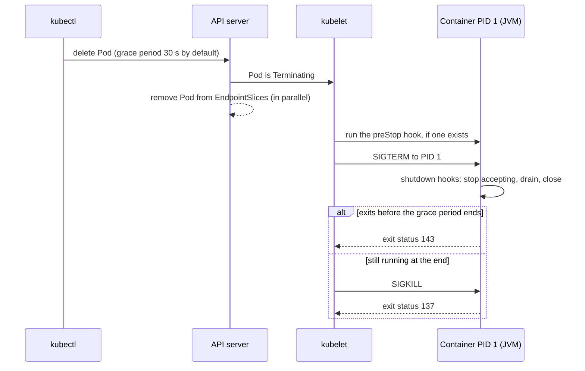

# Linux for Developers

## Why It Matters

A Java backend runs on Linux in almost every production setup, and interviews check whether a candidate can work on that machine. The questions have three forms. The concept form: "What is the difference between `SIGTERM` and `SIGKILL`?", "What does `chmod 750` mean?", "What does the load average count?". The tool form: "How do you find which process uses a port?", "What does `strace` show?", "How do you read `free`?". The scenario form: "A Java service uses 400 percent CPU. What do you do?", "A service has high latency and low CPU. What do you do?", "A pod restarts with exit code 137 or 143. What happened?". A candidate who names the tool, says what each output column means, and states what conclusion the output allows, passes these questions. A candidate who lists tool names does not.

This page covers signals and graceful shutdown (it is the home of signals), permissions and capabilities, the shell basics that a developer needs, the diagnostic tools with worked examples, the JVM tools on Linux, and two troubleshooting walkthroughs. The mechanisms behind the tools are on other pages: [processes and threads](01-processes-and-threads.md), [memory management](04-memory-management.md), [file systems and I/O models](05-file-systems-and-io-models.md), and [TCP and UDP](../networking/03-tcp-and-udp.md). The Java memory tools (heap dumps, leak analysis) are on [memory and garbage collection](../java/06-memory-and-gc.md).

!!! warning "Where the output on this page comes from"
    The machine that prepared this page runs macOS, not Linux. `strace`, `ss`, and `/proc` do not exist on macOS, and `top`, `ps`, and `netstat` print different formats there. Every command output below is **Illustrative output, not from a real run**. Its columns and options come from the Linux man pages (man7.org) and the tool manuals that the sections name. The numbers are invented to be consistent with each other.

## Core Concepts

**Signal**: a small asynchronous notification that the kernel (or another process) sends to a process. It carries a number and almost no data.

**Disposition**: what a process does when a signal arrives: run the default action, ignore the signal, or run a handler function. `signal(7)`: "Each signal has a current disposition, which determines how the process behaves when it is delivered the signal." The disposition is a per-process attribute.

**Exit status**: the number from 0 to 255 that a process returns to its parent. By convention, 0 means success. When a signal ends a process, the shell reports 128 plus the signal number (bash manual: "128+N").

**PID 1**: the first process in a PID namespace. On a host it is `init` or `systemd`. In a container it is the command that the container runtime starts.

**Graceful shutdown**: ending a service in steps: stop accepting new work, finish the work in progress, close resources, exit.

**Permission bits**: nine bits (read, write, execute for owner, group, and others) in a file's mode, plus three special bits (setuid, setgid, sticky).

**`umask`**: a per-process mask that removes permission bits from the mode of each newly created file or directory.

**Capability**: one privilege of the superuser, as a separate unit. `capabilities(7)`: "Linux divides the privileges traditionally associated with superuser into distinct units". A process can hold some and not others.

**Pipe**: a one-way byte channel that connects the output of one process to the input of the next (`cmd1 | cmd2`).

**Load average**: three averages (1, 5, and 15 minutes) of the number of tasks that want to run or wait for I/O. See "Diagnostic tools" below.

**Resident set size (RSS)**: the part of a process's memory that is in RAM. **Virtual size (VSZ)**: the total address space that the process has mapped. See [memory management](04-memory-management.md).

**Tracing**: recording what a program does, call by call. `strace` traces system calls, and `tcpdump` captures packets.

**Sampling profiler**: a tool that stops a program many times each second, records where it was, and counts the places. It has lower overhead than tracing.

## How It Works

### Signals

A signal tells a process that an event happened. The sender is the kernel (a fault, a timer, a child that ended, a terminal key) or another process (`kill(2)`). The command `kill` sends a signal. Despite its name, it does not always end the process: "If no signal is specified, the TERM signal is sent" (`kill(1)`).

Table of the signals that a developer meets. The numbers are the values on x86 and Arm Linux (`signal(7)`). Other architectures use other numbers for some signals, so use names in scripts.

| Signal | Number | Default action | Can the process catch it? | Typical source and use |
|---|---|---|---|---|
| `SIGHUP` | 1 | Terminate | Yes | The terminal closed ("hangup detected on controlling terminal"). Many daemons reload their configuration on it, by convention |
| `SIGINT` | 2 | Terminate | Yes | `Ctrl-C` ("interrupt from keyboard") |
| `SIGQUIT` | 3 | Terminate and write a core dump | Yes | `Ctrl-\` ("quit from keyboard"). The JVM prints a thread dump |
| `SIGILL` | 4 | Terminate and write a core dump | Yes | Illegal instruction |
| `SIGABRT` | 6 | Terminate and write a core dump | Yes | `abort()`. A native library calls it on an internal error |
| `SIGBUS` | 7 | Terminate and write a core dump | Yes | Bad memory access. A mapped file that shrank causes it (see [memory management](04-memory-management.md)) |
| `SIGKILL` | 9 | Terminate | **No** | "Kill signal". The kernel's OOM killer and `kill -9` send it |
| `SIGUSR1` | 10 | Terminate | Yes | User-defined |
| `SIGSEGV` | 11 | Terminate and write a core dump | Yes | "Invalid memory reference" |
| `SIGUSR2` | 12 | Terminate | Yes | User-defined |
| `SIGPIPE` | 13 | Terminate | Yes | "Broken pipe: write to pipe with no readers" |
| `SIGTERM` | 15 | Terminate | Yes | "Termination signal". The polite request to end. `kill` sends it by default, and so do `docker stop` and Kubernetes |
| `SIGCHLD` | 17 | Ignore | Yes | A child stopped, ended, or continued |
| `SIGCONT` | 18 | Continue a stopped process | Yes | Resume a process that `SIGSTOP` stopped |
| `SIGSTOP` | 19 | Stop the process | **No** | "Stop process" |
| `SIGTSTP` | 20 | Stop the process | Yes | `Ctrl-Z` ("stop typed at terminal") |

`signal(7)`: "The signals `SIGKILL` and `SIGSTOP` cannot be caught, blocked, or ignored." So a process cannot clean up when it gets `SIGKILL`: no handler runs, no finalizer, and no JVM shutdown hook.

**How a signal is delivered.** The `signal(7)` page states these rules:

- A signal that is **blocked** is not delivered until the process unblocks it. Between its generation and its delivery, a signal is **pending**.
- "Standard signals do not queue." If the same signal arrives three times while it is blocked, one instance stays pending.
- The disposition is shared by all threads of a process. A signal that is sent to the process "may be delivered to any one of the threads that does not currently have the signal blocked". The kernel picks one. A signal that a fault causes (`SIGSEGV`) goes to the thread that caused it.
- After `fork`, "a child created via `fork(2)` inherits a copy of its parent's signal dispositions" and its signal mask, and it starts with an empty set of pending signals. After `execve`, "the dispositions of handled signals are reset to the default", ignored signals stay ignored, and the signal mask and the pending signals are kept.
- A handler runs in the middle of other code, so it may call only **async-signal-safe** functions (`signal-safety(7)`). This is the reason that C handlers only set a flag and return. A real cleanup runs later in the main loop.

**Java and signals.** Java has no standard API for signal handlers. The standard mechanism is the shutdown hook (see below). What the JVM does on Linux, from the `java` command reference for JDK 21 (option `-Xrs`):

- "The JVM uses `SIGHUP`, `SIGINT`, and `SIGTERM` to initiate the running of shutdown hooks." The exit code is 128 plus the signal number (see [processes and threads](01-processes-and-threads.md), which cites `java.lang.Terminator`). So `SIGTERM` gives exit status 143, and `SIGINT` gives 130.
- `SIGQUIT` makes the JVM print a thread dump. The same page says that with `-Xrs`, "the signal masks for `SIGINT`, `SIGTERM`, `SIGHUP`, and `SIGQUIT` aren't changed by the JVM, and signal handlers for these signals aren't installed", and "`SIGQUIT` thread dumps aren't available". The JDK 21 Troubleshooting Guide ("Control+Break Handler") states: "On Linux operating systems, a thread dump is printed if the Java process receives a quit signal. Therefore, the kill -QUIT pid command causes the process with the ID pid to print a thread dump to standard output." In a container, the standard output of the JVM is the container log. `-Xrs` is for programs that embed the JVM and must handle these signals themselves. A normal server does not set it.
- A `SIGSEGV` in native code, or a JVM fault that the JVM cannot recover from, ends the process and writes an error file: `-XX:ErrorFile` "specifies the path and file name to which error data is written when an irrecoverable error occurs", by default `hs_err_pid<pid>.log` in the current working directory. Keep that file: it names the failing frame.
- `SIGKILL` cannot be caught, so a JVM that gets it ends at once. The `Runtime` javadoc says that `halt` "does not initiate the shutdown sequence", and the same is true of a kill by the kernel: hooks do not run.

**`SIGTERM` against `SIGKILL`.** `SIGTERM` asks the process to end. The process can run a handler, finish its work, and exit with its own status. `SIGKILL` ends the process, and the kernel does it without the process's help. The `kill(1)` page recommends `TERM` first so that a process can clean up before it exits. Send `SIGKILL` only after `SIGTERM` failed to end the process within a time that you set. Sending `-9` first is the most common operational mistake: it skips flushes, lock releases, and deregistration.

### Graceful shutdown in a container

A container runtime stops a container by sending a signal to the container's main process and then waiting. If the process does not exit, the runtime sends `SIGKILL`. The chain from a `kubectl delete pod` to the JVM:



The Kubernetes documentation ("Pod Lifecycle", termination of Pods) states the steps. The default grace period is 30 seconds (`terminationGracePeriodSeconds`). If a container defines a `preStop` hook, "the kubelet runs that hook inside of the container" first. The kubelet "triggers the container runtime to send a TERM signal to process 1 inside each container". When the grace period ends, "the container runtime sends `SIGKILL` to any processes still running". The page also says that the control plane removes the Pod from the endpoints of its services as part of the same process. The two actions are not ordered against each other, so a load balancer can still send a request after the process got `SIGTERM`. Plain Docker is simpler: `docker stop` sends `SIGTERM` (or the signal from `STOPSIGNAL`), waits 10 seconds for Linux containers by default, and then sends `SIGKILL` (Docker documentation, `docker container stop`).

**Why PID 1 needs care.** The process that the runtime starts is PID 1 in its PID namespace. `pid_namespaces(7)` gives it special rules:

- "Only signals for which the 'init' process has established a signal handler can be sent" to it by other processes in the namespace. For a signal from an ancestor namespace (the host), the same rule applies, "with one exception": `SIGKILL` and `SIGSTOP` "are forcibly delivered". So a program that runs as PID 1 and has no `SIGTERM` handler does not get the default action (terminate). The signal has no effect, and `docker stop` waits for the full grace period and then kills it.
- "When a child process becomes orphaned, it is reparented to the 'init' process in the PID namespace of its parent." If PID 1 does not call `wait` on its children, zombie processes pile up (see [processes and threads](01-processes-and-threads.md)).
- If PID 1 ends, "the kernel terminates all of the processes in the namespace via a `SIGKILL` signal".

The JVM installs handlers for `SIGTERM`, `SIGINT`, and `SIGHUP`, so a JVM that is PID 1 reacts to `SIGTERM`. The common failure is a different one: the JVM is not PID 1.

**Shell form against exec form.** The Dockerfile reference states the difference for `ENTRYPOINT`. The shell form "starts your `ENTRYPOINT` as a subcommand of `/bin/sh -c`, which does not pass signals. This means that the executable will not be the container's PID 1, and will not receive Unix signals" and "your executable doesn't receive a `SIGTERM` from `docker stop`". The exec form is "the preferred form".

```dockerfile
# Wrong: the shell is PID 1. It does not forward SIGTERM to java.
ENTRYPOINT java -jar /app/app.jar

# Right: java is PID 1 and gets SIGTERM.
ENTRYPOINT ["java", "-jar", "/app/app.jar"]
```

If the container must start a script (to build the command line from environment variables), end the script with `exec`, so that `java` replaces the shell and becomes PID 1:

```bash
#!/bin/sh
# entrypoint.sh
JAVA_OPTS="${JAVA_OPTS:--XX:MaxRAMPercentage=60}"
exec java $JAVA_OPTS -jar /app/app.jar
```

The Dockerfile reference gives the same advice: "you need to remember to start it with `exec`". If you cannot change the entrypoint, Docker offers `docker run --init`. The Docker documentation describes it as "Run an init inside the container that forwards signals and reaps processes", and says that the default init is the `docker-init` binary, which "is backed by tini". An init process as PID 1 also reaps orphaned children, so it helps a service that starts child processes. A Java service that starts no child processes and runs as PID 1 in exec form has no zombie problem. Kubernetes has no equivalent flag in the Pod spec, so build the init into the image (for example `tini` as the entrypoint) if you need one.

**The JVM shutdown sequence.** When `SIGTERM` arrives, the JVM runs the shutdown hooks and then exits. The `Runtime` javadoc (JDK 21) states the rules for hooks:

- "The registered shutdown hooks are started in some unspecified order. They run concurrently with any daemon or non-daemon threads that were alive at the beginning of the shutdown sequence." No hook can assume that another hook has finished or has not started. A framework that registers its own hook (Spring, a logging library) may close its resources while your hook still uses them.
- "Shutdown hooks run at a delicate time ... and should therefore be coded defensively", they should be thread-safe and avoid deadlocks, and "should also finish their work quickly".
- A hook must not call `System.exit`: "because a successful invocation of this method blocks indefinitely, if it is invoked from a shutdown hook, it will prevent that shutdown hook from terminating".

A service with a framework should use the framework's lifecycle, not a hand-written hook. The Spring Boot reference says that graceful shutdown "is enabled by default with all three embedded web servers (Jetty, Reactor Netty, and Tomcat)". The server stops accepting new requests at the network layer and lets existing requests finish within a timeout, which you set with `spring.lifecycle.timeout-per-shutdown-phase`. The reference page shows the property with the value `20s` and does not state the default. The default is 30 seconds: the class `LifecycleProperties` in the Spring Boot source (`private Duration timeoutPerShutdownPhase = Duration.ofSeconds(30);`) sets it. That default equals the Kubernetes default grace period, so a service that uses both defaults has no room for the `preStop` hook and the shutdown work, and gets killed. Set the timeout explicitly. Set it below the pod's `terminationGracePeriodSeconds`, or the kubelet kills the JVM in the middle of the drain.

**Checklist for a Java service in Kubernetes:**

1. Use the exec form (or `exec` in the script), so that `java` is PID 1.
2. Fail the readiness probe as soon as shutdown starts, so that the load balancer stops sending requests. *Recommendation:* add a short `preStop` sleep (a few seconds) to cover the time that the endpoint removal needs to reach the proxies. The Kubernetes page does not state a value, so measure it in your cluster.
3. Stop accepting new work, finish the requests in progress, then close pools and flush buffers.
4. Keep the drain timeout below the grace period. Raise `terminationGracePeriodSeconds` if a request can take longer.
5. Read the exit status: 143 means the process ended after `SIGTERM` (the JVM's 128 + 15). 137 means `SIGKILL` (128 + 9): the grace period ran out, or the OOM killer acted (see [memory management](04-memory-management.md)).

### Permissions, users, and capabilities

Each file has an owner, a group, and a **mode**. The mode has three classes (owner, group, others) of three bits each: read (4), write (2), and execute (1).

```text
-rwxr-x---  1 app  staff  18432 Nov  5 10:00 run.sh
 |\_/\_/\_/
 | |  |  +-- others: --- (0)  no access
 | |  +----- group:  r-x (5)  read and execute
 | +-------- owner:  rwx (7)  read, write, and execute
 +---------- type:   - regular file (d directory, l symbolic link)
```
Illustrative output, not from a real run.

This file has mode `750` in octal. `chmod 750 run.sh` sets it. Each octal digit is the sum of the bits of one class. The meaning of the bits differs between a file and a directory:

| Bit | On a regular file | On a directory |
|---|---|---|
| `r` (4) | Read the content | List the names in it |
| `w` (2) | Change the content | Create, rename, and delete entries (needs `x` too) |
| `x` (1) | Run it as a program | "Search": enter the directory and reach the entries by name (the POSIX `chmod` page calls this bit "execute/search") |

To delete a file, a process needs write permission on the directory that holds it, and not on the file itself.

**Special bits.** These are the first octal digit of a four-digit mode (`chmod(1)`: "the first digit selects the set-user-ID bit (4), the set-group-ID bit (2), and the restricted deletion or sticky bit (1)"). `inode(7)` lists them as `S_ISUID` (04000), `S_ISGID` (02000), and `S_ISVTX` (01000).

| Bit | Octal | Effect |
|---|---|---|
| setuid | 4000 | A program that has it runs with the user ID of the file's owner, not of the user who started it (`execve(2)`). `passwd` uses this to edit a file that only root can write. It is also an attack target: a flaw in a setuid-root program gives root |
| setgid | 2000 | The same for the group ID. On a directory, new files get the group of the directory (the GNU `chmod` page says that `chmod` keeps these bits on directories unless you ask otherwise) |
| sticky | 1000 | On a directory, "prevents unprivileged users from removing or renaming a file in the directory" that they do not own. The `chmod` page says that it is "commonly found on world-writable directories like `/tmp`" |

`ls -l` shows these bits in the execute position (GNU coreutils manual): `s` for setuid or setgid when the execute bit is also set, `S` when it is not, `t` for the sticky bit when the other-execute bit is also set, and `T` when it is not. A mode of `4755` prints as `-rwsr-xr-x`, and `1777` on a directory prints as `drwxrwxrwt`.

**`umask`.** A new file is created with the mode that the program asks for, minus the bits in the `umask`. `umask(2)`: "permissions in the umask are turned off from the mode argument to `open(2)` and `mkdir(2)`", with the example "0666 & ~022 = 0644". "The typical default value for the process umask is `S_IWGRP | S_IWOTH` (octal 022)". A child inherits the `umask` of its parent. A service that must create files readable only by its own user runs with `umask 077`.

**Users and root.** The kernel checks permissions against the process's user ID and group IDs. User ID 0 is root, and the kernel skips most permission checks for it. Many container images run the application as root by default, which is a risk: a flaw in the application then has root rights inside the container. Run the service as a normal user (`USER app` in the Dockerfile).

**Capabilities.** `capabilities(7)` splits the power of root into units. A process can hold only the units that it needs. Four that a Java developer meets:

| Capability | Meaning (from `capabilities(7)`) | Where it appears |
|---|---|---|
| `CAP_NET_BIND_SERVICE` | "Bind a socket to Internet domain privileged ports (port numbers less than 1024)" | A non-root service that listens on port 80 or 443 |
| `CAP_SYS_PTRACE` | Trace arbitrary processes with `ptrace(2)` and "perform other privileged process-inspection and debugging operations" | `strace -p` on a process that another user owns |
| `CAP_NET_RAW` | "Use RAW and PACKET sockets" | `ping` and packet capture (`tcpdump`) |
| `CAP_PERFMON` | "Employ various performance-monitoring mechanisms" such as `perf_event_open(2)`. Added in Linux 5.8 | `perf`, async-profiler's `perf_events` mode |

`CAP_SYS_ADMIN` is "overloaded", and the page advises: "Don't choose `CAP_SYS_ADMIN` if you can possibly avoid it!" A file can also carry capabilities (`setcap(8)`, stored in the `security.capability` extended attribute). Prefer a capability over running as root: a service that needs only to bind port 443 gets `CAP_NET_BIND_SERVICE` and nothing else.

### Shell basics for a developer

**Pipes and redirection.** Each process has three standard streams: input (descriptor 0), output (1), and error (2). The shell connects them.

```bash
cmd > out.txt            # write standard output to a file (replace)
cmd >> out.txt           # append
cmd 2> err.txt           # write standard error to a file
cmd > all.txt 2>&1       # send error to the same place as output
cmd < in.txt             # read standard input from a file
cmd1 | cmd2              # connect the output of cmd1 to the input of cmd2
cmd > /dev/null 2>&1     # discard everything
```

**Exit codes.** Each command returns a status, and `$?` holds the status of the last command. From the bash manual: a command with exit status 0 "has succeeded". The status is 127 when the shell cannot find the command, 126 when it finds the file and cannot run it, and "128+N" when a fatal signal N ended the command. So 130 is `SIGINT`, 137 is `SIGKILL`, 139 is `SIGSEGV`, and 143 is `SIGTERM`. For a pipeline, "the exit status of a pipeline is the exit status of the last command in the pipeline, unless the `pipefail` option is enabled". With `set -o pipefail`, the status is that of the "rightmost command to exit with a non-zero status". A script that must stop on error starts with `set -euo pipefail`. (`-e` stops at the first failed command, `-u` stops on an unset variable. Both are bash options. The bash manual explains their exceptions, which are many, so test the script.)

**Environment variables.** Each process has a set of name and value pairs that a child inherits. `export NAME=value` makes a shell variable visible to child processes. `env` prints them, and `env NAME=value cmd` runs `cmd` with one more. Container platforms pass configuration this way, and Java reads it with `System.getenv`.

**Text tools.** Each reads lines and writes lines.

```bash
grep -rn "ERROR" /var/log/app/            # search a tree; -n prints line numbers
grep -c "timeout" app.log                 # count matching lines
grep -v "healthcheck" app.log | tail -50  # drop lines, then show the last 50
awk '{ sum += $5 } END { print sum }' f   # add up the fifth column
awk '$9 >= 500 { n++ } END { print n }' access.log   # count HTTP 5xx in a web log
sed -n '100,120p' app.log                 # print lines 100 to 120
sed 's/password=[^&]*/password=***/g' f   # replace text with a regular expression
sort app.log | uniq -c | sort -rn | head  # the ten most frequent lines
```

**`find` and `xargs`.** `find` walks a tree and selects files. `xargs` turns its input lines into command-line arguments.

```bash
find /var/log -name '*.log' -mtime +7 -print0 | xargs -0 rm -f
find . -name '*.java' -print0 | xargs -0 -P 4 -n 20 grep -l "synchronized"
```

The `xargs(1)` page explains `-print0` and `-0`: Unix file names can contain blanks and newlines, so the default of splitting on whitespace "is often a problem", and `-0` ("input items are terminated by a null character") with `find -print0` handles every file name. `-n` sets the maximum number of arguments for each command line, and `-P` runs that many commands at the same time (the default is 1). `xargs` exits with 123 if any command it ran returned a status other than 0 or 255, with 124 if a command returned 255, with 125 if a signal killed a command, with 126 if it could not run the command, and with 127 if it did not find it.

### Diagnostic tools

This subsection is the home of the tool reference. [Processes and threads](01-processes-and-threads.md) sends readers here for the load average.

**Method.** Start with a question, and choose the tool that answers it. Check the four resources in this order: CPU, memory, disk, network. For each, ask whether it is saturated (work waits for it) and whether it has errors.

| Question | Tool |
|---|---|
| Is the machine busy? Which process? | `uptime`, `top`, `ps` |
| Is memory short? Is it swapping? | `free`, `vmstat`, `dmesg` |
| Is the disk slow? | `iostat -x`, `vmstat` |
| What is a process doing right now? | `strace`, `jcmd Thread.print`, `lsof` |
| Which files and sockets does it hold? | `lsof`, `ss` |
| What is the network state? | `ss`, `tcpdump`, `curl -v`, `dig` |
| Where is the CPU time going? | `perf`, async-profiler |
| What did the kernel or the service log? | `dmesg`, `journalctl` |

#### Load average, `uptime`, and `top`

`uptime(1)`: "System load averages is the average number of processes that are either in a runnable or uninterruptible state". They cover the past 1, 5, and 15 minutes. `proc_loadavg(5)` gives the same fields in `/proc/loadavg`: the first three fields are the averages, and the fourth is two numbers joined by a slash (the count of "currently runnable kernel scheduling entities" over the count of such entities that exist). On Linux, the count includes tasks in state `R` (runnable) and state `D` (uninterruptible sleep, mostly waiting for I/O). So a high load average has two possible causes:

- Many tasks want a CPU. Compare the load to the number of CPUs (`nproc`). A load of 6 on 8 CPUs is below capacity. A load of 6 on 2 CPUs means that, on average, 4 tasks wait.
- Many tasks wait for the disk or a network file system. Then the CPU can be idle, and the load is high.

Use the three numbers as a trend. If the 1-minute value is higher than the 15-minute value, the load is growing.

`top` shows a live view. `top -b -n 1` prints one frame for a script, `-H` shows threads, and `-p <pid>` follows one process (`top(1)`). Inside `top`, `H` toggles threads, `1` toggles one line for each CPU, `P` sorts by CPU, and `M` sorts by memory.

```text
top - 10:42:07 up 12 days,  3:11,  1 user,  load average: 4.12, 3.80, 3.10
Tasks: 212 total,   2 running, 210 sleeping,   0 stopped,   0 zombie
%Cpu(s): 44.6 us,  2.8 sy,  0.0 ni, 51.5 id,  0.4 wa,  0.0 hi,  0.4 si,  0.3 st
MiB Mem :  15884.0 total,    410.2 free,   9453.9 used,   6353.3 buff/cache
MiB Swap:      0.0 total,      0.0 free,      0.0 used.   6430.1 avail Mem

    PID USER      PR  NI    VIRT    RES    SHR S  %CPU  %MEM     TIME+ COMMAND
   4312 app       20   0    8.2g   3.1g  41200 S 380.0  20.0  91:12.44 java
   1189 root      20   0  412300  18320  11200 S   1.3   0.1   2:01.37 node_exporter
```
Illustrative output, not from a real run (8 CPUs).

How to read it:

- **`%Cpu(s)` line.** From `top(1)`: `us` is "time running un-niced user processes", `sy` "time running kernel processes", `ni` "time running niced user processes", `id` "time spent in the kernel idle handler", `wa` "time waiting for I/O completion", `hi` and `si` the time that hardware and software interrupts took, and `st` "time stolen from this vm by the hypervisor". Here `us` is 44.6 percent of all 8 CPUs, which matches the 380 percent of the `java` process (3.8 of 8 CPUs is 47.5 percent, with the other processes and the kernel in the rest): the CPU does user-space work, which for a JVM means application code, the JIT compiler, or the garbage collector. A high `sy` means the kernel does the work: many system calls, network traffic, or context switches. A high `wa` means that the CPUs idle while processes wait for I/O. A high `st` on a virtual machine means that the hypervisor gives the CPU to other guests, and no tuning inside the guest helps.
- **Per-process `%CPU`.** It is a share of one CPU, so a multi-threaded process can pass 100 percent. The 380 percent of `java` uses about 3.8 of the 8 CPUs.
- **Memory lines.** `free` here is idle memory, and `buff/cache` is the page cache and kernel buffers. The `top(1)` page defines `used` as `MemTotal - MemAvailable` and `buff/cache` as `Buffers + Cached + SReclaimable`. In the sample, 15884.0 - 6430.1 gives 9453.9 for `used`. The columns do not add up to the total, because `avail` counts part of the cache as available. The `avail Mem` figure sits on the swap line, and it is "an estimation of physical memory available for starting new applications, without swapping". Only 410 MiB is free, but 6430 MiB is available: this host has enough memory. See `free` below.
- **`VIRT`, `RES`, `SHR`.** `VIRT` is "the total amount of virtual memory used by the task". `RES` is "the non-swapped physical memory a task is currently using". `SHR` is the part of `RES` that other processes can share. A JVM has a large `VIRT` because it reserves the heap address space (see [memory management](04-memory-management.md)).
- **`S` (state).** `D` is uninterruptible sleep, `R` running, `S` sleeping, `T` stopped by a job control signal, `t` stopped by a debugger, `Z` zombie (`top(1)`).

`htop` is an interactive viewer with color, a tree view, and mouse support. It reads the same kernel data, so the numbers have the same meaning. It is not part of most minimal server images, so know `top`.

#### `ps`

`ps` prints a snapshot. GNU `ps` accepts two option styles, and the man page warns that `ps -aux` "is a confusion of two different standards". Use `ps -ef` (UNIX style) or `ps aux` (BSD style, no dash).

```bash
ps -eLf | grep java                 # all threads of java processes (-L: threads)
ps -o pid,stat,rss,vsz,nlwp,wchan:20,cmd -p 4312
ps -eo pid,ppid,stat,pcpu,pmem,cmd --sort=-pcpu | head
```

Fields from `ps(1)`: `rss` is "resident set size, the non-swapped physical memory that a task has used (in kibibytes)", `vsz` is "virtual memory size of the process in KiB", `nlwp` is the "number of lwps (threads) in the process", and `wchan` is the "name of the kernel function in which the process is sleeping". The state codes in `STAT`: `D` "uninterruptible sleep (usually I/O)", `R` "running or runnable", `S` "interruptible sleep", `T` "stopped by job control signal", `t` "stopped by debugger", `Z` "defunct (zombie)", and `I` "idle kernel thread". The extra characters include `l` ("is multi-threaded") and `+` ("is in the foreground process group"). Many processes in `D` state with a `wchan` such as an NFS or block I/O function point to a storage problem. A growing number of `Z` processes means that a parent does not call `wait` (see [processes and threads](01-processes-and-threads.md)).

#### `free`, `vmstat`, and memory

```text
               total        used        free      shared  buff/cache   available
Mem:            15Gi       9.2Gi       410Mi       120Mi       6.2Gi       6.3Gi
Swap:             0B          0B          0B
```
Illustrative output, not from a real run (`free -h`).

`free(1)` defines the columns: `used` is "used or unavailable memory (calculated as total - available)", `free` is "unused memory", `shared` is "memory used (mostly) by tmpfs", `buff/cache` is the sum of `buffers` and `cache`, where `cache` is "memory used by the page cache and slabs", and `available` is the "estimation of how much memory is available for starting new applications, without swapping". **"Free" memory is low on a healthy Linux host** because the kernel uses idle RAM as page cache (see [file systems and I/O models](05-file-systems-and-io-models.md)) and gives it back on demand. Read the `available` column. If `available` is small and swap use grows, the host is short of memory. `/proc/meminfo` has the raw values: `MemAvailable` (since Linux 3.14), `Cached`, `Dirty`, `AnonPages`, and `Committed_AS`.

`vmstat` prints system-wide counters at an interval: `vmstat 1 5` prints five lines, one for each second. `vmstat(8)`: "the first report produced gives averages since the last reboot", so ignore the first line.

```text
procs -----------memory---------- ---swap-- -----io---- -system-- -------cpu-------
 r  b   swpd   free   buff  cache   si   so    bi    bo   in   cs us sy id wa st gu
 4  0      0 420045 210232 6143012    0    0     8    52 4200 9100 45  3 51  0  0  0
 3  1      0 418980 210240 6143650    0    0     0   640 4310 9350 44  3 52  1  0  0
```
Illustrative output, not from a real run.

Columns (`vmstat(8)`): `r` "the number of runnable processes (running or waiting for run time)", `b` "the number of processes blocked waiting for I/O to complete", `swpd` swap in use, `free`, `buff`, and `cache` in KiB, `si` and `so` "memory swapped in from disk" and "swapped to disk" per second, `bi` and `bo` blocks received from and sent to a block device (KiB/s), `in` interrupts per second, `cs` "the number of context switches per second", and the CPU split `us sy id wa st gu`. A reading rule: `r` above the CPU count means a CPU shortage. A non-zero `si` or `so` for several seconds means swapping and, with a high `wa`, thrashing (see [memory management](04-memory-management.md)). A high `cs` with a high `sy` points to lock contention or too many threads.

#### `iostat`

`iostat -x 1` shows disk statistics (package `sysstat`). The first report covers the time since boot, and later reports cover the interval (`iostat(1)`), so ignore the first one.

```text
avg-cpu:  %user   %nice %system %iowait  %steal   %idle
          18.20    0.00    4.10   31.50    0.00   46.20

Device    r/s   rkB/s  r_await  rareq-sz    w/s   wkB/s  w_await  aqu-sz  %util
nvme0n1  20.0   320.0     0.40      16.0  950.0 60800.0    38.50   36.90   99.80
```
Illustrative output, not from a real run (columns shortened).

From `iostat(1)`: `r/s` and `w/s` are the read and write requests completed each second, `rkB/s` and `wkB/s` are the data rates, `r_await` and `w_await` are "average time in milliseconds for read requests to be served, including queue time" (the same for writes), `aqu-sz` is the average queue length, and `%util` is the "percentage of elapsed time with I/O requests issued to the device". Reading the sample: the writes wait 38.5 ms each, the queue is deep, and the device is busy 99.8 percent of the time. The page cautions about `%util`: "device saturation occurs when this value is close to 100% for devices serving requests serially", but for devices that serve requests in parallel ("RAID arrays and modern SSDs") the number "does not reflect their performance limits". So use `await` and `aqu-sz` as the main signals, and use `%util` as a hint. `%iowait` in the CPU line is "the time the CPU was idle while the system had an outstanding disk I/O request": it is idle time, not busy time.

#### `strace`

`strace` traces the system calls of a process and the signals that it gets. A system call is the point at which a program asks the kernel for something (see [processes and threads](01-processes-and-threads.md)). So `strace` shows what a program does at the boundary: which files it opens, which sockets it connects to, and where it waits.

```bash
strace -f -tt -T -p 4312 -o /tmp/trace.txt          # attach; all threads; time stamps
strace -f -c -p 4312                                # count calls; Ctrl-C prints a summary
strace -f -e trace=network -p 4312                  # only network calls
strace -e trace=file java -version                  # only calls that take a file name
```

Options from `strace(1)`: `-p` attaches to a process, `-f` "traces child processes as they are created" (and with `-f -p`, "attaches to all of its threads"), `-tt` prints the wall clock time "with microsecond precision", `-T` "shows the time spent in system calls", `-c` "gathers per-call counts and time", `-e trace=` selects calls (with classes `file`, `network`, `process`, and `signal`), `-o` writes to a file, `-s` sets the maximum string size to print (the default is 32), and `-y` prints the paths that belong to descriptors. The output format is the call name, its arguments, and the return value, with the error name after a failure.

```text
[pid  4377] 10:42:07.120344 read(12, "GET /orders/17 HTTP/1.1\r\nHost:"..., 8192) = 512 <0.000041>
[pid  4377] 10:42:07.121002 futex(0x7f1c6a3f1d28, FUTEX_WAIT_PRIVATE, 0, NULL) = 0 <1.204113>
[pid  4380] 10:42:08.325310 connect(15, {sa_family=AF_INET, sin_port=htons(5432), ...}, 16)
    = -1 EINPROGRESS (Operation now in progress) <0.000120>
[pid  4380] 10:42:08.326001 openat(AT_FDCWD, "/etc/app/app.yml", O_RDONLY)
    = -1 ENOENT (No such file or directory) <0.000030>
```
Illustrative output, not from a real run.

Reading it: the `[pid ...]` prefix is the thread ID (a Linux thread is a task, see [processes and threads](01-processes-and-threads.md)). A `futex` call that returns after 1.2 seconds is a thread that waited for a lock or a condition (see [synchronization](03-synchronization.md)). `EINPROGRESS` on `connect` is normal for a non-blocking socket. `ENOENT` on `openat` says that a file is missing. A thread in a long `read` or `poll` waits for the network. The man page warns about the cost: "a traced process runs more slowly than a non-traced one", so use `strace` on a production process for a short time, with `-e trace=` to cut the work, and use `--seccomp-bpf` (with `-f`) to reduce the effect. Attaching also needs permission: the same user, or `CAP_SYS_PTRACE` (see "Capabilities" above).

#### `lsof`

`lsof` lists open files. Because a socket, a pipe, and a directory are files too, it shows everything that a process holds. `lsof(8)`: it "lists on its standard output file information about files opened by processes".

```bash
lsof -p 4312                  # everything the process has open
lsof -i :8080                 # who uses port 8080 (-i selects Internet files)
lsof -nP -i TCP -a -p 4312    # sockets of one process, no name lookup (-n, -P)
lsof +L1                      # open files that were unlinked (deleted)
lsof -u app -t                # only the PIDs (-t) of the user app
```

```text
COMMAND  PID USER   FD   TYPE   DEVICE   SIZE/OFF    NODE NAME
java    4312  app  cwd    DIR    253,1       4096  131074 /opt/app
java    4312  app    7w   REG    253,1 8123456789  262200 /var/log/app/app.log (deleted)
java    4312  app   45u  IPv4    98765        0t0     TCP 10.0.0.5:8080->10.0.0.9:51234
                                                      (ESTABLISHED)
```
Illustrative output, not from a real run.

The `FD` column holds a name such as `cwd` (current directory), `txt` (program text), `mem` (memory-mapped file), `rtd` (root directory), or a descriptor number with a mode letter: `r` read, `w` write, `u` read and write. The sample shows the two usual findings. Descriptor `7w` is a deleted log file that the process still writes (`lsof(8)`: "The cached path is followed by the string `(deleted)` to indicate that the path by which the file was opened has been deleted". `/proc/<pid>/fd` holds a symbolic link for each descriptor, `proc_pid_fd(5)`) (see [file systems and I/O models](05-file-systems-and-io-models.md) for why the disk stays full), and `45u` is an established connection. A count of lines per process (`lsof -p <pid> | wc -l`) compared with the limit from `ulimit -n` finds a descriptor leak before `Too many open files` appears.

#### `ss` and `netstat`

`ss` shows socket statistics, and it replaced `netstat`. The `netstat(8)` page says: "This program is mostly obsolete. Replacement for `netstat` is `ss`." Options from `ss(8)`: `-t` TCP, `-u` UDP, `-l` "only listening sockets (these are omitted by default)", `-a` all, `-n` "do not try to resolve service names", `-p` "show processes using sockets", `-s` "print summary statistics", `-o` "show timer information", `-i` "show internal TCP information", `-m` "show socket memory usage", and `-H` ("suppress header line"). The old command `netstat -tulpn` ("all open TCP and UDP ports, with the corresponding process's PID") is `ss -tulpn`. A filter selects by state (`state established`, `state time-wait`, `state close-wait`) or by port (`dport = :80`, `sport = :8080`).

```bash
ss -ltnp                          # listening TCP sockets with the owning process
ss -Htan state established '( sport = :8080 )' | wc -l  # clients of this server
ss -tan state close-wait          # connections that wait for the local application to close
ss -s                             # counts by state
ss -ti dst 10.0.0.9               # TCP internals (RTT, congestion window) for a peer
```

```text
State   Recv-Q  Send-Q   Local Address:Port    Peer Address:Port  Process
LISTEN  0       128            0.0.0.0:8080         0.0.0.0:*     users:(("java",pid=4312,fd=44))
```
Illustrative output, not from a real run (`ss -ltnp`).

On a **listening** socket, `Recv-Q` and `Send-Q` have a special meaning (`sock_diag(7)`): `Recv-Q` is "the number of pending connections", that is the connections that completed the handshake and wait for the application's `accept`, and `Send-Q` is "the backlog size", the limit of that queue. Here the queue is empty (0) and its limit is 128. A `Recv-Q` that approaches `Send-Q` means that the application accepts too slowly, and the kernel will drop or refuse new connections. On other sockets, `Recv-Q` is the "amount of data in the incoming queue": bytes that the kernel received and the application has not yet read. A growing `Recv-Q` on an established connection means that the application is slow to read. (`sock_diag(7)` describes the matching field for other sockets as "the amount of memory available for sending". This page does not interpret `Send-Q` on established sockets.)

The state names are the TCP states of the [TCP and UDP](../networking/03-tcp-and-udp.md) page. Two states carry a diagnosis:

- **Many `CLOSE_WAIT`**: the peer closed the connection, the kernel acknowledged the FIN, and the **local application has not called `close`**. This is an application bug: a connection that is not returned to a pool, or a stream that is not closed. The kernel cannot fix it. Use `ss -tanp state close-wait` to find the process, then take a thread dump or heap dump to find the code that holds the sockets.
- **Many `TIME_WAIT`**: the local side closed first, and the kernel keeps the connection record for a fixed time. It is normal in moderation. A client that opens a new connection for each request builds them up, and the fix is connection reuse (see the TCP page).

#### `tcpdump`

`tcpdump` captures packets: "prints out a description of the contents of packets on a network interface that match the Boolean expression" (`tcpdump(1)`). Options: `-i` the interface (`any` on Linux means all), `-n` "don't convert addresses ... to names", `-c` "exit after receiving or reading count packets", `-w` "write the raw packets to file", `-r` read a saved file, `-s` the snapshot length (the default is 262144 bytes), `-v` more detail, and `-A` and `-X` print the payload in ASCII and in hex. Reading from an interface "may require that you have special privileges", and reading a saved file does not. The filter syntax is in `pcap-filter(7)`.

```bash
tcpdump -i any -nn -c 20 'tcp port 8080 and host 10.0.0.9'
tcpdump -i eth0 -w /tmp/cap.pcap 'port 5432'      # save for Wireshark
tcpdump -nn -r /tmp/cap.pcap 'tcp[tcpflags] & tcp-rst != 0'   # show only resets
```

```text
12:00:01.000100 IP 10.0.0.9.51234 > 10.0.0.5.8080: Flags [S], seq 1000, win 64240, length 0
12:00:01.000150 IP 10.0.0.5.8080 > 10.0.0.9.51234: Flags [S.], seq 2000, ack 1001, win 65160,
length 0
12:00:01.000300 IP 10.0.0.9.51234 > 10.0.0.5.8080: Flags [.], ack 2001, win 502, length 0
12:00:01.000900 IP 10.0.0.9.51234 > 10.0.0.5.8080: Flags [P.], seq 1001:1312, ack 2001, length 311
```
Illustrative output, not from a real run.

The line format from the man page is "src > dst: Flags [tcpflags], seq data-seqno, ack ackno, win window, ... length len". The flag letters: `S` is SYN, `F` FIN, `P` PUSH, `R` RST, and `.` is ACK (`S.` is SYN plus ACK). The first three lines are the three-way handshake of the [TCP page](../networking/03-tcp-and-udp.md). Typical findings: a SYN that gets no SYN-ACK (a firewall or a full accept queue), repeated segments with the same `seq` (retransmission, so packet loss), `Flags [R]` (a reset: a closed port or an aborted connection), and `win 0` (the receiver's buffer is full). A payload is readable only if the traffic is not encrypted, and HTTPS shows only the TLS records.

#### `dig` and `curl -v`

`dig` queries DNS servers: "a flexible tool for interrogating DNS name servers" (BIND 9 documentation; the man7.org site has no `dig` page). Options: `@server` picks the server (without it, `dig` reads `/etc/resolv.conf`), `-t` the record type, `-x` a reverse lookup, `+short` "a terse answer", `+trace` "tracing of the delegation path from the root name servers" (with recursion off), and `+noall +answer` "displays the answer section" only. The DNS protocol, records, and caching are on the DNS page ([DNS](../networking/06-dns.md)).

```bash
dig +noall +answer api.example.com            # the answer section only
dig +short api.example.com A @8.8.8.8         # ask a specific resolver
dig +trace api.example.com                    # follow the delegation from the root
```

```text
api.example.com.   300   IN   CNAME   lb-1.example.net.
lb-1.example.net.   60   IN   A       192.0.2.10
```
Illustrative output, not from a real run. The second column is the remaining TTL in seconds. The host uses documentation addresses (RFC 5737).

`curl -v` shows one HTTP exchange. From `everything.curl.dev`: curl "adds informational [lines] and prefix[es] them with `*`", lines that start with `>` are the data that curl sends (the request line and headers), and lines that start with `<` are the data that the server sends back (the status line and headers).

```text
* Connected to api.example.com (192.0.2.10) port 443
> GET /health HTTP/1.1
> Host: api.example.com
> Accept: */*
>
< HTTP/1.1 200 OK
< content-type: application/json
<
```
Illustrative output, not from a real run (shortened).

Use `--write-out` for timing. The `curl` manual defines the variables as times "from the start": `time_namelookup` ("until the name resolving was completed"), `time_connect` ("until the TCP connect to the remote host (or proxy) was completed"), `time_appconnect` ("until the SSL/SSH/etc connect/handshake ... was completed"), `time_starttransfer` ("until the first byte was received", which includes the time that the server needed to compute the result), and `time_total`.

```bash
fmt='dns=%{time_namelookup} tcp=%{time_connect} tls=%{time_appconnect}'
fmt="$fmt ttfb=%{time_starttransfer} total=%{time_total}\n"
curl -s -o /dev/null -w "$fmt" https://api.example.com/health
```

```text
dns=0.012 tcp=0.031 tls=0.074 ttfb=0.310 total=0.312
```
Illustrative output, not from a real run.

The values add up cumulatively, so subtract to get each step: DNS 12 ms, TCP handshake 19 ms (0.031 - 0.012), TLS handshake 43 ms (0.074 - 0.031), and then 236 ms from the end of the handshake to the first byte (0.310 - 0.074), which is the server's time plus one round trip. A large first number points to DNS, a large second to the network path, and a large last one to the server.

#### `perf`, `dmesg`, and `journalctl`

`perf` is the Linux performance counter framework: it "covers hardware level (CPU/PMU, Performance Monitoring Unit) features and software features" (`perf(1)`). Its commands include `perf stat` (counts events for a command), `perf top` (a live view of the hot functions), `perf record` (samples into a file), `perf report` (shows the file), and `perf list` (lists the events). A common use is `perf record -g -p <pid> -- sleep 30` and then `perf report`. It needs permission (`CAP_PERFMON` on Linux 5.8 and later). For a Java process, `perf` cannot name the JIT-compiled methods by itself. The perf-map-agent README explains why: `perf` "will expect symbols for code executed from unknown memory regions at `/tmp/perf-<pid>.map`", and that agent writes such a file for the code that the JVM generates at run time. async-profiler needs no map file and "shows native and kernel frames in stack traces" together with Java frames (README), so use it for Java (below).

`dmesg` prints the kernel ring buffer ("used to examine or control the kernel ring buffer"). `-T` prints human-readable timestamps, and the man page warns that they "could be inaccurate" because the time source is not updated after a suspend. `-H` is human-readable output, `-w` waits for new messages, `-l` selects levels, and `--since` selects a start time. It can fail with "permission denied" when the kernel setting `dmesg_restrict` is on. The first place to look after a mysterious container kill is the OOM killer message:

```bash
dmesg -T | grep -i -E 'out of memory|oom-kill|killed process'
```

```text
[Thu Nov  5 10:41:55 2026] Out of memory: Killed process 4312 (java)
    total-vm:8512344kB, anon-rss:3198000kB, file-rss:0kB, shmem-rss:0kB, UID:1000
    pgtables:7120kB oom_score_adj:0
```
Illustrative output, not from a real run (the message is one line in a real log). The format comes from the kernel source `mm/oom_kill.c`: `"%s: Killed process %d (%s) total-vm:%lukB, anon-rss:%lukB, file-rss:%lukB, shmem-rss:%lukB, UID:%u pgtables:%lukB oom_score_adj:%d"`. The first `%s` is "Out of memory" for a host-wide shortage and "Memory cgroup out of memory" when a container limit caused the kill. The kernel also prints a line that starts with `oom-kill:constraint=`. The `dmesg(1)` man page does not describe these lines, so the grep pattern follows the kernel source strings. The source check covers the master branch, so the text can differ on an older kernel.

`journalctl` reads the systemd journal ("used to print the log entries stored in the journal", `journalctl(1)`). Options: `-u` for one unit, `-f` to follow, `-n` for the last lines, `-k` for kernel messages only (the same as `dmesg`), `-p` for a priority, `-S` and `-U` (`--since` and `--until`) for a time range, `-b` for one boot, `-o` for the format, and `--no-pager` for a script.

```bash
journalctl -u myservice -n 200 --no-pager         # last 200 lines of one service
journalctl -u myservice --since "10 min ago" -p err
journalctl -k -b -1                               # kernel messages of the previous boot
```

### JVM tools on Linux

These tools talk to the JVM through its attach mechanism, not through signals. The `jcmd` page for JDK 21 says that it "must be used on the same machine on which the JVM is running, and have the same effective user and group identifiers that were used to launch the JVM". The `java` reference says that `-XX:+DisableAttachMechanism` turns the mechanism off, and that "the tools such as `jcmd`, `jinfo`, `jmap`, and `jstack` shipped with the JDK aren't supported when using the tools from one JDK version to troubleshoot a different JDK version". In a container, run the tool inside the container (as the same user), or share the process namespace.

**`jcmd`.** `jcmd` with no arguments lists the JVM processes. `jcmd <pid> help` lists the commands of that JVM.

```bash
jcmd                                # list JVMs (same as jcmd -l)
jcmd 4312 Thread.print -l           # thread dump; -l adds java.util.concurrent locks
jcmd 4312 VM.flags                  # the effective JVM flags
jcmd 4312 VM.uptime
jcmd 4312 GC.heap_info              # heap sizes and usage (Impact: Medium)
jcmd 4312 JFR.start name=rec1 settings=profile duration=60s filename=/tmp/rec1.jfr
```

The page lists `Thread.print` ("prints all threads with stacktraces", impact "medium - depends on the number of threads"; options `-l` for locks and `-e` for extended information), `VM.flags`, `VM.system_properties`, `VM.uptime`, `VM.version`, `GC.heap_info`, and `JFR.start`. The memory commands (`GC.class_histogram`, `GC.heap_dump`, `VM.native_memory`) and the leak workflow are on the [memory and garbage collection](../java/06-memory-and-gc.md) page.

**`jstack`.** `jstack <pid>` prints "Java stack traces of Java threads for a specified Java process" (`-l` adds lock information). The JDK 21 page marks it: "This command is experimental and unsupported." Recommendation: use `jcmd <pid> Thread.print`, because `jcmd` is the general tool, and its page carries no such warning. A third way needs no tool: `kill -3 <pid>` sends `SIGQUIT`, and the JVM prints the dump to its standard output (not available with `-Xrs`).

**Reading a thread dump.** Each thread has a header and a stack. In JDK 21, the header carries the Java thread number and the **native thread ID in decimal**, in square brackets. The HotSpot source for JDK 21 (`JavaThread::print_on` and `OSThread::print_on`, tag `jdk-21-ga`) prints `"name" #<java id> [<native id>] prio=...` and later `nid=<native id>` in decimal. The source for JDK 17 (`jdk-17-ga`) prints `nid=0x%x`, in hexadecimal. So the conversion step that many guides give (convert the thread ID from `top -H` to hexadecimal) applies to JDK 17 and older, and not to JDK 21: compare the decimal TID from `top -H` with the `nid=` value as printed. Check the first thread in your dump to see which form your JDK prints.

```text
"http-nio-8080-exec-7" #52 [4377] daemon prio=5 os_prio=0 cpu=88213.40ms elapsed=912.15s
    tid=0x00007f1c4c00a000 nid=4377 runnable
   java.lang.Thread.State: RUNNABLE
        at com.example.report.Aggregator.merge(Aggregator.java:88)
        at com.example.report.ReportService.build(ReportService.java:41)
```
Illustrative output, not from a real run. The header format follows the JDK 21 source: `JavaThread::print_on` prints `#<id> [<native id>]` (format `"#" INT64_FORMAT " [%ld] "`), and `OSThread::print_on` prints `nid=` with `UINT64_FORMAT`, which is decimal. The values are invented.

The thread states (`java.lang.Thread.State`) that matter: `RUNNABLE` (running, or waiting in a native call such as a socket read, which the JVM also reports as runnable), `BLOCKED` (waiting for a monitor), `WAITING` and `TIMED_WAITING` (in `Object.wait`, `park`, or `sleep`), and `TERMINATED`.

**async-profiler.** async-profiler is "a low overhead sampling profiler for Java that does not suffer from the Safepoint bias problem" (project README). It profiles CPU time, allocations, locks, and hardware counters. The README's quick start writes a flame graph (an interactive HTML page that shows the sampled stacks, where a wider box means more samples) for a process:

```bash
asprof -d 30 -f flamegraph.html 4312      # profile for 30 s, write an HTML flame graph
```

The README says that the latest stable release is 4.6 (checked 2026-11-05). The README links to a "Profiling in Container" document. It says that "by default, Docker container restricts the access to `perf_event_open` syscall", and it lists three ways to profile anyway: change or disable the seccomp profile (`--security-opt seccomp=unconfined`, and `--cap-add SYS_ADMIN` may be needed in addition), use the `--fdtransfer` option, or fall back to the `-e ctimer` mode. From the host, run async-profiler as a privileged user with the process ID of the host namespace, and make the library reachable at the same path inside the container (or use `--libpath`). See `CAP_PERFMON` above. A sampling profiler answers "where is the CPU time?" with a small overhead. A thread dump answers "what is each thread doing now?" and the two work well together.

### Troubleshooting walkthroughs

#### A Java service with high CPU

Symptom: an alert says that CPU is at 400 percent on an 8-CPU host.

1. **Confirm and size the problem.** `uptime` and `top`. Is the process `java`? Is `us` (user) or `sy` (kernel) high? Compare the load average with `nproc`.
2. **Find the busy threads.** `top -H -p <pid>` lists threads. The `PID` column now shows the thread ID. Note the IDs of the threads with high `%CPU`. A thread name such as `GC Thread#0`, `C2 CompilerThre`, or an application pool name tells you the class of the cause (`top -H` prints the native thread name. `pthread_setname_np(3)` limits a thread name to "16 characters, including the terminating null byte", so the name shows at most 15 characters, and `C2 CompilerThread0` appears as `C2 CompilerThre`).
3. **Take thread dumps.** `jcmd <pid> Thread.print -l > dump1.txt`. Take three dumps, five to ten seconds apart. Match the thread ID with `nid` (decimal in JDK 21, hexadecimal in JDK 17: see above). A thread in `RUNNABLE` state with the same application stack in all three dumps is a hot loop or a slow computation. The top frame names the code.
4. **Branch on the thread class.**

    | The busy threads are | Likely cause | Next step |
    |---|---|---|
    | Application threads, same stack in each dump | A hot loop, an expensive algorithm, a regex with backtracking | Read the code at the top frames. Profile with async-profiler |
    | `GC Thread` or `G1 ...` threads | The heap is nearly full and collections run back to back | Read the GC log and heap use (see [memory and garbage collection](../java/06-memory-and-gc.md)) |
    | `C1` and `C2` compiler threads | Warm-up after a deploy: the JIT compiles hot code | Wait, and see whether the CPU drops after some minutes |
    | Many application threads, high `sy` in `top` | Many system calls or lock contention | `strace -f -c -p <pid>`, and look for `futex` time in the dumps |
    | Threads in a spin: `Thread.State: RUNNABLE` in `ConcurrentHashMap` or a retry loop | Contention with retries | A profile of CPU and locks |

5. **Profile.** `asprof -d 30 -f cpu.html <pid>` and read the widest boxes. The flame graph shows the same hot method as the dumps, with counts.
6. **Look for the trigger.** What changed? A deploy, a traffic increase, a slow dependency that causes retries, or one tenant's data. Check the request rate and the retry rate. Fix the cause, and keep the thread dumps and the profile with the incident note.

#### A Java service with high latency and low CPU

Symptom: requests take seconds, and `top` shows the CPU at 10 percent. Idle CPU with slow requests means that the service waits.

1. **Measure from the client side.** `curl -w` with the timing variables shows whether the delay is in DNS, the TCP handshake, the TLS handshake, or the server's time to the first byte.
2. **Check the saturation of the host.** `vmstat 1`: `b` above 0 for long, a high `wa`, or `si` and `so` above 0 mean that the host waits for the disk or swaps. `iostat -x 1`: a high `await` and `aqu-sz` on the data disk. `free -h`: a small `available` value. If memory is short, `dmesg -T | grep -i oom` shows kills.
3. **Check the sockets.** `ss -s` and `ss -tan` for the service port. A `Recv-Q` on a listening socket that stays above 0 means that the application accepts too slowly (all threads are busy). Many connections in `CLOSE_WAIT` mean leaked connections. Many `ESTABLISHED` connections to the database mean that threads wait for it.
4. **Take thread dumps.** `jcmd <pid> Thread.print -l`, three times. Count the threads by state and by top frame:
    - Most threads in `WAITING` on a pool's `getConnection` or `take`: the connection pool or the executor is exhausted. The cause is a slow dependency, a leak, or a pool that is too small.
    - Most threads `RUNNABLE` in `SocketInputStream.read` or `NioSocketImpl.read` (the frames differ between JDK versions): they wait for a remote service or the database. Name the peer with `ss -tanp` and look at its latency.
    - Threads `BLOCKED` on one monitor: lock contention. The dump names the owner of the lock.
    - Many `TIMED_WAITING` in `Thread.sleep` or `park`: retry back-off.
5. **Look for pauses.** A garbage collection pause stops all application threads while the CPU can look low afterward. Read the GC log for pause times (see [memory and garbage collection](../java/06-memory-and-gc.md)). In a container, CPU throttling by the cgroup quota also gives low CPU use and high latency, and the cgroup `cpu.stat` shows it.
6. **Trace the slow call.** `strace -f -T -e trace=network,futex -p <pid>` for a short time shows which call takes the time. `tcpdump` shows retransmissions (repeated `seq` values) and zero windows.
7. **Fix the cause and add a guard.** Typical fixes: a timeout on the slow client call, a larger or fixed pool, a connection leak fix, or a bulkhead. Add the metric that would have shown it (pool wait time, queue length), as the observability page of the later phases explains.

## Trade-offs and When to Use

| Choice | Strength | Weakness | Use it when |
|---|---|---|---|
| `kill -TERM` then `kill -KILL` after a timeout | The process can drain and exit | Needs a handler and a wait | Always for services. This is what Docker and Kubernetes do |
| `kill -9` first | Ends the process at once | No cleanup, lost writes, held locks | The process is stuck and `SIGTERM` failed |
| Shell form `ENTRYPOINT` | Shell expansion of variables | The shell is PID 1 and eats the signal | Do not use it for a service |
| Exec form `ENTRYPOINT` | `java` is PID 1 and gets `SIGTERM` | No shell expansion | The default for services |
| `exec java ...` in a script | Variables expand, and `java` takes over PID 1 | One more file | The command line needs computation |
| Run as root in a container | No permission problems | A flaw gives root rights | Never as the final choice. Use a user and capabilities |
| `top` | Everywhere, live | A snapshot of a moment, no history | A first look |
| `vmstat` and `iostat` | A time series with few columns | Needs a person to watch | Finding the saturated resource |
| `strace` | Exact calls, errors, and wait times | Slows the process | A short look at a stuck or failing process |
| `tcpdump` | Ground truth on the wire | Large output, needs privilege, encrypted payload | The network is the suspect |
| Thread dump (`jcmd`) | Cheap, shows all threads | A snapshot: take several | Hangs, pool exhaustion, high CPU |
| Sampling profiler (async-profiler) | Low overhead, shows hot code over time | Needs setup in containers | A CPU or allocation question |
| `perf` | System-wide, kernel and native code | JIT frames need extra symbols. Needs `CAP_PERFMON` | Native or kernel-heavy load |

**Recommendation:** make the three habits automatic: send `SIGTERM` before `SIGKILL`, run the service as PID 1 in exec form with a drain timeout below the grace period, and take three thread dumps before you change anything.

## Java Example

The program models the shutdown chain of a container, without a real signal, process, or clock. The signal arrives at time 0. The service stops accepting work and drains the requests in progress. A simulated clock advances to the next completion. If the grace period ends first, the container runtime sends `SIGKILL`, and the exit status changes from 143 to 137. The two statuses are 128 plus the signal number (bash manual).

```java
import java.util.ArrayList;
import java.util.List;

public class Drain {
    /** One request that is still running when the signal arrives. */
    record InFlight(String name, int secondsLeft) { }

    static final int SIGKILL = 9;
    static final int SIGTERM = 15;

    /** Models: SIGTERM, drain, close, exit, and the SIGKILL at the end of the grace period. */
    static int shutdown(List<InFlight> inFlight, int graceSeconds) {
        int clock = 0;
        System.out.println("t=0  SIGTERM received: readiness probe fails, listener closes");
        List<InFlight> running = new ArrayList<>(inFlight);
        while (!running.isEmpty()) {
            int step = running.stream().mapToInt(InFlight::secondsLeft).min().getAsInt();
            if (clock + step > graceSeconds) {
                System.out.println("t=" + graceSeconds + " grace period over: SIGKILL, "
                        + running.size() + " request(s) lost");
                return 128 + SIGKILL;
            }
            clock += step;
            List<InFlight> next = new ArrayList<>();
            for (InFlight r : running) {
                if (r.secondsLeft() == step) {
                    System.out.println("t=" + clock + " finished " + r.name());
                } else {
                    next.add(new InFlight(r.name(), r.secondsLeft() - step));
                }
            }
            running = next;
        }
        System.out.println("t=" + clock + " pool and connections closed, process exits");
        return 128 + SIGTERM;
    }

    public static void main(String[] args) {
        List<InFlight> fast = List.of(new InFlight("GET /orders", 2),
                new InFlight("POST /pay", 9));
        List<InFlight> slow = List.of(new InFlight("GET /orders", 2),
                new InFlight("POST /report", 45));

        System.out.println("-- short requests");
        System.out.println("exit status " + shutdown(fast, 30));
        System.out.println("-- one request needs 45 s, grace period is 30 s");
        System.out.println("exit status " + shutdown(slow, 30));
    }
}
```

<!-- expected-output -->

```text
-- short requests
t=0  SIGTERM received: readiness probe fails, listener closes
t=2 finished GET /orders
t=9 finished POST /pay
t=9 pool and connections closed, process exits
exit status 143
-- one request needs 45 s, grace period is 30 s
t=0  SIGTERM received: readiness probe fails, listener closes
t=2 finished GET /orders
t=30 grace period over: SIGKILL, 1 request(s) lost
exit status 137
```

In the second run, the 45-second request cannot finish within 30 seconds, so the runtime kills the process, and the report request is lost. The fix is either a longer grace period, a shorter request (a timeout), or moving the long work to a job queue.

The class below is not run, because registering a hook changes how the JVM exits. It shows the drain as a shutdown hook for a service that uses a plain `ExecutorService`: stop accepting new work, let the queued work finish, wait at most 20 seconds (below a 30-second grace period), and then interrupt what is left. A framework such as Spring Boot does this for you, so use the framework's lifecycle when one exists.

```java
import java.util.concurrent.ExecutorService;
import java.util.concurrent.TimeUnit;
import java.util.concurrent.atomic.AtomicBoolean;

class ShutdownHookRegistration {
    static void install(ExecutorService pool, AtomicBoolean accepting) {
        Thread hook = new Thread(() -> {
            accepting.set(false);                       // stop taking new work
            pool.shutdown();                            // let queued work finish
            try {
                if (!pool.awaitTermination(20, TimeUnit.SECONDS)) {
                    pool.shutdownNow();                 // interrupt what is left
                }
            } catch (InterruptedException e) {
                pool.shutdownNow();
                Thread.currentThread().interrupt();
            }
        }, "shutdown-drain");
        Runtime.getRuntime().addShutdownHook(hook);
    }
}
```

The hook does not call `System.exit` (that would block, see the javadoc quote above), and it finishes in a bounded time. The hooks of other components run at the same time, so a hook should not depend on a resource that another component's hook closes.

## Interview Angle

### Questions

??? question "What is the difference between `SIGTERM` and `SIGKILL`? What do `SIGINT`, `SIGHUP`, and `SIGQUIT` do to a Java process?"

    **Direct answer.** `SIGTERM` (15) asks a process to end. The process can catch it, clean up, and exit. `SIGKILL` (9) cannot be caught, blocked, or ignored (`signal(7)`), and the kernel ends the process with no chance to clean up.

    **Why it matters.** No shutdown hook, `finally` block, or flush runs after `SIGKILL`. So an operator sends `SIGTERM`, waits a set time, and only then sends `SIGKILL`. Docker (10 seconds for Linux containers by default) and Kubernetes (30 seconds by default) do exactly this.

    **The others on the JVM.** `SIGINT` (`Ctrl-C`) and `SIGHUP` (terminal hangup) also start the JVM shutdown sequence, which runs the shutdown hooks. The exit status is 128 plus the signal number, so 143 for `SIGTERM` and 130 for `SIGINT`. `SIGQUIT` (`Ctrl-\` or `kill -3`) does not end the JVM: it prints a thread dump to the standard output. `-Xrs` turns off these JVM handlers, and then no thread dump by `SIGQUIT` is available.

    **Edge cases.** `SIGSEGV` in native code ends the JVM and writes `hs_err_pid<pid>.log`. A process that is stopped in `D` state does not react to signals until its I/O returns.

??? question "A Java service in Kubernetes should shut down without dropping requests. What happens at shutdown, and what do you configure?"

    **Direct answer.** The kubelet runs the `preStop` hook if one exists, sends `SIGTERM` to PID 1 of the container, waits for the grace period (30 seconds by default, `terminationGracePeriodSeconds`), and then sends `SIGKILL`. In parallel, the control plane removes the Pod from the service endpoints. The two are not ordered, so requests can still arrive after `SIGTERM`.

    **Configuration.**

    1. Make `java` PID 1: use the exec form of `ENTRYPOINT`, or `exec java ...` in a script. In shell form, `/bin/sh` is PID 1 and "does not pass signals", so the JVM never sees `SIGTERM`, and the kubelet kills it at the end of the grace period.
    2. On `SIGTERM`: fail the readiness probe, stop accepting new connections, and finish the requests in progress. Spring Boot does this by default and has a timeout setting, `spring.lifecycle.timeout-per-shutdown-phase` (default 30 seconds in the source, the same as the Kubernetes grace period). Set that timeout below the grace period.
    3. Add a short `preStop` sleep so that the endpoint removal reaches the proxies before the drain starts. The length depends on the cluster, so measure it.
    4. Read the exit status: 143 means a clean exit after `SIGTERM`, and 137 means `SIGKILL` (grace period over, or the OOM killer).

    **Trade-off.** A longer grace period lets slow requests finish and slows down rollouts. Long work belongs in a queue, not in a request.

??? question "What does the load average count on Linux? A server shows a load of 20 on 8 CPUs, with the CPU at 10 percent. What is going on?"

    **Direct answer.** The load average is the average, over 1, 5, and 15 minutes, of the number of tasks that are runnable or in uninterruptible sleep (`uptime(1)`, `proc_loadavg(5)`). On Linux it includes tasks that wait for I/O (state `D`), not only tasks that wait for a CPU.

    **The scenario.** A load of 20 with a low CPU use means that most counted tasks are in `D` state: they wait for the disk, or a network file system, or another uninterruptible kernel wait. The CPUs have nothing to run, so the CPU is idle. I check `vmstat 1` (`b` is high, `wa` is high), `iostat -x 1` (high `await`, deep queue), and `ps -eo pid,stat,wchan:20,cmd | awk '$2 ~ /^D/'` to see which tasks wait and in which kernel function.

    **If the CPU were high.** A load of 20 on 8 CPUs with 90 percent CPU use means a CPU shortage: about 12 tasks wait in the run queue. Then `top -H` and thread dumps find the busy threads.

    **Edge case.** The load average is a host-wide figure. Inside a container, `/proc/loadavg` shows the host's value unless a tool virtualizes it: the LXCFS manual lists the option `-l, --enable-loadavg` ("Enable loadavg virtualization"), so the virtualization is off by default. Compare the value with the host's CPU count and not with the container's quota. For the container itself, read the cgroup `cpu.stat`.

??? question "`free` shows only 400 MB free on a 16 GB server. Is the server out of memory? How do you read `free`?"

    **Direct answer.** Not necessarily. The kernel uses idle memory as page cache, so `free` is low on a healthy host. The column to read is `available`: "an estimate of how much memory is available for starting new applications, without swapping" (`free(1)`).

    **Reading it.** `used` is total minus available. `buff/cache` is the page cache and the kernel buffers, and the kernel drops clean cache pages on demand. `shared` is mostly `tmpfs`. If `available` is large (6 GB here), the host is fine. If `available` is small, swap use grows (`vmstat`: `si` and `so`), and `dmesg` shows OOM kills, the host is short of memory.

    **JVM and containers.** The RSS of a JVM includes touched heap, native memory, and mapped files, and a container limit counts the page cache of the container. A container can be killed at a limit that its heap does not reach (see [memory management](04-memory-management.md)). Do not use `drop_caches` as a fix: the next reads go to disk.

??? question "A Java service uses 400 percent CPU. Walk me through the diagnosis."

    **Direct answer.** I find the busy threads, map them to Java stacks, and decide whether the cause is application code, the garbage collector, or the JIT.

    1. `top`: confirm that the `java` process is the consumer, and check `us` against `sy`.
    2. `top -H -p <pid>`: list the threads, and note the thread IDs with high CPU and their names.
    3. `jcmd <pid> Thread.print -l`, three times, five to ten seconds apart. Match the thread ID to `nid` in the dump. In JDK 21 `nid` is decimal, and in JDK 17 and older it is hexadecimal, so convert only if the dump shows hexadecimal.
    4. Branch: the same application stack in all dumps is a hot loop or an expensive computation. GC threads mean heap pressure, and I read the GC log. Compiler threads right after a deploy are warm-up. High `sy` means system calls or contention, and I run `strace -f -c -p`.
    5. Confirm with a profile: `asprof -d 30 -f cpu.html <pid>`, and read the widest boxes of the flame graph.

    **Why dumps and profiles.** One dump is a single sample and can mislead. Three dumps show what persists, and a profile gives the counts. Last, I look for the trigger (a deploy, a traffic spike, a retry storm) and fix that.

??? question "A service has high latency but low CPU. How do you find the cause?"

    **Direct answer.** Low CPU with high latency means that the threads wait. I find what they wait for.

    1. Split the latency from the client: `curl -w` with `time_namelookup`, `time_connect`, `time_appconnect`, and `time_starttransfer` shows the step that grows. The variables are cumulative, so subtract.
    2. Check the host: `vmstat 1` and `iostat -x 1` for blocked processes, `wa`, swapping, and disk `await`. `free` for `available`.
    3. Check the sockets with `ss`: a listening socket whose `Recv-Q` stays above 0 (the accept queue) means that the application accepts too slowly. Many `CLOSE_WAIT` sockets mean leaked connections. Many connections to the database mean that threads wait for it.
    4. Take three thread dumps. Most threads in `WAITING` on a pool's `getConnection` or `take` means an exhausted pool. Most threads in a socket read mean a slow remote service. Threads `BLOCKED` on one monitor mean contention.
    5. Check for garbage collection pauses in the GC log and for CPU throttling in the cgroup `cpu.stat`.
    6. If the cause is still unclear, `strace -f -T -p <pid> -e trace=network,futex` for a short time, or `tcpdump` for retransmissions and zero windows.

    **Fix.** Add timeouts to every remote call, size the pools from the measured wait, and add metrics for pool wait time and queue length.

??? question "Explain `chmod 750`, `umask 022`, setuid, and the sticky bit."

    **Direct answer.** Octal permissions have one digit each for owner, group, and others. A digit is the sum of read (4), write (2), and execute (1). So `750` means owner `rwx`, group `r-x`, and others no access.

    **`umask`.** The `umask` removes bits from the mode of new files. With `022`, a program that asks for `0666` gets `0644` (`0666 & ~022`, the example in `umask(2)`), and a directory that asks for `0777` gets `0755`. A child inherits the `umask`. A service that stores secrets uses `077`.

    **setuid.** The bit `4000` on an executable makes it run with the owner's user ID. `passwd` uses it to write a file that only root can write. It is a risk, so keep the number of setuid-root programs small. `2000` (setgid) does the same for the group, and on a directory it makes new files inherit the directory's group.

    **Sticky.** `1000` on a directory means that only the owner of a file (or of the directory, or root) can delete or rename it. `/tmp` uses it, so that users cannot delete each other's files although the directory is world-writable.

    **Directory permissions.** `x` on a directory means "search": the right to reach entries by name. Deleting a file needs write and `x` on the directory, not write on the file.

??? question "How do you find out why a process is stuck? Which tools do you use, and what does each tell you?"

    **Direct answer.** I look from three sides: the process state, the system calls, and the Java threads.

    - `ps -o pid,stat,wchan:20,cmd -p <pid>`: the state (`D` means a kernel I/O wait, `S` a normal sleep) and the kernel function that it sleeps in.
    - `strace -f -tt -T -p <pid>`: the last system call of each thread. A `read` or `poll` that never returns waits for a peer. A `futex` wait waits for a lock or a condition. Attaching slows the process, so I do it for a short time.
    - `lsof -p <pid>` and `ss -tanp`: the files and sockets that it holds, and the state of each connection and its queues. This names the peer that it waits for.
    - `jcmd <pid> Thread.print -l`: for the JVM, the state and stack of each thread, and which thread owns which lock. A deadlock is reported at the end of the dump.
    - `dmesg -T` and `journalctl -u <service>`: kernel messages (OOM kills, disk errors) and the service log.

    **Interpretation.** If all threads wait on one pool or one remote peer, the cause is that dependency. If one thread owns a lock that all others wait for, the cause is the owner's stack. If a process is in `D` state, signals do not help until the kernel I/O returns.

??? question "What is a `CLOSE_WAIT` pile-up, and how do you find the code that causes it?"

    **Direct answer.** `CLOSE_WAIT` means that the peer sent a FIN, the local kernel acknowledged it, and the local application has not called `close` (see the [TCP page](../networking/03-tcp-and-udp.md)). The kernel can do nothing more, so a pile of `CLOSE_WAIT` sockets is a leak in the application: a connection that is not returned to a pool, a response body that is not closed, or a stream that is not in try-with-resources.

    **Find it.** `ss -tanp state close-wait` lists the sockets with the owning process, and `ss -s` gives the counts. `lsof -p <pid>` shows the same sockets as descriptors, and the count grows toward the `ulimit -n` limit, which ends in `Too many open files`. To find the code, take a thread dump and a heap dump and look for the objects that hold the sockets (the connection pool's borrowed connections, `HttpClient` responses that were not consumed). The [memory page](../java/06-memory-and-gc.md) covers the heap dump workflow.

    **Fix.** Close in `finally` or with try-with-resources, set a maximum lifetime and a leak detection time on the pool, and set a read timeout so that a dead peer does not hold a thread.

### Follow-up Questions

??? question "Why does `docker stop` take 10 seconds for some containers and not for others?"

    `docker stop` sends `SIGTERM` and waits 10 seconds (the default for Linux containers) before it sends `SIGKILL`. A container that exits at once handles `SIGTERM`. A container that waits the full 10 seconds does not get or handle the signal. The usual cause is a shell as PID 1 (shell form of `ENTRYPOINT`), or a PID 1 program with no `SIGTERM` handler. The kernel gives PID 1 no default action for a signal that has no handler (`pid_namespaces(7)`), so the signal has no effect. The fix is the exec form, `exec` in the entrypoint script, or an init program.

??? question "What is the difference between `kill`, `pkill`, and `killall`? What does `kill -0 <pid>` do?"

    `kill` sends a signal to a PID (or a process group with a negative number). `pkill` ("will send the specified signal (by default SIGTERM) to each process") and `killall` ("sends a signal to all processes running any of the specified commands. If no signal name is specified, SIGTERM is sent") select processes by name or attribute, so they can hit more than you expect. Check the match first: `pgrep -a <pattern>` lists the process IDs and "the full command line" (`pgrep(1)`), and `pkill` uses the same patterns. `kill -0 <pid>` sends no signal. `kill(2)`: "If sig is 0, then no signal is sent, but existence and permission checks are still performed; this can be used to check for the existence of a process ID". Scripts use it as a liveness test. A failure can mean "no such process" or "no permission", so do not read it as "dead" without checking the error.

??? question "What is the difference between `ps -ef` and `ps aux`?"

    They are two option styles (UNIX and BSD) that select all processes. `ps -ef` prints the user, PID, parent PID, a CPU figure, the start time, the terminal, the time, and the command. `ps aux` prints the user, PID, `%CPU`, `%MEM`, `VSZ`, `RSS`, the terminal, the state, the start time, the time, and the command. `ps aux` is the one that shows memory. The man page warns that mixing the styles (`ps -aux`) is "a confusion of two different standards". Use `ps -eo` with named columns in scripts, because the columns are then fixed.

??? question "How do `top`, `vmstat`, and `iostat` differ in what they sample, and why do you ignore the first line of the last two?"

    `top` samples each process and shows system totals, refreshed live. `vmstat` and `iostat` print system-wide counters at an interval. Their first report averages the time since boot (`vmstat(8)`: "the first report produced gives averages since the last reboot", and `iostat(1)`: the first report covers the time since boot), so it hides a problem that started a minute ago. Read the lines after the first. `iostat -y` omits the since-boot report.

??? question "Why can `strace` change the behavior of the program that it traces?"

    `strace` stops the traced thread at each system call (the man page says that "a traced process runs more slowly than a non-traced one"). A program that is slow at its system calls slows down a lot, and timing-sensitive code (timeouts, races) can behave differently. `--seccomp-bpf` limits the stops to the traced calls. For a production system, trace one process for a short time with a narrow `-e trace=` filter, or use a lower-overhead tool such as `perf` or a sampling profiler.

### Red Flags

- "`kill -9` is how you stop a process." It skips all cleanup. The order is `SIGTERM`, a wait, and then `SIGKILL`.
- "The JVM runs shutdown hooks on `kill -9`." No hook runs, because `SIGKILL` cannot be caught.
- "Use the shell form of `ENTRYPOINT` for a Java service." The shell is PID 1 and does not forward `SIGTERM`.
- "The load average is the CPU use." On Linux it also counts tasks in uninterruptible sleep, so it can be high with idle CPUs.
- "Free memory is 400 MB, so the server needs more RAM." The page cache uses idle memory. Read `available`.
- "`%iowait` means the CPU is busy with I/O." It is idle time while an I/O request is outstanding.
- "Ignore the first line of `top`." It is `vmstat` and `iostat` whose first report is the average since boot.
- "Convert the thread ID to hexadecimal to find `nid`" without looking at the JDK version. JDK 21 prints it in decimal.
- "Run the container as root, it is easier." A flaw in the application then has root rights in the container.
- "`chmod 777` fixes a permission problem." It removes the access control and hides the real cause (a wrong owner or a wrong `umask`).
- "A thread dump of one moment is enough." Take at least three, so that you see what persists.
- Quoting tool output from memory, without saying which column means what.

## Common Mistakes

| Mistake | Why it hurts | Fix |
|---|---|---|
| Shell form `ENTRYPOINT` or `CMD` for the JVM | The shell is PID 1. `SIGTERM` does not reach `java`, and the kubelet kills it after the grace period | Use the exec form, or `exec java ...` in the script |
| A drain timeout longer than `terminationGracePeriodSeconds` | The kubelet sends `SIGKILL` in the middle of the drain | Keep the drain timeout below the grace period, and raise the grace period if requests need it |
| Not failing the readiness probe at shutdown | The load balancer keeps sending requests to a stopping process | Fail readiness on `SIGTERM`, and add a short `preStop` sleep |
| `System.exit` inside a shutdown hook | The call blocks, and the shutdown sequence never ends | Return from the hook |
| Relying on the order of shutdown hooks | They start concurrently in unspecified order | Use one hook, or the framework's ordered lifecycle |
| Reading the first line of `vmstat` or `iostat` | It averages since boot | Read the later lines of `vmstat 1` and `iostat -x 1` |
| Treating a high load average as a CPU problem | It also counts `D` state tasks | Check `vmstat` (`r` and `b`) and `top` (`us`, `sy`, `wa`) |
| Using `drop_caches` to "free" memory | The next reads go to disk | Read `available` and find the real consumer |
| Running `strace -f -p` on a busy production JVM for minutes | Heavy slowdown, and a possible incident | Short runs, narrow `-e trace=`, or a sampling profiler |
| One thread dump for a CPU or latency problem | A single sample can mislead | Take three dumps, five to ten seconds apart, and compare |
| Matching a decimal TID with a hexadecimal `nid` (or the reverse) | You search for the wrong thread | Look at the first thread header in the dump to see the form your JDK prints |
| Deleting a big log file to free disk space | A process that holds it open keeps the blocks | `lsof +L1`, then restart the process or truncate in place |
| `find ... | xargs rm` on names with spaces | The names split into separate arguments | `find -print0 | xargs -0` |
| A script without `set -o pipefail` | The status of `a | b` is the status of `b`, so an error in `a` is lost | `set -euo pipefail`, and test the exceptions |
| `chmod -R 777` on a directory | Every user can change the files | Fix the owner and use `750` or `640`, with `umask 027` |
| Running as root, or with `CAP_SYS_ADMIN`, to avoid a permission error | The process has far more power than it needs | Give the one capability that the task needs |

## Commonly Confused With

| Looks like | Difference | Deciding question |
|---|---|---|
| `SIGTERM` and `SIGKILL` | `SIGTERM` can be caught and gives the process a chance to clean up. `SIGKILL` cannot be caught | Does the process need to flush or release anything? |
| `SIGINT` and `SIGQUIT` | `SIGINT` (`Ctrl-C`) ends the JVM through the shutdown sequence. `SIGQUIT` (`Ctrl-\`) prints a thread dump | Do you want to stop the JVM or look at it? |
| Exit status 137 and 143 | 137 is 128 + 9 (`SIGKILL`). 143 is 128 + 15 (`SIGTERM`) | Did the process get time to clean up? |
| `OutOfMemoryError` and `OOMKilled` | The first is a Java exception. The second is `SIGKILL` from the kernel, exit 137 | Is there a Java stack trace, or only exit code 137? |
| Shell form and exec form | The shell form runs `sh -c` as PID 1. The exec form runs your program as PID 1 | Which process gets `SIGTERM`? |
| Load average and CPU use | Load counts runnable and uninterruptible tasks. CPU use is the share of busy CPU time | Is the CPU busy, or do tasks wait for I/O? |
| `free` memory and `available` memory | `free` is unused. `available` includes cache that the kernel can drop | Can the kernel get the memory back without swapping? |
| `RES` and `VIRT` | `RES` is memory in RAM. `VIRT` is the whole mapped address space | Is the memory resident or only reserved? |
| `us`, `sy`, and `wa` | User code, kernel code, and idle time with outstanding I/O | Is the CPU time in your code, in the kernel, or idle? |
| `strace` and `tcpdump` | `strace` shows system calls of one process. `tcpdump` shows packets on an interface | Is the question about a process or about the wire? |
| `ss` and `netstat` | `ss` is the current tool (netlink). `netstat` is "mostly obsolete" | Which tool does the host have, and is it the old one? |
| `lsof` and `ss` | `lsof` lists the open files of processes (sockets included). `ss` lists sockets with TCP detail | Do you need the files, or the TCP state and queues? |
| `jstack` and `jcmd Thread.print` | Both give a thread dump. `jstack` is marked experimental and unsupported in the JDK 21 reference | Is the tool in the supported set? |
| A thread dump and a profile | A dump is one snapshot of every thread. A profile is many samples over time | Do you need what threads do now, or where time goes? |
| `chmod` and `chown` | `chmod` changes permission bits. `chown` changes the owner and group | Is the problem the mode or the owner? |
| `umask` and `chmod` | `umask` sets the mode of future files. `chmod` changes an existing file | Is the file already created? |
| Capability and root | A capability is one privilege. Root holds all of them | Does the task need all of root, or one right? |

## Quick Reference Card

- **Signals**: `SIGTERM` 15 (catchable, the polite request), `SIGKILL` 9 (not catchable), `SIGINT` 2 (`Ctrl-C`), `SIGHUP` 1, `SIGQUIT` 3 (JVM thread dump), `SIGSEGV` 11, `SIGSTOP` 19 (not catchable). Standard signals do not queue. `kill` sends `TERM` by default.
- **JVM**: `SIGTERM`, `SIGINT`, and `SIGHUP` run the shutdown hooks (exit 143, 130, 129). `-Xrs` turns off the handlers. `SIGKILL` runs nothing.
- **Exit status**: 128 + signal number. 137 = `SIGKILL`, 143 = `SIGTERM`, 139 = `SIGSEGV`, 130 = `SIGINT`. 127 = not found, 126 = not executable.
- **Containers**: exec form or `exec java`, so `java` is PID 1. PID 1 gets no default action for a signal without a handler. Docker waits 10 s, Kubernetes 30 s by default, then `SIGKILL`. Drain timeout below the grace period. Fail readiness first.
- **Hooks**: concurrent, unspecified order, no `System.exit`, short. Prefer the framework lifecycle.
- **Permissions**: `r`=4, `w`=2, `x`=1. `750` = `rwxr-x---`. `x` on a directory = search. `umask 022` turns `0666` into `0644`. setuid 4000, setgid 2000, sticky 1000. Capabilities split root: `CAP_NET_BIND_SERVICE`, `CAP_SYS_PTRACE`, `CAP_PERFMON`.
- **Shell**: `>`, `>>`, `2>&1`, `|`. `$?`. `set -euo pipefail`. `find -print0 | xargs -0`.
- **Load average**: runnable (`R`) plus uninterruptible (`D`) tasks, over 1, 5, 15 minutes. Compare with `nproc`.
- **`top`**: `us sy ni id wa hi si st`. `-H` for threads. `%CPU` per CPU. Memory: read `avail`.
- **`vmstat 1`**: `r` runnable, `b` blocked, `si so` swap, `cs` context switches. Skip the first line.
- **`iostat -x 1`**: `await`, `aqu-sz`, `%util` (a weak signal on SSDs). Skip the first report.
- **`free`**: read `available`, not `free`.
- **`strace -f -tt -T -p`**: system calls with times. `-c` counts. `-e trace=network`. Slows the process.
- **`lsof`**: `-p`, `-i :port`, `+L1` (deleted but open). **`ss -ltnp`**: on a listener `Recv-Q` = accept queue, `Send-Q` = backlog. Many `CLOSE_WAIT` = the application does not close.
- **`tcpdump`**: `S` SYN, `.` ACK, `F` FIN, `R` RST, `P` PUSH. **`curl -w`**: cumulative times, subtract. **`dig +trace`**: follow the delegation.
- **`dmesg -T`**: OOM kills. **`journalctl -u svc -f`**: service log.
- **JVM**: `jcmd <pid> Thread.print -l` (three dumps), `jcmd <pid> help`. JDK 21 `nid` is decimal, JDK 17 `nid` is hexadecimal. async-profiler: `asprof -d 30 -f flamegraph.html <pid>`.
- **High CPU**: `top -H`, three dumps, match the thread, branch (app, GC, JIT, kernel), profile. **High latency, low CPU**: `curl -w`, `vmstat`, `iostat`, `ss`, three dumps (pool waits), GC log, throttling.

## Further Reading

- [signal(7)](https://man7.org/linux/man-pages/man7/signal.7.html) and [kill(1)](https://man7.org/linux/man-pages/man1/kill.1.html): the signal table, dispositions, delivery rules, and the default `TERM`.
- [pid_namespaces(7)](https://man7.org/linux/man-pages/man7/pid_namespaces.7.html): why PID 1 in a container ignores a signal without a handler, and what happens to orphans.
- [Dockerfile reference](https://docs.docker.com/reference/dockerfile/) and [`docker container stop`](https://docs.docker.com/reference/cli/docker/container/stop/): shell form against exec form, and the stop signal and timeout.
- [Kubernetes documentation: Pod lifecycle, termination of Pods](https://kubernetes.io/docs/concepts/workloads/pods/pod-lifecycle/#pod-termination): the termination flow, the `preStop` hook, and the 30-second default.
- [`java` command reference, JDK 21](https://docs.oracle.com/en/java/javase/21/docs/specs/man/java.html): `-Xrs`, `-XX:ErrorFile`, `-XX:+DisableAttachMechanism`. [`Runtime` javadoc, JDK 21](https://docs.oracle.com/en/java/javase/21/docs/api/java.base/java/lang/Runtime.html): the shutdown sequence and the hook rules.
- [Spring Boot reference: graceful shutdown](https://docs.spring.io/spring-boot/reference/web/graceful-shutdown.html): the default and the timeout property.
- [chmod(1)](https://man7.org/linux/man-pages/man1/chmod.1.html), [umask(2)](https://man7.org/linux/man-pages/man2/umask.2.html), [inode(7)](https://man7.org/linux/man-pages/man7/inode.7.html), and [capabilities(7)](https://man7.org/linux/man-pages/man7/capabilities.7.html): the special bits, the `umask` formula, the mode constants, and the capability list.
- [GNU Bash manual: exit status](https://www.gnu.org/software/bash/manual/html_node/Exit-Status.html) and [pipelines](https://www.gnu.org/software/bash/manual/html_node/Pipelines.html): 126, 127, 128+N, and `pipefail`. [xargs(1)](https://man7.org/linux/man-pages/man1/xargs.1.html): `-0`, `-n`, `-P`, and the exit statuses.
- [uptime(1)](https://man7.org/linux/man-pages/man1/uptime.1.html) and [proc_loadavg(5)](https://man7.org/linux/man-pages/man5/proc_loadavg.5.html): what the load average counts. [proc_meminfo(5)](https://man7.org/linux/man-pages/man5/proc_meminfo.5.html): `MemAvailable`, `Cached`, and `Dirty`.
- [top(1)](https://man7.org/linux/man-pages/man1/top.1.html), [ps(1)](https://man7.org/linux/man-pages/man1/ps.1.html), [vmstat(8)](https://man7.org/linux/man-pages/man8/vmstat.8.html), [iostat(1)](https://man7.org/linux/man-pages/man1/iostat.1.html), and [free(1)](https://man7.org/linux/man-pages/man1/free.1.html): the output columns of each tool.
- [strace(1)](https://man7.org/linux/man-pages/man1/strace.1.html), [lsof(8)](https://man7.org/linux/man-pages/man8/lsof.8.html), [ss(8)](https://man7.org/linux/man-pages/man8/ss.8.html), [sock_diag(7)](https://man7.org/linux/man-pages/man7/sock_diag.7.html), and [netstat(8)](https://man7.org/linux/man-pages/man8/netstat.8.html): the options, and the meaning of `Recv-Q` and `Send-Q` on a listening socket.
- [tcpdump(1)](https://www.tcpdump.org/manpages/tcpdump.1.html), [dig in the BIND 9 manual](https://bind9.readthedocs.io/en/latest/manpages.html), [curl manual](https://curl.se/docs/manpage.html), and [Everything curl: verbose](https://everything.curl.dev/usingcurl/verbose/index.html): packet capture, DNS queries, and the timing variables.
- [perf(1)](https://man7.org/linux/man-pages/man1/perf.1.html), [dmesg(1)](https://man7.org/linux/man-pages/man1/dmesg.1.html), and [journalctl(1)](https://man7.org/linux/man-pages/man1/journalctl.1.html): the performance counter framework, the kernel ring buffer, and the journal.
- [JDK 21 Troubleshooting Guide](https://docs.oracle.com/en/java/javase/21/troubleshoot/) ("Control+Break Handler"): `SIGQUIT` and the thread dump on standard output. [`docker container run`](https://docs.docker.com/reference/cli/docker/container/run/): `--init` and `tini`. [LXCFS manual](https://linuxcontainers.org/lxcfs/manpages/man1/lxcfs.1.html): load average virtualization.
- [perf-map-agent](https://github.com/jvm-profiling-tools/perf-map-agent) and [async-profiler: profiling in a container](https://github.com/async-profiler/async-profiler/blob/master/docs/ProfilingInContainer.md): JIT symbols for `perf`, and the container restrictions. [`LifecycleProperties` in Spring Boot](https://github.com/spring-projects/spring-boot/blob/main/core/spring-boot-autoconfigure/src/main/java/org/springframework/boot/autoconfigure/context/LifecycleProperties.java): the default shutdown timeout.
- [pgrep(1)](https://man7.org/linux/man-pages/man1/pgrep.1.html), [killall(1)](https://man7.org/linux/man-pages/man1/killall.1.html), [kill(2)](https://man7.org/linux/man-pages/man2/kill.2.html), [pthread_setname_np(3)](https://man7.org/linux/man-pages/man3/pthread_setname_np.3.html), [`mm/oom_kill.c`](https://github.com/torvalds/linux/blob/master/mm/oom_kill.c), and the [GNU coreutils `ls` manual](https://www.gnu.org/software/coreutils/manual/html_node/What-information-is-listed.html): the process selection tools, signal 0, the thread name limit, the OOM message format, and the `s` and `t` characters.
- [`jcmd` (JDK 21)](https://docs.oracle.com/en/java/javase/21/docs/specs/man/jcmd.html), [`jstack` (JDK 21)](https://docs.oracle.com/en/java/javase/21/docs/specs/man/jstack.html), and [async-profiler](https://github.com/async-profiler/async-profiler): the thread dump command, its status, and the sampling profiler.
- HotSpot source for the thread dump header: [`javaThread.cpp` and `osThread.cpp` at the JDK 21 GA tag](https://github.com/openjdk/jdk21u/blob/jdk-21-ga/src/hotspot/share/runtime/osThread.cpp) against [the JDK 17 GA tag](https://github.com/openjdk/jdk17u/blob/jdk-17-ga/src/hotspot/share/runtime/osThread.cpp): decimal `nid` against hexadecimal `nid`.
- [File systems and I/O models](05-file-systems-and-io-models.md) in this KB: file descriptors, deleted open files, and the page cache, which several tools above report.
