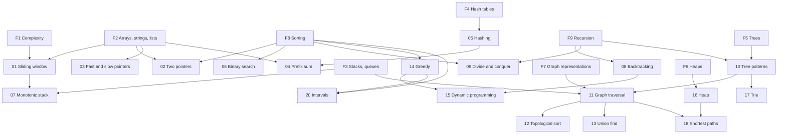

# Learning Roadmap

This page tells you what to study, in which order, and how to know that you can move on. It lists only pages that exist in this knowledge base (KB). The [mastery tracker](mastery-tracker.md) defines the levels that this page uses (L1 to L6), and [My Progress](my-progress.md) is the sheet where you record your level for each topic.

## Which Interviews This KB Prepares You For

The KB targets backend software engineer interviews at product companies, for a candidate who codes in Java. The table shows each round and the state of the KB for it.

| Round | What the interviewer tests | KB subject | State |
|---|---|---|---|
| Coding (1 to 3 rounds) | You solve one or two unseen problems in 45 minutes and explain the solution | [DSA](dsa/README.md) | Complete. Pages in the lesson format are marked in the [DSA index](dsa/README.md) |
| Low-level design or machine coding | You design classes for a small system and write working code | [LLD](lld/README.md) | Complete |
| High-level design | You design a distributed system and defend the trade-offs | [HLD](hld/README.md) | Complete |
| Language and fundamentals | Java, the JVM, concurrency, databases, operating systems, networking | [Java](java/README.md), [Databases](databases/README.md), [Operating Systems](operating-systems/README.md), [Networking](networking/README.md) | Complete |
| API design and security questions | REST, authentication, common attacks | API Design, Security | Not written yet |
| Behavioral and project discussion | Your past work, conflicts, decisions | Behavioral | Not written yet |
| Debugging, testing, and code review | You read code, find the defect, and improve it | Engineering Practice | Not written yet |

For the three rows that are not written yet, the KB cannot prepare you. Use an outside source for them until their pages exist. The [interactive timeline](prep-timeline.html) names sources.

## The Six Stages

Each stage has an entry condition and an exit test. Do not use the calendar as the exit test. A stage ends when you pass its test.

| Stage | What you learn | Enter when | Exit test |
|---|---|---|---|
| 0. Tools | Java for problem solving, complexity analysis, the base data structures, recursion | You can write a loop, a method, and a class in Java | You pass the [Stage 0 check](#stage-0-check) below |
| 1. Core patterns | DSA patterns 01 to 08 | Stage 0 passed | L4 on each pattern, and [Milestone 1](mastery-tracker.md#milestone-assessments) passed |
| 2. Structures and search | Patterns 09 to 13, 16, 17, 20 | Stage 1 passed | L4 on each pattern, and Milestone 2 passed |
| 3. Optimization | Patterns 14, 15, 18, 19 | Stage 2 passed | L4 on each pattern, and Milestone 3 passed |
| 4. Design | LLD, then HLD, with the fundamentals subjects next to them | Stage 1 passed (LLD). LLD fundamentals read (HLD) | The LLD and HLD mock sets scored with their rubrics |
| 5. Interview conditions | Mixed, timed, spoken practice in every round type | L4 on all P1 topics | L6 on the P1 patterns, and Milestone 4 passed |

Stages 1 to 3 and stage 4 run at the same time in the [cross-subject study plan](study-plan.md). The stages order the topics inside each track. They do not say "finish all DSA before any design".

### Stage 0 Check

Answer each item without a page open. If you cannot, read the linked page first.

- [ ] I can state the time and space complexity of a loop nest and of a recursive method, and give the reason. ([Complexity Analysis](dsa/foundations/01-complexity-analysis.md))
- [ ] From the constraint `n <= 10^5`, I can say which complexity classes pass. ([How to Choose a Pattern, Step 1](dsa/how-to-choose-a-pattern.md#step-1-read-the-constraints))
- [ ] I can say what each of these costs and why: `ArrayList.add`, `ArrayList.remove(0)`, `HashMap.get`, `PriorityQueue.poll`, `ArrayDeque.push`. ([Java Toolkit](dsa/java-toolkit.md), [foundations](dsa/README.md#foundations))
- [ ] I can trace a recursive method on paper, frame by frame, and write one from a statement of what it returns. ([Recursion](dsa/foundations/09-recursion.md))
- [ ] I can reverse a linked list and do a level-order traversal of a binary tree in Java without a reference.

## DSA Topic Dependencies

An arrow from A to B means that B uses an idea that A teaches. Read A first. The numbers are the pattern numbers, and F0 to F9 are the [foundations](dsa/README.md#foundations) pages.

Patterns with one prerequisite or none in this graph: 19 (bit manipulation) needs only F1. Pattern 23 (math) needs [F0](dsa/foundations/00-math-for-complexity.md).

The patterns 21 to 28 extend earlier patterns:

| Pattern | Read first | Reason |
|---|---|---|
| [21 Segment tree and Fenwick tree](dsa/21-segment-tree-and-fenwick-tree/README.md) | 04, 09 | It answers range queries that a prefix sum cannot answer after an update. It splits a range in halves |
| [22 String algorithms](dsa/22-string-algorithms/README.md) | 05, 17 | Rolling hash extends hashing. KMP and tries both avoid comparing a prefix again |
| [23 Math and number theory](dsa/23-math-and-number-theory/README.md) | F0 | It uses modular arithmetic and counting |
| [24 Advanced graphs](dsa/24-advanced-graphs/README.md) | 11, 13, 18 | Minimum spanning trees use union find. Strongly connected components extend DFS |
| [25 Matrix and simulation](dsa/25-matrix-and-simulation/README.md) | F2, 11 | Grid traversal is graph traversal on an implicit graph |
| [26 Design data structures](dsa/26-design-data-structures/README.md) | F4, F6, 03 | Each design combines a hash map with a list or a heap |
| [27 Advanced DP](dsa/27-advanced-dp/README.md) | 15, 19 | Bitmask DP stores a set in the bits of an integer |
| [28 Randomized algorithms](dsa/28-randomized-algorithms/README.md) | F0, F8 | It uses probability and the partition step of quicksort |

The arrows show what a page needs, not the only valid order. The [DSA study plan](dsa/study-plan.md) is one order that respects the arrows.

## Dependencies Between Subjects

| Read this | Before this | Reason |
|---|---|---|
| [Java Language Core](java/01-language-core.md), [Collections Internals](java/04-collections-internals.md) | DSA patterns, LLD | Every solution and every design is Java code |
| [OOP](lld/fundamentals/01-oop.md), [SOLID](lld/fundamentals/02-solid.md) | LLD patterns and case studies | The patterns are applications of these principles |
| [Processes and Threads](operating-systems/01-processes-and-threads.md), [Synchronization](operating-systems/03-synchronization.md) | [Concurrency Basics](java/07-concurrency-basics.md), [Concurrency in LLD](lld/fundamentals/09-concurrency-in-lld.md) | Java locks and thread states are built on the operating system mechanisms |
| LLD fundamentals | HLD | You must be able to design one service before you design many |
| [Indexing](databases/03-indexing.md), [Transactions and Isolation](databases/04-transactions-and-isolation.md) | [Choosing a Database](hld/fundamentals/04-choosing-a-database.md), [Replication](hld/fundamentals/05-replication.md), [Consistency and CAP](hld/fundamentals/07-consistency-and-cap.md) | HLD trade-offs assume that you know what one database node does |
| [TCP and UDP](networking/03-tcp-and-udp.md), [HTTP](networking/04-http.md), [DNS](networking/06-dns.md) | [Load Balancing, DNS, and CDN](hld/fundamentals/02-load-balancing-dns-cdn.md), [Communication Patterns](hld/fundamentals/09-communication-patterns.md) | A load balancer and a CDN operate on these protocols |
| DSA [F4 Hash Tables](dsa/foundations/04-hash-tables.md), [F5 Trees](dsa/foundations/05-trees-and-balanced-bsts.md) | [Indexing](databases/03-indexing.md), [Partitioning and Sharding](hld/fundamentals/06-partitioning-and-sharding.md) | A B-tree index and consistent hashing are these structures at a larger scale |

The cross-subject plan orders the fundamentals subjects after the design tracks start. If an HLD page uses a database or network idea that you do not know, stop and read the page in this table first.

## Essential and Advanced Topics

Each page has a priority in its front matter and in its subject index. The roadmap uses the priorities this way:

| Priority | Meaning | When to study |
|---|---|---|
| P1 | The topic is part of the base syllabus of its round | Every path includes it |
| P2 | The topic appears in some interviews, or it matters on the job | After L4 on the P1 topics of the same subject |
| P3 | The topic is useful on the job | When a role asks for it |

For DSA, patterns 01 to 20, 23, 25, and 26 are P1. Patterns 21, 22, 24, 27, and 28 are P2. The priorities are the judgment of the KB authors. The KB has no data on how often a company asks a topic.

## Learning Paths

Choose the path that matches your start point. Each path uses the same pages in a different order and with a different depth.

### Path A: From the Start to Interview-Ready (about 21 weeks at 20 hours each week)

Use this path if you have not practiced DSA for more than a year, or if you fail the [Stage 0 check](#stage-0-check).

1. Stage 0: week 0 of the [DSA study plan](dsa/study-plan.md). Read foundations F1 to F9 in order. Do not skip [Recursion](dsa/foundations/09-recursion.md).
2. Follow the [cross-subject study plan](study-plan.md) week by week. It runs DSA, one design track, and one fundamentals track at the same time.
3. Apply the [study loop](mastery-tracker.md#the-study-loop-for-one-topic) to each topic. Record your level in [My Progress](my-progress.md) each week.
4. Take each [milestone assessment](mastery-tracker.md#milestone-assessments) when you reach its stage. If you fail one, repeat the weak patterns before you move on.

### Path B: Intermediate, Strengthen the Weak Areas (4 to 8 weeks)

Use this path if you pass the Stage 0 check and you have solved problems before, but your results in interviews or mocks are not stable.

1. **Diagnose first.** Do the [recognition drills](dsa/how-to-choose-a-pattern.md#part-5-recognition-drills) and one [mixed set](mastery-tracker.md#mixed-sets) under time. Do not study before this step.
2. **Classify each failure** with the [weak-area log](mastery-tracker.md#the-weak-area-log): recognition, approach, implementation, edge cases, complexity, or communication.
3. **Repair by class, not by problem.** A recognition failure sends you to [How to Choose a Pattern](dsa/how-to-choose-a-pattern.md) and to the "Recognition Guide" and "Tell Them Apart" parts of the pattern page. An approach failure sends you to the "Derivation" section: rebuild the technique from the brute force without the page. An implementation failure sends you to the "Implementation" and "Common Mistakes" sections, and you write the code again from an empty file.
4. Set every pattern in [My Progress](my-progress.md) to its real level. Work on the P1 patterns that are below L4, in the order of the [dependency graph](#dsa-topic-dependencies).
5. Repeat step 1 each week with a new mixed set.

### Path C: Experienced Engineer, Focused Revision (3 to 4 weeks at 10 to 15 hours each week)

Use this path if you have passed such interviews before and you need to return to form.

| Week | Coding | Design | Fundamentals |
|---|---|---|---|
| 1 | The "Quick Reference Card" and the "Mastery Checklist" of each P1 pattern. For each unchecked item, do the page's practice ladder from the first problem that you cannot solve | [How to Approach an LLD Interview](lld/how-to-approach-lld.md), [LLD cheatsheet](lld/cheatsheet.md), two case studies under time | [Java question bank](java/interview-question-bank.md): answer aloud, mark the misses |
| 2 | One [mixed set](mastery-tracker.md#mixed-sets) each day | [How to Approach an HLD Interview](hld/how-to-approach-hld.md), [estimation](hld/back-of-envelope-estimation.md), [HLD cheatsheet](hld/cheatsheet.md), three case studies under time | The pages behind your misses, then the [Databases question bank](databases/interview-question-bank.md) |
| 3 | [Mock interviews](dsa/mock-interviews.md), spoken, with the rubric | [LLD mock sets](lld/practice-and-mock-interviews.md) and [HLD mock sets](hld/practice-and-mock-interviews.md) | [OS question bank](operating-systems/interview-question-bank.md), [Networking question bank](networking/interview-question-bank.md) |
| 4 | Company-style sets from [Company Prep](dsa/company-prep.md) | Full mock loops | The misses from weeks 1 to 3 |

### Path D: Limited Time

These plans trade coverage for depth on the topics that the other topics depend on. They do not make you ready for every round. Each plan states what it leaves out.

**Two weeks, coding rounds only (about 40 hours).** Patterns 01, 02, 05, 06, 08, 10, 11, 15, 16, in this order, two days for pattern 15 and one day for each other pattern. For each pattern: the "Derivation" section, the first four problems of the practice ladder, and the "Tell Them Apart" pairs. Pattern 16 is not a lesson page yet: for it, read [Heaps](dsa/foundations/06-heaps.md) and the pattern page's templates, and solve its first four Medium problems. Days 13 and 14: two [mixed sets](mastery-tracker.md#mixed-sets) each day. This plan leaves out patterns 03, 04, 07, 09, 12 to 14, 17 to 28, and every design and fundamentals topic.

**Six weeks, all rounds (about 120 hours).**

| Weeks | Coding (60%) | Design and fundamentals (40%) |
|---|---|---|
| 1–2 | Patterns 01 to 08 | LLD: [approach](lld/how-to-approach-lld.md), [OOP](lld/fundamentals/01-oop.md), [SOLID](lld/fundamentals/02-solid.md), [creational](lld/fundamentals/06-creational-patterns.md) and [behavioral](lld/fundamentals/08-behavioral-patterns.md) patterns, 3 case studies |
| 3–4 | Patterns 10, 11, 12, 13, 14, 16, 20 | HLD: [approach](hld/how-to-approach-hld.md), [estimation](hld/back-of-envelope-estimation.md), fundamentals 01 to 08, 4 case studies |
| 5 | Pattern 15, then 18 | The P1 pages of Java 04, 07, 08 and Databases 03, 04 |
| 6 | Mixed sets and mocks | Mock sets for LLD and HLD, the question banks |

This plan leaves out patterns 09, 17, 19, and 21 to 28, the P2 pages of every subject, and most case studies.

### Path E: One Round Type

| Goal | Order |
|---|---|
| Coding rounds | Stage 0, then the [DSA study plan](dsa/study-plan.md), then [mixed sets](mastery-tracker.md#mixed-sets) and [Mock Interviews](dsa/mock-interviews.md) |
| Machine coding and LLD | [Java Language Core](java/01-language-core.md), then the [LLD track](study-plan.md#lld-track) |
| System design | The [Databases track](study-plan.md#databases-track) weeks 2 and 3, [TCP and UDP](networking/03-tcp-and-udp.md), [HTTP](networking/04-http.md), then the [HLD track](study-plan.md#hld-track) |
| Java and backend fundamentals | The [Java track](study-plan.md#java-track), then the [Databases track](study-plan.md#databases-track), then the [OS and Networking track](study-plan.md#os-and-networking-track) |

## When to Practice, Revise, and Take Mocks

| Activity | When | Rule |
|---|---|---|
| Learn a new topic | Each study day | Follow the [study loop](mastery-tracker.md#the-study-loop-for-one-topic). Attempt before you read the solution |
| Topic practice | The same day and the next day | The page's practice ladder, with the hints closed until you have worked for 15 minutes |
| Revision | On the dates in [My Progress](my-progress.md) | Recall first, then check. See [the revision schedule](mastery-tracker.md#the-revision-schedule) |
| Mixed practice | From the end of stage 1, two sessions each week. Daily in stage 5 | Problems without a pattern label ([mixed sets](mastery-tracker.md#mixed-sets)) |
| Timed practice | From stage 2 | 25 minutes for a Medium problem, 40 minutes for a Hard problem. Stop at the limit and record the result |
| Spoken mock interview | From stage 3, one each week. Three each week in stage 5 | Speak aloud for the whole session. Score with the rubric of the round |
| Milestone assessment | At each stage exit | Fixed conditions, pass or fail ([milestone assessments](mastery-tracker.md#milestone-assessments)) |

## Questions This Page Answers

The sections named in the right column ("Prerequisites", "Practice Problems", "Mastery Checklist", "Next Topics") exist on the lesson pages: DSA patterns 01 to 15 and the Recursion page. For every other page, use the subject index for the order, the page's `??? question` blocks for practice, and the level tests of the mastery tracker.

| Question | Where to look |
|---|---|
| What do I study today? | The next unchecked row of your path, or the earliest review date in [My Progress](my-progress.md). A review that is due comes before new material |
| What must I already know? | The "Prerequisites" section of the page, and the [dependency graph](#dsa-topic-dependencies) |
| Where do I learn a missing prerequisite? | The link in the "Where to learn it" column of the page's "Prerequisites" table |
| What do I practice after this topic? | The page's "Practice Problems", then its "Next Topics" |
| How do I know that I have mastered it? | The page's "Mastery Checklist" and the level tests in the [mastery tracker](mastery-tracker.md#the-six-levels) |
| Where do I revise it later? | The page's "Quick Reference Card", then one problem from its ladder that you have not solved in the last month |
